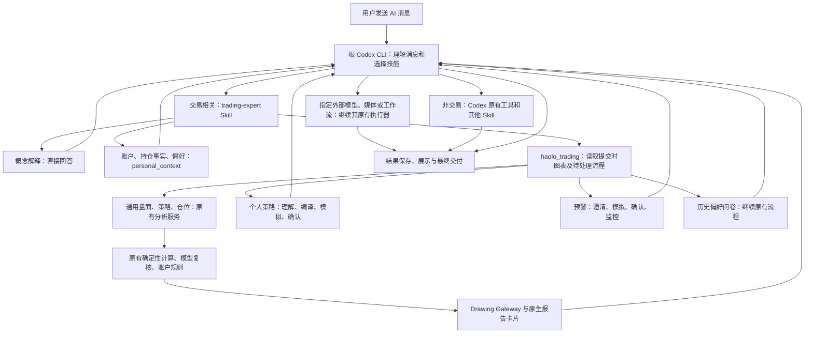

# Codex 统一入口与交易专家 Skill 验收记录

任务：M1-400 / ADR-050。日期：2026-10-20。

本次交付是客户端源码、开发构建及本机 CLI 更新，没有生成或发布新的客户端安装包，没有修改云端 API/Worker。

## 消息链路

- 普通执行、交易会话、指定模型问答、媒体、群聊 AI、客户端 AI 渠道请求及自动任务均由 Codex 接收消息。
- 工作流新增 Codex 入口处理。冻结画布保留节点、版本和拓扑；交易结果传给原节点。需要用户澄清/确认时不会继续启动画布模型。
- 删除发送前的交易语义分类及交易消息拦截。策略列表实时读取现有目录，包括个人策略；策略引擎和云端协议继续复用。
- 仓位管理保留独立响应模式，保留账户事实、交易偏好、左侧/右侧/自动策略、现有硬校验。图表和不画线请求均保留。
- 无图表的会话可按明确品种/市场调用原有云端分析；不会借用其他会话正在显示的图表。

## 实现边界

独立 Skill 位于 `resources/default-haolo-ai/skills/trading-expert/SKILL.md`。

根 Codex 通过本机 stdio MCP 调用 `haolo_trading`，MCP 再访问带认证的本机 Host 桥。Host 绑定当前账户、窗口、会话、轮次、真实用户文字及提交时图表；模型只拿到本轮不透明的 `context_id`。

选择 MCP 的原因是 0.163.0 的原生动态工具只在 `thread/start` 提供，不能在已有会话 `resume` 时补装；MCP 已通过真实 CLI 的旧会话恢复测试。没有使用不兼容的动态工具恢复参数。

- 图表、模拟 K 线及附件按提交时固定；上传完成后更新附件路径。
- 同一可见群聊的交易操作依次执行；不同会话保持隔离。
- 自动重试保留原上下文和成功操作结果，更新能力标识；中途补充消息使用真实的新文字。
- 取消、超时、切换账户和过期调用不会继续使用旧能力。原生卡片进入 Codex 的工具结果，重开可恢复；指定模型会话也接收并保存这些卡片。
- 个人策略使用真实行情窗口；缺失时读取明确的币安市场，取不到有效数据则失败，不用空 K 线生成零价格结果。
- 外部模型仍执行原有受控任务，没有因此获得 CLI 的系统权限。

## CLI 升级

官方稳定版本核验为 [Codex CLI 0.163.0](https://github.com/openai/codex/releases/tag/rust-v0.163.0)，发布于 2026-10-15。

| 位置 | 更新前 | 更新后 |
|---|---|---|
| 本机 npm Codex CLI | 0.160.1 | 0.163.0 |
| 客户端内置运行时 | 0.157.1 | 0.163.0 |

Windows 官方发布包 SHA-256：

`dabdb4d16aaf10fea40b74811c96efddcd9138f122163b69ed604fcb3eb704c3`

验证了 47 个运行文件的哈希、所需 OpenAI Authenticode 签名及实际 `--version` 输出。保留官方资源目录、Code Mode Host、语音依赖及许可证；补全安装资源映射和 Git LFS 规则。仅适配 `codex-package.json` 的入口名为客户端原有 `haolo_ai.exe`，可执行文件保持官方签名。

升级脚本：`scripts/update-codex-runtime.ps1`。它重新解压经摘要验证的包，校验版本/签名，备份旧运行时，复制并复验，失败恢复备份。

本次备份保存在 `output/codex-first-20261020/runtime-0.157.1-backup/` 和 `output/codex-first-20261020/global-cli-0.160.1/`。这些本机备份不是安装包资源。

## 验证和限制

- 真实内置 CLI + 真实 MCP/Host 传输：新会话、非交易消息不调用交易工具、交易工具调用、工具错误、旧会话恢复、原生卡片持久化。
- 客户端链路：策略目录、仓位标志、现货市场、无图表分析、图表会话隔离、附件、个人策略、预警真实确认、取消、群聊串行、自动恢复和中途补充。
- 指定模型/媒体：Codex 先执行，原模型、媒体、计费与文件授权元数据继续保留。
- 工作流：Codex 入口先于画布模型；冻结图不重规划；结果传递、等待确认及取消经过回归验证。
- `final-chains.log`：106 项链路/工作流/运行时重点测试全部通过。
- TypeScript、Vite 构建和 Skill 格式校验通过。Vite 仍提示现有主资源包体积较大。
- 最新全量回归 `regression-delivery.log`：4,422 项，4,391 通过、31 失败。18 项已用初始源码 `25a24b1` 在内存加载复现（样式、翻译、额度展示、图表菜单、订单流与指数预加载）；1 项来自其他会话删除的偏好提示文案；12 项在本轮共享卡片新增 `separateAction` 后出现，涉及聊天、保存与悬浮卡片 HTML 一致性。本次未改这些卡片模块，也未回退并行改动。
- 在最后一批卡片并行改动前，完整回归为 4,419 项中 4,400 通过、19 失败，记录在 `regression-accepted.log`。本次新增的冻结画布 3 项在后续 106 项重点回归中全部通过。
- 当前工作区并非全绿，不能据此宣称全部业务已无问题。其他会话改动继续保留；后续合并/发布前需解决这些失败并使用真实账号联调。

真实 CLI 测试的模型响应和云端分析由本地测试服务提供，因此验证的是协议和业务衔接，不代表真实在线模型的所有语义判断都已验证。交易 Skill 的自动选择由模型完成；新增边界表达仍需持续用真实账号验收。本次没有执行真实下单、创建生产预警、发布安装包，也不以自动化测试声称所有业务绝对不会出问题。
