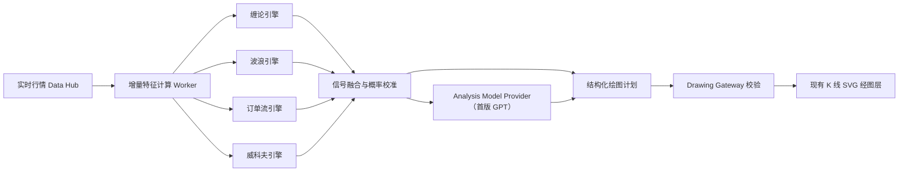

# 交易专家实时 AI 盘面分析执行方案

> Mac 当前任务：`M6-MAC-183-20261030`，0.1.183 Universal 正式签名包已完成公证及桌面交付。基于已复查的 7abf228，构建源码 2285d36；全量 6,190 通过／0 失败／12 平台跳过，公司 Developer ID、Apple Accepted、附票、Gatekeeper 和系统分发检查通过。详见 [0.1.183 交付记录](mac-release-0.1.183-20261030.zh-CN.md)。以下其他平台发布记录为上游历史，不代表本会话官网／生产部署授权或 Mac 已上线；平台流程以本地 AGENTS.md 为准。

2026-10-29 L10N-ALL-003（本端源码与本地复查完成）：英语／繁体／韩语／日语／越南语共 2,640 个唯一页面布局组合最终通过，完整回归 5,969 项、末次文案专项 10 项通过；大字号自选裁字、历史英文误译及邀请奖励／日语术语已修复。其他会话差异保留，仅本任务源码提交／推送，不部署、发布、关机或打开可见应用。详见 [五语言复查记录](all-language-review-20261028.md)。

2026-10-28 L10N-VI-001-R1（本端源码与本地验收完成）：修复旧云端回执／便笺／图表恢复与 renderer 夹具，保留完整冻结正文、金额、价格和单次动作断言。完整回归 5,966 项全部通过，0 失败／跳过；类型检查和构建通过。英越 22 个页面／面板、三种缩放、四档字号、双主题共 1,056 状态及 160 下拉状态全部通过，六语言重启保持和 30 次双向切换通过；2,960 字体样本无裁切。末次专业术语调整后另建本地构建，越南语全部 22 面板 88 状态／20 下拉状态及 12 项语言专项再次通过。共享未提交新功能保留，HEAD renderer 兼容验证 49 项通过。详见 [本轮跨端记录](../../../haolo_front_web3/docs/vietnamese-regression-review-20261028.md)。本次仅源码提交／推送，不部署／发布，不启动可见应用；关机已取消。

2026-10-27 L10N-VI-001（源码与本地专项验证完成，本批仅提交／推送）：新增专业越南语 vi／vi-VN，与简英繁韩日共六语言。设置与账号同步、界面／动态提示／无障碍标签、计划／预警／绘图／分享／便利贴、模型输出、Chrome 面板、语音及更新说明接通；价格与协议保持。已完成专项和英越布局复查，完整证据及全量旧测试失败边界见 [越南语验收记录](../../../haolo_front_web3/docs/vietnamese-localization-20261027.md)。本次仅推送源码，不部署／发包；此后用户已取消关机，不再执行该历史安排。

2026-10-27 RELEASE-182-20261027（已完成）：Windows 0.1.182／Android 0.1.13+14 已正式发布并延续强制更新，源码与版本均已推送各自origin/dev。两端签名、包内版本、旧版／当前版检查、完整公网下载摘要及精确客服知识激活通过；正式ASAR的真实模型计划／隔离授权操作16项通过。Android已按规范保留数据覆盖安装开发签名0.1.13+14，真实前台及设备摘要一致。Windows上传504通过只读核验恢复原记录，无重复上传。完整源码SHA、失败记录与平台边界见 [本批发布记录](windows-release-0.1.182-20261027.md)。本批未部署后端或网关，iOS未签名构建。

2026-10-27 M1-463D-R2（源码已提交、后端已部署）：本端回滚源码 `77f471f04904581e4f2185a2d792d7a509e1cac2` 已推送origin/dev；后端API/Ideas和独立Worker均部署 `bddf77eb0b4468b60e78f55eeaf802c088cecb54`，回执complete，旧概率任务自然完成后交接，用户明确要求不再等待后主动结束最后1个旧API长连接，各1188文件和同步概率门槛检查通过，API／Worker稳定观察及最终复核零5xx和流式错误。本轮未发布新客户端安装包，正式更新渠道仍为原版本。完整范围、备份及验收见规范后端docs/backend-probability-rollback-release-20261027.md；下方未提交／未部署表述为前一阶段历史记录。

2026-10-27 M1-463D-R1／PROBABILITY-ASYNC-ROLLBACK-001（定点回滚及深度复查完成）：按用户截图撤销新异步概率任务、补充轮询、计划下气泡及取消50%门槛，恢复原同步评估和严格大于50%展示。复查用失败对照确认并修正三项：保留已发布历史ready估算的只读恢复及结果哈希／计划绑定校验，保留删除历史／撤销授权时清理旧概率资源和任务，保留Windows日语文案；均不启动异步模型或轮询。正常分析恢复、冻结绘图提前交付、自选同步、概率卡元信息精简、客服和发布修复保留。Windows193个不同用例、移动160项通过，类型／Dart／Windows隔离构建及客服双生成器一致性通过；后端98通过，另1项auto模式旧夹具失败已以HEAD原代码复现，未放宽校验。环境内存／C盘临时空间失败日志保留，释放本任务空闲进程并改D盘临时输出后复测通过。Android已保留数据覆盖安装0.1.12+13，2026-10-27 11:02:35 +08:00核验PID3598、真实前台焦点、宿主OpenGL、设备／本地APK 120c53ceae4102af6abb1b6b1f6b9a72561072d5205f324aaf2e56cbd2a6936a一致，构建输入未变、启动异常0。未使用Computer Use，iOS原生及生产未验收；未提交、推送、部署或正式发包。原M1-463D决策作废，历史与发布证据保留。证据见三个仓库.cache/probability-rollback-review-20261027；后续部署须按既有SSH控制器核对旧概率任务排空及API／Worker真实版本。

2026-10-27 RELEASE-181-20261027（已完成）：用户已授权六端最新源码提交远端 dev，部署后发布 EV 签名 Windows 0.1.181 与递增的 Android 正式包，均强制更新；全部验收成功后关机。当前工作焦点已完成：生产服务终态、签名安装包、官网强制更新及下载摘要均已核对。Windows 产品候选为 910f8507；后台及官网候选为 8faa92f9；Android 产品候选为 9d42b15a。发布前已通过 Windows 专项 30 项及类型检查、内置运行时 47 文件与第三方签名校验；生产上线与最终安装包结果另行追加，不以候选构建代表完成。

2026-10-27 M1-463D／PROBABILITY-ASYNC-001（本地源码与验收完成，未生产发布）：主结果先成功，概率独立补充；Windows与Android/iOS均在计划下显示“模型正在分析盈利概率...”气泡，完成后替换，失败／等待耗尽结束气泡。所有有效0%至100%结果展示，覆盖旧的50%门槛。移动绘图可见2秒→正文渐进→计划顺序保持，补充不改主busy／streaming、不重播绘图正文。后端89通过；Windows专项12通过、扩大回归225通过及10条HEAD同样复现的既有威科夫便利贴比较失败，类型／构建／40组界面通过；移动414回归及最终26项交互通过、分析器无问题。Android已于03:33保留数据覆盖安装0.1.11+12，PID2927、焦点和本地／设备APK哈希一致，当前异常检查为0。此会话未提交、推送、生产部署或发布正式安装包。详见概率补充验收记录。

2026-10-26 WYCKOFF-DUAL-20261026（已完成：源码与专项验收，尚未生产启用）：用户要求仅优化威科夫，已确认箱体破位后提供独立多空条件卡，原卡片样式不变。后端按冻结原生箱体生成回测延续／收回反转条件，Windows与移动仅拆分展示及绑定独立提醒。协议由能力协商开启，历史回执保持。Windows262项、后端最终105项、移动1698项相关回归通过，Windows类型／隔离构建与Android本机覆盖安装验收完成。6条BTC箱顶失败已定位并修复新增镜像测试对共享历史数据的污染，原价格断言及生产算法未改。当前交接焦点：配套版本发布及生产验收，未在本任务执行。实现决策及证据见 docs/wyckoff-dual-plan-20261026.zh-CN.md；尚未提交、发布或部署。

2026-10-26 L10N-JA-002（源码与回归完成，未部署／发布）：已逐项核销上轮测试失败，补齐日语云端回执、18类策略标题、原生／历史计划解析与系统模板动态字段，并同步后端引擎及移动绘图弹窗。Windows全量5651项、类型检查与构建通过，日英176页面状态／40选择控件／2960字体样本通过；移动全量7343通过、6项依赖专用夹具跳过、0失败。词典重新盘点无缺项，保留价格校验、用户原文及原性能阈值。具体终态与提交边界见docs/japanese-localization-20261026.md；本轮仍不部署、不发布。

2026-10-26 L10N-JA-001（源码已完成，未部署／发布）：Windows、移动端、官网／业务后端及邀请后台已增加专业日语和日本語设置，并串联账号设置、接口和模型语言。日语专项、跨端布局和英语审查完成；全量套件中其他任务的差异单独记录。正在核对源码提交推送，详见docs/japanese-localization-20261026.md。

2026-10-24 MODEL-DISPLAY-001：本地完成用户选择模型展示修复，当前焦点为跨端消费展示验收。会话和云端请求保留原始选择，兜底／运行时设置不覆盖；消费API与下载共用持久化选择，DeepSeek实际执行与计费分离。简英繁、移动双平台双主题回归及独立数据库验证见规范后端`docs/selected-model-display-20261024.md`。本次未部署、发布客户端或提交其他会话改动；原始选择缺失的历史数据不猜写。

> 文档状态：已冻结的实施基线
> 创建日期：2026-08-08
> 最近更新：2026-10-27
> 当前里程碑：M2 统一 Data Hub 与增量特征层
> 总体状态：M2 进行中（M2-013 生产基础设施验收受阻）
> 当前工作焦点：M6-MAC-183-20261030 / 已完成：0.1.183 Universal 公司 Developer ID 签名、Apple 公证、附票及正式门禁通过，最终 DMG 已交付桌面，附校验和／构建记录／客服快照。独立工作树及原安装保留；未上传官网或启用更新。
> 适用仓库：`D:\youle_desktop\youle_desktop`（桌面端）、`D:\youle_agent_ms`（业务后端）、`D:\zhongzhuan`（统一模型中转）

## 1. 文档用途与持续更新规则

本文是“交易专家实时 AI 盘面分析”唯一的长期执行基线，同时承担实施计划、架构决策、验收标准和进度记忆四个职责。后续任何相关开发、审查、测试或发布工作开始前都必须先阅读本文；工作结束前必须回写本文的任务状态和进度日志。

更新规则：

1. 使用本文定义的稳定任务编号，不用临时口头描述替代任务状态。
2. 开始一项任务时，将状态改为 `进行中`，并填写“当前工作焦点”。
3. 只有代码、必要测试和验收证据均完成时才能标记 `已完成`。
4. 任务被设计或外部依赖阻塞时标记 `受阻`，记录阻塞条件、已经验证的事实和解除条件。
5. 每次工作结束都在“进度日志”追加一条记录；历史记录只追加，不覆盖。
6. 如果实现需要偏离本文冻结架构，必须先在“架构决策记录”增加 ADR，写明原因、影响、替代方案和批准状态。
7. 不使用虚构完成百分比。总体进度以已通过验收的任务和里程碑为准。

状态枚举：`未开始 | 进行中 | 受阻 | 已完成 | 已取消`。

## 2. 目标契约

### 2.1 最终交付物

在现有交易专家 K 线工作区内建设可持续运行的实时 AI 盘面分析系统。系统能够基于缠论、艾略特波浪、威科夫和订单流产生可复现的结构化分析，融合为带证据、失效条件和历史校准的市场情景，并通过现有 K 线绘图能力自动落图。

### 2.2 成功标准

1. AI 绘图使用真实市场时间和价格坐标，缩放、拖动、切换主题后保持正确定位。
2. 缠论、波浪、威科夫和订单流分别形成版本化、可测试的独立引擎，不能只依赖大模型自由解释。
3. Analysis Model Provider 只消费结构化市场事实、规则和候选结果，不把截图识别作为主分析链路；2026-10-24 用户确认托管推理统一为 `deepseek-flash / low`，普通与旗舰档位一致，模型异常不切 GPT（MODEL-ONLY-20261024，覆盖旧兜底规则；本地源码完成，尚未部署）。
4. 大模型输出必须经过 JSON Schema、权限、市场版本、坐标范围和对象数量校验后才能进入画布。
5. 用户手工绘图与 AI 绘图完全分层；AI 不覆盖用户绘图，也不污染用户撤销/重做栈。
6. 所有结构区分 `暂定`、`确认`、`失效`，不得在后续行情到来时无痕修改历史判断。
7. 涨跌概率来自无未来数据泄漏的历史回测和校准，不采用大模型自报置信度冒充概率。
8. 数据、分析、绘图、模型和错误事件均带稳定 ID、版本、时间和证据，可回放、可审计。
9. 亮色与暗色主题同时交付，覆盖默认、悬停、选中、焦点、展开、加载、禁用、过期和错误状态。
10. 关闭功能开关后，现有交易专家对话、行情、指标和手工绘图行为保持不变。
11. AI 落图默认使用虚拟 AI 光标逐对象、逐线段播放，用户能观察绘制过程；不得在等待结束后整批瞬间出现。

### 2.3 禁止事项

- 第一版不自动下单、不连接交易账户、不生成可直接执行的订单。
- 不让 GPT 或外部模型直接操作 DOM、SVG、`localStorage`、行情连接或系统权限。
- 不把全部逐笔成交、盘口快照或数千根原始 K 线反复发送给模型。
- 不把外部模型 API Key 写入 Renderer、日志、聊天、源码或普通配置文件。
- 不用普通 OHLCV 数据伪装成订单流；数据源不足时必须明确降级。
- 不以知识库代替确定性算法、行情数据、回测或概率校准。
- 不把新增实现继续堆入超大的 `src/renderer/main.ts` 或 `src/main/main.mjs`。
- 不通过合成真实鼠标/指针事件制造拟人效果，不让 AI 动画进入用户手工绘图的撤销栈。

## 3. 首发范围与后续范围

### 3.1 首发验证范围

- 市场：Binance 永续合约。
- 品种：`BTCUSDT`、`ETHUSDT`。
- 主分析周期：15 分钟、1 小时、4 小时。
- 预测周期：未来 3、6、12 根目标周期 K 线。
- 理论：缠论、波浪、威科夫、订单流四个引擎全部进入融合链路。
- 绘图：理论结构、关键区间、主/备选情景、支撑压力、目标位和失效位。
- 交互：实时分析开关、图层管理、实时结论卡、结构解释、手动刷新、过期提示。
- 运行模式：只分析、自动绘图和提醒；不包含交易执行。

### 3.2 非首发范围

- A 股、美股、外汇等缺少统一深度或逐笔方向数据的真实订单流。
- 自动下单、策略托管、资金管理、仓位同步和交易所账户授权。
- 用户自定义脚本语言、策略市场和公开策略排行榜。
- 大规模在线模型训练和个性化模型微调。

这些能力需要独立目标、数据授权、安全设计和发布验收，不能从本方案自动扩大范围。

## 4. 冻结架构



固定分工：

| 层 | 责任 | 不负责 |
|---|---|---|
| Market Data Hub | 连接数据源、标准化时间与市场身份、缓存和重连 | 理论判断、绘图 |
| Feature Worker | 增量计算摆动点、波动率、成交量、CVD、深度等事实 | 自然语言结论 |
| Theory Engines | 按版本化规则输出候选结构、证据与失效条件 | 最终概率、直接绘图 |
| Fusion/Calibration | 融合信号，产出市场状态和经回测校准的概率 | 自由叙事 |
| Analysis Model Orchestrator | 通过 Provider Registry 处理歧义、主备情景、理论冲突和用户解释 | 绑定具体模型厂商、直接写画布、计算逐笔流 |
| Drawing Gateway | 校验、限流、版本并发控制、生成受信任绘图补丁 | 推理行情 |
| Renderer | 展示、主题、交互、用户控制 | 持有模型凭证、签发权限 |

### 4.1 过渡策略

当前 Binance REST/WebSocket 和 K 线数组主要位于 Renderer。为避免一次性重写现有行情：

1. M1 先增加严格的只读 `MarketSnapshot` 导出桥，复用当前行情，打通端到端绘图链路。
2. M2 建立主进程 `TradingMarketDataHub`，由主进程统一管理订阅、重连、缓存和多周期数据。
3. Renderer 改为 Data Hub 的只读订阅者，分析 Worker 与图表共享同一行情事实源。
4. 迁移验收完成后删除临时 Renderer 快照桥，不能长期保留双数据源。

## 5. 数据和时间语义

### 5.1 市场身份

所有协议使用稳定 `marketId`，不得仅用 `symbol`。至少包含：

- `provider`：数据提供方；
- `venue`：交易场所；
- `marketType`：现货、永续或其他；
- `symbol`：交易标的；
- `interval`：目标周期；
- `priceTick`、`quantityStep` 和计价币种。

`BINANCE:FUTURES:BTCUSDT` 与 `BINANCE:SPOT:BTCUSDT` 必须被视为不同市场。

### 5.2 时间语义

- 协议、存储、分析和绘图锚点一律使用 UTC Unix 时间。
- 中国时区偏移只在 Renderer 显示阶段应用。
- 每根 K 线明确携带 `openTime`、`closeTime` 和 `closed`。
- 暂未收盘 K 线参与盘中候选分析，但不得作为历史回测中的已知终值。
- 所有分析结果记录 `snapshotTime`、`lastClosedBarTime` 和输入摘要哈希。

### 5.3 数据覆盖

K 线基础数据：OHLCV、成交笔数、主动买/卖量（数据源支持时）、标记价格、指数价格、资金费率、持仓量。

订单流增强数据：逐笔成交方向、盘口深度与增量、最佳买卖价、爆仓、持仓量时间序列和可验证的多空相关数据。

每个数据字段都要带覆盖状态：`available | delayed | partial | unavailable`。订单流数据不完整时，订单流引擎返回 `insufficient_data`，融合层降低覆盖度而不是编造结论。

## 6. 核心协议

所有跨模块对象必须携带 `schemaVersion`。以下为语义基线，实施时固化为 TypeScript/JSON Schema，并在主进程边界重复校验。

### 6.1 MarketSnapshot

```ts
interface MarketSnapshot {
  schemaVersion: 1;
  snapshotId: string;
  marketId: string;
  interval: string;
  snapshotTime: number;
  lastClosedBarTime: number;
  candles: Candle[];
  stats: MarketStats;
  orderFlow?: OrderFlowWindow;
  coverage: DataCoverage;
  inputHash: string;
}
```

要求：

- 同一 `snapshotId` 内容不可变。
- K 线按时间升序、去重、有限数值和合法价格校验。
- 发送给 GPT 的不是完整逐笔数据，而是 TheoryResult、聚合特征和必要的有限 K 线窗口。

### 6.2 TheoryResult

```ts
interface TheoryResult {
  schemaVersion: 1;
  resultId: string;
  engineId: "chan" | "elliott" | "wyckoff" | "order_flow";
  engineVersion: string;
  snapshotId: string;
  status: "succeeded" | "insufficient_data" | "failed";
  structures: TheoryStructure[];
  signals: TheorySignal[];
  evidence: Evidence[];
  invalidations: InvalidationCondition[];
  confidence: ConfidenceAssessment;
}
```

`confidence` 表示本引擎对结构识别的可靠程度，不等于市场上涨概率。

### 6.3 AnalysisPlan

```ts
interface AnalysisPlan {
  schemaVersion: 1;
  analysisId: string;
  revision: number;
  snapshotId: string;
  marketId: string;
  interval: string;
  regime: "trend_up" | "trend_down" | "range" | "transition" | "unknown";
  primaryScenario: Scenario;
  alternateScenarios: Scenario[];
  probabilityForecasts: ProbabilityForecast[];
  theoryViews: TheoryView[];
  drawingPatch: DrawingPatch;
  narrative: AnalysisNarrative;
  expiresAt?: number;
}
```

### 6.4 DrawingPatch

```ts
interface DrawingPatch {
  schemaVersion: 1;
  analysisId: string;
  baseRevision: number;
  marketId: string;
  interval: string;
  operations: Array<
    | { op: "upsert"; drawing: AiDrawing }
    | { op: "remove"; drawingId: string }
  >;
}
```

每个 `AiDrawing` 至少包含：稳定 ID、理论图层、工具类型、时间价格锚点、语义颜色、状态、证据引用、置信度、失效条件和生成来源。

## 7. Drawing Gateway 与图层设计

### 7.1 独立图层

绘图状态至少分为：

- `manual`：用户手工绘图；沿用当前撤销/重做和持久化语义。
- `ai/chan`：缠论。
- `ai/elliott`：波浪。
- `ai/wyckoff`：威科夫。
- `ai/order-flow`：订单流。
- `ai/consensus`：综合情景、目标和失效位。

AI 绘图默认锁定、不可直接拖动。用户选择“复制为手工绘图”后生成新的 manual ID，脱离 AI 分析版本。

### 7.2 校验规则

Drawing Gateway 必须在主进程或受信任 Host 边界执行：

1. Schema、协议版本和必需字段完整。
2. `marketId`、`interval`、`analysisId` 和 `baseRevision` 与当前会话一致。
3. 工具只来自批准白名单；点数符合工具定义。
4. 时间、价格和数值有限，预测锚点处于允许的未来窗口。
5. 单对象点数、单补丁操作数、总 AI 对象数和文本长度受限。
6. 颜色使用语义 Token，不接受任意 CSS、HTML 或 SVG 片段。
7. 迟到修订、旧市场、旧周期和已失效分析不能覆盖当前结果。
8. 应用补丁是幂等操作，同一分析修订重复到达不产生重复绘图。
9. 拒绝事件返回机器可读错误并记入审计，不把模型原始内容渲染为 HTML。

### 7.3 绘图状态

- `tentative`：虚线、较低不透明度，表示盘中或未满足确认规则。
- `confirmed`：实线和正常不透明度。
- `invalidated`：灰化并保留历史；用户可选择隐藏失效结构。
- `stale`：输入行情已经超过有效期但尚未产生新分析。

### 7.4 拟人化逐笔绘制播放

AI 落图默认不得在等待结束后整批瞬间出现。Drawing Gateway 必须先完整校验绘图补丁，再由 Renderer 的 `AiDrawingPlaybackController` 将受信任补丁转换为逐项、逐段、逐帧的播放计划，使用户看到类似分析师操作画布的过程。

固定原则：

1. 不伪造浏览器 `PointerEvent`，不调用手工绘图的点击/拖拽事件处理器，避免污染用户选择状态、撤销栈和输入焦点。
2. 使用独立的 AI 虚拟光标、点击涟漪和 SVG 几何插值表现“移动 → 落点 → 拖动/连线 → 完成”。
3. 每次完整 DrawingPatch 校验通过后才开始播放；不能一边解析不完整的模型 JSON 一边落图。
4. 确定性引擎先完成的图层可以先播放，不必等待 GPT 叙述；GPT 综合图层在完整校验后接续播放。
5. 播放顺序按语义固定为：基础结构 → 理论关键点 → 区间/通道 → 目标与失效位 → 主/备选情景 → 文字标注。
6. 模型只能建议语义优先级，不能指定任意毫秒时长、缓动函数、CSS 或光标行为；具体时序由本地受信任控制器归一化。
7. 每完成一个对象才把它提交为该分析修订的稳定绘图；正在播放的半成品只存在于临时展示状态。

不同工具的默认表现：

| 工具类型 | 播放方式 |
|---|---|
| 趋势线、射线、水平线、箭头 | 光标移动到起点，落点后终点沿路径平滑延伸 |
| 折线、缠论笔、波浪计数 | 按锚点逐段连接，每段完成后短暂停顿 |
| 矩形、中枢、威科夫区间 | 从第一角拖动到对角，边框和填充同步展开 |
| 通道、斐波那契 | 先绘基准锚点，再逐级显示派生线和标签 |
| 预测路径、主备情景 | 从当前价格向未来区域逐段延伸，最后显示概率/失效标签 |
| 文本与标记 | 光标定位后以短打字效果或受控淡入显示 |

播放控制和中断语义：

- 默认显示 AI 虚拟光标和“AI 正在绘制”状态；用户可以暂停、继续、调速或点击“立即完成”。
- “立即完成”只跳过展示动画，仍应用同一份已校验补丁，不能绕过 Gateway。
- 用户切换市场、周期或关闭 AI 图层时，立即取消当前临时动画并清除半成品，不把它提交为完成对象。
- 新 revision 在旧 revision 播放时到达，控制器在当前对象的安全边界终止旧队列，丢弃旧半成品，再从最后已提交状态计算新补丁；旧 revision 不得继续覆盖新结果。
- 用户正在手工绘制或拖动手工对象时，AI 播放暂停，避免视觉光标和真实操作竞争；结束后从安全边界继续。
- `prefers-reduced-motion` 或应用的减少动态效果设置生效时，缩短移动和拖动动画，保留明确的分步淡入，不以闪烁或大幅光标运动呈现。
- 每帧只更新临时几何，不写持久化；只记录播放开始、对象完成、暂停、跳过、被新 revision 取代、取消和全部完成事件。

默认节奏由本地策略配置：单个简单对象约 250–700ms，多点结构按段增量播放；标准密度的一轮分析应在保持可观察的前提下自适应压缩，目标总播放时间约 3–10 秒。对象很多时提高速度或按语义组连续播放，不能让陈旧分析长时间占用画布。

## 8. 理论知识库

### 8.1 目标

知识库不是向模型灌输百科，而是冻结 Haolo 采用的定义、流派、参数、确认规则、失效规则、绘图语义和争议处理方式，使同一输入在不同时间得到可解释的一致结果。

建议目录：

```text
resources/trading-knowledge/
  manifest.json
  shared/
    glossary.zh-CN.md
    evidence-schema.json
    drawing-semantics.json
  chan/v1/
    rules.yaml
    examples.jsonl
    counterexamples.jsonl
  elliott/v1/
    rules.yaml
    examples.jsonl
    counterexamples.jsonl
  wyckoff/v1/
    rules.yaml
    examples.jsonl
    counterexamples.jsonl
  order-flow/v1/
    rules.yaml
    examples.jsonl
    counterexamples.jsonl
```

要求：

- 内容使用原创归纳、获授权或可合法使用的材料，不大段复制受版权保护的书籍。
- 每条规则有稳定 ID、版本、定义、输入要求、确认条件、失效条件和示例引用。
- GPT 每次只接收与当前结构相关的规则片段及其 ID，不倾倒整个知识库。
- 知识库升级创建新版本；历史分析保留当时使用的规则版本。

### 8.2 四个规则包

缠论 v1：包含关系、标准/非标准分型、笔、线段、中枢、走势类型、背驰和买卖点；明确递归级别与未完成结构处理。

波浪 v1：摆动点、推动浪硬规则、调整浪结构、交替原则、比例参考、主/备计数和失效位；软指南不能伪装成硬规则。

威科夫 v1：交易区间、PS/SC/AR/ST、Spring/UTAD、SOS/SOW、LPS/LPSY、量价努力结果和阶段候选；事件标签必须附证据。

订单流 v1：主动买卖方向、CVD、成交失衡、盘口失衡、吸收、衰竭、爆仓和持仓量联动；每个判断注明数据覆盖和阈值来源。

## 9. 确定性分析引擎

统一接口：

```ts
interface TheoryEngine {
  describe(): TheoryEngineManifest;
  analyze(snapshot: MarketSnapshot, context: EngineContext): TheoryResult;
}
```

### 9.1 公共特征层

统一计算并缓存：摆动高低点、ATR、趋势斜率、成交量分位数、VWAP、价差、波动率状态、成交量扩张/收缩、主动成交差、CVD、OI 变化和盘口失衡。相同特征不能由四个引擎各自重复实现。

### 9.2 缠论引擎

流水线：K 线包含处理 → 分型 → 笔 → 线段 → 中枢 → 走势类型 → 背驰/买卖点候选。所有中间结构保留来源 K 线索引和规则 ID。

### 9.3 波浪引擎

使用公共摆动点生成有限候选计数，先执行硬规则剪枝，再用软指南排序。必须输出主计数、最多两个备选计数及各自失效点，禁止只保留一个看似确定的答案。

### 9.4 威科夫引擎

先识别趋势或交易区间，再根据价差、成交量、测试行为和突破质量生成事件与阶段候选。事件没有足够证据时标记候选，不强行命名。

### 9.5 订单流引擎

以滑动窗口增量维护逐笔、CVD、深度、爆仓和 OI 特征。订单流只对数据源覆盖的时间范围给结论；断线恢复后需要标记缺口，不能把缺口前后数据直接视为连续。

## 10. 信号融合与 Analysis Model Provider 边界

### 10.1 机器融合

融合层先于 GPT 工作，输出：

- 当前市场状态；
- 各理论方向、强度、覆盖度和冲突矩阵；
- 关键支撑、压力、目标、失效位；
- 历史校准后的不同预测周期概率；
- 数据不足或理论不适用标志。

### 10.2 模型中立输入

Provider 输入采用单次完整但紧凑的结构化上下文：

- 当前用户问题与显示周期；
- MarketSnapshot 摘要；
- 四个 TheoryResult；
- 融合和概率结果；
- 本次相关规则片段与规则 ID；
- 当前画布 AI 图层摘要；
- 输出 Schema、权限和禁止事项。

不发送全部逐笔成交或无关历史文件。当前生产跨厂商 Transport 没有被验证为真实增量计费，因此不能用伪 stateful 多轮不断重放大上下文。

### 10.3 模型中立输出

Analysis Model Provider 负责：主情景、备选情景、理论冲突解释、用户可读叙述和建议的 DrawingPatch。首版由 `gpt-5.6-sol` 适配器实现；模型自报置信度只能作为语义证据之一，不能直接成为涨跌概率。

任一 Provider 输出都先形成不可信 `ProposedAnalysisPlan`，由 Host 完成 Schema 和业务校验后才形成受信任 `AnalysisPlan`。

### 10.4 模型和权限

- 交易专家根分析默认使用项目指定的 `gpt-5.6-sol`。
- Codex 保持默认且唯一的根编排和最终采纳权。
- 外部模型若参与，只能返回分析建议，不获得绘图、文件、Shell 或系统写权限。
- 实际绘图由本地 Drawing Gateway 按窄能力执行；模型不持有 Renderer 或系统权限。
- 生产模型流量继续通过 `D:\youle_agent_ms` 和 `D:\zhongzhuan` 的集中链路，桌面不持有厂商上游 Key。

## 11. 概率、回测与防未来泄漏

### 11.1 标签定义

对未来 3、6、12 根 K 线分别定义三分类结果。初始基线可使用波动率归一化阈值：

- 未来收益大于 `+k × ATR`：上涨；
- 未来收益小于 `-k × ATR`：下跌；
- 其他：震荡。

`k` 不在产品代码硬编码；按市场、周期和训练窗口在校准配置中版本化。

### 11.2 校准原则

- 使用 walk-forward 或 expanding-window，禁止随机打乱时间序列造成泄漏。
- 未收盘 K 线不得以终值参与历史特征。
- 特征、规则和模型版本必须与回测记录绑定。
- 在样本不足前界面显示“信号强度”，不显示伪精确概率。
- 概率和结构识别置信度分别展示。
- 上涨、下跌和震荡概率之和必须为 100%，同时展示样本量、覆盖期和最近校准时间。

### 11.3 发布门槛

- Brier Score 必须优于无条件频率基线。
- 校准误差、分类覆盖、最大回撤情景和不同市场状态表现必须进入报告。
- 不以单次收益或少数截图作为有效性证据。
- 达不到发布门槛时保留结构分析功能，但关闭“概率”展示。

## 12. 实时触发与性能

触发分层：

- Tick/盘口：本地 Worker 以 100–500ms 节流增量更新；不调用 GPT。
- 盘中结构：关键结构发生变化时更新暂定图形。
- K 线收盘：确认结构、运行四理论融合，必要时调用 GPT。
- 事件触发：突破失效位、区间边界、订单流异常或数据恢复时重新分析。
- 用户触发：手动刷新、追问或切换主要分析周期。

性能目标：

- 本地特征和绘图增量更新 P95 小于 1 秒。
- K 线收盘后的本地四引擎结果 P95 小于 3 秒。
- GPT 综合分析目标 P95 小于 10 秒；超时不阻塞本地结构更新。
- Drawing Gateway 接受补丁后 150ms 内出现首个可见绘制反馈，不能继续停留在无反馈等待状态。
- 拟人化播放使用 `requestAnimationFrame`，目标 60fps；每帧不进行持久化、全量 Schema 校验或重新计算理论结构。
- 300 个可见 AI 绘图对象下，常规缩放和拖动保持流畅，不因分析阻塞 UI 线程。
- 所有高频计算放入 Worker 或主进程计算边界，不占用 Renderer 主线程。

## 13. 产品交互

### 13.1 图表控制

- 顶部“AI 实时分析”总开关。
- 状态：监听中、分析中、已更新、数据不足、已过期、连接中断和错误。
- 图层：综合、缠论、波浪、威科夫、订单流。
- 密度：精简、标准、完整。
- 绘制速度：0.5×、1×、2×；默认 1×。
- 操作：暂停/继续绘制、立即完成、刷新、隐藏失效结构、清除当前 AI 视图、复制为手工绘图。
- AI 虚拟光标必须与系统真实鼠标明显区分，并带“AI”标识，不能让用户误以为真实鼠标被接管。

### 13.2 实时结论卡

右侧交易专家对话区域顶部展示：

- 市场状态与数据时间；
- 未来 3/6/12 根 K 线的上涨/下跌/震荡概率或信号强度；
- 主情景和备选情景；
- 支撑、压力、目标和失效位；
- 四理论一致度、数据覆盖和规则版本；
- “为什么这样判断”的可展开证据。

### 13.3 主题要求

所有新增 UI 使用交易专家局部语义变量，例如 `--trading-ai-bull`、`--trading-ai-bear`、`--trading-ai-tentative`、`--trading-ai-stale`，分别为亮色和暗色定义。不能把只适合白底的浅色、阴影或图标颜色写死在组件中。

主题验收覆盖默认、hover、active/selected、focus、open、loading、disabled、stale、invalidated 和 error；同时检查文字、图标、边框、菜单、弹层、表单、开关、图层 Chip、图形透明度、AI 虚拟光标和点击涟漪。亮暗主题都必须保证虚拟光标可见且不遮挡 K 线价格信息。

## 14. 代码模块边界

建议结构：

```text
src/main/trading-analysis/
  protocol.mjs
  model-provider.mjs
  app-server-provider.mjs
  chan-engine.mjs
  chan-pipeline.mjs
  market-data-hub.mjs
  snapshot-store.mjs
  analysis-runtime.mjs
  drawing-gateway.mjs
  knowledge-loader.mjs
  probability-calibrator.mjs
  theory/
    common-features.mjs
    chan.mjs
    elliott.mjs
    wyckoff.mjs
    order-flow.mjs
  workers/
    feature-worker.mjs

src/renderer/
  trading-expert-ai.ts
  trading-expert-ai-view.ts
  trading-expert-ai-playback.ts
  trading-expert-drawing.ts
  trading-expert-market.ts

resources/trading-knowledge/
test/fixtures/trading-analysis/
test/trading-analysis-*.test.mjs
```

`src/renderer/main.ts` 和 `src/main/main.mjs` 只增加装配和窄 IPC 入口；业务逻辑必须位于独立模块。

## 15. 测试与验收矩阵

| 测试层 | 必须覆盖 |
|---|---|
| 协议测试 | Schema 版本、无效数值、旧修订、错误市场、对象限额、幂等 |
| 单元测试 | 四引擎规则、公共特征、时间聚合、概率标签、颜色 Token |
| 黄金样例 | 每种理论的标准案例、反例、争议案例和专家共识 |
| 回放测试 | 固定行情事件流得到相同结构、ID、状态变化和绘图补丁 |
| 集成测试 | WebSocket/REST → Snapshot → Engines → Fusion → Gateway → Renderer |
| 播放测试 | 虚拟光标、各工具插值、语义顺序、暂停/继续、立即完成、取消、新 revision 取代和 reduced-motion |
| 断线测试 | 重连、缺口、乱序、重复事件、迟到 GPT 响应和切市场 |
| 性能测试 | 高频 Worker、300 个对象、切周期、缩放和长时间运行 |
| 主题回归 | 亮色/暗色及全部交互状态的截图或 DOM/CSS 契约 |
| 安全测试 | Prompt 注入、HTML/SVG 注入、任意颜色、越界坐标和权限绕过 |
| 回测审计 | 无未来泄漏、版本绑定、基线对比、校准和样本覆盖 |

任何里程碑在相应测试未通过前不得标记完成。

## 16. 可观察性与故障降级

每次分析至少记录：`traceId`、`snapshotId`、`analysisId`、revision、市场、周期、引擎版本、规则版本、模型、触发原因、耗时、数据覆盖、结果状态和错误分类。模型原始大响应保存为受控 Artifact 引用，不直接写普通日志。

降级顺序：

1. GPT 不可用：继续展示确定性引擎和上次有效叙述，标记“AI 综合暂不可用”。
2. 某理论数据不足：从融合中降权并明确显示覆盖不足。
3. 订单流断线：保留 K 线理论，订单流图层标记过期并停止输出新信号。
4. Drawing Gateway 拒绝：不改变当前画布，记录机器可读错误并允许重新分析。
5. 全部行情不可用：冻结最后有效视图并显示时间，不继续生成新判断。

## 17. 风险清单

| 风险 | 应对 |
|---|---|
| 缠论和波浪流派差异 | 知识库冻结口径，规则版本化，展示备选情景 |
| 模型幻觉或绘图注入 | Schema + Drawing Gateway + 工具白名单 + Host 执行 |
| 结构重绘导致误导 | 暂定/确认/失效状态与不可变分析修订 |
| 订单流数据不完整 | Coverage 契约、缺口标记和 `insufficient_data` |
| 概率被理解为保证 | 历史校准、样本信息、风险提示和无自动下单 |
| 高频计算卡顿 | Worker、增量算法、RAF 合并和对象上限 |
| 拟人动画拖慢新分析 | 自适应时长、安全边界中断、新 revision 取代和立即完成 |
| AI 光标干扰真实操作 | 独立展示层、禁止合成 PointerEvent、手工操作时自动暂停 |
| 模型调用成本过高 | 事件触发、紧凑完整上下文、缓存和本地优先 |
| 未来数据泄漏 | UTC/收盘语义、walk-forward、回放审计测试 |
| 亮暗主题割裂 | 同一任务同时实现两主题并加入回归测试 |
| 当前工作区改动较多 | 小切片、避免覆盖无关改动、逐模块验证 |

## 18. 里程碑与详细任务台账

### M0：架构、规则和契约基线

| ID | 任务 | 状态 | 依赖 | 完成证据 |
|---|---|---|---|---|
| M0-001 | 核对现有行情、绘图、模型和主题实现 | 已完成 | 无 | 2026-08-08 代码盘点 |
| M0-002 | 冻结混合架构、目标契约与首发范围 | 已完成 | M0-001 | 本文第 2–4 节 |
| M0-003 | 建立长期执行文档与进度台账 | 已完成 | M0-002 | 本文 |
| M0-004 | 在 `AGENTS.md` 登记持久读取与回写要求 | 已完成 | M0-003 | `AGENTS.md` 持久记忆入口与 2026-08-08 校验记录 |
| M0-005 | 固化 MarketSnapshot/TheoryResult/AnalysisPlan/DrawingPatch Schema | 未开始 | M0-002 | 协议模块与契约测试 |
| M0-006 | 定义 Feature Flag、错误分类、审计字段和本地存储迁移 | 未开始 | M0-005 | 配置与测试 |
| M0-007 | 创建四理论规则模板、词汇表和版权来源规范 | 未开始 | M0-002 | knowledge 目录与校验 |
| M0-008 | 冻结拟人化逐笔落图、虚拟光标和中断语义 | 已完成 | M0-002 | 本文 7.4、ADR-005 与 2026-08-08 记录 |

M0 退出条件：协议、规则模板、错误和功能开关均有自动化测试；关闭开关时旧行为无变化。

### M1：AI 自动绘图纵向切片

| ID | 任务 | 状态 | 依赖 | 完成证据 |
|---|---|---|---|---|
| M1-001 | 导出/适配当前绘图模型，建立 manual 与 AI 图层 | 未开始 | M0-005 | 单元测试 |
| M1-002 | 实现 Drawing Gateway 校验、幂等和 revision 控制 | 未开始 | M0-005 | 安全与协议测试 |
| M1-003 | 实现临时 Renderer MarketSnapshot 只读桥 | 未开始 | M0-005 | 集成测试 |
| M1-004 | 使用固定 Fixture 生成模拟 TheoryResult 和 DrawingPatch | 未开始 | M1-002,M1-003 | 端到端演示 |
| M1-005 | 实现 AI 总开关、状态和图层控制 | 未开始 | M1-001 | UI 测试 |
| M1-006 | 实现亮色/暗色全部状态 | 未开始 | M1-005 | 主题回归 |
| M1-007 | 实现“复制为手工绘图”和独立撤销语义 | 未开始 | M1-001 | 交互测试 |
| M1-008 | 实现 AiDrawingPlaybackController 和工具几何插值 | 未开始 | M1-001,M1-002,M1-004 | 动画单元/回放测试 |
| M1-009 | 实现 AI 虚拟光标、涟漪、绘制状态和速度控制 | 未开始 | M1-005,M1-008 | 亮暗主题与交互测试 |
| M1-010 | 实现暂停/继续、立即完成、取消、revision 取代及 reduced-motion | 未开始 | M1-008,M1-009 | 中断与可访问性测试 |
| M1-011 | 以当前真实 K 线跑通经过 GPT-5.6 Sol 的缠论测试按钮纵向切片 | 已完成 | M0-005,M1-001,M1-002,M1-003,M1-008,M1-009 | `trading-analysis/*`、窄 IPC、测试按钮、AI 独立图层/光标、46 项专项通过、类型检查与生产构建通过 |
| M1-012 | 修复真实客户端点击“测试”后进入“重试”的运行时故障 | 已完成 | M1-011 | 根因是 `userMessage` 被误计为副作用；修复捕获分类并增加可见错误提示；真实 500 根 BTC 日线 + GPT 完整管线成功；46 项专项、类型检查、语法检查、生产构建通过 |
| M1-013 | 将缠论测试按钮升级为 `@策略:缠论` 对话式专家入口 | 已完成 | M1-012 | 已移除测试按钮；完成问答/截图/看盘意图分流、当前画布参数继承、按指令切换行情、对话进度、受控绘图与完整报告；74 项交易专家专项、类型检查、语法检查和生产构建通过 |
| M1-014 | 修复交易专家发送消息缺失、整页闪动与当前 K 线周期丢失 | 已完成 | M1-013 | 用户气泡和分析报告作为本地历史保留；进度改为局部更新对话区；临时任务升级正式 ID 时迁移同一行情工作区；交易专家及发送/分组相关 186 项测试、类型检查和生产构建通过 |
| M1-015 | 修复交易专家发送后输入残留并补齐标准思考状态气泡 | 已完成 | M1-014 | 发送后同步清空 textarea、草稿和 mention 高亮层；复用标准思考气泡展示准备行情、分析盘面、绘制结构、整理报告及耗时；交易专家 75 项与发送相关 111 项回归、类型检查和生产构建通过 |
| M1-016 | 在缠论最终报告中增加当下判断、涨跌情景概率和条件交易计划 | 已完成 | M1-015 | 已增加偏多/偏空/中性判断、25%–75% 审慎情景概率、结构来源的多空触发/失效/目标价、观望与风险条件；交易专家专项 76 项、类型检查、管线语法检查和生产构建通过 |
| M1-017 | 移除普通/升级模式按钮并由 `@自定义指标:趋势带` 双向同步趋势带 K 线 | 已完成 | M1-016 | 已删除按钮、事件和样式；标记出现时启用趋势带，普通删除、原子标记删除或发送清空时恢复原 K 线并保持视窗；77 项交易专家专项、类型检查、变更检查和生产构建通过 |
| M1-018 | 修复口语化缠论看盘误分流、当前 K 线丢失和内部提示词回显 | 已完成 | M1-017 | “帮我分析下/分析看看/研判下/复盘下”等表达进入专用看盘链路，缺省参数严格继承当前品种、周期和可见范围；内部专家提示词由统一消息清洗层隐藏；交易专家与历史消息专项 82 项、类型检查、变更检查和生产构建通过 |
| M1-019 | 用模型固定 JSON 路由替换缠论请求正则判断 | 已完成 | M1-018 | 新增只读 `gpt-5.6-sol` 路由、8 字段固定 JSON 契约、显式参数提取、0.65 置信度门槛和问答安全回退；移除缠论语义/参数正则；交易专家与消息发送共 123 项回归、类型检查、主进程语法检查和生产构建通过 |
| M1-020 | 修复模型路由等待期间交易专家输入框未清空 | 已完成 | M1-019 | 用户气泡登记后、等待路由模型前立即清空状态、草稿、匹配当前任务的 textarea 和 mention 覆盖层，正式任务升级后继续二次兜底；交易专家专项 82 项、类型检查和生产构建通过 |
| M1-021 | 修复缠论模型复核 180 秒超时后直接失败 | 已完成 | M1-020 | 超时改为结构化 `WORKFLOW_TURN_TIMEOUT/timeout`，模型活动会续期空闲看门狗，连续无进展时在原会话自动恢复；路由请求仍在 60 秒失败回退；增加脱敏诊断和中文超时回归，97 项相关测试、类型检查、主进程语法检查及生产构建通过 |
| M1-022 | 优化交易专家一级菜单到二级菜单的悬浮容错 | 已完成 | M1-013 | 接入级联菜单 180ms 延迟关闭并保留透明跨栏热区；补齐 `.submenu-open`、ARIA 展开态及亮暗主题契约；相关 30 项测试、类型检查和生产构建通过 |
| M1-023 | 将交易专家分析过程改为流式留存并在最终结果后折叠 | 已完成 | M1-015 | 每条进展作为独立 `commentary` 追加，运行中保持展开，最终报告/错误作为 `final_answer` 后复用普通执行折叠；核心 67 项、主题/流式 18 项、类型检查和生产构建通过 |
| M1-024 | 增加 K 线专业多点标注并约束文字框排版 | 已完成 | M1-011 | 每次输出 3–4 条综合判断/末笔/关键分型/中枢标注；AI 字号由 16px 缩至 12.8px，自动换行并约束框体/命中区；相关 65 项、类型检查和生产构建通过 |
| M1-025 | 对 AI 标注进行整组防碰撞和 K 线避让 | 已完成 | M1-024 | 12px 标注间距、8px 蜡烛避让、40px 顶部保护区；三角尾改为 1.2px 线段和锚点，缩放/平移后重排；相关 66 项、类型检查和生产构建通过 |
| M1-026 | 修复视窗外标注错位并改为 9px 无框文字 | 已完成 | M1-025 | 屏外锚点不参与布局且不进入渲染，末端笔绑定真实分型；9px 无框文字、连接线结束于首字并优先采用斜线；相关 66 项、类型检查和生产构建通过 |
| M1-027 | 将 AI 标注调整为 10px 并把缠论笔改为深灰色 | 已完成 | M1-026 | AI 标注统一为 10px；缠论笔亮色为 `#4b5563`、暗色为 `#9aa3b2`；相关 66 项、类型检查和生产构建通过 |
| M1-028 | 将缠论笔恢复为原紫色 | 已完成 | M1-027 | 亮色恢复 `#7b61ff`、暗色恢复 `#a994ff`；相关 66 项、类型检查和生产构建通过 |
| M1-029 | 将 AI 标注引线改为虚线并收紧文字行宽 | 已完成 | M1-028 | 确认/暂定标注统一虚线，单行最大宽度收紧为 200px；相关 66 项、类型检查和生产构建通过 |
| M1-030 | 为交易专家复用普通任务右侧会话栏收起/展开控制 | 已完成 | M1-023 | 复用 `rightCollapsed`、`toggle-right-panel`、面板图标及状态同步；布局与普通任务相关 61 项、类型检查和生产构建通过 |
| M1-031 | 复核当前缠论完整链路并以 `@策略:订单流` 跑通真实订单流纵向切片 | 已完成 | M1-030 | 完成真实 Binance 聚合成交/深度/OI、确定性 Delta/CVD/POC/成交簇/失衡引擎、模型中立复核、Gateway、AI 独立图层与拟人播放；15 项订单流+缠论专项、类型/语法检查、真实数据烟测和生产构建通过 |
| M1-032 | 以 `@策略:波浪理论` 跑通确定性波浪候选、模型复核和拟人落图纵向切片 | 已完成 | M1-031 | 完成摆动点、五浪推动/倾斜候选、ABC 调整、硬规则、斐波那契关系、主备计数、确认/失效、模型中立复核、`ai/wave` Gateway 与虚拟光标逐段落图；缠论+订单流+波浪 21 项专项、类型/语法检查、500 根实时 BTCUSDT 烟测和生产构建通过 |
| M1-033 | 将 ICT/SMC 市场结构体系并入 `@策略:订单流` 完整链路 | 已完成 | M1-031 | 完成 OB、FVG、BOS、CHoCH、MSS、Displacement、EQ、EQH/EQL、BSL/SSL、Sweep、Breaker、OTE 的多周期确定性候选、真实订单流窗口证据融合、模型中立复核和受控拟人落图；四理论 25 项专项、类型/语法检查、实时多周期烟测及生产构建通过 |
| M1-034 | 将 `@策略:波浪理论` 升级为完整 5 浪与 ABC/WXY 复合浪型计数 | 已完成 | M1-032 | 完成 `0-1-2-3-4-5 → A-B-C/W-X-Y` 完整周期、Zigzag/Flat/Expanded/Running Flat、Double Three、相对浪级、候选多样性保留、分段配色及 W/Y 内部子浪逐点标注；四理论 26 项专项、类型/语法检查、实时 BTCUSDT 烟测和生产构建通过 |
| M1-035 | 精简订单流/波浪盘面并输出新手可执行的条件式结论 | 已完成 | M1-033、M1-034 | 订单流绘图限制为 16 项内并按重要性保留转折、支撑/压力、上下流动性和最多一组微观证据；波浪只画主计数和短浪标；两类报告均输出确定性上破/跌破/回踩/反弹/等待区、第一目标、取消价及新手风控，四理论 26 项专项、实时烟测和生产构建通过 |
| M1-036 | 未点名理论时由模型判断是否优先分析左侧当前 K 线 | 开发完成，待用户实机验收 | M1-035 | 语义意图只由模型固定 JSON 路由判断，不使用关键词/正则判断语义；盘面请求未明确指定参数时继承左侧当前品种、周期和可见 K 线，进入独立通用价格结构引擎与 `ai/price-action` 受控拟人绘图层；83 项专项、类型/语法检查和生产构建通过，开发版已重启 |
| M1-037 | 将订单流与波浪绘图从过度精简调至中等复杂度且保持报告不变 | 已完成 | M1-035 | 订单流恢复第二层结构、双向区域、流动性、Sweep、EQ/OTE、POC 与两组成交证据，实时补丁 31 项；波浪恢复完整主计数、Fib、确认/失效和两条差异化备选路径，实时补丁 28 项；波浪结构折线强制实线，右侧报告与交易建议生成逻辑未改；87 项专项、实时烟测和生产构建通过 |
| M1-038 | 修复切换币种或 K 线周期后 AI 绘图丢失 | 已完成 | M1-037 | AI 图层按 `marketId + interval` 独立保存到本地；切换行情、取消播放和页面销毁只停止临时播放，不删除已完成图；同盘面新绘图通过 Gateway 后才替换旧图，分析失败保留上一版；62 项交易绘图/四理论专项、TypeScript 和生产构建通过 |
| M1-039 | 移除交易专家思考状态下方与消息气泡重复的灰色详情 | 已完成 | M1-023 | 交易专家阶段详情固定为空且空详情不生成 DOM；保留状态标签与已处理耗时，普通任务详情不变；35 项专项、TypeScript、变更空白检查和生产构建通过 |
| M1-040 | 将交易专家原仅在思考详情显示的首条执行文案补为进展气泡 | 已完成 | M1-039 | 通用盘面、缠论、订单流和波浪四条链路均通过统一 `updateProgress` 追加首条 commentary；37 项专项、TypeScript、变更空白检查和生产构建通过 |
| M1-041 | 修复实时订单流证据错投到历史 K 线并合并重复标签 | 已完成 | M1-037 | POC、成交失衡区和大额主动成交严格吸附到真实成交窗口所属执行 K 线；窗口与画布不重叠时禁止微观证据落图；同根 K 线同方向证据保留独立图形并合并文字标签；新增错投与聚合回归，64 项交易分析专项、TypeScript、变更空白检查和生产构建通过 |
| M1-042 | 修复订单流分钟级证据在小时画布被夹到左边界 | 已完成 | M1-041 | 微观证据不再使用 K 线内部分钟/秒时间作为 SVG 横坐标，统一使用对应执行 K 线开盘时间和整周期边界；订单流买卖/POC 标签引线限制在锚点 220px 内；新增 1H 成交窗口与标签距离回归，66 项交易分析专项、TypeScript 和生产构建通过 |
| M1-043 | 将订单流文字标注强制布局到结构箱体外侧 | 已完成 | M1-042 | Renderer 将当前可见订单流矩形转换为硬禁入区，订单流标签只从箱体外候选中布局并保留原锚点虚线引线；新增嵌套 FVG/OTE 箱体回归，67 项交易分析专项、TypeScript、主题审计和生产构建通过 |
| M1-044 | 严格复核波浪理论规则并审查 SOL 1H 实机计数 | 已完成 | M1-034 | 只读审查确认截图主计数不成立：波4对波3回撤 156.9% 且越过波3起点，既非标准推动浪也不满足倾斜三角形；定位到重叠即降级为 diagonal、cycle 丢失 motive 类型及缺少负例测试三项实现缺口；现有波浪专项 7/7 通过但未覆盖该违规形态 |
| M1-045 | 按波浪硬规则彻底修复推动浪、倾斜、截短与完整周期判定 | 已完成 | M1-044 | 波浪引擎 0.3.0 将父级锚点与低一级摆动证据分离，硬剪枝波2起点、波3推进/最短、波4全回撤/重叠、波5推进/严格截短及 5-3-5-3-5；倾斜必须显式位置、楔形和内部结构，当前无法证明父级位置时失败关闭；ABC/WXY 需内部结构证据，cycle 保留 motive 子类型；SOL 违规计数、倾斜、截短、调整浪和周期包装负例已覆盖，72/72 专项、类型/语法、双主题审计、实时 SOL/BTC 烟测及生产构建通过 |
| M1-046 | 以 `@策略:威科夫` 跑通区间、阶段、事件、模型复核和拟人落图纵向切片 | 已完成 | M1-045 | 完成确定性交易区间、量价努力结果、A–E 阶段、PS/SC/AR/ST/Spring/Test/SOS/LPS 与 PSY/BC/UTAD/SOW/LPSY 候选，模型中立复核、`ai/wyckoff` Gateway、盘面持久化、通俗条件价和拟人落图；122/122 交易专家专项、类型/语法、双主题、BTCUSDT 500 根 1H 实时烟测及生产构建通过，开发版已启动 |
| M1-047 | 波浪盘面无候选时自动扩大 K 线窗口直到可分析 | 已完成 | M1-045 | 仅对 `TRADING_WAVE_INSUFFICIENT_DATA` 从当前窗口倍增至已加载历史，仍不足时按 500 根补充更早 K 线，最多检查 2500 根；历史复盘不引入结束点后的 K 线，模型/网络/取消错误不重试；127/127 交易专项、TypeScript、生产构建及实时 BTCUSDT 4H 自动 `100→200→400` 烟测通过 |
| M1-048 | 按用户意图复用当前分析，按需重画并直接回答追问 | 已完成 | M1-036,M1-038,M4-007 | 首次完整分析继续生成原受控画线与固定完整报告；已有同品种/周期分析时，语义路由将依据/目标/风险/买卖条件等追问转为直接对话，刷新可重新计算但不替换原图，只有明确重画才播放新 Drawing Patch；通用价格行为、缠论、订单流/ICT-SMC、波浪、威科夫五条链路统一支持 `full/direct` 响应模式，Drawing Gateway 与确定性报告保持不变；135/135 相关专项、TypeScript、主进程/管线语法检查、双主题审计和 Vite 生产构建通过 |
| M1-049 | 修复副图开关后切换 K 线周期造成主图或副图缩放错乱 | 已完成 | M1-038 | 副图价格轴显式恢复自动缩放；关闭副图时先从 Lightweight Charts 数据层删除全部 Series，再清理 Pane，旧时间点不再污染后续周期；135/135 交易专项、TypeScript、生产构建、亮暗主题契约及两条开发版实机路径通过 |
| M1-050 | 将完整交易专家工作台迁入“新任务”主区域并移除智能体列表入口 | 已完成 | M1-049 | 顶层“新任务”创建与激活统一初始化完整交易专家行情、绘图、右侧功能栏和对话链路，同时保留应用导航与任务列表；原空白新任务界面不再出现在标准入口，智能体目录隐藏交易专家但保留历史线程兼容；146/146 相关专项、TypeScript、亮暗实机验收、变更空白检查和 Vite 生产构建通过 |
| M1-051 | 精简交易专家顶部栏并将交易对左移 | 已完成 | M1-050 | 移除“退出”按钮及其废弃事件链路，绘图栏不再显示右侧分隔线，交易对取消额外 42px 左内边距并贴齐原分隔线位置；146/146 相关专项、TypeScript、亮暗实机验收、变更空白检查和 Vite 生产构建通过 |
| M1-052 | 微调交易对水平位置并统一左右折叠按钮底部间距 | 已完成 | M1-051 | 交易对容器整体左移 10px，调整绘图栏堆叠上下文以完整显示越过原边界的币种图标；交易专家 Shell 将左折叠按钮顶距设为标题栏 42px + 行情栏 4px，与右折叠按钮保持相同底部间距；146/146 相关专项、TypeScript、亮暗实机验收、变更空白检查和 Vite 生产构建通过 |
| M1-053 | 精简任务侧栏并迁移交易专家功能分类 | 已完成 | M1-052 | 全局会话搜索的界面、状态、事件、索引、IPC、主进程回退模块及专用测试已完整移除，单会话内历史搜索继续保留；快捷新建菜单迁至“新任务”卡片右侧并保留全部原功能；任务/账户/预警/知识库成为左侧顶部唯一分类入口，“任务”显示任务会话列表，右侧原分类栏和任务刷新按钮已移除；119/119 相关专项与 1781/1781 全量回归、TypeScript、亮暗主题契约审计、变更空白检查和 Vite 生产构建通过，开发版保留运行供用户实机验收 |
| M1-054 | 对齐指标底栏并解耦左侧分类与右侧任务会话 | 已完成 | M1-053 | 指标底栏以完整 K 线区左边缘对齐；左侧分类只控制侧栏内容，右侧任务会话常驻；新增独立 K 线折叠开关；1781/1781 全量回归、67/67 折叠相关专项、TypeScript、亮暗主题契约和 Vite 生产构建通过 |
| M1-055 | 让画线工具栏随左侧任务栏响应式显隐 | 已完成 | M1-054 | 左栏展开时隐藏画线工具栏，折叠时恢复，画布与指标栏同步铺满和对齐；29/29 布局专项、TypeScript、亮暗主题契约和 Vite 生产构建通过 |
| M1-056 | 让行情顶栏随画线工具栏自适应对齐 | 已完成 | M1-055 | 画线工具栏隐藏时行情栏保留 42px 左侧控制区，恢复时取消额外占位；29/29 布局专项、TypeScript、亮暗主题契约和 Vite 生产构建通过 |
| M1-057 | 将任务/账户/预警/知识库设为聊天侧栏常驻分类 | 已完成 | M1-056 | 四分类在普通与交易专家会话中共用鼠标、键盘和可访问性链路；29/29 布局专项、1781/1781 全量回归、TypeScript、亮暗主题契约和 Vite 生产构建通过 |
| M1-058 | 恢复交易专家分组选择与双模型选择 | 已完成 | M1-057 | 分组选择器复用原任务逻辑；模型白名单限定 `gpt-5.6-sol` 与 `deepseek-v4-flash` 并按任务保存；82/82 相关专项、1781/1781 全量回归、TypeScript、亮暗主题契约和 Vite 生产构建通过 |
| M1-059 | 合并交易专家 K 线与会话折叠控制 | 已完成 | M1-058 | K 线与会话改为两栏交界处同组双按钮，左键控制 K 线、右键控制会话；组合入口在任一侧收起后仍可恢复，且禁止同时收起两侧；67/67 相关专项、TypeScript、亮暗主题契约、变更空白检查和 Vite 生产构建通过 |
| M1-060 | 将可见折叠入口改为极简方向图标 | 已完成 | M1-059 | 左侧栏、K 线和会话入口改为 12px 状态感知细线箭头；组合控件移除常驻面板轮廓、胶囊外框和组内分隔线，仅保留 hover/focus 淡背景；99/99 相关专项、全量回归、TypeScript、亮暗主题契约、变更空白检查和 Vite 生产构建通过 |
| M1-061 | 修复交易专家模型选项菜单被右侧面板裁切 | 已完成 | M1-058 | 模型定位层扩展到完整输入框、触发器保持原位、224px 菜单按输入框居中且窄宽度自适应；Sol/DeepSeek 分组与文字完整；44/44 模型/布局专项、TypeScript、亮暗主题契约、变更空白检查和 Vite 生产构建通过 |
| M1-062 | 将历史会话列表改为 Codex 式极简单行展示 | 已完成 | M1-061 | 新任务入口保持原样，历史会话压缩为 36px 单行标题并移除头像、摘要和时间；保留标题提示、分组、未读、运行中、完成提醒和更多菜单；76/76 相关专项、全量回归、TypeScript、亮暗主题契约、变更空白检查和 Vite 生产构建通过 |
| M1-063 | 按 Codex 信息架构重排完整会话侧栏 | 已完成 | M1-062 | 顶部按新对话/自动任务/连接渠道/创建群聊排列，新对话吸顶；会话置顶提升为全局区，项目使用文件夹标题且默认显示 5 条；删除加号菜单、空白画布创建与首版 Seed 链路；164/164 相关专项、757/757 全量回归、TypeScript、亮暗主题契约、变更空白检查和 Vite 生产构建通过 |
| M1-064 | 修复行情顶栏周期文字被折叠入口预留区裁切 | 已完成 | M1-060 | 周期控件保留 210px 最低可用宽度，收藏行情优先收缩；38/38 布局与主题专项、TypeScript、变更空白检查和生产构建通过，并在 150% 缩放、4 个收藏行情的亮暗主题下确认“5分”完整可见且不遮挡折叠按钮 |
| M1-065 | 将会话侧栏圈选导航整体左移 5px | 已完成 | M1-063 | 顶部四入口及置顶/项目分区标题通过共享外边距整体左移 5px；49/49 侧栏、交互与交易专家相关测试、TypeScript、亮暗主题审计、变更空白检查和 Vite 生产构建通过 |
| M1-066 | 修复交易对弹窗收藏行情缺少最新价和 24H 涨幅 | 已完成 | M1-064 | 弹窗优先复用 REST/WebSocket 实时行情，同 ID 无报价快照不能覆盖有效报价；行情、布局与双主题相关 59/59、TypeScript、变更空白检查和 Vite 生产构建通过 |
| M1-067 | 修复顶部与交易对弹窗收藏行情未实时变化 | 已完成 | M1-066 | 收藏行情改为直接组合流订阅，补充 12 秒静默超时重连、只在流静默时启用的 4 秒按交易对 REST 兜底、8 秒请求中止及低价币自适应精度；行情/布局与双主题专项 50/50、全量 1791/1791、TypeScript、变更空白检查和 Vite 生产构建通过 |
| M1-068 | 提升暗色 K 线价格轴对比度并将应用默认主题改为暗色 | 已完成 | M1-067 | 暗色主图/副图价格轴统一使用 `#dfe1e3`，主题热切换显式覆盖各价格轴文字色；Renderer、主进程偏好和原生窗口初始背景的无偏好默认值统一改为暗色，显式浅色偏好继续保留；主题/布局专项 39/39、全量 1792/1792、TypeScript、变更空白检查和 Vite 生产构建通过 |
| M1-069 | 将主图上涨 K 线及成交量上涨柱样式对齐 OKX 参考图 | 已完成 | M1-068 | 主图普通行情与趋势带的绿色蜡烛均使用透明实体、绿色描边/影线，红色蜡烛保持实心；成交量上涨柱为空心描边、下跌量柱为红色实心，MA5/MA10 默认 1px 并迁移旧默认值；行情/指标/主题专项 62/62、全量 1794/1794、TypeScript、变更空白检查和 Vite 生产构建通过 |
| M1-070 | 将全部涨跌柱改为 Binance 参考图的实心红绿色 | 已完成 | M1-069 | 主图、趋势带、成交量和 MACD 柱统一为实心 `#2EBD85` / `#F6465D`；旧指标颜色迁移到 v3；54/54 专项、1795/1795 全量、TypeScript、双主题审计、变更检查和生产构建通过 |
| M1-071 | 在历史会话中标记并恢复最后一次 AI K 线分析画布 | 已完成 | M1-063,M1-038 | 会话行与文件夹图标左对齐并加宽；亮暗主题显示最后一次分析的币种周期前缀；最后分析上下文按会话持久化、旧绘图反向迁移，点击会话恢复对应市场、周期和已保存绘图；73/73 专项、全量回归、TypeScript、双主题契约、变更检查和 Vite 生产构建通过 |
| M1-072 | 将左右面板分隔线改为可拖拽宽度调节 | 已完成 | M1-059,M1-060 | 左栏 192px、右栏 300px 改为硬下限；两条 12px 分隔命中区支持双竖线 hover/focus、指针拖拽、键盘调节、宽度持久化和窗口收敛；33/33 布局专项、TypeScript、双主题契约、变更检查和 Vite 生产构建通过 |
| M1-073 | 打通行情三点菜单、七类图表设置与 1–9 窗分屏 | 已完成 | M1-064,M1-070 | 三点菜单只提供设置/分屏；七类设置直接驱动真实主图并持久化；22 种 1–9 窗布局使用独立真实行情、品种和周期；64/64 专项、TypeScript、双主题实机/契约审计、变更检查和 Vite 生产构建通过 |
| M1-074 | 修复对数与百分比坐标切换后 K 线消失或压缩 | 已完成 | M1-073 | 线性坐标继续按可见 K 线固定绝对价格范围；对数/百分比坐标清除旧范围并启用原生自动缩放，主图与分屏一致；65/65 专项、TypeScript、变更检查和 Vite 生产构建通过 |
| M1-075 | 消除辅助分屏定时刷新闪动并统一主辅图表视觉 | 已完成 | M1-073,M1-074 | 后台轮询不再显示加载遮罩；无变化不重绘、尾部变化增量更新、瞬时失败保留旧图并继续重试；主辅图共用币种图标渲染和行情栏控件规格，OHLC/坐标文字同步；69/69 专项、全量回归、TypeScript、双主题审计、变更检查和 Vite 生产构建通过 |
| M1-076 | 修复竖向分屏主行情栏跨越独立窗格 | 已完成 | M1-073,M1-075 | 分屏时将主行情栏动态移入主图网格单元，主辅窗格分别裁切工具栏、行情数据、图表和弹层；分屏期间隐藏画布/会话收起控制，切回单屏自动恢复；47/47 专项、TypeScript、双主题审计、变更检查和 Vite 生产构建通过 |
| M1-077 | 统一分屏首窗与其他窗格的自定义周期菜单 | 已完成 | M1-073,M1-076 | 2–9 分屏时首窗复用辅助窗同一紧凑周期菜单样式与周期数据，支持相同选中、hover、active、focus、disabled 和关闭交互；切回单屏恢复完整周期编辑器；与 M1-078 合并验证通过 |
| M1-078 | 确保任意分屏状态下分屏选择器完整可见 | 已完成 | M1-073,M1-076 | 选择器打开时提升为行情工作区直属浮层，按实际触发窗格自动水平收敛、上下翻转和限制滚动高度，关闭/选择后归位；50/50 专项、TypeScript、双主题审计、变更检查和 Vite 生产构建通过 |
| M1-079 | 为所有辅助分屏提供完整交易对搜索选择器 | 已完成 | M1-073,M1-075,M1-078 | 辅助窗复用首窗搜索框、表头、行情行与币种图标，搜索覆盖完整币安永续/现货目录并支持无分隔符交易对、平台和类型关键字；当前品种置顶、单窗结果最多 120 条，行情目录异步完成后原地同步所有分屏而不重建图表；52/52 专项、TypeScript、双主题审计、变更检查和 Vite 生产构建通过 |
| M1-080 | 更新会话侧栏的新建入口与交易专家项目显示文案 | 已完成 | M1-063,M1-065 | “新对话”改为“新任务”；交易专家项目仅将侧栏可见标题映射为“最近”，内部身份与旧会话识别保持不变；44/44 相关测试、TypeScript、主题审计、变更检查和 Vite 生产构建通过 |
| M1-081 | 让共用画线工具作用于任意独立分屏 | 已完成 | M1-073,M1-075,M1-076 | 左侧工具状态在所有窗格共享，绘制、选择、缩放、撤销、重做、锁定、隐藏与清空按最后操作窗格路由；每个辅助窗拥有独立 SVG 绘图层、图表坐标系、历史栈和会话存储，布局切换会安全回到首窗且不串图；86/86 交易专家专项、TypeScript、双主题审计、变更检查和 Vite 生产构建通过 |
| M1-082 | 让一次交易专家分析在所有可见分屏独立计算并落图 | 已完成 | M1-038,M1-073,M1-081 | 通用、缠论、波浪、威科夫和订单流分析在首窗完成后，以最多两个并发工作器读取每个可见辅助窗自己的市场、周期和 K 线范围，经原 Drawing Gateway 生成独立补丁并在所属画布拟人播放；单窗失败保留原图且不阻塞其他窗，144/144 专项通过 |
| M1-083 | 分屏且会话栏收起时在首窗周期栏末尾提供展开入口 | 已完成 | M1-060,M1-076 | 首窗周期按钮末尾增加复用现有右栏布局图标与 `toggle-right-panel` 事件链的展开按钮，仅在“分屏激活且会话栏收起”时显示；默认、hover、active、focus、disabled 和亮暗主题继续使用现有语义 Token 与状态同步 |
| M1-084 | 按最后一次画线操作持久化并恢复会话布局、窗格行情与全部历史画线 | 已完成 | M1-038,M1-071,M1-073,M1-081 | 每次手工或 AI 画线成功写入会话存储后，记录当时单屏/分屏布局及所有窗格市场和周期；打开历史会话恢复该最后画线快照，仅浏览、切市场/周期或切布局不覆盖基准；手工与 AI 图层继续按会话、分屏序号、市场、周期隔离保留，并兼容旧无周期手工记录 |
| M1-085 | 会话名称与历史会话名称隐藏交易专家 @ 调用词 | 已完成 | M1-065,M1-080 | 新标题生成和旧标题显示统一移除完整交易专家调用标记，仅保留用户实际输入；侧栏、会话头部和已存历史标题均生效，保留普通邮箱等非调用型 @ 文本；42/42 相关测试、TypeScript、变更检查和 Vite 生产构建通过 |
| M1-086 | 收起会话后交易分析静默后台执行并可恢复进度 | 进行中（阶段 A 已完成） | M1-060,M1-082,M1-083 | 收起期间交易专家进度与线程刷新保持为局部状态更新，隐藏会话 DOM 暂停刷新并在展开时一次性对账；收起/展开按钮在 `pointerdown → click` 期间阻止根节点替换，`pointercancel`/窗口失焦可安全释放；53/53 专项、TypeScript、双主题审计、变更检查和 Vite 生产构建通过，完整任务与 DOM 解耦继续按 `docs/trading-expert-background-analysis-plan.zh-CN.md` 阶段 B/C 推进 |
| M1-087 | 分析运行期间隐藏并锁定会话收起入口 | 已完成 | M1-086 | 请求提交、专家阶段状态及模型/工作流运行任一成立即隐藏并禁用“收起会话”；事件层拒绝旧 DOM/程序化收起，成功、失败或取消终态即时恢复，已收起时的“展开会话”继续可用；相关分组/布局/暗色按钮专项 103/103、TypeScript、双主题审计、变更检查和生产构建通过 |
| M1-088 | 删除“历史任务”项目并统一未指定分组到“最近” | 已完成 | M1-058,M1-063,M1-080 | 默认项目唯一显示为“最近”，未显式选择分组的现有与新增会话统一进入该项目；旧交易专家内部项目在偏好加载时迁移并保留执行身份，显式用户分组继续生效；相关分组/布局/暗色按钮专项 103/103、TypeScript、双主题审计、变更检查和生产构建通过 |
| M1-089 | 将收藏交易对实时行情迁移到全局窗口标题栏 | 已完成 | M1-064,M1-067 | 复用原实时组件并挂载到全局标题栏；24px 固定左右留白、最多 12 个报价、跨重绘恢复、分屏持续可见、亮暗完整状态；91 项专项、TypeScript、变更检查和生产构建通过 |
| M1-090 | 发送首条任务后同步会话标题到左侧会话栏 | 已完成 | M1-062,M1-085 | 首条用户消息写入标题后，交易专家局部刷新同步请求更新当前侧栏行，左侧会话名立即与会话标题一致；标题/侧栏/交易布局/暗色可见性专项 50/50、TypeScript、差异检查与 Vite 生产构建通过 |
| M1-091 | 将交易专家对话完整写入顶层持久化会话 | 已完成 | M1-014,M1-023,M1-071,M1-090 | 顶层线程以 `thread/inject_items` 物化并串行、幂等、分批写入用户消息、分析进度和最终结果；内部分析线程继续保持临时隔离；顶层 rollout 是正文事实源，轻量发现索引补齐当前 app-server 对仅注入线程不返回 `thread/list` 的运行时缺口；前后台历史读取按索引恢复注入条目，归档同步清理索引 |
| M1-092 | 锁定订单流简短执行词进入实时分析与画图链路 | 已完成 | M1-023,M1-091 | `@策略:订单流 分析下`、仅调用标记及同类无参数短指令在主进程确定性路由为 `chart-analysis + chart-drawing` 并继承当前画布，不再允许模型误判为普通问答；带币种/周期的复杂请求继续由模型提取参数，概念问答与带图解读保持原链路 |
| M1-093 | 为 K 线画布增加全屏专注与原布局恢复按钮 | 已完成 | M1-060,M1-072,M1-086 | 周期栏末尾新增全屏专注切换；进入时精确快照并收起左右栏、保持 K 线与绘图画布完整铺满，退出时恢复进入前的三项折叠状态；分析锁、焦点回落、亮暗主题交互状态及布局重绘均已覆盖，99/99 相关回归、TypeScript、差异检查和 Vite 生产构建通过 |
| M1-094 | 移除新增周期数值框的蓝色加重焦点外框 | 已完成 | M1-077 | 数值框已脱离通用 `2px` 蓝色外轮廓，改为亮暗主题共用的中性细边框焦点态；交易专家布局专项 37/37、TypeScript、差异检查和 Vite 生产构建通过 |
| M1-095 | 画线工具激活时保留 K 线滚轮缩放 | 已完成 | M1-081 | SVG 画线层将完整滚轮参数转交所属主图或分屏的 Lightweight Charts 原生处理器，保留缩放速度、鼠标锚点、Ctrl 反转和绘图坐标同步；画线/设置/布局专项 95/95、TypeScript、差异检查和 Vite 生产构建通过 |
| M1-096 | 画线过程中右键逐级取消最后一个已确认端点 | 已完成 | M1-081 | 主图与分屏共用控制器仅在手工绘图草稿等待下一端点时拦截右键；逐级撤销最后一个确认点并保留更早端点，撤销起点后保留当前工具；99/99 相关回归、TypeScript、双主题审计、差异检查和 Vite 生产构建通过 |
| M1-097 | 移除 K 线模拟模式横幅与未来模拟提示 | 已完成 | M1-096 | 删除模拟横幅、退出按钮及未来模拟分隔线/文字和定位事件，保留独立模拟 K 线、触发标记与确认链路；预警全链路 88/88、交易专家/视觉专项 55/55、TypeScript、双主题残留审计、差异检查和 Vite 生产构建通过 |
| M1-098 | 让带标记圆点的会话标题与普通标题左对齐 | 已完成 | M1-097 | 圆点绝对定位到会话按钮左侧内边距，不再占据标题 flex 排版宽度；标记与未标记标题使用相同 12px 文字起点，侧栏/标记/布局/暗色专项 55/55、TypeScript、双主题审计、差异检查和 Vite 生产构建通过 |
| M1-099 | 移除全部状态预警卡片左侧闹钟图标 | 已完成 | M1-098,TA-M6-002 | 删除实体卡片图标 DOM、54px 列和图标样式，所有状态与草稿统一无图标单列布局；亮暗/缩放视觉报告、UI/视觉/暗色专项 20/20、TypeScript、差异检查和 Vite 生产构建通过 |
| M1-100 | 预警意图全量模型优先与健壮协议返修 | 已完成 | M1-099,TA-M2-009 | 移除画线本地意图快路径；所有意图先经模型，严格 Validator 精确返修，连续异常保留可续接澄清草稿；真实画线、MA 死叉、MA+MACD E2E 和全仓 1964/1964 通过 |
| M1-103 | 让全局标题栏收藏交易对支持拖拽换位并持久化 | 已完成 | M1-089 | 独立指针排序控制器实现拖拽阈值、卡片抬升、相邻让位动画、边缘自动滚动和点击抑制；顺序按账号持久化，补充 Alt+左右键与无障碍播报；亮暗/reduced-motion、存储和接线专项 64/64、TypeScript、差异检查与 Vite 生产构建通过 |
| M1-104 | 将全局标题栏和左侧会话栏背景改为可辨识的浅蓝色 | 已完成 | M1-089 | 亮色 Chrome 使用 `#eaf4ff`、暗色配套 `#0d1520`；开发版重启后左栏与顶栏实测像素均为 `#EAF4FF`，62/62 主题/侧栏/交易布局回归、TypeScript、差异检查与生产构建通过 |
| M1-105 | 移除交易对拖拽后标题栏外露的大号状态文字 | 已完成 | M1-103 | 将误用的局部 `sr-only` 类替换为交易对组件专属视觉隐藏规则，拖拽结果不再占据标题栏，读屏播报保留；布局专项 38/38、TypeScript、差异检查与 Vite 生产构建通过 |
| M1-106 | 按用户反馈将应用 Chrome 亮暗背景完全回滚 | 已完成 | M1-104 | 精确恢复修改前的亮色浅灰 `#f4f5f6`、暗色基础值 `#0f1115` 与最终石墨值 `#0c0d0f`；开发版重启后左栏与顶栏实测为 `#F4F5F6`，62/62 双主题/侧栏/交易布局回归、TypeScript、差异检查与生产构建通过 |
| M1-107 | 修复交易对拖拽透明残影和换位中途自动回位 | 已完成 | M1-103,M1-105 | 浮层在 CSS 与内联层双重强制亮色纯白/暗色 `#1b1e23` 实色背景和 `opacity: 1`，原卡片使用隐形占位；指针捕获迁移到稳定标题栏容器，DOM 换位不再触发取消恢复；拖拽/存储/双主题专项 64/64、TypeScript、差异检查与 Vite 生产构建通过 |
| M1-108 | 修复收藏交易对普通点击无法切换 K 线 | 已完成 | M1-107 | 指针捕获延后到移动超过 5px、正式进入拖拽后；普通按下/松开不再被重定向到容器，按钮点击继续进入市场选择和 K 线重载链路；新增点击/拖拽事件级回归 2/2，合计专项 66/66、TypeScript、差异检查与 Vite 生产构建通过 |
| M1-109 | 将“最近”项目内容整体左移 4px | 已完成 | M1-063,M1-071,M1-088 | 项目容器统一左移 4px，文件夹标题、会话列表和展开入口保持内部几何；侧栏专项 10/10、TypeScript、双主题审计、差异检查和 Vite 生产构建通过 |
| M1-110 | 将“最近”项目内容继续左移 2px | 已完成 | M1-109 | 项目容器总位移由 4px 调整为 6px；侧栏专项 10/10、TypeScript、双主题审计、差异检查和 Vite 生产构建通过 |
| M1-111 | 将“最近”文件夹标题行单独右移 2px | 已完成 | M1-110 | 标题行独立右移 2px，会话列表与展开入口不动；侧栏专项 10/10、TypeScript、双主题审计、差异检查和 Vite 生产构建通过 |
| M1-112 | 双向居中项目展开入口并修复收起态图文重叠 | 已完成 | M1-111,M1-060 | 展开入口在对称按钮区上下左右居中，K 线收起后的会话标题为左栏开关预留 44px；侧栏/布局专项 48/48、TypeScript、双主题审计、差异检查和 Vite 生产构建通过 |
| M1-113 | 将“展开显示”与项目内会话标题左对齐 | 已完成 | M1-112 | 展开入口复用会话行宽度和左右外边距，文字起点与会话标题同轴；侧栏专项 10/10、TypeScript、双主题审计、差异检查和 Vite 生产构建通过 |
| M1-114 | 优化预警草稿直接确认与删除交互 | 已完成 | M1-100,TA-M6-010 | 可确认草稿在卡片内直接调用持久化确认并读回新预警，不再跳回源会话；确认右侧增加删除入口并复用删除会话弹窗的遮罩、圆角、按钮和双主题样式；预警专项 143/143、TypeScript、Windows 16 张视觉验收与 Vite 生产构建通过 |
| M1-115 | 统一 Windows 原生确认弹窗为应用内模态框 | 已完成 | M1-114 | 预警删除及其余 Renderer/Main 确认提示统一复用删除会话模态框；亮暗主题、队列、焦点、键盘和 IPC 失败关闭回归通过 |
| M1-116 | 移除预警页错误提示栏并增加卡片滚动区 | 已完成 | M1-114,M1-115 | 过期/失败错误不再渲染顶部提示栏；筛选栏固定，卡片超出可视高度后在独立区域显示亮暗主题滚动条 |
| M1-117 | 打通 Binance 只读账户绑定与真实资产/持仓页 | 已完成 | M1-050,M1-115 | 复用 Haolo 现有邮箱验证码；主进程 `safeStorage` 加密 HMAC 凭据并按账号隔离，真实聚合 Wallet/USDⓈ-M 账户、盈亏和持仓；无交易 IPC，59/59 账户/安全/主题/布局专项、6 张 Windows 双主题视觉验收、TypeScript、差异检查与 Vite 生产构建通过 |
| M1-118 | 修复账户页右侧会话布局并保持完整展开 | 已完成 | M1-117,M1-058 | 账户页复用“新任务”交易专家会话的完整布局上下文并在进入时展开；59/59 专项、TypeScript、生产构建及 Windows 150% 双主题 6 图几何验收通过 |
| M1-119 | 移除账户页顶栏并将未绑定态改为极简黑白风 | 已完成 | M1-117,M1-118 | 顶部 Binance 标题区已删除；未绑定卡片、线稿与主操作实现无黄色亮暗主题，59/59 专项、TypeScript、生产构建及 Windows 双主题 6 图验收通过 |
| M1-120 | 调整账户未绑定态背景与字号 | 已完成 | M1-119 | 亮色账户画布改为纯白；标题由 36px 降为 31px，绑定按钮由 14px 降为 12px，双主题实机验收通过 |
| M1-121 | 将账户未绑定标题改为 25px 常规字重 | 已完成 | M1-120 | “还未绑定 API”固定为 25px、400 字重，亮暗主题实机计算样式验收通过 |
| M1-122 | 缩小账户未绑定态操作按钮并取消文字加粗 | 已完成 | M1-121 | “去绑定”调整为 88.5×38px，“查看教程”同步 38px 高，两者均为 400 字重，双主题实机验收通过 |
| M1-123 | 统一工作区标题栏、左栏入口与左上圆角 | 已完成 | M1-112,M1-118 | 收藏交易对仅在“新任务”的交易 K 线页显示；账户、预警等含会话侧栏页面的收起按钮固定在内容区左上角，中央工作区左上角固定 16px；108/108 专项、TypeScript、生产构建及 Windows 双主题 6 图验收通过 |
| M1-124 | 将账户刷新与解除绑定文字按钮改为图标按钮 | 已完成 | M1-119 | 两项操作已改为带可访问名称与提示的 32px 纯图标按钮，最右侧按钮距资产卡片右边缘固定 20px；刷新状态旋转且同步禁用安全解绑，亮暗主题及 hover/active/focus/loading/disabled 状态完整，账户 UI 5/5、TypeScript、差异检查、生产构建及 Windows 双主题 6 图视觉验收通过 |
| M1-125 | 收紧账户资产与持仓卡片的圈选纵向间距 | 已完成 | M1-124 | 两张资产卡片顶部、标题到金额及持仓卡片顶部到标题间距均减少 3px；刷新与解除绑定图标整体上移 6px，解绑改为同款灰色，右侧 20px 不变；亮暗/窄屏回归完整，账户 UI 5/5、TypeScript、差异检查、生产构建及 Windows 双主题 6 图视觉验收通过 |
| M1-126 | 移除持仓卡片底部只读交易按钮 | 已完成 | M1-125 | 已删除“杠杆 / 止盈止损 / 平仓”整组禁用控件、容器及专用底栏样式；六项持仓数据直接成为卡片末端且不留空白底栏，账户 UI 5/5、TypeScript、差异检查、生产构建及 Windows 双主题 6 图视觉验收通过 |
| M1-127 | 修正账户负百分比的重复负号 | 已完成 | M1-126 | 百分比统一使用“符号 + 绝对值”格式化，投资回报率按图显示为单负号 `-2.57%`，今日盈亏负百分比同步修正；账户 UI/服务 12/12、TypeScript、差异检查、生产构建及 Windows 双主题 6 图视觉验收通过 |
| M1-128 | 统一持仓重点数字与资产明细字重 | 已完成 | M1-127 | 持仓卡片“未实现盈亏”和“投资回报率”两个重点数字已改为与上方资产明细数字相同的 500 字重，字号、色彩与主题状态不变；账户 UI 5/5、TypeScript、差异检查、生产构建及 Windows 双主题 6 图视觉验收通过 |
| M1-129 | 稳定账户页 Binance 数据加载并消除重复整页加载 | 已完成 | M1-117,M1-124 | 进入账户页保留上次成功快照，60 秒内复用且到期后静默刷新；主进程合并并发请求并在瞬时故障时回退 15 分钟内的最后快照，手动刷新强制取新；账户/确认/布局专项 60/60、TypeScript、差异检查和生产构建通过 |
| M1-130 | 稳定“新任务”K 线工作区并消除页面切换重复加载 | 已完成 | M1-075,M1-129 | 离开交易页面时停放并保留同一个图表、最后成功行情、画线、视口和实时连接，返回原任务时直接接回原 DOM，不再重建图表、重新拉取 500 根首屏 K 线或弹出重复加载；退出登录仍销毁账号级实例；交易布局 38/38、TypeScript、差异检查和生产构建通过 |
| M1-131 | 将技能页收口为仅展示交易策略卡片并更名为“策略” | 已完成 | M1-123,TSK-P3-001 | 保留全部技能加载、注册与执行逻辑，仅在策略页展示注册目录中的已启用交易策略卡片；策略/UI/主题专项 34/34、侧栏入口 1/1、TypeScript、差异检查和生产构建通过 |
| M1-132 | 右移标题栏收藏行情并打通账户页与会话页双向展开控制 | 已完成 | M1-089,M1-118,M1-123 | 收藏行情整体右移 20px；账户页新增可展开/收起控制，右侧“新任务”控制可双向切换全页会话并恢复账户页；布局/账户/安全/确认/字号专项 74/74、TypeScript、差异检查和生产构建通过 |
| M1-133 | 在 K 线画布展示只读持仓、条件单、限价单及止盈止损线 | 已完成 | M1-117,M1-038 | 新增独立只读订单线层，将 Binance 持仓与普通/算法委托映射为持仓、条件做多/做空、限价做多/做空、止盈和止损线；标签按价格坐标跟随并避让，主图/分屏、切币种/周期及明暗主题同步生效，不新增交易 IPC；专项 108/108、TypeScript、差异检查和生产构建通过 |
| M1-134 | 对齐标题栏收藏行情与新任务 K 线画布并无缝衔接 | 已完成 | M1-123,M1-132 | 收藏行情使用共享左栏宽度与 K 线画布像素级同轴并消除垂直间隙，拖动左栏时保持同步；仅新任务交易 K 线取消左上圆角，账户等其他中央板块继续保持 16px 圆角；布局/账户专项 48/48、双主题窗口矩阵 8/8、TypeScript、差异检查和生产构建通过 |
| M1-135 | 修复订单线账户读取引发的 Binance 418 重试风暴与页面加载失败 | 已完成 | M1-133,M1-129,M1-130 | 无缓存账户失败遵守 Renderer 退避和 Binance `Retry-After`，交易页账户刷新降至 30 秒；行情 REST 共享 418/429 冷却、收藏兜底串行降峰并在冷却结束自动恢复；专项 69/69、TypeScript、主/预加载语法、差异检查、生产构建及开发版 70 秒日志观察通过 |
| M1-136 | 将预警“需处理”生命周期并入“已暂停”分类展示 | 已完成 | M1-114,M1-135 | `failed`、`gap_detected`、`reconnecting` 卡片与数量已统一并入“已暂停”页签，同时保留真实状态标签、启用状态与自动重连行为；预警 UI 37/37、TypeScript、差异检查和生产构建通过 |
| M1-137 | 为四种交易策略卡片提供专属简洁图标并展示两行说明 | 已完成 | M1-131 | 缠论、订单流、波浪理论、威科夫分别使用结构/盘口/五浪/区间突破内联 SVG，策略说明固定两行省略；相关 UI/主题 27/27、TypeScript、差异检查、生产构建及开发版亮色实机核对通过 |
| M1-138 | 在策略页增加“指标/量化”分类并隐藏“插件”分类 | 已完成 | M1-131 | 分类栏显示策略、指标、量化，指标与量化提供独立空状态；插件页签仅隐藏展示，加载、启停、删除和渲染代码保持不变；相关 UI/主题 28/28、TypeScript、生产构建、差异检查及 Windows 亮暗视觉验收通过 |
| M1-139 | 打通谐波形态 Trading Strategy Skill 完整链路 | 已完成 | M1-138,TSK-P6-002 | 经典五类 XABCD 的确定性识别、模型受限复核、X-A-B-C-D/PRZ/确认/止损/双目标绘图和 ExecutionPlanV1 已接入统一 Registry/Coordinator；专项 186/186，全仓新增失败 0，Skill/类型/构建/主题/回滚门禁通过 |
| M1-140 | 优化持仓线、方向/盈亏色与 K 线避让标签 | 已完成 | M1-133 | 持仓标签仅保留多/空与浮盈亏，线延伸至价格轴；标签从右向左优先寻找 K 线空白，密集行情优先保护最右侧最新 8 根 K 线并在右侧区域靠左降级；浮盈绿、浮亏红，价格轴标签多绿空红，亮暗主题同步；订单线/绘图/UI 组合 52/52、收藏与布局组合 68/68、TypeScript 和生产构建通过 |
| M1-141 | 为首次无收藏记录的账号默认收藏 BTC/ETH USDT 永续 | 已完成 | M1-089,M1-103 | 账号级存储仅在收藏 ID 与详情记录都不存在时缺省为 BTC/USDT、ETH/USDT 币安永续并显示于顶部行情栏；已保存空数组继续保持空，支持取消任一、取消全部及增加其他收藏；收藏与布局组合 68/68、TypeScript 和生产构建通过 |
| M1-142 | 将持仓价格并入线标签并增加悬浮持仓详情卡 | 已完成 | M1-117,M1-140 | 已移除持仓线右侧价格轴重复标签；线内按“开仓价 + 浮盈亏 USDT”展示，悬浮或键盘聚焦持仓标签时在其上方 5px 展示只读持仓详情卡；详情字段覆盖方向、合约、保证金模式、杠杆、未实现盈亏、回报率、持仓数量、保证金、保证金比率、开仓/标记/强平价；亮暗主题、90 项关联回归、TypeScript、生产构建与真实 Electron 窗口视觉验收通过 |
| M1-143 | 缩小悬浮持仓详情卡尺寸 | 已完成 | M1-142 | 已按当前 400×220px 基准将卡片宽度减少 20% 至 320px、高度减少 10% 至 198px，并同步压缩内边距与纵向间距；标签上方 5px 间距、完整字段、边缘定位与亮暗主题保持一致；90 项关联回归、TypeScript、生产构建及真实 Electron 双主题视觉验收通过 |
| M1-144 | 将持仓卡片收紧至 300×190px 并细化交易线 | 已完成 | M1-143 | 悬浮持仓详情卡已更新为 300×190px，并把持仓、限价、条件、止盈止损横线及连接线统一从 1.2px 收细到 0.8px；标签上方 5px 间距、完整字段与亮暗主题保持不变；90 项关联回归、TypeScript、生产构建及真实 Electron 双主题视觉验收通过 |
| M1-145 | 将持仓卡片调整为 280×180px 并与标签右对齐 | 已完成 | M1-144 | 悬浮持仓详情卡已更新为 280×180px，卡片右边缘与持仓标签方框右边缘对齐，使卡片整体左移；边缘限制、上方 5px 间距、完整字段、0.8px 交易线和亮暗主题均保持；90 项关联回归、TypeScript、生产构建及真实 Electron 双主题视觉验收通过 |
| M1-146 | 将持仓卡片进一步收紧至 260×165px | 已完成 | M1-145 | 悬浮持仓详情卡已更新为 260×165px，并同步收紧内部留白；与持仓标签方框右对齐、上方 5px 间距、完整字段、0.8px 交易线、边缘限制及亮暗主题均保持；90 项关联回归、TypeScript、生产构建及真实 Electron 双主题视觉验收通过 |
| M1-147 | 微调持仓卡片数值字号与第三列对齐 | 已完成 | M1-146 | 未实现盈亏与投资回报率数值已从 20px 缩小至 18px；保证金比率、强平价格数值右移 10px，投资回报率标题右移 2px、保证金比率标题右移 10px，分别与下方数值视觉对齐；260×165px、其他字段位置、右对齐、5px 间距及双主题保持不变；91 项关联回归、TypeScript、生产构建及真实 Electron 双主题验收通过 |
| M1-148 | 将悬浮持仓卡片收紧至 250×160px 并微调重点数值 | 已完成 | M1-147 | 持仓卡片固定尺寸已调整为 250×160px并同步压缩内部纵向留白；两项重点盈亏数值从 18px 进一步缩小至 16px，投资回报率标题右移量设为 5px；其他字段对齐、标签方框右对齐、上方 5px、0.8px 交易线、完整字段及亮暗主题保持不变；91 项关联回归、TypeScript、生产构建及真实 Electron 双主题验收通过 |
| M1-149 | 将持仓卡片投资回报率整组右移 7px | 已完成 | M1-148 | 在当前 250×160px 卡片内，投资回报率标题与下方重点数值已作为一组整体向右平移 7px；现有标题微调、16px 重点数值、其他字段位置、右对齐、5px 间距及双主题保持不变；91 项关联回归、TypeScript、生产构建及真实 Electron 双主题视觉验收通过 |
| M1-150 | 微调投资回报率标题并增加持仓强平线 | 已完成 | M1-149 | 投资回报率标题相对当前左移 1px、绿色数值保持不动；每个具有有效强平价格的持仓新增对应价位 0.8px 实线，标签左侧显示“强平”、右侧显示价格；强平线不改变默认线性价格范围，仅在该真实价位进入可视范围时显示；亮色使用黑色线与黑底白字标签，暗色使用高对比浅灰线及黑底白字标签；91 项关联回归、TypeScript、生产构建及真实 Electron 双主题视觉验收通过 |
| M1-151 | 将强平线改为橙黄色并收紧全部交易线标签 | 已完成 | M1-150 | 强平横线已改为亮暗主题均清晰的橙黄色，保留“强平”黑底白字类型块；全部持仓、限价、条件、止盈止损和强平标签方框高度从 18px 降至 15px，并按最终 SVG 文字边界收紧至右侧约 10px；既有 0.8px 线宽、价格范围行为、卡片右对齐和双主题保持；91 项关联回归、TypeScript、生产构建及真实 Electron 双主题视觉验收通过 |
| M1-152 | 将强平类型块改为橙黄色底白字 | 已完成 | M1-151 | 强平标签左侧类型块已由黑底白字改为高对比橙黄色底白字；强平横线、右侧价格、15px 标签高度、约 10px 右留白、价格范围行为及亮暗主题保持；91 项关联回归、TypeScript、生产构建及真实 Electron 双主题视觉验收通过 |
| M1-153 | 统一交易线标签为仓位与盈亏信息 | 已完成 | M1-152 | 所有交易线标签正文已统一为“仓位 USDT + 盈亏 USDT”，盈亏连同单位按绿盈红亏着色；持仓显示当前名义仓位与未实现盈亏，平仓类止盈止损等订单显示覆盖仓位与按触发价计算的预计盈亏，开仓单未知盈亏显示占位；强平仅显示全部仓位的损失；正文价格与“止盈平空/止损平空”等说明已移除。亮暗双主题实际渲染均确认标签高 15px、右间距 10px、强平无仓位字段，关联回归 91/91、TypeScript 与生产构建通过 |
| M1-154 | 统一强平配色并压缩交易线标签高度 | 已完成 | M1-153 | 强平实线、方框描边与类型块已在亮暗主题统一为用户色块的准确颜色 `#FCD535`，类型块白字增加深色文字描边；全部交易线标签高度由 15px 统一降至 13px，文字居中及右侧 10px 间距保持不变。真实 Electron 双主题均测得目标 RGB、13px 高度与 10px 右间距，关联回归 91/91、TypeScript 与生产构建通过 |
| M1-155 | 为全部非强平交易线增加委托悬浮卡片并修复滚轮残留 | 已完成 | M1-154 | 除强平外，全部持仓与委托标签均支持悬浮/键盘聚焦并在标签上方 5px 显示 250×160px 卡片；委托卡片展示交易对、类型、方向、仓位、预计盈亏、委托/触发价格及订单属性。画布滚轮缩放会先关闭卡片再继续传递缩放事件。真实 Electron 亮暗主题均测得悬浮展开、滚轮关闭、聚焦重开、250×160px 与 5px 间距，强平无触发器；关联回归 91/91、TypeScript 与生产构建通过 |
| M1-156 | 悬浮卡片同步当前委托内容并恢复强平橙色 | 已完成 | M1-155 | 委托悬浮卡片已对齐账户“当前委托”的交易对/永续、委托类型与方向/时间、数量、价格和触发类型结构；委托与持仓卡片取消固定 250×160px，按实际内容测量后与标签右对齐并保持 5px 间距。强平线与类型块恢复品牌黄色调整前的亮暗主题橙色，类型块文字由“强平”收口为“平”，无障碍说明仍保留完整强平语义；交易 UI 关联回归 81/81、TypeScript、生产构建及真实 Chromium 双主题视觉验收通过 |
| M1-157 | 恢复完整强平标签并统一止盈止损虚线 | 已完成 | M1-156 | 强平标签已恢复为完整“强平 + 强平价”，整块标签在亮暗主题均使用高对比度橙黄色背景白字；止盈与止损横线统一为 Lightweight Charts 当前价格线 `LineStyle.Dashed` 在 1px 下对应的 `2 2` 虚线，持仓与强平继续保持实线；已完成自动回归、类型检查、生产构建与亮暗主题真实 Chromium 视觉核对 |
| M1-158 | 精确匹配强平橙色并合并同价交易线 | 已完成 | M1-157 | 强平横线与整块标签已在亮暗主题精确统一为参考图取样色 `#FF6739`，白字使用轻微深色描边；普通多空挂单及其他非持仓/强平线统一为当前价同款 `2 2` 虚线，只有持仓与强平保持实线；同一市场同一价格只绘制一条共享线并保留全部标签，共享线只要包含持仓或强平即为实线，否则为虚线；同价标签作为一个横向组共同避让 K 线并在同一水平线首尾串联；普通多空挂单移除 `-- USDT`；委托悬浮卡片移除“触发类型”整行；81 项关联回归、类型检查、生产构建及亮暗主题真实 Chromium 视觉验收通过 |
| M1-159 | 同价标签增加线距并统一四字类型名 | 已完成 | M1-158 | 同价标签继续保持同一水平线，但相邻标签之间加入固定线距以露出共享线，纯委托显示虚线、含持仓或强平时继续遵循实线优先；除“强平”外全部标签类型名统一为四个字，覆盖“多头持仓/空头持仓”“限价做多/限价做空”以及按真实委托类型生成的“限价止盈/市价止损”等；同步扩展类型块宽度、亮暗主题与回归测试 |
| M1-160 | 强平类型字去描边并显示市价单触发价 | 已完成 | M1-159 | 强平标签左侧“强平”两字在亮暗主题均改为纯白字且不再使用深色描边；市价止盈、止损及条件委托悬浮卡片的价格行改为“触发价”，按真实订单触发方向显示 `≤/≥` 与触发价格；限价委托仍显示“价格”，同步补齐自动回归和双主题视觉验收 |
| M1-161 | 在 K 线设置增加订单显示分类与四类开关 | 已完成 | M1-160 | 设置左侧最后新增“订单显示”；当前委托、当前持仓、强平价格、止盈止损四类订单线可独立开关，默认全部开启并持久化；主图、分屏、标签与悬浮卡片同步受控，覆盖旧设置迁移、恢复默认、亮暗主题及 default/hover/active/focus/disabled 状态；专项回归、类型检查、构建、视觉验收与开发版重启通过 |
| M1-162 | 统一订单显示页与 K 线设置既有视觉规格 | 已完成 | M1-161 | 订单显示选项组已去除外框、圆角和行分隔；标题使用与其他设置项相同的 13px 普通字重，四项使用 22px 行距和零内边距，开关统一为全局设置同款 36×20px；亮暗主题及完整交互状态通过回归与视觉验收 |
| M1-163 | 精简订单显示文案并对齐设置字段文字 | 已完成 | M1-162 | 四项下方说明小字已从结构中删除；保留的四个选项名统一使用与主图样式左侧字段标签相同的 13px 字号、400 字重、muted 主题色与 7px 顶部节奏，亮暗主题、测试、构建和视觉验收通过 |
| M1-164 | 在“指标”分类展示趋势带卡片 | 已完成 | M1-017,M1-138 | “指标”页展示趋势带已安装卡片，完整复用策略卡片的 320×112 尺寸、结构和交互；点击/键盘激活进入交易专家并预填指标标记；专项 89/89、TypeScript、生产构建及 Windows 亮暗主题视觉验收通过 |
| M1-165 | 打通裸K分析 Price Action Strategy Skill 完整链路 | 已完成 | M1-145,TSK-P6-002 | 已完成 OHLC-only 独立 Skill/Adapter/结构与信号子引擎、严格路由、受控专业绘图和四周期 ExecutionPlanV1；裸K专项 11/11、交易全域 286/286、全仓新增失败 0，Skill、类型、构建和双主题源码回归通过 |
| M1-166 | 为裸K分析增加完整蜡烛形态子引擎与圈选标注 | 已完成 | M1-165 | 已冻结 54 项单根、双根、三根及多根目录；独立子引擎按前置趋势、关键区、真实缺口和收盘确认识别，最多四个明确形态以受控椭圆与名称标注；裸K专项 20/20、交易全域 446/446、全仓新增失败 0，Skill、类型和构建门禁通过 |
| M1-167 | 修复裸K策略入口绕过新 Adapter、继续调用旧通用分析 | 已完成 | M1-166 | Renderer 取消 `price-action → runTradingGeneralAnalysis` 历史特判；显式策略一律进入 `tradingStrategy:run`，无策略标记的普通盘面问答仍保留旧通用链路；定向 73/73、交易全域 446/446、全仓新增失败 0，开发版已重启 |
| M1-168 | 修复裸K蜡烛形态椭圆在 Renderer 落图时被拒绝 | 已完成 | M1-167 | 主进程已允许的 `circle/ellipse` 同步进入 Renderer 受控 AI 工具集合；真实晨星补丁完成主进程校验到 Renderer 标准化的端到端回归；定向 75/75、交易全域 446/446、全仓新增失败 0，开发版已热重启 |
| M1-169 | 优化裸K蜡烛形态标签主题与屏幕碰撞布局 | 已完成 | M1-168 | 标签浅色为统一紫色、暗色为白色、常规字重且无描边；Renderer 按屏幕坐标确定性避让相邻标签、K线、形态圈、结构文字、路径与区间边界；定向 62/62、交易全域 447/447、全仓新增失败 0、类型与生产构建通过，开发版已热重启 |
| M1-170 | 为裸K蜡烛形态标签增加目标指引虚线 | 已完成 | M1-169 | 每个避让后的标签以同主题色虚线连接到对应形态圈顶部中心，并用端点圆点锁定单根或多根 K 线组；浅色紫色、暗色白色同步覆盖；定向 62/62、交易全域 447/447、全仓新增失败 0、类型与生产构建通过 |
| M1-171 | 修复底分型及全部多K组合形态椭圆可见性 | 已完成 | M1-170 | 形态椭圆改用专属高对比双主题描边并提升到结构/区间图元之上、标签之下；42 种双根至五根组合形态逐项锁定“椭圆+标签”、首尾时间和高低价覆盖；定向 63/63、交易全域 448/448、全仓新增失败 0、类型与生产构建通过 |
| M1-172 | 收敛裸K形态椭圆范围并修复分数逻辑坐标 | 已完成 | M1-171 | 修复 Lightweight Charts 对分数 logical 直接返回零坐标导致椭圆退化的问题；椭圆线宽收敛为 0.8，仅 42 种双根至五根组合形态绘制，12 种单根形态只保留名称与目标虚线；历史单根椭圆在 Renderer 兼容隐藏；定向 54/54、交易全域 450/450、全仓新增失败 0、类型与生产构建通过 |
| M1-173 | 修复裸K形态收盘确认语义与执行门禁 | 已完成 | M1-172 | 将“形态所需 K 线已收盘”和“后续方向跟随”拆成独立状态；按快照时间与周期计算最后已收盘 K 线，结构和执行信号只消费已收盘数据；已收盘形态标签只显示名称，只有依赖未收盘 K 线的形态显示“待收盘”；4H 顶/底镜像、定向 38/38、交易全域 451/451、全仓新增失败 0、类型与生产构建通过 |
| M1-174 | 新增独立道氏理论趋势环境 Strategy Skill | 已完成 | M1-173,TSK-P6-002 | 新增 `dow-theory` Skill/Manifest/Adapter、主要/次级/小级别三尺度确定性引擎、收盘突破、成交量辅助确认、高周期可选上下文、经典双指数确认不可用边界、独立绘图与 ExecutionPlanV1；原七策略不建立依赖；道氏专项 7/7、交易全域 458/458、全仓新增失败 0、Skill 校验、类型与 95 modules 生产构建通过 |
| M1-175 | 新增独立江恩理论 Strategy Skill 与三子引擎完整链路 | 已完成 | M1-174,TSK-P6-002 | 新增 `gann-theory` Skill/Manifest/Adapter、严格 Router、确认锚点与价格/Bar 标尺、九线角度子引擎、方格/轮中轮子引擎、Square of Nine 数字螺旋子引擎、独立绘图与 ExecutionPlanV1；排除未收盘 K 线与占星/不可复算神秘数；专项/注册/主题 29/29、交易全域 464/464、全仓新增失败 0、Skill/语法/类型与 97 modules 生产构建通过 |
| M1-176 | 修复江恩文字与方格/轮中轮箱体重叠 | 已完成 | M1-175 | Renderer 将所有可见江恩矩形登记为标注障碍；江恩文字在屏幕坐标中避让箱体、K 线和其他文字，并保留最长 360px 引线指回原锚点；定向 49/49、交易全域 465/465、类型与 97 modules 生产构建通过 |
| M1-177 | 新增独立 ICT/SMC Strategy Skill 并保持订单流零迁移 | 已完成 | M1-176,TSK-P6-002 | 独立 Skill/Manifest/Adapter/Router/Pipeline 复用既有确定性 ICT 结构引擎，只消费已收盘 K 线，输出受控结构、PD Array 和等待型 ExecutionPlanV1；订单流 Pipeline/Engine 与 ICT 结构引擎未改写，ICT 独立链路不读取逐笔成交或深度 |
| M1-178 | 新增独立 SMT Strategy Skill 与 Hyperliquid 只读跨市场数据 | 已完成 | M1-177 | 新增相关市场对齐/相关性/极值非确认引擎和 Hyperliquid `candleSnapshot` 只读网关；同币种跨场所只做质量确认，BTC/ETH 相关品种才做经典 SMT；缺数据安全降级、仅绘制主市场、始终等待 MSS/位移/PD Array 回踩；交易全域 471/471、全仓新增失败 0、双 Skill/类型与 101 modules 构建通过 |
| M1-192 | 在 BBI 右侧新增可见范围成交量分布 VPVR | 已完成 | M1-178 | 主图与分屏均新增 VPVR 开关；按当前可见 K 线 OHLCV 将成交量确定性分配到 8–96 个价格档位，绘制右侧成交量柱、70% 价值区和 POC，缩放/拖动/切周期/切主题实时重算；专项 68/68、类型、双主题源码回归、112 modules 生产构建与差异检查通过 |
| M1-193 | 修复滚轮缩放时 VPVR 未持续跟随价格轴 | 已完成 | M1-192 | 主图补回可视几何同步中的 VPVR 重绘，主图与分屏在每次滚轮后合并执行 12 帧价格坐标跟随并在连续滚动时自动延长；销毁或视口重置会取消任务；专项 68/68、类型、112 modules 生产构建与差异检查通过 |
| M1-194 | 锁定滚轮期间 VPVR 成交量快照与 POC 价位 | 已完成 | M1-193 | 将成交量统计与价格坐标绘制拆分；主图与分屏的滚轮、可视范围、尺寸、实时 K 线和历史回补只重投影或沿用缓存档位，不重算统计，POC 在滚轮前后保持同一价格区间；切换品种/周期、修改档位、重新启用或明确重置视口时才刷新快照；专项 68/68、类型、112 modules 生产构建与差异检查通过 |
| M1-195 | 将 VPVR 默认升级为 96 档并统一浅蓝半透明样式 | 已完成 | M1-194 | 默认档位由 32 升至 96，POC 柱与定位线由橙黄改为成交量同款浅蓝；亮色普通/价值区/POC 柱透明度由 30/52/86% 降为 15/26/43%，暗色由 36/60/92% 降为 18/30/46%；v3 默认配置一次性迁移至 v4 且保留迁移后的自定义能力；专项 69/69、类型、112 modules 生产构建与差异检查通过 |
| M1-196 | 新增 VPVR Indicator Skill 与可见窗口信息分析 | 已完成 | M1-195,TSK-P6-002 | 新增独立 Manifest/Skill/Adapter/Router/Engine/Pipeline；确定性结果与原生 96 档、70% 价值区和 POC 逐档一致，只读取当前可见窗口并只报告支撑、阻力、POC/VAH/VAL/HVN/LVN、市场接受度与成交分布，不向可见报告注入执行方案；专项 21/21、交易全域 528/528、全仓新增失败 0、Skill/语法/类型/114 modules 构建通过 |
| M1-197 | 建立通用智能体个人上下文与长期记忆层 | 已完成 | M1-091,M1-096,M1-196 | 根 Codex 可按语义选择稳定知识、工作区/附件、账号隔离的显式长期记忆、Binance 只读账户上下文或联网资料；记忆仅接受当前用户显式写入/删除并由 `safeStorage` 加密、本地保留；标准交易方案确定性执行单笔亏损、仓位、杠杆、最低盈亏比及其他硬约束。定向 61/61、全仓新增失败 0、类型、语法与 114 modules 生产构建通过 |
| M1-198 | 精简标准执行方案并按 Binance 只读账户生成直达价位方案 | 已完成 | M1-197 | 可见方案固定为六项核心信息并只展示首选方向；价位由已收盘 K 线结构产生，现价满足或价格触达即执行。未绑定/降级不输出虚构账户数值；新鲜只读快照确定性覆盖新仓、管理/缩减同向仓位、先平反向仓位、条件市价止损/止盈及预估盈亏。交易全域 371/371、个人上下文 7/7、类型、语法、114 modules 构建和空白检查通过；未新增订单能力 |
| M1-199 | 从设置页完整移除“数据提供方”入口与内容页 | 已完成 | M1-198 | 设置导航、内容渲染、事件绑定和专属样式已删除；设置/预警定向 64/64、TypeScript、114 modules 生产构建、双主题残留审计与开发版重启通过；预警和行情能力保持不变 |
| M1-200 | 修复长耗时分析后实盘账户方案丢失 | 已完成 | M1-198 | Binance 只读账户快照改为分析完成后 `force + live` 刷新，最终六项方案按最新可用余额与当前持仓计算真实操作建议；截图数值回归确认 262.8893 USDT 可用余额在 10 倍杠杆下产生不超过 2628.89 USDT 的名义仓位；交易 543/543、账户 30/30、个人上下文与运行时 28/28、类型、语法和 114 modules 构建通过 |
| M1-201 | 统一标准方案净盈亏比的展示与最低门槛 | 已完成 | M1-198 | 风险收益比与同句净亏损/净盈利统一计入预估双向手续费和滑点，最低盈亏比门槛复用相同净口径；SOLUSDT 截图回归锁定 `-29.95 / +35.77 => 1:1.19`，最低 `1:1.5` 时确定性 `no_trade`；运行时 22/22、交易关联 551/551、类型检查和 114 modules 生产构建通过 |
| M1-202 | 低于最低净盈亏比时保留完整候选方案展示 | 已完成 | M1-201 | 保留 `no_trade` 安全判断，但不再删除候选场景、入场、止损、止盈、净盈亏比与账户预估金额；低门槛方案使用“候选测算”文案避免与执行指令混淆；运行时 22/22、交易关联 551/551、类型检查和 114 modules 生产构建通过 |
| M1-203 | 将智能体执行方案添加到独立计划页 | 已完成 | M1-202 | 完成的智能体执行方案或候选方案气泡提供“添加到计划”，复用连接 Binance 按钮的完整亮暗交互状态，按账户持久化且防止同消息重复添加；计划页与自动任务彻底解耦，无计划时只显示“当前没有计划”，有计划时显示三列响应式卡片；专项 46/46、侧栏 29/29、类型检查和 115 modules 生产构建通过 |
| M1-204 | 添加执行计划后立即进入计划页 | 已完成 | M1-203 | “添加到计划”成功持久化后直接切换到独立计划视图，使用户立即看到新卡片；失败与重复添加分支不跳转；执行计划与导航专项 46/46、类型检查通过 |
| M1-205 | 计划卡片只保留标准执行方案区块 | 已完成 | M1-204 | 优先按“标准执行方案”等标题、风险收益比末项和分隔线提取卡片内容，避免后续完整分析再次出现止损或风险收益比时扩大选区；读取旧数据时同步收窄已有卡片；执行计划与关联页面专项 47/47、类型检查通过 |
| M1-206 | 精简计划卡片信息层级与字段强调 | 已完成 | M1-205 | 移除卡片左下角的用户输入来源，去除六项方案的列表圆点，字段名使用亮暗主题黄色并统一左对齐；执行计划与关联页面专项 48/48、类型检查和 115 modules 生产构建通过 |
| M1-207 | 取消计划卡片黄色字段名加粗 | 已完成 | M1-206 | 黄色字段名改为普通字重，保持颜色、左对齐及亮暗主题不变；执行计划与关联页面专项 48/48、类型检查通过 |
| M1-208 | 使用交易上下文标题并移除计划图标 | 已完成 | M1-207 | 移除卡片标题前的文档图标；交易计划标题统一为“SOL/USDT 币安永续 1H”格式，新旧卡片均从分析上下文、任务标题或报告市场标识解析；执行计划与关联页面专项 49/49、类型检查和 115 modules 生产构建通过 |
| M1-209 | 清洗计划卡片补充文案并突出多空方向 | 已完成 | M1-208 | 展示层删除中英文括号及括号内文案和全部“候选”字样；方向判断含空时显示红色、含多时显示绿色，并同步亮暗主题；执行计划与关联页面专项 49/49、类型检查和 115 modules 生产构建通过 |
| M1-210 | 提升暗色策略与指标卡片图标亮度 | 已完成 | M1-164,M1-196 | 18 组暗色专属前景色提亮，SVG 描边由 1.8 提升至 2.05，亮色主题保持 1.8；图标与指标专项 70/70、TypeScript、115 modules 生产构建、差异检查及四张双主题实机截图通过 |
| M1-211 | 为计划卡片正负数增加盈亏色 | 已完成 | M1-209 | 带负号的数值显示红色、带正号的数值显示绿色，不误判普通价格、盈亏比或价格区间，并同步亮暗主题；执行计划与关联页面专项 50/50、类型检查和 115 modules 生产构建通过 |
| M1-212 | 将计划卡片“测算”统一改为“推荐” | 已完成 | M1-211 | 展示层把“测算”“测算仓位”等全部替换为“推荐”“推荐仓位”，不改原始分析和持久化内容；执行计划与关联页面专项 50/50、类型检查和 115 modules 生产构建通过 |
| M1-213 | 新增计划生命周期子分类与手动执行卡片 | 已完成 | M1-212 | 复用预警页子分类和卡片操作样式，新增“待执行 / 执行中 / 已结束”及数量；支持开始执行、按止盈/止损/取消/过期结束和重新打开，旧计划迁移为待执行；执行计划与关联页面专项 51/51、类型检查和 115 modules 生产构建通过 |
| M1-214 | 修复执行计划卡片操作按钮失效 | 已完成 | M1-213 | “开始执行 / 结束 / 重新打开”和状态子分类改为根节点捕获阶段的一次性事件委托，重绘后不丢失；操作层提高命中层级并排除时间文字遮挡；专项 14/14、类型检查和 115 modules 生产构建通过，开发版已冷重启 |
| M1-215 | 统一聊天执行方案与计划卡片格式样式 | 已完成 | M1-214 | 确定性约束智能体方案为交易标题加六项无圆点内容；聊天气泡复用计划卡片字段、多空与盈亏颜色并覆盖亮暗主题；关联策略与 UI 回归 120/120、类型检查和生产构建通过 |
| M1-216 | 将执行计划与真实复合预警一对一联动 | 已完成 | M1-215 | 添加计划时由主进程重新解析并校验交易对、方向和入场/止损/止盈价，创建真实 Binance 行情预警；待执行只监控入场，执行中切换为止损/止盈，已结束自动暂停；预警卡片展示三条带阶段条件且隐藏通用操作；新增解析、真实引擎触发、生命周期与双主题 UI 回归，TypeScript 和生产构建通过 |
| M1-217 | 为计划生命周期状态变化增加桌面通知 | 已完成 | M1-216 | 计划状态成功切换为待执行、执行中或已结束后，经安全 IPC 复用任务完成的 Windows 桌面通知窗口；通知标题包含计划标题，正文包含状态说明，点击可回到关联预警/来源会话；消息弹窗关闭、后台模式或应用退出时安全跳过且不影响计划持久化；计划/通知定向 20/20、TypeScript、差异检查和 Vite 生产构建通过 |
| M1-218 | 修复双向条件执行计划的拆分、识别和添加链路 | 已完成 | M1-217 | 中性且同时具备多空触发/失效/目标价时，Runtime Formatter 输出独立的多头与空头六项计划；Renderer 支持多计划解析、双卡片和分别添加/去重保存；订单流将模型方向显式适配到公共计划，并补齐嵌套方向字段识别；订单流、图表形态、价格行为及执行计划相关回归 564/564、TypeScript 类型检查和 115 modules 生产构建通过 |
| M1-220 | 修复普通问答被强制包装为执行计划 | 已完成 | M1-219 | 外部 GPT 问答仅在显式 `gptPlanMode`/`planMode` 或 `presentationMode=plan` 时注入计划展示协议；普通根会话和交易专家问答新增按问题直接作答约束，仓位安全问题先给安全性判断；问答模式文案改为“问答模式”；相关提示词、路由和个人上下文回归通过 |
| M1-221 | 接入 Binance Futures TradFi 传统金融永续合约 | 已完成 | M1-220 | 解析 Binance `TRADIFI_PERPETUAL` 与 `underlyingType/underlyingSubType`，纳入 SNDK、XAU、XAG 等全部状态为 TRADING 的 TradFi 永续目录；新增大宗商品、ETF、股票、Pre-IPO、指数、外汇分类，搜索/收藏/实时 ticker、标记价格、资金费率、持仓量、K 线和逐笔沿用既有只读链路；双主题选择器回归 73/73、TypeScript 和 115 modules 生产构建通过 |
| M1-222 | 为 TradFi 交易对补齐本地头像与主题回退 | 已完成 | M1-221 | Binance TradFi 不再依赖缺失的交易所/Hyperliquid Logo URL；SNDK 使用本地红色股票标记，XAU/XAG 使用金银商品标记，Pre-IPO、ETF、指数、外汇及未来品种按分类生成确定性本地图标；主行情、分屏、预警选择器统一复用，亮暗主题回归 96/96、TypeScript 和 115 modules 生产构建通过 |
| M1-223 | 接入 Binance TradFi 传统金融现货并贯通头像 | 已完成 | M1-222 | Spot `exchangeInfo` 无 TradFi 元数据，改用实时 Futures TradFi 根资产解析 `XAUT`、`SNDKB` 等现货包装，并保留全部可交易计价币种；现货 ticker、K 线、聚合成交和深度继续走既有 Spot 只读网关；现货 `assetClass` 传递到主行情、当前品种、分屏和预警头像，XAUT 使用 Au、SNDKB 使用 S 本地 SVG 标记；专项 94/94、TypeScript、115 modules 生产构建和开发版冷重启通过 |
| M1-224 | 修复非K线问题被误路由为K线分析 | 已完成 | M1-220 | 通用交易请求增加确定性语义保护：学习/概念/新手/策略推荐/个人账户问题即使模型误返回 chart-analysis 也强制走 conversation；仅明确追问上一轮价位/目标/风险时才注入盘面 follow-up 提示。新增通用路由回归 15/15、相关路由组合 45/45、TypeScript 通过 |
| M1-225 | 修复普通交易教学回答被错误折叠成执行计划卡片 | 已完成 | M1-224 | 执行计划渲染要求候选包含真实结构化交易字段；仅有“BTC/USDT 币安永续 4H”上下文标题和止损/止盈教学文字时保持原文显示，并隐藏“添加到计划”；执行计划、Renderer 源码和亮暗主题回归通过 |
| M1-226 | 提升不同问题类型的最终消息展示兼容性 | 已完成 | M1-225 | 执行计划卡片改为显式 presentation 标记优先，普通消息不再依赖不断增加的教育关键词；只有交易分析流程明确标记为 `execution-plan`，或旧交易消息具备完整方向/触发/止损/止盈结构且通过具体价格校验时才折叠，其余内容完整显示并隐藏“添加到计划”；执行计划/通用路由回归 62/62、交易转录持久化 20/20、TypeScript、115 modules 生产构建和差异检查通过 |
| M1-227 | 修复策略短盘面指令被模型路由为普通问答而不读 K 线/画线 | 已完成 | M1-226 | 策略协调器对“帮我分析/分析下/看盘/刷新并画线”等无参数短指令确定性路由为当前画布 `chart-analysis + chart-drawing`；裸K回归、六组交易专家策略回归 94/94、TypeScript、Vite 116 modules 生产构建和 `git diff --check` 通过 |
| M1-228 | 全策略与指标在盘面数据不足时自动扩大 K 线画布并持续分析 | 已完成 | M1-227,M1-047 | 统一扩窗覆盖缠论、波浪、威科夫、订单流、通用/个人策略及 MA/RSI/MACD/KDJ/BOLL/VPVR 等指标入口：可见区/用户范围仅作起点，自动向左扩大已加载历史，耗尽后按固定结束点补充更早 K 线；每次尝试前同步 `setVisibleRange`，历史复盘不引入结束点之后数据，模型/网络/取消错误不触发扩窗；分屏快照低于门槛自动回退到偏好窗口，波浪协议允许有界 2500 根历史；Trading Expert/策略专项 397/397、最终增量回归 81/81、TypeScript、Vite 116 modules production build 和 `git diff --check` 通过 |
| M1-229 | 接入 iFinD A 股分类并贯通只读 K 线入口 | 已完成 | M1-228 | 行情选择器新增独立 `A股` 分类；iFinD 标的归一化为 `a-share`，旧收藏记录自动迁移到该分类，避免与美股混在一起；保留现有受保护 iFinD 搜索、报价、快照和历史 K 线桥，不把 refresh/access token 暴露给 Renderer；iFinD 周期能力仍按当前后台契约限制为日线/周线，指标继续由本地 OHLCV 计算层绘制；iFinD/分类专项 5/5、Trading Expert 相关回归 78/78、TypeScript 和 117 modules Vite 生产构建通过 |
| M1-230 | 为交易专家增加普通问答直连与智能体安全升级路由 | 已完成 | M1-197,M1-224,M1-226 | 确定性安全门禁先隔离实时行情/画线、仓位/订单/记忆、附件/引用、联网、动作和历史上下文；其余公开单轮问题通过窄 IPC 直连 `gpt-5.6-sol`，固定 low 推理并仅开放 `handoff_to_agent` 路由信号；完成流式展示、停止、迟到结果隔离、根智能体失败回退、顶层转录持久化、无正文延迟日志和关闭开关。专项 176/176、TypeScript、169 modules 生产构建通过；全仓 2393 项中 2381 通过，12 项旧失败与基线一致，新增失败 0 |
| M1-231 | 清除英文界面的客户端本地中文并建立零汉字门禁 | 已完成 | M1-230 | 修复自动任务占位符、17 个内置策略/指标卡片、英文提及令牌与内部路由归一、会员协议及支付网络动态文案；仅翻译客户端拥有的展示文字，后端回传和用户内容保持原样。静态资源/字面量门禁、10 场景运行时零汉字审计、180 状态双主题布局审计、TypeScript 和 173 modules 生产构建通过 |
| M1-232 | 为 K 线 AI 文字标注增加悬浮字号调节 | 已完成 | M1-029,M1-038 | AI 文字命中区悬浮或键盘聚焦后在右上方显示缩小/放大控件；按 8–36px 离散档位只调整对应标注并沿用会话、交易对与周期隔离持久化，不解锁 AI 图层或进入手工撤销栈；亮暗主题完整覆盖默认、hover、active、focus、open 与 disabled，文字布局专项 4/4、TypeScript、175 modules production build 和差异检查通过 |
| M1-233 | 将聊天执行卡片移到气泡下方并增加桌面便利贴 | 已完成 | M1-203,M1-215,M1-218 | 消息结构调整为分析气泡、独立执行卡片、添加到计划按钮；黄色字段名恢复粗体，卡片按消息持久化 11–20px 有界字号。新增安全 IPC 和无边框、可拖动、`screen-saver` 级置顶便利贴，悬浮右上角支持放大、缩小、删除并随字号有界调整窗口；亮暗主题和三语言控件同步覆盖。专项/语言回归 35/35、TypeScript、Vite 175 modules 构建、四张双主题 Electron 截图与真实窗口烟测通过 |
| M1-234 | 收紧聊天执行卡片底部留白并悬浮显示操作 | 已完成 | M1-233 | 操作栏改为卡片内绝对定位悬浮层，不再占据独立网格行；底部预留由原约 44px 收紧为 25px。鼠标悬浮显示，键盘焦点、loading 与无悬浮设备保留可访问回退；亮暗主题专项 21/21、TypeScript、176 modules 生产构建和差异检查通过 |
| M1-235 | 联动同组执行卡片与桌面便利贴并支持四角伸缩 | 已完成 | M1-233,M1-234 | 同一条回复内的多张执行卡片统一响应放大、缩小和便利贴操作，历史回复互不影响；同次生成的桌面便利贴同步字号放大/缩小，删除仍只关闭当前窗口。四角悬浮显示斜向伸缩手柄，可拖动自由调整当前便利贴，最小 280×180px 并限制在显示器工作区，缩小后内容可滚动；亮暗主题、专项/语言回归 35/35、TypeScript、176 modules 生产构建、四张 Electron 截图及联动缩放/单张删除/角点拖拽烟测通过 |
| M1-236 | 优化桌面便利贴四角伸缩的实时跟手性 | 已完成 | M1-235 | 移除逐帧自定义 URL 导航，新增仅暴露 `resizeLive/resizeCommit` 的沙箱 preload；指针移动按动画帧合并后使用单向 IPC 直达主进程 `setBounds`，松手再提交最终位置，达到与客户端窗口相同的连续跟随体验。连续四帧宽高递增烟测、专项/语言回归 35/35、TypeScript、176 modules 生产构建与差异检查通过 |
| M1-237 | 精简便利贴四角伸缩图标 | 已完成 | M1-236 | 移除伸缩手柄的可见方形背景、边框、圆角和阴影，只保留与角方向一致的斜向双箭头；28px 透明命中区、实时 IPC 拖拽、亮暗主题对比和按下反馈保持不变。便利贴专项 3/3、四张双主题 Electron 截图、TypeScript、176 modules 生产构建与差异检查通过 |
| M1-238 | 完全移除桌面便利贴外框阴影 | 已完成 | M1-237 | 同时移除卡片根表面的 CSS `box-shadow` 与 Electron `BrowserWindow` 系统阴影，便利贴四周仅保留 1px 语义边框；右上角操作栏自身的层级阴影不受影响。便利贴专项 3/3、亮/暗 × 12/20px 四张 Electron 截图、TypeScript、176 modules 生产构建与差异检查通过 |
| M1-239 | 保证英文版智能体思考、最终回答与执行卡片全英文 | 已完成 | M1-231,M1-233 | 应用语言已进入根智能体、普通问答和交易快问的 developer policy；主进程进度出口、Renderer 思考/子智能体/最终消息均有英文零汉字兜底。ExecutionPlanV1 新增原生英文 Formatter，Coordinator 在英文模式只返回英文执行方案，Renderer 可解析英文卡片并阻止旧中文卡片继续显示。专项 94/94、TypeScript、Vite 176 modules 构建、英文 UI 审计和英文亮暗主题 20 状态布局审计通过。 |

| M1-240 | 修复英文界面动态文案、图表 AI 标注与指标文字中英混杂 | 已完成 | M1-024,M1-231,M1-239 | 分组菜单改为 No group，实体编码纳入静态检查并补齐加载/点击提示；缠论原生英文生成，历史标注在 SVG 排版前整句翻译，指标 Canvas 标签同步本地化，英文单词和价格优先完整换行。12 场景英文 UI 零汉字、20 状态双主题布局、8 组真实 Electron 标注与语言往返、TypeScript 和生产构建通过；167 项关联测试 165 通过，2 项为 HEAD 已有且相关源码未变的断言失败。 |
| M1-241 | 修复同会话画线分析后再次提问时思考气泡提前消失 | 已完成 | M1-015,M1-023,M1-230 | 快速问答、Codex 与工作流分别按当前运行响应标识判定 final，Provider 请求优先且不再回退到旧 Codex turn；无标识时保守保留气泡，当前完成消息统一标记 `final_answer`。跨轮次/快速问答/流式输出/会话转圈/思考气泡 28/28、TypeScript、Vite 178 modules 构建与思考气泡双主题回归通过。 |
| M1-242 | 修复搜索“龙虾”触发无效 Binance symbol 与底层 IPC 报错 | 已完成 | M1-066,M2-008 | Binance 持久化记录以严格校验的 `marketId` 为身份源并修复本地化 `symbol`，选择/恢复与 Renderer REST 边界再次拒绝非 ASCII symbol；主进程把本地非法参数和 Binance `-1121` 归类为结构化不可用错误，界面提供一键回到 BTC/USDT，三语言及亮暗主题交互态同步完成。专项 48/48、TypeScript、Vite 178 modules 构建和差异检查通过。 |
| M1-243 | 恢复 Binance 官方中文 symbol 的搜索、行情与分析全链路 | 已完成 | M1-242,M2-008 | 以 Binance `exchangeInfo` 的真实 symbol 字符集重建窄白名单，`龙虾USDT`、`币安人生USDT` 可通过目录、搜索、持久化、REST、WebSocket 与全部策略路由，同时继续拒绝斜杠、空格、控制字符和非白名单请求。核心专项 67/67、策略链 138/139（1 项既存源码形状失败）、TypeScript、Vite 178 modules 构建和差异检查通过；开发版已重启。 |
| M1-244 | 降低交易分析内部理论复核轮次的推理强度 | 已完成 | M1-011,M1-031 | 内部 `theory_review` 固定使用 `medium`，外层交易智能体模型与固定推理策略不变；策略专项 3/3，扩展链路 24/25，唯一失败为改造前既存源码形状断言。 |
| M1-245 | 将自动任务统一迁移为交易智能体优先的完整执行链路 | 已完成 | M1-230,M1-243,M2-011 | 定时触发与立即执行统一进入交易 Worker；自动保存创建时行情上下文，并按显式任务参数覆盖；后台读取实时 Binance K 线及策略所需高周期、订单流或 SMT 对照数据，经策略协调器、模型复核、个人风险和只读账户上下文生成 ExecutionPlanV1 与受控绘图归档。自动任务线程固定为交易工作区及 GPT-5.6 Sol ultra；无明确交易动作授权和既有门禁时不执行实盘订单。专项 36/36、TypeScript、Vite 178 modules 构建和差异检查通过。 |
| M1-246 | 修复双向执行计划因标题后缀无法创建关联预警 | 已完成 | M1-216,M1-218,M1-239,M1-243 | Renderer 卡片标题与主进程监控解析现统一接受中文/英文、单向/双向已知后缀，并贯通 Binance 官方 Han symbol；任意后缀和非法标识继续失败关闭。卡片到预警核心 37/37、预警扩展 178/179（1 项为本轮前通知国际化源码形状失败）、中文 symbol/英文零汉字 41/41、TypeScript、Vite 178 modules 构建与差异检查通过。 |
| M1-247 | 修复中文币种执行卡片吞掉完整分析结论 | 已完成 | M1-233,M1-243,M1-246 | Renderer 执行计划标题、卡片标题和仓位监控身份统一支持 Binance 官方 Han symbol；无显式标题的兜底解析与双向多卡片解析改为保留全部非卡片正文，不再把完整分析清空。专项与扩展回归 101/101、TypeScript、Vite 178 modules 构建和差异检查通过。 |
| M1-248 | 切换界面语言后完整保留历史会话与图表标注原文 | 已完成 | M1-239,M1-240,M1-247 | 历史智能体正文、交易分析报告、执行卡片、子 Agent 最终消息和已保存 AI/指标标注不再按当前界面语言过滤或重译；新标注仅在提交时按分析启动语言定稿，无法无损翻译时保留原文；语言往返、亮暗主题、TypeScript、178 modules 生产构建和差异检查通过。 |
| M1-249 | 搜索结果打开 K 线后自动加入顶部收藏 | 已完成 | M1-066,M1-243 | 搜索词非空时点击交易对并成功打开 K 线后，以稳定 marketId 幂等写入既有账户级收藏并立即刷新顶部实时行情；空搜索目录浏览、顶部收藏切换和手动取消收藏语义不变。自动收藏接线 2/2、行情收藏专项 40/40、TypeScript、Vite 178 modules 构建和差异检查通过。 |
| M1-250 | 审计画线分析各模型轮次的实际推理强度 | 已完成 | M1-230,M1-244 | 区分策略表面配置与最终 `turn/start`：请求路由及理论复核虽配置 `medium`，内部工作流未携带 fixed 元数据，仍被全局自适应器按完整提示重算。六条会调用模型的画线复核链（通用盘面、缠论、订单流、波浪、威科夫、合格谐波候选）用真实 Prompt Builder 与 240 根代表性 K 线复算均落到 `max`；17 个策略专用模型路由代表请求落到 `high`，通用/外部策略路由落到 `max`，但明确短指令会确定性绕过模型。其余画线策略的分析主体为确定性引擎，无推理档位；外层交易会话继续固定 Sol `ultra` / DeepSeek `max`，普通快问固定 `low`。推理策略与画线代码未改。 |
| M1-251 | 固定交易内部分析首轮为 medium，并按校验/歧义分级升级 | 已完成 | M1-250 | 请求路由、预警意图和六条模型复核链的最终 `turn/start` 已通过私有 fixed 元数据真正固定首轮 `medium`；统一复核器只在结构化校验失败或语义不同的确定性候选评分差不超过 0.06 时升级 `high`，仅 `high` 仍校验失败才升级 `max`，并记录实际档位、尝试次数、累计延迟和升级原因。外层 Sol `ultra` / DeepSeek `max` 与普通快问 `low` 不变。专项 108/109，唯一失败为既存思考状态源码形状断言；TypeScript、178 modules 生产构建和差异检查通过。 |
| M1-252 | 将所有 K 线图表的默认周期由日线改为 1 小时 | 已完成 | M1-073 | 主图首次创建、无历史上下文回退和新建分屏中的日线默认槽位统一改为 TradingView `60`；保留用户已保存周期、历史画布恢复和 iFinD 日/周能力回退。定向回归、TypeScript 与生产构建通过；完整布局 43/46，通过项覆盖本次默认值，3 项失败均为既有无关断言。 |
| M1-253 | 为每次真实预警触发增加账户邮箱通知 | 已完成 | M1-100,M1-216 | 每次真实触发以 `evidenceId` 写入账号绑定的本地持久队列，业务后端只向 JWT 当前账户邮箱发送简中/繁中/英文提醒；网络与 SMTP 失败指数重试，后端按账号和事件幂等，跨账号不得误投。客户端专项 21/21、扩展 API 批次 130/130，后端新增 7/7 与关联 23 项分批通过，类型、静态检查和 178 modules 生产构建通过。 |
| M1-254 | 修复交易偏好完成后重复邀请连接已绑定 Binance 账户 | 已完成 | M1-117,M1-197 | 专项问答保存后先复用/刷新当前只读账户绑定状态；已绑定时显示“币安已经连接成功”且不生成按钮，未绑定或状态不可用时保留原安全邀请；旧转录邀请在当前已绑定时同步转换为成功提示并过滤旧按钮。专项 37/37、TypeScript、178 modules 生产构建与差异检查通过。 |
| M1-255 | 修复自由对话交易偏好被记住但未被执行 | 已完成 | M1-117,M1-197,M1-202 | 账户净值风险、价格止损距离和止盈距离改为显式分型；歧义写入与残留旧字段失败关闭，规范硬约束进入确定性仓位、止盈上限和盈亏比门禁；`no_trade` 不再伪装成推荐下单。本机错误记忆已原子迁移为5%账户风险并留存加密备份。关联专项 58/58、类型检查、178 modules 构建和差异检查通过。 |
| M1-256 | 强制策略调用和行情请求进入真实图表分析与受控绘图 | 已完成 | M1-227,M1-230 | 策略/指标提及和需要读取行情的请求确定性进入 `chart-analysis`，默认提交 Drawing Patch；路由失败不能降级为文字冒充绘图。定向 89/89、完整交易 617/623（6 项既有失败）、全仓 2542/2568、类型检查、178 modules 构建和差异检查通过。 |
| M1-257 | 为策略分析中的 OB、FVG、PRZ、缩口等区域显示绑定区域的可见标签 | 已完成 | M1-033,M1-043,M1-177 | 公共矩形渲染器显示 Drawing Patch 已有区域语义；ICT/SMC 标签补齐周期、方向、OB 全称及 Breaker，订单流保留同证据引线标签。区域/ICT/订单流 21/21、邻接策略 37/37、类型检查、178 modules 构建和差异检查通过。 |
| M1-258 | 将通用绘图阶段气泡由缠论专属文案改为盘面结构 | 已完成 | M1-015,M1-256 | 通用 `drawing` 阶段统一显示“正在绘制盘面结构”，同步英文/繁中离线词库并增加旧文案防回退；专项 1/1、语言 25/25、TypeScript、178 modules 生产构建和差异检查通过。 |
| M1-259 | 标注可视 K 线最高/最低价并提升现价虚线实时性 | 已完成 | M1-067,M1-075,M1-130 | 主图和分屏已按可视逻辑区间标注最高/最低价，方向箭头自动避让边缘并随行情、缩放、拖动、切周期和布局变化同步；前台逐笔行情改为下一动画帧原地更新 K 线、现价标签与虚线，保留后台节流。亮暗主题、4/4 专项、112/116 关联回归、类型检查、179 modules 构建和视觉验收已完成，4 项未通过均为既存无关源码形状断言。 |
| M1-260 | 将最高/最低价标注字号与现价标签统一 | 已完成 | M1-259 | 修复未定义 `--font-sans` 导致整条字体简写失效的问题；极值与现价标签共用字号、字体族和字重，亮暗 × 四档字号计算样式 8/8、极值专项 4/4、TypeScript 和 179 modules 生产构建通过。 |
| M1-261 | 彻底修复 K 线缓存残片造成的历史断位 | 已完成 | M2-001,M2-011,M2-016 | Binance REST `closeTime`、WebSocket `x` 与逐笔形成中状态已统一；v1 坏缓存自动迁出，已收盘 REST 历史在启动竞态中保持权威，启动/回退/重连从最早异常柱重叠回补且 kline 活性独立监测。行情/缓存/Data Hub 54/54、启动与重连约束 2/2、TypeScript、179 modules 生产构建和差异检查通过。 |
| M1-262 | 交易对列表点击打开 K 线时统一自动收藏到顶部栏 | 已完成 | M1-127 | 列表行成功打开 K 线后统一自动收藏、持久化并刷新顶部栏，不再检查搜索词；专项 2/2、TypeScript、180 modules 生产构建和差异检查通过。 |
| M1-263 | 为 K 线设置按钮增加说明式悬浮提示 | 已完成 | M1-073 | 鼠标悬浮与键盘焦点均显示标题/说明浮窗，设置打开或控件禁用时抑制；亮暗主题实图、定向回归、TypeScript、180 modules 构建与差异检查通过。 |
| M1-264 | 分屏布局隐藏全部图表 Haolo Logo | 已完成 | M1-073 | 辅助窗格不再生成 Logo，主窗格 Logo 在任意分屏布局统一隐藏并在单屏恢复；定向 2/2、TypeScript、180 modules 生产构建和双主题源码回归通过。 |
| M1-265 | 让用户指定的交易对、合约类型和周期优先于当前画布后再分析 | 已完成 | M1-221,M1-227,M1-252,M1-256 | 原文确定性语义覆盖分类模型与当前画布；中文数字周期可识别，显式品种缺省 1H/Binance 永续；加载 marketId/interval 核验通过后才分析画线。核心 25/25、扩展 159/160（1 项既存失败）、TypeScript、181 modules 构建与主题审计通过。 |
| M1-266 | 常显执行卡片与桌面便利贴操作并支持便利贴滚轮缩放 | 已完成 | M1-233,M1-234,M1-235,M1-238 | 两类操作栏均默认常显；桌面操作栏移除投影并由卡片区域滚轮复用有界分组缩放。专项 25/25、TypeScript、181 modules 构建、亮暗 × 12/20px 实图、滚轮/联动/伸缩/删除烟测与开发版冷重启通过。 |
| M1-267 | 阻止自然语言交易指令被误识别为行情交易对 | 已完成 | M1-256,M1-265 | 主进程与 Renderer 双入口均拒绝自然语言伪交易对，并把被拒绝交易对随附的伪周期一并清空；两条实机事故、17 个内置策略、41 项定向回归、真实 Renderer 运行时、TypeScript 和 181 modules 生产构建验证通过。 |
| M1-268 | 统一模型优先意图识别、盘面执行与永不丢答恢复链 | 已完成 | M1-256,M1-265,M1-267,M4-005 | 所有通用问题和策略提及均先由模型识别是否需要盘面；正则仅解析原文明确参数并在模型不可用时恢复。需要盘面时统一继承或切换图表、分析和受控画线，增强链异常时由本地 OHLCV 引擎输出问题匹配的可核验结论与安全画线；非盘面问题继续普通回答。核心专项 109/109、类型/语法检查和 183 modules 生产构建通过。 |
| M1-269 | 增加商品与美股中文名称到规范交易对的共享映射 | 已完成 | M1-267,M1-268 | 布伦特原油、WTI 原油、美光、闪迪、海力士、英伟达和特斯拉统一映射到 BZ、CL、MU、SNDK、SKHYNIX、NVDA、TSLA 的 USDT 行情；简繁体和 WTI 大小写/空格兼容，通用与全策略链共用。关联专项 52/52 与 TypeScript 通过。 |
| M1-270 | 扩展贵金属、能源与美股中文名称共享映射 | 已完成 | M1-269 | 黄金、白银、铂金、钯金、铜、天然气及 14 个美股中文名称统一绑定用户指定的规范 USDT 行情；裸名称、名称加周期、简繁体、通用与全策略链一致。关联专项 53/53、TypeScript 和 183 modules 构建通过。 |
| M1-271 | 修复仅指定 K 线周期的策略分析错误继承当前周期 | 已完成 | M1-265,M1-268 | `分析4小时` 确定性绑定 240，主进程与 Renderer 在模型纠偏后重新绑定原文字面目标；全策略、模型离线、预测视野隔离、目标加载门禁、TypeScript 与 183 modules 构建验证通过。 |
| M1-272 | 让自然语言显式指定的策略进入对应专属分析与画线链路 | 已完成 | M1-167,M1-256,M1-268 | “用缠论/用裸K”等不带 `@策略:` 的指令按启用策略目录名称和别名解析，尊重否定、替换和冲突语义并调用对应 Strategy Adapter；专项 48/48、扩展交易链新增失败 0、TypeScript、真实 Renderer 与 184 modules 构建通过。 |
| M1-273 | 在发送时锁定交易分析的会话、市场、周期与 K 线快照 | 已完成 | M1-086,M1-087,M1-227 | `@策略:裸K分析 帮我分析` 在模型意图分类前同步捕获不可变任务目标；会话列表即时显示运行态，后续切换交易对或会话不会改写原任务目标，Drawing Patch 只写回原会话和原市场/周期；专项 40/40、扩展策略批次新增失败 0、TypeScript、184 modules 构建和差异检查通过。 |
| M1-274 | 将 K 线主图默认样式改为 K线图（HLC） | 已完成 | M1-073 | 设置 Schema v3 将旧版原默认 K线图迁移到 HLC；首次无偏好、无效回退和“恢复默认”也统一使用 HLC，其他旧样式及升级后明确选择的 K线图继续保留。迁移专项 2/2、TypeScript、184 modules 构建、冷重启开发版和双主题契约通过。 |
| M1-275 | 取消交易专家问答直连并统一由智能体处理提示词 | 已完成 | M1-230,M1-268,M1-273 | 保留大模型意图识别层且仅授予路由权，收紧为 low 推理与 30 秒硬上限；删除交易专家普通问答 Provider 直答、Fast Chat IPC 与升级协议。盘面请求进入行情分析/画线智能体，其他请求进入根执行智能体；“闪迪/币安人生 + 做单思路”真实交易对专项、发送快照、类型、184 modules 构建与双主题关联回归通过。 |
| M1-276 | 将波浪理论升级为分析浪级、结构浪级与执行浪级的真实多周期嵌套链路 | 已完成 | M1-045,M1-198,M1-201,M1-228,M1-273,ADR-017 | 4H 等分析周期只输出方向与宏观边界，真实 1H/15m 已收盘 K 线完成父子浪验证；执行价受 2 ATR、3 ATR 局部止损、12 根执行 K 线有效期和 1:1.2 净风报门禁约束，失败时只等待。交易与波浪专项 78/78、类型/语法检查、184 modules 构建和差异检查通过。 |
| M1-277 | 修复波浪主周期无候选时丢弃低周期候选并收紧模型上下文 | 已完成 | M1-276,ADR-017 | 主周期无可审计候选时按结构周期→执行周期晋级真实低周期候选，保留 `sourceRole/sourceInterval` 并在报告、绘图和模型复核中明确“低周期兜底”而不冒充主周期；历史快照限制子周期 `endTime`，模型上下文改为紧凑白名单结构并控制在 120,000 字符上限内。波浪专项 20/20、TypeScript、Vite 184 modules 构建和 `git diff --check` 通过。 |
| M1-278 | 严格收紧波浪内部细分并让止盈止损显式绑定波浪/Fib依据 | 已完成 | M1-276,M1-277,ADR-019 | 修复任意 15/21/31 等奇数摆点数被直接误判为 3/5 浪的问题；低级别噪声先经 ATR 过滤，较长序列只能受控压缩成通过全部几何硬规则的标准 3/5，或通过扩展推动 9 /复杂修正 7 的明确分组验证。局部失效止损保留 0.15 ATR 缓冲，目标改为候选浪段的 Fib/结构投影并把依据带入报告、ExecutionPlan 和画线；无目标、失效位或净风报不合格时只等待。波浪专项 21/21、策略运行时合计 52/52、TypeScript、Vite 184 modules 构建和差异检查通过。 |
| M1-281 | 统一“触发已满足”时的方向动作与风控阻断状态 | 已完成 | M1-201,M1-202,M1-255,ADR-021 | `ExecutionPlanV1` 在现价达到首选触发后保持 `long/short` 动作，新增向后兼容的 `executionBlocked` 表达最低净盈亏比、止损距离或旧风险口径冲突；中英文六项方案继续显示候选测算（不可执行），不放宽个人风控和无下单边界。MU/USDT 等价截图回归、16 个执行策略遍历、计划卡片/警报相关回归、TypeScript、Vite 184 modules 构建和差异检查通过。 |
| M1-282 | 让标题栏选中的交易对卡片完整展示并自动滚入可视区 | 已完成 | M1-089,M1-132,M1-134 | 选中收藏卡片使用 `max-content`、132–220px 自适应宽度并禁止自身 flex 收缩，保留交易对、价格和涨跌幅的完整展示空间；切换或新增选中交易对后按卡片边界修正标题栏横向滚动位置，并在下一帧复核布局；亮色/暗色沿用现有选中、加载、焦点和禁用语义。标题栏专项 44/46（2 项为既存提及源码形状失败）、新增布局断言通过，`pnpm run typecheck`、Vite 184 modules 生产构建和 `git diff --check` 通过；全量 2588/2616，28 项为本轮前既存失败。 |
| M1-283 | 统一同一 Binance 交易对在不同 K 线周期上的当前价格 | 已完成 | M1-067,M2-010,M2-018 | 市场级 ticker/逐笔/未收盘 K 线统一写入按交易对维度维护的最新成交价，并回写主图、分屏及缓存中的当前周期柱；周期切换立即隔离旧数组，REST、缓存和延迟 WebSocket 结果均受精确交易对/周期与事件时间校验，不能覆盖统一现价。行情专项 61/61、布局新增断言 3/3、TypeScript、Vite 184 modules 生产构建和差异检查通过；另有本轮前既存的 UI 源码形状断言失败。 |
| M1-284 | 强制所有策略分析基于当前行情快照并修复旧缓存/旧日期分析 | 已完成 | M1-273,M1-283,M2-018,M2-019 | 通用、波浪、缠论、威科夫和订单流入口在调用模型或确定性引擎前均校验最新 K 线结束时间；旧缓存、过期分屏和网关旧响应不再直接进入分析。当前快照使用每次变化的 `endTime` 重拉并最多重试 3 次，仍遇到旧 K 线时合并最新 ticker/WebSocket 现价生成当前时间桶、回写图表/统计/缓存后继续分析；发送快照刷新后不再复用旧可视切片。行情过期判定、强制刷新参数与发送目标锁定回归 49/49，TypeScript、Vite 184 modules 生产构建和差异检查通过。 融合审查补修：当前 Binance 分析必须获得新请求的有效 K 线，禁止以旧缓存或无时间依据报价合成当前柱；报价只修正有效序列，不能填补历史缺口。新请求正常、ticker 单独失败时仍可继续。 |
| M1-285 | 所有策略默认生成三档分批止盈并优先采用目标盈亏比区间 | 已完成 | M1-255,M1-280,M1-281 | 共享 `ExecutionPlanV1` 现在会在波浪等带结构目标的策略中独立补齐可容纳的第一、第二止盈档，不再因为最终目标超出 1:1.3–1:1.5 就丢弃前两档；最终目标始终保留原策略测量值，最终目标在优先第三档之外时明确提示“保留当前策略可用比例”。默认第一档落在 1:0.4–1:0.6、第二档落在 1:0.8–1:1；价格空间不足时保留已能执行的部分梯度。用户明确填写的最低盈亏比（包括低于 1:0.4）继续优先。新增多头、空头、最终比值高于 1.5 和压缩空间回归；六个交易专家相关测试 131/131、类型检查、Vite 184 modules 生产构建和 `git diff --check` 通过。 |
| M1-286 | 彻底阻断旧行情快照进入当前分析并固定当前数据版本 | 已完成 | M1-273,M1-284,M1-285,M2-018,M2-019 | 用户新截图仍出现当前图表上的结构/目标与旧分析口径不一致；现已定位并修复时间戳新但 OHLC 仍为旧缓存、以及普通入口沿用旧可视窗口两条路径。币安五类分析每次强制使用带新 `endTime` 的当前快照，并用实时 ticker/WebSocket 价格修正形成中 K 线；无明确历史回看时统一从最新数据尾部取分析窗口，刷新后不再复用发送时旧可视切片；当前行情下的 Binance 分屏也会先强制刷新再取窗口。 融合审查补修：缠论/威科夫/订单流在刷新后校验 generation、币种和周期；切换或销毁时停止分析。已校正快照写回图表跳过旧报价二次合并；当前与历史波浪上下文按快照/父柱结束时间取较早截止值。 |
| M1-287 | 将所有策略多空触发价限制在当前价 ±2% | 已完成 | M1-281,M1-285,M1-286 | 共享 `ExecutionPlanV1` Builder 统一把多头和空头触发价限制在当前价格的 ±2% 以内，超出范围按边界价生成条件；首选方向、双向条件方案、风险收益、止损和账户只读仓位计算均基于归一化后的触发价，原结构证据仍保留。新增远端多空触发和双向条件回归，策略运行时专项 35/35 通过。 |
| M1-288 | 消除 K 线悬停 OHLC 信息栏闪动 | 已完成 | M1-019,M1-073,M2-019 | `crosshairMove` 不再以 `innerHTML` 重建主图或分屏 OHLC 整栏；两者预渲染固定时间/开高低收/涨幅/振幅节点，悬停时仅更新变化文本和涨跌 class，清空时保留节点并隐藏信息栏。实时逐笔/形成中 K 线刷新会保留悬停 K 线时间，不再用 `renderLatestOhlc()` 覆盖历史悬停值；只有明确 `pointerleave` 才恢复最新 K 线。重复相同值也跳过文本写入，亮暗主题继续复用既有语义 Token。稳定 OHLC 回归 1/1、市场指标专项 45/45、TypeScript、Vite 184 modules 生产构建和差异检查通过。 |
| M1-289 | 修复明显推动浪被压成 ABC、补齐 1–5 与后续 ABC 联动计数 | 已完成 | M1-045,M1-278,M1-286 | 双尺度摆点提取保留趋势推动候选，末端暂定摆点纳入最新高低点；候选排序优先近期推动浪，模型复核不能用旧 ABC 覆盖；真实 ETHUSDT 1H 回放恢复 2355.12→2419.20→2367.85→2528.31→2488.55→2547.00 的 0–5 六点，低级别 5-3-5-3-5 证据不足时标注暂定并禁止确认完整循环。波浪专项 24/24、策略运行时 59/59、TypeScript、Vite 184 modules 构建和差异检查通过。 |
| M1-290 | 让手工绘图工具沿用上一次样式配置 | 已完成 | M1-081,M1-288 | 手工绘图按工具记忆最近一次颜色、线型、线宽及文本样式；同一工作区的主图与分屏同步样式状态，新建草稿和文本绘图直接复用对应工具样式，已有持久化绘图可恢复样式偏好。`pnpm run typecheck`、Vite 184 modules 生产构建和 `git diff --check` 通过；绘图专项 46/47，唯一失败为本轮开始前已有的分屏分析源码形状断言。 |
| M1-291 | 彻底修复预警替换会话标题乱码与标题丢失 | 已完成 | M1-245,M1-290 | 预警触发持久化显式传入真实预警标题；主进程替换会话优先使用本次标题并同步 `thread/name/set`，索引层移除乱码回退值、从旧预警预览恢复标题并兼容历史乱码记录。预警与会话持久化整组 178/178、TypeScript、Vite 184 modules 生产构建和 `git diff --check` 通过。 |
| M1-292 | 在自定义 K 线周期中增加周、月、年 | 已完成 | M1-252,M1-283 | 自定义周期编辑器新增周/月/年单位并允许保存、排序和恢复；月线使用 TradingView/币安 `1M`，年线用 `12M` 表示，周期标签和英文动态翻译同步；主图/分屏沿用同一周期列表，iFinD 继续按日/周能力禁用不支持项。市场周期专项 45/45、布局周期专项 1/1、语言周期专项 1/1、`pnpm run typecheck` 和 Vite 184 modules 生产构建通过；未新增 CSS，亮暗主题沿用现有菜单 default/hover/active/selected/focus/open/disabled 语义。 |
| M1-293 | 自定义周期编辑器改为变更即自动应用 | 已完成 | M1-292 | 移除“最多展示”、恢复默认和确定底部操作区；新增、移除及拖动排序均立即持久化并刷新主图/分屏周期按钮，弹窗继续保持打开以便连续编辑，至少保留一个周期的限制仍有效。新增自动应用状态的英文/繁体中文翻译，亮暗主题继续复用现有周期编辑器语义样式。周期布局/周期函数专项 2/2、语言专项 1/1、`pnpm run typecheck`、Vite 184 modules 生产构建和 `git diff --check` 通过。 |
| M1-294 | 修复仓位管理请求未按指定交易对分析并默认币安永续 1H | 已完成 | M1-265,M1-268,M1-273,M1-284 | 通用与策略路由先识别 `position-management` 语义；`SKHYNIX` 等显式品种绑定 Binance USDT 永续，缺省周期固定为 1H，目标行情不可用时禁止回落到 BTC/当前图表；价格行为模型提示强制先给出目标盘面偏多/偏空/震荡，再结合开仓方向、强平价和只读仓位提出管理建议。路由/目标专项 10/10、通用分析 23/23、策略运行时 36/36、价格行为 12/12、`pnpm run typecheck`、Vite 184 modules 生产构建和 `git diff --check` 通过；缠论专项唯一失败仍为本轮前既有思考状态源码形状断言。 |
| M1-295 | 修复仓位管理答非所问并保留画线 | 已完成 | M1-294 | 仓位管理请求继续在指定交易对和默认 1H 上画线，但回答模式强制改为问题直答；模型第一句直接回应“在哪里平仓/是否减仓/继续持有”，先引用目标盘面偏多、偏空或震荡，再结合用户仓位给出相关处理。最终报告改为“直接回答 + 盘面依据 + 账户校验”，不再把通用多空开仓计划、新手清单、杠杆和候选下单数量展示给用户；仓位报告使用 plain 展示，避免渲染为执行计划卡；模型不可用时的本地恢复回答也沿用同一仓位语义。通用分析专项 24/24、恢复专项 3/3、路由/目标 10/10、策略运行时 36/36、价格行为 12/12、`pnpm run typecheck`、Vite 184 modules 生产构建和 `git diff --check` 通过；缠论专项唯一失败仍为本轮前既有思考状态源码形状断言。 |
| M1-296 | 将 AI 标注字号按钮固定在最顶部注释左侧 | 已完成 | M1-024,M1-025,M1-029 | `TradingDrawingController` 不再根据悬浮/失焦隐藏字号工具栏；每次图表重绘从当前可见 AI 文字命中框中选择最顶部标注，字号调整按钮固定放在该文字左侧，并继续对当前图表全部 AI 标注生效。新增左侧定位边界回归；`trading-expert-drawing-tools` 字号/主题专项通过，`pnpm run typecheck` 和 `git diff --check` 通过。浅色/暗色及 default、hover、active、focus、disabled 状态继续复用现有语义，未引入硬编码浅色控件。 |
| M1-298 | 彻底修复 Binance 周 K 线实时更新后的日期错位 | 已完成 | M1-283,M1-292,M2-019 | 用户实机截图显示原生周线从 2026-08-31 周一跳到 2026-09-03 周四，再回到 2026-09-07 周一；根因是实时逐笔、缓存现价修正和自定义聚合分别按 Unix 周四锚点取整。新增统一的 Binance UTC 周一锚点覆盖 REST 聚合、WebSocket 逐笔、实时现价缓存和缓存批次合并；缓存版本升级到 v3 并清理 v1/v2 错误快照。缓存周线回归 13/13、市场指标 45/45、布局实时取桶契约通过，`pnpm run typecheck`、Vite 184 modules 生产构建和 `git diff --check` 通过。 |
| M1-299 | 让手工绘图跨周期保留并支持副图自由画线 | 已完成 | M1-081,M1-290,M1-298 | 手工绘图改为按交易品种与绘图 pane 隔离、忽略 K 线周期过滤，切换 15m/1h/4h 等周期仍保留原时间/价格锚点；主图之外的每个可见副图指标挂载独立 SVG 绘图层，复用统一工具栏、样式记忆、选中编辑、撤销/重做和持久化，指标值使用各自 pane 的坐标映射。主图/指标 pane 范围、跨周期和 legacy 绘图兼容回归通过；`pnpm run typecheck`、Vite 184 modules 生产构建、`git diff --check` 通过。亮色/暗色复用现有语义 Token，新增 pane 定位样式覆盖默认、悬停、选中、焦点、禁用交互。 |
| M1-300 | 移除分析过程及结束后的会话记录后台重试提示语 | 已完成 | M1-091,M1-295 | 保留会话记录失败后的后台重试与日志诊断，分析过程和结束后均不再向用户展示该 Toast；会话持久化专项 20/20、`pnpm run typecheck`、Vite 184 modules 生产构建和 `git diff --check` 通过；未修改 CSS，亮色/暗色及全部交互状态继续复用现有语义。 |
| M1-301 | 彻底修复英文环境交易策略中文残留 | 已完成 | M1-256,M1-257,M1-268 | 订单流模型提示、报告和 ICT/SMC 确定性报告/标注按英文生成；Coordinator 对所有策略叙述提供英文兜底；图表标注补齐多空、OB/FVG/Breaker、流动性和关键价位短语翻译，并阻止未收录中文标注泄漏。订单流/ICT 专项 14/14、TypeScript、Vite 184 modules 构建通过。 |
| M1-303 | 修复英文订单流执行计划因中文目标依据降级、导致执行卡片缺失 | 已完成 | M1-301,M1-302 | 英文 ExecutionPlan formatter 将“候选结构投影”“结构风险倍数兜底目标”等目标依据本地化，订单流英文报告保持纯英文并可被执行卡片解析；订单流专项 11/11、ICT/SMC 专项 5/5、TypeScript 和差异检查通过。 |
| M1-304 | 排查偶发分析增强不可用，修复误降级并补齐诊断 | 进行中 | M1-021,M1-036 | 本地修复已验证：空响应进入有限复核、绘图失败保留模型报告、取消/会员校验不再伪装降级成功、错误分类与导出诊断；故障专项 22/22，扩大回归 233/236（3 项 HEAD 已存断言），类型检查与 185 modules 构建通过。9 月 15 日异机截图事件具体根因仍待该设备日志，详见 `docs/trading-analysis-fallback-investigation-20260915.zh-CN.md`。9 月 18 日 Mac 169 个案已定位长期记忆安全存储不可用及行情新鲜度拒绝；9 月 19 日完成该个案源码修复：分析继续、个人风险不可读时暂停执行计划，回归 393/393、类型检查、构建通过。未打包/发布及目标设备恢复验收，见 `docs/trading-analysis-mac-169-investigation-20260918.zh-CN.md`。 |
| M1-305 | 模型过载或执行失败时切换 GPT-5.5 最高推理续跑 | 已完成（源码与验证） | M1-304 | 普通任务原线程有限续跑；只读复核保留请求/快照并切换 gpt-5.5/xhigh，取消与硬错误不恢复；相关回归 120/120、类型检查、185 modules 构建通过。扩大回归另有 1 项 HEAD 已有图表源码断言失败；未打包、安装或发布。 |
| M1-306 | 故障切换跨任务持续 24 小时并自动恢复主模型 | 已完成（源码、验证与本地出包） | M1-305 | 故障窗口持久化，重启后新任务仍使用 GPT-5.5/xhigh；到期下次真实分析尝试 GPT-5.6-Sol，失败重新启用 24 小时备用期。相关回归 133/133；扩大回归 4 项 HEAD 既有断言失败已独立复现。已按指定版本 0.1.169 基于 dev / da3e44e 出包，打包专项 103/103、类型检查、186 modules 构建与产物一致性检查通过；尚未安装或上传更新系统。 |

| M1-307 | DeepSeek V4.1 Flash 最高推理故障恢复与 GPT-5.5 退役 | 已完成 | M1-305,M1-306 | DeepSeek / max 与 24 小时策略已落地；原生运行时同任务跨供应商、K 线工具/绘图及退役模型出口拦截通过。合并回归 680/688 通过，8 项原有失败已基线复现；类型检查/构建通过，详见 deepseek-recovery-review.zh-CN.md。 |
| M1-308 | DeepSeek 正式模型 ID 迁移与 403 恢复止损 | 已完成 | M1-307 | 正式 ID/max 全链路迁移；原生 403 仅请求一次；线上两次 HTTP 200 完成 K 线工具和绘图数据验收；767 项回归 758 通过、9 项基线失败，详见验收记录。 |

| M1-309 | 将分析过程中的 DeepSeek Flash 显示名称统一为 GPT-6 Astra 大模型 | 已完成（源码与验证） | M1-308 | 统一主图五类分析、分屏与完成提示的显示名，兼容旧 Flash ID，实际路由及诊断保持原值；78/78 相关回归、TypeScript、190 modules 构建和差异检查通过；亮暗主题共用原消息组件，未新增样式；未出包或发布。 |

| M1-310 | 全局备用窗口缩短为 1 小时并迁移旧状态 | 已完成（源码与验证） | M1-308,M1-309 | 固定一小时及旧 24 小时状态原激活时间迁移；56/56 相关回归、类型检查、191 modules 构建通过，三语提示同步；当前开发版等待重启加载，未出包或发布。2026-09-17 融合审查 R2 补修已验收：媒体创建/发送/有限续跑保持兼容 GPT，三语提示同步；普通文本备用规则不变，详见融合审查报告。 |
| M1-311 | Sol 网关错误与 DeepSeek 备用记录专项排查 | 已完成（排查与复现） | M1-308,M1-310 | 只读重建 490 条后台记录，115 条 DeepSeek 成功从第 37 条开始；包内代码一致，真实内核复现 WS 五次失败后 Sol HTTP 成功而不激活窗口，确认意图路由绕过备用；33/33 回归。异机具体终态/构建未知，未修改产品逻辑或生产。 |
| M1-312 | AI 标注 A−/A+ 工具栏支持自由拖动 | 已完成（源码与验证） | M1-296,M1-297 | A−/A+ 与工具栏背景均可整体拖动，4px 阈值区分点击与拖动；重绘/关闭恢复保留位置、缩窗夹限、取消/失焦/销毁释放指针。新增行为测试 6/6，定向交互/主题 22/22，扩大回归 66/67（唯一分屏断言已在 HEAD 确认既有）；Electron 双主题原生输入、类型检查、191 modules 构建通过。未打包发布。 |
| M1-313 | 修复 Windows 普通发送及备用到期的模型/提供方错配 | 已完成（源码与验证） | M1-307,M1-308,M1-310 | 统一实际提供方验证、旧缓存恢复和原生 403 分类；338/338 桌面回归、真实 Windows 内核双向切换、类型检查与 192 modules 构建通过；网关配套错误分类/记录回归通过。详见 windows-model-route-repair-20260918.zh-CN.md；未打包或部署。 |
| M1-314 | 根据用户视频优化 K 线自由拖动、价格轴缩放与框选放大 | 已完成（源码与验证） | M1-074,M1-081,M1-095 | 主图/分屏共用原生双向拖动和价格轴缩放，双击恢复自动适配；Shift 框选、刷新/主题保持、标注同步与取消清理已覆盖。新增 13/13，扩大回归 189/194（5 项 HEAD 已有源码断言）；Electron 明暗主题主图/分屏实测、类型检查和 193 modules 构建通过。详见 trading-chart-navigation-20260919.zh-CN.md；未打包发布。 |
| M1-315 | K 线画布交互统一采用 TradingView 默认习惯 | 已完成（源码与验证） | M1-314 | Shift 临时测量、工具框选、Ctrl 聚焦、Shift 横移、时间/价格轴、Auto/复位/窗格快捷键统一；18/18 导航行为及设置迁移回归，扩大回归 195/200（5 项 HEAD 既存），Electron 双主题主图/分屏与 12 组价格模式实测、类型检查和 193 modules 构建通过。详见 tradingview-chart-interactions-20260919.zh-CN.md；未打包发布。 |
| M1-316 | TradingView 画布交互代码审查 | 已完成（问题由 M1-317 修复） | M1-315 | 实际 Electron 复现 1 项 P1（窄幅对数坐标偏移、空图）及 2 项 P2（分屏模式切换无效、测量随时间轴缩放失真）；导航 18/18，导航与设置 42/43（1 项既有失败）。详见 tradingview-chart-review-20260919.zh-CN.md；本次审查未改产品代码，后续修复见 M1-317。 |
| M1-317 | 修复 TradingView 画布审查问题 | 已完成（源码与验证） | M1-316 | 原生对数范围转换、分屏模式提交及主题保持、测量失效清理完成；导航 20/20，扩大回归 192/197（5 项既有），新增 Electron 双主题 100 组与原有 12 组坐标验收、类型检查、193 modules 构建通过。未打包发布。 |

| M1-318 | 修复历史执行卡片随最新分析周期/市场变化 | 已完成（源码与验证） | M1-317 | 标题按原消息独立解析，移除卡片/计划/便利贴/预警/通知对会话最新周期的依赖；118/118 回归、Electron 双主题原生点击与截图、类型检查和前端构建通过。详见 execution-plan-context-repair-20260919.zh-CN.md；未打包发布。 |

| M1-319 | 统一 A−/A+ 与图表导航操作栏显示和隐藏交互 | 已完成（源码与验证） | M1-312,M1-318 | 共用画布离开/重入状态、关闭按钮样式和拖动边界；53/53 行为/主题回归及 AI 样式定位专项 1/1、Electron 双主题主图/分屏两类工具栏原生输入、类型检查和 200 modules 构建通过。扩大绘图回归有 1 项 HEAD 已有分屏源码断言失败；未打包发布。 |

| M1-320 | 修复主图绘图越界覆盖副图 | 已完成（源码与验证） | M1-299,M1-314,M1-319 | 绘图层统一使用所属 pane 高度，覆盖 AI/手工绘图、文字与命中层；新增/性能回归 5/5，Electron 双主题主图/分屏 44 项及 12 次原生拖动、副图区域像素差异 0，类型检查/构建通过。扩大回归 107/108（1 项 HEAD 既有断言）。详见 trading-drawing-pane-clipping-20260920.zh-CN.md；未打包发布。 |

| M1-321 | 让手工水平线价格标签持续显示 | 已完成（源码与验证） | M1-320 | 手工水平线绘制完成后即使取消选中仍在主图右侧价格轴显示价格标签；其他绘图类型仍保持选中时显示端点标签，水平射线保持原行为。定向绘图回归 1/1、TypeScript、200 modules 前端构建和差异检查通过；完整绘图文件回归 49/50，唯一失败为修改前 HEAD 已存在的分屏源码形状断言。未打包发布。 |
| M1-322 | 修复开发版启动时 K 线柱间距异常 | 已完成（源码与验证） | M1-314,M1-320 | 隐藏/未完成布局的图表不再按 1px 画布计算初始逻辑范围；真实尺寸出现后立即恢复最近 K 线视口，保留用户已有缩放。可见、隐藏后显示、稀疏历史 Electron 启动回归通过，TypeScript、Vite 构建和差异检查通过；未打包发布。 |
| M1-323 | 恢复 GPT-6 模型选择并按会员等级限制 | 已完成（源码与验证） | M1-309,M1-313,ADR-028 | 交易专家仅显示 GPT-5.6-Sol/GPT-6-Sol/GPT-6-Astra，三者请求绑定 Provider 且固定 max；DeepSeek Flash 继续作为 GPT-6 Astra 显示的兜底。体验版/基础版/专业版/旗舰版门禁、升级充值套餐预选、主进程 IPC 二次校验和 GPT-6 Sol 目录投影已接通，定向回归、TypeScript、Vite 构建通过；未打包发布。 |
| M1-324 | 将 MA/EMA 主图均线扩展为五条并补齐 30/60 默认周期 | 已完成（源码与验证） | M1-323 | MA/EMA 从 5/10/20 扩展为 5/10/20/30/60；主图、分屏、图例和指标设置统一支持五条，旧三参数配置自动补齐 30/60；新增均线文案已补齐英文/繁体映射。`pnpm run typecheck`、Vite production build、语言回归 27/27 通过；未打包、安装、提交、推送或发布。 |
| M1-325 | 统一积分/会员不足消息为充值气泡并清除红色失败状态 | 已完成（源码与验证） | M1-323,M1-324 | 所有普通会话、交易专家策略/指标/订单流/缠论/波浪等入口统一把积分或会员不足转换为独立的“您的积分不足，请充值或开通会员”助手气泡，并附“充值”按钮；用户原消息不再显示红色失败状态，历史缓存中的旧失败元数据也不会重新渲染。定向回归 5/5、相关回归 64/64、TypeScript 通过；开发版已重启加载最新源码，未打包、安装、提交、推送或发布。 |
| M1-326 | 修复交易策略首次只读账户读取导致分析长时间等待 | 已完成（源码与验证） | M1-323,M1-325 | 修正 `force + live` 在无缓存时错误退化为完整账户快照的问题；首次 live 读取现在只请求账户、持仓和当前委托，不再同步收益历史、钱包和成交历史。账户服务 26/26、TypeScript、Vite 201 modules 生产构建和 `git diff --check` 通过；缠论扩大回归保留 2 项修改前 HEAD 已存在的源码形状断言失败。 |

| M1-327 | 修复 GPT-6 分析模型参数遗漏并核验上游支持边界 | 进行中 | M1-323,M1-313 | 已定位缠论/威科夫主分析和五类分屏未传递所选模型；截图上游明确拒绝 ChatGPT/Codex 订阅通道的 gpt-6-sol。补齐参数及硬错误分类，执行定向回归；生产授权与真实端到端调用待验收。 |
| M1-328 | 收敛全策略分析延迟与模型超时恢复 | 已完成（源码与验证） | M1-251,M1-326,M1-327 | 显式 `@策略` 盘面指令跳过重复意图模型；内部复核首轮 medium，仅校验失败/候选歧义升级；主模型使用单调 120 秒总预算，超时立即切换既有 DeepSeek Flash 45 秒预算，展示层沿用 GPT-6 Astra；账户只读快照与模型并行；相同快照/提示/模型注册表在 30 秒内合并，并对共享调用保留独立取消订阅；新增确定性结构、账户快照、分析流水线阶段通知和脱敏耗时日志。核心恢复/运行时/策略回归 61/61，模型复核与预算缓存 11/11、类型检查、Vite 201 modules 构建、差异检查通过；扩展回归 152/153，唯一失败为本项之前已有的 `tradingExpertThinkingStage` 源码形状断言。未打包、安装、提交、推送或发布。 |
| M1-329 | 统一支持模型快速通道并隐藏模型过程提示 | 已完成（源码与验证） | M1-323,M1-328 | app-server 和中转请求对 GPT-5.6-Sol、GPT-6-Sol、GPT-6-Astra 统一使用 `priority` Fast 通道；DeepSeek 保持专用传输，不携带不兼容参数。交易专家进度消息不再输出“模型复核”、模型耗时或备用模型信息，改为结构完成、账户快照和结果整理等中性状态。快速通道/中转 117/117、分析核心 22/22、类型检查、Vite 201 modules 构建和差异检查通过；未打包、安装、提交、推送或发布。 |

M1 退出条件：不调用模型也能通过固定行情 Fixture 完成结构化、逐笔动画自动绘图；非法补丁全部被拒绝；默认不会整批瞬间落图；用户绘图和真实鼠标不受影响。


| M1-330 | 修复交易分析历史恢复丢失正文与执行卡片 | 已完成（源码与验证） | M1-328,M1-329 | 持久化威科夫/盘面最终报告时保留完整正文、执行卡片字段与回合完成态；历史恢复把阶段性“正在整理结果”归入已完成回合，历史列表优先使用本地最终报告预览，重新选择交易分析会强制只读刷新 durable transcript。定向持久化/待完成状态回归 23/23、历史正文/执行卡片渲染 2/2、真实历史 rollout 恢复检查、TypeScript、Vite 201 modules 构建通过；全量回归仍有工作区既有 UI/源码形状与环境类失败。未改写真实历史记录，未打包、安装、提交、推送或发布。 |

| M1-331 | 支持最多三种策略按 @ 顺序串行分析并限制超额选择 | 已完成（源码与验证） | M1-227,M1-328,M1-330 | 显式策略令牌按首次出现位置去重并最多允许 3 个；超出时发送前提示“最多同时选择3个不同策略”；多个策略逐一完成路由、确定性分析、绘图和执行卡片持久化后再进入下一个；多令牌全部清洗后仍稳定进入 chart-analysis。策略选择/运行时 42/42、TypeScript、Vite 201 modules 构建和 `git diff --check` 通过；交易专家扩展回归唯一失败为本任务前已有的 `tradingExpertThinkingStage` 源码形状断言。未打包、安装、提交、推送或发布。 |
| M1-332 | 修复连续多策略结果互相折叠导致前序报告与执行卡片隐藏 | 已完成（源码与验证） | M1-331,M1-330 | 同一条用户消息下按每个 `final_answer` 切分连续策略结果组；每组仅折叠自身的阶段性处理消息，前序策略最终报告和执行卡片保留；每组使用独立展开键，可分别展开/收起。历史恢复、连续策略折叠与执行卡片回归 10/10，TypeScript、`git diff --check` 通过；未打包、安装、提交、推送或发布。 |
| M1-333 | 修复国内直连威科夫分析的模型线路错误 | 已完成（源码与验证） | M1-328,M2-024 | 依据用户机器 502 诊断确认错误来自模型中转传输失败及已撤销模型 GA 选路；`haolo.pro` 在无代理时固定普通东京 `8.216.43.79`，移除模型地区探测和能力头，禁止旧模型 GA 与行情 GA 地址混用。网络策略/传输/威科夫/中继回归、类型检查、生产构建和差异检查通过。 |

| M1-334 | Windows 计划卡片与便利贴对齐移动端样式 | 已完成（源码与验证） | M1-318 | 消息/计划列表/便利贴共享移动端白底圆角、方向标签、分栏价位和逐条止盈排版；保留右下字号/便利贴、多空添加按钮及原数据。46/46 定向测试、类型检查、Vite 构建、12 组布局与便利贴交互验证通过。 |
| M1-335 | 计划卡片数值、仓位与便利贴布局修正 | 已完成（源码与验证） | M1-334 | 共享账户与双向仓位、两位小数、右列共同左边界、方向旁金色策略标签；去金额 USDT、隐藏底部汇总、盈亏估算灰色统一；止盈价格/盈亏比同行，右列靠右且左右外间距一致，便利贴按内容宽度收紧；两类按钮上间距分别再减 5/10px。主体 93/93、追加 51/51 回归，类型与构建、18 组卡片和 24 组便利贴布局及交互通过。 |
| M1-336 | 修复显式威科夫分析被裸 K 恢复链路替换 | 已完成（源码与验证） | M1-335 | 本机 10 月 11 日 03:40 BTC 1H 日志确认威科夫 120–600 根无区间后转入 price_action；移除显式策略的两处跨策略恢复，无区间说明检查数量且不生成计划；威科夫绘图失败保留原报告。171/171 专项、类型检查、205 modules 构建及差异检查通过。 |
| M1-337 | 提交 dev 并发布指定 0.1.173 EV 签名包 | 已完成（发布验收） | M1-336 | 修复提交 d704433、native host 提交 cf97588 已推送 dev；四项 EV、412 个 ASAR 文件、248 个额外资源、四项安装包提取比对通过。官网 Web3 完整下载 SHA-256、blockmap、Range 206 和版本更新验收通过；标准渠道未变。用户授权的关机条件已满足。 |

| M1-338 | 计划卡片与桌面便利贴改为逐张添加和独立缩放 | 已完成（源码与验证） | M1-235,M1-266,M1-335 | 当前卡片单独添加及保存字号，便利贴按钮/滚轮只调整所属窗口（含边角与操作栏）。49/49 定向回归、类型检查、205 modules 构建、18 组卡片/24 组便利贴布局及双主题原生按钮/滚轮隔离验收通过；未打包发布。 |
| M1-339 | 提交 dev 并发布指定 0.1.174 EV 签名包 | 已完成（发布验收） | M1-338,M6-007 | 源码 a671ace 已推送 dev；100/100 回归、四项 EV、412 个 ASAR 文件和 248 个资源、安装包提取比对通过。官网完整下载 SHA-256、blockmap、Range 206、更新接口验收通过；关机另等移动端会话实际修复完成。 |

| M1-340 | 修复有效分析被重复复核拖成超时并优化威科夫模型负载 | 已完成（源码与验证） | M1-328,M1-336 | 候选歧义首轮 high，合格即完成；威科夫输入去重与非 direct 冗余报告移除，预算耗尽/真实模型诊断修正，错误正文不重复。77/77 专项、类型检查、205 modules 构建通过；真实模型隔离夹具分别 10.2 秒/16.0 秒完成。扩展 322/324，两项旧源码断言 HEAD 同样失败。 |
| M1-341 | 全策略超时修复覆盖核验及冗余模型输出精简 | 已完成（源码与验证） | M1-340 | 17 个内置策略加通用分析全部入口核验；新增 84 项跨入口/本地执行回归，452/452 策略专项与 3/3 原生恢复测试通过，类型检查与构建通过；订单流、波浪实模夹具分别 78.3 秒/16.9 秒单次复核成功。 |
| M1-342 |
| M1-343 | 构建并发布 macOS 0.1.175 Universal 包 | 构建完成，官网发布待签名与管理员凭据 | M1-342,M6-007 | 已基于远端 `bd4cff4` 完成 Universal DMG；包内容、双架构、版本字段、`hdiutil` 与全量测试通过。当前本机无 Developer ID 身份，官网 Mac 发布还需要签名公证环境和 `APP_UPDATE_ADMIN_KEY`。 | 提交全策略超时修复并制作 0.1.175 正式签名包 | 已完成（推送与正式包验收） | M1-340,M1-341 | 源码 9760b51 已推送 dev；0.1.175 主程序/辅助程序/安装包/卸载程序 EV 验证全部通过，412 个应用文件与 248 个资源及安装包提取内容一致；已交付桌面 Web3 子目录，未上传生产。 |
| M1-342 | 提交全策略超时修复并制作 0.1.175 正式签名包 | 已完成（推送与正式包验收） | M1-340,M1-341 | 源码 9760b51 已推送 dev；0.1.175 主程序/辅助程序/安装包/卸载程序 EV 验证全部通过，412 个应用文件与 248 个资源及安装包提取内容一致；已交付桌面 Web3 子目录，未上传生产。 |
| M1-343 | 官网发布 0.1.175 Windows Web3 正式包 | 已完成（发布与公网验收） | M1-342 | 已发布到官网 Web3 通道；完整下载 209689984 字节及 SHA-256 一致，blockmap、Range 206、官网下载入口和版本更新检查全部通过，标准通道不变。 |
| M1-344 | 一键导出交易会话诊断证据 | 已完成（源码） | M1-343 | 单个诊断 JSON 纳入脱敏索引、相关会话 JSONL、保存／恢复与重试事件；52 项相关测试、类型检查、生产构建及 12 组布局验证通过。未打包发布；多语言全量检查的 2 项已有失败与 HEAD 一致。 |
| M1-345 | 按原版本重打 0.1.175 诊断增强签名包 | 已完成（本地交付） | M1-344 | 版本保持 0.1.175，四项 EV 签名、413 个应用文件／248 个资源及四项安装包提取比对通过，已交付桌面并备份旧同版本包；209692768 字节，未上传生产。 |
| M1-347 | 修复策略报告与数字错误码混淆 | 已完成（代码与回归，未发布） | M1-346 | 移除正文额度过滤，统一结构化错误识别；17 策略 × 400–599 价格、真实额度错误及历史恢复通过。原始 SNDK 报告保留 `1,402.66` 即可见且 handled；专项 257/257、typecheck、生产资源构建通过。移动端无同类缺陷，18 策略回归及本机安装验证完成。 |
| M1-346 | 排查 SNDK 裸K报告已生成却显示待完成 | 已完成（只读排查，未修复） | M1-344 | 真实最终报告 1922 字已保存；价格 `1,402.66` 被额度错误正则 `\b402\b` 误判，`shouldHideChatItem` 隐藏正文并导致进度组显示 pending。实际函数隔离复现与内存单值对照通过，既有专项 28/28 通过但未覆盖金额误判；产品修复待实施。 |

| M1-348 | 修复英文策略／指标只有绘图、报告被替换 | 已完成（源码、回归与本地签名包） | M1-347 | 删除按汉字丢弃整份报告的两层逻辑，内置策略计划名称原生英文；17入口、三语、主／辅助分屏、直接回答及计划卡片覆盖，589项回归、typecheck和构建通过。移动18入口相关321项及服务端370项通过。用户批准Keroro证书后完成0.1.175同版本四项EV签名、资源／解包／blockmap验证与桌面交付；未发布。 |
| M1-350 | 真实模型验证全部英文策略／指标分析 | 已完成（样本验收与本地交付） | M1-349 | 2026-10-17：既有 Windows 17／移动 20 入口英文样本完成；另将移动复杂波浪修复同步 Windows。最终 0.1.180 包内原失败案例真实 GPT 12.553 秒一次完成，专业英文及事实核对通过，242 项回归和四项 EV 签名通过。本次未上传渠道或覆盖安装；不将固定案例验收扩展为全行情／真机 UI 保证。见 docs/complex-wave-windows-release-20261017.md。 |
| M1-349 | 英文模式生成专业英文策略／指标结论并修复移动共享管线 | 已完成（源码、Windows打包及Worker上线） | M1-348 | 0.1.176 EV签名包已交付；修复上游429的共享额度／历史同步突发后，4fcebab API和Worker均已上线。875运行文件、400引擎及在线19项英文回归通过；601秒延长观察43,908次请求零5xx、零上游429/418。前四次回退保留；未上传客户端更新渠道、未做付费模型／真机UI验收。 |
| M1-351 | 修复 Windows dev 提交验证中的 14 项测试失败 | 已完成（修复与验证） | M1-350 | 原 14 项全部恢复；测试适配独立绘图词表、TypeScript 执行及当前界面／分屏／行情契约。17 文件 308/308、typecheck、Vite 构建及 diff 检查通过；无跳过。见 docs/dev-test-repair-20261017.zh-CN.md。 |

| M1-352 | 交易偏好自定义语义编译与统一消费 | 已完成（源码与验收，未发布） | ADR-010 | 六题自定义经只读模型理解及主进程严格校验后原子保存；失败保留旧配置及输入。普通分析、策略模型和确定性计划前置条件读取规范配置。124/124 回归、5/5 真实模型样例、亮暗／三语／两尺寸 UI、typecheck 与 Vite 构建通过。证据位于 .cache/trading-preference-native-20261017/results.json 和 .cache/trading-preference-settings-qa/。 |
| M1-353 | Windows 官方策略云端化与统一交易偏好 V3 | 已完成（代码、review 修复、服务端上线与验收；Windows 未发布） | M1-352、ADR-031 | Windows 3597/3597、引擎 699/699、服务端 1393 通过/8 项无关环境测试跳过、SDK 54/54、真实模型结果桌面回放 19/19，三语两主题和 0.1.181 EV 签名/G3 通过。服务端 8ba578e 三阶段 complete，三语实际线上 SDK 通过；35,412 请求中同花顺 38 次 503 按授权单列，其他 5xx/流式错误为 0。最终证据见 docs/cloud-strategy-final-review-20261018.zh-CN.md。 |
| M1-354 | 右侧交易与迁移前执行卡片严格兼容 | 已完成（代码、原版对照及服务端验收；Windows 不发布） | M1-353 | b79ec878 独立基线；17 策略逐项全链路对照、右侧专项 339 项通过。Windows 3604、引擎 706、G1 229、相关后端单测 482、旧协议集成 926 通过/8 跳过；深度 review 修复原偏好、模型上下文、卡片监控价格、重复绑定、历史混合索引等问题。服务端 5ecac8b API→Worker complete，最终 27461 请求零 5xx/流式错误；三语真实 SDK 通过，账号保持自动。详情见 right-legacy-compatibility-20261018.zh-CN.md。 |
| M1-355 | 旧问答交易偏好无损迁移与明确失败提示 | 源码及本地验收完成；用户暂不发布，线上恢复待验证 | M1-353 | 后端 94adfae 确定性迁移已知旧记录并保留原值和元数据；客户端三语分类提示。真实旧记录 10/10 离线保留，后端 35 项、客户端 28 项及类型检查通过；无生产切换、无线上偏好改写。详见 legacy-trading-preference-migration-20261018.zh-CN.md。 |
| M1-356 | 清理 46 项既有单测失败并补齐 8 项跳过环境 | 已完成（测试、环境、深度 review 与兼容回归） | M1-354 | 原 46 项逐项通过；后端全量 2620 通过/14 项其他历史跳过；旧客户端及移动端 934 通过/0 跳过，含实际 SDK 54 项。原 8 项环境用例及严格复验均通过。只修改测试与文档，未改业务逻辑、部署服务端或发布 Windows。 |
| M1-357 | 恢复剩余14项跳过与深度复核 | 已完成（源码与本地验收） | M1-356 | 后端2683、Agent384、兼容935（SDK54）、Windows3618全部通过/零跳过；修复回滚分叉/回执重放/澄清缓存及Windows并发问题。额外部署控制器7项Linux检查单列。详见后端remaining-skips-20261018.md。 |
| M1-358 | 同花顺停用与Windows/移动A股隐藏 | 已完成（源码与本地验收；未部署发布） | M1-357 | 保留代码和历史，服务端410拦截、旧任务终止，未来部署关闭供应商且不依赖凭据。两端隐藏实时入口；移动3610通过并保留数据安装，Windows3618通过。详见ifind-retirement-20261018.zh-CN.md。 |
| M1-359 | Windows 发送策略后立即显示并持续保留响应状态 | 已完成（源码与本地回归） | M1-353 | 识别后保留准备状态直至分析接手；失败按状态对象身份清理，兼容新建/恢复线程。8 项真实发送管线异步回归及相关 86/86、类型检查通过；未实机发送或打包发布。 |

| M1-360 | 裸 K 右侧条件备案及全 17 策略计划保留审计 | 已完成（生产已发布） | M1-354,ADR-033 | cdc7e34e 已发布 API/Ideas 与独立策略 Worker，回执均 complete。真实17策略全部成功，6个右侧条件计划、11个正常等待；原两次完整100根快照重放均恢复1个计划。账号自动偏好／revision 1／哈希不变。稳定窗口44827请求零错误；全区间17次503及网络复验单列留档。 |

| M1-361 | 云端条件计划统一新版卡片布局 | 已完成（源码与隔离验收；运行中开发版待重启） | M1-353、M1-354 | 17 个官方入口两协议／三语言／多空的三处卡片回归；85 项通过，408 组 Electron 布局（1,224 实例）通过。保留完整条件、到期与冻结数据，修复英文窄便利贴溢出；见 cloud-plan-card-style-20261018.zh-CN.md。 |

| M1-362 | 云端卡片精简与移动端布局对齐 | 已完成（源码验收；最后保护调整待开发版重载确认） | M1-361 | 两协议三处补齐本地有效时间与原始盈亏比／账户数据；88 回归、420 Electron 布局通过。实机历史卡片已确认；最后账户幅度保护后用户 Esc 停止界面操作。见 cloud-plan-card-style-20261018.zh-CN.md。 |

| M1-363 | 计划有效期单行与时区标记 | 已完成（源码与隔离验收） | M1-362 | 有效期跨列单行，末尾显示实际 UTC 偏移；41 回归、420 组／1,260 实例布局、类型检查与构建通过。开发版需加载更新。 |

| M1-364 | 计划卡片短日期与右列边距 | 已完成（源码与隔离验收） | M1-363 | 有效期省略年份，止损／盈亏比／预计盈利整列靠右且列内左对齐；41 回归、420 组布局、类型检查与构建通过。 |

| M1-365 | 移除云端任务额外入口与提醒面板 | 已完成（源码与隔离验收） | M1-353、M1-364 | 计划页入口、恢复弹窗及预警额外提醒区均移除；源码／构建产物无旧入口文案或引用。103 项回归、48 组 Electron 页面布局、类型检查与构建通过，证据在 output/planning-ui-cleanup-20261018/。 |

| M1-366 | 计划有效期移至标题下方 | 已完成（源码与隔离验收） | M1-364 | 共享卡片有效期位于标题与价格标签之间；41 项现有回归、420 组／1,260 实例布局及 Vite 构建通过；简中常规和英文窄大字截图确认位置。 |

| M1-367 | 缩小标题与有效期之间的间距 | 已完成（源码与隔离验收） | M1-366 | 该处 14px 间距缩至约 4.67px；420 组／1,260 实例布局及 Vite 构建通过，截图确认。 |

| M1-368 | 扩大有效期与价格标签的间距 | 已完成（源码与隔离验收） | M1-367 | 有效期下方间距从 6px 调整为 12px；420 组／1,260 实例布局及 Vite 构建通过，截图确认。 |

| M1-369 | 修复云端卡片账户仓位适配与预计盈亏 | 已完成（源码与隔离验收） | M1-362、M1-368 | 用真实服务端 risk_check 生成公开字段夹具，按场景／回执适配 V2；显示数量、杠杆、名义金额、止损和独立全仓净盈亏。111 回归、468 组／1,404 实例布局、类型及 Vite 构建通过；运行中开发版需重新加载。 |

| M1-370 | 恢复账户计划卡片原版文字和紧凑布局 | 已完成（源码与隔离验收） | M1-369 | 三处恢复 b79ec878 的账户文字和数字格式，保留新版账户适配与现有有效期行；111 回归、494 组／1,482 实例布局、三语言原版标记对比、类型检查及构建通过。 |
| M1-371 | 补齐止盈仓位和当前动作 | 已完成（源码与隔离验收） | M1-370 | 三处补齐原版分档仓位、累计预计盈利及当前动作，保留有效期；120 回归、494 组／1,482 实例布局、类型检查及构建通过。 |

| M1-372 | 自动／右侧兜底与缠论历史计划核对 | 已完成（最终源码 98961ba7 已部署并验收） | M1-360,ADR-034 | 四份缠论完整历史输入恢复原生入场／止损／目标；冻结报价及闭合结构边界补正。原版右侧、左侧与原生无方案边界保持；安装后双模式三语及真实 SDK 恢复通过，账号偏好未改。 |

| M1-373 | 会话 AI 画线与单条手工画线隐藏／恢复 | 已完成（源码与隔离验收） | M1-024 | A−／A+ 右侧与删除左侧增加眼睛；独立会话显示状态，隐藏保留数据和历史。83 项 Node 回归、双主题各 98 类绘图恢复、实际点击／分屏／会话切换／三语言、类型检查和 Vite 构建通过，证据 `.cache/drawing-visibility-*`。 |

| M1-374 | 全17策略／指标原生计划兜底彻查与修复 | 已完成（全量最新后端已推送并部署 98961ba7） | M1-372,ADR-035 | 七类遗漏及波浪报价／闭合选区修复；742 引擎、88 单元、63 集成、115 合并支付／鉴权检查通过。生产双模式三语 184 项、五份历史恢复与一份未收盘反例通过；18 个已完成 SDK 结果只读恢复，覆盖17入口。 |

| M1-375 | K 线设置增加独立的 AI／手工图层隐藏开关 | 已完成（源码与隔离验收） | M1-373 | 隐藏绘图页新增两个独立开关，与眼睛和真实分屏会话同步；102 项回归、双主题 Electron 点击／重载／三语言、各 98 类绘图、类型检查和 Vite 构建通过。证据 `.cache/chart-drawing-visibility-*`。 |

| M1-376 | 修复画线清空确认弹窗随后台刷新消失 | 已完成（源码与隔离验收） | M1-081 | 工作区重挂载恢复原生模态层和内部焦点，不触发 close；97 项绘图／布局回归、双主题 Electron 各 20 次刷新与取消／Esc／确认／分屏路由、类型检查及 204 modules 构建通过。证据 `.cache/drawing-clear-dialog-qa/`；开发版重新加载后生效。 |

| M1-377 | 订单流历史窗口及全部策略／指标准入彻查 | 已完成（推送、后端部署、当前开发版验收） | M1-372,M1-374 | 统一公开历史合同，修复100/120根不一致及字符串错误码；94/37/57/21项检查通过，17生产入口和当前开发版复验成功。详见 `order-flow-history-fix-20261019.zh-CN.md`。 |
| M1-378 | 全策略／指标多币种、多周期及分屏复验 | 修复／推送／后端部署及开发版更新完成；实窗交互未复验 | M1-377,ADR-036 | 51组真实分析、306次图表接收、368客户端、66后端链路通过；API／Worker 202d4845 已上线。开发进程10:30:16重启且Vite含修复；用户Esc停止后的实窗交互不继续。详见 analysis-matrix-20261019.zh-CN.md。 |

| M1-379 | 分屏分析与手工绘图端点拖拽回归修复 | 已完成（源码与隔离验收） | M1-378,M1-024 | 更新过期错误提示断言并补三语言分屏失败隔离验证；端点置于标签命中区之上。354项Node、1270项绘图检查、原生Electron端点拖拽／右键逐点撤销、类型及差异检查通过。 |
| M1-380 | 五种手工艾略特波浪样式与交互复刻 | 完成（源码与本地验收） | M1-379 | 五种工具逐项完成亮／暗主题、逐点预览、26 个独立端点、整组拖动、设置与持久化验收；89／89 Node 回归、TypeScript 和构建通过。详见 trading-elliott-wave-20261019.zh-CN.md。 |
| M1-381 | 裸 K 双路线左侧偏好、观察卡片与云端提醒链路 | 完成（源码与隔离验收；未启用） | M1-353、M1-354、M1-371 | 4h 收回跟进与 1h 触区方案接入左侧／自动；后端去重覆盖92项、引擎16项、原右侧62组、客户端79项及72组／168界面实例通过，类型与构建通过。默认关闭，经济验证未通过；详见 price-action-left-dual-20261019.zh-CN.md。 |
| M1-382 | 原版 4h 左侧主路线与有效条件单保留 | 已完成 | M1-381 | 原参数及右侧保持，新分析独立评估 4h，合格候选在正常模型等待后保留条件单。后端77项、引擎13项、右侧62组、Windows16项、36组／84界面、类型及构建通过；131040个历史时点候选一致。观察预案84.796%，完整候选0.137%，不承诺每次有单或正收益；源码与本地验收完成，未部署。 |

| M1-383 | 排查 ETHUSDT 裸 K 左侧模型结果未知与未部署关系 | 已完成（只读排查，未修复） | M1-382 | 原任务／review、三处运行版本、Worker 401ms异常与网关无可用账号／上游容量429交叉核验；53项模型传输回归通过。新左侧未部署属独立问题，未重试、部署或改变偏好；详见 price-action-left-failure-20261019.zh-CN.md。 |
| M1-384 | 模型分析失败统一切换 DeepSeek 并保留会员积分门槛 | 已完成（已提交、上线及验证） | M1-383 | 后端 976e4e5c 已推送，API／独立 Worker 均 complete；两次真实 DeepSeek、固定一小时窗口及 15 个权限反例通过，正常观望不触发。134 单元＋162 集成＋21 发布测试；首轮行情预算错误触发回退，重试稳定窗口零错误，完整证据见后端 backend-deepseek-final-fallback-release-20261019.md。 |

| M1-385 | 裸 K 顶底分型按局部位置互斥展示 | 已完成 | M1-173,ADR-031 | 桌面58abf63、后端23a0b58d已推送；包含本修复的ed49576e已部署API／Worker，均complete、1000运行文件核对通过。每端33项回归与6项顶底三语绘图通过；同区反向分型为零。并发锁拦截独立候选，确认最终版本包含修复后未重复覆盖上线。 |
| M1-386 | 全左侧正式条件计划兜底 | 已完成（生成与独立保存验收） | M1-382,ADR-039,M1-388 | 原兜底57acb362／857648c已上线；此前14/14正式卡片但仅4/14真实保存的证据保留。M1-388拆分保存与激活后，ae3f8ca8线上14/14正式生成、保存、列表／缓存回读及显示通过；不创建新提醒。详见docs/verification/plan-save-live14-20261020.json。 |

| M1-387 | 全策略三档止盈复核与左侧卡片精简 | 已完成（提交、双端上线与开发版启动） | M1-386,ADR-040 | Windows 4d76140、后端88722d67已推送，实际API／Worker候选ae3f8ca8，两端各24文件及合计192项功能独立验证通过。发布后Worker一次OOM自动恢复已单独记录，约165秒恢复窗口20422请求、0代理5xx／流错误。开发版01:09:22启动，主PID32364，12文件hash与最终布局一致、窗口响应及5177=200。有效期下移、等待句和长说明移除、操作位于卡片外侧右下；历史回执不补价。 |

| M1-389 | 便利贴比例、同行页脚与添加后自动激活 | 已完成（源码与隔离验收） | M1-387,M1-388,ADR-042 | 默认便签316×370 CSS像素、卡片宽高比约0.85，工具栏／创建时间与有效期同行；仅“缩”字减1px，计划卡片移除待执行／未激活标签及操作。保存后自动激活、失败留卡、账号隔离通过；123回归、494组1482界面、42默认便签布局、类型与239模块构建通过。 |
| M1-388 | 正式计划保存与提醒激活分离 | 已完成（提交、部署、开发版及14策略线上复验） | M1-386,ADR-041 | 后端c8f23a13／ae3f8ca8、Windows59d1f7b7／f66f7ed5已推送。API与Worker均ae3f8ca8，各1005运行文件一致；14/14真实保存回读与84展示面通过，同区激活仍409且保留卡片。后台探针OOM一次自动恢复留证，最终61050请求零错误；开发版01:13启动，不操作实窗。 |

| M1-390 | 计划入场价、目标止损、盈亏与分位精度统一 | 云端完成；开发版实窗待续 | M1-387,ADR-044,ADR-045 | 后端91fc0013与客户端ec1ff1f已推送；API和策略Worker均complete，各1007文件及新计划SDK／卡片计算验算通过。用户Esc停止界面操作，开发版重启和实窗验收未完成。 |

| M1-391 | 操作行对齐、已添加灰色及底栏同字号 | 已完成（源码与隔离验收） | M1-389,M1-390 | 撤销单字减号，操作行字号／行高／高度统一，已添加禁用状态保持相同灰色；创建时间为MM/DD HH:mm，日期和便签按钮与有效期同字号。530组1590界面、42便签布局、6组新增已添加状态与日期检查、类型及239模块构建通过。 |

| M1-392 | 画线添加文字避让、计划主周期及新旧计划自动激活 | 已完成（源码与隔离验收） | M1-388,M1-389,M1-391,ADR-046 | 主周期标题1h，无15m附加说明；占位文字显示时仅裁剪所属线段。追加用户口径：新旧已保存待执行计划均自动启用提醒，无手动入口；权威列表优先、串行去重、暂时失败退避、账号切换／退出隔离。追加157回归、类型及241模块构建通过；上一轮画线84状态与36展示面证据保留。 |

| M1-393 | 计划价格线复用持仓样式，并移除所有卡片有效时间 | 追加完成（源码与隔离验收） | M1-387,M1-390 | 五条价格线复用持仓样式，所有卡片隐藏有效期；追加将入场区间按卡片取价合并为单条蓝线，并共享小数显示，移除激活未确认 toast。75项回归、12组画线、类型及241模块构建通过；保留保存和状态同步，未重启实窗或发布。 |

| M1-396 | 统一默认交易偏好并取消迁移拦截，保留设置修改 | 已完成（源码与本地验收，未发布） | M1-353,M1-355,ADR-048 | 旧本地偏好不再导入，云端旧配置从新默认基线开始，主动保存持续生效；60 客户端、33 后端专项及12 SDK 回归通过，类型／语法／差异检查通过。旧 SDK 计划用例失败单列并复现基线。 |

| M1-397 | 最新 Windows dev 源码提交与 0.1.178 EV 测试包 | 已完成（本地验收） | M1-396,M1-393 | 源码3c1f553；类型／构建通过，221项回归218通过、3项HEAD基线失败已复现；四项EV、263个ASAR文件／251资源／327解包文件及隔离启动通过。测试包已复制桌面，远端状态见release-summary.json。 |

| M1-398 | 计划价位标签优先靠右并避让画线标注与 K 线 | 已完成（源码与隔离验收） | M1-393,M1-140 | 接入实际 SVG 标注边界，优先靠右、全宽向左寻找空白；密集图优先保留文字可读及最新 K 线。39 项回归、24 组 Electron 布局、隐藏图层检查、TypeScript 与 242 模块构建通过；未打包发布。 |

| M1-399 | 自动入场右侧优先、左侧兜底 | 已完成（API 与策略 Worker 上线验收） | M1-386,ADR-049 | 源码869c51ec已推送，双端发布complete；各1012运行文件、24项实际容器专项通过；固定提交278项回归、22项发布控制器测试通过。详见规范后端 docs/backend-auto-entry-right-priority-release-20261020.md。 |

| M1-400 | Codex 统一 AI 入口、独立交易专家 Skill 与 CLI 升级 | 实现及专项验收完成；全库未全绿 | M1-399,ADR-050 | Codex 根入口覆盖普通、交易、模型问答、媒体、群聊、AI 渠道、自动任务及冻结画布；CLI 本机/内置均 0.163.0，47 文件哈希/签名通过；106 项重点链路测试、类型检查、构建通过。最新全库 4422 项：4391 通过、31 失败（18 项初始基线复现，13 项其他会话偏好/卡片改动）。未提交、打包或发布；见 codex-first-trading-skill-20261020.zh-CN.md。 |
| M1-401 | Codex 直接编排独立交易 Skills | 源码与隔离验收完成；全仓及线上验收有边界 | M1-400,ADR-051 | 17 个云端策略/指标调用 Skill，加账户、行情、偏好、画线、计划展示/管理、预警、模拟、个人策略和兼容入口共 27 个。最终 133 项复核、CLI/MCP、类型、开发构建、6 组界面检查通过；全仓旧失败与线上验收未消除，见专项记录。 |

| M1-402 | 绘图隐藏按钮与五层独立显隐 | 已完成（源码与隔离验收） | M1-375,M1-393,M1-398 | 2026-10-22 追加：侧栏眼睛同时隐藏／恢复 AI 绘图和计划线，两者只隐藏一项时下次点击统一隐藏；保留分类菜单及其他图层。12 项回归、TypeScript、双主题 64 组合、混合状态及三语实际点击通过；证据 `youle_desktop/.cache/visibility-settings-M1-402/`。 |
| M1-403 | 全仓既有测试失败清理 | 已完成（源码与全仓回归） | M1-401 | 修正测试发现范围、缺失翻译、失配 fixture/断言及焦点对比度；4483/4483、类型检查、构建和双主题隔离界面验收通过，无跳过测试；证据 output/regression-cleanup-20261020/。 |

| M1-404 | 计划报告生成后结束分析状态 | 已完成（源码与隔离回归） | M1-401 | 原生报告绑定发送轮次，卡片出现即结束分析展示、侧栏转圈和耗时，恢复发送且保留后台排队保护；121 项相关回归、最终 47 项重点回归、类型与 246 模块构建通过。开发版需加载更新，未打包发布。 |
| M1-405 | 全渠道 Codex 统一入口、旧路由清理与语义确认 | 已完成（源码与隔离回归） | M1-401,M1-403,ADR-052 | 三渠道先入 Codex、独立工具保持上下文及报告/图表回传；删除旧分类入口，语义确认保留版本与真实新回复校验。分批 42/200/123 项通过，最终全仓 4531/4531、类型检查及 Vite 构建通过。证据 output/codex-route-cleanup-20261020/，未实发渠道消息、提交或发布。 |

| M1-406 | K 线右键菜单移除所有绘图 | 已完成（源码与隔离验收） | M1-402 | 菜单直接清空所属图表手动/AI 绘图及历史，取消播放后禁止补丁回写；141 项专项、类型检查、239 模块构建与双主题三语言 Electron 实际点击通过，覆盖副图、独立分屏、隐藏/锁定、重做及重新加载。 |
| M1-407 | 微信旧历史压缩兼容与设置同步 422 | 已完成（客户端及本地后端源码） | M1-405 | 旧历史模型按当前运行时明确选择迁移，HTTP/WS 同路保护；原生 CLI 复现失败并验证修复，设置保留原值且隔离不支持字段。全仓 4561/4561、57 项专项、类型与构建通过，后端 11 项通过；实机 20 项待同步降为 2 项，仅保留柱子样式。用户明确不部署云端，样式仍本地暂存。证据 output/settings-sync-compaction-20261020/。 |
| M1-408 | Codex-first 全场景路由审查与真实模型验收 | 已完成（源码与隔离验收） | M1-405,M1-407 | 49 种场景获得真实 CLI/模型通过证据，覆盖全部 17 个策略/指标；修复恢复轮次回传归属及“分别画线”误判。全仓 4584/4584、类型检查及构建通过。上游 429/503 和业务替身边界单列，详见 output/route-scenario-audit-20261020/review.md。 |
| M1-409 | 三渠道每条消息独立上下文 | 已完成（源码与隔离验收） | M1-408,ADR-053 | 三渠道逐条新根会话、当前附件、原展示历史、按需业务状态；停止/排队/恢复/消耗/文件回传已补齐。11 个无历史业务多轮场景和生产运行器图片/文件/恢复 3 项真实 CLI 验收通过；全仓 4584/4584。需重新加载开发客户端主进程，未发布。 |

| M1-410 | 修复计划报告交付后迟到的文字及卡片重复展示 | 已完成（源码与隔离验收） | M1-404,M1-409 | 本机约 20 秒迟到收尾已定位；原生交付标记、同轮展示收敛、混合任务和多策略保留完成。109 项专项、全仓 4588/4588、两项真实模型场景、类型与 240 模块构建通过；开发版重启后生效。 |

| M1-411 | 币安绑定后自动接入只读账户分析，兼容历史默认关闭状态 | 已完成（源码与隔离测试） | M1-401 | 后端30单元/23不同集成、Windows20项及类型检查通过；新老绑定三语真实SDK链路取得快照与正数仓位，未部署。 |

| M1-412 | 策略／指标止损底线、左侧三档盈亏比与理论点位 | 已完成（入场价修正源码与回归） | M1-387,M1-399 | 止损距入场价至少 1%，覆盖左侧、右侧及自动；左侧盈亏比范围保持。435 项后端、26 项新增原生引擎及 43 项三语补验通过；全引擎 12 项既有订单流基线失败未变。本次修正尚未部署。 |

| M1-413 | 独立打开交易对／周期 Skill 与中文别名切换 | 已完成（源码与隔离验收） | M1-401,M1-405 | 新增 trading-chart-open／haolo_chart_open，默认 1H，加载并核验目标 K 线后同步上下文再分析。中文别名覆盖闪迪、海力士、美光、黄金、WTI／布伦特原油、谷歌等；176 项回归、类型检查、Skill 校验及隔离构建通过。未重启用户客户端、提交、打包或发布。 |

| M1-414 | 正式回答恢复与普通行情问答／交易计划分流 | 已完成（源码与隔离验收） | M1-410,M1-413 | 工具 JSON 结构化压缩保留原生正文／完成标记，冷热历史恢复维持卡片顺序，正式回答不再进入过程折叠。普通问答默认 general、按需画图且不生成计划；策略／仓位路径保留。165 项回归、实际 BTC 会话四路回放、真实模型三场景、类型检查与 242 模块隔离构建通过；未重启用户客户端、提交、打包或发布。 |
| M1-415 | 计划交付后进度收起与完成提示纠错 | 已完成（源码与隔离验收） | M1-410,M1-414 | 用户 ETHUSDT 原始回执在旧源码复现计划下残留完成提示，新源码只保留最终报告并可展开全部 4 条进度；122 项回归、类型检查与隔离构建通过。修复完成文案的 0 根／重复分析及未绘图先称成功；未重启或发布。 |

| M1-416 | 止盈标记数量、价格与正式计划同源修复 | 已完成（源码与隔离验收） | M1-387,M1-393,M1-412 | 原始 SNDK 回执证实图表保留风控前两档价位，卡片使用最终三档；云端签名前与客户端展示统一最终计划，历史恢复保留清除语义。471 项客户端、153 项后端、六组真实图表主题／语言验收、类型检查及隔离构建通过；未重启用户窗口或部署。 |

| M1-417 | 持仓健康问题被扫描摘要替代的排查与修复 | 已完成（源码与隔离验收） | M1-401,M1-410,M1-414 | 完整报告与宿主持仓风险证据返回根编排；工具／卡片不可完成或隐藏根回答，兼容旧入口与历史恢复。原始 SUI 回放、4659/4659 全量测试、18/18 真实模型场景、类型、构建、17 策略一致性通过；证据 `.cache/position-answer-M1-417/verification.json`。运行客户端尚未重启，未打包／发布。 |

| M1-418 | 计划卡片与直接回答的显示顺序及已处理归属 | 已完成（随 M1-419 发布） | M1-414,M1-415,M1-417 | 已处理置于本轮所有答案顶部，分析／计划在中间，重点直接答案最后且默认可见；过程折叠不隐藏答案。123 项回归、18 个三语双主题展开／收起状态、类型检查和隔离构建通过；已随正式 0.1.177 发布官网。 |

| M1-419 | Windows 0.1.177 正式签名包与官网发布 | 已完成 | M1-418 | 源码 104945ccbf38685e6e1c162379cecaadcfb34333 已推 dev；4670 项全量测试、类型／构建、4 项 EV 签名、包内／启动／更新往返及官网下载 SHA、Range、blockmap 全部通过。官网 Web3 正式版 0.1.177，标准渠道保持。见 `windows-release-0.1.177-20261021.md` 及机器回执。 |
| M1-420 | 威科夫突破后双向左侧回踩与具体等待原因 | 已完成（API／Worker已发布） | M1-417 | 源码53e645c6随合并19834cdb发布，保留结构、时效、距离与风控门槛；两端各1027文件及28功能核验通过，线上公共结果Windows9／Flutter12展示回归通过；Windows兼容现有0.1.177，未发布新安装包。 |
| M1-421 | 完整止盈目标兼容及不可重试分析错误终止 | 已完成 | M1-419,M1-420 | 四份真实 BTCUSDT 成功回执旧校验均失败、新校验均通过；完整三档同源校验、IPC／MCP 错误策略和本轮停止门禁完成。495 项回归、类型检查、隔离构建通过；未重启、打包或发布客户端。 |

| M1-422 | 排查开发版威科夫长时间等待与未执行 | 已完成（排查与隔离复现；未修复） | M1-408,M1-413,M1-421 | 客户端与生产网关关联证实上游 `turn_rate_limit_exceeded`，内核等待198.999秒；图表会话校验随后失败，分析工具未调用。实际函数复现同会话workspace重建误判，49项现有回归通过。详见 `docs/wyckoff-response-latency-20261021.zh-CN.md`。 |

| M1-423 | 排查威科夫＋缠论串行分析长时间恢复图表 | 已完成（排查与隔离复现；未修复） | M1-413,M1-421,M1-422 | 真实轮次489.065秒，首正文6.889秒、威科夫63.867秒；缠论前置检查失败，8次重开图表失败和10次查看截图。实际函数复现同会话workspace重建误判、普通错误未触发终止；21项现有回归通过。详见 `docs/dual-theory-response-latency-20261021.zh-CN.md`。 |

| M1-424 | 同会话图表安全重绑定与分析失败终止 | 已完成（源码与隔离回归） | M1-423 | 同账号／会话重绑定、有限内部恢复、账户过期自动刷新、失败终止与逐策略提示；93 项业务及 4 项随包 Skill 回归、类型检查、隔离构建通过；未重启或发布。详见 docs/chart-context-recovery-20261021.zh-CN.md。 |

| M1-425 | Windows 历史会话计划卡片恢复 | 已完成（源码、回归与开发版读取） | M1-408,M1-421 | 持久展示结果恢复、账号／会话隔离、轮次归属、前后台读取和去重；25 会话回放恢复 26 张卡片，94 项测试、类型检查、隔离构建通过。详见 docs/plan-history-recovery-20261021.zh-CN.md。 |
| M1-426 | Windows 启动及运行期间刷新吞点击 | 已完成（本项修复与原生交互验收） | — | 共用原生交互渲染保护覆盖整页及关键局部更新；启动核心数据和模型缓存就绪后放行。29 项隔离 Electron 原生交互通过；去重自动回归 232/233 通过，唯一失败为并行改色后旧颜色断言；类型检查、隔离构建通过。未打包发布。 |

| M1-427 | 同轮多份 K 线绘制循环切换与历史记忆 | 已完成（源码与隔离验收） | M1-416,M1-426 | 眼睛右侧切换按钮含序号，同轮顺序循环、下一轮替换、会话／市场／周期／分屏隔离与选中记忆；323 项链路回归、18 项 Electron 实际交互、最终 13 项存储补验、类型检查及 253 模块隔离构建通过。未重启用户窗口、打包或发布。证据 `.cache/ai-drawing-sets-M1-427/`。 |
| M1-428 | 三渠道交易顶栏及 K 线／计划卡图片交付 | 已完成（源码与隔离验收） | M1-409,M1-410 | 微信／飞书／Telegram 共用交易对顶栏与直角衔接；修复纯截图附件过滤，结论附带临时绘制的原样式计划卡 PNG，微信使用原生图片消息。194 项相关回归、7 项顶栏及 8 项图片 Electron 验收、类型／语法检查与隔离构建通过。未实发消息、重启、打包或发布。 |

| M1-431 | MACD 分析服务响应超时排查 | 已完成（排查与隔离复现；未修复） | INDICATOR-PRICE-ACTION-001 | DeepSeek 19.396 秒返回后因第九个区域证据遗漏被拒，GPT 备用 89.923 秒超时；原始输出／内存单引用移除对照成立，五个运行文件同一性通过。详见业务仓库 `youle_mas-dev/backend/docs/macd-timeout-investigation-20261021.md`。 |
| M1-432 | 七指标联合审阅证据名单一致性修复 | 已完成（源码与隔离验收） | M1-431 | 本轮原生上下文与允许证据同源，补齐区域／摆动／形态／蜡烛及指标引用；保留方向、双源和非法引用拦截。原始失败响应不修改即可一轮通过；Windows 133、后端 363 项回归、类型检查与隔离构建通过。未提交、部署或发布；详见业务仓库 `youle_mas-dev/backend/docs/indicator-evidence-fix-20261021.md`。 |

| M1-433 | 左右侧条件预案卡、移除自动偏好及减少动态效果绘图修复 | 已完成（源码与隔离验收） | M1-399,M1-432 | 新左右侧统一 entry-v2；等待结果展示三语条件预案并保留策略／风险门槛，历史自动只按右侧兼容；减少动态效果仍逐对象播放。Windows 498、后端 Python 416／引擎 155 项回归、类型检查、261 模块构建及真实 Edge 408 组卡片／6 组偏好／两种播放模式通过。未提交、部署或发布；详见 `docs/conditional-plan-playback-20261022.zh-CN.md`。 |

| M1-434 | K 线低延迟拖动与二维惯性滑行 | 已完成（源码与隔离验收；重压性能有限） | M1-314 | 修复起步丢输入、二维惯性及横向滚轮合并；移除隐藏提示的常驻遮罩负担。171 自动回归、12 组真实图表、164 组工具文字、28 组原生像素对照、类型和构建通过；常规场景约 60fps，300 条画线重压 P95 33–50ms，严格门槛两项仍未达。详见 trading-chart-momentum-20261022.zh-CN.md。 |
| M1-435 | Windows 0.1.179 正式包与官网更新发布 | 已完成 | M1-433,M1-434 | 4888 项全量测试、类型／构建、四项 EV 签名、包内同一性与隔离启动、398 文件更新回环、公开完整下载哈希及 Range／blockmap 均通过；后台并行更新后重新验证 API／独立策略 Worker 兼容。详见 windows-release-0.1.179-20261022.md。 |

| M1-436 | 修复超过 64 条交易历史阻断旧聊天分析 | 已完成（源码与隔离回归） | M1-330,M1-429 | 历史恢复与单批写入限额分离；新增 10 项回归，64／65／256 条历史、4 MiB 累计历史、旧聊天发送并保存报告、重启恢复与幂等均通过。154/154 相关回归、类型及语法检查通过；未重启、提交、打包或发布。证据 `.cache/transcript-history-M1-436/`。 |

| M1-437 | 移除观察卡并恢复左右侧完整条件计划 | 已完成（后端已发布；客户端源码已推送） | M1-433 | Windows b1ae599、后端 dbdfde88 已推送，仅含本任务差异；独立 Worker → API/Ideas 均 complete，双端各 1040 文件、102 组完整计划及 17 策略就绪核验通过，交接全窗口 123509 请求零错误。Windows 安装包未发布；详见 docs/complete-plan-cards-20261022.zh-CN.md。 |

| M1-438 | 分析进度限流恢复与 HTTP 并发隔离 | 已完成（后端已部署；客户端源码已推送） | M1-408,M1-413 | Windows 1f9ded6 与后端 9636253 已推送；API/Ideas complete，新增已有任务独立 32 个 HTTP 名额。API／原 Worker 各 1040 文件及 17 策略就绪，新版 51191 请求零错误；准备阶段旧版 4 次 503 单列。Windows 安装包未发布；详见 analysis-query-recovery-20261022.zh-CN.md。 |

| M1-439 | 排查 BTCUSDT 1H 威科夫箱体突破／回踩未绘图 | 已完成（排查与隔离复现；未修复） | M1-420,M1-437 | 原任务 100 根输入哈希一致重放，七窗口因上沿触碰不足全部拒绝；突破段抬高区间、仅 0／6 根终点搜索及无扩窗导致零形态。原补丁无矩形、模型复核 0 次；扩窗／同输入增终点对照成立，API／Worker 四文件同一性及 10＋31 项检查通过。详见 wyckoff-missing-range-20261022.zh-CN.md。 |

| M1-442 | 威科夫突破前箱体冻结与突破／回踩识别 | 已完成（后端上线与真实行情回放） | M1-439 | Windows 30b16c6、API／Worker 08b8a50；旧客户端 100 根补历史，冻结箱体 80989.628–82721.12，84875.2 突破极值及 82624.1 回踩绘图恢复。双端各 1042 文件、9 组回放，旧绘图器三语双主题 45 项通过；原 100 根计划价位保持。交接 7 次 503 单列，稳定窗口零错误；安装包未发布。 |
| M1-441 | AI 策略绘图原生样式与原标注保留 | 已完成（含用户追加标注修订） | M1-001,M1-427 | 几何保持原生线条／填充，所有文字标注按追加要求恢复原样；隐藏订单流大额主动买卖／主动成交失衡提示文字，保留箭头、区域和结构标注。136 项回归、229 项 Electron 双主题检查、原文字渲染函数对照、类型与隔离构建通过。详见 ai-native-drawing-style-20261022.zh-CN.md；未重启、打包或发布。 |

| M1-440 | 订单流额度冷却被误判为缺数据导致数秒失败 | 已完成（后端发布与真实分析验收） | M1-377 | 等待 M1-438 退役后，API／Worker 均部署 6c0ac09，各 1040 个运行文件验证通过，观察零 5xx。真实 BTCUSDT 1H 任务 90.86 秒成功，报告和条件计划卡通过桌面合同；未激活或下单。Windows 新文案未打包；见 order-flow-quota-recovery-20261022.zh-CN.md。 |

| M1-443 | 登录云端计划同步静默重试与原始错误诊断 | 已完成（源码与隔离回归） | M1-353 | 网络／暂时性服务错误静默退避重试，保留旧计划及账号代际隔离；原始异常脱敏落盘。新增 13 项、相关 125/125 回归、TypeScript 和隔离构建通过；未重启、提交或发布。详见 cloud-plan-sync-retry-20261022.zh-CN.md。 |

| M1-444 | 图表形态扩充、生命周期与原生画线融合 | 已完成（API／Worker 上线与真实行情验收） | M1-441 | Windows a7cbb80、后端 c62590f 已推送；两端 complete，各 1,046 运行文件。5,400 根最新真实 K 线，两端各 27 组三语结果一致；新版原生绘图 238、0.1.179 兼容 184 项通过。完整 124,302 请求零错误。客户端安装包未发布，保留源码供测试。 |

| M1-445 | 币安共享额度治理、账户拆分与共享成交订阅 | 本地完成，待发布 | M1-440,M2-001 | 三阶段代码及隔离验收完成：固定用途计量／领域错误／合并、分级容量／独立刷新／公平历史、有序共享成交及分析原任务持久等待。337 后端单元与账户/SDK组合回归通过，真实 PostgreSQL、HTTP、WebSocket、三语双主题及两档虚拟负载验证；详见 docs/binance-quota-governance-20261022.zh-CN.md。保留其他会话改动，未部署。 |

| M1-446 | AI 绘图盖章式显示、慢帧跳笔及绘图／文字速度修复 | 已完成（源码与隔离验收） | M1-433,M1-441,M1-429 | 减少动态效果逐段插值、可见帧时钟与单点淡入；按追加要求绘图 1.5 倍、文字 100ms／批。146 项回归、79 项真实 Electron 图表、新旧会话两组、类型与 268 模块隔离构建通过；未打包发布。详见 `docs/ai-drawing-motion-20261022.zh-CN.md`。 |

| M1-447 | 计划价格标注贴齐右侧价格轴 | 已完成（源码与隔离验收） | M1-393,M1-398 | 水平虚线保留，名称色块右边界贴齐价格轴左边界，价格在轴内按真实高度显示。37 项相关回归、28 项实际 Electron 图表检查、类型和 268 模块隔离构建通过；未重启用户窗口或发布安装包。 |

| M1-448 | AI 文字标注区域拖动画布与悬浮单条删除 | 已完成（源码与隔离验收） | M1-441,M1-446 | 标注区域原生四向拖动，右上角黑底白色 × 圆形删除按钮；删除持久化及播放结束保护。108 项回归、130 项 Electron 三语双主题检查、类型与 269 模块隔离构建通过。详见 ai-annotation-interaction-20261022.zh-CN.md；未重启、打包或发布。 |

| M1-449 | 去掉所有 AI 绘图箭头标记 | 已完成（源码与隔离验收） | M1-441,M1-446,M1-448 | 共用展示及播放入口隐藏所有策略 AI 箭头，历史恢复同样适用；47 项回归、311 项实际 Electron 检查、类型和 269 模块隔离构建通过。其他几何、文字、手工箭头及原始补丁保持；未重启或发布。 |

| M1-450 | AI 绘图完成后自动容纳全部计划价格线 | 已完成（源码与隔离验收） | M1-447 | 绘图完成和主动打开计划时，原生价格轴纳入全部计划线、AI 锚点及可见 K 线，保留上下边距和手动缩放。128 项回归、21 项实际 Electron 图表检查、类型及 270 模块隔离构建通过；见 .cache/ai-plan-fit-M1-450/。 |
| M1-451 | AI 标注避让计划价格线及入场方向标签 | 已完成（源码与隔离验收） | M1-447 | AI 文字避让固定计划标签及水平线；入场做多／做空跟随卡片情景，兼容历史计划。108 项 Node 回归、52 组实际图表检查、130 项交互与 28 项价格轴复验通过；证据 .cache/ai-plan-label-M1-451/。 |

| M1-452 | 图表形态学 AI 主形态边界使用蓝色粗实线 | 已完成（源码与隔离验收） | M1-441,M1-444 | 按追加要求仅主形态边界使用 #2962ff／3px／实线，内部路径恢复原颜色与细线／虚线。16 项回归、49 项实际图表三语双主题检查、类型及 270 模块构建通过；证据 .cache/chart-pattern-style-M1-452/outline-only/。 |

| M1-453 | Windows／移动端同时间同市场同周期计划一致性排查 | 已完成（诊断与隔离回放；未修复） | M1-353,M1-437 | 两端共享 entry-v2，但历史窗口、独立冻结／模型运行和价格精度不保证一致；102份同结果价位对应通过，20组窗口回放12组候选不同，Windows100／移动82项回归通过。线上API／Worker同为8867c856，九文件逐端同一性核验。见 windows-mobile-plan-parity-audit-20261022.zh-CN.md。 |

| M1-454 | 后端统一 Windows／移动官方策略历史窗口 | 已完成（本地源码、测试与 Android 安装；待生产发布） | M1-453 | 后端 200／500／600 默认窗口与图表解耦；Windows457、Flutter393、后端109项通过，68组实际双端请求快照和34组引擎回放一致。Android保留数据安装重启并核对APK／757个输入；见 analysis-window-unification-20261022.zh-CN.md。 |

| M1-455 | Windows 0.1.180 正式安装包与 EV 签名（仅本地） | 已完成（本地交付；未上传） | M1-452,M1-454 | 5125 项全量测试、24 项安装器／签名回归、四项 EV 签名、295 项包内与 324 项附加资源、47 项内核文件、399 文件更新回环及差分重建通过；详见 windows-release-0.1.180-20261022.md。 |

| M1-456 | SMT分资产配对与明确诊断，Windows／移动一致 | 已完成（本地修复、真实数据回放；未部署） | M1-454 | SNDK15m／1h选MU，BTC／ETH互配；18组三语真实API／历史及量化同一性通过，候选资格与数据质量分开，诊断完整贯穿回包／折叠历史。详见smt-pairing-fix-20261023.zh-CN.md。 |

| M1-457 | AI 指标标注与行情时间轴隔离 | 已完成（源码与隔离验收） | M1-190,M1-299 | 共用副图 primitive 替代标注数据序列，兼容旧引线和精确交点；新增 24 项、定向 539/539、实际 Electron 50 组通过，覆盖全部 13 类副图、主／分屏与生命周期。扩大回归 2079/2083，四项为并行 SMT 改动失败；类型／构建通过。未重启用户窗口、打包或部署。 |

| M1-458 | 最新 Windows 源码同步 dev 与 0.1.180 正式 EV 包重建 | 已完成（源码推送与本地交付） | M1-455,M1-456,M1-457 | 源码 fcdea09；5210/5210、类型／构建、四项 EV 签名、1368 输入、297 包内／324 附加资源、47 内核、399 文件更新回环及179→180差分重建通过；网关最新代码已在dev。详见 windows-release-0.1.180-20261023.md。未上传或部署。 |

| M1-459 | AI 斐波那契回撤线统一内置样式与协调布局 | 已完成（源码与隔离验收） | M1-441,M1-451 | 新旧 AI 回撤线复用内置分档线、填充与比例／价格标签，原始价位保留；156 项回归、53 组实际图表、类型与 272 模块隔离构建通过。证据 `.cache/ai-fibonacci-M1-459/`；未重启用户客户端、打包或部署。 |

| M1-460 | 纳入 AI 斐波那契修复并同步 dev、重建 0.1.180 正式包 | 已完成（源码推送与本地交付） | M1-458,M1-459 | 源码65ca437已推送；5220/5220、类型／272模块构建、四项EV签名、1370输入、297包内／324附加资源、47内核、399文件更新回环及179→180差分通过。详见windows-release-0.1.180-M1-460-20261023.md。未上传或部署。 |

| M1-461 | 审核文案后上传并发布 Windows 0.1.180 | 已完成（生产发布与公网验收） | M1-460 | 发布ID d054a548-eb67-401d-9382-9b69cd09a682；原EV包SHA256 e91937fa…875d8f保持，三语文案、177/178/179/180版本判断、官网302、双下载源Range、blockmap及247805400字节公网整包通过。API／Worker b30e530c保持；详见windows-release-0.1.180-published-20261023.md。 |

| M1-468 | 威科夫绘图按完整形态定位 | 已完成（源码与隔离验收） | M1-467,M1-450 | 绘制前、完成后及已有计划均容纳完整区间／阶段／事件／预测；147 项回归、27 种实际图表检查、16 种其他策略共288组定位输出对照、类型与310模块隔离构建通过。见 wyckoff-viewport-20261026.zh-CN.md；未重启或发布。 |

### M2：统一 Data Hub 与增量特征层

| ID | 任务 | 状态 | 依赖 | 完成证据 |
|---|---|---|---|---|
| M2-001 | 实现主进程 TradingMarketDataHub | 已完成 | M0-005 | `trading-market-data-hub.mjs` 在主进程按 Spot/Futures 复用 ticket 化连接、引用计数订阅、心跳和重连；Hub 契约与边界回归通过 |
| M2-002 | 标准化 UTC、K 线收盘、市场身份和数据覆盖 | 未开始 | M2-001 | 协议测试 |
| M2-003 | 实现 15m/1h/4h 多周期缓存与回补 | 未开始 | M2-001 | 回放测试 |
| M2-004 | 实现 Feature Worker 与公共特征缓存 | 未开始 | M2-002 | 性能/单元测试 |
| M2-005 | Renderer 改为 Data Hub 只读订阅 | 已完成 | M2-001 | Renderer 不再创建 Binance WebSocket 或接触 JWT/ticket，只通过受限 preload IPC 订阅公共 stream；源码边界回归通过 |
| M2-006 | 删除 M1 临时快照桥和双数据源 | 未开始 | M2-005 | 搜索与回归证据 |
| M2-007 | 增加逐笔方向、深度、爆仓和 OI 序列覆盖 | 未开始 | M2-001 | 数据覆盖报告 |
| M2-008 | 实现 Haolo 集中公共行情网关，统一 Binance Spot/Futures REST、WebSocket、缓存、订阅池、限流和健康检查 | 已完成 | M0-005 | 独立服务覆盖 REST 白名单、Redis/内存缓存、同请求合并、429/418 冷却、一次性 WS ticket、上游订阅池/轮换/重连、用户限流、受保护 metrics 和 readiness；Gateway 14/14 通过 |
| M2-009 | 实现 Haolo 私有账户受控出口，保持本地凭证和签名并贯通国内只读 Binance USER_DATA | 已完成 | M2-008,ADR-008 | HTTPS CONNECT 只允许 `api.binance.com`/`fapi.binance.com:443`，Haolo JWT 代理鉴权、DNS 公网地址固定、SSRF 阻断、用户连接配额、TLS 透传与脱敏边界均有自动化覆盖 |
| M2-010 | 建立桌面主进程网关配置和公共行情客户端，移除 Renderer 对 Binance 地址的硬编码 | 已完成 | M2-008 | 环境变量与打包资源双配置、HTTPS origin 校验、生产 `requireGateway` 失败关闭、主进程 JWT/ticket 客户端及 IPC 边界测试通过 |
| M2-011 | 将主图、收藏行情、告警和分析迁移到统一 TradingMarketDataHub | 已完成 | M2-001,M2-010 | 主图与收藏由 Renderer 受限订阅、告警由主进程订阅，复用同一 Hub stream 引用；连接共享、切市场、重连和无 Renderer WebSocket 契约通过 |
| M2-012 | 将 Binance 账户读取迁移到私有出口并保留 safeStorage、本地签名和只读路由边界 | 已完成 | M2-009,ADR-008 | Electron 隔离 session 使用固定 HTTPS proxy；凭证仍由 safeStorage 保存、本地主进程 HMAC 签名、仅 GET 且目标 origin 固定，代理认证按请求获取 Haolo JWT，私有传输与安全回归通过 |
| M2-013 | 完成公共/私有双链路生产部署、双区域配置、国内三网、压力、混沌、安全与灰度验收 | 受阻 | M2-008,M2-009,M2-011,M2-012 | Docker Compose、TLS override、Kubernetes 双可用区/PDB/HPA/Ingress/L4 LB 模板及生产验收手册已交付；等待境外基础设施、真实域名/TLS、Redis、固定 EIP 和 Secret 注入后执行 72 小时 soak 与三网灰度；不再要求用户配置 Binance IP 白名单 |
| M2-014 | 公共行情与用户只读账户按实际 Binance 可达性自动选择本地直连或 Haolo 网关 | 已完成 | M2-008,M2-009,M2-010,M2-012 | 主进程按现货/合约、行情/账户四通道执行 3 秒直连尝试、指数冷却和半开恢复；REST/WS 自动回退，账户回退前重新校时与重签；无 VPN/IP 采集、GET-only 与边界回归 50/50、Gateway 13/13、TypeScript 和 168 modules 生产构建通过 |
| M2-015 | 将 Haolo 私有账户出口升级为稳定用户分片、Redis 全局权重许可和多固定 EIP 独立容量池 | 已完成 | M2-009,M2-012,M2-014,ADR-014 | 服务端可信只读路由权重、独立稳定哈希 Secret、一致性分片、总量/后台/单用户 Redis 原子预算、一次性短期 CONNECT 许可、429/418 原分片冷却、桌面逐请求双层 TLS、公共/私有 K8s 分片模板均已落地；Gateway 24/24、桌面专项 62/62、TypeScript、168 modules 构建和 YAML 解析通过 |
| M2-016 | 极致优化国内 Binance 公共行情首屏与实时增量链路 | 已完成 | M2-001,M2-008,M2-010,M2-011,M2-014 | 跨重启路由偏好、45 秒后台直连恢复探测、公共 GET 200ms 延迟竞速、48 组 K 线持久化 stale-while-revalidate 缓存、增量 REST 分页与并发 WebSocket 合并均已落地；私有签名请求不竞速，专项 96/96、TypeScript 和 169 modules 生产构建通过 |
| M2-017 | 修复关闭 VPN 后 Electron 残留系统代理导致公共行情网关回退失效 | 已完成 | M2-016 | Haolo 网关改用 origin 白名单、IPv4、Keep-Alive、8 秒硬超时的 Node 原生 HTTPS 直连，完全绕过 Electron/系统代理；网关 401 自动强制刷新一次令牌，记忆网关失败时立即尝试已恢复直连；无 VPN 等价 Electron 全链路 562ms、真实 500 根 ETH K 线 705ms，专项 107/107、全仓新增失败 0 |
| M2-018 | 彻底优化 Binance 行情限流、出口预算、REST 竞速与降级恢复 | 已完成 | M2-011,M2-014,M2-015,M2-016,M2-017 | 桌面限流按本地直连、公共网关和私有网关真实出口归因，仅本地直连权重影响本地 Spot/Futures 独立预算；公共 REST 使用直连健康租约并阻止 429/5xx/STALE 抢赢健康直连，主图/收藏/分屏/预警峰值已收敛。桌面和网关均提供有界 stale-if-error；网关缓存命中不占上游预算，多副本通过 Redis 原子权重账本共享限额并吸收 Binance 实际权重水位。专项 54/54、网关全量 31/31、类型检查与 184 模块生产构建通过。 |
| M2-019 | 修复 Binance 合约 WebSocket 路由并优化高频行情渲染与背压 | 已完成 | M2-011,M2-016,M2-018 | USDⓈ-M `aggTrade/kline/ticker/markPrice` 已按 `/market`、`bookTicker` 按 `/public` 分流；Hub/网关按流类复用连接并批量净化订阅命令，Renderer 逐笔内存更新、动画帧绘制、现价/标记价分层且排除选中交易对重复 ticker，网关慢客户端使用有界背压队列与 1013 重连。桌面行情配置/路由/预警/Hub/缓存专项 45/45，网关 33/33，类型检查、Vite 184 modules 构建和 `git diff --check` 通过。 融合审查补修：背压恢复直接发送后清理同流旧 pending，退订同步清理；watchdog 对完整活动状态和容器存在性先校验，禁止缺失/损坏状态回退旧实例。网关全量 54/54。 |

| M2-020 | 排查并补齐国内香港加速入口、行情 REST/WS 选路和故障恢复 | 进行中 | M2-017,M2-019 | 已完成接口清单、GA 固定候选、失败地址暂缓、8 秒 WS/票据截止时间、公共 5xx 回退及 Hyperliquid 对比/预警正文超时与握手恢复，网络和预警专项 120/120；两个行情域名已由用户切换，邀请中心已验收；安装包 CDN 全文件、CNAME 切换及正常域名客户端验收完成；真实带票据 Binance 行情等待客户端登录。Hyperliquid 仍直连，源码尚未发布，详见 docs/domestic-network-audit-20260914.zh-CN.md。2026-09-17 融合审查 R1 源码补修已验收：认证变化统一清除旧网关 fetch 与共享 transport，含无 App Server 分支；真实登录及生产验收仍待完成。 |
| M2-025 | 修复 Windows 融合后的运行时资源、收藏同步竞态和分析进度通知 | 已完成（源码与验证） | M2-020,M1-328 | Windows Codex 0.157.1 三个运行时从官方发布资源按 manifest SHA-256 恢复；Windows 打包命令与运行时测试在 LFS 指针或哈希不匹配时 fail-closed。收藏服务同步加入本地 revision 防覆盖、待同步变更、响应结构校验和指数退避重试；策略进度通知改为安全发送。定向 12/12、全量 3282 通过/6 跳过、类型检查、Vite 202 modules 构建、运行时校验、语法和差异检查通过；未打包、安装、提交或推送。 |

| M2-021 | 系统代理或网络变化后重新建立已有香港行情连接 | 已完成（源码） | M2-001,M2-019,M2-020 | 行情专用每 URL 代理/网络/出口复查与 Hub 新票据重连；真实 TLS、HTTP CONNECT、WS 及边界回归共 71/71，typecheck、语法和差异检查通过。用户明确保留第一项私有账户加速规则；未打包发布客户端，安装版需更新后生效。 |
| M2-022 | 修复国内行情网关缓存 OOM、初次历史失败后的完整恢复及异常柱宽 | 已完成（网关上线、客户端 0.1.170 已出包） | M2-018,M2-021 | 公共缓存限额与失败降级已上线；Windows DIRECT 10 项及完整服务链 3 项真实验收通过。恢复补齐 500 根、稀疏数据正常柱宽、双主题 Electron 验证通过，客户端定向 45/45、网关真实 Redis 15/15。Windows x64 0.1.170 已生成并核验，尚未上传更新系统；旧网关保留现有连接自然排空。详见 docs/binance-direct-history-repair-20260919.zh-CN.md。 |

| M2-023 | 香港公共行情节点与费用优化 | 已完成（源码与定向验证，未上线） | M2-018,M2-021,M2-022 | 共享事件编码、慢报价恢复顺序、默认关闭的压缩灰度、独立 market 角色及香港候选配置已完成；1875 连接合成回放消息完整，但压缩尾延迟退化，继续关闭；Windows 分块更新真实安装包重建校验通过。详见主仓库 docs/cloud-code-optimization-20260919.md。香港边缘已按 M2-024 单独迁移；本项新增优化未部署，实机容量和三网仍待验收。 |
| M2-024 | 香港边缘普通公网迁移与客户端线路衔接 | 已完成（服务器与源码验证，安装包未发布） | M2-021,M2-023 | 五个边缘域名固定 8.217.125.71，行情取消 GA 和地区探测；模型现固定普通东京 `8.216.43.79`，不再使用已取消的模型专用 GA。网络策略与传输回归通过。 |
| M2-025 | 生产级 Binance 公共行情限流与跨副本冷却收敛 | 已完成（源码与定向验证，生产部署待执行） | M2-018,M2-022,M2-024 | 直连 418/429 立即判定为公共出口故障并切换网关；网关将按 `HAOLO_PUBLIC_EGRESS_ID` 隔离的 Spot/Futures 上游冷却写入 Redis 共享键，阻止多副本重复探测；STALE 旧数据只触发网关/路由器探测，不冻结整个桌面币种桶；错误包保留真实上游状态；桌面限流/路由/服务 50/50、网关配置/REST/缓存/公共服务 28 通过（真实 Redis 1 条条件跳过），类型检查、Vite 生产构建与差异检查通过。 |

| M2-026 | 流量归因、无损行情编码、会员双线路 | 已完成（源码与本地验证，未上线） | M2-023,M2-025,ADR-029 | 137 通过、1 项真实 Redis 条件跳过；双独立节点实际 HTTP/WS 与协议往返通过；160 连接四轮回放每轮 8 万条零序列/精度错误、约省 26% WS 字节；类型、202 模块构建和差异检查通过。ENS/三网与客户端发布待执行 |

M2 退出条件：图表和分析共享唯一行情事实源；断线、重复、乱序、回补和切市场均可回放验证。

| M2-027 | 行情预算真实归因、共享补线与缓存冷却边界修复 | 完整源码发布验收完成；旧实例自然回收待完成 | M2-003,M2-018,M2-025 | 活动dev-5bec9dc，22:17:09切换、22:19:29验收；19文件匹配、Redis88/回收6通过，REST/WS/CONNECT、共享恢复及952根分析复验通过。159秒6049请求零429/5xx，1113鉴权P95 178ms。首轮25次超时503已回退留证，后端发布及300秒稳定窗口后重试；旧连接双零回收。Windows仅推送dev，13项回归失败与本机新鲜度限制详见网关发布记录。 |

### M3：知识库与四理论引擎

| ID | 任务 | 状态 | 依赖 | 完成证据 |
|---|---|---|---|---|
| M3-001 | 完成公共词汇、证据和绘图语义 | 未开始 | M0-007 | Schema/规则校验 |
| M3-010 | 完成缠论规则 v1 和黄金样例 | 未开始 | M3-001 | 专家审阅记录 |
| M3-011 | 实现缠论引擎和回放测试 | 未开始 | M2-004,M3-010 | Engine 测试 |
| M3-020 | 完成波浪规则 v1 和黄金样例 | 未开始 | M3-001 | 专家审阅记录 |
| M3-021 | 实现有限候选波浪引擎 | 未开始 | M2-004,M3-020 | 主/备计数测试 |
| M3-030 | 完成威科夫规则 v1 和黄金样例 | 未开始 | M3-001 | 专家审阅记录 |
| M3-031 | 实现威科夫引擎 | 未开始 | M2-004,M3-030 | 区间/事件测试 |
| M3-040 | 完成订单流规则 v1 和黄金样例 | 未开始 | M3-001 | 专家审阅记录 |
| M3-041 | 实现订单流引擎和缺口降级 | 未开始 | M2-004,M2-007,M3-040 | 流式/断线测试 |
| M3-050 | 建立四理论一致性与冲突矩阵 | 未开始 | M3-011,M3-021,M3-031,M3-041 | 融合 Fixture |

M3 退出条件：相同 Fixture 重复运行得到相同结构、稳定 ID、证据和失效条件；主观结构保留备选而非伪确定性。

### M4：融合、模型 Provider 和实时解释

| ID | 任务 | 状态 | 依赖 | 完成证据 |
|---|---|---|---|---|
| M4-001 | 实现确定性融合器和冲突矩阵 | 未开始 | M3-050 | 单元/Fixture 测试 |
| M4-002 | 实现知识库按规则 ID 检索 | 未开始 | M3-001 | 检索契约测试 |
| M4-003 | 定义模型中立输入包、输出 Schema 和 Policy Prompt | 未开始 | M4-001,M4-002 | 契约测试 |
| M4-004 | 实现 Provider Registry 并接入 `gpt-5.6-sol` 首个适配器 | 未开始 | M4-003 | GPT/替身 Provider 集成测试 |
| M4-005 | 实现迟到、取消、超时和本地降级 | 未开始 | M4-004 | 故障测试 |
| M4-006 | 实现实时结论卡和证据展开 | 未开始 | M4-001,M4-004 | UI/主题测试 |
| M4-007 | 实现用户追问与画布结构引用 | 未开始 | M4-004,M4-006 | 对话集成测试 |

M4 退出条件：任一 Provider 不可用时本地引擎继续；替换为 DeepSeek 等 Provider 不修改理论引擎、Gateway 和 Renderer；模型输出不能绕过 Drawing Gateway；所有叙述可追溯到结构和规则 ID。

### M5：概率、回测与评估

| ID | 任务 | 状态 | 依赖 | 完成证据 |
|---|---|---|---|---|
| M5-001 | 固化 3/6/12 根 K 线标签与 ATR 阈值版本 | 未开始 | M2-004 | 标签测试 |
| M5-002 | 建立无泄漏行情回放与特征快照 | 未开始 | M3-050,M5-001 | 泄漏审计 |
| M5-003 | 训练/拟合基线融合与概率校准 | 未开始 | M5-002 | 校准报告 |
| M5-004 | 建立 Brier、校准误差、覆盖度和市场状态报告 | 未开始 | M5-003 | 评估 Artifact |
| M5-005 | 实现概率发布门控和样本不足降级 | 未开始 | M5-004 | 产品测试 |
| M5-006 | 在结论卡展示样本、覆盖期和更新时间 | 未开始 | M5-005 | UI/主题测试 |

M5 退出条件：评估优于基线且通过无未来泄漏审计后才显示概率；否则只显示信号强度。

### M6：稳定性、灰度和发布

| ID | 任务 | 状态 | 依赖 | 完成证据 |
|---|---|---|---|---|
| M6-001 | 完成长时间运行、内存和 300 对象性能测试 | 未开始 | M4,M5 | 性能报告 |
| M6-002 | 完成安全、注入、权限和错误脱敏测试 | 未开始 | M4 | 安全报告 |
| M6-003 | 完成亮色/暗色全量回归 | 未开始 | M4,M5 | 主题基线 |
| M6-004 | 内部回放灰度，只记录不展示 | 未开始 | M6-001,M6-002 | 对比日志 |
| M6-005 | 小范围用户灰度，默认关闭自动绘图 | 未开始 | M6-004 | 灰度报告 |
| M6-006 | 审批公开开关和更新说明 | 未开始 | M6-005 | 发布审批 |
| M6-007 | 构建、打包和发布 Windows 客户端 | 未开始 | M6-006 | 安装包与版本记录 |
| M6-MAC-20261030 | 将 Windows 8fa4c68 融合到 Mac 并本地验收 | 已完成 | Mac 5c49c01、Windows 7ba94ca | 6,185 通过／0 失败／12 平台跳过，24 控件状态与重载、类型／构建、客服一致性；见 windows-sync-20261030.zh-CN.md；无生产发布 |
| M6-MAC-20261030-R1 | 整体深度复查并准备 Mac dev 交付 | 已完成（复查与修复） | M6-MAC-20261030 | 修复实际账户读取缓存／取消／身份校验及行情刷新覆盖关闭标签；全量 6,189 通过、0 失败、12 平台跳过，随后新增执行回归所在套件 21/21，完整应用指标弹窗 24 状态、双架构运行时及客服候选一致性通过。用户授权正常推送 Mac dev，回读结果见本地 delivery.json；无生产部署。 |
| M6-MAC-183-20261030 | 构建并交付 0.1.183 Universal 正式签名包 | 已完成（桌面交付） | M6-MAC-20261030-R1 | 源码 2285d36，全量 6,190 通过／0 失败／12 平台跳过；27 代码对象签名、18 Mach-O 双架构独立审计、483 源码／2,038 包文件审计及两架构启动通过。Apple Accepted、App／DMG 附票、Gatekeeper、正式 finalize 和系统分发检查通过，见 mac-release-0.1.183-20261030.zh-CN.md；未上传官网。 |

M6 退出条件：功能开关、降级、回滚路径、更新说明和支持诊断齐备；未经审批不得直接全量开放。


## 19. 推荐实施顺序与人员并行

最短关键路径：`M0 → M1 → M2 → M3 → M4 → M5 → M6`。

可并行工作：

- 桌面工程：M1 图层/Gateway/UI 与 M2 Data Hub。
- 量化工程：M3 规则、引擎、Fixture 与 M5 回测。
- AI/后端工程：M4 模型上下文、集中中转适配和可观察性。
- 设计/测试：从 M1 起同步完成亮暗主题和黄金样例，不在最后补做。

以 1 名桌面工程师、1 名量化/数据工程师和兼职 AI/后端支持估算：M1 可演示纵向切片约 1–2 周；包含四引擎、GPT 和真实订单流的内部 MVP 约 6–8 周；完成概率校准、稳定性和发布灰度约 8–12 周。实际日期以数据授权、专家标注和测试结果为准，不以工期压力绕过验收。

### ADR-056：单个纯引用分析的固定业务入口（M1-429）

2026-10-21 用户明确批准第一阶段实施。仅 Windows 桌面当前图表中的单个完整官方 `@策略`／`@指标` 引用可跳过根模型多轮工具编排；附件、引用、正文问题、多策略、渠道、外部模型及其他任务保持原入口。这是 ADR-051／052／055 的窄范围例外：完整云端报告作为该纯分析请求的最终答案，仍执行原云端模型、确定性引擎、账户／偏好／风控、Drawing Gateway 与计划保存／激活校验，不把扫描摘要当作报告、不改为较低质量模型、不恢复旧语义分类器。第一阶段保留现有动画及轮询策略。

| 任务 | 状态 | 验收范围 |
|---|---|---|
| M1-429 单个纯引用分析快通道 | 已完成（含渐进展示及气泡修复） | 首轮 512 项、侧栏修复 135 项、第二阶段 674 项通过；追加修复 723 项回归、类型检查、构建及两组真实 Renderer 验收通过：正文渐进与逐笔绘图并行、渐进时隐藏过程气泡、无重复完成提示；按用户要求文字速度减半、纯引用绘图 1.3 倍速；联网耗时尚未实测，详见专项记录 |

### ADR-057：纯引用报告提前展示及事件通知（M1-429 第二阶段）

2026-10-21 用户批准第二阶段，并明确要求保留绘制过程。仅精确纯引用发送分支设置显式标记：原模型与完整报告校验不变，收齐请求的主图／分屏结果后先展示报告及计划卡，原 Drawing Gateway 继续逐笔动画，忙碌状态持续到绘图结束。停止时中止未完成动画，不补绘剩余整批结果；已完成报告保存成功后才确认恢复日志。事件流仅通知重新读取规范结果，原每秒轮询并行兜底，连接有界、断线回退、账号变更与停止释放连接；事件文本不产生报告或计划。能力／历史门槛之后允许请求内行情快照与账户连接独立读取并行，不缓存市场结果，不更改服务端任务体或幂等键。普通智能体、渠道、延迟展示和恢复入口默认不启用。该调整沿用 ADR-056 的窄范围例外，不改变确定性引擎、模型综合判断和受控绘图边界。

### ADR-MAC-PREP-20261030：融合普通分析的独立准备并行读取

随本轮用户要求融合 Windows `8fa4c68`，扩展 ADR-057 的准备阶段范围：普通分析与纯引用分析均可在能力、历史和偏好检查后并行读取新行情快照与账户连接。只扩展两项独立只读准备请求的重叠执行，不扩展纯引用快通道、不改变根模型、主分析推理档位、概率设置、报告／计划／绘图语义或服务端付费准入。

继续保留冷却后重读账户、owner 与取消校验、任一路失败取消另一读取、幂等日志与付费请求不重放；不缓存市场结果或授权。不改“确定性引擎 + 模型综合判断 + Drawing Gateway”边界。本地范围已实现并经全量及专项测试验收；生产 API／独立 Worker 的实际版本与负载不属于本轮验证范围。证据见 `windows-sync-20261030.zh-CN.md`。

## 20. 当前工作焦点

2026-10-30：M6-MAC-20261030 已完成。Mac 起点 `5c49c01752f17dca71ee2ccd0a3445781520c4ac`，Windows 目标 `8fa4c681ef09bdd37f593a6051f9eee5e0359e04`；定向、全量、类型／构建及真实 Electron 控件验证通过。原未跟踪教程 7 文件哈希保持。见 [融合记录](windows-sync-20261030.zh-CN.md)。

2026-10-26：M6-MAC-20261026 已完成。21 个上游提交及 598 个路径分五阶段融合，每阶段复查／修复／复验后推进；最终桌面 5791 通过／0 失败／12 Windows 跳过，网关 136 通过／0 失败／6 环境跳过。0.1.180 Universal 本地 ad-hoc 未公证包、两架构隔离启动、源码／资源／签名／DMG 验收通过，已交付桌面。原工作区与旧包保留，无生产发布。见 [融合台账](windows-sync-20261026.zh-CN.md) 和 [制品记录](mac-release-0.1.180-20261026.zh-CN.md)。

2026-10-23：M6-MAC-20261023-180 已完成。按用户指定 0.1.180 重建 Universal 本地签名包（未公证）；13/13 打包回归、两架构实际启动、源码/资源一致性、签名及 DMG 校验通过。安装包、校验文件和构建记录交付桌面，原工作区和历史包保留，未上传更新渠道。见 [180 制品记录](mac-release-0.1.180-20261023.zh-CN.md)。

2026-10-23：M6-MAC-20261023-FIB 已完成。上游 `d6ff244..dad7281` 的 10 个路径逐项覆盖；Windows EXE 保留平台边界。阶段回归 107/107、182/182，全量 5362/0/12、图表 53 组及标注交互 130 项通过；0.1.182 Universal 双架构实际启动、包内一致性、签名及 DMG 完整性通过。见 [融合台账](windows-sync-20261023-fibonacci.zh-CN.md)。

2026-10-23：M6-MAC-20261023-FIB 进行中。冻结 Windows `d6ff244..65ca437`；先融合显示模型和几何样式，再接入主/分屏并完成原生 UI 验证，最后整体回归、深度复查与 Universal 本地测试包。原工作区已备份，Windows EXE 不移植，保留现有 Mac 适配。

2026-10-23：M6-MAC-20261023 已完成。Windows `749f8a9..d6ff244` 全部客户端增量分阶段融合、复查、修复与验收；最终 5352/0/12，原生 UI 74 组通过。Mac 0.1.182 Universal 本地 ad-hoc 包、两架构启动及 DMG 校验通过，桌面日期文件区分旧包。原工作区和历史包保留，无生产部署/上传。见 [本轮融合台账](windows-sync-20261023.zh-CN.md)。

2026-10-23：M6-MAC-20261023 进行中。冻结 Windows `749f8a9..d6ff244`；按账户链路、SMT/指标图表、累计审查三阶段推进，保留 Mac 平台与原工作区。详见 [融合台账](windows-sync-20261023.zh-CN.md)。

2026-10-23：M6-MAC-20261022 已完成。分阶段融合 Windows `08cc4fd..749f8a9` 的 46 个提交，详见 [本轮融合台账](windows-sync-20261022.zh-CN.md)。S1–S7 分阶段复验、累计深度复查及发现问题修复完成；恢复原工作区后最终桌面 5266/0/12，网关 120/0/6，typecheck/build 通过。Mac 0.1.182 Universal 本地 ad-hoc 测试包已完成双架构启动、源码/资源一致性、签名、挂载和 DMG 校验，并复制到桌面。无生产部署/上传；真实账户及生产云端联调不在本轮本地验收范围。

2026-10-20：M6-MAC-20261020 已完成。按 [分阶段融合计划](windows-sync-20261020.zh-CN.md) 完成 Windows `e7a8ef0..08cc4fd` 的五阶段移植、整体复查及 Mac 0.1.181 Universal 测试包交付；桌面 4530/0/6、网关 107/0/3，成品两架构启动、包审计、签名和 DMG 校验均通过。生产云端联调与正式签名发布不属于本轮交付。

2026-10-12 当前专项：M1-343 进行中。已完成远端源码审查、修复、推送和 macOS 0.1.175 Universal DMG 构建；正式官网发布需 Developer ID 签名/公证与 `APP_UPDATE_ADMIN_KEY`，当前环境均未配置。

2026-10-20 M1-397 进行中：按本会话授权汇总已完成的 Windows 客户端最新差异，提交到 origin/dev 并构建 0.1.178 EV 测试安装包。相关 Windows 修改会话已结束；后端发布由独立会话负责。固定仓库 haolo_windows_web3，初始 HEAD 4f5bb77；保留本地 output/ 验收产物。证据目录 release/build-0.1.178-test-20261020/。
2026-10-21 M1-419 进行中：当前会话负责 Windows 0.1.177 整批发布；远端 dev 与本地 7def543 同步，待提交为 M1-418 和必要版本／构建资料。已核对相关客户端提交及后端发布会话均结束，后端 API／策略 Worker 已完成 eb9942f6 发布。客户端沿用当前 haolo.com 和 haolo_windows_web3 渠道；按本次指定版本覆盖本地开发版本号，旧安装包先备份，生产更新不强制升级。签名和包内验收完成后刷新渠道基线再上传，不部署业务后端、官网静态文件或其他服务。
2026-10-30 PLAN-SEARCH-LATENCY-20261030-R1（本地组合复查完成）：Windows 运行时与计划/概率/绘图展示相关 780 项通过，扩大组合验证覆盖移动 App、两种网页与后端；发现并修复移动 App / 移动网页两处准备竞态。全部限定回归 2932 项通过、1 项平台跳过，另 16 组浏览器用例/交互检查通过。Windows 解说未拆、主分析 low、计划校验与绘图/动画保持；概率 none 的数值/显示率会变，不能将本候选称为业务完全无变化。详见规范后端 `docs/combined-inference-audit-20261030.zh-CN.md`。未提交、推送、安装、启动用户窗口或上线，真实设备/生产全链路待验收。

2026-10-30 PLAN-SEARCH-LATENCY-20261030（本地实现与限定测试完成）：普通入口独立准备请求并行、后端计划搜索精确修复反馈；Windows、移动 App、电脑 Web、移动 Web 源码同步覆盖。保持主分析 low、全部计划校验、Windows 解说路径、正文／计划展示顺序、AI 绘图内容与动画，不新增旧版回退分支。Windows 174 项回归通过，受控准备阶段 219.83 → 128.40 ms；最终六语言修复轮 5/6 → 6/6 通过，3.590 → 3.331 s，但总 token +7.9%，不承诺生产总体节省。详见规范后端 `docs/plan-search-latency-impact-20261030.zh-CN.md`。未提交、部署或发布。独立编号避免与既有 M1-467B 气泡节奏任务混淆。

2026-10-29 L10N-ALL-003（本端源码与本地复查完成）：英语／繁体／韩语／日语／越南语共 2,640 个唯一页面布局组合最终通过，完整回归 5,969 项、末次文案专项 10 项通过；大字号自选裁字、历史英文误译及邀请奖励／日语术语已修复。其他会话差异保留，仅本任务源码提交／推送，不部署、发布、关机或打开可见应用。详见 [五语言复查记录](all-language-review-20261028.md)。

2026-10-28 L10N-VI-001-R1（本端源码与本地验收完成）：修复旧云端回执／便笺／图表恢复与 renderer 夹具，保留完整冻结正文、金额、价格和单次动作断言。完整回归 5,966 项全部通过，0 失败／跳过；类型检查和构建通过。英越 22 个页面／面板、三种缩放、四档字号、双主题共 1,056 状态及 160 下拉状态全部通过，六语言重启保持和 30 次双向切换通过；2,960 字体样本无裁切。末次专业术语调整后另建本地构建，越南语全部 22 面板 88 状态／20 下拉状态及 12 项语言专项再次通过。共享未提交新功能保留，HEAD renderer 兼容验证 49 项通过。详见 [本轮跨端记录](../../../haolo_front_web3/docs/vietnamese-regression-review-20261028.md)。本次仅源码提交／推送，不部署／发布，不启动可见应用；关机已取消。

2026-10-27 L10N-VI-001（源码与本地专项验证完成，本批仅提交／推送）：新增专业越南语 vi／vi-VN，与简英繁韩日共六语言。设置与账号同步、界面／动态提示／无障碍标签、计划／预警／绘图／分享／便利贴、模型输出、Chrome 面板、语音及更新说明接通；价格与协议保持。已完成专项和英越布局复查，完整证据及全量旧测试失败边界见 [越南语验收记录](../../../haolo_front_web3/docs/vietnamese-localization-20261027.md)。本次仅推送源码，不部署／发包；此后用户已取消关机，不再执行该历史安排。

### 2026-10-27：M1-463C 概率卡固定元信息移除（已完成：源码及隔离验收，未发布）

按用户圈图，移除固定评估标题、已收盘K线根数／周期与数据截至时间及其空白；保留原始模型摘要、盈利概率及可展开口径，冻结历史数据与校验不变。同步移动端；Windows概率及历史5项回归、32组四语×亮暗×双宽度×展开状态的真实Electron隔离检查和TypeScript通过。模型原文纯文本转义、输入数据不变及卡片位置保持；客服候选和双生成器一致性通过。未重启用户Windows实例、提交推送、打包发布或部署。证据`.cache/probability-metadata-20261027/`及`youle_desktop/.cache/plan-probability-20261025/`。

### 2026-10-27：M1-463B 概率卡片精简说明（已按用户要求回滚）

用户撤销上次隐藏“不确定性较高”的要求。已逐项反向撤销本会话的显示函数、测试、视觉脚本和概率说明文档差异，恢复原始模型摘要；其他工作区差异和暂存区摘要在回滚前后一致。Windows5项与移动105项原有回归、Dart静态检查通过，Android当前源码重建安装与哈希／前台／异常日志核验通过。未提交、发布或重启Windows窗口。证据`.cache/probability-copy-rollback-20261027/`及移动PROJECT_MEMORY。

### 2026-10-27：M1-446A 上次修复提交及安装包追溯（已完成）

已核实 2026-10-22 的逐段绘图修复提交为 `8a0a33a6990e757646deda66cd119c9a5a0df060`，属于 0.1.181 基线 `6c2fc5fd0b612d147025828ac57b2f66e5abb622` 的祖先；该文件在原提交、发布基线和当前 HEAD 的 blob 相同。正式 ASAR 包含中间帧保护，也保留系统减少动态效果时清空／不更新虚拟鼠标的逻辑，原测试明确要求鼠标为空。结论是上次修复范围及验收标准保留了此差异，不是漏提交、旧包覆盖或回退。原修复文档的“未提交”仅为当轮记录，已补充后续追溯说明。当前 M1-446A 改动仍未提交、未打入 181 安装包；证据 `.cache/ai-cursor-M1-446A/provenance.json`。

### 2026-10-26：M1-446A AI 虚拟鼠标不再被系统动画设置隐藏（已完成：源码、回归与隔离构建，未发布）

用户在原因排查后明确要求任何电脑都显示虚拟鼠标。已修复 Windows 主图及独立分屏共用播放控制器：无论系统动态效果偏好，绘制过程均显示虚拟鼠标并跟随当前笔画，单点与文字显示各自锚点；减少动态效果仍省略跨对象旅行和点击涟漪。旧代码在新增行为断言中 8 项失败，修复后播放 23 项、相关 51 项回归通过，真实 Electron 明暗主题／两种系统偏好／主图及分屏／400ms 卡顿共 181 项通过。已查看减少动态效果模式亮暗截图，TypeScript 与 Vite 隔离构建通过，五语客服候选和运行时已同步。证据 `.cache/ai-cursor-M1-446A/`。未改系统设置、未提交／推送／重启用户客户端，现有 0.1.181 安装包未改；另一台需后续包含修复的新安装包。

### 2026-10-26：M1-446 续查——两台 Windows 的 AI 虚拟鼠标显示差异（机制排查已完成，另一台设置待核对）

用户确认另一台为 0.1.181，线条正常逐步画出但缺少跟随鼠标。源码与 0.1.181 正式包 ASAR 均确认：`prefers-reduced-motion: reduce` 会清空虚拟鼠标，同时保留逐段几何。本机 `SPI_GETCLIENTAREAANIMATION` 只读查询成功且值为 true，运行的是规范仓库开发版。15 项既有运动回归通过；直接提取正式包播放控制器，用相同路径和模拟帧分别执行两种系统偏好，普通模式 14 个中间几何帧／19 次非空鼠标更新，减少动态效果模式 11 个中间几何帧／0 次非空鼠标更新，两者最终提交一致。证据：`.cache/ai-cursor-diagnostic-20261026/report.json`。另一台实际偏好尚未采集，建议开启 Windows 动画效果、重启 Haolo 后重新触发一次分析验证；不把可复现条件等同于现场确认。未改产品代码、系统设置或运行中客户端。

### 2026-10-26：M1-371A 会话计划卡片当前动作（已完成：源码与隔离验收）

按用户截图，在会话计划卡片内部左下角恢复“当前动作”及原计划状态，复用已有灰色详情行；兼容云端条件计划和旧文本计划，保留便利贴／已保存计划独立页脚及原始计划数据。128 项定向回归、36 组／108 实例 Electron 布局、语法及客服候选检查通过；覆盖简中／繁中／英语、多空、明暗及266／300／410px宽度，确认动作行位于止盈下方、左边对齐且处于卡片边框内。证据：`.cache/chat-plan-action-20261026/`。无源码阻塞，未提交、打包、发布或重启用户客户端，开发版加载更新后生效。

### 2026-10-26：WYCKOFF-DRAWING-PRIORITY-001（已完成：源码与本地验证）

用户要求Windows与移动端威科夫双卡保留，AI绘图仅显示经校验盈利概率最高计划的入场、三档止盈与止损。仅做显示投影，卡片、保存、提醒及结构图保留；同概率或没有有效概率时按延续主计划稳定选一份，不编造概率。Windows70项专项、类型检查及隔离构建通过；移动207项、共享图表168项及133组实际图表价格轴回归通过，Android23:09:35已保留数据覆盖安装／重启并核验哈希。详见docs/wyckoff-dual-plan-20261026.zh-CN.md追加记录，未提交推送、发布、部署或重启Windows用户窗口。

### 2026-10-26：M1-463A 通用分析计划概率评估（已完成：源码与隔离验证）

用户要求纯文字请求进入 `analysisKind=general` 后也进行概率评估。已移除通用分析类型排除，复用最终冻结计划的独立评估、严格大于50%展示及历史保存链路；继续排除仓位管理、仅观察、无有效计划与不足60根已收盘行情。后端83项与Windows概率卡片5项通过，新增用例在修复前已复现跳过；两仓客服目录／运行时及说明同步，定向差异检查通过。无源码阻塞，保留其他会话改动；未提交、推送、部署或重启客户端，线上生效需要发布独立策略Worker。详见 `docs/plan-probability-reply-20261025.zh-CN.md`。

### 2026-10-26：M1-468 威科夫完整形态取景（已完成：源码与隔离验收）

按用户两张截图修复威科夫绘图完成后的定位裁切：仅威科夫按完整区间、阶段、事件及预测路径取景，覆盖绘制前、最终定位和打开已有计划；兼容历史保存模型的语义 Token，无计划时也容纳形态纵向范围。147项回归、27种实际Electron图表检查、16种其他策略288组输出一致性对照、类型与310模块隔离构建通过；客服五语候选已同步。无阻塞，保留并行修改，未重启用户客户端、提交、推送、打包或发布；详见 docs/wyckoff-viewport-20261026.zh-CN.md。

### 2026-10-26：M1-466A 普通同步静默降耗与可靠提醒推送（六类遗漏已完成本地修复与验收；未部署）

当前工作焦点已完成本地验收：保持既有连接池／提醒回执协议与幂等身份，补齐全入口冷却、后台门禁、事件读有限补读、异常短连接退避、分页鉴权／期限和只读到期投影；历史清理改有界账号轮转。Windows135、后端197、移动195项通过，共527项；Windows类型／隔离构建和Dart最终静态检查通过。Android20:36经Run-Mobile保留数据覆盖安装／重启，1022项源码输入前后未变、设备APK哈希一致、前台／OpenGL／启动日志核验通过。三仓库客服候选及生成器验证同步，无新增UI或付费模型重试。未提交、推送、部署、正式发包或重启Windows用户窗口；生产灰度和真机／iOS仍待验收。详见docs/account-sync-events-20261026.zh-CN.md最新节；下方review待修清单为历史。

最新review结论：八个隔离探针确认六类遗漏，当前候选暂不直接发布。移动设置force绕过冷却且已排队上传在后台继续；后端提醒补收内层分页跳过鉴权／期限；双端短连接正常EOF固定1秒重连；Windows计划事件读失败无恢复；Windows两类列表遗漏到期投影；历史清理候选可被单账号长期挡住。此轮只审查、复现和更新记录，未改业务代码／UI、未安装或部署。探针通过表示缺陷重现；上一轮621项回归不覆盖这些场景。详见docs/account-sync-events-20261026.zh-CN.md最新节。

上一轮验收：在线账号定向通知、冷却保留、损坏提醒失败回执与继续接收、数据库后台／补收／前台名额隔离、只读列表和可恢复分批迁移均已完成；移动额外发现的15秒图表轮询与30秒控制器轮询全部移除，画线忙时补读、字节分批及拒绝持久隔离补齐。计费复查修正偏好模型按原计费档位校验会员，保持DeepSeek-only／low和失败不自动重放。后端326项、Windows109项、移动186项通过；类型／静态检查及Windows隔离构建通过。Android已重新构建、安装、重启并核验设备APK；iOS原生和生产灰度待验收，无新增UI，未部署／提交／推送或重启用户Windows窗口。

用户授权实施：停用联系人后台同步；普通设置／画线／计划展示取消周期轮询，复用通知并每日错峰核对，清理非核心同步提示；核心交易提醒使用持久事件、断点续收和去重。以 CAPACITY-20261026 已完成改动为基线，不重复实现合并／退避／画线拒绝隔离／连接等待限制。采用追加兼容的同步协议及显式迁移，保留旧接口；API 与 Worker 业务判断、计费幂等不放宽。先本地实现、隔离 PostgreSQL／HTTP／故障注入和客户端回归，未授权部署、推送或重启用户开发版。

ADR M1-466A：普通同步可延后并静默，业务操作结果仍如实呈现。提醒事件与源事件同事务持久化，使用提交有序的账户游标；NOTIFY仅是唤醒提示，服务端共享校验补漏，不用每个客户端的定时GET。等待时不持有数据库连接；持久接收进度不等同于用户已看到系统通知，操作系统通知与日志提交之间仍存在极窄重复展示窗口。离线普通设备不建推送队列，上线读取最新状态；原移动FCM/APNs业务提醒保留。

2026-10-26最新用户约束：不新增任何同步相关界面或元素。已撤掉新增提醒历史区、连接状态、状态IPC及样式，原提醒模板与文案文件恢复基线；后台刷新没有加载／错误提示。Windows最终271项、后端49项、移动111个不同用例通过，类型／静态检查与Windows隔离构建通过；Android标准安装流程因无在线设备未完成，iOS与真实线上链路待验收。五语客服候选更新。详见 `docs/account-sync-events-20261026.zh-CN.md`，未提交、推送、发布或部署。

18:02后深度复查收紧交付结论：线上2分钟28395请求、7993次429，五类目标读取占80.53%；API单进程CPU约一个核心、主机可用内存约23.84GiB。新增隔离探针确认全账号广播放大、state清缓存破坏429冷却、异常提醒堵住后续正常事件与普通state、移动画线忙时丢提示；移动计划／提醒30秒旧轮询仍在，迁移同事务锁表回填需重新设计／规模演练。原有通过用例不能证明这些集成场景已解决。完整证据和下一步见同名说明“深度复查”节；本轮未部署，待修复后重新验收。

### 2026-10-26：M1-465B 恢复无信号只读观察卡（已完成：源码与隔离验证）

用户在 M1-465A 后追加要求：查找并恢复原有无交易信号说明卡。已找到 9ec0000 的通用条件观察卡及 b1ae599 删除记录；恢复原三语文字布局并扩展当前五语无信号结果，仍不展示空价格字段或生成计划／提醒资格。168 项相关回归、20 组真实 Electron 明暗主题检查、类型和隔离构建通过；截图已核对，客服候选同步。未重启用户窗口、提交、推送、打包或发布，见进度日志及 preference-plan-presentation-20261025.zh-CN.md。

### 2026-10-26：M1-467B 前置气泡统一节奏（已完成：源码与隔离验收）

- 第一条回执即时显示，后两条前置进度按统一 1000ms 展示节奏逐条追加，后台分析不等待；停止／错误跳过队列，历史不重播，快速完成不提前折叠。254 项回归、类型检查、隔离构建通过；真实 Electron 两轮间隔 1202.6／1026.4ms 和 1126.5／1022.4ms，首条 DOM 245.1／130.7ms，页面错误为空。证据见 docs/trading-prelude-pacing-20261026.zh-CN.md；未重启、提交或发布。

### 2026-10-26：M1-465A 无交易信号时隐藏空计划卡（已完成：源码与本地验证）

按用户截图修正 M1-465 的无条件展示规则：服务端没有提供价格方案的分析只展示正文，不再渲染全为 `—` 的交易卡片及其工具栏。以结构化 `planPresentation` 判断，新消息与历史恢复共用同一规则；已有完整条件计划及带价格的受限参考方案继续按原逻辑展示。133 项相关回归、类型检查和隔离构建通过；五语、左右侧、新旧历史及混合报告索引覆盖通过。客服候选与运行时已同步。未提交、推送、打包、发布或重启用户窗口，详见进度日志。

### 2026-10-26：M1-467A 极速响应气泡保留（已完成：源码与功能验收；首帧性能门槛未通过）

- 首条回执按账号在本机保留，后续进度追加；正式消息 ID 替换、会话迁移、连续发送和历史重绘均保持原气泡。245 项回归、类型与隔离构建通过；实际 Electron 两轮功能检查通过，截图已目视确认。首帧 269.2ms／第二轮 124.4ms，原 250ms 门槛仍未通过（投影最高 0.3ms），单独记录，不宣称全项通过。详见 docs/send-receipt-retention-20261026.zh-CN.md；未重启、提交或发布。

### 2026-10-26：M1-467 发送即时回执与交易图表自适应取景（已完成：源码与隔离验收）

- 本地发送立即投影五语回执，正式进度接替；近期结构与全部计划价格联合取景，屏外旧锚点不再压小 K 线。344 项回归、34 项真实图表检查、真实 Renderer 六秒延迟回执验证、类型检查及隔离构建通过；证据见 docs/analysis-feedback-viewport-20261026.zh-CN.md。未重启用户窗口、提交或发布。

### 2026-10-26：M1-466 分析入口反复 MOBILE_BUSY 根因修复（本地深度复查完成，用户选择暂不部署）

- 后续旧测试修复完成：此前5项基线失败已解决。按既定 DeepSeek-only／low、失败不重放和策略工作区边界修正契约，原场景扩展11项通过；完整相关170项及专用六指标25项，共195/195通过、零失败／跳过，Ruff及差异检查通过。生产业务实现未改动，无提交、推送、部署或客户端重启，详情见M1-466报告第三轮。

- 追加复查已完成：17×2 官方策略／侧别、通用／持仓、自动化、多图、别名、任务追问与恢复均已梳理。补齐准备阶段停止、追问独立路径、恢复预算与停止竞态；已落盘任务的未知提交／待确认结果禁止工具层换任务 ID 重做。Windows279项、后端144项通过；5项旧助手测试在修复前模块同样失败，单列记录。真实隔离 PostgreSQL 验证每组20次并发同键提交仅一条任务／队列，取消重放不入队，消费记录重复终态不放大。详见 `docs/analysis-entry-busy-20261026.zh-CN.md`。只保留本地修改，不提交、推送或部署。

- 用户截图为 BTCUSDT 1h 裸K分析约两秒失败。已确认开发版及生产 API 同时出现后台设置／绘图／行情 429，生产 admission.py 与当前源码一致；沿 M1-438 继续核对普通请求池饱和来源、分析准备和提交的恢复边界。
- 已定位 13:55:17 偏好 GET 被后台轮询占满普通池后拒绝，尚未调用模型。现按原短请求总预算划分后台96／入口32，隔离同步流；客户端偏好／能力／绑定／提交仅恢复明确准入拒绝，保持正文／任务ID／幂等键、停止和账号围栏。后端19、Windows215项、类型检查和构建通过，旧模块同场景429／新模块200。用户明确选择仅保留本地修复，本轮交付完成；完整证据见 docs/analysis-entry-busy-20261026.zh-CN.md。未提交、推送、部署或重启窗口，不宣称线上已修复。

### 2026-10-26：跨仓库最新源码与云端交付（M1-465 / M2-019）

- 用户本次明确授权提交六项最新源码到远端 dev，并部署后端、行情网关、官网和邀请中心。Windows 源码 b6e37a27296d5387d414995cb6aaddb3493a7edd 已推送；5638/5638、0 失败/跳过及 TypeScript 通过。修复新闻 CSS 导入造成的 Node 测试加载问题、英韩回退文案、根包脚本的实际 package filter 及客服目录 ID。未发布 Windows 安装包。
- M1-465 云端现已交付：策略 Worker 8d5cd2b27f36db3c6f17eaba0395da447a0fc3b6，最终 API 5c6b2636f103c52c3406f4738665f1f6f8808be8；二者 1151 个运行文件仅 API 新闻 HTML 外壳不同，策略引擎/协议/依赖一致。严格兼容的 Worker-first 交接、唯一消费者、分别安装文件验证、API/Worker 稳定窗口及旧 API/Ideas 退役均完成；最终整批 254944 请求零 5xx/流错误。候选 API/Worker 各 564 项已安装代码测试通过，使用隔离合成模型/行情。
- M2-019 行情网关当前 cbfe575a962cd5c3039a367e29edd28dca17f64a 的 24 个运行文件与最新 Git 内容完全相同，实测 6 组 REST、XAU WS 和授权 CONNECT 通过，沿用已验收实例。两个旧实例继续自然排空，原守护均运行，无新增叠加发布。
- 官网和邀请中心正式发布通过；客服网站知识随官网验收，桌面知识仍随未来安装包启用。新闻正文旧静态资源导致韩语/样式未更新的问题已在最终 API 修复，四语双主题公网验证通过。完整 SHA、镜像、备份、测试与限制见 [跨仓库发布记录](https://github.com/cuirenjie/haolo_front_web3/blob/dev/docs/release-batch-20261026.md)。本条更新下方历史“未提交/未部署”记录对应功能的当前交付状态，不改写历史证据；未创建订单、客户消息、邮件或付费模型调用。


### M1-443：已保存计划回执缺少原始提问的同步修复（2026-10-25，已完成：源码与开发版验收）

- 本机 20:41:56 起出现 `ERR_INVALID_ARG_TYPE`：M1-464 新增 prompt 哈希检查复用了不保留 prompt 的历史计划回执，导致 33 条计划中的一条阻断整批同步。只读实证仅在内存补回 prompt 后 33/33 通过。
- 已区分新分析校验与已保存回执校验，保留原始提问校验、冻结内容／身份／条件一致性及历史保留语义。新增25项、相关173/173、类型检查和隔离构建通过；真实原始回执33/33校验并合并成功。20:56重启开发版、20:58计划页显示1/0/32，后续日志无同步异常。无需后端变更或改写生产计划，未提交／推送／发布安装包；详见 `docs/cloud-plan-request-receipt-20261025.zh-CN.md`。

### M1-464：本轮策略要求及偏好优先级（2026-10-25，源码与自动验证完成）

- 用户明确要求所有策略／指标遵循本轮完整输入，做多／做空不能反向；候选不足时强制模型继续寻找真实条件方案。本轮要求覆盖冲突的交易偏好，其他偏好保留且不回写。
- 与业务后端BUG-PROMPT-DIRECTION-001联动：冻结语义约束、候选／备用／最终发布检查、两阶段条件搜索、持久恢复。Windows验证receipt原文hash、保存revision及方向，允许本轮模式覆盖默认模式；历史读回与计划卡继续核对。默认revision0合法。保留结构／费用／几何要求，不凭空捏造满足条件的价格。
- Windows 101项自动回归及类型检查通过；后端原回归427、新真实引擎36、数据库崩溃恢复6项通过，完整矩阵与边界见规范后端`docs/request-requirements-20261025.md`。四语客服目录／运行时为pending源码候选。
- 本任务未提交、推送、打包Windows正式安装器或部署API／独立Worker。共享目录内其他会话改动保留；上线须协调配套客户端及API／Worker版本，不能把源码验证称为生产修复。

### M1-463：计划卡片后概率评估回复（2026-10-25，已完成：源码与隔离验证）

- 2026-10-25 展示位置复调已完成（源码与隔离验收）：按用户最新要求将概率卡片移回对应计划卡片及操作栏下方，继续删除公式行；当前与历史兼容渲染、四语言和客服说明已同步。8 项相关回归、TypeScript、四语言双主题双宽度 32 个 UI 状态及差异检查通过；概率计算与阈值保持，未重启、打包或发布。
- 按用户最新修正：计划卡片始终保留，仅模型估算的盈利概率严格大于 50% 时追加回复；不随机抬高数值。无依据、模型异常或不超过阈值时不追加。
- 云端在最终计划冻结后进行独立、只读、有界评估；客户端只展示已绑定当前计划的结果，历史恢复沿用原结果。
- 公式为 100% − 止损概率。二元口径限定为入场后第 1 止盈与止损先触达的条件情景；明确标为未经回测校准的模型估算，不声称整笔分批交易的最终净胜率。
- 完成证据：Windows 69/69、后端62/62、类型检查、294模块构建、四语言双主题32个UI状态通过；结果/计划凭据持久化及取消传播验证通过。详见 `docs/plan-probability-reply-20261025.zh-CN.md`。未调用线上模型，未提交、推送、部署或发布安装包。

2026-10-25 M1-465 源码及专项验收完成（早期本地证据目录为 m1-463，任务号避免与概率回复重叠）：用户授权源码修改与完整本地验收，明确先不部署。已实现本轮输入＞已保存偏好＞默认值，三档净止盈比例随有效最低净盈亏比同比例调整；成功分析始终展示计划卡，纪律／参数冲突保留价格与原因，禁止误激活提醒。按最新要求严格保持原卡片元素与样式，原因与风险说明仅在聊天正文。卡片、图表、持久化与提醒共用冻结结果，覆盖参数与组合、四语及双主题。M1-462 的固定区间作为默认基线和历史政策保留。用户追加授权的11项工作区失败已修复；固定并发4完整套件5568/5568通过，原卡片192组与hao宝四语双主题32组实际渲染通过，类型及隔离构建通过。默认高并发性能失败证据保留，500ms门槛未放宽；详见 docs/workspace-regression-20261025.zh-CN.md。未部署。

| ID | 任务 | 状态 | 验收范围 |
|---|---|---|---|
| M1-465 | 偏好优先级、比例止盈与始终展示计划卡 | 已完成（源码与隔离验收） | 剩余11项修复；固定并发4全量5568通过、0失败/跳过；原卡192组、hao宝32组，类型及隔离构建通过；保留原卡样式，未部署 |
| M1-462 | 右侧三档强制区间与缺档随机补齐 | 已完成（源码与隔离验证） | 专项 180 项通过；关联 517 通过、39 既有失败与 HEAD 相同；冻结随机种子／历史恢复／双方向／精度／偏好／谐波／四语，未生产部署 |

2026-10-25 M2-019-PAYER-20261025 进行中（19:15：用户明确“客户端不要发布”）：服务统计已由 `batch-20261025-1732` 交付并独立复核，后端 dc765f52、网关 cbfe575a；取消重复服务部署，两旧实例继续自然排空。客户端构建、签名、打包、上传和发布已停止，automation-5已移除客户端发布步骤；候选a7541f4仅留档，完成本地unpacked但完整发行校验未通过，未生成或发布安装包。继续只读采集商业身份及行情类别，至少完整24小时并对账同窗账单；前后台缺失保留unknown，纯后台报价节省暂不能可靠量化。未强断、降频或改逐笔。详见 ../../services/haolo-binance-gateway/docs/traffic-attribution-20261025.zh-CN.md。

2026-10-25 WIN-TEST-089 修复与验收完成：以 dev / bb47b259 复现 88 项失败，并修复上一轮飞书恢复竞态；同步 DeepSeek-only／low／900 秒预算契约，修复 Python、NSIS 中文路径、公开包审计与 UI／原生历史测试夹具。最终全量 5357/5357、0 失败、0 跳过，TypeScript 与差异检查通过。保留工具授权、旧会话和韩语能力；源码提交推送目标 origin/dev，不部署／发布。详见 [验收记录](windows-full-test-repair-20261025.zh-CN.md)。

2026-10-25 L10N-KO-001 源码验收：四端与后端专业韩语、英语缺项检查及整体 review 已完成。新增 ko 设置／同步、报告／模型语言、图表、动态文案、Chrome 侧栏及安装器韩语；保持价格、字段、原文、模型策略、工具与绘图权限边界。Windows 四语言分批合计 576 个唯一布局状态通过；最终韩语 144 状态、80 下拉状态、2368 字体检查通过，含主题按钮间距和单词换行复核。语言／Chrome／品牌专项 56、接口／语音 123 项与类型检查／renderer 构建通过。全量早期 5346 项中 92 失败，3 个本任务相关项已修复专项通过，其余旧断言／本机环境问题详见跨端报告，不宣称全量全绿。本批仅提交推送，不部署／发布／改版本。跨端证据见 ../../../haolo_front_web3/docs/korean-localization-20261025.zh-CN.md。

2026-10-25 DSML-RECOVERY-20261025 已完成代码与隔离验收，未发布：确认未声明工具名来自上游结构化回复；原生轮次返回未执行反馈后只续写一次文字，Host 轮次状态和请求／响应双重禁止工具执行，历史整理不能解除限制。756 项回归通过；真实 DeepSeek 旧会话、新会话、再次冷恢复全部完成，3 次恢复均新增业务调用 0。保留 DSML、破损调用、权限失败和未知执行状态的终止边界，详见 docs/deepseek-protocol-compatibility-20261025.zh-CN.md。

2026-10-25 DSML-COMPAT-20261025 已完成代码与隔离验收，未发布：修复 Windows DeepSeek 工具协议、旧 GPT 会话历史及 DSML 正文泄漏。适配作用于模型请求/响应副本，保留原始历史、业务参数与权限；正常正文继续流式显示，不执行 DSML 或自动重放。747 项回归及类型检查通过；真实 DeepSeek 跑通旧会话恢复、新会话持仓分析与再次冷恢复。另一次模型未声明工具名被明确拦截，负向证据保留，不承诺零模型失败。详见 docs/deepseek-protocol-compatibility-20261025.zh-CN.md。

2026-10-25 M2-019-TRAFFIC-20261025 进行中：大接口无损增量、设置／画线／任务变化通知及 hmz1 逐事件压缩已通过隔离测试。桌面 75 项，网关 106 通过／6 环境跳过；1000 连接 50 万事件全部按序精确收到，较 hmc2 少 18.26% socket 字节，P99 39.28→46.74ms，客户端 CPU 上升。后端7dcc2a48已完成蓝绿发布、旧实例退役和1078运行文件验收，23099请求零5xx／流式错误；客户端未出包，行情候选22文件已核验但前批仍49条WS自然排空，不叠加发布、不截断历史、不降采样。详见 ../../../haolo_front_web3/docs/traffic-phase2-20261025.md。

2026-10-25 PLAN-MENU-20261021 继续聊天已完成（源码及本地验收）：原云端历史会话恢复可编辑输入，沿用原 taskId 追加对话并保留全部历史；复用服务端 assistant-runs，提交幂等、跨账号隔离、错误重试及重启历史保留已验证，禁止创建替代会话。实际 ETH 原会话可输入并启用发送按钮；发送与回读在隔离账号替身验收，不向用户真实历史写入测试消息。

2026-10-25 MODEL-ONLY-20261024 续项（本地完成，待发布）：补齐原生 RPC/历史会话和传输层 DeepSeek/low 边界，关联独立网关旧 WebSocket 的 DeepSeek HTTP 桥接及业务后端 MODEL-PREP-20261025 批量准备优化。48 项路由、17 项捆绑运行时测试及 TypeScript 检查通过。耗时增加主要在模型生成量；不削减提示词、证据、推理/输出预算或验证。客服三语目录及候选包已更新，跨服务能力条目 pending。未提交、发布。

2026-10-25 PLAN-MENU-20261021 纠正已完成（源码、实际账号验收）：已从云端 tasks 历史找到受影响 ETH 计划的原任务“@策略:裸K分析”（10-24 23:38），按 planId → runId → taskId 读取全部原消息，保持同一云端身份；撤销创建恢复记录及提示气泡路径。两跳转、原市场周期画线、重启来源、旧错误记录不再覆盖来源均实测通过。云端原会话当前只读展示，本机原会话保留原交互。148 项相关测试、19 组 Electron 菜单交互、类型检查及隔离构建通过。见 plan-card-menu-20261021.zh-CN.md 最新纠正记录。未提交、打包或发布。

2026-10-25 PLAN-MENU-20261021 追加进行中：计划页箭头、弹窗与聊天卡统一；补齐云端来源同步、草稿转正式会话关联和无本机来源的云端报告恢复。单测与隔离原生交互已通过，正在验证用户实际 ETH 卡片及重启后的来源持久化。

2026-10-24 PLAN-MENU-20261021 追加已完成（源码与隔离验收）：计划页整卡点击打开菜单，恢复结束（四种原因）／重新打开／删除确认，增加跳转原计划 K 线画线与来源历史会话。复用原生命周期、原市场分析周期及冻结绘图；来源缺失时禁用跳转，菜单复核账号与计划版本，删除确认和异步返回期间切账号不写入新账号。80 项相关回归、TypeScript、281 模块隔离构建、19 组状态／三语／双主题及旧计划 Electron 原生点击通过；键盘、重绘、过期菜单与账号切换专项通过。截图和回执见 `.cache/saved-plan-menu-20261024/`，说明见 `docs/plan-card-menu-20261021.zh-CN.md`。未重启用户窗口、提交、打包或发布。

MODEL-ONLY-20261024 已完成本地源码与定向验证：托管 Sol/Astra 历史选择统一 DeepSeek low；停用 GPT 兜底与旧冷却，普通/旗舰一致，修复长流等待和心跳。Windows 96 项、后端 368 项（含 PostgreSQL 44 项）、网关定向测试及类型检查通过；生产尚未变更。配置与交付说明见 [DeepSeek 单模型 / low](../../../haolo_front_web3/docs/deepseek-only-low-20261024.zh-CN.md)。

2026-10-23 M1-461 已完成：按用户审核通过的三语文案发布Windows x64 Web3 0.1.180，发布ID d054a548-eb67-401d-9382-9b69cd09a682，北京时间03:36:20落库。采用M1-460原签名包，源码65ca437c88b46e14297083cb4ff2afd23752c7d0，247805400字节，SHA256 e91937faacae1475bcdf3cbef14b342bbc9fccd25d2a5e426d1375909a875d8f。四项EV签名复核、三语文案逐字核对、177强制／178及179普通／180无重复提示、官网302、双源Range、blockmap和公网整包哈希均通过。API／Worker保持b30e530c、各1062安装文件匹配、唯一消费者及17策略就绪，后台各服务实例未变。记录docs/windows-release-0.1.180-published-20261023.md。

2026-10-23 M1-460 已完成：M1-459 AI斐波那契修复及重编译native host等8文件以65ca437c88b46e14297083cb4ff2afd23752c7d0推送origin/dev，保持0.1.180完成正式EV包。5220/5220、类型／构建、四项签名、1370输入、297包内／324附加资源、47内核、实际封装启动、399文件更新回环／1500项包边界和179→180差分均通过。安装器247805400字节，SHA256 e91937faacae1475bcdf3cbef14b342bbc9fccd25d2a5e426d1375909a875d8f，交付桌面好咯最新安装包/haolo_windows_web3；前次180的8文件已校验备份，旧构建目录及output缓存保留。未上传更新系统或部署服务，记录docs/windows-release-0.1.180-M1-460-20261023.md。

2026-10-23 M1-459 已完成（源码与隔离验收）：策略 AI 斐波那契回撤线复用客户端内置分档颜色、2px 实线、20% 填充及比例／价格标签。历史水平线按原比例与价格验证后合并显示，过窄回撤组自适应展示宽度，标签避让 K 线、计划线和其他注释。156 项回归、53 组双主题／三语／缩放／窄窗／历史恢复／播放／分屏检查、类型与 272 模块隔离构建通过；证据 `youle_desktop/.cache/ai-fibonacci-M1-459/`，未重启用户窗口、提交、打包或部署。

2026-10-23 M1-458 已完成：最新 Windows 源码 fcdea09ab32eb300c9e3bff1dba4d33aca2c728e 已推送 origin/dev，Windows x64 Web3 0.1.180 重建与四项 EV 签名验收通过。5210/5210、类型／构建、1368 构建输入、297 包内／324 附加资源、47 内核、实际封装启动及399文件更新回环／1500项边界审计通过，179→180差分重建一致。安装包247804296字节，SHA256 0b611834c7355a01c46805d53113432139f9fb37715321c05fdb07546b183323，桌面旧180已备份，新包与blockmap／校验／签名报告已交付。行情网关树与远端一致，未上传更新渠道或部署服务。详见docs/windows-release-0.1.180-20261023.md。

2026-10-23 M1-458 源码门禁通过：最新整合版本全量 5210/5210（无失败／跳过）、TypeScript、正式 Vite 构建及内核 0.163.0 的 47 项哈希／所需 OpenAI 原签名通过。首轮因本机缺少默认 Python 命令的 15 项失败已在指定本机 Python 3.12.14 后全量复验通过，未修改断言。用户追加同步行情网关；本地与 origin/dev 的网关树均为 38801a0680ce7532f33526678718d6b9841a94b5，最新网关修复已在远端。继续固定客户端提交并进行签名封装。

2026-10-23 M1-458 进行中：按用户要求将已完成的最新 Windows 改动提交并推送 origin/dev，固定 0.1.180 重新制作正式 EV 签名安装包。整合 M1-456 SMT 诊断、M1-457 指标时间轴隔离、账户盈亏刷新及国内绑定网络恢复；相关修复会话已结束，暂存区原为空，运行截图／缓存不提交。全量回归、类型、构建、四项签名和封装内容验证完成后交付；本次范围为源码同步及本地打包，云端服务和更新渠道未纳入。

2026-10-23 M1-457 已完成（源码与隔离验收）：KDJ、RSI、MACD 及通用副图 AI 标注已与行情时间轴隔离，历史 +1 秒引线、同时间垂线、逆序路径和插值交点直接连续投影，不新增时间点。539 项定向、50 组主／分屏实际 Electron、类型与隔离构建通过；扩大回归 2079/2083，四项并行 SMT 改动失败单列，未修改其源码。证据 `.cache/indicator-time-axis-M1-457/`（根目录测试日志、客户端目录截图／实机回执）。未重启用户窗口、打包或部署。

2026-10-23 M1-456 已完成本地修复与验证、未部署：SMT按instrument类别及有限同类候选配对，使用信号前80／160根历史排序并冻结；明确区分未配置、行情问题、相关性不合适与完成无背离。SNDK15m／1h真实行情选MU，BTC／ETH互配，18组三语API／历史回放与Windows／云端量化结果、图形、报告一致。Windows语言事实／配对／包边界54项、ICT／SMT12项、类型与隔离构建通过；后端15项Python、31项Node及53项集成通过。Flutter双平台双主题三语与AndroidRelease保留数据安装完成。诊断只作为公开展示字段进入安装包，算法仍在云端；既有条件计划政策保持。详见docs/smt-pairing-fix-20261023.zh-CN.md，线上API／Worker尚未更新。

2026-10-22 M1-455 已完成本地交付：Windows x64 Web3 0.1.180 基于 749f8a9 制作，5125/5125 全量及 24/24 安装器／签名回归、类型／构建、四项 EV 签名、封装资源同一性、隔离启动和真实安装器续传／差分重建全部通过。修正 NSIS 语言配置为英文／简体／繁体；1359 项输入已核验。安装包 247798400 字节，SHA-256 4b9bf325ab02d246429f24f485c7301a9e81b9a6791e28bc54629d310dd5c608，已复制桌面好咯最新安装包/haolo_windows_web3。遵照用户要求未上传、发布或部署；本轮版本与构建配置改动尚未提交。详见 docs/windows-release-0.1.180-20261022.md。

2026-10-22 M1-455 进行中：按用户明确要求固定 0.1.180，基于已推送 749f8a9737ccaaab8b915cf6cde0bf44787941f0 制作正式 Windows x64 Web3 安装包。使用已批准的 EV Sign CLI 与证书，校验主程序、自有 Chrome native host、卸载程序及安装器；完成包内资源、内核和隔离启动检查后本地交付。用户明确要求暂不上传，不执行更新渠道发布或云端部署。

2026-10-22 M1-454 本地完成、待发布：按用户确认由后端统一官方策略 200／500／600 根默认历史，普通分析与图表缩放解耦，显式回看与 VPVR 精确范围保留，冻结 policy 随队列刷新保留。Windows457、Flutter393、后端109项通过；68组真实客户端请求经冻结接口快照一致，34组确定性引擎回放一致（16组有候选）。Android 0.1.7+8已保留数据安装重启，APK／757个输入核验通过。未部署API／Worker或发布Windows；详细证据和上线顺序见 docs/analysis-window-unification-20261022.zh-CN.md。下方M1-453为修改前的诊断记录。

2026-10-22 M1-453 排查完成、未修复：两端新官方策略共用 windows-v1／entry-v2，但默认历史窗口不同，独立任务分别冻结行情／账户并审阅模型，不能保证同时间同市场同周期产生相同卡片。实际价格格式化亦不同（123.4567在Windows保留、移动显示123.46）。102份冻结投影核心价位对应一致，20组窗口敏感性回放12组候选不同，Windows100／移动82项回归通过；线上API／Worker均8867c856，九文件逐端哈希与本地一致。详见 docs/windows-mobile-plan-parity-audit-20261022.zh-CN.md。未进行双端同时付费实测、产品修复、提交或部署；其他会话改动保留。

2026-10-22 M1-452 续作已完成（源码与隔离验收）：蓝色 3px 实线仅应用于主形态外轮廓边界，内部结构与观察折线恢复原生细线／虚线和颜色。16 项回归、49 项实际图表检查（三语双主题，包含主边界 3px 实线与内部细实线／点线的分别校验）、类型及 270 模块构建通过，亮暗截图已目视核对；证据 youle_desktop/.cache/chart-pattern-style-M1-452/outline-only/。未重启用户窗口、提交或发布。

2026-10-22 M1-451 已完成（源码与隔离验收）：AI 形态、分型和 note 文字主动避开贴轴计划标签及水平线，计划价位保持准确。入场标签随卡片情景显示入场做多／入场做空，兼容旧历史与三语；同步修正居中文字的悬浮区域。108 项 Node 回归、52 组实际图表检查、130 项交互及 28 项价格轴复验通过，TypeScript 与 270 模块隔离构建通过。证据 .cache/ai-plan-label-M1-451/；其他会话修改保留，未重启用户窗口、提交或发布。

2026-10-22 M1-450 已完成（源码与隔离验收）：绘图完整落地后自动纳入全部计划价位及 AI 图形锚点，原生缩放继续覆盖可见 K 线，上下预留少量边距。主图／分屏共用，保留手动缩放；取消、清除、上下文切换或过期播放不触发完成适配。128/128 相关回归、21 项实际 Electron 图表检查、TypeScript 与 270 模块隔离构建通过；截图已目视核对。证据 .cache/ai-plan-fit-M1-450/；未提交或发布安装包，当前开发进程启动时间晚于本次产品源码修改。

2026-10-22 M1-449 已完成（源码与隔离验收）：所有策略 AI 箭头在展示与播放入口统一隐藏，旧分析恢复同样生效；保留已校验原始补丁、圈选、文字、区域及手工绘图。47/47 Node 回归、311 项 Electron 实际图表检查、TypeScript 与 269 模块隔离构建通过；覆盖三语双主题、主图／分屏、历史恢复及手工箭头。证据 `.cache/ai-arrow-hidden-M1-449/report.json` 与七张截图；未重启用户窗口、提交、打包或部署，保留已有会话差异。

2026-10-22 M1-448 已完成（源码与隔离验收）：AI 文字区域透传原生拖动与缩放；几何悬浮检测显示右上角黑底白色 × 圆形按钮（按追加要求），删除单条文字及引线，重载、历史切换和播放最终补丁不恢复。108/108 Node 回归、130 项 Electron 实际图表三语双主题检查、类型检查与 269 模块隔离构建通过。证据 docs/ai-annotation-interaction-20261022.zh-CN.md；未重启用户窗口、提交、打包或发布，保留并行改动。

2026-10-22 M1-447 已完成（源码与隔离验收）：入场、止损和止盈名称色块右边界对齐价格轴左边界，价格显示于轴内，原始价位／水平虚线及账户订单布局保持。37 项相关回归、28 项实际 Electron 图表检查、TypeScript 与 268 模块隔离构建通过；覆盖三语、双主题、宽窄窗口、缩放、显隐及附近账户订单。截图已目视核对，证据 `.cache/plan-axis-M1-447/`，复现脚本 `scripts/trading-plan-axis-qa.cjs`。未重启用户窗口、提交、打包或部署；其他会话差异保留。

2026-10-22 M1-446 已完成（源码与隔离验收）：修复 reduced-motion 整对象盖章及长帧跳过线段，保留逐段几何和单点淡入；追加将原 1.3 倍绘图改为 1.5 倍，报告文字 80ms／批改为 100ms／批（原速度的 0.8 倍）。146/146 回归、79/79 真实 Electron 主图／分屏／双主题检查、新建与已有会话两组、类型检查与 268 模块隔离构建通过；原代码对照 37 项视觉／帧检查失败。未取得反馈用户电脑日志，未重启、提交、打包或发布；见 `docs/ai-drawing-motion-20261022.zh-CN.md`。

2026-10-22 M1-444 发布验收完成：两仓源码已分别推送，API／独立策略 Worker 均为 c62590f 且 complete，旧实例正常退出。最新 BTC／ETH 合约和 SOL 现货三个周期两端各 27 组结果一致；既有 K 线组件新旧绘图器共 422 项通过。完整 124,302 请求零 5xx／流式错误，金融 Worker 和基础服务实例保持。客户端安装包未发布，用户窗口未重启；新原生映射保留已推送源码供测试。

2026-10-22 M1-139-MARKET-WAIT-20261022 续作完成（本地整链路）：与 M1-445 分工补齐 Worker 补取、订单流及账户预取额度等待；原 runId 持久排队，释放 Worker 执行名额，无累计等待/重试上限，恢复后重新取数。客户端按 queued + marketRecovery.state=waiting 暂停执行计时，短暂状态查询失败继续读取原任务；取消/换号/撤权和已收费阶段保护保持。独立 SDK→HTTP API→真实 PostgreSQL→Worker→引擎→报告/计划/绘图矩阵 17/17、数据库专项 12/12、客户端相关回归 290/290、三语双主题进度 UI 6/6、类型与隔离构建通过。使用受控行情/模型和加速冷却，非生产验收；未提交、重启、打包或部署。证据 .cache/market-recovery-20261022/durable-verification.json；后端/优先额度归属 M1-445，无重复修改。

2026-10-22 M1-139-MARKET-WAIT-20261022 客户端本地修复完成：行情快照额度/暂时性连接错误持续等待，遵守 Retry-After，等待不计入分析执行超时；恢复后重取快照并仅创建一次任务。取消、换号、账户绑定刷新、三语进度及公开包依赖校验已覆盖，相关回归 271/271、类型与隔离构建通过。已获用户授权与「排查报错根因」协调：M1-445 负责后端用途认证、interactive_analysis 保留容量、SDK purpose allowlist、额度/账户/成交流；本会话只负责主动分析请求与客户端恢复。服务端完整链路及分析中补取行情的恢复仍由 M1-445 验收，不能把本地结果称作线上完成；未重启、打包或部署。证据 .cache/market-recovery-20261022/。

2026-10-22 M1-139-FAILURE-20261022 排查完成、修复未启动：截图本机 15:53:55 对应 `MARKET_UNAVAILABLE / HTTP 429`；服务器时钟约领先 7 分 48 秒，相符 BTC 1h／100 根快照于服务器 16:01:44 因共享 K 线额度需等 15.915 秒而被拒，超过普通取数 12 秒预算。客户端快照阶段未等待 Retry-After，直接以通用“分析服务繁忙”结束；尚未创建谐波分析任务，与严格谐波规则无关。前后端离线复现各通过 1 项，运行文件与 API 发布源码核验一致；证据 `.cache/harmonic-failure-20261022/evidence.json`。仅只读诊断与台账，未修改产品代码或生产服务；关联共享额度治理 M1-445，具体消费者占额比例尚无历史计量证明。

2026-10-22 M1-445 本地完成，待发布：三批改动通过分阶段及客户端／API／Worker 隔离验收。沿用同一 v1 总账与交易所冷却；账户数据仅进程内缓存。主动分析准备按原 runId 持久等待，取消/撤权、冻结输入和付费幂等保护均通过验证；未重启开发版或部署生产。证据见 docs/binance-quota-governance-20261022.zh-CN.md，跨会话客户端恢复由 M1-139-MARKET-WAIT 交付。

2026-10-22 M1-444 发布续作：用户授权分别提交两仓源码，串行发布 API／Ideas 与独立策略 Worker，并使用最新真实行情验证识别和现有 K 线画线工具。负责人为本会话，排除其他会话未完成改动；客户端不发布安装包。

2026-10-22 M1-444 续作完成：275 篇正文／更新与 275 张主图均已核对；用户明确将视频收敛为已核对的一篇，并选择收敛补图研究，使用已核实材料完成融合。其余视频下载、转录、抽帧和补图浏览已停止。v2.1 增加最长 240 根旗形、逐方向父结构空间限制、回踩后收缩与极值量价辅助证据，继续复用原生 K 线画线工具；客户端 215、云端 94、Electron 三语双主题 43 项通过，真实 BTC 窗口回放、类型及隔离构建通过。交付为本地源码；未重启用户客户端、提交、制作安装包或部署 API／Worker。

2026-10-22 M1-139-STRICT-20261022 本地修复完成：失效生命周期、Shark BC/0B 比例、图形/计划绑定和禁用谐波通用兜底已实现；用户追加的多取区间最低价、空取最高价同步到后端测算与三处卡片。专项 167/167、后端新链路 28/28、独立回放 12/12、24 个离屏页面、类型与隔离构建通过；全量仍有其他模块失败，未标为全仓通过。详见 docs/harmonic-strict-fix-20261022.zh-CN.md；未生产发布。

2026-10-22 M1-139-AUDIT-20261022 排查已完成、修复未开始（关联 M1-437）：确认谐波原生等待可被通用价格区间完整计划替换，形态绘图与交易依据分离；Crab/Shark 旧锚点被反向新极值破坏后仍可保留预测 PRZ，四个镜像隔离反例均复现；另发现 Shark 0X 测量与原始文稿 0B 基准差异。Windows 定向 2/2、后端 harmonic 6/6 通过仅证明现有行为。未取得截图原始任务快照，不冒称现场复现。详见 docs/harmonic-plan-audit-20261022.zh-CN.md；本轮未修改交易逻辑、提交或发布。

2026-10-22 M1-441 标注追加修订完成：全部 AI 文字恢复原配色、无底框和虚线引线；去掉订单流大额主动买入／卖出及主动成交失衡提示文字，仅过滤注释展示与交互目标。画线、填充、箭头、点位及分析保持；POC、OB、CHoCH、MSS 等结构注释保留。136 项回归、229 项 Electron 双主题检查、类型及隔离构建通过，原文字渲染与命中函数对照一致。证据 `.cache/ai-annotation-restore-M1-441/`；未重启、提交、打包或发布。

2026-10-22 M1-442 发布验收完成：Windows 源码 30b16c6、后端 08b8a50 已推送，API／独立策略 Worker 均 complete，各 1042 运行文件一致。线上行情补取与原 240 根真实数据完全匹配，两端各 9 组回放及旧版绘图器三语双主题 45 项检查通过；原 100 根计划价位一致。安装包未发布、旧报告不自动改写。交接期间 7 次 503 已单列，交接后 106581 请求零错误；详见 D:/haolo_front_web3/docs/backend-wyckoff-lifecycle-release-20261022.md。

2026-10-22 M1-444 阶段完成：图表形态扩为 28 类、六尺度，形成期阈值、时序终态、交点截止、回踩量能与嵌套证据融合；近期历史几何独立保留，不转为新入场。绘图走现有趋势线／多点折线／文字工具，保留手动图层。275 篇公开文字及更新已核对，68 视频未逐段核对、仅 3 篇图像目视核对，不宣称全部复刻。Windows 85、后端 79、Electron 三语双主题 43 项通过，类型和隔离构建通过。10 个云端共用源文件已同步本地，API／Worker 未发布；未重启、提交或打包。证据见 docs/chart-pattern-robustness-20261022.zh-CN.md 与逐篇研究索引。

2026-10-22 M1-443 已完成（源码与隔离回归）：登录后的云端计划同步对网络／暂时性服务失败静默退避重试，普通间隔上限 60 秒并遵守 Retry-After；退出／换号清理计时器并拒绝旧代际响应。主进程与 Renderer 原始异常脱敏写入 app-server.log，保留旧计划及鉴权／合同校验。新增 13 项、相关 125/125、类型／语法检查和隔离 Vite 构建通过；未重启用户开发版、提交或发布。详见 docs/cloud-plan-sync-retry-20261022.zh-CN.md。

2026-10-22 M1-402 追加已完成（源码与隔离验收）：画线侧栏眼睛同时控制 AI 绘图与计划线；两者均隐藏时点击恢复，否则点击一并隐藏。三语提示、图标和按下状态同步，分类菜单仍可单独调整。12 项回归、TypeScript、双主题 64 组合与混合状态实际点击通过；保留其他图层与并行任务修改，未重启用户窗口、提交、打包或发布。

2026-10-22 M1-442 已完成（源码与隔离验收，未发布）：威科夫按收盘前缀冻结形成箱体，保留后续突破、延迟回踩、失效及再次突破；边界往返校验覆盖缓慢箱体并排除趋势噪声。真实 BTC 的 240/600 根历史选择同一 80989.628–82721.12 箱体，绘出 84875.2 上行极值及 82624.1 已确认回踩，最后未收盘事件待确认。原 100 根输入的计划价位保持；新增历史分析仍按原风险规则选价。Windows 133、Node 57、Python 94、Electron 图表 39 项通过，类型与隔离构建通过。保留并行改动，未提交、重启、打包或部署。详见 wyckoff-frozen-range-20261022.zh-CN.md。

2026-10-22 M1-441 已完成（源码与隔离验收）：裸 K、威科夫以外的 AI 策略绘图复用 K 线原生工具外观；谐波共享原生蓝色线条、半透明填充及白字徽标，鲨鱼／赛福原点名与比例保留，发展中预测继续虚线。135 项回归、138 项 Electron 双主题检查、类型和隔离构建通过；历史、字号、显隐及手工图层隔离验证通过。未重启用户开发版、提交、打包或发布；详见 ai-native-drawing-style-20261022.zh-CN.md。

2026-10-22 M1-440 已完成（后端发布与真实分析验收）：成交额度需等 25～33 秒却被吞为零成交，根因由任务／日志和旧代码复现确认。同任务有界等待、完整重新采集及取消／租约围栏完成；发布前 Python 86、引擎 6、Windows 54 项通过。用户授权后等待 M1-438 的 9636253 完成退役，刷新基线并将 6c0ac09 串行发布到 API／Worker；双端 1040 文件一致，真实任务 0d80b94e-7f32-40ca-a33c-a19a7609e2ab 于 90.86 秒成功，报告／条件计划卡合同通过，未激活或下单。客户端新文案未打包；详见 docs/order-flow-quota-recovery-20261022.zh-CN.md。

2026-10-22 M1-439 已完成（根因排查与隔离复现；未修复）：已关联原任务 7a9cf27c，100 根原始行情输入哈希完全一致；七候选窗口都被突破段抬高的上沿及单次触碰淘汰，0／6 根固定终点漏查历史箱体。云端没有下发矩形或调用威科夫复核模型，独立条件计划生成价位线。补历史及仅内存增加终点均恢复候选；API／Worker 四文件同一性、10 项诊断和 31 项现有回归通过。未修改产品逻辑、生产任务、重启、提交或发布；详见 docs/wyckoff-missing-range-20261022.zh-CN.md。

2026-10-22 M1-437 源码归档与后端发布完成：Windows b1ae59979ff9f82ce5ee492ad4e5f0b469739cd9、后端 dbdfde88d35567f6e038ace2437bc6dd564dd000 已推送；仅提交本任务文件／差异块，M1-438 和静态部署改动保持未提交。SSH 按独立 Worker → API/Ideas 顺序部署，两端 complete；1040 文件与 102 组计划输出分别通过，唯一消费者及 17 策略就绪，完整交接窗口 123509 请求零 5xx／流错误。金融 Worker、数据库、Redis、入口实例保持。Windows 安装包未发布，历史观察卡隐藏需后续客户端更新；发布回执见任务报告。

2026-10-22 M1-438 源码归档与后端发布完成：Windows 1f9ded66bf71a9a6fc85e0d052aac4732b686308、后端 9636253fc41319c32b5a177569ae19b89a637f05 已分别推送，仅含本任务文件／差异块。API/Ideas green complete、旧实例正常退役；两个 Worker、数据库、Redis 与入口实例保持。新版本独立窗口 51191 请求零 5xx／流式错误，准备阶段旧版 4 次 503 单列；未发布 Windows 安装包。后端完整回执见 docs/backend-analysis-query-release-20261022.md。

2026-10-22 M1-437 已完成（源码与隔离验收）：移除文字待触发／待确认观察卡及复制文本残留，统一原版入场、止损、三档止盈卡片；原生条件优先，正常无信号分析补充明确来源的未来计划。后端 626/626、Windows 97/97，102 组投影／卡片同源、28 组真实引擎冻结回放、三语双主题、类型与构建通过。模型／数据失败与个人硬风险限制不伪造成计划。尚未进行数据库或生产端到端验收，未提交、部署或发布；API／独立 Worker 与 Windows 生效顺序见任务报告。保留并行 M1-438 等差异。

2026-10-22 M1-436 源码提交复核通过：用户授权仅提交并推送本次修复和回归测试到远端 dev。已核对规范仓库、空暂存区及本地／远端共同基线 a64e53c9ea39c5bc08346f3158e7f594133e0b8e；范围为转录模块、两份测试、一份测试辅助模块和本任务台账差异块，保留缠论及语音资源改动。154/154 相关回归与类型检查对应源码未变；本轮不打包、不发布，实际提交及远端核对回执保存于 `.cache/transcript-history-M1-436/commit-receipt.json`。

2026-10-22 M1-436 已完成（源码与隔离回归）：完整历史不再套用单批 64 条／4 MiB 限额，保留逐条校验、同 ID 冲突拦截及原写入保护。64／65／256 条旧聊天可继续保存请求和结果；实际 Renderer 发送／分析／持久化管线对接真实主进程 IPC 处理函数及临时 rollout，验证谐波分析入口、结果卡片和重启恢复。新增 10 项回归，154/154 相关测试与类型检查通过；云端使用固定测试响应，不冒称线上模型或用户电脑实测。本轮未重启、提交、打包或发布；证据 `.cache/transcript-history-M1-436/`。

2026-10-22 M1-435 已完成：Windows x64 Web3 0.1.179 已发布官网，源码 0ad3e758da51f5cddda637a65333a79a7efd9f22 已推送；保留 178 以下的强制更新门槛，178 普通升级到 179。4888 项测试、四项 EV 签名、包内与公开下载完整性、隔离启动和更新回环通过；API／Worker 实际文件与条件计划兼容分别验证；后台并行更新后的新 API 已重新验收，独立策略 Worker 与数据库／Redis／入口实例保持。完整证据见 `docs/windows-release-0.1.179-20261022.md`。

2026-10-22 M1-435 进行中：按用户指定版本 0.1.179 构建并发布 Windows x64 Web3 正式包。本会话负责客户端发布完整批次；审查并纳入已完成的 AppData 路径修复，保留语音资源的原始本地换行状态。验证生产地址、全量回归、四项 EV 签名、安装包资源与官网更新链路；发布前重新读取 API／Worker 基线。

2026-10-22 M1-434 源码提交复核通过：用户要求将最新代码提交到远端 dev，审查范围为该优化的 12 个文件；本轮 86/86 项相关回归、TypeScript、QA 脚本语法与差异检查通过。后续开发版重启及模块加载已由原开发会话确认；原重压性能限制保持，语音资源纯换行差异留在本地，本轮不打包或发布。详见 `docs/trading-chart-momentum-20261022.zh-CN.md` 的源码提交复核记录。

2026-10-22 M1-434 已完成（源码与隔离验收）：K 线拖动从按下位置直接响应，松手二维惯性减速且可即时中断；横向滚轮按帧累加、滑行全程保护图表宿主。隐藏文字提示按需启用遮罩，密集图层长帧明显降低。171 自动回归、12 组真实图表／7 组中断、164 组工具文字及 28 组原生像素对照通过，类型与 262 模块构建通过。常规 P95 16.7–16.8ms；300 条画线重压 P95 33.4–50.1ms，严格门槛两项未达，不宣称全负载 60fps。未重启用户开发版、提交、打包或发布；详见 `docs/trading-chart-momentum-20261022.zh-CN.md`。

2026-10-22 M1-433 已完成（源码与隔离验收）：新左右侧统一 entry-v2；无合格候选时显示相应条件预案、未满足项及确认步骤，数据或模型失败不捏造价格，保留正式执行门槛。自动选项和跨侧自动选择移除，历史偏好按右侧使用。减少动态效果保留逐对象静态播放。Windows 498、后端 Python 416／引擎 155 项回归、类型检查、261 模块隔离构建及真实 Edge 408 组卡片／6 组偏好／两种播放模式通过；未提交、部署或发布，API／Worker 与客户端待协调上线。详见 `docs/conditional-plan-playback-20261022.zh-CN.md`。

2026-10-21 M1-432 已完成（源码与隔离验收）：修复 M1-431 发现的模型可见价格区域与允许证据不一致，MA、MACD、BOLL、RSI、KDJ、VPVR、趋势带统一从本轮原生上下文生成引用名单，补齐摆动／形态／蜡烛及指标证据。原始失败响应保留第九个区域引用，一轮通过并保持等待无计划；Windows 133／后端 363 项回归、三语、类型检查和隔离构建通过，两端共享源码一致。方向、双源、伪造引用及快照门槛保持；未提交、部署或重启。详见业务仓库 `youle_mas-dev/backend/docs/indicator-evidence-fix-20261021.md`。

2026-10-21 M1-431 已完成（只读排查与隔离复现；未修复）：20:59 BTCUSDT 1h MACD 的 DeepSeek 19.396 秒结果引用了完整输入中第九个真实区域，但允许证据仅登记前八个，触发 MODEL_REVIEW_INVALID；自动切 GPT 备用后 89.923 秒超时。原始冻结数据重现拒绝，仅在内存删除该名单外引用后实际引擎通过并保持等待。API／Worker 均为 f27b1d36，五个相关运行源码哈希一致。详见规范业务仓库 `youle_mas-dev/backend/docs/macd-timeout-investigation-20261021.md`；未改产品逻辑、生产任务、重启或部署。

2026-10-21 M1-430 已完成正式发布：使用审核通过的 0.1.178 EV 签名包发布 Windows x64 Web3 更新，发布记录 41f6fdd1-d07d-4add-8591-7378c88f6b4a。源码 16b000be879156bc8e638a0a7a4ffed523b0dc5a，包体 SHA-256 a714ccf3f7371216d2bf2e0ad895f3025228ede709bc676ce17c03e549c862e7；完整下载、Range、blockmap 与更新提示验证通过。本轮只删改更新说明及发布元数据，未重打包或部署后端；详见 windows-release-0.1.178-review-20261021.md。 用户追加要求已于北京时间 21:26 落地为强制更新；旧版本标记、当前版本不重复提示及其他渠道保持不变均已验证。

2026-10-21 M1-429 追加修复已完成（源码与隔离验收）：撤销完成提示冒充最终回答的处理，同一请求报告／过程归组兼容旧历史。正文开始前保留准备气泡，开始渐进后隐藏过程气泡和底部执行提示；完整校验报告在展示层渐进呈现，完成后显示完整计划卡，与逐笔绘图并行。按用户最新要求，文字 80 ms 一批（原 40 ms），仅纯引用主图／分屏逐笔绘图 1.3 倍速，保留停止、账号隔离及普通任务原速。723/723 回归、类型检查、隔离构建、新任务／已有会话两组真实 Renderer 通过；各捕获 8 帧实际 DOM 渐进输出，额外气泡为 0，原绘图器收到 1.3 倍速。专项记录 `docs/pure-analysis-fast-path-20261021.zh-CN.md`。未代发真实分析、提交、打包或发布。

2026-10-21 19:59 M1-429 第二阶段开发版启动验收完成：按用户要求从规范仓库启动最新源码，启动前无开发实例且 5177 空闲。监督进程 15460、Vite 32384、客户端 26840 正常，窗口响应且可见；HTTP 200 的实际服务模块包含纯引用标记、提前报告、过程完成状态及原逐笔绘图路径。证据 `youle_desktop/.cache/pure-analysis-M1-429/phase2-dev-launch.json`、`phase2-dev-health.json`；未代用户发起真实分析。

2026-10-21 M1-429 第二阶段已完成（源码与隔离验收）：完整报告先展示，原逐笔顺序、动画时长和过程提示保留；SSE 完成通知与原轮询兜底并行，仅纯引用并行读取新快照和账户连接。已整体审查第一、二阶段及侧栏迁移修复，补齐停止后不补绘和事件流缓冲兜底。674/674 回归、类型检查、隔离构建及新任务／已有会话两组真实 Renderer 验收通过，普通智能体、渠道、分屏、停止、账号切换与恢复链路均有覆盖。无已知未解决任务内回归，真实联网提速尚未测量。详见 ADR-057 与 `docs/pure-analysis-fast-path-20261021.zh-CN.md` 第二阶段记录；未提交、打包或发布。

2026-10-21 19:31 M1-429 追加修复完成：确认纯引用分析状态已结束，但草稿转正式会话后侧栏 DOM 仍绑定旧编号；迁移时同步列表行身份、按钮与菜单，再按既有逻辑刷新标题／选中／工作状态。135 项相关回归、类型检查、隔离构建及新任务／已有会话两组真实 Renderer 验收通过；同时验证其他运行中会话的转圈不受影响。当前开发实例已在修复后重启，HTTP 模块核对包含修复。证据 `.cache/pure-analysis-M1-429/spinner-*.log`、`native-new-thread/receipt.json`、`spinner-dev-health.json`。

2026-10-21 19:19 M1-429 追加启动验收已完成：按用户要求从规范仓库启动开发版（启动前原实例已退出、5177 空闲）。开发服务 HTTP 200，主进程 37324 响应正常，实际服务的 Renderer 已包含纯引用匹配与直接分析分支。证据 `.cache/pure-analysis-M1-429/dev-restart-health.json`；用户自行进行实际联网速度测试，未代发分析请求。

2026-10-21 M1-428 追加修复完成（源码及真实捕获隔离验收）：实测 SNDK 威科夫截图遗漏是分析周期 `60` 与预警快照 `1h` 的字符串误判；统一周期比较，仍拦截实际市场／周期／会话变化及未就绪图表。卡片徽章改用实际字形边界居中，方块与标题同行上移。70 项回归、旧问题复现加三渠道实际绘图→capturePage→双图附件验证、10 项卡片／像素验收、类型检查及隔离构建通过。未实发消息、重启用户开发版、提交或发布；源码重新加载后生效。

2026-10-21 M1-429 已完成（源码与隔离验收）：单个完整官方 @策略／指标引用在桌面空闲交易会话直接提交既有云端分析并展示完整报告，保留发送时模型、图表、原绘图与计划能力；其他请求保持原智能体入口。512 项相关回归、类型检查、隔离构建及真实 Electron 两种纯引用／正文回退验收通过。未实测联网耗时，未重启用户窗口、提交、打包或发布。详情见 `docs/pure-analysis-fast-path-20261021.zh-CN.md`。

2026-10-21 M1-428 已完成（源码与隔离验收）：三渠道顶部交易对栏及左上缺角对齐普通交易会话；修复空正文原生 K 线截图丢失，并在结论交付时依据本轮计划数据临时绘制同样式 PNG。微信按原生图片协议发送，飞书／Telegram 图片通道验证通过。194 项相关回归、7 项顶栏与 8 项计划图片 Electron 验收、类型／语法检查和隔离构建通过。保持恢复轮次和会话隔离；未实发用户消息、重启开发版、打包或发布。主进程／preload 改动需重启开发版加载。

2026-10-21 PLAN-MENU-20261021 已完成（源码与隔离验收）：Windows 聊天计划卡增加右箭头与整卡菜单，接通加入／查看计划、原市场周期画线、便利贴和分享图片；已加入／过期状态与移动端一致。分享采用公开字段白名单、邀请链接校验及 PNG 复制／保存。275 个去重相关用例、类型／语法检查、隔离构建及 7 组三语双主题 Electron 交互验收通过；详情见 `docs/plan-card-menu-20261021.zh-CN.md`。未重启当前窗口、提交、打包或发布，保留并行改动。

2026-10-21 INDICATOR-PRICE-ACTION-001（用户追加确认，源码及自动化完成，云端待部署）：替换 INDICATOR-GENERAL-001 为全部指标附带的通用分析，新增 indicator-price-action-analysis 调用现有裸 K 策略引擎、绘图和有效场景；保留指标主图／副图并联合判断计划，Windows 与 Android／iOS 共用云端实现，无有效裸 K 场景时等待。模型方向须属于有效场景并引用双源证据，计划从裸 K 触发／结构止损／目标经过既有风控，Entry V2 与原生回退保留联合方向约束。独立通用分析入口不变，本条取代下方通用组合的有效范围。Windows 50 项回归、类型检查及 Vite 构建通过；后端 32 项组合引擎、65 项 API／候选回归、18 项旧计划回执测试通过；移动 128 项恢复／计划卡与12项双平台、双主题、三语进度组件测试通过。证据见 docs/verification/2026-10-21/indicator-price-action，Android 安装结果见移动项目同任务记忆。未提交、推送或生产部署，iOS 未原生构建。

2026-10-21 M1-427 已完成（源码与隔离验收）：AI 字号工具栏眼睛右侧增加同轮绘制循环切换与当前位置；按会话／市场／周期／分屏保存本轮完整绘制和选择，新一轮首次成功绘制替换旧组。323 项相关链路回归、18 项 Electron 原生交互、13 项最后存储补验、类型检查及隔离构建通过。扩展旧绘图回归 85/86，唯一失败是本任务未修改的十字线颜色旧断言；保留并行改动。未重启用户窗口、提交、打包或发布。

2026-10-21 M1-426 已完成本项修复与原生交互验收：整页及会话／输入／账户／支付／行情菜单／绘图工具栏刷新保留正在激活的原节点；启动 12 秒仅显示慢启动提示，核心初始化与模型缓存未就绪时不展示可操作工作区，失败可重新连接。29 项 Electron 原生交互全部通过（含持续刷新、鼠标、空格、取消、慢启动、重试、图表局部重绘与端点拖拽），去重自动回归 232/233 通过，类型检查和隔离构建通过。共享工作区唯一失败是并行十字线改色后尚未同步的旧颜色断言，与本项无关，未覆盖其改动。详见本任务进度日志；未提交、打包、发布或重启用户窗口。

2026-10-21 INDICATOR-GENERAL-001 源码及自动化完成、云端待部署：MA／MACD／BOLL／RSI／KDJ／VPVR 增加通用 K 线结构绘图，保留指标主图／副图，计划综合两类证据；移动共用层另覆盖趋势带。新增 indicator-general-analysis 组合层，保持冻结快照、Drawing Gateway 与既有风控；方向结果须引用两类证据，观望不被 Entry V2 回退改成入场，图中执行价仅来自最终计划。VPVR 原始引擎仍描述成交量分布，组合能力现包含条件计划。同步 Android／iOS 与三语进度、恢复和计划卡。Windows 50 项相关回归、类型检查及 Vite 构建通过；证据见 docs/verification/2026-10-21/indicator-general。后端 32 项组合引擎、24 项单元、16 项移动接口、18 项旧计划、36 项 Entry V2 集成通过；Android 128 项 Flutter／138 项图表测试及 Release 覆盖安装完成。未提交、推送或生产部署，线上需 API／独立 Worker 发布后生效，旧历史分析不自动重算；iOS 未原生构建。

2026-10-21 M1-425 已完成：历史加载补入按账号／会话校验的持久展示结果，修复工具历史包装／截断后计划卡片消失；25 个真实会话回放恢复 26 张可显示卡片，截图会话两张卡片及操作按钮已在开发版确认。94 项回归、类型检查、隔离构建通过。用户 Esc 停止后不再操作界面；未提交、打包或发布。详见 `docs/plan-history-recovery-20261021.zh-CN.md`。

2026-10-21 M1-424 已完成（源码与隔离回归，开发版已加载）：同账号／会话图表重建可安全重绑定，加载中最多内部恢复一次；失败先提示再中断根轮次，禁止重复截图／重开图表，明确缠论未完成并保留威科夫结果；串行分析账户过期由 Host 刷新。93 项业务及 4 项随包 Skill 回归、类型检查、Vite 隔离构建和差异检查通过。证据 `.cache/chart-recovery-M1-424/`，报告 `docs/chart-context-recovery-20261021.zh-CN.md`；16:40 按用户追加授权启动开发版，16:41 核验窗口响应、修复模块和托管 Skill 已加载；未提交、打包或发布。

2026-10-21 M1-423 排查完成：16:06:57轮次首正文6.889秒、威科夫63.867秒，随后缠论被账户60秒新鲜度和图表原会话校验拒绝；威科夫绘图完成后仍耗时350.993秒，根轮次累计489.065秒。8次重开图表失败、10次查看截图、71次模型传输均200。实际函数复现同会话workspace重建误判及普通Error未触发Host终止，21项现有回归通过；现场缺少workspace身份日志，不能确定具体重建触发。未改产品、重启或部署；详见 `docs/dual-theory-response-latency-20261021.zh-CN.md`。

2026-10-21 MODEL-DEFAULT-20261021 链路复核：五账号逐个 Responses 测试通过，API／Worker／Windows 本地转发的 DeepSeek 调用及产品计费确认通过。15:29 裸 K 失败为新开发版发送 `deepseek-flash`，线上旧 API 的 RunCreate 仅允许 GPT，返回 422。用户明确不要旧服务端兼容、将直接发布；已撤回本轮兼容代码及对应附加协议／测试，保留原定新模型方案。生产 API／Worker 仍为19834cdb、网关f651fb3e，本任务未部署。GPT备用实测两次上游server_is_overloaded，应在正式发布验收继续关注；五账号优先级1–5且高级调度关闭，未修改该配置。

2026-10-21 MODEL-DEFAULT-20261021 已完成（本地源码与定向回归，未部署）：Windows 与移动共用默认推理改为 DeepSeek V4.1 Flash 1017（`deepseek-flash`），连续 20 秒无正文、推理或工具参数有效增量／模型异常时切换 `gpt-5.6-sol` 一次。Windows 305 项／后端159项（含真实 PostgreSQL24项）与网关三个包的定向回归通过，Windows 类型检查通过；真实随包执行器验证同任务切换与工具结果保留。保留 Codex 执行器、确定性引擎、工具权限及原 GPT 消耗展示／计费。五个上游账号待用户准备，通过独立网关配置。本任务未提交、推送、打包、安装或部署；汇总见 `haolo_front_web3/docs/deepseek-default-20261021.md`，该新决策覆盖本文历史 GPT 主模型／DeepSeek 备用窗口记录。

2026-10-21 M1-422 排查完成：生产网关上游账号14明确返回 `turn_rate_limit_exceeded`／Codex at capacity，非业务限额；网关60秒账号冷却与内核198.999秒重试分别留证。根轮次238.969秒后以未执行分析结束；同会话图表重建误判已隔离复现，但此次触发分支缺少现场身份日志。49项现有回归通过，未修改产品或生产配置；报告见 `docs/wyckoff-response-latency-20261021.zh-CN.md`。

2026-10-21 M1-421 已完成：保留完整三档止盈并校验其与唯一原生情景一致；不可重试错误保留结构化策略、显示停止原因、中断失败轮次并阻止同轮改参数／换策略重试。四份真实回执回放、495 项相关回归、类型检查与隔离构建通过。证据位于 `.cache/cloud-right-M1-421/`；未修改生产记录，未重启、打包或发布用户客户端。

2026-10-21 M1-420 发布完成：用户授权三仓提交推送并协调合并发布；后端威科夫53e645c6、Windows2144c48／088e36dc、移动10578b61／def60b80均已推dev。由解说会话唯一发布包含解说、威科夫、完整止盈的19834cdb，API／独立Worker均complete，旧实例已退役。独立核对两端各1027文件、28项功能及相同9份三语公开结果；Windows9／Flutter12展示测试通过，相关6模块9渲染函数与已发布0.1.177相同。API／Worker稳定窗口21970／22396请求零错误，发布全区间2次503单列；未发布客户端安装包。此状态承接下方源码阶段记录，详见正式后端docs/wyckoff-left-retest-release-20261021.md。

2026-10-21 M1-420 已完成（源码与隔离回归）：Windows／移动共用业务后端补齐威科夫突破后箱顶回踩左多／跌破后箱底反抽左空，保留 ST、4根时效、2%距离、1%止损底线及左侧三档净盈亏比；结构化等待原因三语同源。后端53项Node／213项Python、Windows63项回执／报告／卡片／历史投影通过，最终样例9项复验通过；移动12项双平台双主题三语回归与静态检查通过，本机安装见移动记忆。原SNDK冻结行情仍因证据缺失、过期、旧突破失效及超距等待。未提交、打包或部署；Windows没有重新引入本地策略算法，生产需后续分别发布API／独立策略Worker。详见规范后端 docs/wyckoff-left-retest-20261021.md。

2026-10-21 M1-419 已完成：Windows 0.1.177 已发布 haolo.com 的 Web3 x64 非强制更新渠道；源码 104945cc 已推远端 dev，4670 项全量测试、类型／构建、四项 EV 签名、包内比对、隔离启动、更新往返和公开完整下载／Range／blockmap 均通过。旧撤回同号记录先完整归档，本次新包 247,922,992 字节、SHA-256 `2d5a11848778868b61cd225998efa0f97a7e817990be6d2797dd46eb8652be6f`；桌面副本与旧包备份已落盘。API／策略 Worker 的 eb9942f6 实际文件、镜像及健康分别核验保持，标准更新渠道保持。发布文档与机器回执见 `windows-release-0.1.177-20261021.md`；用户另要求全部完成后关闭电脑。

2026-10-21 M1-418 已完成（源码与隔离验收）：按用户最终澄清，“已处理”在最顶部，下面保留所有分析答案与计划卡片，直接回答问题的重点答案在最底部且默认可见。实时与冷热历史恢复统一投影；展开／收起仅影响过程消息，多策略卡片及操作保留。123 项回归、18 个三语双主题交互状态、类型检查和隔离构建通过，证据 `.cache/answer-order-M1-418/`。未改写聊天记录或交易数据，未重启用户客户端、提交、打包或发布。

2026-10-21 M1-417 已完成（源码与隔离验收）：工具证据／卡片与根最终回答分离，宿主保留真实账户并提供确定性风险测算；完整云端报告兼容全部 17 策略，旧入口及持久化路径遵循同一交付契约。原始 SUI 回放、4659/4659 全量、18/18 真实模型场景、20 项最后改动回归、13 项技能契约、类型和隔离构建通过。证据 `.cache/position-answer-M1-417/verification.json`。保留 M1-415／M1-416 及账户盈亏并行改动；尚未重启客户端或发布。

2026-10-21 M1-416 已完成（源码与隔离验收）：图表入场／止损／三档止盈使用最终执行计划，保留原结构标注与不可变回执。真实 SNDK 旧回执回放修正为 1391.740／1360.640／1411.460／1421.630／1453.960；客户端 471 项、后端 153 项、六组真实图表主题／语言检查、类型检查与隔离构建全部通过。证据 `.cache/plan-prices-M1-416/verification.json`；后端说明 `haolo_front_web3/youle_mas-dev/backend/docs/plan-drawing-prices-20261021.md`。保留其他会话改动；客户端重启后生效，云端源码尚未部署。

2026-10-20 M1-415 已完成（源码与隔离验收）：最终报告作为折叠入口，同轮尾部进度一起收起；完成文案省去内部引擎 ID、缺失数量的“0 根”和重复“分析”，分离分析待展示与已绘图状态。用户 ETHUSDT 原始回执的旧／新源码回放、122 项回归、类型检查与隔离构建通过；证据 `.cache/completion-fold-M1-415/`。保留真实报告、多策略、后续正式回答与错误；未重启用户窗口、提交、打包或发布。

2026-10-20 M1-414 已完成（源码与隔离验收）：修复长工具 JSON 压缩、原生卡片历史重排和正式回答折叠；增加 general／strategy 工具契约，普通行情解释不再默认进入计划链路，保留显式策略与仓位流程。165 项回归、用户实际 BTC 会话冷热／前后台四路回放、真实 GPT-5.6-Sol 三场景、类型检查、17 个策略 Skill 一致性及 242 模块隔离构建通过。证据 `.cache/market-answer-M1-414/` 和 `output/route-scenario-audit-20261020/live-1792509275484/results.json`。保留 M1-413 等并行工作；未重启用户客户端、提交、打包或部署，重新加载主进程后使用。

2026-10-20 M1-413 已完成（源码、隔离验收及远端名称表复核）：独立切图 Skill 默认 1H，加载核验后再分析、绘图和展示计划；原 176 项回归、类型、Skill 校验及构建通过。追加从最新 origin/dev 核实 M1-269/M1-270 的 59 个名称／35 个交易对，新表 68 个名称完整包含原表，无遗漏或错配；冻结远端来源并完成 22/22 针对回归，覆盖原表全部名称的默认 1H 和显式 4H。证据 `.cache/chart-open-M1-413/`；未重启用户客户端、提交、打包或发布，保留并行改动。

2026-10-20 M1-412 入场价修正源码与回归完成：左侧、右侧及自动新策略／指标计划均按入场价至少 1% 校验止损，覆盖原生右侧与自动候选两条路径；左侧三档盈亏比保持。435 项后端、26 项新增原生引擎及 43 项三语补验通过；全引擎 832/844，12 项既有订单流基线失败与修改前一致。原版本已由发布会话部署；本次修正尚未部署。详见业务后端 docs/left-strategy-risk-bands-20261020.md。

2026-10-20 M1-411 已完成（源码与隔离测试）：新绑定验证后启用只读分析，历史默认 false 通过统一有效授权兼容；API/Worker、恢复和监控口径一致。后端30单元/23不同集成、Windows20项及类型检查通过；新老绑定三语SDK链路取得快照和具体仓位。未部署、未改生产数据；并行 M1-410 等工作保持。详见业务仓库 `youle_mas-dev/backend/docs/binance-bound-account-analysis-20261020.md`。

2026-10-20 M1-410 已完成（源码与隔离验收）：修复原生报告交付后迟到的根最终回复再次流式展示，以及普通文本再次解析成计划卡片。109 项专项、全仓 4588/4588、类型、240 模块构建通过；真实 gpt-5.6-sol 单策略与双策略比较均通过。全仓首轮 Python 占位程序及并发时序失败使用有效 Python 和受限并发复验后全部通过，未放宽断言。证据 `.cache/native-report-delivery-M1-410/`；当前开发版重启后生效。

2026-10-20 M1-409 已完成源码与隔离验收：微信、飞书和 Telegram 每条消息创建独立 Codex 上下文，仅提交本条文字/图片/文件；展示历史仍持久保存，不注入聊天/项目会话摘要，Skill 按需读取同一可见会话的草稿和最近分析引用。11 个无历史多轮场景、3 个生产运行器真实 CLI 场景及全仓 4584 项通过，类型检查/构建通过。开发客户端主进程和 preload 需重新加载后使用；未发送真实渠道消息。

2026-10-20 M1-408 已完成源码与隔离验收：49 种场景取得真实模型 + 内置 CLI + 正式业务 MCP/Host 的通过证据，覆盖 17 个策略/指标及非交易、账户、仓位、混合任务、预警修改/确认、结果复用与失败边界；修复两个真实路由问题。GPT-5.6-Sol 后续遇到上游 429/503，完整覆盖改用 GPT-6-Astra；不宣称服务始终可用。业务/渠道效果为替身，证据 output/route-scenario-audit-20261020/，未提交或发布。

2026-10-20 M1-407 已完成（客户端及本地后端源码）：微信旧历史自动压缩沿用停用 gpt-5.5，当前会话约 2.1 万 token 并非超长；在运行时已明确选定受支持模型时迁移旧模型出站请求，HTTP/WS 一致，普通停用模型请求仍拒绝且历史原文不变。设置同步隔离确定性 422 的不支持字段，保持原配置、未知结果幂等重试和账号隔离。全仓 4561/4561、57 项专项、真实 CLI+MCP、类型与构建通过；后端补齐 solid/hollow 校验，11 项及真实原始 19 项上传体通过。实机队列 20→2、已有值零变化。用户明确保留本地补丁、不部署云端，两个样式继续本地暂存，未实发微信消息、提交或发布。

2026-10-20 M1-406 已完成（源码与隔离验收）：K 线右键菜单新增“移除所有绘图”，直接清空所属图表会话的手动/AI 绘图、草稿、重做与保存记录；同步清理主图副图各控制器，分屏独立。显式清空使待开始及播放中的 AI 补丁失效，避免播放收尾恢复旧图。141 项专项、类型检查、239 模块隔离构建与双主题三语言 Electron 实际点击通过；证据 `.cache/chart-remove-all-drawings-qa/`。未重启用户窗口、提交、打包或发布。

2026-10-20 M1-401 真实账户仓位计算补充验收已完成：真实 gpt-5.6-sol / 内置 CLI 通过账户 MCP 和云端分析生成 ZECUSDT 1H 方案；实时净值 68.99533471 USDT，风险偏好 1%，数量 0.0200234 ZEC、名义 22.76 USDT，独立复算含费用滑点亏损 0.689672774156 USDT，小于风险上限 0.6899533471 USDT。云端回执与模型数量一致，回读计划保持 draft、未保存／激活；无 UI 操作或下单。仅补充验收，未修改业务源码、提交或部署。证据 output/model-account-read-20261020/plan-sizing-audit.json。

2026-10-20 M1-405 已完成（源码与隔离回归）：微信/飞书/Telegram 统一进入 Codex；旧前置分类与废弃正则退出生产链，必要执行校验保留；预警支持自然语言接受/取消/修改。最终全仓 4531/4531、类型与构建通过；生产入口依赖扫描无旧路由可达。保留 M1-404/M1-406 等共享工作区改动；真实渠道实发与云端在线语义准确率不在本次隔离验收内，未提交或发布。

2026-10-20 M1-404 已完成（源码与隔离回归）：修复工具生成报告缺少当前轮次关联造成的“智能体正在执行”残留。计划报告出现即结束该轮分析展示，收起执行提示、停止侧栏转圈和耗时、恢复发送按钮；真实请求仍负责收尾与下一轮排队。121 项相关回归及最终 47 项重点回归、类型检查和 246 模块构建通过；未操作用户实窗、提交、打包或发布。

2026-10-20 M1-403 已完成：本轮规范测试基线 4470 项中 61 项失败；修复后全仓 4483/4483，通过类型检查、开发构建、差异审查和焦点双主题实渲染验收。默认入口仅发现 test 下全部 479 个 ESM、1 个 CommonJS 测试模块，归档和专项辅助程序不再误执行；没有跳过真实测试或放宽业务风控。共享工作区同期新增用例，最终总数高于本轮基线。证据 output/regression-cleanup-20261020/summary.json。未提交、打包安装器或发布。


2026-10-20 M1-402 悬浮眼睛追加完成：A−／A+ 旁的AI眼睛与设置页、左侧菜单AI项双向同步；收起或非光标绘图模式下也提前刷新状态，恢复时不显示旧图标。23项专项、双主题64组合及三入口原生点击、类型与构建通过；计划线保持独立。

2026-10-20 M1-402 追加完成（源码与隔离验收）：图表背景的数据标注开关已移至隐藏绘图页，补齐仓位线／计划线，与菜单共用五层状态；保留旧偏好兼容及行情／主图指标数值显隐。41项定向回归、64组显隐及双向设置点击、双主题三语言、类型与构建通过，未重启用户窗口或发布。

2026-10-20 M1-402：源码与隔离验收完成。隐藏绘图右箭头菜单提供五类独立开关，AI 隐藏保留计划线；64组组合与原设置页回归、三语双主题、类型及构建通过。109项扩大回归中2项既有断言失败已核对HEAD及去掉本次改动后的输入，未修改无关断言。未重启用户窗口、提交或发布。

2026-10-20 M1-401 / ADR-051：三个批次源码及隔离验收完成，最终复核 133/133、类型与开发构建通过。27 个独立/兼容 Skill 中 17 个对应云端策略/指标；真实 CLI/MCP 串联通过。全仓 4506 项、66 失败（65 项既有基线，1 项代理并发失败单独复测通过），未声称全仓全绿；线上真实账户验收与发布尚未执行。详见 trading-skills-decoupling-20261020.zh-CN.md。


2026-10-20 M1-400：源码及专项链路验收完成。本机和内置 CLI 已升级官方 0.163.0；根 Codex 按交易专家 Skill 调用原有业务能力，保留上下文、确认、卡片、取消与恢复。106 项重点测试通过；最新共享工作区全库回归 4422 项、31 项未通过，失败归因及在线验收边界见专项记录。本次未提交、打包、发布或改动云端服务。

2026-10-20 当前专项：M1-399 已完成上线。自动模式右侧优先、左侧兜底源码869c51ec已推送；API与独立策略Worker均complete、旧实例退役；双端各1012运行文件与24项实际容器专项通过，固定提交278项回归、22项控制器测试通过。历史计划保持冻结结果。

2026-10-20 M1-398 已完成（源码与隔离验收）：止盈、入场、止损及账户价位标签优先使用价格轴旁空白，冲突时向左搜索，避让实际显示的 AI／手工文字与区域标签。39 项回归、24 组亮暗主题／中英文／宽窄窗口／缩放布局及隐藏图层检查通过，TypeScript 与 242 模块构建成功。证据位于 `.cache/order-label-avoidance-M1-398/`；本次未重启用户窗口、打包或发布。

2026-10-20 M1-397 本地验收已完成：最新Windows差异已汇总至源码提交3c1f5534b21362c28cb0d371fff06f577b5b8611，0.1.178 EV测试包已生成并复制桌面；类型／构建、四项EV、源码资源一致性、下载解包与隔离启动通过。221项回归218通过，3项既有断言失败已在初始HEAD复现并保留证据。验收记录提交后推送origin/dev，最终远端回读记录在release/build-0.1.178-test-20261020/release-summary.json。此批仅Windows源码与本地测试包，后端部署属于独立会话。

2026-10-20 M1-396 已完成（源码与本地验收，未发布）：按用户最终口径，所有旧用户从默认值开始，仍可随时在设置修改。旧记录不再导入或阻断分析，旧客户端导入仅返回有效配置；主动保存后持续生效。空白交易会话显示可选设置提示，已有消息不追加、重新保存后隐藏；入场方式单字段保存成功标记已修复。105项专项通过，类型／语法／差异检查通过。扩展SDK旧计划用例失败单列，代表性失败在HEAD偏好函数复现；未部署、打包、提交或修改线上账户。

### PERMANENT-CREDIT-001：永久积分独立准入（2026-10-20，源码与双端部署已完成）

- 用户确认“没有会员但是有永久积分可以正常使用”，覆盖旧的强制有效会员条件。后端 API／Worker／每轮模型及备用切换优先检查权威永久积分，保留高等级模型会员限制、账号禁用与余额不足拦截。
- Windows 已支持永久余额独立准入，本次补齐无会员／过期会员回归，拆分积分不足和会员等级不足的分类与三语报告；真实 Renderer 策略发送回归验证无错误充值提示。移动端同步修复共享准入及助手异常分类。
- 后端73项（含15项备用切换权限边界）、Windows47项、移动81项相关回归通过；发布控制器22项通过。Windows类型／构建、移动全量静态分析及安卓保留数据安装重启通过。扩展旧网关套件的18项候选样例失败在原准入代码中完全复现，单列保留。API／独立Worker已完成授权部署和双端验收，见下方12:21追加记录；未发布客户端安装包。

### M1-395：Windows 0.1.176 正式发布（2026-10-20，已完成）

- 用户明确要求最新代码构建 176、直接发布 haolo.com，确认成功后关闭电脑。
- 本批负责人：发布 Windows 正式版 176 会话。候选源码 `08cc4fdc237098af2022cf987e0094e36bc3d5b2` 已与 origin/dev 同步；仅按指定值将本地开发版本 0.1.181 改为正式版本 0.1.176。
- 完成类型检查、更新与签名回归、EV 签名、包内容／安装器解包与启动验收后上传 Web3 Windows 渠道；生产上传等待后端会话 `01a1559c-8d5b-77c1-b341-aff2346536f1` 的完整发布批次结束并刷新基线。
- 回执目录：`release/build-0.1.176-production-20261020/`。本会话不变更 API／策略 Worker 镜像；关机依赖官网下载、全文件哈希及更新检查成功。
- 本地及官网验收完成：548项回归、类型／241模块构建、四项EV签名、263个ASAR源码／前端文件、251个附加资源、327个安装器解包文件及隔离启动通过；安装包209703816字节，SHA-256 `9dab056837543b446e5a8c94e1cd530a9d5f2b6602974c800f30ff59a7bbdb9a`。API／Worker负责人已完成740f8f69发布；北京时间2026-10-20 04:11完成官网入口、整包下载、Range206、blockmap及175→176更新验收，标准Windows渠道未变。上传代理504通过唯一已提交记录及释放的事务锁恢复确认，没有重复发布。

2026-10-20 M1-393 追加完成（源码与隔离验收）：同一条件仅展示单条蓝色入场线，多头取下沿、空头取上沿，并复用卡片价格格式；图示显示1409.490，不再显示1405.85。主动加入与后台补激活的“激活未确认”toast均已移除，保存、状态同步、重试与真实拒绝状态保持。75项测试、12组亮暗／三语／宽窄截图、类型及241模块构建通过。未操作用户实窗或发布，保留并行M1-392/M1-394差异。

2026-10-20 M1-394 进行中（源码与验收完成，待上线）：已修复 SNDKUSDT 1h 波浪分析在 DeepSeek 恢复窗口内两次被单次90秒限制中断、最终耗尽180秒的问题；波浪单次180秒、模型总420秒、Worker450秒、租约480秒、自然排空510秒。321项测试和类型检查通过；原复核输入哈希一致，真实DeepSeek50.596秒完成、34个绘图/1份条件计划通过Windows合同。原失败记录保留，未提交或部署；扩展旧网关套件18个候选夹具失败及基线复现单列。详见业务仓库 docs/wave-analysis-timeout-20261020.md。

2026-10-20 M1-392 追加完成（源码与隔离验收）：按用户最新要求移除原消息及计划操作中的手动激活入口；旧已保存待执行计划在登录／同步权威列表后自动补激活，旧manual标记不再阻止补激活。新计划保存后自动启用保持。串行去重、30秒起最多5分钟退避、确定性拒绝不循环提交、云端缓存先刷新、账号切换及退出后迟到回执隔离均已覆盖；157项相关测试、类型检查及241模块构建通过。未操作真实提醒或重启实窗；源码重新加载后生效，保留并行M1-393/M1-394改动。

2026-10-20 M1-393 已完成（源码与隔离验收）：入场、止损和三档止盈复用真实订单线的全幅水平线、彩色名称及价格标签，旧绘图直接适配，保留精确价格及AI图层隐藏／周期／品种范围。追加要求已覆盖聊天、计划列表及便利贴：不再显示有效期，原始回执、到期及提醒规则保持。49项回归、12组画线、38组114卡片展示面、42组便签及6组页脚检查、类型和240模块构建通过，亮暗截图已查看。未重启用户实窗、提交或打包发布；开发版重新加载后生效。

2026-10-20 M1-392 已完成（源码与隔离验收）：图中80681.26／80033.70计划只读核实为saved=true、version=2、无关联提醒；主周期1h／条件15m。标题改用冻结主周期，用户明确不展示15m说明；提醒条件不变。占位文字接入仅作用于本绘图的遮罩；原消息允许显式启用已保存但未激活的计划，使用当前保存版本、按云端ID去重，保留失败记录与风控。210相关测试、84绘图状态／光栅检查、36卡片展示面、类型检查和构建通过。未操作真实提醒、提交或发布安装包；保留M1-389/M1-391差异。

2026-10-20 M1-390 云端发布完成，开发版实窗待续：修复已提交推送，API／策略Worker运行91fc0013并各核验1007文件；稳定窗口12459／11103请求零5xx和流式错误。真实新计划的入场、净1:1止损、仓位、净盈亏比及累计盈利通过SDK／共享卡片HTML独立复算。用户按Esc停止Computer Use，后续未操作界面；客户端ec1ff1f源码已推送，重启及实窗验收仍待完成。

2026-10-20 M1-390 最终完成（源码与本地验收）：用户最终要求多头下沿／空头上沿统一卡片和风控，第一止盈扣费后净1:1反推止损，再按原风险预算重算仓位。截图固定输入为入场80681.26、止损79464.96、三档净RR 1.00／1.13／1.21、建议开仓4.96、预计止损-0.09、累计盈利+0.03／+0.06／+0.10。修复服务端所有左侧候选取价、目标与止损计算、客户端口径校验和分位精度；旧回执保持不变并提示重新分析。后端286、引擎93、客户端114项及42组126展示面通过，类型与239模块构建通过。API与独立Worker尚未部署，客户端未重启、打包或发布。下方早先81490.77结论已由ADR-044/045取代。

2026-10-20 M1-391 已完成（源码与隔离验收）：撤销聊天“缩”字单独减号，统一整行字号、行高、24px最小按钮高度及不换行排版；已添加按钮保留右侧相同灰色，禁用透明度为1。创建时间去掉年份显示MM/DD HH:mm，创建时间与便签三项操作通过共享字号与有效期一致。530组1590界面、42便签布局及6组已添加状态／日期检查、TypeScript、239模块构建与差异检查通过。保留M1-389自动激活及M1-390金额／入场价改动，未重启、提交、打包或部署。

2026-10-20 M1-390 已完成（源码与本地验收）：原始回执确认左侧区间为 80681.26–81490.77，风控按 81490.77 测算；按用户选择统一显示风控实际采用的入场价。分批预计盈利保留精度到累计显示，原 +0.01／+0.02／+0.04 修正为 +0.01／+0.03／+0.05；十进制分位分配避免 1.13 被截为 1.12。125项回归、36组／108界面、类型检查及239模块构建通过；真实历史回执四展示面只读复验通过。保留 M1-389 并行改动，未重启实窗、提交、打包或发布；重载开发版后生效。

2026-10-20 M1-389 完成（源码与隔离验收）：按截图调整便利贴默认约 0.85 宽高比、有效期同行工具栏、聊天“缩”字减1px及计划卡片同行创建时间；移除计划卡片待执行／未激活标签和底部操作。添加计划保存成功后自动激活提醒，沿用服务端校验，失败保留记录并提示，不批量激活历史记录。123回归、494组1482界面、42组默认便利贴（三语言、双主题、七档字号）、类型检查与239模块构建通过。截图已抽查；未重启用户开发版、操作真实计划、提交、打包或部署。

2026-10-20 M1-388 完成：独立幂等保存只持久化正式计划，不创建提醒或占用预算；显式激活仍校验有效期、合格性与风控，失败不丢卡片。API／Worker实际ae3f8ca8，双端1005文件与隔离功能检查通过；14策略真实生成、saved=true、列表／缓存恢复和三处渲染全部通过，28组84展示面及28激活按钮检查通过。保留上轮4/14历史及本轮Worker附加探针OOM／恢复回执，最终61050请求零5xx／流错误。开发版最终launcher40488／主3476，仅重启，其他UI修改保留未代提交。

2026-10-20 M1-387 发布完成：Windows 4d76140与后端88722d67已提交推送；统一批次实际候选ae3f8ca8完成API及独立Worker发布。独立48文件与192项合成功能验证通过，发布后OOM事件和恢复约165秒零5xx／流错误窗口分别留证。最新Windows开发版于01:09:22启动，12文件与最终布局冻结一致、窗口响应、5177=200；M1-388的真实14策略验收由其责任会话单独记录。

2026-10-20 00:08 M1-386 补充验收完成，真实保存部分通过：剩余14策略在BTCUSDT 1h、现有left偏好逐项线上运行，14/14均生成正式计划。均线／道氏／KDJ／江恩4项实际saved=true、列表回读、计划及便签渲染通过；其余10项在保存时触发LEFT_ZONE_ATTEMPT_LIMIT。11个条件兜底共用同一区域，先保存的道氏已占用唯一尝试，取消不返还；未绕过风控或修改产品代码。四条测试提醒已结束，saved记录最终回读仍在。API／Worker前后3c83cb13 complete，网关稳定窗口已释放。显示使用进程启动时加载的实际Renderer函数，遵守不操作实窗的限制；后续M1-387展示改动已交接真实回执，未纳入本轮验收。

2026-10-19 23:07 M1-385 发布验收完成：桌面58abf63、后端23a0b58d已推送。并发发布最终版本ed49576e包含完全相同的三个分型运行文件，API／独立策略Worker均complete，各1000文件核对、33项回归及6个顶底三语参数样例通过；顶区仅顶、底区仅底，相反绘图为零。API26683／Worker26034请求稳定窗口零错误，DB／Redis／金融Worker／入口代理保持；独立候选51453af7在部署锁前被拒，未覆盖已有发布。回执在规范后端docs/verification/fractal-display-release-20261019.json；已有历史绘图不自动重写，未发布客户端安装包。

2026-10-19 23:37 M1-386 发布验收完成：后端57acb362与桌面857648c已推送。与指数／分型／模型网关会话协调后，先兼容Worker、再API，均complete且各1002运行文件核对通过。17策略三语在两端各51例，裸K、MACD、波浪真实左侧结果各1个正式计划，生成记录回读／恢复及聊天、保存界面投影、便签9处渲染通过；当时未执行真实保存。API26016／Worker25827请求稳定窗口零错误，交接期7次503单列保留；开发版23:21:37重启，用户停止电脑操作后未继续实窗交互。完整发布记录在规范后端docs/backend-left-conditional-release-20261019.md。

2026-10-19 M1-385 完成（源码与本地验收，未部署）：顶部／底部区域只显示对应分型，重叠分型保留一个，分离高低拐点与合格未收盘预览继续显示。桌面与后端共享引擎同步，保留后端交易时段收盘适配；82项桌面、33项云端三语及左右侧兼容测试、类型检查与239模块构建通过。回归样例复现顶／底／顶→顶及底／顶／底→底，原始形态与执行信号一致；证据 output/price-action-fractal-display-20261019/verification.json，规则及部署边界见规范后端 docs/price-action-fractal-display-20261019.md。未提交、部署或修改用户历史绘图。

2026-10-19 22:46 M1-384 发布完成：后端源码 976e4e5c 已推送并上线 API/Ideas blue 与独立策略 Worker，均 complete。两次真实 DeepSeek 调用验证主模型部分输出后失败可兜底、新运行显式选择 GPT 仍遵守固定一小时窗口；到期边界用受控时钟验证。每次调用保留实时权益校验，15 个合成权限反例均在获取 DeepSeek key 前被阻止。首轮因行情预算 503 受保护回退，恢复后独立重试通过；稳定 API 28674／Worker 28431 请求零错误，完整发布区间错误单列保留。金融 Worker、DB、Redis、入口代理未重启，未发布客户端安装包；模型网关诊断 91c6f4d 仅提交推送。

2026-10-19 M2-027 完成（本轮 dev 源码推送与网关发布；旧实例自然回收待完成）：174 个 Windows 源码／测试／文档文件已提交 5bec9dc 并推送 dev，版本 0.1.181、无安装包。完整网关 dev-5bec9dc 于 22:17:09 切换、22:19:29 accept，19 文件匹配、真实 Redis 88／回收6通过，159秒6049请求零429/5xx，1113鉴权P95 178ms。首轮25次鉴权超时已回退留证，等待独立后端发布及300秒鉴权稳定窗口后重试。Windows类型／构建通过，失败文件重跑335通过／13失败；本机1秒新鲜度失败如实保留。详见 ../services/haolo-binance-gateway/docs/dev-source-release-20261019.zh-CN.md。

2026-10-19 M1-383 已完成（只读故障排查）：ETHUSDT 1h 原任务的模型 WebSocket 尝试 401ms 后失败；网关同窗口账号选择返回 no available accounts，其前后可调度账号连续容量已满／429。后端将提交后关闭泛化为 MODEL_OUTCOME_UNKNOWN，客户端如实展示但遗漏实际拒绝原因。API 23f06c8c／Worker 202d4845 均不含 M1-382 新左侧模块，这是另一个未发布问题。原任务、review、运行版本、网关日志及无 usage 记录已核验，模型传输回归 53/53；未重试原模型请求或修改／部署业务。详见 price-action-left-failure-20261019.zh-CN.md。

2026-10-19 M1-382 完成（源码与本地验收）：新裸 K 左侧独立评估原版 4h，合格候选在模型正常等待后保留条件单；原价位、风控、保护退出和右侧保持。后端77项、引擎13项、原右侧62组、Windows16项、36组／84界面、类型和构建通过。2026年1—9月五币种131040时点原候选对象一致，完整候选179时点、仅入场观察111117时点、仅结构参考19744时点；预案不可激活，不能据此承诺每次有单。历史扣费收益仍负，未部署、打包或重启用户窗口。详见 price-action-left-protect-20261019.zh-CN.md。

2026-10-19 MARKET-INDICES-003/004/005/006 完成：指数底部整行说明删除，复用完整周期编辑器并独立保存；美股后增加指数分类，450项中英/代码搜索、五角星收藏和原画布选择已验证，最右复选框整列删除。115项回归、类型/构建及六种语言/主题和450项搜索回放通过，20:47:27开发版已重启。前五项切换/收藏/加载修复、两端真实频率副标题和450/450报价已完成。后端延长核验发现20:44—20:45 FD耗尽，目录补价243路并发GET改为单次MGET；eb5cd53d通过43项检查并受保护发布complete，39,391请求独立复核零错误，实际8路快照仅7个缓存连接。Windows8路鉴权请求和移动真实HTTPS均通过；保留原失败区间记录及独立Worker。分析新鲜度门槛保持。

2026-10-19 MARKET-INDICES-002：根据用户最新要求移除指数弹窗，点击指数直接复用原主 K 线画布；实际周期菜单、向前历史、切回交易对与响应隔离已接通。优先九项 58 个周期生产联调通过，后端 4c4c5b07 已发布，另一个会话的 Worker 保持原实例。Windows API 7 项、类型、构建、原画布三语双主题回归通过；未发布安装包，用户开发窗口保留手动重启更新。详见 index-charts-20261019.zh-CN.md。

2026-10-19 M1-381 完成（源码与隔离验收）：两套裸 K 左侧方案接通偏好、固定周期行情、候选、模型选择、风险、卡片／历史／绘图及入场与退出提醒；左侧／自动、多空、三语及只读账户路径通过。后端去重覆盖92项、引擎16项、右侧62组冻结基线、客户端79项、72组／168界面实例及类型／构建通过。默认关闭；经济验证未通过，未部署、打包或重启用户窗口。详见 price-action-left-dual-20261019.zh-CN.md。

2026-10-19 M1-380 完成（源码与本地验收）：五种手工艾略特波浪已按用户截图逐项实现并验证。亮／暗主题原生交互、26 个独立端点、逐点预览、整组拖动、坐标与样式设置、存储重载、普通／对数缩放及取消／锁定／撤销重做全部通过；89／89 Node 回归、TypeScript 与构建通过。证据见 trading-elliott-wave-20261019.zh-CN.md 和 .cache/elliott-wave-qa/。本轮未打包发布，保留其他会话改动，无遗留阻塞。

2026-10-19 M1-379：分屏分析与端点拖拽两项回归已修复。前者为多语言错误处理更新后的过期测试，后者为文字标签命中区覆盖端点的真实缺陷；354项Node、1270项绘图检查、隔离Electron原生拖拽及右键逐点撤销、类型检查全部通过。未打包、发布或修改分析业务逻辑。

2026-10-19 M1-378：修复、推送、后端部署与开发版更新完成，实窗交互未复验。51组真实分析、306图表接收、368客户端、66后端链路、14引擎、21控制器通过。API／Worker 202d4845 已上线，40486请求零错误；当前开发进程10:30:16重启，规范路径及Vite所含分屏修复已核对。用户Esc停止窗口自动操作后未继续交互。详见 analysis-matrix-20261019.zh-CN.md。

2026-10-19 M1-377 已完成：订单流／道氏100根窗口导致准入409，客户端补足公开下限并在Host按服务端合同校验；服务端统一公布历史要求。修复字符串错误码丢失及三语提示。94客户端、37后端单元、57数据库／SDK、21发布控制器通过；17生产入口成功并在新版只读恢复一致，当前开发版订单流72秒完成报告／绘图／条件计划，未激活。Windows a909d996、后端9d08b064已推送，API/Ideas发布complete，9775请求零错误；保留其他会话改动。详见 order-flow-history-fix-20261019.zh-CN.md。

2026-10-19 M1-372／M1-374 联合发布验收完成：最终运行源码 98961ba7 已推送并部署 API/Ideas 与独立策略 Worker，回执均 complete；纳入其他会话的隐私、币安失效密钥、日报、TLS 与支付金额分配改动。742 引擎、88 单元、63 集成、115 合并检查及生产双模式三语 184 项通过；五份历史漏接恢复，未收盘波浪确认反例保持等待。最终版只读恢复18个已完成 SDK结果，覆盖17入口；偏好保持自动 revision 1，金融 Worker 保持已验收436283f0。后端最终发布记录见 haolo_front_web3/docs/backend-all-strategy-fallback-release-20261019.md；客户端未打包。

2026-10-19 M1-347 云端迁移复核已完成：原始 SNDK 1922 字报告保留 `1,402.66`，当前显示函数返回可见／handled；58 项现有回归及两协议 × 三语 × 200 种价格的 1200 组云端结果／历史恢复隔离回放通过。实际生产 API／策略 Worker 均为 `40d15817`，关键六文件与本地一致；Worker 961 个运行文件与发布清单一致，实际部署引擎三语 SNDK 合成行情及内存完成回执均 succeeded。原修复在当前云端链路仍有效；本次无业务代码修改、付费分析、生产数据写入、服务重启或发布，不宣称 GUI／付费模型端到端验收。

2026-10-19 M1-376 完成源码与隔离验收：全页刷新临时移出图表会使原生 dialog 保留 open 却丢失模态层，现随同一工作区保存／恢复模态弹窗和内部焦点，不派发 close。97 项绘图／布局回归、双主题各 20 次刷新、等待超过工具栏隐藏时间、取消／Esc／确认、停放恢复和分屏清空隔离均通过；已检查两主题截图，类型检查、204 modules 构建及差异检查通过。未重启用户窗口、提交或打包发布，开发版重新加载后生效。

2026-10-18 M1-375 完成源码与隔离验收：K 线设置新增“隐藏绘图”分类和“隐藏AI画线／隐藏手动画线”两个开关；开启即隐藏，独立控制当前会话，与眼睛双向同步。真实分屏命名空间共享图层状态，各自保留单条隐藏偏好；会话切换、重载和恢复默认通过。102 项 Node 回归、双主题／三语言设置点击、两主题各 98 类绘图恢复、类型检查及 Vite 构建通过。未重启用户窗口、提交或打包发布，开发版重新加载后生效。

2026-10-19 M2-027 实流复验已按用户新要求提前完成：不再等待旧实例退休，10:14–10:16真实REST/WS/CONNECT、12消费者共享/断连恢复/20次切换、952根收盘OHLCV及MA20/RSI14、六个历史限流参数200/MISS全部通过，精确镜像隔离恢复10项通过。至10:16:17共16764请求无非预期WS401/429/5xx（仅前轮两次已知主动测试401），3702鉴权P95 92ms。活动ticket-bdb7ad5未变；五旧实例安全回收独立跟进，自动检查继续观察401并按新票据日志定位新增事件。未修改生产代码、重新部署、重启开发版或打包。

2026-10-18 M1-374 完成本地核查与修复：17正式入口、趋势带与图表指标已逐项核对；修复除缠论外七类原生方案漏接，追加原有效期／江恩投影截止、实时跨价与短窗口边界。734引擎、154单元、397全策略集成及90专项／提醒复验通过，三语言和真实Windows合同保持。仅后端源码和台账，无提交、部署或客户端打包；其他会话改动保留。

2026-10-18 M1-373 完成源码与隔离验收：A−／A+ 右侧控制当前会话 AI 图层，手工画线／文本工具栏删除左侧控制单条显示。隐藏保留几何、样式、撤销历史与同步数据，画布点击找回闭眼恢复按钮；多条隐藏时按最近隐藏顺序逐条恢复。独立本地显示偏好按会话保存，同会话分屏共享，其他会话隔离，支持临时线程升级。83 项 Node 回归、双主题各 98 类绘图、实际点击／会话切换／分屏／三语言／新 AI 到达检查通过，类型及 Vite 构建通过。未重启用户窗口、提交或打包发布，开发版加载最新资源后生效。

2026-10-18 M1-372 完成核查与源码修复：截图对应100根原始行情（99根已收盘）重放确认旧缠论有两套有效结构方案，V2因“裸K候选＋中枢内反应”而清空；另外两次历史请求同样复现。补独立缠论原生突破／跌破兜底，已收盘重算必须与原价一致，原有效期及全部风控保持。715引擎、74单元、32数据库／真实Windows契约用例通过；显式右侧原版、左侧及原生无方案保持。账号偏好、历史计划未改；生产未部署。报告：业务后端 docs/chan-native-fallback-audit-20261018.md。

2026-10-18 M1-371 完成：三处卡片补齐止盈仓位和当前动作。新版缺少显式分档时复用旧引擎等百分比分档／末档补余量规则，仅在展示适配中生成 targetEstimates；预计盈利恢复累计分档口径，有显式 targetOrders 时保持原值。金额向下保留分位，档位合计与显示开仓金额一致；冻结账户与计划不改写。旧动作原文恢复显示，新条件计划显示等待条件触发，硬限制显示暂不交易；有效期和原版样式保持。120 回归、494 组／1,482 实例 Electron 布局、类型检查及 Vite 构建通过，抽查简中亮色和英文暗色窄卡片；证据 .cache/cloud-target-action-*。未操作运行窗口，重新加载开发版后生效。

2026-10-18 M1-370 完成：聊天、计划页、便利贴的账户金额区域恢复原版建议开仓／预计止损／盈亏比／预计盈利及两位小数格式，去除新增数量／杠杆行、币种后缀和全仓净盈亏文字。按用户补充明确保留当前有效期行、位置、日期时区与间距。账户适配和计算口径保持；111 回归、494 组／1,482 实例 Electron 布局、三语言原版 HTML 对比、类型检查及 Vite 构建通过。截图确认；证据在 .cache/cloud-account-original-style-qa/，开发版重新加载后生效。

2026-10-18 M1-369 已完成源码与隔离验收：修复账户已参与计算但卡片漏显的协议适配。新协议使用所属场景、条件回执及 accountPlan.entryPrice 绑定；数量／杠杆／名义金额取冻结数据，净盈亏以服务端原始净盈亏比乘预计止损幅度换算，没有分批比例时各目标独立显示“全仓净盈亏”。实际服务端 risk_check 生成多空夹具，111 回归、468 组／1,404 实例布局、类型和 Vite 构建通过；已检查简中亮色与英文暗色窄卡片截图。未重启用户开发版，重新加载后已有完整记录可直接显示；无 API 重绑或服务端发布要求。

2026-10-18 M1-368 完成：按最新截图圈选，将有效期与入场／止损标签之间的间距调为原来的两倍（6px → 12px）。420 组／1,260 实例布局及 Vite 构建通过，简中亮色截图确认；证据在 .cache/cloud-plan-expiry-price-gap-qa/，开发版加载更新后生效。

2026-10-18 M1-367 完成：按用户圈选，将卡片标题与有效期之间的 14px 间距减少三分之二至约 4.67px，保留其余行间距。420 组／1,260 实例布局及 Vite 构建通过，简中亮色截图确认；证据在 .cache/cloud-plan-expiry-gap-qa/，开发版加载更新后生效。

2026-10-18 M1-366 完成：按用户截图，将有效至行移到市场／周期／方向／策略标题下方、价格标签上方；保留短日期、时区与价格齐平。41 项现有回归、420 组／1,260 实例布局及 Vite 构建通过，抽查简中亮色常规与英文暗色窄大字截图。证据在 .cache/cloud-plan-expiry-heading-qa/；运行中开发版需加载更新。

2026-10-18 M1-365 完成：删除云端任务按钮、恢复弹窗与相关操作、预警页云端提醒面板及过时跳转提示；正常计划／预警列表沿用既有页面。103 项回归、48 组两主题／三语言／两尺寸／空与非空页面布局、类型检查及构建通过。源码和构建产物全量检索无旧 UI 引用；未操作用户运行窗口，需加载最新源码后生效。

2026-10-18 M1-360 客户端 SDK 生产复验完成：17 个新分析全部成功，7 个右侧兜底计划、10 个无合格候选等待；裸 K Inside Bar、图表形态／威科夫模型等待后的原生条件保留均通过。5 次行情 BudgetDeferred / 503 在创建任务前发生，冷却后补跑成功，原失败留档。完整偏好三次严格比较一致，仍为 auto / revision 1；服务端只读冻结行情与条件核对通过。真实结果两主题三处渲染 14 组／42 面通过，未激活提醒。窗口捕获／激活失败，逐项 GUI 点击验收未完成，不与 SDK 和隔离渲染混称。详见 docs/client-strategy-live-recheck-20261018.zh-CN.md。

2026-10-18 M1-364 完成：有效期改为 MM-DD HH:mm (UTC偏移)，完整年份仍在原始时间和悬浮提示中。止损／盈亏比／预计盈利共用按内容宽度靠右的列，列内保持左对齐，窄卡片限制右列最大宽度以避免挤压。41 回归、420 组布局／1,260 实例、类型检查与构建通过，常规卡片实测左右文字边距误差小于 1px，所有尺寸右列起点一致。未操作正在使用的开发版。

2026-10-18 M1-363 完成：有效期移至跨两列独立单行，日期后追加实际 UTC 偏移，示例“有效至 2026-10-19 00:34 (UTC+8)”。窄卡片按内容宽度控制该行字号，不截断或换行，价格保持齐平。41 项定向回归（含 7 组时区／夏令时案例）、420 组 Electron 布局（1,260 实例）、类型检查与构建通过。本轮未操作运行中的用户窗口，开发版加载更新后生效。

2026-10-18 M1-362 源码与隔离验收完成：参考移动端，在入场标签旁显示本地绝对有效时间，止盈旁显示原始盈亏比，匹配场景的可用账户数据展示仓位／累计盈利／止损损失；精简固定说明块，条件仍在报告和计划数据。88 回归、420 Electron 布局（1,260 实例）、类型检查与构建通过。已实机确认威科夫历史卡片；最后账户幅度保护调整后用户 Esc 中止界面操作，未确认该处重载。详见 cloud-plan-card-style-20261018.zh-CN.md。

2026-10-18 M1-361 源码与隔离验收完成：entry-v2 复用新版卡片价格／标签／分档止盈，完整保留入场、失效、UTC 有效期及原始精度；17 官方入口的两协议、三语、多空和聊天／计划列表／便利贴通过 85 项回归及 408 组 Electron 布局检查。开发版已出现更新提示，用户按 Esc 停止 Computer Use 后未重启，真实历史窗口换样式尚未实机确认。验证范围与证据见 cloud-plan-card-style-20261018.zh-CN.md。

2026-10-18 M1-360 已完成生产发布及复验：用户授权包括其他会话的后端改动，固定 cdc7e34e 发布 API/Ideas 和独立策略 Worker，两个回执 complete。原两次完整100根快照／冻结偏好／账户检查点只读重放各恢复1个右侧计划；17策略真实SDK全部成功，裸K／均线／布林带／KDJ／图表形态／江恩各1个计划，其余11个正常等待。自动偏好、revision 1和哈希保持不变；Windows运行代码和安装包未发布。引擎710、单元80、集成553、合并范围184及部署21项通过。独立稳定窗口44827请求零错误；发布全区间5次行情BudgetDeferred和12次Worker交接503、一次未入队网络提交失败均独立留档。

2026-10-18 M1-359 已完成源码及本地回归：发送开始即展示响应，识别后保留准备状态，覆盖权益校验、会话创建及消息保存，直到分析接手。失败仅清理本次发送拥有的状态，兼容线程替换，不清除后续分析状态。8 项异步专项与相关 86/86、类型检查通过；保留既有校验、分析顺序和历史持久化。未实机发送、构建安装包或发布，无本项源码阻塞。

2026-10-18 M1-357、M1-358 已完成源码及本地验收：原14项跳过全部恢复；后端2683、Agent384、32模块兼容935（SDK54）、Windows3618、移动Flutter3610通过，主测试均零跳过。深度review修复回滚/澄清/回执、存储读写和通道关闭竞态；同花顺后端源码关闭，Windows/移动端隐藏A股且保留历史。未来部署不依赖同花顺凭据；生产未部署，Windows0.1.181未发布。

2026-10-12 当前专项：M1-342 已完成。全策略超时修复、版本 0.1.175 和原生宿主源码提交为 9760b51321b1415f2c564af6a9cb60203bd4c3df，已推送 origin/dev。正式 Windows x64 安装包 209689984 字节，SHA-256 d5182dcc4afdb86c8041543dcc8888b8640d6fb16c7a75f8ffe268acb16865a1；官方 EV CLI 签名和最终内容验收通过。桌面副本位于“好咯最新安装包/haolo_windows_web3”，保留其他项目已有同号包；本次未上传生产更新系统。
2026-10-18 M1-356 已完成：原 46 项失败全部与最终 JUnit 逐项匹配；后端全量 2620 通过、0 失败，14 项其他平台/历史专项跳过单列。补齐 PostgreSQL 与锁定的 PGlite 后，旧客户端/移动端集成 934 通过、0 跳过，含原 8 项环境测试及 SDK 54 项；npm ci 重装后的严格 8 项复验通过。深度 review 修复身份夹具、事务锁断言、Windows 子进程编码、价格页契约和启动目录问题，补充权限反例及防跳过运行器。本轮只修改测试与文档，保留后端另行进行的推荐邮件工作，不改业务逻辑和账号偏好，不发布 Windows。详见业务后端 docs/test-repair-20261018.md。

2026-10-18 M1-354 已完成：右侧只迁移执行位置，17 策略原版基线、真实 SDK 隔离全链路、旧协议回归及深度 review 均完成。Windows 4a75377、服务端运行 5ecac8b 已推送，服务端 API→Worker 验收 complete。账号按用户要求保持自动，三语生产 SDK 通过；0.1.181 不发布，最新开发版已打开供测试。已知 46 项既有单测失败、8 项集成跳过及原生设备验收边界详见专项报告。

2026-10-18 M1-355 源码及本地验收完成：后端 94adfae 修复旧问答缺少 trading_choices 的迁移阻断，真实旧记录 10/10 离线原值及元数据保留；后端 35 项、客户端 28 项和类型检查通过，三语提示已补齐。用户明确选择“暂不发布，保留已验证的修复”；生产服务与线上偏好未改，真实裸 K 分析恢复留待发布后验证。详见 legacy-trading-preference-migration-20261018.zh-CN.md。

2026-10-18 兼容核查：已启动固定仓库最新 0.1.181 开发版供用户测试。M1-354 记录用户新明确的“右侧 = 原版执行卡片”硬要求；只读检查与同输入重放证明当前 entry-v2 右侧尚不等价，G1 228 项通过仅证明原投影层。旧移动请求仍默认 legacy-v1，但共享报告/计划构建器也有更新，不能把协议兼容说成所有结果逐字段不变。本轮未修改业务实现，待按该标准修正并独立验收。

2026-10-18 后续发布：M1-353 Windows 代码 e1c1801 已推送；服务端 8ba578e 已按增量索引 → 独立 Worker → API 顺序上线，三阶段及最终复核 complete。699 项 Linux 引擎（原 G1 散列不变）、三语实际线上 Windows SDK 分析/恢复/幂等/历史/绘图、提交前取消均通过。0.1.181 安装包未发布、EV 签名及哈希保持，供用户测试。最终 35,412 请求中同花顺搜索/报价/快照/K 线合计 38 次 503 按用户追加授权单列，其他 5xx/流式错误为 0；同花顺凭据故障未修复。

2026-10-18 M1-353 已完成代码、深度 review 修复与本地验收：Windows 3597/3597、独立引擎 698/698（含 G1 228 项）、服务端最终 1393 通过/0 失败/8 项无关专用环境测试跳过、G2 448/448、实际 SDK 54/54、真实模型结果桌面回放 19/19、三语两主题 UI、0.1.181 EV 签名和实际更新包 G3 通过。17 项 entry-v2 使用显式验收列表，仍需全部活跃 Worker 满足新协议；生产部署/灰度和线上回滚未执行。完整证据及验证边界见 `cloud-strategy-final-review-20261018.zh-CN.md`。用户要求所有修复复验和保存完成后才关机。

2026-10-17 M1-352 已完成源码与验收：自定义先经既有只读模型理解、逐题校验后一次写入；错误定位到题目且保留旧配置和输入。六题共享契约、数字范围、未知字段、账号变化、重复保存及模型不可用均有失败关闭覆盖。124 项回归、5 组真实 GPT 样例、亮暗／三语／两尺寸 UI、typecheck 与构建通过；新人默认直接生效、开始按钮直达设置页继续保留。未打包发布。模型与程序边界沿用 ADR-010：数值风险参数进入确定性校验；文本要求进入分析上下文和计划前置条件，不将任意自然语言伪称为自动下单程序。

2026-10-17 M1-351 已完成修复与验证：7dd589d 提交验证的 14 项失败全部恢复；修正测试翻译作用域、TypeScript 执行和旧界面／分屏／行情断言，补充菜单、语言扫描负例和键盘排序覆盖。17 文件 308/308、类型检查与构建通过。用户已授权验证后提交推送 dev；实际提交结果以 Git 回执为准。详见 docs/dev-test-repair-20261017.zh-CN.md。

2026-10-17 M1-350 当前完成：移动端 d65d90e 的复杂波浪修复已同步 Windows；无损候选引用编码减少提示主体约 28.5%，候选选择与最终价位分离，修正暂定浪型、真实周期、历史参考与前瞻方案表述。最终 0.1.180 包内原失败样本真实 GPT 12.553 秒一次完成；最终专业英文与事实核对、242 项回归及四项 EV 签名通过。安装包已交付本地，未上传渠道或覆盖安装；详见 docs/complex-wave-windows-release-20261017.md。以下旧轮状态仅作历史追溯。

2026-10-16 本轮最新：17 个 Windows 入口与 20 个移动入口已完成英文样本检查，0.1.179 已签名并交付本地，当前安装版本仍为 0.1.174。最终 0b9edcc API／移动 Worker 均已完成发布验收；复杂波浪超时尚未解决，M1-350 保持进行中。详见 docs/english-revalidation-20261016.md。以下旧轮记录保留用于追溯，不代表当前邮件或 Worker 状态。

2026-10-16 新一轮 M1-350：SMTP 已迁移且 API／移动 Worker 193d965 已完成发布；按用户要求重新调用真实模型验证 Windows 17 和移动 20 个入口，重新核验线上源码与英文质量，保留旧超时及发布失败证据。当前进行中，尚不计为本轮通过。

2026-10-16 当前专项：M1-350英文样本覆盖已完成，最终移动Worker发布受外部邮件服务阻塞。Windows17入口（5原生复核、12确定性报告加真实模型审阅）、移动20入口（18主要入口及range/trend兼容入口）都有通过专业英文复核的最终真实模型样本；0.1.178 EV安装包已交付，SHA-256为4259cd8175a7daf8f6b58fb344051960e03c9a4af655998ae214f7609d201a4f，最终430项回归通过。生产API/Ideas为193d965；最终Worker观察期出现一次OTP-send502，合作回退至健康af5bb92，两个版本各876运行文件独立核验。同期账户23次200、Binance112次200，SMTP只读认证两次返回551 Main account unavailable；用户确认当前运维主账号的DirectMail页面未开通，需核实旧发信地址归属或完成当前账号服务和SMTP配置。最终range/trend与VPVR修订尚未在生产Worker生效。复杂波浪样本180秒上游超时保留，既有WXY真实复核和解释通过；语言覆盖不代表所有场景可用性通过。见docs/real-model-english-acceptance-20261016.md和后端独立上线回执。未执行真机UI验收、更新渠道上传、移动APK重发或历史中文报告回写。

2026-10-16 当前专项：M1-348 已完成修复、回归与同版本签名包本地交付。英文模式不再因中文策略名、交易对或引用文本整份丢弃分析；17入口相关589项、最终展示53项、签名／运行时16项及typecheck／Vite构建通过。移动18入口相关321项、服务端370项通过，本机Android已重建安装；iOS仅共享组件测试。用户明确批准Keroro后更新产物固定指纹，0.1.175四项EV签名、415应用文件／248资源、安装包提取及blockmap均通过，桌面Web3目录已交付并备份旧同版本包。安装包209702600字节，SHA256为04bd30e16c6ac43b7b32f3a71c56a02e2b72879873262e857fadafa80095ecc3。未上传、发布或Git提交推送。

2026-10-16 当前专项：M1-347 已完成代码修复与回归。正常报告正文不再参与额度识别或隐藏；明确错误字段、HTTP 状态及传统错误消息仍正常提示充值。Windows 257/257、typecheck、生产资源构建和原始 SNDK 报告回放通过，当前运行中的 Windows 开发版需重启以加载主进程及 Renderer 全部改动。本次未打包、提交或发布。移动端无同类正文过滤，新增18策略回归，71项及静态检查通过，本机Android重新构建安装启动；iOS仅共享Widget测试。

2026-10-14 当前专项：M1-345 已完成。按用户要求保持 0.1.175，将 M1-344 诊断增强纳入本地 EV 签名安装包。四项签名、包内源码／资源、安装包提取和 blockmap 校验通过，交付桌面 Web3 子目录并备份旧同版本包。固定仓库 dev 与 origin/dev 均为 6b1eca6，诊断改动与重编译 native host 保留未提交；本次未上传生产。

2026-10-14 当前专项：M1-344 已完成源码与验证。用户授权扩展既有“导出诊断报告”，保持单文件操作，采集当前及近期相关交易会话、转录索引状态和保存／恢复事件。52 项相关测试、类型检查、生产构建与 12 组布局验证通过；多语言检查 27/29 通过，2 项失败经 HEAD 对比确认为既有问题。仅扩展 Windows 客户端诊断能力，尚未打包发布。

2026-10-12 当前专项：M1-343 已完成。M1-342 已验收的 0.1.175 Windows Web3 正式包已发布到 Haolo 官网，12:21:49 北京时间完成公网验收。完整下载 209689984 字节，SHA-256 d5182dcc4afdb86c8041543dcc8888b8640d6fb16c7a75f8ffe268acb16865a1 与签名原包一致；blockmap、Range 206、官网最新下载入口和版本更新检查全部通过。标准版通道与发布前基线相同。

2026-10-12 当前专项：M1-339 已完成发布验收。0.1.174 源码 a671ace 已推送 dev；四项 EV、包内比对、官网完整下载哈希/长度、差分与 Range 验证通过。用户追加明确要求等“排查国内直连合约交易对搜索”会话完成实际修复后再关机，排查结束不算；目前保持电脑开机，关机条件和后续回执保存在 release-summary-0.1.174.json。

2026-10-12 当前专项：M1-338 已完成（源码与验证）。按用户最新要求取消 M1-235 / M1-266 的同组添加和缩放交互；添加、聊天卡片字号保存、便利贴按钮及整个窗口区域的滚轮均逐张生效。49/49 回归、类型检查、205 modules 构建、双主题 Electron 原生输入及布局验收通过，既有布局改动保留。证据位于 `.cache/execution-plan-context-qa/` 与 `.cache/execution-plan-sticky-qa/`。无本项阻塞，未重启用户客户端或打包发布；开发版需重启加载主进程变更。

2026-10-11 当前专项：M1-337 已完成发布验收。0.1.173 源码基线 cf97588 已推送 dev；四项 EV、包内资源、官网完整下载 SHA-256、差分文件和 Range 206 均通过，官网 Web3 最新版本为 0.1.173，标准渠道仍为 0.1.171。用户授权的关机条件已满足，最终验收记录推送后执行关机，命令回执另存本地 release 摘要。

2026-10-10 当前专项：M2-025 后续 Windows 增量融合与 Mac 兼容审查（已完成源码与验证）。已 fetch `windows/dev` 至 `85bf8f6` 并按顺序移植此前 `d9bcfb4` 之后的 11 个提交；已完成 Mac 兼容审查、全量测试、类型检查、构建和差异检查。保留 Mac 平台适配与安全边界，结果详见本次进度日志。

2026-10-10 上游 Windows 记录：M1-334 / M1-335 的计划卡片、便利贴、共享账户快照和图表滚轮缩放改动已包含在待融合来源中；来源仓库的提交前验收记录保留在下方进度日志，本地 Mac 验收结果以本次融合后的测试为准。

2026-10-10 上游 Windows 记录：M1-335 计划卡片及便利贴右列外边距已按内容宽度整体靠右，计划卡片操作栏上间距减少 5px，便利贴操作区上间距减少 10px；来源记录的 18 组卡片、24 组便利贴交互验收随代码一并保留。

2026-10-02 当前专项：M2-026 已完成源码与本地验证。按会员/线路/行情类型归因，hmc1 无损结构编码与会员双线路已接入，有效体验版属于会员线路；137 通过、1 项真实 Redis 条件跳过，类型检查、202 模块构建与差异检查通过。160 连接四轮各 8 万条零序列/精度错误、WS 字节约省 26%，P99 与原格式同量级。ENS 采购、域名/TLS、三网、生产灰度与客户端发布尚未执行，默认分流和编码关闭；不把样本节省率当成账单降幅。

2026-10-02 当前专项：M2-026 已完成源码与本地验证。按会员/线路/行情类型归因，hmc1 无损结构编码与会员双线路已接入，有效体验版属于会员线路；137 通过、1 项真实 Redis 条件跳过，类型检查、202 模块构建与差异检查通过。ENS 采购、域名/TLS、三网、生产灰度与客户端发布尚未执行，默认分流和编码关闭；不把样本节省率当成账单降幅。

2026-09-30 当前专项：M2-025 已完成（源码与验证）。Windows Codex 0.157.1 运行时已按 manifest 哈希恢复，并在 Windows 出包前增加 fail-closed 校验；收藏同步加入本地 revision、待同步变更、响应结构校验和分类指数退避重试；策略进度通知在 Renderer 关闭竞态下保持 best-effort。定向 12/12、全量 3282 通过/6 平台条件跳过、类型检查、Vite 202 modules 构建、Windows runtime verify、语法和差异检查通过。未打包、安装、提交、推送或发布。

2026-09-30 Binance 限流专项：已完成源码与定向验证。直连限流立即切换公共网关，网关上游冷却按公共出口 ID 通过 Redis 跨副本共享，队列在实际发往 Binance 前再次检查冷却，旧缓存不再把长 `Retry-After` 复制为桌面长时间阻断，并补齐上游状态诊断；桌面限流/路由/服务 50/50、网关配置/REST/缓存/公共服务 28 通过，真实 Redis 测试 1 条条件跳过；`pnpm run typecheck`、Vite 生产构建、语法检查和差异检查通过。尚未打包、安装、发布客户端或部署网关。

2026-09-27 当前专项：M1-333 已完成（源码与验证）。用户机器日志显示国内直连威科夫分析失败发生在模型中转上游 502/超时，旧客户端仍尝试已取消的模型专用 GA，随后触发本地确定性引擎兜底。现已让 `haolo.pro` 无代理固定普通东京 `8.216.43.79`，删除模型地区探测与能力头，并禁止模型复用行情 GA 地址。网络策略、TLS/流式传输、威科夫分析和模型中继定向回归，以及类型检查、生产构建和差异检查通过；未打包、安装、提交、推送或发布。

2026-09-27 当前专项：M1-332 已完成（源码与验证）。同一条消息连续调用多个策略时，交易会话结果按各自 `final_answer` 分成独立折叠组；前序策略报告和执行卡片不会被后一个策略的“已处理”状态隐藏，每组都使用独立展开键，可分别展开和收起。历史恢复/连续策略折叠/执行卡片回归 10/10、TypeScript 和 `git diff --check` 通过。使用指定唯一仓库，未打包、安装、提交、推送或发布。

2026-09-27 当前专项：M1-330 已完成（源码与验证）。历史 rollout 中的威科夫/盘面最终报告现在带有完整正文、执行卡片字段和 completed 回合状态；恢复与重新选择历史交易分析时会刷新 durable transcript，阶段性“正在整理结果”不会再把已完成回合渲染成“待完成”，历史列表也优先显示最终报告预览。定向持久化/待完成状态回归 23/23、当前真实历史 rollout 恢复检查、TypeScript、Vite 201 modules 构建通过；全量回归仍有工作区既有 UI/源码形状与环境类失败。使用指定唯一仓库，不改写真实历史记录，未打包、安装、提交、推送或发布。

2026-09-27 当前专项：M1-329 已完成（源码与验证）。app-server 和中转出口已对 GPT-5.6-Sol、GPT-6-Sol、GPT-6-Astra 统一启用 `priority` Fast 通道，DeepSeek 保持独立传输；交易专家界面不再向用户显示模型复核、模型耗时或备用模型信息，只保留结构、账户快照和结果整理等中性进度。M1-328 的核心恢复/运行时/策略 61/61、模型复核与预算缓存 11/11，加上本轮快速通道/中转 117/117、分析核心 22/22、TypeScript、Vite 201 modules 构建和差异检查通过；扩展回归仍为 152/153，唯一失败为本轮之前已有的 `tradingExpertThinkingStage` 源码形状断言。M1-327 的真实上游 GPT-6-Sol 授权验收仍单独进行。
2026-09-27 当前融合：M2-020 Windows 上游共享代码增量已接入本地 Mac `dev`。从 Windows `dev@7792b54` 到 `2d16326` 的 8 个共享提交已按提交顺序移植；Windows EV 签名提交 `aa3450f`、`f346354` 明确排除。保留 Mac 的网络认证重置、个人风险降级、图表视口/绘图窗格和平台适配；自选/公共指数、会员导航、网关许可和交易账户流程已合入。桌面全量 3264/3270 通过、6 项按平台跳过，网关 69/70 通过、1 项 Redis 条件跳过，TypeScript、Vite 201 modules、定向模型/网络/风险回归通过。保留原有未提交本地改动，未推送、打包、安装或部署。

2026-09-26 当前专项：M1-327 进行中。排查选择 GPT-6-Sol 后上游报不支持、缠论仍使用 GPT-5.6-Sol 的两个独立问题；在用户指定唯一仓库补齐缠论、威科夫及分屏的模型参数，阻止不支持所选模型的硬错误触发备用或本地分析伪成功。上游需具备真实 GPT-6-Sol 授权，客户端目录展示与会员门禁不能替代上游授权；生产接通仍需中转通道验证。

2026-09-26 当前专项：M1-326 已完成（源码与验证）。已确认策略模型请求成功后，`loadTradingStrategyReadOnlyBinanceAccountContext()` 会调用 `snapshot({ force: true, live: true })`；账户无缓存时原实现会读取收益、钱包和成交历史，阻塞客户端完成态。现已让首次 live 快照也只读账户、持仓和当前委托，账户服务 26/26、TypeScript、Vite 201 modules 生产构建和 `git diff --check` 通过；缠论扩大回归的 2 项失败均为修改前 HEAD 已存在的源码形状断言。

2026-09-24 当前专项：M1-324 MA/EMA 均线扩展已完成。主图与分屏的 MA/EMA 均支持五条均线，默认周期为 5、10、20、30、60；指标设置、颜色/线宽、可见性、实时数据和图例全部同步，旧三条均线配置会在规范化时保留原值并补齐 30/60。类型检查、Vite 构建和语言回归通过；未打包、安装、提交、推送或发布。

2026-09-24 当前专项：M1-323 模型选择与会员权限链路已完成。交易专家普通会话只显示 GPT-5.6-Sol、GPT-6-Sol、GPT-6-Astra，三个模型默认推理强度均为 max；选择值会进入策略/通用盘面 IPC 和按请求 Provider，实际 turn 使用 max。体验版、基础/专业版、旗舰版按模型分层，Renderer 受限点击弹出升级/取消并预选对应月付套餐，主进程再次拒绝绕过 UI 的受限请求。DeepSeek Flash 仍保持原有兜底与 “GPT-6 Astra” 显示兼容。会员、模型 Provider、目录投影和定向模型选择回归、TypeScript、Vite 构建通过；全量回归保留修改前 HEAD 的 UI/源码形状失败及 Unicode 临时目录环境失败。未打包、安装、提交、推送或发布。

2026-09-23 当前专项：M1-321 源码与验证已完成。手工水平线在完成绘制后持续保留右侧价格轴标签，取消选中不再隐藏；其他绘图类型的选中端点标签与水平射线行为保持不变。定向绘图回归 1/1、TypeScript、200 modules 前端构建和差异检查通过；完整绘图文件回归 49/50，唯一失败为修改前 HEAD 已存在的分屏源码形状断言。未打包、安装、提交、推送或发布。

2026-09-20 当前专项：M1-320 源码与验证已完成。绘图层统一使用所属 pane 实际高度，主图 AI/手工绘图、文字、命中和光标不再进入副图/时间轴；新增/性能回归 5/5，Electron 明暗主题主图/分屏 44 项、12 次原生拖动、逐像素边界验收通过。扩大回归 107/108（1 项 HEAD 既有分屏源码断言），类型检查/前端构建通过；无本项阻塞，未打包、安装、提交、推送或发布。详见 [修复证据](trading-drawing-pane-clipping-20260920.zh-CN.md)。

2026-09-20 当前专项：M1-319 源码与验证已完成。AI 标注 A−/A+ 与图表导航共用显示/隐藏控制器；关闭后经过标注、绘图覆盖层、焦点和重绘保持隐藏，只有离开整个画布再进入才回到默认位置。深灰圆底白色居中 ×、拖动边界与双主题同步；53/53 行为/主题回归、AI 样式定位专项 1/1、Electron 明暗主题主图/分屏原生输入、类型检查和 200 modules 构建通过。扩大回归仅有 1 项修改前 HEAD 同样失败的分屏源码形状断言；无本专项阻塞，未打包、安装、提交、推送或发布。

当前打包：M6-007（2026-09-30，Mac 0.1.171 Universal 测试包构建与验收完成）。本轮基于融合后工作区生成 `release/好咯-0.1.171-universal.dmg`，大小 489062710 bytes，SHA-256 `25cf69361d759e4a427ffe56a8b7d1bf23aedf9e6247c54911160b0cce4fd02c`。主程序、Electron helper、`haolo_ai` 和 `rg` 均包含 x86_64 + arm64；Universal 应用包、ASAR、资源、版本字段及 748 个代码对象的本地 ad-hoc 启动签名校验通过；`hdiutil verify` 通过。使用 `HAOLO_ALLOW_UNTRUSTED_MAC_DMG=1`，未做 Developer ID 签名或 Apple 公证，仅供测试；未安装、上传或发布。

当前打包：M6-007（2026-09-19，Mac 0.1.170 发布候选本地构建与验收完成）。用户指定版本 170，用于发布；基于 `c58b0e6` 及已验收的 R1/R2 修复工作区，生成 Universal DMG，488797206 bytes，SHA-256 `cca4137b6b825a1722d1cc01f8b7efc367ce8649647e7a6936e364ee841d8d8f`。包内代码、244 个附加资源、双架构、748 个代码对象签名、运行时烟测与 DMG 挂载/完整性检查通过；920 个构建输入和 8 个历史 DMG 保持原哈希，旧同版本包已归档。当前为 ad-hoc 未公证候选，本机无 Developer ID，已询问用户签名方案；未上传或写生产发布记录。详见 `docs/mac-release-0.1.170-20260919.zh-CN.md`。

当前修复：M2-020（2026-09-19，融合审查 R1/R2 源码修复与本地验收完成）。恢复历史行情时保持已有视图，统一在视口操作后重挂/聚焦匹配上下文的预警模拟；图表 Option 字母快捷键按物理键归一化，覆盖输入焦点与组合键隔离。新增 7 个行为回归，定向 85/85；全量 3168 通过、6 Windows 平台条件跳过，类型检查及构建通过。Electron 双主题验证模拟/标签恢复、6 组手动视图、4 组主图/分屏快捷键，Renderer 错误为 0；原有版本改动和 EV 排除保持。修复随后已纳入上方新 170 候选包，尚未安装或推送；外部验收依赖保持，详见 `docs/windows-sync-review-20260919.zh-CN.md`。

前序审查：M2-020（2026-09-19，融合后完整性与回归 review 完成，发现项现已修复，见上）。重新 fetch 确认 Windows dev 仍为 `7792b54`；7 个非签名提交均已纳入，EV 排除完整。确认两项 P2：历史恢复重置预警模拟视口，以及 Mac Option 字母快捷键失效；另记录恢复路径未重挂模拟的相关既有缺口。定向 223 通过/1 Redis 环境跳过，Electron 双主题复现及对照完成。审查阶段仅更新文档，保留原有三个未提交文件，详见 `docs/windows-sync-review-20260919.zh-CN.md`。

当前融合：M2-020（2026-09-19，本轮源码融合与本机验收已完成）。Windows `2534b02..7792b54` 的 7 个非签名提交已移植，完整排除 EV 签名提交 `e16b575`；Mac 修复、配置及原有 0.1.170 未提交改动保留。最终桌面 3161 通过/6 平台跳过、网关 63 通过/1 Redis 环境跳过，无失败；类型检查、194 modules 构建、图表双主题 100 组、锁定设置及执行计划界面验收通过。仅本地提交，现有 DMG 不包含本次融合，历史生产与目标设备验收未因此完成。详见 `docs/windows-sync-20260919.zh-CN.md`。

Windows 上游历史记录（原平台验收）：

2026-09-19 当前专项：M1-318 源码与验证已完成。历史卡片及后续操作统一绑定原始报告，标题的市场与周期按同一来源解析；移除会话最新分析标签和可变会话名称对历史卡片的影响。118/118 相关回归、Electron 明暗主题原生点击/截图、类型检查、前端构建和差异检查通过；无本专项阻塞，未打包、安装、提交、推送或发布。详见 [修复记录](execution-plan-context-repair-20260919.zh-CN.md)。

2026-09-19 当前网络专项：M2-024 服务器迁移与客户端线路代码已验证，客户端未打包发布。官网、邀请、行情与受限私有入口走香港普通公网；模型继续东京及原 GA 规则。旧机保留兼容，9 月 21 日到期前需要完成客户端更新。

2026-09-19 当前专项：M1-317 三项审查问题及分屏坐标被主题覆盖的关联问题已修复。移除对数偏移推算，由库原生转换原始价格区间；分屏模式正确提交并保留局部选择；轴、导航、尺寸与数据变化清除失效测量并释放监听。导航 20/20、扩大回归 192/197（5 项既有）、新增 Electron 双主题 100 组及原有 12 组坐标验收通过；类型检查、193 modules 构建通过。详见 [审查及修复记录](tradingview-chart-review-20260919.zh-CN.md)，未打包、提交、推送或发布。

2026-09-19 审查记录：M1-316 当时确认 M1-315 有 3 项问题：窄幅对数换算导致空图（P1）、分屏坐标模式切换无效（P2）、时间轴缩放后测量标签失真（P2）。审查覆盖主图/分屏与明暗主题，导航及设置回归 42/43（1 项既有失败）；该轮未改产品代码。后续均由 M1-317 修复，详见 [审查记录](tradingview-chart-review-20260919.zh-CN.md)。

2026-09-19 当前专项：M2-023 费用优化源码及定向验证已完成，压缩保留默认关闭。早期 market-only 配置为候选方案；香港正式边缘已按 M2-024 迁移全部旧边缘业务，仍使用原线上精确镜像。本项优化等待独立部署与客户端发布；本次用户已授权连同香港线路提交远端 dev。

2026-09-19 当前专项：M1-315 源码与验证已完成。根据用户要求统一采用 TradingView 画布习惯：Shift 临时测量、放大工具框选、Ctrl 聚焦、Shift 横移、轴缩放/复位、Auto/Log、导航快捷键、窗格/分屏最大化恢复及输入焦点隔离；旧锚点迁移为默认右端。导航 18/18、相关回归 195/200（5 项 HEAD 既有），Electron 明暗主题主图/分屏及普通/极小币价三种坐标模式 12 组实测通过，类型检查与 193 modules 构建通过。详见 [操作契约与证据](tradingview-chart-interactions-20260919.zh-CN.md)。本地完成，未打包、安装、提交、推送或发布。

2026-09-19 当前专项：M1-314 源码与验证已完成。已核对视频画面及口述，完成上下/横向/斜向拖动、右侧价格轴缩放、双击适配和 Shift 框选放大；常规行情刷新、历史回补和主题切换保持手动视图，标注随坐标同步。新增 13/13、扩大回归 189/194（5 项修改前 HEAD 既存源码断言）、Electron 亮暗主题主图/分屏原生输入、类型检查及 193 modules 构建通过。详见 [画布优化记录](trading-chart-navigation-20260919.zh-CN.md)。未打包、安装、提交、推送或发布。

2026-09-19 当前专项：M2-022 修复已提交推送 `dev`（1455c33），用户指定的 Windows x64 `0.1.170` 发布用安装包已生成、核验并复制到桌面“好咯最新安装包”，尚未上传更新系统。类型、192 modules 构建、包内 388 个源码/前端文件与 253 个附加资源逐字节核验、21 项运行依赖及内核签名检查通过。生产公共缓存 OOM 修复已上线，Windows DIRECT 真实历史与授权实时行情通过；首次失败后恢复 500 根、稀疏数据正常柱宽、亮暗 Electron 图表通过。旧网关长连接自然排空待完成，M2-013 长稳/多运营商边界不变。详见 [修复证据](binance-direct-history-repair-20260919.zh-CN.md)。

2026-09-18 当前专项：M1-313 源码与验证已完成。普通发送、自动任务、原有恢复/设置/压缩入口统一验证实际提供方；到期清除残留 DeepSeek 通道，不再凭模型名推测提供方。338/338 回归、真实 Windows 0.153.4 内核经实际发送 IPC 双向切换、类型检查、192 modules 构建及网关配套回归通过。详见 [修复记录](windows-model-route-repair-20260918.zh-CN.md)。尚未打包、安装、推送或部署；Mac 用户另一起反馈未认定为同一事件。

2026-09-18 当前专项：M1-312 源码与验证已完成。按住 A−/A+ 或工具栏背景可整体拖动，点击继续调整当前图表全部 AI 标注；重绘和关闭恢复保留当前控制器内的用户位置，缩窗时保持在图表内。新增行为测试 6/6，定向交互/主题 22/22、Electron 双主题原生鼠标/键盘验证、类型检查及 191 modules 构建通过。扩大回归 66/67，唯一分屏分析断言与未改动 HEAD 一致；未打包发布，无本专项阻塞。

2026-09-17 当前专项：M1-311 排查与复现完成。网关确有 DeepSeek 成功，截图账号自身未见切换；确认 WS 上游连接获取超时、原生重连成功不激活备用、意图路由不读取备用窗口这三项独立事实。按 00:12–01:12 重建 490 条记录，DeepSeek 最近成功为第 37 条；0.1.169 已发布且包内相关模块与源码一致，旧“未发包”文字仅代表历史状态。详见 [专项报告](gateway-sol-deepseek-investigation-20260917.zh-CN.md)。本轮没有修改恢复策略或部署；异机具体构建/终态尚不能确认。

2026-09-16 当前专项：M1-310 源码与验证已完成。全局备用固定一小时，合法旧 24 小时记录保留激活时间并原子写回缩短截止；到期下一次真实请求恢复 Sol，主模型再失败才开启新的一小时。56/56 相关回归、类型检查、191 modules 构建及差异检查通过；当前开发版提示等待重启加载，未改写运行中状态，未出包、推送或发布。

当前测试包：M6-007（2026-09-19）Mac 本地测试制品已完成。基于已推送的 dev@5ef4844，生成 0.1.170 Universal DMG（488967819 bytes），包含本次分析修复；类型检查、打包专项 16/16、包内源码/运行时烟测、748 个代码对象签名及 DMG 挂载/完整性校验通过。历史 7 个 DMG 保持原哈希。使用 ad-hoc 测试签名、未公证，未上传或写生产发布记录；目标设备复测及既有 Windows 发布任务状态不变。

当前修复：M1-304（2026-09-19），Mac 169 个案源码修复与本地验证完成。长期记忆不可读时保留真实策略/模型分析与绘图，以显式不可用状态暂停个人仓位和可执行计划；正常/旧版/自动任务入口共用保护，移除误导执行文案，补齐中英文提示和行情快照分支诊断。扩大定向回归 393/393、类型检查、主进程语法检查、191 modules 构建、差异检查通过。修复已推送 origin/dev@5ef4844 并包含在 170 测试包中，原 169 DMG 不含修复；尚未正式发布或完成目标设备恢复验收，其他设备历史依赖不变。详见 `docs/trading-analysis-mac-169-investigation-20260918.zh-CN.md`。

前期排查：M1-304（2026-09-18，以下为修复前证据）。目标 Mac 0.1.169 报告 20 条失败事件对应 6 组 analysisHash：18 条、5 组为长期记忆读取时 SECURE_STORAGE_UNAVAILABLE，错误哈希精确匹配；另 2 条、1 组为行情快照刷新未完成。正式策略及通用分析共用记忆前置读取，故重复阻断并显示本地降级报告；实际 IPC handler 隔离复现确认 preparation 失败、分析管线调用 0 次，存储恢复后的对照保留风险约束。10 个关键文件与 169 打包清单一致，已有诊断/恢复专项 25/25 通过。主阻断点及次错误来源已确认，macOS 存储不可用的原生原因、修复及现场恢复仍待处理。记录见 `docs/trading-analysis-mac-169-investigation-20260918.zh-CN.md`；仅排查和更新台账，未修改业务实现或生产状态。

当前任务：M6-007 macOS 0.1.169 Universal DMG 已完成。用户指定版本 169，基于本地 `dev@873c4a5` 纳入 Windows 增量融合、认证 transport 和媒体恢复修复；仅更新应用版本与发布台账。
本轮验收：类型检查、Mac/更新/运行时配置专项 11/11、双架构运行时、191 modules 构建、包内源码与资源、748 个代码对象、DMG 挂载身份与 hdiutil 完整性、包内依赖及二维码烟测均通过；889 个构建来源文件和 6 个历史 DMG 未改变。产物 `release/好咯-0.1.169-universal.dmg`，489302802 bytes；SHA-256 `9726e84a47e3243de982244ef6fbdcb66d77d46ea994de3fc679e8a3f3da1558`。
签名边界：本机为 0 个有效签名身份，沿用此前已授权的 `HAOLO_ALLOW_UNTRUSTED_MAC_DMG=1` ad-hoc 路径；不宣称 Developer ID 签名或 Apple 公证，历史安装包保留。
当前阻塞：本地打包无阻塞；本轮未上传更新系统、安装、重启客户端、提交、推送或部署。M2-020 / M2-013 原实机、香港转发及生产验收依赖不变。

## 21. 架构决策记录

### ADR-PROBABILITY-REPLY-20261025：计划后条件概率模型估算（M1-463）

依据用户 2026-10-25 请求增加计划后模型回复，并按其后续修正对不超过 50% 的结果静默隐藏。只消费冻结计划与已收盘历史行情，不改变任何入场、止损、目标或提醒条件。此处为明确标识的未校准模型估算，不是第 11 节所述回测校准概率；M5 校准任务仍未完成。公式只在第 1 止盈先到或止损先到的二元条件事件内使用，未触发、期限内未触达任何边界及最终分批净收益不在口径内。禁止虚构历史样本胜率、用结构置信度替代概率或为达到阈值改值。评估失败只省略回复，卡片照常交付。

### ADR-065：偏好优先级与计划展示独立于提醒资格（M1-465）

2026-10-26 用户最新追加（M1-465B）覆盖下方 M1-465A 的“只展示正文”：保留空价格卡隐藏，恢复原只读文字观察卡；当前正常完成且无候选／价格方案时展示“暂无交易信号”说明卡，历史 conditionalWatch 按原布局展示。无保存／激活权限，数据失败不冒充无信号，服务端冻结结果和交易引擎不变。该请求亦覆盖 ADR-059 中通用历史观察卡一律不渲染的展示规则。

2026-10-26 用户追加（M1-465A）：明确没有交易信号、服务端没有价格方案时不展示交易卡片。覆盖下文“无可靠数据的字段显示不可用”的空卡展示规则；保留分析正文与图形，统一适用于新消息及历史恢复。有具体价格的受限参考方案与正式条件计划保持原展示和权限边界；不修改冻结结果或在客户端生成信号。

2026-10-25 用户批准。新请求冻结独立 Worker 能力：逐字段采用本轮要求、已保存设置、产品默认的顺序；默认档位不得否决显式最低净盈亏比。保留默认生成的三档净比例，以 max(1, 有效下限/第一档净比例) 同比放大，计入原费用与价格精度，记录原价、比例与来源，重新计算仓位和退出收益。历史请求不重解释。有效数据下总有展示卡；无法通过纪律或风险约束时用明确不可启用的展示计划，展示与可执行条件分离，不能生成提醒记录。无可靠数据的字段显示不可用。图表与卡片引用同一冻结价格；不能通过重新解析聊天或客户端独立算价替换服务器结果。方案未授权部署、付费模型调用或生产变更。

用户最新追加：计划卡片保持原有元素、样式及布局；不在卡内添加动作、账户风险、保本、不开仓原因或建议区。这些说明写入聊天分析正文。新增展示路径复用原有卡片构造器并用原版 HTML 与四语双主题实渲染验证。

### ADR-064 补充：按用户最新授权随机补齐缺失止盈档（M1-462）

2026-10-25 用户明确要求“原结构价格无法凑齐三档也要必出计划，无法匹配的止盈档位就根据止盈区间来随机生成价格”。本决定覆盖下方初版不反推价格／缺档等待的政策：每档优先使用合格原结构价位，否则在该档净盈亏比及价格精度、个人硬限制共同允许的价格集合内随机抽取。允许补齐目标超出原结构终点；来源明确标记为区间随机分配，不冒充结构证据。请求 ID 与冻结候选派生随机种子，重试／恢复保持原结果，不在展示端重抽；谐波仍绑定原图形、入场和止损，仅新右侧执行目标允许补齐。行情／模型失败、数学上不存在有效价格或个人硬限制冲突不伪造可执行计划。初版未生产部署，新发布使用 v2 政策与 Worker 扩展。

### ADR-064 初版（已被上方补充覆盖）：右侧止盈强制区间且不反推结构价格（M1-462）

2026-10-25 用户要求第一档 1:0.3–1:0.5、第二档 1:0.6–1:0.8、第三档 1:0.9–1:1.3，并补充“不重新计算止盈价”。新云端右侧计划按相同费用口径筛选策略原目标和已收盘结构摆点，保留原结构终点；不得通过风险倍数合成价格或压缩档位。缺失任一档或与已保存硬偏好冲突时不生成该计划。谐波仍保持同一形态原生几何，额外接受区间校验。新政策仅在新请求由服务端冻结，并使用独立 Worker 能力门禁；历史请求及保存计划保持原政策。左侧规则、模型选价权限与只提醒不下单边界保持。

### ADR-AI-FIBONACCI-20261023：AI 回撤位复用内置斐波那契（M1-459）

- 用户要求所有策略 AI 斐波那契回撤线使用客户端自带样式。显示副本复用内置彩色档位、实线、填充及比例／价格标签，覆盖回撤位原暂定虚线的外观约定；原始状态和证据保留。
- 历史同组 `-fib-比例` 水平线按已有比例与价格验证后合并显示，不新增分析档位，不凭语义颜色误合并确认位、目标位或谐波比例引线。关联旧标签由内置标签替代；数据、计划、手工图层和撤销语义保持。
- 仅在像素显示层扩展过窄的可见回撤组，价格始终经当前坐标轴投影；屏外对象不吸附屏边。标签与计划价格线及其他注释共同避让。无需变更云端协议、引擎或部署 API／Worker。

### ADR-063：SMT分资产配对与可追溯诊断（M1-456，2026-10-23）

- 用户明确批准按方案修复Windows与移动，真实数据验证且暂不部署。根因是旧采集器为非BTC品种统一配BTC，并把相关性不合格归并为数据不足。
- 正式云端基于instrument元数据、同类候选和相同合约／时段分组取数；最多五个候选，信号前80／160根收益相关性排序并冻结，保留60根／85%／0.45基础门槛。未知／杠杆品种不强配；辅助跨场所数据不冒充跨资产配对。
- `smt-diagnostics-v1`从量化诊断贯穿entry-v2、公开计划和历史；两端显示候选、实际样本／对齐／收益相关性和具体原因，量化事实保持语言无关。无背离与配对不可用分开，配对后的风险失败仍保留；既有独立条件计划政策不变。
- Windows参考与云端共同模块同步哈希，公开显示／验证代码放`src/shared/smt-diagnostics.mjs`，配对算法不进入客户端公开包。新Worker协议`smtpairing1:`阻止混合旧消费者误接新SMT任务；本次不部署。

### ADR-062：指标 AI 标注不参与行情时间轴（M1-457，2026-10-23）

- 原因：M1-190 为避免 LineSeries 同时间戳异常给引线终点增加 1 秒，KDJ 交点又含插值时间；这些时间加入共享 DataLayer 后占据完整逻辑列，使真实 K 线和柱状图在相同位置留空。140 根行情的隔离复现得到 148 个时间位置，数据条数仍为 140。
- 决策：保留已校验的云端／历史补丁及原始锚点，统一副图 Renderer 改为附着于已有指标序列的只读 primitive；路径、点和文字均通过真实行情时间插值映射到像素，不调用 addSeries／setData，不改变行情时间集合。允许重复时间、逆序路径及跨 K 线交点，不再为渲染添加时间戳。
- 边界：确定性引擎、模型、Drawing Gateway、云端协议及用户手工图层保持原分工。主图 AI 几何仍使用既有 SVG 绘图。标注仅贡献必要纵轴范围，清理／换周期／恢复使用相同生命周期；本次 Windows 客户端修复可直接消费现有服务端结果。

### ADR-061：服务端统一策略历史窗口（M1-454，2026-10-22）

- 用户明确批准：普通策略由后端控制历史，以移动现有长窗口为基准；图表缩放不改变分析输入。客户端通过 `analysisStrategy` 声明策略，不再自行推导默认条数；后端订单流 200、MA／MACD／BOLL／RSI／KDJ／ICT／SMT 500，其余官方策略 600。波浪后续自适应多周期取数维持。
- 默认窗口是可用历史上限，新上市仍按既有最低历史准入；显式 count／lookback 及 VPVR 精确范围优先。冻结快照记录策略、策略版本和选择方式，排队刷新保留已冻结规则，付费后重试不重新取数。
- 旧请求不带策略时兼容原协议。新增 API 应先于新客户端启用；Worker 须同步窗口刷新与威科夫兼容处理，再验收双方。未改变确定性引擎、模型复核及 Drawing Gateway 分工；独立模型运行仍不承诺逐字／逐值完全相同。

### ADR-CHART-PATTERN-STYLE-20261022：形态线统一蓝色粗实线（M1-452）

- 用户最初要求形态加粗蓝色实线，随后明确内部线维持原来的细线或虚线，只有主形态线使用 3px 蓝色实线。以追加要求为准，仅主形态的上／下边界、颈线、扩散边界及杯柄突破边界覆盖第 7.3 节默认虚实线约定，采用 `#2962ff`、3px、实线。
- 仅转换客户端展示副本，按已有边界对象 ID 识别，不将所有 path 统一加粗；内部结构、观察折线保持原生工具细线及原始虚实线状态。新绘图与历史恢复共用入口；原始 DrawingPatch、坐标、证据、条件绑定、计划价位、文字引线及其他策略沿用现有语义，不需要修改检测引擎或部署 API／Worker。

### ADR-AI-MOTION-20261022：减少装饰运动仍保留逐笔几何（M1-446）

- 依据用户本轮“彻底排查并修复盖章式画线”要求，细化并替代 ADR-058 中逐对象静态展示的实现：系统减少动态效果只移除 AI 光标旅行与涟漪，线段、矩形和椭圆仍保留短时、线性的逐段展开，单点标记／文字使用受控淡入。
- 播放时钟按可见帧增量推进并限制每帧最大步长；隐藏文档不消耗绘制进度，后台恢复及主线程长任务不能跳过整段。Gateway 校验、最终坐标、AI／手工图层和持久化语义保持原有边界。

### ADR-AI-CURSOR-20261026：系统动画关闭时仍显示当前绘制位置（M1-446A）

- 用户明确要求所有电脑都有 AI 虚拟鼠标，覆盖前述 ADR 中减少动态效果模式隐藏虚拟鼠标的行为。虚拟鼠标属于绘制位置反馈，所有模式均在对象起点显示、逐段跟随，并在完成／取消时清理；单点和文字也保留位置反馈。
- 减少动态效果模式仍省略跨对象旅行及点击涟漪，保留已有线性几何和单点淡入节奏；不修改操作系统设置。主图和分屏共用实现，绘图坐标、Gateway、存储及用户手工撤销栈不变。

### ADR-HARMONIC-STRICT-20261022：严格谐波计划与图形同源

- 状态：已批准，来自本轮用户明确修复指令；仅谐波范围覆盖 ADR-059 的通用区间兜底要求。
- 发展中结构在末腿反向突破起点、前置腿中存在被跳过的更极端点或越过合法完成区域时拒绝旧候选；新有效摆点由扫描器重新识别。已完成结构触及止损即失效，不以收盘恢复重新激活。
- Shark 使用 BC/0B（从 B 朝 0 投射）的 0.886–1.13 硬边界与 BC/AB 1.618–2.24 的交集，AB/XA 仍为 1.13–1.618；0B 1.13 不允许被比例容差或波动缓冲扩大。所有标注、规则和测试同步。
- 仅图上选中的已完成、未失效且目标未到达候选可产生同方向条件计划；发展中/无候选维持等待。左侧围绕该候选有效 PRZ，右侧使用其收盘确认/回踩条件。计划绑定候选、快照及原生价格，不得另选未绘制候选。
- 谐波保留原生结构止损、原生双目标及触发价；停止套用通用 1% 止损扩展、现价迁移、目标封顶改价和三档净 R 分配。个人费用、风险和账户限制仍校验，失败则拒绝，不修改价格。其他策略及历史已冻结回执保持既有语义。
- 用户后续明确要求计划价格栏不得显示范围：所有新的区间计划（含右侧回测）采用做多最低价、做空最高价，风险、仓位和卡片同价；触发区间本身保留在合同中。旧回执不重写，显示价与旧测算不符时沿用已有口径不符提示并停止展示其风险/仓位估计。

### ADR-059：完整条件计划取代文字观察卡（M1-437）

- 2026-10-22 用户明确要求以图6原版计划卡统一展示现价或未来触发方案，取代 ADR-058 的文字预案产品形态。
- 原策略完整候选优先。正常分析无入场信号时，使用冻结、连续的已收盘行情区域生成独立的条件计划，明确结构来源，不能声称原策略信号已经确认。入场、止损、三档止盈、费用及账户测算必须在展示前完成。
- 距离现价较远的未来条件不因 2% 距离直接删除；入场价格保持原值，只有未来触发合同成立才提醒。行情／模型失败及个人硬风险限制不伪装成可执行计划。
- 新运行冻结策略版本并要求 Worker 扩展能力；历史回执不改写。Windows 保留旧数据读取，但不再渲染任何观察卡，正式条件计划复用原版卡片。源码、验证与生产发布分别记录。

### ADR-058：左右侧必须有条件预案，自动入场模式退役（M1-433）

- 状态：2026-10-22 用户明确要求左右侧没有合格机会时仍给出条件卡，交易偏好只保留左右侧；据此替代 ADR-049 的自动选边规则。源码和隔离验收完成，不代表生产发布。
- 决策：把是否展示条件预案与是否允许启用入场提醒分开。正式候选继续通过既有策略、模型和风险门槛；无合格候选时生成对应侧的只读 `conditionalWatch`，展示参考触发条件、复核步骤及未满足项。行情或模型不足时列出前置条件，不编造执行价。一般解释和持仓管理不产生无关入场预案。
- 新任务只允许 left/right 且统一 entry-v2。自动选择分支移除；历史 auto 配置按右侧读取，冻结回执与旧任务幂等身份保留。未采用放宽风控、强行选中候选或改写历史快照的方案。
- 绘图继续经过 Drawing Gateway。减少动态效果只取消光标运动／闪动，保留逐对象可见步骤，避免零时长批量提交；不改变确定性引擎、模型审阅和受控绘图的分工。
- 发布依赖：先协调 API 与独立 Worker 的偏好及协议就绪，再发布客户端；本次仅源码工作，未授予生产操作权限。

### ADR-MODEL-DEFAULT-20261021：默认推理与产品计费解耦

2026-10-21 用户已确认：根编排和系统／工具权限仍由原 Codex 执行器及受控宿主持有，默认推理供应方改为 DeepSeek V4.1 Flash 1017，模型异常或 20 秒无有效进展时切换 GPT 一次。20 秒仅针对模型流，不对本地工具执行计时；上游五账号由网关持有。产品价格与消耗展示沿用原 GPT 契约，实际供应方仅作内部诊断。此项改变默认推理选择，不开放新的模型系统权限；当前仅源码与本地回归完成，待后续配置／发布授权。

### ADR-054：币安凭据绑定包含只读账户分析（M1-411）

- 状态：已批准，来自 2026-10-20 用户明确要求“绑定币安 API 后分析应该能正常拿到账户快照，已经绑定的老用户也要兼容处理”。
- 新绑定只在交易所只读验证成功后启用账户分析。历史已绑定、未撤销的币安合约连接，旧 analysisConsent=false 按原绑定默认值兼容；通过统一有效授权函数读取，不批量改写用户数据、历史分析或冻结版本。
- 此后的显式分析授权修改记录来源，显式关闭保持有效；解绑、账号归属、版本围栏、快照时效与交易只读边界保持。旧的裸 false 未记录来源，无法区分默认值与历史显式关闭，本次按用户确认的绑定即分析规则统一兼容。
- API 公共连接投影与 Worker 的任务、恢复、账户工具及计划监控使用同一规则，已有 Windows 客户端继续消费 analysisConsent，不要求老用户解绑重绑。API 与独立 Worker 均需在后续授权发布中更新；本轮只做源码及隔离验收。

### ADR-049：自动入场优先右侧，左侧作为后备（M1-399）

- 2026-10-20 用户明确要求自动模式偏向右侧、左侧兜底，取代 ADR-039 在自动模式下先返回左侧条件计划的顺序。
- 同一冻结行情中存在合格右侧候选时，入场选择只评估右侧候选；右侧候选为空或模型正常等待时，先尝试原策略的右侧条件计划，右侧无合格计划后才允许左侧候选及左侧条件兜底。
- 手动左侧、手动右侧及原版右侧协议保持；不以偏向右侧为由放宽价格、费用、盈亏比、时效、账户或纪律要求。模型错误、数据缺失与未完成评估不能降级成左侧成功，历史结果不回写。
- 修改确定性选择顺序，不增加强制模型轮次、不改变冻结架构。源码与本地验收完成后另行记录交付状态。

### ADR-048：统一产品默认基线，停用旧记录导入，保留用户主动修改

- 2026-10-20；用户最终补充“虽然统一采用默认值，但是用户依然可以随时去设置页面修改交易偏好”，取代本轮先前取消自定义的选择，并取代 ADR-031 与 M1-355 的旧偏好强制导入及冲突核对要求。
- Windows 不读取旧本地偏好或自动调用导入接口，保留设置编辑与保存。服务端通过版本化产品默认基线区分旧配置和之后主动保存的配置；旧配置读取为默认值，保留已有修订供并发校验，主动保存后标记新基线并正常生效。
- 旧客户端导入接口仅在核对账号后返回当前有效配置，不编译、不写入旧记录、不产生迁移冲突；不会覆盖之后主动保存的偏好。默认值和主动保存的值仍由服务端提供哈希，新运行冻结实际配置；历史运行／计划不回写。
- 验收覆盖旧问答残留、损坏本地存储、已保存云端旧配置、主动修改及多设备版本冲突、旧客户端导入、新分析快照及账号切换。源码修复不等同安装包或服务端已发布。

### ADR-047：波浪多阶段分析统一时间与租约边界（M1-394）

- 2026-10-20 原 SNDKUSDT 1h 失败的两次 DeepSeek 结构复核分别在约89秒、84秒被取消，整次约180秒；原180秒总预算与90秒单次上限不足以覆盖慢结构复核及后续入场决策。
- 波浪分析保留原模型、max备用推理、完整冻结行情及全部确定性规则：单次模型请求最多180秒，共享总模型预算420秒；Worker最多450秒，租约480秒，自然排空/Compose停机宽限510秒，均小于客户端600秒轮询边界。普通策略与波浪入口的通用分析保持原预算；不以减少思考、跳过模型或伪造结论改善成功率。
- 原始失败记录、started review重启防重放、一小时固定恢复窗口、实时权益/取消/租约隔离继续保持。超时归类MODEL_TIMEOUT；无法确定完成的其他中断保持MODEL_OUTCOME_UNKNOWN，界面不再错误声称从未尝试备用模型。
- 本次用户授权排查和修复；源码与真实独立回放验收后，生产发布状态单独登记，未发布前不宣称线上生效。

### ADR-046：已加入计划即授权自动启用提醒，覆盖历史已保存计划

- 2026-10-20 用户明确旧的未激活计划也不需要点击激活提醒，取代ADR-042“历史缓存／列表读取不自动激活”和M1-392第一轮手动恢复入口。
- 新计划继续先保存、再自动激活；旧的已保存且待执行计划在账户登录／列表同步后自动补激活。云端历史必须先刷新账户权威列表，不从过时缓存激活已删除或已结束计划。
- 串行、幂等、重复事件去重和账号切换隔离；网络／服务暂不可用自动退避重试，真实过期和风控拒绝保持服务端结果与原因，不伪造成功、不修改交易偏好或预算。无需新增手动激活按钮。

### ADR-045：第一止盈净1:1反推左侧止损

- M1-390；用户确认先固定第一止盈价，扣除双边费用、滑点及资金费准备后按约1:1反推止损，并以新止损重算仓位。此指令取代此前“止损必须保持旧结构价格”的实现限制。
- 多头止损 = 入场价 - (第一止盈价 - 入场价 - 2 × 入场价 × 费用率)；空头镜像。止损按价格步长取整，三档目标固定后不再反馈重算目标。
- 原生三档目标保持；缺少中间止盈的机会先在真实结构终点以内分配，再反推止损。旧固定R止盈帽改用已记录的真实结构目标，避免旧紧止损循环决定新止盈。不得为了1:1把止损收紧到原结构止损以内；无法成立或违反账户／距离限制则拒绝计划。
- 旧回执保留原数据；后续API与独立Worker已发布91fc0013，见本任务发布验收记录。

### ADR-044：左侧区间入场统一采用多头下沿／空头上沿

- M1-390；用户最新明确指令取代ADR-043：卡片、候选entry、净盈亏比、仓位与预计盈亏统一使用多头区间最低价、空头区间最高价。修改确定性候选的价格基准，再执行原费用、距离、仓位和风险门槛，不能仅在Renderer重算或伪造服务端回执。
- 区间边界、结构止损和原生目标不因新口径移动；右侧确认／回踩口径保留，左侧未来确认与提醒仍不代表成交。历史签名计划保留原始数据；若旧entry与新展示口径不一致，隐藏不适用的旧数值并提示重新分析，不自动改持仓、预算或激活状态。

### ADR-043：计划卡片入场价与冻结风控采用同一价格

- M1-390；用户明确选择“显示风控实际采用的入场价，使卡片全部数值使用同一口径”，替代 ADR-040 中左侧多头显示最低价／空头显示最高价的展示规则。左侧区间多头显示上沿、空头显示下沿，与服务端 scenario.entry 一致；右侧区间继续保留区间语义。
- 仅修复展示与派生金额精度，不重写冻结条件、仓位、服务端盈亏比、费用或提醒回执。分批盈利按未截断净收益累计，最后统一格式化；金额仓位分配继续遵守分位整数及末档余数规则。

### ADR-042：添加计划后自动激活，保存失败与激活失败保持独立

- 2026-10-20 用户明确要求移除手动激活界面并改为自动激活，取代 ADR-041 的两步手动交互。
- 客户端仍先调用独立 save、持久化成功后再调用 activate；服务端保存协议与风险限制不变。激活使用保存回执的新版本，失败不得删掉已保存计划或伪造已激活。
- 账号切换后迟到响应不得写入另一账号；历史缓存／列表读取不自动激活。此次仅修改 Windows 客户端，不修改或部署服务端。

### ADR-041：正式计划持久化与提醒授权独立

- M1-388；用户明确要求先保存正式计划，单独激活提醒时校验风控。保存只写计划及保存事件，不创建alert/job、不占用区域次数或风险预算；支持幂等、账户隔离、冻结确认哈希与版本检查。
- 保留现有存储状态以兼容历史客户端；未激活计划由saved=true且linkedAlertId为空表示，卡片明确显示并提供激活按钮。未激活计划结束／恢复不隐式创建提醒；不能通过executing生命周期绕过激活。
- 既有/旧客户端明确activate动作仍执行完整激活检查并兼容原子保存；新客户端添加计划只调用save，不在接口缺失时回退activate。激活失败保留已经保存的计划；过期记录允许保存留档，但不能激活。
- 真实验证先覆盖全部17策略合同、左右侧与本地历史兼容，再在生产重跑用户要求的14策略并实际保存回读。不得通过改账户偏好、增加区域尝试或清空预算让测试通过。

### ADR-040：全策略三档止盈复核与左侧卡片精简

- M1-387；依据用户本轮四项要求。正式计划统一输出三个有序、独立且通过费用及个人风险限制校验的止盈位。共享二次分析保留结构终点，在真实目标空间内结合已收盘摆动价位与净风险倍数选择分批退出价；分批退出价不冒充新发现的结构。
- 不移动入场区或止损，不突破已有结构终点及用户距离上限。精度或风险限制确实容不下三档时不发布只有一两档的可执行新方案，保留明确失败原因。历史云端回执不伪造补价。
- 左侧卡片只显示多头区间最低价／空头区间最高价，完整条件及原有保守费用／风险计算仍绑定服务端回执。聊天、计划页和便利贴共用精简展示，保留实际风控动作但按追加要求隐藏重复等待句，有效期置于止盈下方；底部路线及观察说明只保存在原始记录。

### ADR-039：所有左侧入口采用正式条件计划兜底

- M1-386；用户当前明确授权替代 ADR-037／038 的“缺确认区域只能观察”限制。未确认的真实支撑／阻力可形成等待未来确认的正式条件单；不能将尚未发生的反应写成已确认事实。
- 常规左侧候选优先；无方案或正常模型等待时，按冻结真实区域及已收盘区间补齐入场、结构外止损、对侧结构目标、有效期和依据。17个策略共享兜底并明示其结构来源，不能声称其他策略原生信号已成立。
- 价格、费用、盈亏比、个人纪律、持仓与风险预算继续由服务端验证。数据不可用／无有效价格几何时返回具体原因，不编造价位。提醒要求激活后的触区、收回与后续收盘跟进，并重验报价；不自动下单。
- 新运行冻结独立版本和 Worker 能力标签，旧运行／旧观察回执不重新解释；右侧与既有合格计划保持。源码及隔离验收不代表生产发布或盈利验证。


### ADR-038：原版 4h 左侧路线与合格条件单保留

- M1-382；批准依据：用户本轮明确要求按原版约 60% 胜率的 4h 策略优化当前左侧、尽量保留条件单。此授权取代此前“等待经济验证通过再做产品接入”的研究阶段限制，不代表收益验证通过或生产发布授权。
- 新分析由服务端冻结 protect-only 路线配置；原双路线版本和历史计划可继续重放。原 4h 信号、0.45R 结构封顶目标、0.3 波动单位止损缓冲、0.25R/0.05R 保护、12 小时期限和风控不改。新增 Worker 能力标签隔离旧消费者。
- 模型仍先评估既有候选。仅正常完成且选择等待时，可保留本已通过完整风控的原 4h 条件；保留模型等待回执并再次检查到期和报价状态。模型失败、数据不足、风险不合格与持仓管理不兜底；原右侧已选方案不改。
- 缺少原 4h 收回／跟进确认时仅输出有真实区域来源的条件观察预案，不能伪造止盈止损、自动下单或复用历史胜率。实际有效条件单与观察预案分别统计，不追求以降低门槛制造 100% 订单覆盖。

### ADR-037：裸 K 双路线左侧与观察卡片

- M1-381：只在服务端冻结的双路线版本开关下评估 4h 收回跟进和 1h 触区方案，分别保留历史研究参数；共同使用 15m 执行证据、双边 0.20% 成本和额外资金费预留。自动模式的既有右侧候选与恢复流程保留，手动右侧原协议不变。
- 观察预案只含真实区域、待触发／待确认条件和失效说明，永不生成服务器计划 ID、账户仓位或提醒。可执行方案由确定性候选和风控提供完整价格，模型只选择；卡片明示路线、报价时间和当前状态，过期报价不能继续显示现价可入场。
- 4h 路线执行阶段的浮盈保护和区域失效退出只产生提醒，按计划参考价估算，不声称实际成交或保证保本。历史与恢复沿用冻结方案，不由客户端重算价格。默认关闭和经济验证门槛不因工程验收通过而自动解除。

### ADR-036：分屏提交上下文与威科夫无区间观察

- M1-378：提交前同步捕获并深冻结所有可见分屏身份与可见窗口，分类／网络等待后使用同一捕获结果。分屏切换或关闭仍按原会话及分屏命名空间持久化；只有当前图表身份匹配时才实时绘制。一个分屏失败不丢弃其他结果；绘图失败保留已完成报告并明确提示。
- Windows 云端威科夫仅在确定性核心明确给出 `no_confirmed_trading_range` 时返回正常观察。保留无候选、无计划、不调用模型及不伪造价位的边界；真实行情不足、模型失败仍报错。三语无区间原因在 Entry V2 投影中保留，原版已有区间的策略／模型／计划不变。
- `MODEL_OUTCOME_UNKNOWN` 保留原任务，不自动重复付费请求。新行情的独立验收与原失败分开记录。用户授权涉及后端发布和当前 Windows 开发版更新，不发布安装包。

### ADR-035：全策略原生条件计划逐项接入与无方案边界

- 2026-10-18 M1-374：用户追加彻查全部策略和指标。对17个正式入口及趋势带核对后，除缠论外确认波浪、威科夫、订单流、图表双向形态、ICT/SMC、SMT、布林带的遗漏；纠正 ADR-033 将专用候选适配器视为完整覆盖原生计划的假设。
- 波浪／威科夫／订单流增加独立原生恢复器，仅恢复原生已有合格方案，并以冻结已收盘数据重算验证原始价位。波浪保留原扩展窗口、周期、触达语义及未确认说明；订单流保留真实成交／盘口和提醒前实时门槛。图表补原中性双向边界；ICT／SMT 补有效 OB／Breaker 区域入口，清扫、位移 MSS、SMT 关联数据及时序约束不删除。布林自动／右侧入口与原生80根门槛一致。
- 所有恢复仍通过统一费用、距离、盈亏比、账户、持仓与纪律检查；不延长原有效期或江恩投影期限，不追已经跨过的触发价。模型／数据失败不伪装正常等待。显式原版右侧、手动左侧、VPVR／趋势带原生观察保持；原生无方案不补。保留三语言，未变更客户端协议或生产服务。
- 证据、逐策略边界及验收记录在业务后端 `docs/all-strategy-native-fallback-audit-20261018.md` 与仓库 `output/all-strategy-fallback-audit-20261018/`。源码修复不包含生产发布授权。

### ADR-034：缠论原生右侧条件不依赖裸 K 候选

- 2026-10-18 M1-372：用户要求核对自动／右侧兜底，原来无计划则不强补。截图对应运行 66d5a439 的原始100根行情及保存的模型复核重放确认：原生缠论有两个合格方案，Entry V2 因先筛裸 K、再要求价格位于中枢内而清空；另两次历史运行同样复现。纠正 M1-360 将这些等待一概视为原生无机会的结论。
- 在自动模式正常评估无计划后，独立核验原生缠论方案：原生必须有合格方向、未被风控阻断；用已收盘行情重算缠论并要求原始触发／失效／目标逐项一致，未来触发才允许备案。保持原始有效期、现行费用／距离／账户／纪律检查，优先原首选方向，不把中枢突破称为已确认买卖点或背驰。
- 现有合格候选保留优先，显式右侧继续原版投影；左侧、持仓、模型／数据失败及原生无方案不扩展。专用恢复器不修改裸 K、其他策略候选、客户端协议或历史结果。该源码修复不包含生产发布授权。

### ADR-033：无入场计划时的右侧条件备案与原策略边界

- 2026-10-18 用户明确追加：裸 K 在自动或右侧偏好下无计划时补右侧计划；其他策略尽量保留计划，但原先允许观察且无计划的策略不强补。
- 裸 K 在正常评估完成却无选中计划后，优先使用尚待确认的原生场景／Inside Bar，再评估最近 20 根已收盘 K 线区间突破；明确标注未来条件及区间幅度投射，不复活已经触发或失效的旧交易。所有方案保留来源、快照、有效期、失效条件和同一风控校验。
- 其他策略仅在原生已有有效方案时保留通过本策略证据校验的右侧候选；七类确定性指标／道氏／江恩可从原 actionPlan 恢复原价位。专项形态、流动性、订单流、波浪仍使用其原候选适配器；VPVR 观察状态不变。数据／模型失败、左侧偏好、持仓管理及未核验纪律不进入兜底。
- ADR-032 的原版右侧非空计划仍逐字段保持。仅原版裸 K 为空时新增方案，复用原卡片和提醒协议，同时校验最终价位及账户仓位；自动模式沿用 EntryConditionV2。新增 fallback 元数据标明确定性兜底，不冒充模型选择，不新增自动下单能力。
- 只修改业务后端，客户端合同无需改动；上线仍需后端与独立 Worker 的明确发布授权和验收。

### ADR-032：右侧迁移保持原版策略与卡片语义

状态：2026-10-18 已实施并验收；只对显式 right-legacy-v1 请求生效，生产源码 5ecac8b，Windows 安装包尚未发布。

2026-10-18 用户明确要求右侧交易只迁移执行位置。新增显式 `right-legacy-v1` 协议和独立 Worker readiness；仅接受账户冻结偏好为 right 的 windows-v1 请求，旧任务按冻结协议恢复。该路径直接使用迁移前核心与投影，禁止进入 entry-v2 候选生成、入场再决策、计划重建或持仓重投影。报告、绘图、原计划逐字段保留，云端身份与生命周期作为外层回执；原多方案分别绑定服务器计划，原无计划/观察报告不伪造可执行计划。卡片沿用迁移前公开解析、排版与提醒语义。legacy-v1 移动默认、既有 entry-v2 请求和旧 Windows 本地行为不变。独立冻结基线及实际 SDK 链路验收不得重录期望值以消除差异。

### ADR-031：官方策略与有效偏好由服务端执行和冻结

- 日期：2026-10-17；状态：用户授权实施，2026-10-18 完成本地实现和分阶段验收，生产发布未执行；关联 M1-353、V3 规划。
- 官方引擎、规则提示和语义编译迁到业务后端，Windows 保留展示、公开指标、受控绘图和根 Codex 通用能力。复用现有持久化任务、账号鉴权、幂等及 Worker 就绪机制，不能在云端失败时执行隐藏本地官方策略。
- 偏好以账号版本化配置为权威，保留逐字段来源与原题答案；导入需服务端校验，双方已保存且不同必须明确解决冲突。冻结配置只对新运行生效，不回写历史方案。
- 新模式的 EntryConditionV2 替代 ADR-011 对新计划的统一触达语义，明确价格比较、确认、时序、到期和失效；旧计划保持原版本解释。左右侧不等于多空或市价限价；提醒不代表成交。
- 新模式只有真实证据与正反例验收通过才公告支持；所有用户分发包均须通过核心策略和提示资产移除门禁，包括灰度和回滚包。

### ADR-030：候选歧义在首轮复核处理，合格结果即完成

- 日期：2026-10-12；状态：本次分析超时修复采用，验收随 M1-340 登记。
- 根因：同一冻结快照已通过校验的 medium 结果仍因候选分差强制重做 high；本机故障证据为 63 秒成功后又耗时 57+45 秒失败。共享单调预算按原设计运行，但额外质量轮次无条件丢弃合格结果。
- 决策：发送前已知分差接近时首轮使用 high，并明确要求比较竞争候选和保留不确定性；普通首轮仍为 medium。合格响应直接完成，仅空响应或格式/事实校验失败升级修复，继续共享既有 120/45 秒预算和备用策略。不通过拉长预算、降低校验或切换交易策略制造成功。
- 威科夫完整报告仍由宿主依据已选候选生成；模型该模式的 report 固定为空，具体问题 direct 模式保留自然语言报告。输入以 primaryCandidateId 引用已完整提供的 candidates 主候选，其他事实不裁剪。
- 诊断保留实际模型、推理档位和恢复耗尽信息；成功事件不再错误记为“分析流程未能完成”。上游 503/502 等独立服务故障仍按真实失败处理。

### ADR-029：会员行情分流与无损结构编码

- 状态：用户已授权实施；2026-10-02。
- 决策：复用业务后端 `/api/auth/me` 的有效会员与截止时间，在网关鉴权边界判定线路；体验版不排除。免费节点独立接 Binance 共享上游，不通过会员节点逐用户回源。客户端只接受部署白名单中的 HTTPS 目标。
- 协议：新客户端显式协商版本化结构编码，价格/数量字符串、字段存在性、事件顺序保持；未知结构原样 JSON 回退，无节流或精度截断。按共享事件只编码一次；不启用此前尾延迟退化的逐连接 deflate。
- 上线：默认关闭分流；兼容灰度与严格隔离显式区分，旧客户端升级后才能收紧严格模式。仅改变公共行情传输，账户私有出口、模型、绘图和量化边界不变。


### ADR-001：采用确定性引擎 + GPT 综合 + 受控绘图

- 状态：已批准。
- 日期：2026-08-08。
- 决策：不以截图反复识别作为主链路；理论结构由确定性引擎产生，GPT 处理歧义和解释，Drawing Gateway 执行受控绘图。
- 原因：提高实时性、可复现性、可回测性、安全性和成本可控性。

### ADR-002：知识库用于统一口径，不代替算法

- 状态：已批准。
- 日期：2026-08-08。
- 决策：建立版本化规则与案例库；不在首期进行模型微调。
- 原因：四套理论存在流派差异，产品需要统一解释，但实时结构计算必须由程序完成。

### ADR-003：AI 与手工绘图分层

- 状态：已批准。
- 日期：2026-08-08。
- 决策：AI 图层独立存储、版本和显示；用户只能通过复制转换为手工绘图。
- 原因：防止 AI 更新破坏用户资产和撤销语义。

### ADR-004：先桥接再迁移统一 Data Hub

- 状态：已批准。
- 日期：2026-08-08。
- 决策：M1 使用临时只读快照桥验证闭环，M2 完成主进程统一 Data Hub 后删除桥接。
- 原因：控制一次性重构风险，同时避免形成长期双数据源。

### ADR-005：AI 绘图采用拟人化逐笔播放

- 状态：已批准。
- 日期：2026-08-08。
- 决策：完整绘图计划先通过 Gateway 校验，再由独立播放控制器使用虚拟 AI 光标和 SVG 插值逐项呈现；禁止整批瞬间落图和伪造真实 PointerEvent。
- 原因：让用户看见分析形成过程，增强可理解性和临场感，同时保持用户输入、撤销栈、安全校验和绘图状态相互隔离。

### ADR-006：分析大模型采用可插拔 Provider，业务链路不绑定 GPT

- 状态：已批准。
- 日期：2026-08-08。
- 决策：定义模型中立的 `TradingAnalysisModelProvider` 请求、响应、能力和错误协议；缠论等确定性引擎只产出 `TheoryResult`，融合层只调用 Provider Registry，Drawing Gateway 只消费规范化 `AnalysisPlan`。首版注册 `gpt-5.6-sol` Provider，后续 DeepSeek 等模型通过新增适配器和配置接入，不修改理论引擎、Gateway、Renderer 或拟人播放控制器。
- Provider 必须报告 `providerId`、`modelId`、`requestId`、`latencyMs`、`usage`、`finishReason` 和可重试错误类型；模型原始响应不得直接进入 SVG/HTML。
- Provider 选择由主进程配置和能力路由决定，支持默认模型、显式模型、超时、取消、熔断与后续受控降级；M1-011 默认且必须实际调用 `gpt-5.6-sol`，但代码中不得把它写死在缠论引擎内。
- 原因：避免模型供应商锁定，使 DeepSeek 等模型能够复用同一确定性事实层、提示协议、校验边界和评测集，并允许按质量、延迟、成本和可用性切换。

### ADR-007：AI 绘图按市场与周期持久化

- 状态：已批准。
- 日期：2026-08-08。
- 决策：AI 已完成绘图以 `marketId + interval` 为上下文键独立持久化；切换币种、切换周期、取消播放和页面销毁均不得删除已完成结果。只有同一上下文收到并通过校验的新 Drawing Patch 时，才清除该上下文旧图并开始拟人化绘制；模型请求失败或返回无效补丁时继续展示上一版。
- 原因：行情导航不应改变分析资产，且不同币种、不同周期的图形语义不能串线；延迟替换还能避免网络或模型失败造成用户刚完成的分析意外丢失。

### ADR-008：账户页只读连接 Binance，交易执行继续失败关闭

- 状态：已批准（来自 2026-08-13 用户对账户绑定和真实数据展示的显式需求）。
- 日期：2026-08-13。
- 决策：新增独立账户页与 Binance HMAC API 绑定能力，复用 Haolo 现有邮箱验证码完成敏感操作复核。API Key 与 Secret 只在主进程使用 Electron `safeStorage` 按 Haolo 账号隔离加密保存，不返回 Renderer、不写日志、不进入聊天、导出包或普通配置；Renderer 只获得脱敏状态与标准化资产/持仓 DTO。所有 Binance 请求只允许官方 `USER_DATA` GET 端点，IPC 不提供下单、调杠杆、止盈止损或平仓能力；截图中的交易按钮首期保持禁用并明确标记只读。
- 数据来源：总资产优先使用 Wallet `GET /sapi/v1/asset/wallet/balance?quoteAsset=USDT`，合约账户使用 `GET /fapi/v3/account`，持仓使用 `GET /fapi/v2/positionRisk`，今日已实现盈亏使用 `GET /fapi/v1/income?incomeType=REALIZED_PNL`；签名请求使用服务端时间、5 秒 `recvWindow` 与 HMAC-SHA256。
- 原因：用户需要真实账户可见性，但交易执行会引入完全不同的授权、确认、仓位保护、幂等和审计风险。将只读账户连接从 AI 分析隔离，可在满足展示需求的同时维持“默认不下单”的安全基线。

### ADR-009：四理论采用 Trading Strategy Skill 注册边界并统一输出执行方案

- 状态：已批准（来自 2026-08-14 用户对四策略解耦、未来策略广场和自然语言生成策略的显式要求）。
- 日期：2026-08-14。
- 决策：缠论、订单流、波浪理论和威科夫逐步包装为四个官方内置 `Trading Strategy Skill`，由版本化 Manifest、Strategy Registry、通用 Coordinator、受信任 Legacy Adapter 和统一结果协议驱动。首轮先包裹现有 router/pipeline/engine，不同时重写算法或移动全部文件；旧接口和按策略功能开关保留到逐个等价验收完成。
- Skill 边界：`SKILL.md` 只承载知识、提示和分析纪律；可运行分析仍必须经过机器可读 Manifest、确定性引擎或未来受限声明式 DSL、Analysis Model Provider、ExecutionPlan Builder 和 Drawing Gateway。首轮不加载任意第三方 Node/JavaScript 路径，策略不得直接访问 Electron、DOM、文件系统、网络、密钥或交易 IPC。
- 执行方案：四个策略最终统一输出版本化 `ExecutionPlanV1`，包含前置条件、方向/等待状态、入场方式、收盘或突破确认、止损与失效理由、分批止盈、仓位/最大风险、风险收益、继续观察、有效期和取消条件。所有数值必须来源于确定性结果或经确认的用户参数；证据不足时输出 `wait/no_trade/insufficient_data`，不得编造交易位。该方案不是订单，自动下单仍需未来独立 Risk/Execution Gateway 和用户授权。
- 未来兼容：自然语言策略生成器只生成待确认的声明式策略草稿，经过歧义澄清、静态校验、历史回放和用户确认后才能运行或发布。策略广场的签名、审核、权限和沙箱作为独立后续范围。
- 原因：当前四条纵向链路可支撑内置能力，但继续以菜单、IPC、Renderer 和绘图分支硬编码无法安全扩展策略广场。以适配器优先、旧链路并存和逐策略切流建立稳定扩展契约，可在保持现有行为的同时降低未来新增策略成本。

### ADR-010：根 Codex 采用按需个人上下文层，记忆写入显式授权，交易硬约束确定性执行

- 状态：已批准（来自 2026-08-16 用户要求智能体灵活回答任何问题、自动使用环境并长期遵守个人策略的显式需求）。
- 日期：2026-08-16。
- 决策：不为“仓位健康”“记住风控”等示例建立独立问答分支。根 Codex 继续作为唯一编排者，先判断问题需要的来源，再选择稳定知识、工作区/附件、既有工具、个人上下文或联网检索；个人上下文通过全局 `personal_context` MCP 的短期 loopback token 访问，首期提供来源发现、显式记忆读写和 Binance 账户只读快照，后续数据源沿同一边界扩展。
- 记忆边界：只有当前用户明确要求记住、修改或忘记时才允许变更长期记忆；网页、文件、工具输出、第三方文字、假设和模型推断都不能授权写入。记忆按 `baseUrl + accountId` 隔离，整个用户 Profile 使用 Electron `safeStorage` 加密，本地文件不进入用户数据导出，Renderer、日志和 MCP 配置不出现明文内容或长期密钥。
- 风控边界：单笔最大亏损、最大仓位占比、最大杠杆和最低盈亏比映射到稳定结构化键，并在 `ExecutionPlanV1` Builder 内确定性执行；盈亏比不足直接 `no_trade`，数量数据不足只返回上限公式。其他明确的硬性交易约束作为执行前置条件进入方案，不依赖模型临场记忆。账户仍只读，不新增下单、平仓或调杠杆能力。
- 外部模型边界：本 MCP 只交付根 Codex 的本地编排能力，不向当前只读外部模型 Runtime 隐式开放私有账户、记忆或工具权限；未来若扩展到外部节点，仍须经过独立 `CapabilityGrant + ContextPackage + Tool Broker` 审批与审计。
- 原因：将“需要什么上下文”的判断交给通用智能体能覆盖未知问题；把隐私、记忆写入和可计算风控放在受信任主进程/确定性 Builder 边界，才能同时获得灵活性、账户隔离和可验证的严格约束。

### ADR-011：标准方案采用价格触达即执行，并按只读账户可用性分级输出

- 状态：已批准（来自 2026-08-16 用户要求极度精简方案、取消主观二次确认并在绑定 Binance API 后给出具体操作数值的显式需求）。
- 日期：2026-08-16。
- 决策：可见的标准执行方案固定为六项核心信息，只展示首选方向及其触发、止损和目标，不再展示前置条件、确认方式、观察项、有效期、取消条件和长免责声明。分析价位仍只从已收盘 K 线和确定性结构产生，但执行触发改为现价满足或价格触达即执行，不再追加“回踩不破/反抽不回”的主观二次判断。
- 账户分级：未绑定 Binance API、只读快照不可用或快照已降级时，只输出方向和价格，不虚构账户权益、杠杆、数量或盈亏。已绑定且主进程取得新鲜只读快照时，Builder 才可使用合约账户净值、可用余额和同品种真实持仓，以当前用户风控上限确定性计算建议杠杆、USDT 名义仓位、条件市价止损/止盈分配及包含预估手续费和滑点的止损/止盈金额；账户快照没有账号级费率时，仓位预算使用双向手续费与滑点合计 0.20% 的保守估值并在结构中保留该比率。计算结果必须向下归一且不得突破风险、仓位或杠杆上限。
- 执行边界：上述“开仓”“挂条件委托”均为直接可读的条件式操作建议，不新增 Binance POST/DELETE、下单、改单、调杠杆或平仓 IPC，不把只读 API 升级为交易授权。若已有反向仓位或剩余风险预算不足，方案必须明确先处理冲突或不新增仓位，不得借建议文字绕过一向/双向持仓语义与亏损加仓约束。
- 原因：六行方案能让用户直接看到关键价格和动作；将账户数值限制在新鲜快照与确定性计算边界内，可在提高可执行性的同时避免模型猜仓位、误读杠杆或把文字建议变成未经授权的自动交易。

### ADR-012：Binance 国内直连采用公共集中行情网关与私有账户受控出口分层

- 状态：已批准；“所有流量固定走网关”和“用户填写 IP 白名单”部分已由 ADR-013 取代，公共/私有网关的分层安全边界继续有效。
- 日期：2026-08-21。
- 公共行情决策：独立部署 Haolo Market Gateway，统一管理 Binance Spot/Futures 公共 REST、WebSocket、订阅引用、缓存、相同请求合并、429/418 冷却、断线重连和缺口回补；桌面端最终只消费主进程 `TradingMarketDataHub`，Renderer、收藏和告警不得继续各自直连 Binance。公共行情可以跨用户共享上游订阅和非敏感缓存。
- 私有账户决策：独立建立 Haolo Private Access Gateway，仅提供经 Haolo 身份鉴权、目标主机白名单、连接配额和审计脱敏保护的 Binance 私有网络出口。API Key/Secret 继续由 Electron `safeStorage` 按账户隔离保存，签名在主进程本地完成；私有账户连接、响应和缓存不得跨用户共享，禁止把 Secret 上传到 Haolo 服务端，禁止开放任意目标代理。
- 交易边界：只读账户能力继续受 ADR-008 约束；桌面 IPC、网关应用协议和服务端路由均不新增下单、撤单、调杠杆、划转、提现或平仓能力。私有 TLS 隧道无法检查 HTTP 路径，因此继续由桌面端 GET 白名单、服务端目标域名白名单、safeStorage 和本地签名共同限制能力，不依赖用户 IP 白名单。
- 容灾决策：公共与私有链路使用独立限流、健康检查和发布单元；稳定生产域名后的跨可用区负载均衡/全局流量入口负责 Haolo 内部健康切换，桌面端再按 ADR-013 在真实 Binance 直连和 Haolo 回退之间自动选择。固定 EIP 用于出口稳定性与运维定位，不要求写入用户 Binance API Key。
- 原因：公共行情适合集中去重和广播，私有账户涉及凭证、签名、余额、仓位和订单，安全模型完全不同。分层可在实现国内直连的同时保留本地密钥、用户隔离、只读失败关闭和可审计边界。

### ADR-013：客户端按实际 Binance 可达性自动直连，失败时统一回退 Haolo

- 状态：已批准（来自 2026-08-21 用户明确要求公共行情和用户只读数据在当前网络可直连 Binance 时均走直连，不要求用户填写 IP 白名单）。
- 日期：2026-08-21。
- 路由决策：不得通过枚举 VPN 进程、虚拟网卡或上传公网 IP 推断用户是否开启 VPN；主进程只对 Binance 官方公共健康端点和真实请求做本地可达性判断。直连成功时公共 REST/WebSocket 和账户 GET 使用当前系统网络，连接超时、传输失败或明确地域阻断时进入有冷却时间的 Haolo 网关回退，恢复探测成功后再切回直连。Binance 429/418、鉴权和业务错误继续原样处理，不通过换出口规避上游限制。
- 账户决策：API Key/Secret 继续由账号隔离 safeStorage 保存，签名仍在主进程本地完成，方法继续限制为 GET；取消“用户必须配置固定出口 IP 白名单”的产品前置条件。直连账户请求失败后必须重新取得服务器时间并重新签名再走私有出口，不能复用可能过期的签名；鉴权、权限和参数业务错误不得被误判为网络故障反复切路。
- 稳定性决策：现货行情、合约行情、现货账户和合约账户分别记录真实结果；一次明确的传输失败、3 秒直连超时或地域阻断即可快速进入指数冷却，冷却结束只允许单飞半开探测，成功状态使用短租约。主进程 Data Hub 在 WebSocket 早期失败后统一重连；Renderer 不接触选路状态、VPN 信息、外部网关端点、JWT 或 ticket。
- 原因：VPN、系统代理、TUN 分流和企业隧道不能仅凭适配器状态可靠判断；以目标可达性作为事实可减少误路由和网关带宽，同时保留国内网络下的可用回退。

### ADR-014：私有账户回退使用稳定用户分片和全局权重准入，不用换 IP 规避限流

- 状态：已批准（来自 2026-08-21 用户明确要求按长期生产的多出口分片方案彻底优化）。
- 日期：2026-08-21。
- 分片决策：公共行情与私有账户使用独立出口容量池；私有账户按 Haolo 用户 ID 对已启用分片做确定性一致性选择，同一用户稳定落到同一固定 EIP。分片散列使用独立长期稳定 Secret，不能与会定期轮换的 JWT Secret 共用。单纯增加域名、Pod 或服务器但共用同一 NAT EIP 不计为扩容；每个生产私有分片必须有独立出口 EIP、独立 shard ID 和可验证的 DNS/TLS 入口。
- 配额决策：桌面端每个允许的 Binance 只读路由在建隧道前向控制面申请许可，权重只由服务端白名单计算。Redis 以 `shard + Spot/Futures + Binance 时间窗` 原子协调所有实例；核心路由与可降级的历史/全量路由使用独立预算，保留核心账户和仓位刷新余量。无 Redis 的生产环境失败关闭，不能退化为各 Pod 自行计数。
- 隧道决策：控制面签发绑定用户、分片、目标主机、市场、权重和短过期时间的一次性 CONNECT 许可；出口分片校验 shard ID、目标和 nonce 后才能建立 TLS 透传。官方桌面客户端一项 Binance 请求只使用一个隧道，API Secret 和内层请求/响应继续端到端留在客户端与 Binance 之间。
- 限流决策：Binance 429/418 或 `Retry-After` 只会使当前用户的既定分片进入共享冷却，客户端保留错误或使用已有缓存，不得切换其他 EIP 重试。只有已确认的 Haolo 基础设施故障才能通过一致性分片拓扑变更完成受控故障迁移；扩容、缩容和迁移均需审计并渐进发布。
- 原因：Binance 请求权重按出口 IP 聚合，客户端各自限流无法保护共享 EIP；稳定分片和全局准入可把容量线性拆分并保留公平性，而一次性许可可在不终止 Binance 内层 TLS、不上传 Secret 的前提下把身份、路由、配额和实际出口绑定起来。

### ADR-015：交易专家普通问答采用公开直连与根智能体升级的混合路由

- 状态：已批准（来自 2026-08-23 用户要求普通问题不再全部经过智能体、需要画线或查看仓位等能力时才升级的显式需求）。
- 日期：2026-08-23。
- 决策：发送前先执行确定性安全门禁；明确涉及实时/当前行情、K 线或画线、仓位/资产/订单/账户、长期记忆、附件/截图/文件、联网时效信息、外部应用或任何副作用时，直接进入既有根智能体或专用分析链路。其余公开纯文本问题使用生产集中中转直连 `gpt-5.6-sol`，请求只包含本轮用户问题和固定公开问答策略，不携带历史会话、个人上下文、附件、Windows 路径、工具结果或上游密钥。
- 升级协议：直连模型只获得一个无副作用的 `handoff_to_agent` 函数定义并使用 `tool_choice=auto`；模型可以直接回答，也可以在需要实时数据、工具、私有信息、历史分析或无法安全独立回答时请求升级。桌面 Host 只把该函数调用解释为路由信号，不把它当作模型工具执行，也不向直连模型补发私有上下文。
- 连续性与失败语义：直连成功后将用户问题和最终回答作为普通顶层会话消息幂等持久化，后续根智能体可从同一线程看到这段公开对话；升级时不先注入重复用户消息，继续使用既有根智能体 turn。直连传输失败、协议异常或空回答时安全回退根智能体；用户取消必须中止当前 Provider 请求，迟到结果不得覆盖取消终态。
- 可观察性与回滚：记录不含正文的 route、model、request/interaction ID、首包/总延迟、升级原因、完成/取消/失败状态；保留关闭开关，关闭后全部普通问题恢复现有根智能体链路。模型能力不等于权限，直连路径永远不获得 `personal_context`、Drawing Gateway、行情读取、文件、Shell、MCP 或系统写能力。
- 原因：当前普通知识问答为获得一个无需工具的回答也要启动完整根智能体 turn，延迟明显；单轮公开直连可减少编排开销，而确定性门禁、模型自升级和根智能体失败回退共同保护实时性、隐私、工具权限与对话连续性。

### ADR-016：交易专家保留大模型意图识别并取消所有用户可见问答直连

- 状态：已批准（来自 2026-09-02 用户要求交易专家全部提示词进入智能体，同时明确保留大模型意图识别层）；在交易专家范围内取代 ADR-015 的公开直答与升级协议。
- 日期：2026-09-02。
- 决策：每条交易专家通用提示词仍先由现有大模型语义路由器判断 `chart-analysis / conversation`；该模型只能输出结构化路由结果，不得直接向用户回答，也不获得行情、账户、Drawing Gateway 或副作用工具。路由调用固定 low 推理、30 秒硬上限且不按活动续期，超时或协议异常使用确定性恢复继续执行。显式策略继续进入对应 Strategy Adapter；通用盘面请求进入行情分析与画线智能体；概念、账户、记忆、附件、联网或其他非盘面请求进入根执行智能体。所有最终可见回答都来自智能体链路。
- 目标约束：发送时同步冻结会话、交易市场、周期与 K 线快照；用户原文交易对和周期继续由确定性解析器约束并优先于模型和当前画布。`闪迪/閃迪` 固定解析为 Binance `SNDKUSDT`，`币安人生/幣安人生` 固定解析为 Binance 原生中文合约 `币安人生USDT`；包含“思路、交易计划、操作方案、布局、机会”等交易意图时必须进入盘面分析与默认画线路径，模型不得把它降级为普通会话或替换成同名股票报价。
- 删除边界：移除 `fast-chat-router.mjs`、`tradingAnalysis:routeFastChat`、`tradingAnalysis:sendFastChat`、Renderer API 暴露、`HAOLO_TRADING_EXPERT_FAST_CHAT` 和 `handoff_to_agent` 升级协议。应用独立的显式“问答模式”及其他非交易专家 Provider 会话不在本决策范围内。
- 原因：交易专家需要以真实图表身份、实时 K 线与受控画线工具完成交易请求。直答模型既无法访问这些能力，又可能先回答错误标的再升级，增加延迟和认知成本；保留大模型意图识别可以继续处理自然语言歧义，而把回答权统一交给工具型智能体可保证目标、工具和用户可见结果位于同一受控执行链。

### ADR-017：波浪理论以真实低周期子浪产生执行触发，主周期结构边界不再自动充当入场价

- 状态：已批准（来自 2026-09-03 用户要求按 4H 定方向、低周期数浪并缩短可执行触发距离的方案彻底优化）。
- 日期：2026-09-03。
- 决策：波浪引擎把用户选择周期定义为分析浪级，并按确定性映射加载结构浪级和执行浪级的真实已收盘 K 线；例如 4H 使用 1H 子浪与 15m 微浪。父浪继续提供方向、主/备选计数、宏观确认和场景失效，子浪必须位于当前活跃父浪时间/价格包络并满足原有推动浪、调整浪硬规则；执行触发只来自与父方向一致的最新有效微浪突破，局部止损来自子浪失效并保留独立宏观失效。
- 门禁：执行价与现价距离按执行周期 ATR 标准化，默认优先不超过 1.5 ATR、硬上限 2 ATR；触发增加 0.1–0.25 ATR 突破缓冲并要求已收盘 K 线确认，8–12 根执行周期 K 线后过期。没有真实低周期数据、父子方向冲突、距离超限或扣费后风险收益不合格时输出观察/等待，不回退为移动主浪摆点或伪造近端价。
- 输出与绘图：报告和 `ExecutionPlanV1` 区分分析周期、结构周期、执行周期、机会状态、战术触发、局部止损、宏观确认/失效、分层目标和有效期；当前主图只叠加活跃父浪及映射到主周期时间轴的最新子浪/微浪，以线宽、线型和语义标签区分层级。Drawing Gateway、模型候选白名单、只读账户与无下单能力边界保持不变。
- 原因：原实现的“低一级结构”只是同周期 radius-1 摆点，并将主计数确认/失效两端直接映射为多空触发，导致 4H 计划出现离现价很远且净风报失真的执行价。真正的分形父子浪可以保留 4H 结构约束，同时以低周期已验证摆点给出可到达、可过期、可审计的战术触发。

### ADR-018：波浪主周期无候选时按结构→执行周期兜底，不把有效低周期误报为不可用

- 状态：已批准（来自 2026-09-03 用户反馈，要求完整排查波浪理论多周期链路）。
- 日期：2026-09-03。
- 决策：分析周期候选优先；若主周期窗口没有候选而真实已收盘结构周期已有通过硬规则的候选，则晋级结构周期候选；结构周期也没有时再晋级执行周期候选。晋级结果必须标注 `sourceRole` 与 `sourceInterval`，确定性方向、候选白名单、父子包络和交易安全门禁继续生效；只有三级都无候选才返回 `insufficient_data`。模型只接收有界的紧凑 TheoryResult，子周期请求的 `endTime` 不得晚于被分析的主周期快照。
- 输出：报告、`ExecutionPlanV1` 和 Drawing Patch 明示当前是低周期兜底计数及其周期，不能把它表述为主周期结论；模型复核仍只能选择确定性候选 ID，未知或越权候选继续回退确定性主结果。
- 原因：原链路虽已加载结构/执行周期，但状态门禁只读取主周期 `candidateCount`，主周期无候选就直接抛出 `TRADING_WAVE_INSUFFICIENT_DATA`，有效低周期候选从未进入模型和绘图；修复后保留“主周期优先”的语义，同时不再误报整个波浪理论不可用。

### ADR-019：内部细分必须可解释，交易计划只使用有证据的波浪失效位与测量目标

- 状态：已批准（来自 2026-09-03 用户要求重新排查波浪规则、画线和止盈止损链路）。
- 日期：2026-09-03。
- 决策：内部细分不再把 `count >= expected` 的任意奇数摆点当作 3/5 浪。低级别半径摆点先过滤小于 `0.3 ATR` 的微小反复；若原序列仍比目标浪型更长，只能在最多 18 个点的有界组合中保留首尾并选择一个通过全部几何硬规则的标准 3/5 骨架，找不到则拒绝。生产细分也可接受经过分组几何验证的 7 浪复杂修正、9 浪扩展推动；标准 5 浪继续检查交替、波2不越起点、波3推进且不最短、波4不回到波1区域、波5推进，低级别点序和非零幅度必须真实存在。7/9 只在相应 W-X-Y 或扩展分组通过时成立，并在候选标签中明示“复杂修正/扩展推动”；比例只用于候选排序，不能挽救硬规则失败。
- 交易计划：局部止损锚定已确认执行浪最近反向摆点，外加至少 `0.15 ATR` 缓冲；宏观失效位仅负责取消父级场景。止盈从候选自身测量产生：完整周期结束后从调整末端按前一推动段的 `0.382/0.618/1.0` 投影；单独推动段结束后的调整目标按推动段 `0.382/0.5/0.618` 回撤；单独调整段结束后的反向目标按整个调整净幅的 `0.382/0.618/1.0` 回撤，并保留候选结构投影。已有波浪测量目标不会再被通用三档 R 倍数止盈覆盖；用户止盈上限/偏好若介入会单独标注。所有目标必须位于触发方向，扣除成本后的最终净风报低于 `1:1.2`、没有目标或没有局部失效位时不交易。ExecutionPlan 的目标标签、条件和报告必须保留 Fib/结构依据，避免只显示一个无法复核的价格。
- 原因：此前真实样本曾把 `31/21/15` 半径摆点直接当作已验证细分，导致“严格波浪”名义下的噪声折线落图；旧目标还在风险倍数、ATR 和测量幅度间取最大值，却不说明实际采用的依据。严格分组和依据透传后，宁可返回观察/已激活等待，也不伪造完整小周期浪或无出处的止盈价。

### ADR-020：波浪战术止损改用确认结构区外侧，并设置噪声下限与距离上限

- 状态：已批准（来自 2026-09-03 用户确认，要求把过近、容易被噪声扫掉的固定止损改为更合乎逻辑的支撑/阻力止损；本轮只改本地分析与计划生成，不发布、不下单）。
- 日期：2026-09-03。
- 决策：多头止损取已确认且未被收盘价破坏的支撑区下沿，空头止损取阻力区上沿，再加 `max(0.15 ATR、2 tick（若宿主提供）、支撑/阻力区宽度 10%、价格粒度回退)` 缓冲。结构区从分析/结构/执行三级的确认摆点、候选点和执行微浪确认摆点聚类而来；聚类限制总宽度，避免链式近价点扩张成无意义的大区间；结构区至少具备高一级证据或两次触点。
- 门禁：止损距计划入场至少 `0.8 ATR`，`1.0–1.8 ATR` 为偏好区间；硬上限为 `min(2.5 ATR, 入场价 1.5%)`。没有有效结构区、结构区已被收盘突破或距离门禁失败时只返回观察/已激活等待，不生成执行价。宏观失效位继续只负责取消父级场景；止盈仍沿用候选自身 Fib/结构测量，最终扣费净风报仍须不低于 `1:1.2`。
- 输出与风控：`stopBasis`、报告、ExecutionPlan、绘图线和证据列表明确显示支撑/阻力区上下沿、确认触点、缓冲与结构来源；仓位计算继续使用新的入场—止损距离，因此止损变宽时名义仓位按同一账户风险预算自动缩小。亮色/暗色 UI 和无下单边界不变。
- 原因：原先只在执行浪最近反向摆点外加 `0.15 ATR`，在截图示例中 `950` 触发与 `958` 止损只留下很小空间，容易被正常波动触发。用结构区外侧并保留明确的最小/最大门禁，可以减少噪声止损，同时防止为了“更合理”而把止损放得过远。

### ADR-021：当前方向动作与风控可执行性分离

- 状态：已批准（来自 2026-09-03 用户对 MU/USDT 4H 实机结果的明确修正，要求空头触发达到后当前动作必须显示做空，并统一适用于所有策略）。
- 日期：2026-09-03。
- 决策：`ExecutionPlanV1.action` 表示当前行情是否已满足首选方向触发；只要现价达到完整的多头或空头触发、止损、目标和有效期方案，`action` 必须为 `long/short`，不能再被最低净盈亏比、最大止损距离或旧风险口径冲突覆盖成 `no_trade`。个人硬风控是否允许执行由新增的向后兼容字段 `executionBlocked` 独立表达；可见六项方案仍将账户数量和分批价位标为“候选测算（不可执行）”，且不生成被硬门槛禁止的账户仓位。
- 未触发与数据边界：价格尚未达到触发位时继续使用 `wait`；风险门槛已经阻断尚未触发的候选时可继续使用 `no_trade`；缺少方向、现价、触发、止损或目标时继续使用 `insufficient_data/wait`，不得为了显示方向而编造价位。
- 统一范围：缠论、MACD、均线、布林带、订单流、ICT/SMC、SMT、RSI、波浪、KDJ、威科夫、谐波、图表形态、裸 K、道氏和江恩等全部带执行方案的内置策略复用同一 Builder 语义；VPVR 仍只做可见窗口成交分布分析，不生成执行方案。
- 安全边界：本决策只修正“当前动作”的事实表达，不放宽个人风险参数，不把候选测算变成真实下单建议，也不新增 Binance 写接口、自动交易或凭证权限。
- 原因：此前 Builder 先正确识别 `currentPrice <= shortTrigger`，随后又让风险门槛把动作覆盖为 `no_trade`，造成同一卡片同时出现“偏空、空头触发已达到、推荐空单”和“当前不交易”的自相矛盾信息。分离状态后，方向事实与执行限制都能被准确呈现。

### ADR-022：Binance USDⓈ-M 按 WebSocket 路由类别建立独立上游通道

- 状态：已批准（来自 2026-09-04 实机实时行情优化；不改变交易权限或 REST 限流边界）。
- 日期：2026-09-04。
- 决策：合约 `aggTrade`、`kline`、`ticker`、`markPrice` 使用 Binance `/market` 路由；`bookTicker` 使用 `/public` 路由。桌面 TradingMarketDataHub 与 Haolo 网关订阅池按 `marketType + streamClass` 复用连接，单个订阅可跨类别拆分并由同一 dispose 句柄统一释放。
- 原因：Binance USDⓈ-M 已停止在旧 `/ws`、`/stream` 路径提供完整公共市场流；把所有流混在单一路径会出现价格静默并触发 10 秒 REST 回退。按官方路由类别隔离后，逐笔低延迟流与盘口公共流均能稳定接收，同时不增加 Binance 入站订阅频率。
- 影响与替代方案：上游连接数按类别最多增加一条，仍由 Hub/网关共享并遵守 24 小时轮换、重连和消息预算；REST 只负责首屏、断线回补和对账。若继续使用旧单一路径，无法保证实时性；未采用为每个交易对单独建连接的高连接数方案。

### ADR-023：本轮 GPT-5.5 / xhigh 故障恢复

- 2026-09-16 用户明确要求：出现“本轮执行失败”或上游过载时，切换 GPT-5.5 最高推理并尽量完成当前分析。官方模型文档与本地推理档位表均使用 `xhigh`；不把其他模型的 `max`/`ultra` 发送给 GPT-5.5。
- 普通任务仍由原根线程协调，通过 `thread/resume` 和带固定 `xhigh` 的 `turn/start` 续做，保留问题、附件和历史工具结果；不重新发送原始用户指令。每个用户任务最多 3 次恢复，连续无进展时退避；恢复提示要求核对已执行操作，不能重放结果不明的外部操作。
- 只读理论复核在 `app-server-provider.mjs` 统一故障恢复，主模型一次失败后最多调用备用模型 2 次。每次保留相同请求与快照，前一临时线程清理/中断完成后才启动下一次；无法确认旧调用停止则终止恢复。输出仍经既有 JSON、价格、绘图规则校验，格式修复保持 GPT-5.5 / xhigh，最多 3 个质量复核回合；空响应耗尽恢复后不重置模型预算。意图路由与预警编译维持原有策略。
- 识别被错误标为 `retryable=false` 的容量故障；鉴权、权益、余额、权限、取消、上下文超限、协议错误以及副作用越界仍先拦截。取消/新用户轮次使异步恢复失效，迟到回包不续跑。两个模型都失败时如实报告，确定性价格引擎仍只是末级降级，不能冒充成功的模型分析。
- 不改变默认模型、账户、代理、网关部署或 Drawing Gateway 权限。成功回包和诊断记录实际模型与推理档位。中英文及繁体提示复用既有深浅主题消息界面。

### ADR-024：持久化 24 小时备用模型窗口

- 用户 2026-09-16 明确修改 M1-305：由一次故障触发跨新任务的 GPT-5.5/xhigh 默认路由；24 小时到期后，新调用恢复 GPT-5.6-Sol，若仍失败则重新进入 24 小时备用期。
- 主进程持有独立持久化状态与最终请求选择权，Renderer 只读取和展示有效模型；不依赖页面存储或应用存活的 24 小时定时器，不额外发送后台探测请求。备用期间普通新任务不刷新截止时间，备用模型本身失败也不无限推迟主模型复试。
- 状态只包含版本、启用时间和截止时间。原用户问题、账户、工具权限、快照与默认配置文件不被改写；正在执行的轮次和已进入备用模型的质量复核保持原模型至结束。新轮次及新的只读理论分析受窗口影响，意图路由/预警编译和第三方模型不扩张范围。

### ADR-025：DeepSeek 故障恢复与退役模型请求边界

> 模型 ID 决定已由 ADR-026 修正：当前执行池必须使用 deepseek-flash。以下保留原决策历史。

- 用户明确要求 M1-305 / M1-306 备用模型改为 DeepSeek V4.1 Flash 最高推理 max，保留固定 24 小时窗口及到期主模型重试语义。复用已接入的 `deepseek-v4-flash` 业务模型池别名和 DeepSeek Responses 提供商，不将其错误发送到 GPT 凭据路由。
- 主编排仍是现有 Codex App Server；根任务通过确认提供商切换的同线程续跑继续，结构化理论复核仍是隔离只读调用，模型不能直接修改图表或发起交易。行情、Schema 校验、Drawing Gateway、取消与副作用护栏继续生效。
- GPT-5.5 从新任务默认、可选模型与托管运行时目录退役；旧选择迁移到主模型，旧备用窗口直接采用新的 DeepSeek 备用模型。主进程 RPC、问答/外部模型请求及本地 HTTP/WebSocket 转发边界拒绝遗留请求；历史文本不删除、不篡改。
- 最高推理只用于此次备用策略与既有交易专家 DeepSeek 模式；不扩大尚未通过网关实测的图片/视频输入能力。K 线分析使用真实结构化 OHLC 数据，绘图通过受控结构化补丁完成。
- 原生运行时实测发现 `thread/resume` 忽略已订阅/错误态任务的供应商覆盖。先解除订阅；仍不生效时，仅在无活动任务/请求（含隐藏工作流与后台分析）时重载运行时并恢复原任务，不使用归档、fork 或历史截断。重载期间新 RPC 等待，供应商未确认则禁止执行模型请求。

### ADR-026：正式 DeepSeek 模型身份与不可重试错误

- 关联诊断会话与线上只读报告确认目录 v47 将旧 deepseek-v4-flash 的执行能力禁用，仅启用 deepseek-flash。客户端必须在凭据/能力查找前统一模型身份，不能依赖发生在权限检查之后的上游别名映射。原有官方目录原件及散列保留，托管执行目录投影到正式 ID。
- 本机日志确认原生运行时对每次 403 继续采样重试 5 次。DeepSeek 的传输重试交由客户端有限恢复策略管理，403/明确不可重试错误终止恢复；过载、临时错误仍使用既有有限恢复。历史文本、行情和受控绘图协议保持不变。

### ADR-027：全局备用窗口缩短为一小时

- 用户 2026-09-16 修改 ADR-024 / ADR-025 的持续时间：主模型故障触发 DeepSeek Flash / max 的固定一小时全局备用期；到期下一次真实请求恢复 Sol 及其提供商，再失败才开始新的一小时。
- 旧版本合法的 24 小时记录保留 activatedAt，截止迁移为 activatedAt + 1 小时，并原子写回。已超过一小时的旧记录立即视为过期，不从升级或重启时重新计时；拒绝其他异常时长。
- 进行中分析、有限恢复、权限/取消护栏、模型显示名称和 GPT-5.5 退役保持既有行为；普通流量及备用模型失败不延期。

### ADR-028：媒体任务的恢复选择遵守既有能力边界

- 2026-09-17 修复 M1-310 审查 R2：一小时备用只应用到兼容任务；图片/视频创作使用既有可用 GPT 根执行模型，旧备用选择修正到 Sol 并清除 DeepSeek 固定 max 元数据。Renderer、创建与发送使用同一纯策略，保留媒体发送守卫。
- 媒体任务失败后的同线程续跑保持本轮 GPT 模型与推理档位，仍受已有最多三次、退避、取消、鉴权和副作用对账规则约束；状态事件显示实际恢复模型。普通文本与只读理论复核保持 DeepSeek/max 和固定一小时语义，不改变模型授权或媒体工具权限。

### ADR-028：模型选择按请求绑定分析 Provider，兜底保持独立

- 状态：已批准（来自 2026-09-24 模型选择与会员权限需求）。
- 交易专家选择器只暴露 `gpt-5.6-sol`、`gpt-6-sol`、`gpt-6-astra`，每个模型请求固定推理强度 `max`。选择值随盘面分析请求进入主进程，由该次请求创建对应的模型 Provider；不能用全局单例覆盖并发请求之间的模型选择。
- `deepseek-flash` 继续只作为既有恢复兜底，保持 DeepSeek 提供方和历史显示名 “GPT-6 Astra”；兜底 ID 不加入交易专家三个可选项，也不改变其文本输入能力边界。
- 会员门禁在 Renderer 选择交互和主进程实际请求入口双重执行：体验版只能使用 GPT-5.6-Sol，基础/专业版可使用 GPT-6-Sol，旗舰版可使用全部三个模型。受限选择显示升级/取消弹窗，升级进入对应的月付基础版或旗舰版充值套餐；主进程拒绝绕过 UI 的受限请求。
- 原因：请求绑定能保证交易策略、通用盘面和恢复链路实际使用用户选择的模型，同时让已有 DeepSeek 故障恢复继续独立工作；主进程门禁防止旧 Renderer、IPC 重放或过期页面状态绕过会员限制。

### ADR-050：Codex 统一入口与交易专家 Skill（2026-10-20）

- 批准状态：用户明确批准本会话方案并要求实施、全链路验证和官方 CLI 稳定版升级。
- 根 Codex 接收所有 AI 用户消息，负责语义理解及技能选择；发送前不再执行交易分类或截走交易消息。媒体、外部模型、群聊 AI 与自动任务纳入统一入口，人际消息传输不改变。
- 独立 trading-expert Skill 描述交易流程；Host 工具桥复用云端策略、仓位、偏好、个人策略、预警及 Drawing Gateway。现有确定性计算与模型复核职责保持。
- 使用受认证的本机 stdio MCP 工具桥；Host 绑定可信 thread/turn/account/window/图表及真实用户文字，向模型提供本轮不透明能力标识。0.163.0 的动态工具只能 thread/start 注入，不能在旧会话 resume 补装，因此改用已实测支持恢复的 MCP。
- 结果作为工具返回交给同一根 Codex；原生卡片保留，避免执行中注入重复会话。取消与重启失败关闭，调用重传幂等。
- CLI 更新只选官方稳定版，保留 OpenAI 原签名，校验发布摘要及配套文件，并验证现有协议、技能加载、工具调用、历史和业务回归。发现不兼容则修复后再切换，不以版本更新宣称零风险。

## 22. 进度日志

### 2026-10-30 PLAN-SEARCH-LATENCY-20261030-R1

本端 `cloud-runtime.mjs` 并行方案经 780 项扩大回归通过，覆盖账户/取消/恢复/幂等、计划与概率解析、绘图集合和拒绝恢复。本轮未继续改动本端业务实现；移动侧补齐单路失败及时退出及等待提示聚合，三项新增竞态先复现后修复。后端 1046、移动 App 636、移动 Web 231、电脑 Web JS/网关 56/180、合并站点运行时 3 项通过；另电脑网页 4、移动分析 7、站点入口 5 组无头浏览器验证。独立概率 none 是有内容和展示差异的调整，非零业务影响；主分析 low、Windows 解说与绘图保护保持。详见规范后端组合报告；本端日志为 `output/combined-inference-audit-20261030/windows-regression-final.log`。无真实设备/生产负载验收，无发布动作。

### 2026-10-30 PLAN-SEARCH-LATENCY-20261030

`cloud-runtime.mjs` 将普通入口的行情快照与账户连接检查并行，保留冷却后账户重读、owner/取消检查、幂等及付费不重放。174 项运行时和展示回归通过；Windows/两套电脑 Web 的 24 次受控对比提交及结果一致，准备耗时减少约 40%–43%。对应移动 App、电脑网页、移动网页和业务后端均有本地源码及独立验证；没有拆 Windows 解说或更改主分析 low、计划校验、AI 绘图/动画。报告与原始失败样本保存在规范后端 `docs/plan-search-latency-impact-20261030.zh-CN.md` 及各仓库忽略的 output/.runtime。计划修复有限样本提速但增加 token，不将其表述为生产确定收益。未启动可见应用、未提交/推送/发布，正式同步交付前仍需设备与全链路验收。

2026-10-29 L10N-ALL-003（本端源码与本地复查完成）：英语／繁体／韩语／日语／越南语共 2,640 个唯一页面布局组合最终通过，完整回归 5,969 项、末次文案专项 10 项通过；大字号自选裁字、历史英文误译及邀请奖励／日语术语已修复。其他会话差异保留，仅本任务源码提交／推送，不部署、发布、关机或打开可见应用。详见 [五语言复查记录](all-language-review-20261028.md)。

### 2026-10-27：RELEASE-182-20261027 正式客户端发布完成

2026-10-27 RELEASE-182-20261027（已完成）：Windows 0.1.182／Android 0.1.13+14 已正式发布并延续强制更新，源码与版本均已推送各自origin/dev。两端签名、包内版本、旧版／当前版检查、完整公网下载摘要及精确客服知识激活通过；正式ASAR的真实模型计划／隔离授权操作16项通过。Android已按规范保留数据覆盖安装开发签名0.1.13+14，真实前台及设备摘要一致。Windows上传504通过只读核验恢复原记录，无重复上传。完整源码SHA、失败记录与平台边界见 [本批发布记录](windows-release-0.1.182-20261027.md)。本批未部署后端或网关，iOS未签名构建。

### 2026-10-27：M1-463B 概率卡片显示文案精简

用户随后要求回滚；本节是先前实施记录，已被上述回滚状态取代，不能据此重新启用隐藏逻辑。

仅在两端展示层省略用户指定独立短句及对应译文，未改业务计算、计划／预警、原始数据或客服动作协议。Windows概率回归6项、隔离Electron显示40状态通过并核对亮暗截图；移动106项、Dart分析及本机覆盖安装验收通过，具体证据见概率回复文档和移动PROJECT_MEMORY。未提交推送、打包发布或重启Windows用户窗口。

### 2026-10-26：WYCKOFF-DRAWING-PRIORITY-001 双计划只绘最高概率价位

按用户新要求完成两端显示投影：保留双卡，只显示已校验盈利概率最高一份的入场／三档止盈／止损，平局或缺概率稳定回退延续主计划；历史与任一卡片跳图一致。Windows70项、TS及隔离构建通过，移动207项、图表168项、实际价格轴133组通过，Android已覆盖安装且设备哈希一致。五语客服候选同步；无后端改动、提交推送、正式发包或生产部署，Windows用户窗口未重启。证据及平台限制见双计划文档追加记录。

### 2026-10-26：M1-463A 纯文字通用分析概率评估

按本轮用户明确要求修复 `analysisKind=general` 的概率评估跳过，复用现有冻结计划与概率卡片合同。后端83项隔离回归、Windows卡片与历史恢复5项通过；通用分析成功、阈值、超时、取消及计划凭据持久化覆盖完成，两仓客服候选同步。无源码阻塞，未修改历史数据、调用线上模型、重启、提交、推送或部署；具体测试隔离方式与交付边界见概率回复说明文档。

2026-10-25 M1-443：修复 M1-464 原始 prompt 校验与历史冻结回执不兼容。新分析仍严格绑定原请求，已保存计划改用专用校验入口并保持身份、内容、偏好、条件及绘图一致性；缺少 live prompt 返回结构化错误，校验失败四语文案保留本机计划。新增25项、相关173/173、TypeScript及隔离Vite构建通过；原始生产回执33/33只读校验和Renderer合并成功。开发版已重启，现场1条待执行／0执行中／32已结束且重启后无同步异常。API／Worker保持既有格式，无生产数据改写；未提交、推送或发布安装包。见 `docs/cloud-plan-request-receipt-20261025.zh-CN.md`。

2026-10-25 M1-464：完成本轮要求优先的共享后端与Windows／移动传输校验。Windows154项、类型检查及隔离Vite构建通过，后端810项（含真实引擎及PostgreSQL崩溃恢复），Flutter216项及Dart全项目分析通过。Android开发Release保留数据覆盖安装，设备与本地APK哈希一致；模拟器SystemUI异常另行记录，不宣称界面或长期稳定性验收。四语客服知识为pending候选；未提交、推送、打包Windows正式安装器、上线API／Worker或发布更新。详见规范后端`docs/request-requirements-20261025.md`和移动`verification/2026-10-25/strategy-direction-fix.md`。

### 2026-10-25：M1-463 计划后条件概率模型回复

依据用户后续修正取消随机抬高：最终计划确定后进行只读概率评估，100%减止损概率，严格大于50%才在卡片操作栏下方追加模型回复。低概率、缺数据和模型失败保持原卡片；结果绑定计划几何与条件，纳入报告哈希及保存计划凭据，历史恢复不重算。明确为未回测校准的条件模型估算，M5仍未完成。Windows69、后端62项测试、类型检查、294模块构建及四语言双主题32状态通过，客服候选已同步。未进行线上模型/数据库/生产验收，未提交、推送、部署或发布客户端。实现与交付边界见 `docs/plan-probability-reply-20261025.zh-CN.md`。

### 2026-10-25：M2-019-PAYER-20261025 付款/赠送身份与流量观察

- 19:15 用户明确“客户端不要发布”，覆盖此前客户端发布计划。已停止后续客户端构建/签名/打包/上传/发布，自动跟进只保留服务观察与统计评估；本地候选及日志留档，未生成或发布安装包，不改变渠道或用户进程。旧客户端前后台继续unknown；有证据的免费未收盘K线可后续单独评估，纯后台报价缺少覆盖时明确限制，不猜占比或节省。

- 18:56 跟进：读取实际用户单次重叠授权后独立核验新批次，24个网关运行文件、三类Python容器各1122文件及Ideas16文件通过，真实paid/free/权益指标已出现；旧实例27/291 WS及守护保留，未重复切换。18:40–18:50仅质量窗口，身份覆盖15.01%、前后台0%，未知不归免费，不估算节省。正式0.1.180包SHA保持且无上报模块；独立索引移植统计得到tree 6b22618f7c59c5010a9451d4c816ccc8b000044a，仅五运行文件和一测试，保留原JSON解码，56项通过。待同次support-bundle兼容、签名/渠道及完整有效采集窗；automation-5已改为跟进当前状态，未发布客户端。

- 后续用户明确授权自然排空后安全上线统计与真实占比/费用跟进；已创建当前会话自动跟进 automation-5，每 10 分钟检查。13:32 仍有 34 条旧 WS，等待上一负责会话整批收尾，不叠加发布、强断或降频。本任务差异将独立固定提交，生产采集仍待完成。
- 用户最终口径为历史成功付款或赠送均计付费/赠送，过期、用完仍保留，当前有效性独立。后端从付款/发放账本和权威积分账户读取，不再用空的旧会员表判定商业历史；不改原认证与授权。
- Windows 原生窗口生命周期、共用流和后台服务分开上报；只向宣告能力的新网关发送，统计失败不影响消息。免费和付费的真实本机 WS 均按序完整接收逐笔与未收盘/已收盘 K 线，报表保留旧版本和未知在分母。
- 后端 40 项通过，网关/桌面 Node 170 个不同用例通过、6 个 Redis 环境跳过，Prometheus 10 条规则检查通过。没有提交、推送、发布、降频或重启开发版。13:19 上批网关仍 34 条旧 WS，按规范自然排空后才可开始本批；新客户端覆盖和真实时间窗尚待完成。
- 现场账本去重付款/赠送账号 2,214（仅赠送 1,537），仅为账号历史，不能当流量比例。完整证据与剩余边界见 ../../services/haolo-binance-gateway/docs/traffic-attribution-20261025.zh-CN.md。

### 2026-10-25：WIN-TEST-089 Windows 全量测试修复

- 核销基线 88 项确定失败与上轮 1 项飞书恢复竞态。模型旧断言按已生效产品策略更新，六个真实引擎继续验证绘图、报告、共享预算、取消、权限拒绝及错误终止；502／503 分开验证，禁止 GPT 后备和业务重放。
- 统一已验证的 Python 测试解释器，修复 NSIS UTF-8 夹具；精确补齐两个既有公开云端会话模块的包审计白名单，私有策略检查保持严格。原生旧会话测试同时验证实际压缩恢复与同会话迁移授权。
- 全量命令退出 0：5357 项全部通过、0 跳过；TypeScript、差异空白和逐文件审查通过。详细分类、证据与复跑方法见 [WIN-TEST-089 验收记录](windows-full-test-repair-20261025.zh-CN.md)。本轮仅 Windows 源码提交推送，不部署／发布。

### 2026-10-24：PLAN-MENU-20261021 计划页卡片菜单与来源跳转

- 按用户要求，计划页卡片点击／Enter／空格打开菜单，按当前状态提供结束或重新打开、跳转K线画线、跳转相关会话、删除。结束沿用已止盈／已止损／手动取消／已过期，删除沿用原确认框与预警联动。
- 新增独立 `saved-execution-plan-menu.ts`，主入口仅装配菜单与已有生命周期／会话／图表能力。K线入口使用计划来源线程、原市场和原分析周期恢复冻结绘图；历史会话入口只选择原线程。无来源的云端占位 ID 不被当作会话打开。
- 菜单动作复核账号、来源和版本，避免重绘后重复绑定／重复动作；切换会话或账号取消延迟绘图。删除确认和异步返回后复核账号，避免旧结果写入新账号。
- 验收：49 项既有菜单／计划／来源回归及 31 项新菜单／绘图／云端同步回归全部通过；TypeScript 与 281 模块隔离构建通过，保留既有大块体积提示。19 组原生点击涵盖三状态×三语×双主题和旧计划，另验证四种结束原因、返回、取消、Escape、遮罩、方向键、重绘、忙碌、来源缺失、过期菜单与账号切换；浅深主题截图已查看。证据 `.cache/saved-plan-menu-20261024/report.json`；可复跑 `node --experimental-strip-types youle_desktop/scripts/saved-execution-plan-menu-qa.mjs`。
- 生产账号和接口未用于测试；未重启用户窗口、提交、打包或发布，其他会话改动保留。

### ADR-060：Binance 共享额度与有序成交源（M1-445，2026-10-22）

用户已授权实施三阶段。API 与 Worker 保留同一个 v1 Redis 总账及 IP 冷却，增加固定用途标签、无敏感内容的分钟计量及容量保障；基础账户与可选今日收益分别缓存／退避。Worker 以每市场共享的有序 WebSocket 缓冲服务各计划游标，REST 只负责校准／缺口回放；保留 shadow／关闭开关和有界资源。未知缺口不能触发通知或伪造新鲜数据。只改变取数，不改变确定性策略／模型／绘图边界；新增模块承载逻辑，入口仅接线。替代方案单纯增大额度或加长所有轮询周期不能同时保护账户与实时提醒，因此不采用。上线前分别验证 API 与 Worker 的版本兼容及故障回退。

实施补充：主动分析认证用途独立准入，真正待恢复需求可提升保留，空闲容量可借用。未付费、未冻结的行情/账户准备遇明确 quota 时持久重排同一任务，释放 Worker 槽位，等待不占单次执行预算；账户检查点推迟到必需行情准备成功后冻结。订单流/OI/高周期及其他策略补充行情不能把 429 当可选缺失。已冻结或模型结果未知时禁止改输入重放；恢复中的准备阶段崩溃只有通过无检查点与租约/同意围栏检查才允许重取。历史以已完成分页而非尝试次数公平排序，并共享退避防止校时小请求使大分页饥饿。WebSocket 默认 shadow，live 的生产节流效果须经现场验收。

### 2026-10-22：M1-445 三阶段本地交付与联合验收

- 阶段一完成用途计量、领域错误和读取合并；阶段二完成基础账户/P&L独立生命周期、共享ticker、容量保障及公平回补；阶段三完成共享有序成交流、收盘阶段减耗和原分析任务等待恢复。
- 后端单元337/337；真实数据库恢复专项12/12，计划/订单流/入场监控矩阵均通过；账户SDK→HTTP→API→签名传输fixture→Lua→IPC/preload链路通过；Electron账户错误三语双主题6/6通过。主动分析的独立HTTP矩阵由M1-139-MARKET-WAIT交叉验收，证据共享但不重复认领其客户端代码。
- 虚拟60分钟基准62绑定/45任务/6市场平均940.87、峰1045权重/分钟；双倍绑定和任务平均1489.73、峰1545，均在1800内。两组核心账户/主动分析零内部拒绝，全部历史绑定有分页进展；双倍场景P&L允许退避。该模型假设live成交源，并非生产实测。
- 验收与旧auto模式用例限制记录于 docs/binance-quota-governance-20261022.zh-CN.md 及业务后端对应文档。未改策略价格/权限，未提交、重启现有开发版、打包、部署；后续发布须分别核验API与唯一Worker并先shadow观察。

### 2026-10-22：M1-139-AUDIT-20261022 谐波绘图与计划一致性排查

- 用户要求先以谐波交易规则核查 ETH/BTC 1h 截图。两图均为看涨反转发展中结构，向下末腿投影不等于已确认看跌信号；ETH 高于 PRZ 的多头入场不属于该 D 点反转方案，BTC 高位空头应属于独立末腿/区间计划，提前止盈本身不构成违规。
- 当前源码确认 M1-437 完整条件计划可在谐波原生 wait 后按已收盘区间兜底选边，并保留原形态图、替换水平线和报告；两图止损与统一入场价 1% 下限吻合。发展中进度检查缺少反向突破旧锚点失效门禁，Crab/Shark 多空四反例均保留旧 PRZ。原始 Shark 文稿的 0B 完成基准与当前 0X 实现另需校正。
- 验证：Windows 发展中测试 2/2、后端 harmonic 双模式三语 6/6 通过（现有行为），隔离反例和计算证据见 `.cache/harmonic-audit-20261022/`；审计说明 `docs/harmonic-plan-audit-20261022.zh-CN.md`。未取得两张图原始任务回执或 K 线，不把合成反例当作线上精确复现。
- 交付范围：排查完成，修复未开始；仅审计文档、隔离证据与台账，保留并行差异；未修改交易代码、真实计划或生产服务，未提交、推送、重启、打包或部署。

### 2026-10-22：M1-441 追加恢复原标注并移除订单流主动成交提示

- 用户要求只改标注：撤回原生笔记卡片／谐波文字徽标，所有 AI 文字使用原语义颜色、纯文字和虚线引线；区域文字及副图文字配色同步恢复。
- `order-flow-buy/sell` 的 note／text 在显示和注释交互层隐藏，保留原补丁、历史、箭头和失衡区；POC 与 ICT/SMC 结构标注保留。匹配不依赖语言，历史重载同步适用。
- 136/136 相关回归、229 项独立 Electron 检查、类型及隔离构建通过；实际双主题截图、17 策略／指标、字号、显隐、手工隔离及历史重载验证通过。文字渲染／命中函数与第一轮改动前 HEAD 完全相同。
- 证据 `.cache/ai-annotation-restore-M1-441/`；详见 `docs/ai-native-drawing-style-20261022.zh-CN.md`。未重启用户开发版、提交、推送、打包或部署；保留并行任务改动。

### 2026-10-22：M1-441 AI 策略绘图原生样式

- 按用户两张截图，仅在 Renderer 增加临时展示样式；共享原生谐波线条、填充和徽标，其他策略及副图复用相应工具默认样式，裸 K／威科夫保持原样。
- 不重算或合并 AI 图形，保留点位、实际点名、比例文字、预测虚线及播放／存储；修正标签交互区域以匹配徽标外观。
- 135/135 相关回归、138 项独立 Electron 实际图表检查、类型／语法／差异检查和隔离构建通过。亮暗主题截图、三语历史文字、字号与显隐、手工图层、历史重载均通过；证据 `.cache/ai-native-style-M1-441/`。
- 仅源码与本地验收完成，未重启用户开发版、提交、推送、打包或发布；保留并行任务差异。详见 `docs/ai-native-drawing-style-20261022.zh-CN.md`。

- 2026-10-22：M1-434 按用户要求完成源码提交前复核。已确认规范仓库、dev、origin、空暂存区及原开发会话结束；fetch 后本地与远端均为 9ec00007846b0007e8cf59f4a2170e481a679ecd。12 个任务文件通过差异审查，86/86 项相关回归、类型检查与 QA 脚本语法通过；保留原有重压性能未达标说明和语音资源纯换行差异。本轮交付范围为 Git 提交／推送，不打包、部署或重新启动开发版。

- 2026-10-22 M1-434 已完成（源码与隔离验收）：K 线拖动从按下位置直接响应，松手二维惯性减速且可即时中断；横向滚轮按帧累加、滑行全程保护图表宿主。隐藏文字提示按需启用遮罩，密集图层长帧明显降低。171 自动回归、12 组真实图表／7 组中断、164 组工具文字及 28 组原生像素对照通过，类型与 262 模块构建通过。常规 P95 16.7–16.8ms；300 条画线重压 P95 33.4–50.1ms，严格门槛两项未达，不宣称全负载 60fps。未重启用户开发版、提交、打包或发布；详见 `docs/trading-chart-momentum-20261022.zh-CN.md`。

- 2026-10-21：M1-430 开始 0.1.178 待审核构建。规范工作区／Git 根一致，dev 与 origin/dev 同步；暂存区为空。用户明确授权整批最新客户端代码提交；只审查 youle_desktop 的源码、资源、测试、脚本及文档，排除 output 和本地凭据／产物。相关 Windows 开发会话均已结束；安装包与生产发布分阶段，当前不部署任何后端或上传安装包。

- 2026-10-21：M1-429 根据连续实测反馈修复两段完成提示／重复“已处理”，追加正文渐进与绘图并行、渐进时隐藏全部过程气泡。之前完成消息强制 final_answer 的临时方案撤销；新报告请求关联和旧历史只读兼容避免吞掉错误／停止／其他回答。按用户追加要求文字速度减半、纯引用绘图提高 30%，普通任务保持原速。最终 723/723 回归、TypeScript、隔离 Vite 构建、两组真实 Electron Renderer 通过，旧历史恢复、模型／报告／计划、停止、账号和侧栏状态均覆盖；证据 `youle_desktop/.cache/pure-analysis-M1-429/stream-*` 与 `native*/receipt.json`。线上模型耗时未测，未提交或发布。

- 2026-10-21 19:59：M1-429 按用户要求打开第二阶段最新开发版；规范仓库、端口和进程核验通过，主窗口 26840 响应正常，实际 HTTP 模块包含最新优化及保留绘图过程的实现。启动与健康回执位于 `youle_desktop/.cache/pure-analysis-M1-429/phase2-dev-*.json`。未代发模型请求，实际速度由用户测试。

- 2026-10-21：M1-429 第二阶段按用户最新要求保留完整逐笔绘制过程，完成报告提前展示、事件通知与原轮询兜底、能力校验后的独立读取并行。整体审查第一／二阶段及会话迁移，补齐动画停止与账号切换边界，保持模型、完整报告、计划和普通智能体／渠道／恢复路径。最终 674/674 回归、TypeScript、隔离 Vite 构建、两组真实 Electron Renderer 验收通过；证据 `youle_desktop/.cache/pure-analysis-M1-429/phase2-*`，详见专项记录。未实测线上速度、操作真实计划、提交、打包或发布。

- 2026-10-21 19:31：M1-429 追加修复报告已结束而“新任务”列表仍转圈。真实 Renderer 复现旧草稿行残留且正式会话行缺失；在会话身份迁移完成后同步侧栏行，保留交互保护和原位置，避免重复正式行。新增唯一正式编号的新任务夹具；两组真实界面验收、135/135 回归、最终类型检查及隔离构建通过，其他运行中会话状态保留。已确认开发版主进程 40684 于源文件更新后重启、HTTP 模块含修复，未重复重启或代发真实分析。详见 `docs/pure-analysis-fast-path-20261021.zh-CN.md` 追加章节；未提交、打包或发布。

- 2026-10-21 19:19：M1-429 按用户追加要求启动更新后的开发版。启动前无规范仓库开发进程、5177 空闲；dev.mjs 监督进程 17832、Vite 33924、客户端主进程 37324 正常，模块加载检查通过。启动及健康证据保存于 `.cache/pure-analysis-M1-429/dev-restart-launch.json`、`dev-restart-health.json`。未代用户发起模型分析，实际速度由用户接续测试。

- 2026-10-21：M1-429 按用户授权完成第一阶段单个纯引用分析快通道。精确匹配官方目录，跳过根模型编排与总结，直接复用原云端完整报告、受控画线和计划回执；冻结模型和图表上下文，补齐停止、重复提交、持久化及账号切换保护。512/512 回归、TypeScript、隔离 Vite 构建通过；隔离 Electron 实发纯裸K／MACD 请求各一次且根调用为 0，报告／计划／画线／历史／按钮恢复通过，带正文请求仍进入原根智能体。证据 `.cache/pure-analysis-M1-429/`，专项记录 `docs/pure-analysis-fast-path-20261021.zh-CN.md`。未进行线上模型耗时测试、真实计划操作、重启当前开发版、提交、打包或发布。

### 2026-10-21：M1-428 追加修复周期误判导致截图未生成及卡片徽章对齐

- 真实证据：用户 19:02 微信 SNDK 威科夫一轮的渠道日志显示 `attachmentCount=1`，只有计划 PNG，无发送错误；原生分析 artifact 的市场为 `BINANCE:FUTURES:SNDKUSDT`、周期为 `60`，画线效果未保存为成功，计划展示已成功。`alertContextSnapshot()` 将同一图表周期转换成 `1h`，原捕获函数直接比较这两个字符串并在调用 capturePage 前返回空。与前轮附件过滤问题是不同阶段的问题。
- 修复：截图前及截图完成后的校验统一复用 `tradingResolutionFromAlertInterval` 比较规范周期，仍完整核对当前会话与市场，并保留换图时拒绝附件。绘图准备返回 false 时不发送未就绪图表，拒绝日志只记录目标市场、周期和阶段，不写整个分析 artifact。三渠道共用此捕获入口。
- 卡片：Canvas 的 top 基线不是汉字字形上沿，原固定 `y+4` 使标签偏上，色块又比标题墨迹中心偏下。改用实际字形边界计算水平／垂直位置及标题中心，做空／威科夫方块整体上移约 5 CSS px，右箭头一起对齐；计划数字及布局间距保持原格式。SNDK 做空及 ETH 做多的 PNG 像素验证：色块中心与标题中心差不超过 2 个输出像素，文字在框内水平／垂直中心误差不超过 2 个输出像素（3 倍画布）。
- 新增 `test/external-trading-capture.test.mjs`，执行真实捕获函数与周期转换，覆盖三渠道的 9 种周期、月／分钟区别、不同市场／会话、截图前后切换及未就绪图表。连同交付、截图主进程、渠道后端、工作区、业务工具与恢复专项共 70/70 通过。
- 新增 `scripts/external-trading-capture-qa.cjs`：隔离 Electron、仅测试实例响应注入及原生 capturePage，模拟行情但运行实际客户端绘图／专注布局／截图落盘／原生展示项轮次绑定／双图收集。修改前函数在实际 `60 / 1h` 窗口稳定复现截图为空；修改后三渠道均成功保存含绘图 K 线 PNG 并与计划 PNG 一起收集，专注布局恢复成功。无真实模型、交易或外部消息请求。`scripts/external-trading-delivery-qa.cjs` 扩展 SNDK 卡及像素检查，10/10 通过。
- 证据 `.cache/channel-capture-followup-M1-428/` 下 `capture-report.json`、三渠道 `*-kline.png`、`visual-report.json`、`sndk-short-card.png`、`tests.log`、`build.log`。类型检查和 Vite 隔离构建通过，仅既有 chunk 提示；保留其他会话快通道／账户切换保护改动。本轮未重启用户客户端、实发渠道消息、提交、打包或发布。

### 2026-10-21：M1-428 三渠道交易顶栏、K 线截图及临时计划卡图片

- 范围：微信／飞书／Telegram 的已连接交易会话均使用交易工作区表面判定展示顶部自选交易对，复用既有直角衔接 CSS，消除用户箭头所指的左上圆角缺口；普通新任务保持原布局。三渠道亮暗主题与普通任务共 7 项隔离 Electron 验收通过，证据 `.cache/external-channel-titlebar-qa/report.json` 及对应图片。
- 截图根因：原生画线工具将真实客户端 K 线截图保存为正文为空的 agentMessage，渠道候选过滤只接受有文字的消息，导致三渠道共用的最终附件收集漏掉截图。本次接受纯附件消息，仍限定当前入站请求、原轮次及关联恢复轮次，排除用户输入、过程消息和前后轮；保留原先市场／周期／当前会话及实际截图校验。
- 计划卡：新增 `src/renderer/external-trading-plan-images.ts`，复用客户端原卡片 formatter 的价格、方向、策略、账户仓位、止损、三档目标、净盈亏比与累计预计利润；根据字段用 Canvas 临时绘制高分辨率 PNG，不截图 DOM 或窗口、不另行计算交易数据。卡片只取本次请求的原生 execution-plan 展示项，发送前重新生成，包括缓存分析重放；观望与普通问答不生成虚构计划。多方案和中／繁／英均覆盖。
- 临时文件：`src/main/external-trading-plan-image.mjs` 通过受校验 IPC 接收 PNG，限制数据大小、签名和解码前后尺寸，仅在系统临时目录生成随机文件名；清理 7 天前本生成器文件，保留本轮上传重试与无关文件。失败明确返回错误，不假报图片已生成。
- 微信原先统一把附件作为文件发送，本次按 PNG/JPEG 实际字节识别图片，以 iLink `media_type=1` 上传并用 `type=2/image_item` 发送，`mid_size` 使用加密后字节数。依据 [Tencent 官方协议](https://github.com/Tencent/openclaw-weixin/blob/main/docs/protocol.md)；普通文件仍走原路径。飞书既有 image 与 Telegram sendPhoto 通道无需另改，已用两张 PNG 加结论验证真实发送方法及目标会话／回复关联，网络使用替身。
- 验证：`external-trading-delivery`、渠道后端、Codex-first、API 客户端共 161/161；交易工作区、轮次恢复、渠道放置、业务工具 Renderer 共 31/31；自选／顶栏既有回归 2/2。新增发送回归同时核对微信加密上传／解密字节、图片消息类型，以及飞书和 Telegram 的两图顺序。计划 PNG Electron 验收 8/8，参考样例价格 2459.900／2424.340、三档累计利润 +0.11／+0.29／+0.67 与用户示例一致。脚本 `scripts/external-trading-delivery-qa.cjs`，证据 `.cache/channel-delivery-M1-428/{final-tests.log,workspace-tests.log,ticker-tests.log,visual-report.json,reference-card.png,build.log}`。
- 类型检查、主进程／preload／渠道模块语法及隔离 Vite 构建通过，仅保留原有大 chunk 提示。最初扩展布局回归的两项十字线／价格精度旧断言失败，在修改前备份上复现，证据 `.cache/external-channel-titlebar-qa/baseline-test.log`，未改动无关断言。本次不宣称在线模型或真实渠道端到端验收；未发用户消息、重启窗口、提交、打包或发布，主进程／preload 需重启开发版生效。共享工作区其余会话改动均保留。

### 2026-10-21：PLAN-MENU-20261021 聊天计划卡菜单对齐移动端

- 卡片浅灰右箭头与整卡／键盘菜单完成；未加入为加入计划，已加入／过期为查看计划，另接通原图画线、便利贴和分享。
- 加入后留在聊天并使用现有保存与自动提醒链路；账号／计划版本切换、重复点击、过期和未完成状态均在执行前复核。
- 分享采用移动端公开字段白名单与邀请链接两段验证，每次导出重新核验；复制与保存同一 PNG，不导出账户金额或原始报告。
- 274 项相关回归及最终 12 项补验通过（去重 275 项），类型／语法检查及隔离构建通过。7 组隐藏 Electron 三语双主题检查与账号切换／到期／撤销验证通过，证据 `.cache/plan-menu-20261021/`。
- 未操作真实账号计划、重启用户客户端、提交或发布。实现与验收边界见 `docs/plan-card-menu-20261021.zh-CN.md`。

### 2026-10-21：M1-427 同轮多份 K 线绘制切换与历史记忆

- 用户确认规则：一条用户消息中的多份绘制按到达顺序循环，末份回到首份；同一会话下一轮成功生成绘制后替换旧组，重新打开恢复最新组及所选绘制。
- `CodexTradingTools` 使用宿主捕获的消息上下文标识覆盖模型参数，经普通／策略请求、分析任务和延后绘图传入 `drawingTurnId`；每次分析自己的 `analysisId` 作为绘制槽位，重复回执幂等，新 revision 原位更新，旧 revision 不回写。字段留在客户端展示链路，未改变云端签名回执。
- 新增 `trading-ai-drawing-sets.ts` 保存完整规范化绘制组与选择。原 AI 数组继续承载所选画面，旧单份存储仍可读取；切换会话、后台保存、草稿升级、字号修改、隐藏状态和清空流程均接入。不同市场、周期和分屏独立；手绘和撤销栈保持原状态。
- 眼睛右侧按钮仅两份及以上显示，箭头旁显示 `当前/总数`，原生鼠标和空格可循环切换；播放时禁用切换，完整绘制后入组，播放定位失败保留已完成组；支持简中／繁中／英文及亮暗主题。
- 验收：323/323 相关链路自动化、18 项独立 Electron 真图表交互、13/13 最后存储补验通过；TypeScript 检查、253 模块隔离 Vite 构建、差异空白检查通过。扩展绘图／可见性集 85/86，既有十字线颜色断言仍失败（并行改色，未触碰该样式）。初轮 Node strip-only 不支持并行新增图表时钟的参数属性，改用 `--experimental-transform-types` 验证，未修改其他任务代码。
- 证据：`.cache/ai-drawing-sets-M1-427/integration-tests.log`、`result.json`、`switch-light.png`、`switch-dark.png`、`build.log`；可复验脚本 `scripts/trading-ai-drawing-sets-qa.cjs`。使用独立 userData 和端口 5197；未写用户历史、未重启用户客户端、未提交或发布安装包。

### 2026-10-21：M1-426 Windows 启动及运行期间刷新吞点击修复验收

- 已复现根因一：`main.ts` 整页 `root.innerHTML` 或局部 DOM 替换发生在原生 `pointerdown` 与 `pointerup` 之间，按下的节点已脱离文档，Chromium 不再派发预期 `click`。它在启动后的技能／状态等刷新及运行中的消息、账户、行情更新均可出现，不是按钮需要双击。
- 已复现根因二：启动流程以整个初始化任务与 12 秒计时器做 `Promise.race`，超时先露出工作区，而初始化仍在后台进行；部分操作因 `serverReady=false` 直接返回。改为继续等待真实就绪、12 秒显示慢启动提示，保留返回取消，失败提供重新连接。恢复应用尺寸与核心就绪分开处理，恢复窗口不再绕过加载状态。
- 新增 `src/renderer/interaction-render-guard.ts`：在窗口捕获原生指针及 Space/Enter 激活，从按下到原生点击路径确定前保留命中区域，合并其最新绘制请求；点击自身处理器仍可同步绘制，不模拟、不重放操作。未命中区域和请求／状态更新继续执行；取消、拖出松开、窗口失焦、页面隐藏、丢失鼠标释放均会解除等待。元素自身失焦不会误解除；某区域绘制异常不阻塞其他待更新区域；不同操作共享节点时使用独立稳定队列键。
- 接入整页渲染、会话行／历史搜索／消息区、发送按钮／候选弹层、Agent 面板、账户和支付更新、预警选项、行情目录分批加载、周期／指标／图表设置、自选及绘图工具栏。行情目录先使旧批次失效，避免旧批次覆盖新请求；SVG 图形和拖拽坐标不被工具栏保护冻结。服务暂未就绪的会话切换／新建操作给出反馈。
- 原生验证脚本：`scripts/interaction-click-qa.cjs`，针对本地 Vite 使用隐藏、隔离存储的 Electron，模拟账号／行情并阻断外部请求，不触发真实订单或消息。29/29 通过，包含 12 轮持续状态刷新下点击、30 次刷新突发、输入框失焦、键盘 Space、设置开关、拖出后恢复、13.2 秒慢启动、首次点击、失败重连、取消后旧初始化不得重开、自选排序／折叠、品种和周期切换、绘图工具点击及真实端点拖拽。证据：`.cache/interaction-click-M1-426/report.json`。
- 自动回归：17 个相关测试文件原 227 项中 226 通过，新增独立操作队列键用例通过，共用保护 13/13、会话切换 11/11；另图表性能 5/5，去重合计 232/233。唯一失败 `selected drawing endpoints expose price and date-time axis markers` 仍断言 `#7d838c/#626b77`，同工作区另一项十字线改色已改为 `#131313`，本任务未修改其样式或放宽断言。此前同组 169/169 与运行路径 58/58 均通过；收尾记录以当前共享工作区的 232/233 为准。日志位于 `.cache/interaction-all-regression.log`、`.cache/interaction-final-guard.log`、`.cache/interaction-chart-performance.log`。
- 类型检查通过；Vite 隔离构建通过（输出 `.cache/interaction-click-M1-426/renderer-build`，保留既有包体积提示）；差异空白检查通过。Node 回归使用 `--experimental-transform-types` 以支持现有图表时钟的 TypeScript 参数属性。运行期间并行加入的价格预警类型错误已由其后续改动消除，最新类型检查通过。
- 交付边界：修复覆盖已确认的刷新中断原生激活及启动假就绪问题；模拟数据验收不代表已证明所有网络、磁盘或 CPU 延迟消失。没有真实支付／下单／模型调用；没有提交、打包、发布或重启用户客户端。共享分支颜色断言仍需所属改色任务同步。

### 2026-10-21：M1-423 威科夫＋缠论长时间恢复图表排查

- 对齐截图与真实会话 `01a15d7f-c678-7972-9009-7531e826d0d3`、诊断 `H-20261021080657-F1873D57`。首正文6.889秒，威科夫分析63.867秒、绘图23.626秒成功；缠论四次尝试（含兼容入口）均在前置检查失败，没有独立缠论成功结果。
- 根轮次489.065秒，其中威科夫绘图完成后350.993秒。后续8次重开图表失败，34次命令、10次查看截图；71次模型传输均200，请求体由94.3KiB增至5.99MiB。本轮不沿用13:49上游限流原因。
- 隔离执行当前源码证明：同会话workspace对象重建会被旧引用严格相等校验拒绝；普通图表Error缺少结构化策略而未触发Host终止，外层MCP补PERSONAL_CONTEXT_ERROR发生得更晚。现场无workspace身份日志，具体触发重建或切换分支仍不能确定。
- 两组隔离回放通过；business-analysis-stop与codex-trading-tools-renderer共21项现有回归通过。证据 `.cache/dual-theory-latency-M1-423/evidence.json`，报告 `docs/dual-theory-response-latency-20261021.zh-CN.md`。只完成排查与复现，未修改产品、用户会话或生产配置，未重启、提交或部署。

- 2026-10-21 MODEL-DEFAULT-20261021：完成默认 DeepSeek→GPT 一次恢复、SSE 有效进展 watchdog、v2 状态隔离与 Windows 原 GPT 计费路径接入；305 项 Windows 定向回归、159 项后端测试、网关三个包定向测试和类型检查通过。五账号未配置，真实账号容量／生产验收未执行；无部署、提交、推送或客户端重启。跨仓验收汇总：`haolo_front_web3/docs/deepseek-default-20261021.md`。

### 2026-10-21：M1-421 完整三档止盈接收与不可重试错误终止

- 用户截图会话 `01a15ce5-2c32-7e12-83d2-5ef3fba5474f` 的四次威科夫请求云端均成功，但 `right-legacy-v1` 客户端校验把完整 `scenario.targets` 强制等同于 `[TP1]`，报 `CLOUD_RESULT_CONTEXT_INVALID`。Renderer → IPC → MCP 原链路又丢失 `code/retryable`，工具轮次不显示失败结论，根模型因而反复换参数提交。此前 M1-420 的公开样例未覆盖本次完整三档右侧真实回执，不能替代本次验收。
- 兼容旧单档回执；多档必须与唯一冻结原生情景的方向、入场、止损及完整目标数组一致，并检查方向与单调性，不截断、不重写回执。计划和卡片保留 TP1／TP2／TP3，预警仍按原 `windows_v1` TP1 合同执行。修改／追加／重排目标及含糊情景仍拒绝。
- 显式 `retryable=false` 的分析错误跨 IPC、动态工具与 MCP 保留机器策略；先显示本轮已停止及固定可读原因，再取消自动恢复并仅中断失败原生轮次。同轮排队请求、换参数／策略／别名及传输恢复均不能绕过门禁；真实新用户输入才重置。旧轮次迟到错误不影响新输入，分屏终止错误立即上抛并阻止剩余分屏启动及迟到绘图；用户取消、可重试错误保持原语义。
- 只读取得四份本次真实回执及本地冻结请求，保存在忽略目录，未新建云端任务、修改生产计划／历史或输出账户凭证。`scripts/regression-cloud-right-incident.mjs` 对四份数据重现旧校验失败，再验新校验、完整报告、三档卡片／历史投影、本地内存恢复为 succeeded；注入目标不一致后各只允许一次分析请求并终止。原始响应 SHA、runId 与逐项结果见 `.cache/cloud-right-M1-421/verification.json`。
- 23 个相关测试文件 495／495 通过，包含真实 stdio／HTTP MCP 传递、主进程原回调精确中断和 Renderer 轮次隔离；类型检查及 Vite 隔离输出构建通过，构建仅有现有大块体积提示。证据为同目录 `regression.log`、`typecheck.log`、`build.log`、`replay.log`。未提交／推送、重启开发版、打包或发布；运行中客户端需重启加载修复。保留其它会话改动。

### 2026-10-21：M1-420 三仓推送与合并生产发布独立验收

- 保留原线上账户与行情a3664726，用户授权后由单一会话完成19834cdb的API→独立Worker批次，包含解释03e6523f、威科夫53e645c6和完整止盈19834cdb；未覆盖未提交工作，未另切旧候选。Windows只提交本任务测试／夹具／文档，完整SHA及镜像见正式后端机器回执。
- API和Worker各1027实际文件及5个威科夫核心文件核验、各28项决策／风控／触发／最终回执检查通过；9份三语多空等待公共结果完全相同，cases SHA为1aa77ecd8cda234ebc9cb1b4c22b22cceefdf43419d7501f98ae92e01b520709。Windows将该实际输出交给现有主进程校验、报告／卡片／保存／恢复链，9项通过；Flutter双平台组件双主题三语12项通过。
- Windows相关6模块及9渲染函数与已发布0.1.177源码一致，后端修复适用于该客户端合同。本轮未启动或操控Windows界面，未发布新Windows／移动安装包。移动显示修复此前已安装，iOS只做组件回归。原SNDK冻结行情仍按真实拒绝原因等待，不移动价位、放宽风控或重写历史计划。
- API稳定窗口21970、Worker22396请求零5xx／流式错误，最终严格窗口58801请求零错误；全区间94454请求另有2次503，发生在北京时间12:51:24.730／12:51:27.109的POST /api/mobile/v1/agent-runs，位于旧Worker退出与新Worker就绪之间；12:51:31起严格窗口零5xx。唯一策略消费者1，金融Worker／数据库／Redis／入口代理保持。独立记录：正式后端docs/wyckoff-left-retest-release-20261021.md；Windows证据.cache/wyckoff-retest-M1-420/receipt-live.log及published-compatibility.json。

### 2026-10-21：M1-420 威科夫突破后双向左侧回踩与具体等待原因

- 用户要求同时修复客户端所用后端与移动后端。实际两者共用规范业务仓库 `entry-wyckoff-candidates.mjs`；新回踩候选按原箱体边沿±容差，依据该情景的局部结构失效，再走既有止损／三档止盈／费用／个人风险检查。原生图形、手动右侧兼容链和历史冻结计划保持。
- 原始SNDK主箱体重放左多下沿1383.0908，距离末收1415.07约2.26%；ST缺失、LPS已5根且旧SOS后曾失效，因此继续等待，没有为了重现截图机会放宽规则。三语报告显示确切原因；移动历史收起时也保留理由。
- 后端53项Node与213项Python、Windows63项回归通过。Windows新增三语多空／等待9项使用后端实际投影公开夹具，覆盖主进程条件哈希、报告、聊天卡、保存投影和便利贴；最终原截图等待夹具再跑9项通过。合格计划与保存状态均为合成隔离样例，未创建线上计划；原行情样本无账户资料。
- 两客户端夹具SHA256相同 `78bd371277448245acbb267b0028c9ae07067b20ea6df051c10708cffb01fee4`。证据 `.cache/wyckoff-retest-M1-420/`；首轮测试误把合格报告也要求含拒绝ST，以及把draft样例交给saved列表，纠正测试投影后通过，未修改生产门禁。
- 本轮未改Windows运行时算法／界面，无需重打客户端包；当前Windows版本收到后端新结果即可按同一合同展示。移动新增等待正文展示修复，构建安装与iOS原生限制记于移动记忆。未提交、推送、发布API／策略Worker或更新安装包渠道，保留其它会话工作。

### 2026-10-21：M1-419 Windows 0.1.177 官网正式发布

- 用户明确要求最新 Windows 代码提交远端 dev、指定版本 177 正式包、发布 haolo.com，并随后要求全部完成后关机。本次在规范仓库固定源码 `104945ccbf38685e6e1c162379cecaadcfb34333`，保留原有 `output/`。
- 4670/4670 全量回归、类型检查和正式构建通过；四个自有 EXE 均通过固定 Keroro 证书、EV 策略、SHA-256、可信时间戳和 Authenticode。280 个 ASAR 文件、324 个额外资源、47 个内核 manifest 文件比对通过，第三方原字节／签名保留。
- 隔离启动、生产下载器镜像回退与断点续传、安装器解包 400 文件比对通过。公开渠道由 176 更新到 177，完整官网下载哈希、Range 206、blockmap、旧版更新提示与新版不重复提示全部通过，标准渠道未变。
- 昨日撤回的 177 记录已在版本事务锁下完整备份归档，未恢复旧包；本次上传遇到网关 504，核对原事务完成后恢复成功回执，未重复上传。时间戳临时故障及只读网络检查失败均重试验证通过。详细过程、边界和证据见 `windows-release-0.1.177-20261021.md`。
- 最终包 247,922,992 字节，SHA-256 `2d5a11848778868b61cd225998efa0f97a7e817990be6d2797dd46eb8652be6f`；桌面副本一致。机器回执 `docs/verification/windows-release-0.1.177-20261021.json`。API 与独立策略 Worker 保持已验收的 eb9942f6，未重启或部署其他服务。

### 2026-10-21：M1-418 已处理置顶与重点答案收尾

- 用户最终澄清显示顺序：最顶部“已处理”，其下是所有答案，分析报告／计划卡片在前，直接回答用户问题的重点答案在最后且默认可见。
- 同一用户请求和轮次内，迟到或历史恢复追加的原生计划先于直接答案显示；只变更显示投影，保留原消息、时间和持久化顺序，不跨用户消息／其他轮次重排。
- 将“已处理”入口绑定到第一份答案；展开后移到首条可折叠文字过程上方。原生报告正文、卡片及直接答案始终可见，过程消息可展开／收起；无过程时显示完成状态，避免空展开按钮。保留多策略、附件、错误、普通问答及卡片源 ID 和操作绑定。
- 验收：123/123 相关回归、TypeScript 检查、245 模块 Vite 隔离构建通过。使用生产投影、分组、消息气泡、计划卡片渲染与 CSS，在隐藏 Electron 中验证三种语言／亮暗主题共 18 个收起→展开→收起状态；已人工检查中文亮色收起、暗色展开截图。构建仅有既有大 chunk 提示。
- 证据 `.cache/answer-order-M1-418/tests-final.log`、`typecheck.log`、`build-final.log`、`visual-results.json` 和预览截图。未操作用户运行窗口或真实计划，未提交、打包、发布；客户端加载更新源码后生效。

### 2026-10-21：M1-416 止盈标记数量与价格同源修复

- 原始 SNDK 不可变回执确认：`right-legacy-v1` 最终计划为入场 1391.74、止损 1360.64、止盈 1411.46／1421.63／1453.96；其原始绘图仍是 1391.744、1360.636、1438.406／1453.96。不是标签遮挡：上游发来的目标数量本身只有两档。
- 根因是右侧计划经风控、分档与价格精度处理后，Windows `desktopProjection` 继续发送原生结构价位绘图；裸 K 引擎虽生成最终价位绘图，却仅在 fallback 分支回写到桌面分析结果。Renderer 随绘制顺序编号，并且止损／止盈与卡片使用不同价格格式，进一步暴露不一致。
- 规范后端在 `right-legacy-v1` 正式计划的原生回执签名前，按最终 `executionPlan` 投影入场、止损及全部目标；同一纯函数用于客户端新结果、恢复结果与旧历史展示。按计划／场景／目标序号标识价位，避免多空分支或回放顺序改变标签。保留普通结构标注、原分析结论、账户订单、Entry V2 及结构直答。
- 历史补偿仅作用于当前会话／分屏中完整匹配旧 ID 与原价位坐标的一组绘图，不改签名回执或保存计划，不跨市场／周期恢复，不复活用户已清空或部分删除的计划。新结果与历史重放均幂等；所有价格标签复用卡片格式。
- 验证：客户端相关回归 471/471，后端 153/153，均无跳过；后端覆盖 17 策略 × 三语 × 双输入（含账户／无账户），并保留原 Windows 冻结基线。原始私有回执再次经真实校验器与历史注册链路回放，最终五个价格全部相符，原回执及结构标注不变。TypeScript 与 Vite 隔离构建通过，仅既有 chunk 大小提示。
- 隔离 Electron 调用实际图表控制器，在亮／暗主题 × 简中／繁中／英文六组场景验证旧四线→新五线、TP3、真实水平线 y 坐标、隐藏／清空与切换市场；人工查看截图。测试使用离线蜡烛与简化卡片，未宣称登录态在线端到端。首轮测试依赖注入／启动脚本与退出阶段问题日志保留，修正后的六组全部成功且 Electron 退出码为 0。
- 证据：`.cache/plan-prices-M1-416/{verification.json,tests-final.log,typecheck.log,build.log,visual.json,*-zh-CN.png,*-zh-Hant.png,*-en.png}`；可重放夹具 `test/fixtures/plan-prices-sndk.json` 只保留必要绘图和计划价位，无账户与会话身份。后端记录及测试日志见 `docs/plan-drawing-prices-20261021.md` 与 `output/plan-prices-M1-416/tests-final.log`。
- 本次完成源码修复与隔离验收，未重启用户客户端、写真实交易计划、提交、打包或部署。客户端加载新源码后修正新结果与旧历史；云端根因修复仍需按既有流程发布至业务 API／独立策略 Worker，并分别核验版本和功能。保留 M1-415、M1-417 及其他会话改动。

### ADR-055：工具证据与最终回答分离（M1-417）

- 用户明确要求从根本修复答非所问，并验证持仓与非交易问题。Codex 仍是唯一根编排，按用户实际目标选择工具；工具成功、图表绘制和原生卡片展示只证明该产物已交付，不证明整个问题已回答。
- 原生工具不能通过 hasRemainingWork=false 宣告根回答完成或隐藏后续正文。根智能体基于完整证据给出直接结论，覆盖全部子问题；无需复制已展示的完整计划表。非交易任务不因打开交易图表而被强制分析。
- 仓位事实由宿主按账户／会话隔离保留，结合有效偏好和已验证云端价位做确定性风险测算；新仓触发价不能冒充实际开仓价，候选止损不能冒充真实挂单，缺失／陈旧数据不能当成零或安全。最终市场解释及持仓建议由根智能体综合，保持云端引擎与 Drawing Gateway 边界，不新增交易执行权限。

### 2026-10-21：M1-417 持仓证据与完整回答交付修复验收

- 用户追加授权全面修复并验证非交易任务。统一根编排、MCP 工具契约、Renderer 和 17 个策略 Skill：分析返回完整正文；工具成功、绘图或卡片只表示步骤完成，不能抑制根智能体逐项回答。取消仓位证据到“仓位调整方案”摘要卡片的错误入口；旧 `haolo_trading analyze` 进入同一证据流程。新卡片的 `nativeResponseComplete=false` 在流式、冷热历史和注入转录中保留。
- `position-review-evidence.mjs` 使用宿主按账户／会话保存的只读快照与生效偏好；耗时分析后必要时刷新，失效或刷新失败明确 unavailable。核对市场、周期、方向、数量、实际入场、标记价、杠杆、保证金、真实权益及保护订单来源；多持仓／双向持仓分别评估，现货与永续不可错配，清算价 0 视为未知。
- 从旧版右侧计划和 entry-v2 已验证结构读取参考失效价／成本，不生成新交易价位；按真实仓位测算净损失与用户／策略较严格限制，杠杆不重复乘入盈亏。减仓测算包含当前平掉部分的已实现盈亏，不能用缩小剩余数量抹去既有亏损；过期／已突破参考、未知权益／费用／限制均不能声称数量合规。订单覆盖未经证实明确保留，建议不产生任何下单。
- 原始 SUI 会话按原时间离线回放：保留真实入场和数量，识别风险超限、未知保护单与清算价；原 51 字摘要被完整 1472 字证据替代。私人账户数值未写入受版本控制的测试夹具。
- 本地验收：全量 **4659/4659，零跳过**；最后文案、风险证据与注入历史 **20/20**；技能契约 **13/13**；类型、全部 17 策略模板一致性和 Vite 隔离构建通过。保留既有大 chunk 提示。首轮 Windows Python 商店占位程序导致的媒体测试失败改用真实 Python 的进程级 PATH 复验；源码审计排除 `.cache/dist/node_modules` 生成文件，补齐既有历史测试依赖及一般分析纯文本契约，没有删除失败测试或跳过校验。
- 真实 GPT-5.6-Sol + 打包 CLI/MCP/Host，隔离模拟账户／行情／绘图效果，**18/18 场景通过**：单／多持仓、过期账户、话题切换、科普、概念、祝福、代码、文件读取求和、写入回读、缺失文件、行情解释、显式计划、双策略比较、混合任务、云端失败、无候选、仅账户事实及当前图片。前两轮 6 次 429／503 失败完整保留，对应场景随后全部重试通过。上述在线测试不冒充真实账户的实时全链路；真实账户只做原始快照离线复算。
- 汇总 `.cache/position-answer-M1-417/verification.json`；原回放 `original-replay.json`，全量 `acceptance-tests.log`，类型 `acceptance-typecheck.log`，构建 `final-build.log`，在线回执 `output/route-scenario-audit-20261020/live-1792513906998/`、`live-1792514326102/`、`live-1792514531186/`、`live-1792514572718/`。测试输出扫描 230 个文件未发现当前账户凭据。
- 保留并行工作；未重启用户客户端、修改真实账户／订单／计划／历史回复、提交、打包或部署。主进程重新加载源码后使用新契约；当前运行窗口仍是旧进程。

### 2026-10-21：M1-417 SUI 持仓健康答非所问定位

- 用户本轮要求排查原因。只读核对北京时间 00:13:11–00:14:42 的原始会话、不可变分析产物及当前源码；没有修改运行中会话、账户、图表、交易计划或业务代码。
- 账户首次读取返回 HTTP 429，随后 available=true 且包含 SUI 空单；订单与历史来源 unavailable。因此限流是中间异常，但不足以解释最终没有仓位结论。
- 根编排按现有提示选择 analysisKind=strategy、strategyId=price-action、positionManagementRequested=true；分析回执的 report 只有“向上假突破后跌回扫描完成……”一句。真实 cloudReports 中有完整裸 K 市场报告，但没有针对现有仓位的健康度、加减仓决策或对应风险核算。
- 当前 Renderer 的 responseReport 选择逻辑在 positionManagementRequested=true 且 strategyId 存在时走 directResponseRequested 分支，读取 analysisPlan.narrative；展示回调直接将该字符串放进 position-plan 卡片。此分支提前返回，也不展示 cloudReports 正文。根编排调用 haolo_plan_present(hasRemainingWork=false)，产物 __youleNativeResponseComplete=true，最后只输出“加减仓建议与风险校验已显示”的不实完成确认。
- 本次对原始回执做离线一致性断言，证据 `.cache/position-answer-M1-417/diagnosis.json`。后续修复需分别保证仓位评估正文真正生成、展示完整正文、交付完成前校验目标已回答；单纯展开卡片或换模型不足以修复。状态保持进行中，未把定位当作修复验收；未提交、构建、重启或发布。

### 2026-10-20：M1-415 计划报告后的进度收起与完成提示

- 本机 ETHUSDT 裸K记录：完成进度生成于北京时间 23:41:53.811，计划报告生成于 23:42:16.729。部分历史快照仅带展示工具时，保留的较早分析进度追加到本轮末尾；旧折叠逻辑直接选最后一条输出，导致“0 根 K 线”进度成为可见收尾，计划仍在上方。
- 折叠入口优先选择本轮最后一条正式回答，补入其后同轮纯进度；保留多个正式报告、计划卡片、带附件／操作的后续输出、错误和下一轮。处理过程仍可手动展开，底层记录不删除、不改写。
- 旧完成模板读取云端省略的原始蜡烛数组，默认 0，又拼接引擎 ID 与已含“分析”的策略名。改用三语业务完成文案，分析工具等待独立绘图／展示时只说明分析已完成，不提前声称绘图成功。既有模型显示别名和诊断元数据不变。
- 验收：原始回执在 HEAD 源码复现“计划 + 末尾进度”；新源码只显示计划，折叠 4 条进度且展开恢复全部内容。122/122 相关回归、TypeScript 与 Vite 隔离构建通过（保留既有大 chunk 提示）。首轮 ES2022 不支持 findLast 已改兼容实现；中途取消扩大修改模型进度显示的范围，既有别名断言原样通过。
- 证据：`.cache/completion-fold-M1-415/replay-before.json`、`replay-after.json`、`tests-final.log`、`build.log`、`verification.json`；初轮测试日志保留。未调用付费模型、修改真实计划或聊天记录；未提交、打包、发布或重启用户客户端，运行窗口尚需加载更新源码。

### 2026-10-20：M1-414 正式回答恢复与普通行情问答分流

- 用户 BTC 会话原生工具结果为 37,786 字符，旧压缩将 JSON 截断后无法恢复卡片；本地卡片被追加到最终回答之后，导致最终回答被过程折叠。改为对工具 JSON 结构化压缩，仅缩减诊断内容，保留完整展示项、价位及交付标记；后台预取在原位置提取卡片，前台合并将嵌套卡片纳入已有 ID，折叠明确保护 `final_answer`。
- Codex 根指令、独立工具契约和交易 Skills 区分普通行情解释与策略／交易计划。`haolo_analysis` 未指定策略／仓位时默认 general；general 不自动画图、不推荐展示计划，Host 拒绝将该引用当作入场计划。用户要求绘图时可复用同一 general 引用绘图；明确策略、交易计划和仓位管理仍走原路径。兼容 general 入口用 plain 展示，不附带计划记录。
- 实际用户 rollout 只读回放：前台／后台 × 冷恢复／保留本地历史四种情况全部保留原始正式回答正文；计划卡片仅一张且位于回答之前，未改写历史数据。新增回归覆盖超过限制的原生正文、MCP／dynamic 两类三种数据形状、迟到卡片／进度、general 引用重启恢复、冲突参数和显式计划／仓位。
- 最终 165/165 定向及集成回归、TypeScript、17 个生成 Skill 校验、`git diff --check` 与 Vite 242 模块隔离构建通过。真实内置 CLI + MCP/Host + GPT-5.6-Sol 三场景通过：原始上涨问句和普通行情分析均 general／0 张计划卡，明确计划请求 strategy／1 张卡。在线模型验证使用合成行情与账户、无桌面图表；预期的切图失败走已有无图表路径，未调用真实交易所／云策略引擎，未实发渠道消息。
- 证据：`.cache/market-answer-M1-414/tests.log`、`typecheck.log`、`build.log`、`original-rollout-replay.json`、`verification.json`；真实模型结果位于 `output/route-scenario-audit-20261020/live-1792509275484/results.json`。保留并行改动，未重启用户窗口、提交、打包或发布；运行中的客户端需重新加载主进程与资源后生效。

### 2026-10-20：M1-411 币安绑定后的账户快照与仓位计算

- 根因是绑定默认 false 与云端只接受 true 之间的断点。新绑定验证成功后默认启用，历史加密币安合约连接按有效授权只读投影，不重绑、不批量改版本；新显式关闭标注来源并保留。API、Worker恢复、账户工具及计划监控统一判断。
- Windows 提取生产连接选择函数，与真实 SDK 跨仓库测试共用；保持旧客户端响应合同。新/老绑定三语共6条完整链路均取得冻结账户权益并给出正数仓位；过期或失败快照继续没有数量。
- 后端单元30/30，集成23个不同用例（9项专项和17项回归中3项重复），Windows20/20、类型、主进程语法和差异检查通过。账户隔离、解绑、显式关闭及读取期间账户变化均保留保护。首轮新测试遗漏 PATCH 的 version 字段导致1项422，补全后通过，失败日志保留。
- 证据在两仓库的 `output/account-snapshot-M1-411/`（Windows位于youle_desktop下）。隔离PostgreSQL已停止；没有调用真实账户/收费模型、修改生产数据、Git提交、打包或部署。后续需同时发布并验收API与独立Worker，已有冻结报告不回写。

### 2026-10-20：M1-401 后台真实账户仓位计算验收

- 用户授权仅验证、不下单。复用本轮已修复的共享账户读取链，使用真实内置 CLI 0.163.0、gpt-5.6-sol、生产 MCP Broker、主进程账户适配器及云端策略运行器；在隔离运行目录完成一次模型调用和一次真实 ZECUSDT 永续 1H 裸K分析，未向模型预填余额或伪造模型／行情／账户返回。
- 账户工具读取净值／可用余额 68.99533471 USDT、持仓 0；时间 2026-10-20 18:44:50（北京时间）。云端冻结账户时间 18:45:05，回执 accountStatus=available，展示权益／可用余额 68.99 USDT。生产运行器在准入前重新读取偏好，从预检 revision 11（left）更新到 revision 12（right）；本验证没有修改偏好，实际执行 right-legacy-v1 和单笔风险 1%。
- 真实计划入场 1136.67、止损 1104.5，名义 22.76 USDT、数量 0.0200234 ZEC、杠杆 10；独立按净值×1%、价格差与双向成本率 0.002 复算，理论名义 22.7692573092 USDT，向下取分为 22.76；预计损失 0.689672774156 USDT ≤ 0.6899533471 USDT 风险上限。报告向下截分显示 0.68 USDT，复核用未截断数值。模型最终转述的数量／金额／杠杆／入场／止损与云端原始报告逐项一致。
- 证据：output/model-account-read-20261020/plan-sizing-audit.json（全部复核通过）、plan-cloud-result.json、plan-cloud-receipts.json、plan-model-result.json。最初诊断汇总只识别 V2 情景内仓位字段，对 V1 顶层 positionSizing 误记 accountSizingReturned=false；独立审计使用原始冻结回执兼容 V1 后通过，没有重跑付费分析或改变业务算法。模型辅助 JSON 的 equityUsed/riskPercent 为 null，但原生报告含账户权益、结构化回执含 1% 风险；不把未返回字段记为通过。
- 请求记录仅有账户／偏好／行情／运行结果／草稿 GET，以及一次分析 POST /agent-runs；没有订单、计划保存、激活或偏好修改接口。GET 草稿确认 status=draft、savedAt/activatedAt=null。未操作界面、下单、提交、打包或部署；本轮仅新增诊断脚本和台账。该证据只覆盖本账户当前空仓与这次方案，未将非空持仓管理或所有策略列为已验收。
### 2026-10-20 M1-403：全仓既有失败清零

- 按用户授权处理 M1-401 留下的 65 项既有失败及代理并发偶发失败。先保存当前源码与测试快照，再以规范测试范围复现：4470 项、4409 通过、61 失败。原 `node --test` 还会把旧发布归档、输出目录准备程序和要求独立上下文的 support 脚本当成测试执行；新增 `scripts/test.mjs`，保留全部真实 `.test.mjs`／`.test.cjs` 和定向命令，专项辅助入口保留。
- 修复缺失英文文案；绘图设置、颜色面板、截图和信息线审计接入实际使用的专用翻译器，HTML 按真实文本节点与可访问属性逐项检查，未知文案仍报错。任务栏旧品牌锚点使用 C# Unicode 转义，保留旧快捷方式匹配语义。
- 补齐计划上下文测试中的真实布局依赖，按当前计划页／便利贴分离正文与页脚的契约检查原始回执、金额、方向和动作。同步中性色、默认偏好来源、分屏指数菜单与指数缓存通知断言；会员权限不足保持真实失败原因，积分不足继续单独充值提示。
- 订单流样例的净盈亏比低于当前默认 0.4 门槛：新增默认拒绝断言，并在明确设置 0.2 的测试参数下覆盖双向方案与英文卡片。未修改生产默认风险参数、策略计算、账户读取、预警或 Drawing Gateway。代理并发测试采用生产配置时限，独立超时用例仍用 30ms 验证失败边界。
- 邀请入口改版后的共享按钮样式继续执行文字 4.5:1、焦点 3:1 对比度检查；发现浅色焦点实际不足后，改用中性强调色。隐藏、独立 profile 的 Electron 使用生产按钮 HTML／CSS 检查亮暗主题，CDP 强制焦点伪类，保存并查看截图；未打开或操作用户业务窗口。
- 最终 `npm --prefix youle_desktop test`：4483 项全部通过，失败、取消、跳过均为 0；`run typecheck`、`run build` 与差异检查通过，构建仅保留既有分块体积提示。共享工作区同期新增用例，因此与本轮基线总数不同。完整日志、变更前快照、差异审查与两张界面截图在 `output/regression-cleanup-20261020/`；未提交、生成安装器、部署或操作生产账户。

### 2026-10-20 M1-401：独立交易 Skills 三批实现与整体复核

- 根 Codex 直接选择独立 Skill；内置 17 个分析入口仍调用原云端引擎。账户读取、不可变分析引用、受控画线与原始计划/仓位卡片分离；显式策略、不画线、默认裸K仓位路径由宿主保护。
- 预警和个人策略拆分准备、模拟、展示、确认；账号/会话归属、当前草稿、下一轮真实确认、修改失效、取消/恢复及重复回执均有测试。原运行时继续校验规则哈希、模拟绑定和读回结果；计划管理遵守 ADR-046 自动启用提醒，未引入新的交易下单能力。
- 每批 review 并修复新问题；最终 133/133 组合复核、类型与 Vite 开发构建通过，27 份 Skill 格式和 17 份目录一致性校验通过。真实 CLI 0.163.0 / MCP 使用本地模型与云端 fixture 串联，6 组仓位方案界面检查通过并抽查截图。
- 全仓 4506 项：4440 通过、66 失败；65 项在修改前基线存在，唯一新增代理并发测试失败单独复测通过。本次不把全仓或真实账户线上链路标为完全验收；未提交、打包、部署或操作生产业务数据。证据及最终线路见 docs/trading-skills-decoupling-20261020.zh-CN.md、output/trading-skills-20261020/。


### 2026-10-20 M1-402 追加：悬浮 AI 眼睛同步

- 用户追加截图要求 A−／A+ 旁的眼睛同步。该按钮原来已使用同一会话 `aiHidden`；本次将图标、`aria-pressed`、说明文字更新移到可用性判断之前，避免工具栏被收起、当前绘图工具不是光标或暂无目标时保留旧状态。点击眼睛与设置／侧栏菜单均仅切换AI图层，计划线继续可见。
- 隔离Electron验证亮暗主题各32组合的浮动眼睛状态、眼睛点击到设置／菜单的同步，以及设置／菜单到眼睛的同步；补充收起工具栏、进入趋势线工具及恢复的状态检查。原五项设置、旧数据偏好兼容、分屏、重载和三语检查均通过。23项AI工具栏拖动／显隐／计划线专项全部通过，TypeScript和Vite构建通过，只有既有大分块提示。
- 证据在 `youle_desktop/.cache/visibility-settings-M1-402/` 的 `floating-eye-tests.log`、`floating-eye-qa.log`、`report.json`、`build.log`；原设置页整合证据保留。未重启用户窗口、提交、打包或发布，重新加载开发版后生效。

### 2026-10-20 M1-402 追加：隐藏绘图设置页整合

- 用户要求将图表背景的“隐藏数据标注”移入隐藏绘图设置页，并增加“隐藏仓位线”“隐藏计划线”。该页统一显示AI、手动、数据标注、仓位线、计划线五项；使用与侧栏菜单相同的会话状态与顺序，原背景页入口移除。开关相互同步，AI隐藏仍保留计划线。
- 发现旧背景开关独立使用全局 `hideKlineAnnotations`，与上轮菜单的会话开关形成重复来源。现在运行时显隐统一为会话 `dataHidden`；没有明确数据层选择的旧会话继承原全局隐藏偏好，已有明确显示／隐藏选择不会被覆盖。保留原开关对行情行和主图指标数值的控制范围、原字段读取兼容及账户设置协议。
- 41项定向Node回归通过（明确排除上一轮已核实的分屏周期源码断言，未改断言）；新增覆盖旧偏好迁移与显式显示优先。扩展隔离Electron脚本通过两主题各32组合、设置页五项真实点击与菜单双向同步、旧设置迁移、主图指标显隐、分屏、会话重载、恢复默认以及三语菜单／设置页无文字溢出。已查看中文亮色和英文暗色设置截图，原设置页导航英文横向滚动属于既有布局。
- TypeScript、Vite构建及差异检查通过，保留既有大分块提示。证据：`youle_desktop/.cache/visibility-settings-M1-402/` 的 `report.json`、十二张主题语言截图、`tests.log`、`build.log`；复用脚本 `scripts/trading-visibility-menu-qa.cjs`。未Git提交、重启真实窗口、打包或发布，重新加载开发版后生效。

### 2026-10-20 M1-402：隐藏绘图菜单与五类显隐

- 根据用户三张截图，在“隐藏全部绘图”眼睛右侧增加常驻右箭头，复用既有工具菜单定位、键盘导航、Esc／外部关闭和主题变量；菜单按顺序列出隐藏AI绘图、隐藏手动绘图、隐藏数据标注、隐藏仓位线、隐藏计划线，勾选代表隐藏，重复点击恢复。
- AI 与计划线在渲染时先按既有计划价位适配器分类，再分别应用开关。AI 只控制结构几何、标注及命中层，计划独立控制入场／止损／各档止盈；仓位开关涵盖持仓、挂单、止盈、止损、爆仓线及对应浮层。数据标注只控制图顶端时间／开高低收／涨幅／振幅行，主图和分屏一致。主眼睛一次切换五类，设置页原两个开关继续双向同步，恢复默认重置五类。
- 五类状态保存在原本机会话偏好，不更改原图形、账户数据、计划价格、撤销栈和单条隐藏记录。同会话分屏同步、不同会话隔离、旧双开关记录向前兼容；临时会话升级、重新加载及隐藏期间收到新图形均验证。
- 验收：新增 `scripts/trading-visibility-menu-qa.cjs` 使用隔离隐藏Electron真实图表与原生点击，亮暗各32组合、五种账户线、计划／AI分离、键盘、恢复默认、分屏、切会话、重载和三语言菜单均通过。原 `trading-chart-drawing-visibility-qa.cjs` 两主题回归通过；亮色中文／暗色英文截图已查看，标签无溢出，隐藏AI时计划线仍可见。
- Node扩大回归109项，107通过、2失败：分屏周期入口正则在HEAD已不匹配；`rememberTradingAnalysisJobContext(job)` 次数断言期望2，HEAD为1、共享工作区为3。去掉本任务三处行情工作区改动后仍为相同失败，未放宽旧断言。直接相关六文件32项全部通过。首次测试中的新增默认字段及旧“AI隐藏计划线”期望已按本需求更新；首次视觉脚本英文检测正则转义错误已修正，计划Fixture补齐原存储要求的strategyId后验证恢复。
- TypeScript、Vite 244模块构建及差异检查通过，仅有既有大分块提示。证据位于 `youle_desktop/.cache/visibility-menu-M1-402/`：`report.json`、六张主题语言截图、`electron.log`、`settings-regression.log`、`tests.log`、`baseline-failures.json`、`build.log`。保留共享工作区其他任务差异；未操作真实账户或用户窗口，未Git提交、打包安装器或发布。开发版重新加载最新资源后生效。

### 2026-10-20 M1-400：Codex 统一入口、交易 Skill 与 CLI 0.163.0

- 新增独立 trading-expert Skill、受认证 MCP/Host 桥、Renderer 图表快照及原生卡片回放；取消发送前交易分类和截流，继续复用原有策略、仓位、预警、个人策略、偏好及 Drawing Gateway。
- 指定模型/媒体和群聊先由 Codex 编排。普通及冻结工作流增加 Codex 入口处理，原图节点和版本保持；已有交易结果传给后续节点，待确认时停止继续执行。
- 补齐切换会话、附件上传、无图表/指定现货市场、群聊串行、中途补充、自动恢复、取消和超时；个人策略不再用空行情窗口产生零价格结果。
- 本机 CLI 0.160.1 → 0.163.0；内置 0.157.1 → 0.163.0。官方发布摘要、47 文件哈希、所需 OpenAI 签名及实际版本输出通过；旧版本本机备份保留，补全资源和 Git LFS 映射。
- 验证：真实 CLI + MCP/Host 传输及历史恢复；106 项重点回归全部通过，Skill 格式、TypeScript、Vite 构建通过。最终全库 4422 项中 4391 通过、31 失败；18 项在初始源码 25a24b1 的内存回放复现，另 1 项是其他会话移除偏好提示文案，12 项随并行卡片 separateAction 改动出现。未为通过测试回退这些共享改动。
- 范围：模型/云端返回采用本地测试服务验证协议，未宣称真实模型意图覆盖率 100%。真实账号线上联调、真实预警创建及新安装包发布不在本次验收结果内。本次未提交、推送、打包或发布。
- 记录：`docs/codex-first-trading-skill-20261020.zh-CN.md`；日志 `output/codex-first-20261020/{final-chains,regression-delivery,baseline-regression,baseline-dark,typecheck-accepted,build-accepted}.log`。

### 2026-10-20 PERMANENT-CREDIT-001：源码与客户端验收

- 12:21追加：生产API与独立策略Worker均为 `5548100f069971805c5e4f27348fe65616329bea`，两个回执complete／各1,011运行文件匹配；报障用户真实账户无会员但永久积分为正，默认模型在两端均获准，会员模型／零积分反例保持。完整窗口63,095请求零5xx／流式错误，唯一消费者正常。Windows `aa1e64503bc79b0dcd866aeb542422ab8aec26b9` 已推送；本批未发布客户端安装包。详见业务仓库 `docs/backend-permanent-credit-release-20261020.md`。

- 后端修复已提交并推送 `5548100f069971805c5e4f27348fe65616329bea`，不改真实账户余额／会员，不改变模型等级。Windows三语模型等级错误不再生成积分不足充值卡片；Renderer保留繁体语言选择。47项测试、TypeScript及Vite构建通过。
- 移动81项回归与全量静态分析通过；Release按既有host OpenGL链路构建／保留数据安装／重启，设备与本地APK哈希一致。未操控原生界面，原生iOS和安装包正式发布未执行。
- 用户已授权生产API和独立策略Worker部署；本条不提前宣称上线。最终版本、双端运行文件与准入验收见业务仓库 `youle_mas-dev/backend/docs/permanent-credit-access-20261020.md`。保留其他会话的正式176发布台账与native host修改。

### 2026-10-20 M1-387：提交上线与开发版交付

- 用户授权提交、后端部署、开发版启动及跨会话协调；按任务差异块提交Windows `4d76140aa7ac81b2386d3ab63f1c04ee314672bc`、后端 `88722d675c498952694021b313f8db720912f5c9`，均已推送。由M1-388责任会话统一串行发布候选 `ae3f8ca8146db4f34611ac53551d6ce54b25dd21`，本会话不重复切换。
- API／Worker均为complete，原稳定窗口15239／14169请求且无5xx或流错误；两端各24运行文件与68候选、17投影、7边界、4个V1样例独立校验通过，共192项。Git归档行尾差异按准确归档字节校验解决，未替换线上代码。
- 后续离线探针重叠时Worker发生一次512MiB OOM自动重启，保留RestartCount=1及异常证据；改同镜像隔离验收后，17:07:24Z至17:10:08Z约165秒20422请求、0代理5xx／流错误，唯一消费者及两端各1005文件验证通过。金融Worker、数据库、Redis和入口实例保持，备份与完整回执见后端 `docs/three-target-plans-20261020.md` 及其verification摘要。
- 最新开发版01:09:22启动，HEAD `f66f7ed5253f909de6b716ef6fecf482ae86a71e` 包含本任务，保留其他会话已授权的未提交间距／字体调整。主PID32364、launcher11620，窗口响应、5177=200、12文件与最终冻结hash一致，类型检查及构建通过；[开发版核验](verification/three-target-dev-20261020.json)。未发布安装包，旧回执不补价，重新分析生成新三档；未操作用户实窗或将合成检查冒称真实14策略验收。

### 2026-10-20 M1-387：有效期下移与卡片外侧工具栏

- 按用户追加截图及外侧位置确认，将有效期从标题下移至止盈信息下方，移除三语“当前动作：等待条件触发”；仍显示暂不交易、减仓等真实限制。结构化与旧版文本卡片共用此展示逻辑，冻结报告及提醒输入不变。
- 聊天卡片边框收至内容区，放大／缩小／便利贴在边框下方靠右正常排版，保留原事件容器与交互；旧版标题同步收进内容区。未修改 M1-388 的保存、激活及生命周期处理。
- 验证：公共卡片63项及左侧卡片16项通过，类型检查、Vite239模块构建通过。三档48组144处展示与全策略V2／V1及账户494组1482处展示均通过有效期顺序、按钮外侧对齐、价格对齐与溢出检查；亮暗截图已复核。
- 证据：`youle_desktop/.cache/card-footer-tests.log`、`card-footer-left-tests.log`、`card-footer-typecheck.log`、`card-footer-build.log`、`three-target-card-qa/report.json`、`card-footer-cloud-qa/report.json`及对应PNG。本轮仅本地源码与验证，未提交、发布安装包或重启实窗。

### 2026-10-20 M1-387：三档止盈复核及左侧卡片精简

- 按用户四项要求修改公共计划展示与生成链路：左侧多头显示入场区最低价、空头最高价；聊天／计划／便签保留三档、当前动作和有效期，去除底部路线及观察长说明。
- V2 普通候选及左右侧兜底增加扣费后的三档复核，再验证用户风险、止盈距离和账户限额；保留结构终点，结合已收盘摆动证据与风险倍数补充分批退出价，重新绑定候选 ID 与计划投影。V1 及云端副本补齐原逻辑的一两档，零金额分配仍显示目标位；17份源码清单纳入新依赖。
- 最终验证：Windows相关375/375、Python326/326、云端Node314/314；TypeScript、Vite239模块构建和差异检查通过。三语／双主题／宽窄／等待过期48组144展示面无溢出，亮色做多及暗色窄卡做空截图已检查。M1-386的14份真实回执及4份saved记录在当前代码回放32处通过，未重新计费或激活提醒。
- 证据：`.cache/three-target-regression.log`、`three-target-card-qa/report.json`及PNG、`three-target-history-replay.json`、类型和构建日志；规范后端`output/three-target-tests.log`、`three-target-engine-tests.log`与`docs/three-target-plans-20261020.md`。本轮未提交／部署／打包／重启实窗；其他会话行情与保存语义改动保持独立。

- 2026-10-19 19:53（北京时间）MARKET-INDICES-002：按用户追加授权直接启动最新 Windows 开发版，规范仓库、主窗口/PID 27720、Vite 200 与最新指数主画布源码均已核对，启动异常标记 0；开发窗口已更新，不再等待手动重启。证据见 index-charts-20261019.zh-CN.md。

- 2026-10-19 MARKET-INDICES-002：完成指数真实 OHLC 接入并落实“所有指数直接使用原画布、去掉弹窗”的最终决定。固定产品 ID 与服务端签名分离，58 个优先周期、分页、失败旧值、空态、语言主题、指数/交易对身份隔离均有证据；服务端发布和两端验证边界见 index-charts-20261019.zh-CN.md。未改变 AI 分析或交易权限。

### 2026-10-19：M1-372／M1-374 全策略兜底最终上线验收

- 原生缠论与七类遗漏已恢复；冻结报价保留原几何，波浪逐项核验所选止损区的闭合证据，尚未收盘的确认邻居不能补计划。VPVR／趋势带及普通绘图指标原本无方向计划，保持观察。
- 其他会话完成的后端改动随最终源码 98961ba7 全量发布；API/Ideas → 独立策略 Worker 均 complete，金融／邮件 Worker 已在此前接受436283f0并保持。
- 最终742引擎、88单元、63集成、115合并检查通过；生产安装代码184项双模式三语检查、四缠论＋一波浪历史恢复、一波浪未收盘反例通过。17入口的18个已完成 SDK结果只读恢复，偏好revision1保持，无激活或下单。
- 候选486层overlay挂载失败阻止上线，重建为单层并逐项核对文件／权限／配置后通过；两次失败日志保留，没有重启Docker或删除旧镜像。发布期间别的会话上线支付改动，重新验证基线后继续。
- 最终API验收 7718 请求、Worker验收 7138 请求均零错误；最终独立严格窗口 149.3 秒、9128 请求零5xx／流式错误。早期行情预算503及版本漂移拒绝单列保留。
- 后端完整报告和去凭据机器回执：haolo_front_web3/docs/backend-all-strategy-fallback-release-20261019.md、youle_mas-dev/backend/docs/verification/all-strategy-fallback-release-20261019.json。只更新Windows台账，不提交其他会话的客户端改动或发布安装包。

### 2026-10-18：M1-374 全策略与指标原生计划兜底彻查

- 对17个正式策略／指标入口建立68组正反例、镜像方向的原生／V2对照，额外检查趋势带观察路径与图表指标目录。确认并修复波浪结构兜底、威科夫原区间、订单流独立条件、图表中性双向、ICT／SMT有效区域以及布林80～89根门槛七类遗漏；缠论补短窗口回归。
- 恢复沿用原始触发／止损／目标和原有效期；波浪保留原历史扩展窗口、执行周期和触达语义，明确结构兜底未确认；订单流继续核验真实逐笔／深度，并在提醒时重新核验。统一费用、距离、账户、持仓、纪律检查不放宽；显式原版右侧、手动左侧和原生观察／无方案保持。
- 734项引擎、154项单元与报告／条件解释器、397项全策略集成通过。初轮9项订单流新样例因90根小于既有120根准入门槛被拒绝，修正为121根样例后，最终三语／三偏好／真实Windows校验／保存恢复激活和提醒复验90/90通过；原版固定摘要及期望未重录。本机隔离测试库正常停止。
- 证据：业务后端 `docs/all-strategy-native-fallback-audit-20261018.md` 与根目录 `output/all-strategy-fallback-audit-20261018/verification.json`。未修改真实账号偏好、历史方案或生产服务，无提交／推送／打包／部署；不覆盖其他会话绘图显示任务。

### 2026-10-02：M2-026 流量归因、无损编码及会员双线路（源码与本地验证完成）

- 网关新增 node/tier/transport/market/family/codec/legacy 计数，区分应用正文与计费流量；复用权威会员有效期，体验版不排除，缺少权威信息严格模式失败关闭。免费 ENS 独立上游与出口，不逐用户回源付费 ECS。
- 新版按白名单业务路由响应选节点，在目标节点拿一次性票据；真实两节点测试发现 HTTP 421 会触发传输层 POST 重试，改成业务 HTTP 409 后通过。旧版 JSON 与 compatible 阶段明确保留；strict 覆盖 REST、票据与直接 WS，会员到期/租约刷新不会永久保留旧线路。
- hmc1 保留小数字符串、可选字段、未知事件/字段与顺序，仅采用比原 JSON 更短的帧；每事件按格式共享编码，不开启 per-connection deflate。桌面与服务端协议镜像由字节一致性测试约束。
- 最终组合 138 项：137 通过，1 项既有真实 Redis 条件跳过；类型检查、202 模块 Vite 构建、JS 语法和差异检查通过。四轮本地实际 WS 各 160 连接/80,000 条零序列或精度错误；约省 26.2% WS socket 字节，JSON P99 21.49–21.64 ms，hmc1 19.75–22.46 ms。单机回环不代表 ENS 三网可用性。
- 首个完整分流月份建议 CDT 亚太普通 BGP 1700 GB（只读实时报价 1094.80 元、1 年有效总量）+ ENS 香港候选，详见官网仓库 `docs/cloud-code-optimization-20260919.md` 最新章节。ENS 资源查询 403，库存/算力报价/网络选型待核准。无 UI/三语/主题改动；未购买、推送、部署或发布客户端。

### 2026-09-27：M1-333 修复国内直连威科夫分析的模型线路错误（完成）

- 用户截图对应日志中的主模型 `gpt-5.6-sol` 经模型中转连续收到 HTTP 502，WebSocket/HTTP 重试在 120 秒预算内耗尽，DeepSeek 兜底也收到上游 502；最终 `CODEX_TURN_FAILED` 被正确降级为本地确定性价格结构分析。故障点是模型传输线路，不是威科夫规则引擎或 K 线数据。
- 已移除模型专用 GA 能力常量、地区探测和请求头；无代理模型请求固定使用普通东京 `8.216.43.79`，系统代理仍按原 URL 解析且失败不绕过。旧模型 GA `47.57.243.152 / 47.75.126.250`、行情 GA `47.76.124.53 / 47.238.144.244` 均不再进入模型路由。
- 策略/传输回归验证模型路径不触发探测、保留 TLS SNI/Host/Authorization、流式响应只发送一次；威科夫和模型中继专项、TypeScript、Vite 生产构建与 `git diff --check` 通过。当前未做真实付费推理、未打包、未安装、未提交、未推送或发布。

### 2026-09-27：M1-332 连续多策略结果独立折叠（完成）

- 根因是多个策略共用一条用户消息时，旧逻辑把该用户消息之后到最后一个最终回复前的全部输出当成一组；第二个策略收起处理中间消息时，会把第一个策略的最终报告和执行卡片一起标记为隐藏。
- 已让无独立 turn id 的连续输出在每个 `final_answer` 后开启新的结果组，并记录该组的处理中间消息起点；折叠和耗时统计都按组起点过滤，前序报告不会进入后序策略的隐藏范围。每个最终报告继续沿用自己的 `turnResult` 键，因此可以单独展开或收起。
- 新增连续双策略历史恢复回归，验证两个最终报告、两张执行卡片均保留，分别展开时只显示对应策略的处理中间消息；历史恢复/折叠/问答流相关回归 10/10，TypeScript 和 `git diff --check` 通过。

### 2026-09-27：M1-331 多策略 @ 顺序分析（完成）

- 根因是发送入口只解析单个策略；多个显式策略令牌会被当作歧义，且每个策略路由器只移除自身令牌，导致“@策略:A @策略:B”无法稳定进入两条盘面分析链路。
- 已完成顺序去重解析、最多 3 个不同策略的发送前校验、全部策略令牌清洗、主进程多令牌确定性 chart-analysis 路由，以及逐策略等待完成后再启动下一个策略的独立绘图层和执行卡片持久化。
- 验证：策略选择/运行时定向回归 42/42、TypeScript、Vite 201 modules 构建和 `git diff --check` 已通过；交易专家扩展回归唯一失败为本专项之前已有的 `tradingExpertThinkingStage` 源码形状断言。

### 2026-09-27：M1-330 修复交易分析历史恢复丢失正文与执行卡片（完成）

- 根因是交易分析最终报告虽然已持久化到本地 rollout，但历史列表仍可能采用 app-server 的阶段性预览，恢复后的合成回合只在回合外携带 `completed`，结果折叠层遇到旧的消费状态时仍可能显示“待完成：正在整理结果”；同时，模型/分析流水线完成事件会在最终报告落盘前追加一条同名阶段消息。
- 合成交易 transcript 现在把回合完成态同步到每个恢复条目；待完成状态计算优先信任带 `final_answer` 的 completed transcript；历史列表对已建立的本地 transcript 使用最终报告预览和时间；重新选择交易专家历史会强制进行只读 durable transcript 刷新；模型/分析流水线的终态事件不再新增“正在整理结果”阶段气泡。正文、`execution-plan` 展示标记和动作卡片沿用原持久化字段，未改写真实历史 rollout。
- 验证：持久化、回合折叠与待完成状态定向回归 23/23，历史正文/执行卡片渲染回归 2/2；使用当前用户配置中的真实威科夫历史 rollout 检查到 2 个回合均为 `completed`，最终回合保留 `final_answer` 与 `execution-plan`；TypeScript、Vite 201 modules 生产构建通过。全量回归仍有工作区既有 UI/源码形状与环境类失败，未归因于本专项。
### 2026-09-27：M2-020 Windows 上游共享代码增量融合（完成本地源码与回归）

- 从 Windows `dev@7792b54` 到 `2d16326` 按顺序移植 8 个共享提交：自选/公共指数、会员导航和自选交互、网关取消许可、网关公开行情条件响应及最新交易/账户流程。`aa3450f`、`f346354` 两个 EV 签名/出包提交未移植；现有 Mac 平台边界和 EV 排除保持。
- 合并冲突保留 Mac 的认证变化网络 transport 清理、个人风险不可用降级、TradingView 视口恢复、绘图窗格边界、Mac 语言与安全存储适配；补齐新增自选/指数英文文案及测试夹具，标题栏/收藏排序源码断言同步到当前远端 UI。
- 验证：桌面全量 `3264/3270` 通过、6 项 Windows 平台跳过；网关 `69/70` 通过、1 项 Redis 环境跳过；`pnpm run typecheck`、`pnpm run build`（Vite 201 modules）、模型转发/网络认证/个人风险/绘图回归通过。未调用真实付费模型、未接触或输出密钥。
- 交付边界：当前 `dev` 仅本地领先 `origin/dev`，保留 `backup/dev-before-windows-merge-20260927` 和原始 stash；原有未提交本地代码、文档和脚本继续保留。未提交、推送、打包、安装、部署或重启客户端。

### 2026-09-26：M1-327 GPT-6 模型选择与上游支持边界排查（客户端修复完成，上游待验收）

- 根因分为两层：`haolo_ai` 的当前生产配置走 Codex/ChatGPT 订阅通道，上游明确返回 `The 'gpt-6-sol' model is not supported when using Codex with a ChatGPT account.`；同时，缠论/威科夫的扩窗请求以及五类分屏请求没有转发所选模型，主进程因此回到默认 `gpt-5.6-sol`。
- 已为通用、缠论、波浪、威科夫和订单流的主请求、扩窗请求及分屏请求统一转发 `model`/`modelId`/`modelProvider`，固定 `reasoningEffort: "max"`；上游明确不支持所选模型时现在按终态错误处理，不触发备用模型或本地分析伪成功。
- 验证：GPT-6 模型转发与五类分析边界测试 7/7；相关模型、恢复、传输、会员和分析故障回归合计 70/70；`pnpm --dir youle_desktop run typecheck` 通过。未调用真实付费模型、未接触或输出任何密钥。
- 待完成：中转服务使用有 GPT-6-Sol 权限的 OpenAI API 项目/服务账号（不能复用 ChatGPT/Codex OAuth 订阅）配置独立模型池，直接通过 `/v1/responses` 验证返回 `response.model = gpt-6-sol` 后，再做客户端真实端到端验收。

### 2026-09-26：M1-326 首次只读账户快照延迟排查（完成）

- 用户反馈缠论分析最终成功但耗时约 9 分钟；网关成功记录与客户端完成态之间存在明显时间差。
- 代码追踪确认策略协调器在模型复核后还会加载只读 Binance 账户上下文；无缓存时 `live: true` 被 `Boolean(cached?.snapshot)` 限制，意外走完整快照，包含收益历史、钱包、成交历史和委托确认。
- 已将 live 模式改为无论是否有缓存都跳过慢变历史数据，保留账户、持仓和当前委托读取；新增无缓存 live 快照回归。
- 验证：账户服务 26/26、`pnpm run typecheck`、Vite 201 modules 生产构建和 `git diff --check` 通过。缠论扩大回归另有 2 项修改前 HEAD 已存在的源码形状断言失败，未触及本次改动路径。

### 2026-09-26：M1-325 统一积分/会员不足消息

- 根因是积分/会员不足在部分入口会被写入用户消息的 `__youleLocalSendError`/`localSendError`，渲染器随后把它作为红色发送失败状态展示；此前只修复了部分分析请求的助手回复，没有覆盖普通发送、Provider、频道、历史恢复和乐观消息状态。
- 发送失败公共入口现在识别积分、余额、会员到期、未开通套餐及网关错误，清除用户消息的失败状态并统一追加带“充值”按钮的 Haolo 助手气泡；历史旧消息即使仍带失败元数据，渲染时也会隐藏该红色状态，不修改用户原文或附件。其他真实网络/发送错误继续显示原来的红色失败状态。
- 新增 `test/quota-message-presentation.test.mjs`，覆盖订单流、缠论、波浪、指标、普通文件请求及历史元数据；定向相关回归 64/64、定向积分/会员呈现回归 5/5、`pnpm --dir youle_desktop run typecheck` 通过。重启开发版加载最新 Renderer；未打包、安装、提交、推送或发布。

### 2026-09-24：M1-324 MA/EMA 扩展为五条均线

- 按用户确认将现有三条 MA/EMA 均线扩展为五条，默认周期为 5、10、20、30、60。指标目录、参数编辑器、主图与分屏 Lightweight Charts Series、可见性/颜色/线宽设置及悬停图例均已统一接入新增两条；新增文案补齐英文和繁体中文离线目录。
- 规范化旧版本地设置时保留已有三项参数与样式，并为新增字段使用 30/60 默认值和默认颜色；BOLL 继续保持三条颜色配置，不受 MA/EMA 扩展影响。
- `pnpm run typecheck` 通过；Vite production build 通过（仅保留既有大 chunk 提示）；`pnpm exec node --test test/app-language.test.mjs` 27/27 通过；独立检查确认默认及旧三参数配置均得到 `[5,10,20,30,60]` 和五组 series。未打包、安装、提交、推送或发布。

### 2026-09-24：M1-323 恢复 GPT-6 模型选择与会员权限链路

- 参考远端客户端历史以及 `haolo_front_web3` 的 GPT-6 Astra 路由，把交易专家输入框底部模型选择器恢复为三个真实模型：`GPT-5.6-Sol`、`GPT-6-Sol`、`GPT-6-Astra`；三个模型的默认推理强度统一为 `max`。`deepseek-flash` 继续作为既有故障兜底模型，并保留其对外显示为 “GPT-6 Astra” 的兼容逻辑，不加入新的三项选择白名单。
- 新增共享会员模型策略：体验版/无升级会员保持 5.6 Sol 基线，基础版和专业版可使用 GPT-6 Sol，旗舰版可使用 GPT-6 Astra。Renderer 选择时弹出“此模型仅限 xx 会员使用”，升级按钮进入充值页并预选对应的月付基础版或旗舰版；主进程请求入口和交易策略 IPC 同时复核会员权益，避免绕过界面直接请求受限模型。
- Haolo 托管模型目录补齐 GPT-6 Sol 的受管上下文投影，保留 GPT-6 Astra 与 DeepSeek 独立路由。盘面五类请求和通用链路都把选中模型传入 IPC，Provider 层固定 max 并保留失败时 DeepSeek 兜底。会员策略、Provider 选择与充值入口契约回归通过；TypeScript 检查和 Vite 构建通过。当前工作区全量回归仍有修改前 HEAD 已存在的 UI/源码形状失败，另有 Unicode 临时目录环境失败，均未归因于本专项。未修改后端副本、未打包、安装、提交、推送或发布。

### 2026-09-24：M1-322 开发版启动 K 线柱间距修复

- 用户反馈开发版客户端刚打开时 K 线挤在右侧，点击图表恢复后才正常。定位到隐藏/未完成布局时 `ResizeObserver` 将 Lightweight Charts 画布缩为 1px，首次 `setVisibleLogicalRange` 因此把柱间距夹到最小值；显示工作区后原逻辑范围不会自动重算。
- 主图尺寸观察器现在跳过零尺寸布局，初始视口在真实宽高出现后的下一帧应用；未完成尺寸期间只保留待应用标记。普通可见启动、隐藏后显示、稀疏两根 K 线恢复以及已有用户缩放保持均通过 `scripts/trading-chart-startup-qa.cjs` 的 Electron 回归；补充 fixture 支持隐藏启动。
- `node scripts/typecheck.mjs`、`npm run build`、市场指标/历史恢复 53/53 与 `git diff --check` 通过。未打包、安装、提交、推送或发布；充值、绘图等其他工作区修改保持原状。

### 2026-09-23：M1-321 手工水平线价格标签持续显示

- 用户要求将截图中选中时显示在右侧价格轴的水平线价格，改为水平线完成绘制后持续显示。定位到 `TradingDrawingController.updateAxisMarkers()` 仅为当前选中绘图生成轴标记；新增水平线专用持续标记，仍按符号、周期、绘图范围和隐藏状态过滤，水平射线及其他绘图类型保持原有选中态行为。
- 新增水平线/水平射线标记语义回归并通过定向 1/1；TypeScript 检查、200 modules 前端构建和 `git diff --check` 通过。绘图测试文件完整回归 49/50，唯一失败为修改前 HEAD 已存在的分屏源码形状断言；未进行打包、安装、提交、推送或发布。

### 2026-09-20：M1-320 绘图窗格边界修复

- 启动 M1-320：截图仅作为故障证据；用户明确纠正为绘图重叠。定位到 `TradingDrawingController.plotBounds()` 主图使用整个 chart 高度，导致其 SVG viewport 包含副图及时间轴。按所属 pane 高度统一渲染/布局/命中边界，并补充真实 Electron 拖动和双主题验收。
- 完成 M1-320：主图/分屏及副图统一使用所属 pane 缓存高度，复用现有 SVG overflow 裁剪，保留绘图锚点与性能约束；修复前 3 条断言失败，修复后新增/性能 5/5。Electron 明暗主题主图/分屏 44 项、12 次原生拖动通过，修复后副图及时间轴绘图越界像素均为 0；涵盖 AI 结构线/文字、手工图形、选中/绘图命中、平移、轴/滚轮缩放、副图增删/调高、窗口与主题变化。扩大回归 107/108（唯一旧分屏正则在 HEAD 也失败）、类型检查、200 modules 前端构建与差异检查通过；截图人工检查通过，无新增硬编码颜色。证据见 `docs/trading-drawing-pane-clipping-20260920.zh-CN.md`，未打包发布。

### 2026-09-17：M1-311 Sol 错误与 DeepSeek 记录排查

- 生产只读查询匹配截图错误 #41630–41637，主要为上游 WebSocket 获取超时后网关关闭码 1013；另有 #41640 的 HTTP 200 流中过载。按后台实际判定重建一小时 490 条，DeepSeek 成功 115、Sol 成功 72、Sol 失败 303；最近 DeepSeek 位于第 37 条。截图账号在核查范围没有 DeepSeek，其他账号成功不能证明其恢复正常。
- 直接核验 0.1.169 app.asar 四个关键模块与源码相同。使用打包内核及当前模板在 loopback 复现 5 次 Sol WS 失败后 Sol HTTP 成功、下一轮仍用 Sol；生产终态函数注入最终过载则正确激活 DeepSeek。已激活窗口下，意图路由仍选 Sol，理论复核选 DeepSeek；原排除边界仍在。
- 33/33 相关回归通过，证据在 `.codex-tmp/gateway-fallback-20260917/`；完整分析见 [专项报告](gateway-sol-deepseek-investigation-20260917.zh-CN.md)。用户暂不清楚异机版本，未取得对应客户端终态，不将本地复现冒充该次事件全链路证据。仅新增排查记录，无产品代码/UI、账户、服务配置或部署变更。

### 2026-09-16：M1-310 全局备用窗口改为一小时（源码完成）

- 策略常量改为 3,600,000 ms。旧合法 24 小时状态在读取时缩短为原 activatedAt + 一小时并原子写回；保留过期状态，以便旧任务记住的 DeepSeek 选择同时恢复 Sol 模型与 haolo_ai 路由。迁移写入失败仍按内存中的短窗口执行，原文件不丢失，下次加载重试迁移。
- 简体、英文和繁体的当前恢复提示改为一小时；保留历史 24 小时通知的翻译。未增加控件、样式或硬编码颜色，亮暗主题沿用原消息组件，相关主题回归通过。
- 验证：`node --test test/analysis-model-policy.test.mjs test/retired-model-policy.test.mjs test/deepseek-canonical-recovery.test.mjs test/app-language.test.mjs` 56/56 通过；最终调整测试位置后语言专项 27/27。覆盖一小时精确边界、迁移剩余时间、超过一小时的旧记录、迁移写入失败与重启、到期主模型成功/再失败、原轮次不中途换模型和旧模型调用拦截。`node scripts/typecheck.mjs`、Vite 191 modules 构建、`git diff --check` 通过；构建仅有既有大 chunk 提示。
- 对本机状态作只读验证：2026-09-16 19:11:05 激活，旧截止为次日 19:11:05；迁移后为当日 20:11:05，已过期，下一次新调用选择 Sol。开发启动器仍提示等待重启，运行中状态没有手工修改；重启加载后由 Store 自动迁移。无源码阻塞，未触发线上分析、提交、推送、出包或服务端部署。


### 2026-09-16：M1-309 分析模型显示名称（源码完成）

- 按用户明确要求新增独立 Renderer 显示函数，把 `deepseek-flash` 及兼容旧 ID `deepseek-v4-flash` 显示为“GPT-6 Astra 大模型”。通用/注册策略、缠论、波浪、威科夫、订单流和分屏分析统一接入，返回的显示名继续用于最终完成气泡；英文显示为 `GPT-6 Astra model`，繁体使用同一品牌文案。
- 仅改变客户端生成的模型名称，模型请求、Provider 元数据、正文、历史记录和模型选择器保持原行为。绘图失败诊断明确使用响应原始模型 ID，避免把展示别名写入技术诊断。
- 8 个相关测试文件共 78/78 通过，覆盖正常进度与完成、绘图失败、实际模型诊断、旧别名、其他模型、空元数据、语言和亮暗主题共用边界。最后诊断兼容调整后 Renderer 故障专项 6/6 再次通过。TypeScript、Vite 190 modules 生产构建及差异检查通过，构建只有既有大包提示。
- 未增加 DOM、CSS 或颜色，亮暗主题继续使用既有进度气泡与交互状态；未进行实机截图验收。无阻塞项，未出包、推送或发布客户端。

### 2026-09-16：M1-308 正式模型 ID 与 403 恢复修复（完成）

- 实现、Review 与完整验收见 [DeepSeek 恢复记录](deepseek-recovery-review.zh-CN.md)。生产 AppServerClient + 原生运行时确认 403 只发送一次；线上执行请求两次均为 deepseek-flash/max、HTTP 200，完成合成 OHLC 工具及支撑/压力画线数据验证。原任务延续、JSON 修复、24 小时迁移与到期路由恢复通过。
- 63 个相关测试文件 767 项：758 通过，9 项既存断言失败均有基线证据；类型检查、19 个模块语法检查、Vite 构建、diff 检查通过。明暗主题复用现有组件，未添加颜色。开发版 22:25:49 重启并加载源码，未出包、推送、部署；旧 169 安装包未变。

- 已读取关联会话 01a0aa89-5d49-7390-b477-483ff39c1e2d 和 D:/zhongzhuan/outputs/diagnosis-20260916-deepseek-403.md，并核对本机 22:03–22:04 的 3 个原生 turn，每个存在 5 次 403 采样重试。完整工作区差异备份在 .codex-tmp/deepseek-canonical-recovery/。


### 2026-09-16：M1-307 DeepSeek V4.1 Flash 最高推理故障恢复与旧模型退役（完成）

- 实现与 Review 详见 [验收记录](deepseek-recovery-review.zh-CN.md)。最终 `combined-final.log`：688 项，680 通过，8 项既有失败；`baseline-existing-failures.log` 使用修改前 renderer 源码复现同样 8 项失败。类型检查、必要语法检查、Vite 构建通过。
- 真实捆绑运行时 0.153.4 使用隔离临时目录与本机模拟上游，验证 Sol 过载后同任务切换 DeepSeek / max，保留历史并完成 K 线工具调用与答复，再恢复 Sol 路由。交易流水线验证同快照复核、JSON 修复与有效绘图补丁；没有消耗线上模型或扩大工具权限。
- GPT-5.5 的默认/可选/托管目录、旧配置与 HTTP（含压缩）/WebSocket/问答/外部模型出口均已处理，网络诊断脚本也已切换 Sol；仅保留历史元数据与拒绝测试。源码完成，当前安装包和已安装客户端尚未包含本次变更。

- 已记录用户授权并保存任务开始前工作区差异。继续使用 Codex App Server 的现有 DeepSeek 执行适配及集中凭据，切换模型不扩大工具权限；结构化行情经原有分析校验和 Drawing Gateway 落图。
- 官方当前说明 `deepseek-v4-flash` 为 V4.1 Flash 的兼容别名，最高推理为 max；保留业务模型池已配置的别名，避免模型 ID 与授权凭据不匹配。来源：https://api-docs.deepseek.com/quick_start/pricing/ 及 https://api-docs.deepseek.com/quick_start/agent_integrations/codex/ 。

### 2026-09-16：M1-305 / M1-306 最新源码指定版本 0.1.169 出包（完成）

- 用户明确要求最新代码与版本号 169；已核对 origin/dev 与本地 da3e44e 一致，将包清单版本固定为 0.1.169，不执行自动递增。
- 已完成生产地址校验、类型检查、103/103 故障恢复/历史恢复/运行时相关回归、原生宿主重建及 186 modules 渲染器构建。win-unpacked 的 21 个运行时依赖齐全；389 个源码/界面文件与 253 个附带资源逐项 SHA-256 比对一致，默认 auth 不含凭据；运行时 0.153.4 的 3 个签名和清单散列在源目录、包内均通过。
- 使用已核验的 win-unpacked 生成 NSIS 安装包，安装程序与程序文件的 FileVersion/ProductVersion 均为 0.1.169。安装包 202,586,568 字节（193.20 MiB），SHA-256 `db900f9541d562c6d587a53191ecde8e31de00e491b151d50bceec6fb5d804ad`，已复制到 `C:/Users/Joie/Desktop/好咯最新安装包/haolo_desktop-0.1.169-Setup.exe` 并确认散列一致。
- 构建证据保存在 `release/build-0.1.169-20260916-175358-recovery/`，旧同名安装包及此前本地原生宿主保存在其 `previous/` 子目录。打包时已关闭正在运行的 HaoLo；未安装、上传更新系统或部署服务。版本清单、进度文档和重建宿主保留为本地改动。

### 2026-09-16：M1-306 24 小时故障切换（源码完成）

- 已按 ADR-024 实现共享纯策略与独立持久化状态。主进程在普通任务故障恢复、只读分析恢复时记录首次主模型故障时间；新任务及后续请求由主进程统一选择模型并强制备用模型使用 xhigh。Renderer 启动和通知同步状态，既有深浅主题模型控件显示有效选择。
- 备用期固定为 24 小时；普通请求和备用模型故障不会延长截止时间。重启保留剩余时间，到期由下一次真实分析尝试主模型；若再次失败则开启新的 24 小时备用期。已开始的请求和本轮校验修复保持原模型；单独选择的第三方模型、路由及预警编译保持原策略。
- 新增 13 项可控时钟与真实处理函数故障注入回归，覆盖跨任务、重启、精确到期边界、再次失败续期、xhigh 实际请求、持久化损坏、取消及重复通知。新增策略与已有恢复专项合计 27/27；相关回归合计 133/133。含图表布局的扩大回归 180 项，176 通过，4 项源码断言失败均通过 `git show HEAD` 读取修改前源码与测试独立复现：提及分类 token、加号菜单、VPVR 快照与可视蜡烛纵轴适配。
- `node scripts/typecheck.mjs`、主进程及持久化模块语法检查、`git diff --check` 和 Vite 构建通过（186 modules；仅既有大包提示）。提交范围仅为本专项源码、测试与进度文档；未重新打包、安装或发布客户端。


### 2026-09-16：M1-305 GPT-5.5 最高推理故障恢复（源码完成）

- 新增共享 `src/main/analysis-model-recovery.mjs`；接入 `turn-auto-recovery.mjs`、只读分析 provider、理论复核、实际 AppServer 参数与清理边界。固定 `gpt-5.5/xhigh` 通过现有推理参数适配器，不会被简单问题的自适应档位降回 medium/low。
- 故障注入覆盖容量错误（包括 retryable=false）、普通执行失败、网络中断、备用模型持续失败、空响应、格式修复、相同快照/提示词、鉴权拒绝、主动取消、迟到事件、重复终态、子任务状态、实际根任务 RPC 和只读调用清理/副作用边界。新增测试使用本地桩，不将其声称为生产上游可用性验收。
- 相关 14 个测试文件 120/120 通过；扩大回归此前 143 项中 142 通过、1 失败。失败项为 `trading-expert-general-analysis.test.mjs:684` 的 `positionManagementRequested` 源码正则，已通过 `git diff --exit-code HEAD` 确认该测试文件和 `trading-expert-market.ts` 与 HEAD 完全一致，本专项未改动。没有删除或放宽该原有断言。
- `node scripts/typecheck.mjs`、Vite 185 modules 生产构建、`node --check src/main/main.mjs`、`git diff --check` 通过。更新提示的英文/繁体和深浅主题共用消息表面回归通过，无新增颜色或控件。
- 验证记录：`../.codex-tmp/model-recovery/related-final.tap` 与同目录 `regression.tap`。未提交、推送、打包、安装或发布；当前已安装客户端及此前 0.1.170 安装包不自动获得本次机制。两个模型共同不可用时仍可能失败，不能承诺消除上游故障。

### 2026-08-08

- 完成现有交易专家行情、绘图、模型和主题实现盘点。
- 确认当前已具备实时 Binance K 线、时间价格锚定 SVG 绘图和丰富绘图工具。
- 确认缺口为结构化市场上下文、AI 绘图 API、理论引擎、真实订单流覆盖和概率校准。
- 用户批准采用“实时行情 Data Hub → 增量特征 Worker → 四理论引擎 → 融合/校准 → GPT → Drawing Gateway → SVG 图层”的混合架构。
- 创建本执行方案、稳定任务编号、验收标准和持续进度台账。
- 更新项目 `AGENTS.md`，登记本文为交易专家实时 AI 工作的必读持久记忆，并要求每次开始和结束回写任务状态、证据与日志。
- 校验文档存在、持久入口可读取、任务表可解析、工作区只包含本次两个文档范围的新增改动。
- 用户补充拟人化落图要求：AI 必须像分析师操作一样一点一点画，而不是等待后整批出现。
- 新增 M0-008、M1-008 至 M1-010、Drawing Playback 规范和 ADR-005；冻结虚拟 AI 光标、逐帧插值、暂停/跳过、新 revision 取代、真实鼠标隔离和 reduced-motion 规则。
- 启动 M1-011：按用户指定位置增加“测试”按钮，使用当前真实 K 线，经主进程缠论确定性引擎形成候选结构，再由 `gpt-5.6-sol` 复核、解释并生成绘图计划，经过 Drawing Gateway 后拟人化逐笔落图。
- 用户明确确认 M1-011 必须经过 `gpt-5.6-sol`；此前“不调用 GPT”的临时实现设想已撤销。确定性引擎仍保留为可复现的事实层，不能用纯模型看图取代。
- 用户新增硬性架构约束：大模型必须与缠论、Drawing Gateway 和绘图播放解耦。M1-011 采用模型中立 Provider Registry，`gpt-5.6-sol` 只是首个默认适配器；未来接入 DeepSeek 时不得改动理论引擎和前端落图链路。
- 完成模型中立的 `TradingAnalysisModelProvider`、Provider Registry 和 App Server 适配器；缠论引擎与管线源码不含 GPT、OpenAI 或 DeepSeek 厂商依赖，首版仅在主进程装配层选择 `gpt-5.6-sol`。
- 完成主进程缠论包含处理、确认分型、笔、中枢候选、模型复核提示协议和 Drawing Gateway；模型只可选择确定性候选 ID，任意工具、颜色、市场身份和副作用均失败关闭。
- 完成 `tradingAnalysis:runChanTest/cancel` 窄 IPC、隐藏只读模型会话、三分钟超时、重复点击/切市场取消和内部会话清理。
- 在用户指定的品种标题右侧增加“测试”按钮，接入当前最多 500 根真实 K 线；完成分析中、绘制中、完成、错误和 disabled 状态。
- 完成 manual/AI 独立 SVG 图层、语义颜色 Token、亮色/暗色、虚拟 AI 光标、点击涟漪、路径/中枢/分型/注释逐项插值、取消和 reduced-motion；不合成 PointerEvent，不写入用户绘图持久化与撤销栈。
- 新增 `test/trading-expert-chan-analysis.test.mjs`；缠论/Provider/Gateway/播放/集成专项 5 项、合并相关专项共 46 项全部通过；TypeScript 检查、主进程语法检查和 Vite 生产构建通过。
- 全量测试结果为 1710/1718 通过；剩余 8 项均位于既有字体、群聊、媒体、问答分组和周期 hover 断言，未涉及本次新增缠论模块或专项测试。
- Windows 可视化自动验收未执行：本机会话中的 Computer Use 包缺少技能强制要求的 `documentation()` 接口，不能在未读取操作/确认规则时驱动桌面；代码、主题契约和生产构建验收已完成，实际客户端点击仍可作为后续冒烟复核。
- 完成 M1-012 故障复现：直接拉取与截图一致的 BTC/USDT 500 根日线，确定性缠论引擎成功得到 360 根合并 K 线、159 个分型、31 个笔点和 4 个中枢；排除行情与算法数据不足。
- 使用同一批真实 K 线和真实 `gpt-5.6-sol` 跑通模型中立 Provider → JSON 复核 → Drawing Gateway，得到有效复核结论和 16 个受控绘图操作；排除模型能力、协议解析和 Drawing Patch 生成故障。
- 定位 M1-012 根因：app-server 正常发出 `userMessage`、`reasoning`、`agentMessage` 生命周期项，通用捕获器仅排除了后两类，导致输入 `userMessage` 被放入 `completed.effects`，随后触发 `TRADING_ANALYSIS_MODEL_SIDE_EFFECT_BLOCKED`。修复后 transcript 消息不再作为副作用，真实命令、文件、MCP、联网等活动仍受原安全门拦截。
- 错误态不再只显示“重试”：标题栏按钮下方会显示具体失败原因；样式完全使用交易专家主题变量，亮色、暗色以及错误/隐藏状态同步覆盖。
- M1-012 验证完成：交易专家相关 46 项测试全部通过，TypeScript 检查、主进程语法检查和 Vite 生产构建通过。Computer Use 运行时仍缺少技能要求的 `sky.documentation()`，因此未绕过规范执行 Windows 自动点击；实际运行时主链路已用真实行情和真实模型独立冒烟成功。
- 完成 M1-013：移除行情标题栏的临时“测试”按钮及全部专用状态样式，缠论分析改由交易专家输入框中的 `@策略:缠论` 触发。
- 新增独立意图解析模块：缠论概念、方法和截图提问继续由 Haolo 以专业缠论专家身份对话；只有看盘、行情切换或明确绘图请求进入图表执行链路。截图问题优先保留图片问答语义，不会因为截图里出现品种或周期而误触发左侧绘图。
- 看盘请求支持解析品种、K 线周期和时间范围；任一参数缺省时继承当前画布，范围缺省时读取当前画布可见 K 线。示例 `ETH + 最近24小时 + 15分钟K线` 会切换 Binance ETHUSDT 永续、加载 15 分钟行情并聚焦 24 小时窗口。
- 对话区使用稳定进度消息依次反馈行情读取、缠论结构计算、模型复核、逐笔绘制和报告整理；最终报告包含数据范围、确定性结构统计、末笔/中枢、综合判断、观察与失效条件及风险说明。
- M1-013 验证完成：交易专家缠论、布局、绘图工具和指标相关 74 项测试全部通过；TypeScript 检查、主进程/管线语法检查和 Vite 生产构建通过。新增 UI 只删除临时按钮并复用现有亮暗主题对话消息与 AI 绘图语义色，没有新增硬编码亮色控件。
- 完成 M1-014：`@策略:缠论` 看盘请求在清除发送中状态前标记本地历史领先，用户气泡和本地完整分析报告不会再被不包含它们的服务端快照清除。
- 缠论看盘发送、进度和报告改为通过活动消息滚动区及输入区的局部补丁更新；不再直接触发整页 `render()`。交易专家临时任务升级为正式会话 ID 时登记行情工作区替换关系，完整渲染兜底也会复用原图表实例、已选品种、K 线周期和可见范围。
- M1-014 验证完成：交易专家专项 75 项、发送/消息/上下文/分组回归 111 项全部通过；TypeScript 检查、Vite 生产构建和变更文件格式检查通过。此次没有新增视觉样式，用户气泡与进度继续复用已经覆盖亮色、暗色及交互状态的对话组件。
- 完成 M1-015：交易专家看盘请求在正式会话 ID 确定后再次清空 `composerText`、草稿、引用、mention 状态、真实 textarea 和高亮覆盖层，避免局部刷新模式下旧输入残留。
- 缠论执行新增独立的本地思考状态，复用普通任务的 `thinking-bubble`、动画点和耗时更新；阶段依次覆盖“正在准备行情”“正在分析盘面”“正在绘制缠论结构”“正在整理分析报告”，完成或失败后自动移除。
- M1-015 验证完成：交易专家专项 75 项、发送/消息/上下文/分组回归 111 项全部通过；最后的阶段计时补丁再通过 34 项核心回归、TypeScript 检查和 Vite 生产构建。没有新增颜色或独立视觉控件，亮色、暗色、动态阶段和可访问状态全部沿用现有标准任务组件。
- 完成 M1-016：模型复核协议新增多空偏向、上涨/下跌情景权重和策略依据；概率与确定性结构评分融合后限制在 25%–75%，报告明确标注为未经回测校准的启发式情景权重，不等同于胜率或收益承诺。
- 条件交易计划中的做多、做空触发价、失效价和第一目标价只从当前样本的确认中枢、笔端点、近期高低点和 ATR 风险距离推导；要求已收盘 K 线确认及回踩/反抽验证，同时提供区间观望、假突破和永续合约风险提示。
- M1-016 验证完成：交易专家专项 76 项全部通过；TypeScript 检查、缠论管线语法检查和 Vite 生产构建通过。报告继续使用现有 Markdown 消息组件，没有新增独立 UI 或硬编码亮色，亮暗主题覆盖保持不变。
- 完成 M1-017：删除行情指标栏右下角“普通/升级”按钮、点击分支和全部 `.trading-market-modes` 样式，不保留仅在窄屏隐藏的死控件。
- `@自定义指标:趋势带` 现在可由手动输入、粘贴、菜单选择和中文输入法完成事件即时识别；行情工作区重建或复用时也会从当前草稿恢复，启用原升级模式的 ATM1 趋势蜡烛配色与 ATM4 均线带，并保留当前时间轴视窗。
- M1-017 验证完成：交易专家布局、行情指标、缠论和绘图专项共 77 项全部通过；TypeScript 检查、变更空白检查和 Vite 生产构建通过。移除的按钮及其亮暗交互样式无残留，现有 mention 菜单继续覆盖亮色、暗色、hover、focus 和 open 状态。
- 根据用户复核补齐 M1-017 双向行为：行情工作区由只允许 `activateTrendBand()` 改为 `setTrendBandEnabled(boolean)`，完整标记存在时启用，标记不存在时恢复默认蜡烛颜色并清空 ATM4 均线带数据。
- 普通输入删除、粘贴替换、中文输入完成、原子 mention 的 Backspace/Delete 专用分支、发送后输入框清空和工作区重建均调用同一同步入口；恢复普通 K 线时继续保留当前时间轴逻辑范围。
- M1-017 双向同步复验完成：77 项交易专家专项、TypeScript 检查、变更空白检查和 Vite 生产构建全部通过；没有新增 UI、颜色或主题分支，亮暗主题行为保持一致。
- 完成 M1-018：补齐“帮我分析下”“分析看看”“研判下”“复盘下”等口语看盘表达，避免误走普通模型任务链路；未指定品种、K 线周期或时间范围时仍分别使用当前选中行情、当前周期和当前画布可见 K 线，不读取 BTC 日线默认值。
- 缠论专家系统提示词使用 `<haolo_trading_chan_expert_prompt>` 内部消息块封装，通用可见消息清洗器在用户或助手气泡渲染前统一移除该块，只保留用户实际发送内容；流式结束标记暂缺时也沿用既有截断保护，不会闪现内部指令。
- M1-018 验证完成：交易专家及历史消息专项 82 项全部通过；TypeScript 检查、变更文件空白检查和 Vite 生产构建通过。此次未新增视觉样式，现有亮色、暗色及消息交互状态不受影响。
- 完成 M1-019：删除 Renderer 中用于识别看盘/问答、品种、周期和时间范围的全部缠论请求正则，只保留对 `@策略:缠论` 标记的字面量识别；用户发送后先通过独立 IPC 调用只读、禁工具、无桌面权限的 `gpt-5.6-sol` 路由器。
- 路由模型必须只返回包含 `schemaVersion/mode/intent/symbol/interval/lookbackMs/lookbackLabel/confidence` 的单个 JSON 对象；缺字段、多字段、Markdown、额外文字、非法交易对/周期/范围、问答携带画布变更参数均被拒绝。`chart-analysis` 置信度低于 0.65 或模型调用失败时统一回退为专业问答，不执行任何行情切换。
- 模型只允许抽取用户明确写出的品种、周期和范围；对应字段为 `null` 时，执行层继续使用当前选中行情、当前 K 线周期和当前画布可见范围。截图解读保持问答模式，固定 JSON 中不得携带行情变更参数。
- 交易专家对话新增“正在理解请求”标准思考阶段，继续复用亮色/暗色主题下既有思考气泡，不新增颜色、控件或主题分支。
- M1-019 验证完成：交易专家与历史消息专项 82 项、Composer 与消息去重回归 41 项全部通过；TypeScript 检查、主进程/路由器语法检查、变更空白检查和 Vite 生产构建通过。
- 完成 M1-020：模型 JSON 路由引入等待阶段后，输入框清理不再延后到正式任务 ID 创建和图表执行分支；本地用户气泡登记成功后立即调用交易专家专用清理，并在路由模型请求发出前完成。
- 专用清理现在同时清空 `composerText`、草稿、引用、mention 状态、匹配当前任务的全部 textarea 及其 `.composer-highlight` 覆盖层；正式任务 ID 创建后的原二次清理保留，防止局部刷新或任务迁移恢复旧内容。
- M1-020 验证完成：增加“清理发生在路由模型 await 之前”及 textarea/覆盖层同步清空回归；交易专家与历史消息专项 82 项、TypeScript 检查、变更空白检查和 Vite 生产构建通过。没有新增视觉样式，亮暗主题不受影响。
- 完成 M1-021：`captureWorkflowCodexTurn` 的交易分析复核由固定总时长改为按同线程/轮次模型活动续期的 180 秒空闲看门狗；模型仍在推理或输出时不再被机械截断，连续无进展才中断当前轮次。
- 超时错误固定携带 `WORKFLOW_TURN_TIMEOUT`、`category=timeout`、`retryable` 和 `timeoutMs`；通用恢复层会把结构化类别传入 Transport 分类器，中文“超时”也作为兼容兜底，同一内部会话按短退避自动对账续做。请求 JSON 路由继续使用 60 秒不可重试超时并安全回退，避免意图分类无限等待。
- 增加交易分析脱敏诊断：记录 request/snapshot/task/model、提示词字节数、线程/轮次、尝试、终态、输出长度、效果数量和恢复阶段，不记录提示词正文或行情内容；内部会话清理后仍能区分超时、恢复与终态。
- M1-021 验证完成：模型传输、交易专家、工作流恢复与生命周期相关 97 项测试全部通过；TypeScript 检查、主进程与恢复模块语法检查、变更空白检查和 Vite 生产构建通过。此次未新增或修改 UI 样式，现有亮暗主题及思考状态气泡保持不变。
- 完成 M1-022：交易专家一级/二级 mention 菜单接入既有级联菜单容错，一级项离开后保留 180ms，进入二级面板或重新进入一级项会取消关闭；透明跨栏热区继续覆盖上下各 8px，降低快速或斜向移动造成的菜单闪退。
- M1-022 验证完成：触发项补齐 `aria-expanded` 并随 `.submenu-open` 同步，亮色/暗色继续复用主题表面和交互色；交易专家布局与级联菜单相关 30 项测试、TypeScript 检查、变更空白检查和 Vite 生产构建全部通过。
- 完成 M1-023：交易专家不再用同一进展 ID 覆盖气泡；行情读取、结构识别、模型复核、逐笔绘制和报告整理分别以独立 `commentary` 消息按到达顺序追加，运行中全部可见并继续使用局部 DOM 补丁与自动跟随。
- 最终分析报告标记为 `final_answer`；运行态会阻止普通折叠器提前收起过程，报告到达后再把本轮过程折叠到“已处理”结果头部，用户可重新展开。失败消息同样作为终止结果折叠此前过程，不会留下永远运行中的状态。
- M1-023 验证完成：核心交易专家、普通执行折叠、增量渲染相关 67 项及亮暗主题/流式相关 18 项测试通过；TypeScript 检查、变更空白检查和 Vite 生产构建通过。没有新增独立视觉样式或硬编码颜色，默认、展开、折叠、hover、focus 与暗色状态继续复用普通执行组件。
- 完成 M1-024：缠论绘图补丁不再只生成一条总结注释；每次按确定性结构输出盘面结论、末端笔、前序关键分型，并在存在已确认中枢时补充中枢位置说明，共 3–4 条，全部绑定对应笔/中枢证据 ID 且继续经过 Drawing Gateway 白名单校验。
- AI 注释字号从默认 16px 按 80% 缩小为 12.8px；中文按全角、ASCII 按比例估宽并自动换行，单行再由 SVG `textLength` 限宽。注释框、引线和命中区域复用同一套画布约束几何，覆盖右边缘、顶部和多行文本，不再发生文字越框。
- M1-024 验证完成：缠论管线、绘图工具、交易专家布局和行情主题相关 65 项测试全部通过，TypeScript 检查与 Vite 生产构建通过。没有新增颜色或亮色专用样式，既有亮暗主题变量及 default、hover、active、focus、open、loading、disabled 状态保持不变；生产构建仅保留既有大 chunk 提示。
- 完成 M1-025：AI 注释由逐条独立定位改为整组碰撞布局；每次重绘把当前可见蜡烛高低区间转换为占用网格，所有标注按统一候选搜索依次落位，标注框之间保留 12px、与蜡烛保留至少 8px，并预留 40px 顶部行情信息保护区。缩放、平移和窗口变化后使用新的可见坐标重新排布。
- 移除注释框三角尾，改为从框体最近边缘连接真实时间/价格锚点的 1.2px 线段，并用小圆点明确终点；AI 标注框使用既有 `--trading-market-panel` 主题面板色作为 96% 不透明背景，文字、结构线和蜡烛不再透叠，亮暗主题无需独立硬编码颜色。
- M1-025 验证完成：增加四个相邻锚点、密集蜡烛障碍、框体边界和连接点回归；缠论管线、绘图工具、交易专家布局和行情主题相关 66 项测试全部通过，TypeScript 检查与 Vite 生产构建通过。600 根蜡烛、4 条标注的纯布局基准约 1.15ms；生产构建仅保留既有大 chunk 提示。
- 完成 M1-026 根因修复：此前坐标可计算但已离开当前视窗的锚点仍会进入默认标注几何，文字随后被画布边界夹回屏内，导致连接线只剩边缘短截；现在屏外 AI 标注同时跳过布局和渲染，平移回可见区域后再按实时坐标恢复。末端笔标注也从两个笔点的人工中点改为最新已确认分型的真实时间/价格锚点。
- AI 标注统一为 9px 无框文字；连接线文字端固定在首字左侧中点，布局评分在继续满足标注互斥、12px 间距、K 线 8px 避让和顶部保护区的前提下优先选择上下错位的斜线候选，仅在空间不足时容许接近水平的降级位置。没有新增硬编码颜色，亮色和暗色继续共用现有语义文字/线条颜色。
- M1-026 验证完成：增加屏幕点可见性、屏外渲染拦截、真实分型锚点、9px 字号、无框、首字端点和斜线偏好回归；缠论管线、绘图工具、交易专家布局和行情主题相关 66 项测试全部通过，TypeScript 检查与 Vite 生产构建通过；构建仅保留既有大 chunk 提示。
- 完成 M1-027：AI 标注字号由 9px 调整为 10px，整组碰撞布局、K 线避让和斜线偏好继续按实际字号重新测量；缠论笔语义色由紫色改为深灰体系，亮色主题使用 `#4b5563`，暗色主题使用对深色画布更清晰的 `#9aa3b2`，未影响中枢、顶底分型和标注语义色。
- M1-027 验证完成：主题测试锁定亮暗两套缠论笔颜色，绘图布局测试锁定 10px 字号；缠论管线、绘图工具、交易专家布局和行情主题相关 66 项测试全部通过，TypeScript 检查与 Vite 生产构建通过，构建仅保留既有大 chunk 提示。
- 完成 M1-028：按产品复核撤回 M1-027 的深灰色笔线调整，`--trading-ai-chan-pen` 在亮色主题恢复为 `#7b61ff`、暗色主题恢复为 `#a994ff`；10px AI 标注、无框样式、防碰撞、K 线避让和斜线偏好均保持不变。相关 66 项测试、TypeScript 检查和 Vite 生产构建通过，构建仅保留既有大 chunk 提示。
- 完成 M1-029：AI 文字标注到时间/价格锚点的引线强制使用虚线，不受已确认对象原实线状态覆盖；手工标注继续尊重用户线型。AI 标注保持 10px 字号，单行最大宽度由 280px 收紧为 200px，长说明自动增加换行，碰撞布局按换行后的实际宽高重新避让。相关 66 项测试、TypeScript 检查和 Vite 生产构建通过，构建仅保留既有大 chunk 提示。
- 完成 M1-030：在交易专家 K 线顶部右边界增加普通任务同款面板图标，直接复用 `rightCollapsed`、`toggle-right-panel`、`renderPanelLayoutIcon("right")` 和 `syncAgentPanelState()`；点击后右侧消息流与输入框一并隐藏，K 线容器通过既有弹性布局和 `ResizeObserver` 自动占满，收起后入口仍保留用于展开。按钮继续使用语义主题变量，亮色/暗色下的默认、展开、hover 和 focus 状态与普通任务一致；布局与普通任务相关 61 项测试、TypeScript 检查、变更空白检查和 Vite 生产构建通过，构建仅保留既有大 chunk 提示。
- 启动并完成 M1-031：完整复核当前 `@策略:缠论` 链路，确认入口依次经过固定 JSON 请求路由、当前画布市场/周期/可见 K 线读取、主进程确定性缠论引擎、模型中立 Provider Registry（首个装配为 `gpt-5.6-sol`）、Drawing Gateway、`data-ai-drawing-content` 独立 SVG 图层和虚拟光标逐项播放；用户手工绘图、本地持久化与撤销栈继续隔离。
- 新增 `@策略:订单流` 的同构纵向链路：裸 mention 默认分析当前画布，显式品种/周期/范围才允许切换；问答与截图解读进入专业订单流对话提示，内部提示块在可见消息中统一脱敏。主进程新增独立请求路由和分析 IPC，继续复用同一个可插拔 Provider Registry，订单流引擎和管线不包含 GPT、OpenAI 或 DeepSeek 厂商依赖。
- 订单流数据首版直接读取 Binance 永续最近 1000 笔真实聚合成交、双边 100 档 REST 深度快照和最多 30 个 OI 历史点；依据 Binance maker 标记区分主动买卖。覆盖协议固定标记 trades/depth/openInterest/liquidations，静态深度只声明 `partial`，爆仓固定 `unavailable`；非 Binance 永续市场和真实数据不足时失败关闭，不把 OHLCV、截图或 K 线形态冒充订单流。
- 新增确定性订单流引擎：计算主动买卖量/金额、Delta 与窗口 CVD、VWAP、成交量分布和 POC、失衡成交簇、大额主动成交、前 20 档深度失衡、价差和 OI 变化；输出稳定候选 ID、证据、覆盖分数和确认/暂定信号。模型只消费聚合后的 TheoryResult 和最近 K 线，并且只能筛选候选 ID；报告明确数据窗口、REST 深度限制、爆仓缺失、确认/失效条件以及“信号强度不是历史校准涨跌概率”。
- Drawing Gateway 增加 `order-flow` 理论域、`ai/order-flow` 图层及 buy/sell/POC/note 语义颜色白名单，禁止与缠论 Token 混用。Renderer 继续使用同一拟人播放控制器，以 RAF、虚拟 AI 光标和几何插值逐个绘制 POC、成交失衡区域、大额主动成交箭头与说明；不合成 PointerEvent。亮色和暗色主题同时补齐订单流四类语义色，并由主题回归锁定。
- M1-031 验证完成：新增 `test/trading-expert-order-flow-analysis.test.mjs` 6 项，连同原缠论 9 项共 15/15 通过；TypeScript、主进程/订单流/烟测脚本语法、变更空白检查和 Vite 生产构建通过。真实 BTCUSDT 烟测读取 1000 笔聚合成交、双边前 20 档和 30 个 OI 点，成功生成 9 个 `ai/order-flow` 受控绘图操作；实时结果随窗口变化，不固化方向结论。全量仓库回归另暴露字体固定 px、群聊 mention 源码断言、DeepSeek 媒体源码断言和视频并发测试四个现有工作树失败，最后一项导致测试进程不退出；这些用例不属于订单流/缠论专项，本任务未越界修改。
- 完成 M1-032：新增 `@策略:波浪理论` 固定 JSON 请求路由；裸 mention 继承当前品种、周期和可见 K 线，只有用户明确指定时才切换参数。概念问答和截图解读继续进入专业波浪理论对话，内部专家提示块由统一可见消息清洗层隐藏。
- 新增确定性波浪候选引擎：按 ATR 和局部高低点识别确认/暂定摆动点，压缩交替摆动后生成五浪推动、波4重叠的倾斜候选及 ABC 调整候选；逐项核验二浪不越起点、三浪不为最短浪、常规四浪不进入一浪区域、B 浪是否守住起点和 C 浪是否延伸，并计算 0.236/0.382/0.5/0.618/0.786/1/1.272/1.618/2.618 等关系、确认位、失效位和条件投影区。无足够交替摆动时在调用模型前失败关闭。
- 模型复核继续通过可插拔 Provider Registry；生产装配仍默认 `gpt-5.6-sol`，引擎、管线和协议不绑定 GPT/OpenAI/DeepSeek。模型只能从稳定候选 ID 中选择主计数和最多两个备选计数，不得新增浪点、价格或历史事实；报告明确波浪级别/起点天然歧义、暂定末端、主备计数、规则、比例、确认/失效和“投影不是必达目标”。
- Drawing Gateway 增加 `wave` 理论域、`ai/wave` 独立图层及 primary/correction/alternative/fibonacci/note 五类语义 Token，拒绝跨理论颜色混用。Renderer 使用既有 RAF 几何插值和虚拟 AI 光标逐段绘制路径、浪标、备选计数、投影区及失效线，不合成 PointerEvent，也不进入用户手工绘图撤销栈。亮色和暗色主题同步补齐五类语义颜色并由专项源码回归锁定。
- M1-032 验证完成：新增波浪理论 6 项专项，连同缠论 9 项和订单流 6 项共 21/21 通过；TypeScript、主进程/波浪模块语法、变更空白检查和 Vite 生产构建通过。真实 Binance BTCUSDT 500 根 15 分钟 K 线烟测识别 75 个交替摆动点、8 个候选，并生成 8 个 `ai/wave` 受控绘图操作；烟测模型仅验证厂商中立协议，生产运行时仍由配置的真实模型复核。
- 完成 M1-033：新增独立 `ict_smc` 确定性引擎，按 ATR 局部摆动、收盘突破、位移实体/量能、三 K 线失衡、最后反向 K 线、等高等低容差及回踩/回补/失效过程，生成 BOS、CHoCH、MSS、Displacement、看涨/看跌 OB、FVG、Breaker、BSL/SSL、EQH/EQL、Liquidity Sweep、Dealing Range、EQ 50% 与 OTE 0.618–0.786 候选。候选 ID、价位、时间、状态和证据全部稳定可复算，模型不能新增结构。
- 订单流执行周期会自动读取最多三个更高周期上下文：15 分钟及以下读取 1H/4H/1D，1H 读取 4H/1D，4H 读取 1D/1W，日线读取周线。上下文 K 线进入快照哈希和确定性引擎，标签固定带周期前缀并投影到当前画布；任一高周期请求失败会降级而不伪造数据。
- 新增结构与真实订单流融合边界：只有结构事件所在 K 线与最近聚合成交窗口实际重叠时，才允许标记 aligned/divergent/neutral；历史 OB、FVG 和流动性仍明确声明为 OHLCV 市场结构。模型提示只发送最多 22 个受控绘图候选、聚合订单流结构和多周期摘要，不重复发送全量枢轴，也不包含原始逐笔/完整盘口。
- Drawing Gateway 在 `order-flow` 域内增加 structure bull/bear、OB bull/bear、FVG bull/bear、liquidity、equilibrium、OTE 九类语义 Token；矩形绘制 OB/FVG/Breaker/OTE，路径绘制 BOS/CHoCH/MSS/EQ/BSL/SSL，箭头绘制 Sweep，注释清晰显示周期、术语与状态。真实订单流 POC、成交簇和主动成交标记继续同层受控输出，整批限制在 64 项内并由既有虚拟光标逐项播放。亮暗主题同步增加全部语义色。
- M1-033 验证完成：新增 ICT/SMC 4 项专项，连同缠论、订单流和波浪理论共 25/25 通过；TypeScript、主进程/引擎/管线/烟测脚本语法、变更空白检查和 Vite 生产构建通过。真实 Binance BTCUSDT 烟测读取 300 根 15 分钟、240 根 4H、240 根日线 K 线、1000 笔聚合成交、双边前 20 档与 30 个 OI 点，识别 30 个结构事件、21 个 OB、24 个 FVG、24 个流动性池、5 个 Sweep，并生成 59 个 `ai/order-flow` 受控绘图操作；实时方向和数量随窗口变化，不固化结论。
- 完成 M1-034：波浪确定性引擎升级为 0.2.0，推动段输出完整 `0-1-2-3-4-5`；当后续摆动与第 5 浪首尾相接时，组合为 `0-1-2-3-4-5-A-B-C` 或 `0-1-2-3-4-5-W-X-Y` 完整周期。调整段细分 Zigzag、Flat、Expanded Flat、Running Flat 与 Double Three，W/Y 内部三段固定以 `W:a/W:b/W`、`Y:a/Y:b/Y` 标注；浪级只声明相对当前画布的主/次/局部级别，末端证据不足时保持暂定，不强行凑浪。
- 候选池保留完整周期优先级，同时按配额保留完整 ABC、完整 WXY、单独推动段、ABC 和 WXY，避免高分完整周期挤掉全部替代解释。模型仍只能从稳定候选 ID 中选择，不可新增或重排浪点；专家提示明确要求优先完整计数、说明规则例外和斐波那契比例，并禁止为了凑满浪型虚构结构。
- 波浪 Drawing Patch 把完整周期拆成推动色与调整色两段连续路径，逐点生成带相对浪级的具体注释；重复 a/b 子浪使用索引化稳定 ID，不会相互覆盖。完整 ABC 主计数、WXY 备选、斐波那契投影区、确认/失效线继续经过 `ai/wave` Drawing Gateway，并由同一虚拟光标逐笔播放；没有新增 UI 色值，亮暗主题继续使用既有五类波浪语义 Token。
- M1-034 验证完成：波浪专项增加 WXY 子浪绘图回归，四理论合计 26/26 通过；TypeScript、波浪引擎/管线/烟测脚本语法检查和 Vite 生产构建通过。实时 Binance BTCUSDT 500 根 15 分钟 K 线烟测识别 74 个交替摆动点，受控候选池包含 6 个完整周期、2 个推动段、2 个 ABC 和 2 个 WXY，主计数为已确认的向下 `0-1-2-3-4-5-A-B-C`，生成 14 个 `ai/wave` 逐笔绘图操作；行情变化时计数与状态会重新计算，不固化结论。
- 完成 M1-035 订单流精简：模型返回空选择或过多选择时不再绘制全部 22 个 ICT/SMC 推荐候选，而是由确定性重要性选择器最多保留 5 个市场结构——最近一个关键转折、最近看涨/看跌主要区域及价格上下方最近未触及流动性；市场结构绘图预算为 10 项，另仅保留 POC、最多一个失衡成交簇、最多一笔大额主动成交和一条关键价位说明，最终补丁硬上限为 16 项。图示术语翻译为“趋势转多/空、上破关键高点、主要支撑/压力、上/下方止损集中区”，不再默认叠加 EQ、OTE 和所有历史事件。
- 完成 M1-035 确定性订单流交易计划：从当前价、最近已收盘 K 线高低、执行周期 ATR、有效看涨/看跌区域、结构枢轴、交易区间及 BSL/SSL 推导上破偏多价、跌破偏空价、第一目标、方案取消价、等待区、回调观察区和反弹观察区；触发与目标设有基于 ATR/价格比例的最小距离，避免把盘口噪声写成可执行突破。报告先给条件式方案和新手清单，再解释主动买卖、成交密集价和多周期方向；模型原始术语段落不直接成为最终结论。
- 完成 M1-035 波浪精简：保持完整 `0-1-2-3-4-5-A-B-C/W-X-Y` 主计数，但浪点只显示 `0–5`、`A/B/C`、`W:a/W:b/W/X/Y:a/Y:b/Y` 短标签；备选候选保留在文字报告中，不再叠加备选路径。根据主计数确认价、失效价、摆动点、最近区间和平均 K 线振幅生成上破偏多、跌破偏空、第一目标和取消价，图上只增加一条通俗关键价位说明。
- M1-035 报告与风控统一：订单流和波浪都按“先看结论 → 新手执行清单 → 通俗依据/可跳过专业依据 → 数据限制 → 风险说明”组织，要求当前周期收盘确认、假突破撤销、不追涨杀跌、单笔预设亏损约 0.5%–1%、谨慎使用杠杆和分批止盈。实时 Binance BTCUSDT 烟测中订单流由原 59 项降至 14 项、只显示 6 条文字标签；波浪为 14 项且不绘制备选路径。四理论专项 26/26、TypeScript、主进程脚本语法和 Vite 生产构建通过；未新增样式或硬编码颜色，亮暗主题继续使用既有语义 Token。
- 完成 M1-036 开发：交易专家中未点名缠论、订单流或波浪理论的消息统一交给模型固定 JSON 路由判断，不新增关键词或正则语义分类器。模型判定为盘面分析后，只有用户本条消息明确写出品种、周期或范围才切换；字段为 `null` 时由行情工作区继承左侧当前市场、当前周期和当前可见 K 线。普通知识问答与截图问答继续走原对话链路。
- M1-036 新增独立通用价格结构链路：确定性 `price-action` 引擎计算 ATR、EMA、摆动高低点、趋势、支撑/压力、上破偏多价、跌破偏空价、第一目标、取消价和等待区；模型经现有厂商中立 Provider Registry 复核，不能新增价位。Drawing Gateway 仅接受 `ai/price-action` 语义 Token，拟人化逐项绘制趋势、支撑、压力和通俗条件说明；亮暗主题同时覆盖。
- M1-036 验证：新增 7 项通用盘面专项，连同缠论、订单流、波浪、绘图工具和交易专家布局共 83/83 通过；TypeScript、主进程/预加载/路由/引擎/管线语法、`git diff --check` 和 Vite 生产构建通过。开发版已用新主进程重启；按用户要求停止代操作，等待用户自行发送“分析下”进行实机验收。
- 完成 M1-037 订单流绘图增强：确定性重要性选择由最多 5 个候选提升为 9 个，按最多两个关键结构事件、最近双向主要区域、一个补充区域、上下方流动性、最近 Sweep 和执行周期 Dealing Range 分层选择；市场结构预算提升至 20 项，并补充 POC 价签、最多两组失衡成交簇及两笔大额主动成交的图上短标签，最终补丁硬上限为 32 项。右侧报告、条件价位和新手交易建议生成函数未改。
- 完成 M1-037 波浪绘图增强：保留完整主计数和全部浪点，在画布增加主计数类型、Fib 0.382/0.5/0.618、确认价、失效价、投影区及最多两条差异化备选计数；备选优先选择与主计数在浪型、方向或候选种类上不同的结构。所有主浪、调整浪和备选波浪折线路径强制使用实线，只有 Fib、确认/失效等辅助参考线保留虚线语义；右侧波浪报告与交易建议生成函数未改。
- M1-037 验证：实时 Binance BTCUSDT 烟测中订单流生成 31 个 `ai/order-flow` 操作，包含 MSS、FVG、BSL/SSL、Sweep、EQ/OTE、POC、失衡成交簇和大额主动成交；波浪生成 28 个 `ai/wave` 操作，主计数为完整 `0-1-2-3-4-5-A-B-C`，并包含三条 Fib、确认/失效和两条备选路径。相关引擎、Drawing Gateway、拟人播放、绘图工具、亮暗主题、布局和通用看盘共 87/87 通过，TypeScript 和 Vite 生产构建通过。
- 完成 M1-038：AI 绘图模型补充周期上下文，渲染时同时匹配 `marketId + interval`；新增独立 `haolo.trading-market.ai-drawings.v1` 本地存储，页面重建或应用重启后可恢复各盘面最后一次已完成结果，手工绘图存储、选中态和撤销/重做栈保持隔离。
- M1-038 生命周期修复：行情重载、币种/周期切换和工作区销毁不再清空 AI 图层；发起新分析时先保留上一版，只有收到当前市场/当前周期的有效 Drawing Patch 后才替换该盘面旧图。不同盘面的同名绘图 ID 也按上下文隔离，取消中的临时草稿和虚拟光标不会被持久化。
- M1-038 验证：新增币种/周期上下文匹配、替换及生命周期回归，交易绘图、缠论、订单流、ICT/SMC、波浪与通用看盘专项 62/62 通过；TypeScript 和 Vite 生产构建通过。全量仓库 1747/1753 通过，剩余 6 项为工作区既有字体、群聊、媒体状态、问答目录、空任务重试和工作流画布断言，均未涉及本次交易绘图改动。
- 完成 M1-039：交易专家的独立进展消息已经完整显示行情读取、结构分析与绘图进度，思考状态不再把同一句进展作为 `thinking-stage-detail` 重复显示；阶段标签、动画点和“已处理”耗时保持不变，普通任务仍保留原有阶段详情。
- M1-039 主题与布局验证：空阶段详情不生成 DOM 节点，不残留灰字或多余详情间距；没有新增颜色或样式分支，亮色与暗色继续使用同一语义变量和既有状态组件。
- M1-039 验证：交易专家缠论、订单流、波浪、通用分析及普通思考状态共 35/35 项通过；TypeScript 检查、变更空白检查和 Vite 生产构建通过，构建仅保留既有大 chunk 提示。
- 完成 M1-040：通用盘面、缠论、订单流和波浪理论看盘在调用行情分析前，均通过既有 `updateProgress("preparing", message)` 写入第一条独立 commentary 气泡；不再仅调用思考状态更新器保存该文案。
- M1-040 消息与主题验证：首条气泡继续复用既有消息组件，后续行情、结构、绘图和报告进度顺序不变；思考状态仍只显示阶段标签、动画点和已处理耗时。没有新增颜色、样式或主题分支，亮暗模式行为一致。
- M1-040 验证：四条交易专家分析链路及普通思考状态共 37/37 项通过；TypeScript 检查、变更空白检查和 Vite 生产构建通过，构建仅保留既有大 chunk 提示。
- 完成 M1-041：修复订单流实时成交窗口与 K 线画布的时间归属。POC 改为成交窗口所属执行 K 线内的短水平线；失衡成交簇和大额主动成交按实际时间投影到同一根执行 K 线，禁止把当前约 5–10 分钟的实时证据画到数小时前或数日前的历史蜡烛。
- M1-041 标签聚合：同一执行 K 线、同一买卖方向的多个失衡区或大额成交继续保留各自矩形/箭头和证据 ID，但只输出一个汇总文字，并显示“2处/×2”等数量；右侧订单流报告、条件价位和新手交易建议生成逻辑未改。
- M1-041 验证：新增实时窗口吸附、同侧证据聚合及窗口不重叠时拒绝历史落图回归；交易绘图、缠论、订单流、ICT/SMC、波浪与通用看盘专项 64/64 通过，TypeScript、变更空白检查和 Vite 生产构建通过。此次未新增 UI 样式或颜色，亮色与暗色主题继续使用既有订单流语义 Token。
- 完成 M1-042：用户实机复核发现 M1-041 虽已把实时成交归入正确 K 线，但仍把 09:24、09:36 等小时内部时间直接交给离散 K 线画布，SVG 横坐标会被夹到左边界。现在 POC、失衡区、大额主动成交及其标签统一使用对应小时 K 线的开盘时间和下一整周期边界，消除连续成交时间与离散蜡烛索引的混用。
- M1-042 标签布局：订单流微观标签继续参与全局防碰撞和蜡烛避让，但引线最大水平距离限制为 220px；即使当前 K 线位于画布右侧，也不能为了躲避碰撞把文字搬到左侧历史区域。亮暗主题颜色和右侧报告未改。
- M1-042 验证：增加“1H K 线 + 小时内部真实成交窗口”整周期锚点回归，以及五条密集订单流标签的引线距离回归；交易绘图、缠论、订单流、ICT/SMC、波浪与通用看盘专项 66/66 通过，TypeScript 和 Vite 生产构建通过，构建仅保留既有大 chunk 提示。
- 完成 M1-043：Renderer 在每次重绘时把当前可见的订单流矩形（OB、Breaker、FVG、OTE 和真实成交失衡区）转换为裁剪后的屏幕禁入区；所有订单流文字只允许选择与任一箱体保持 8px 间距的外侧位置，箱外无合法候选时不再退回箱内。原时间/价格锚点、虚线引线、文字互斥、蜡烛避让及微观标签 220px 距离限制保持不变。
- M1-043 主题审计：此次没有新增或修改颜色、背景、边框、阴影和交互控件；订单流标签与引线继续使用既有语义 Token，亮色/暗色的默认和绘图状态由原主题契约覆盖。
- M1-043 验证：新增两个嵌套 FVG/OTE 箱体内锚点的硬避让回归，并锁定 Renderer 只对订单流标签启用箱体禁入；交易绘图、缠论、订单流、ICT/SMC、波浪和通用看盘专项 67/67 通过，TypeScript 检查与 Vite 生产构建通过，构建仅保留既有大 chunk 提示。
- 完成 M1-044 只读规则审查：依据 Elliott Wave International 对 impulse、motive wave、diagonal、truncation 和 corrective wave 的规则，标准推动浪要求波4不进入波1区域；倾斜三角形虽然通常允许波1/波4重叠，但任何反向子浪仍不得完全回撤前一顺势子浪，第三浪不得最短，并需匹配特定位置、楔形边界和内部细分；截短五浪还需由完整五个内部子浪验证。
- M1-044 截图验算：截图报告给出的 0 74.33 → 1 72.78 → 2 73.59 → 3 72.29 → 4 74.33 → 5 73.15 中，波4长度 2.04、波3长度 1.30，波4对波3回撤 156.9% 并越过波3起点 73.59；波5又比波3终点高 0.86，既没有形成标准推动浪，也不满足可接受的收敛/扩散倾斜结构。A-B-C 的端点比例本身不够证明内部 5-3-5 或 3-3-5，因此整组“完整五浪推动 + A-B-C”应判为不成立。
- M1-044 根因定位：`wave-engine.mjs` 仅因波4进入波1区域就把任意六摆动候选改为 `diagonal`，没有校验波4不得完全回撤波3、楔形、出现位置、内部细分和截短条件；`completeCycleCandidate` 随后把该 diagonal 无条件包装为 `impulse_plus_abc/wxy`，报告再显示“完整五浪推动”和“倾斜例外”。现有 7 项波浪专项全部通过，但只有合法正例与数据不足例，没有覆盖严重重叠、无楔形和大幅截短的负例；本轮遵循只读审查范围，未修改产品代码或 UI 主题。
- 完成 M1-045 规则引擎修复：`wave-engine.mjs` 升级到 0.3.0，父级摆动锚点与 radius-1 低一级结构证据分离；标准推动浪在评分前硬校验波2不越起点、波3越过波1终点、波4不全回撤波3、波3不为最短、波4不进入波1区域、波5推进或小幅且内部五浪已验证的截短，以及内部 5-3-5-3-5。任何失败直接不生成候选，不能以低分、暂定或比例接近保留。
- M1-045 倾斜与调整结构修复：波1/波4重叠不再自动变为 diagonal；倾斜验证器同时要求 leading/ending 明确位置、收敛/扩散的浪长和边界几何、相应内部结构及截短位置约束。当前引擎无法从孤立六点证明父级浪位，因此生产候选失败关闭，不绘制未证实倾斜。Zigzag 需 5-3-5 低一级证据，Flat/Expanded/Running Flat 需 3-3-5 证据，Double Three 需 W、X、Y 各自结构证据；完整周期只组合已经验证的标准推动与调整，并在 `components` 中保留 motive/correction 子类型。
- M1-045 报告与对话边界修复：模型提示、报告规则文字、图上主计数标题和交易专家提示同步移除“倾斜例外”兜底，明确硬规则失败不可落图、端点比例不能代替内部结构、“暂定”不能包装违规计数。未新增颜色、背景、边框、阴影或交互状态；波浪图层继续复用既有亮色/暗色语义 Token。
- M1-045 验证：波浪专项由 7 项增至 12 项，新增截图精确数值、候选周期包装、倾斜位置/楔形/内部结构、截短五浪及 ABC 内部细分正反例；交易绘图、缠论、订单流、ICT/SMC、波浪和通用看盘共 72/72 通过，TypeScript、波浪引擎/管线/烟测脚本语法和 Vite 生产构建通过。实时 SOLUSDT 500 根 1H K 线烟测识别 23 个父级摆动与 5 个已验证调整候选，`motiveCount=0`、`completeCycleCount=0`，画布只生成 ABC 调整而不再生成截图中的错误 0–5；实时 BTCUSDT 500 根 15m 烟测同样通过确定性引擎、模型中立复核与 Drawing Gateway。主题源码审计仅命中既有成对亮/暗色定义及测试字面量。

### 2026-08-09

- 启动并完成 M1-046：新增独立 `wyckoff-engine.mjs`，先识别至少两次上下沿测试、价格旋转和区间包含率满足规则的交易区间，再按前置趋势、价差、相对成交量、上下影线、测试和突破质量生成吸筹/派发竞争候选；普通单边趋势无法形成旋转区间时返回 `insufficient_data`，不强行套用威科夫叙事。
- 威科夫事件全部绑定稳定 ID、规则 ID、K 线索引、相对量能、价差/ATR、收盘位置和上下沿距离证据。吸筹侧覆盖 PS、SC、AR、ST、Spring、Test、SOS、LPS；派发侧覆盖 PSY、BC、AR、ST、UTAD、Test、SOW、LPSY。没有足够证据的终端测试或强弱信号保持暂定或不生成，A–E 阶段不为完整而强行补齐。
- 新增模型中立 `wyckoff-pipeline.mjs` 和固定 JSON 路由。生产继续复用可插拔 Provider Registry，默认模型只允许选择确定性候选与事件 ID；候选外事件、价格、时间和成交量事实被丢弃。最终报告由本地确定性行动价生成，先给上破偏多、跌破偏空、区间等待、第一目标和取消价，再解释阶段与事件，并明确 OHLCV 量价结构不等于逐笔订单流。
- Drawing Gateway 新增 `wyckoff` 理论域、`ai/wyckoff` 独立图层和 range/demand/supply/phase/event-bull/event-bear/projection/note 八类语义 Token。图上按顺序绘制交易区间、供给/需求边界、Phase A–E 分界、最多八个关键事件、条件路径和通俗价位说明；继续复用虚拟 AI 光标逐对象播放、`marketId + interval` 持久化和手工绘图隔离。
- Renderer 完成 `@策略:威科夫` 字面 mention、模型语义路由、当前品种/周期/可见 K 线继承、截图问答安全分流、进展气泡和完整报告接入。亮色与暗色同步增加全部威科夫语义色，没有新增硬编码浅色控件或独立交互状态。
- M1-046 验证：新增 8 项威科夫专项，覆盖吸筹、派发镜像、单边趋势失败关闭、模型候选约束、跨理论颜色注入、当前画布继承、专家提示与 IPC/主题/持久化装配；连同缠论、订单流、ICT/SMC、波浪、通用分析、绘图、布局和指标共 122/122 通过。TypeScript、主进程/威科夫模块语法、`git diff --check` 和 Vite 生产构建通过。
- 真实 Binance BTCUSDT 500 根 1H K 线烟测识别 4 个交易区间、6 个吸筹/派发候选和 35 个候选事件；当前数据下主候选为暂定 Phase C 派发，事件为 PSY、BC、AR、ST、UTAD、Test，受控生成 27 个 `ai/wyckoff` 绘图操作。该结论只记录烟测时行情，不固化为产品判断。
- 开发版已启动，Vite 运行于 `http://127.0.0.1:5177/`，Electron 主进程正常进入手动验收状态。启动日志中的 Chrome Native Host 缺失和 Windows 快捷方式修复失败属于工作区既有开发环境告警，与交易专家威科夫链路无关。
- 完成 M1-047：新增独立 Renderer 波浪扩窗控制器。首次继续尊重用户显式范围或当前可见 K 线；只有主进程返回 `TRADING_WAVE_INSUFFICIENT_DATA` 时才按至少 120 根、随后倍增的顺序扩大到当前结束时点之前的已加载历史，禁止历史复盘读取未来 K 线。模型、网络、取消和其他错误立即返回，不进入扩窗循环。
- M1-047 历史补充与上限：已加载 K 线全部检查后仍无候选时，每次向前补充 500 根并继续验证，安全上限为 2500 根；成功补充的历史合并回当前市场/周期图表并保留原可见时间范围。达到上限或数据源没有更早 K 线仍无候选时继续失败关闭，提示实际已检查数量，不放宽 M1-045 的价格硬规则和低一级内部结构要求。
- M1-047 验证：新增自动倍增、历史补充、历史结束点防未来数据、非数据不足错误不重试四类回归；波浪专项 16/16、交易专家九组相关专项 127/127、TypeScript、变更空白检查和 Vite 生产构建通过。实时 Binance BTCUSDT 500 根 4H 烟测从默认 100 根自动尝试 `100 → 200 → 400`，在 400 根识别 2 个候选，主候选为 Zigzag；实时结论只作为链路证据，不固化为产品判断。本次没有新增 UI 样式或颜色，亮色/暗色继续复用既有进展气泡和波浪语义 Token。
- 完成 M1-048 请求分流：Renderer 按 `marketId + interval` 检测当前 AI 分析，五个语义路由器接收 `hasCurrentAnalysis`。首次分析继续走 `chart-drawing`；对上一轮目标依据、风险、失效条件及“现在能否买卖”的追问改走普通对话，直接复用线程中的完整报告与图上事实回答；明确重新分析、刷新行情、切换参数时才重新计算。
- 完成 M1-048 可选绘图：把“重新计算”和“重新画图”拆为独立决策。当前上下文已有图线时，`chart-analysis` 使用 `direct` 响应但不播放 Drawing Patch，原 AI 图层保持不变；只有 `chart-drawing` 才通过原 Drawing Gateway 播放和替换同上下文图层。确定性引擎仍生成并校验受控补丁，分析失败继续保留上一版，既有持久化和安全边界未改变。
- 完成 M1-048 自由回答：通用价格行为、缠论、订单流/ICT-SMC、波浪和威科夫管线新增 `full/direct` 模式。`full` 继续输出原“先看结论/执行清单/判断依据”等完整报告；`direct` 要求第一句回答真实问题，只给必要证据和条件，不复述完整盘面、不固定章节，也不机械同时给多空模板。内部追问提示继续从可见消息中脱敏。
- M1-048 验证：五个路由、五条分析管线、绘图持久化、ICT/SMC、布局、指标与亮暗主题相关专项 135/135 通过；TypeScript、11 个主进程/路由/管线模块语法检查、`git diff --check` 和 Vite 生产构建通过。没有新增 UI 控件、颜色或状态，消息气泡、进展状态与 AI 语义图层继续复用既有亮色/暗色实现和 hover/active/focus/open/loading/disabled 回归覆盖。
- 完成 M1-049 根因修复：主图为固定可见价格范围而设置的全局 `rightPriceScale.autoScale=false` 会被新副图继承，导致日线 MACD 的纵轴范围在切到 5 分钟后继续保留；现在副图创建时显式启用独立自动缩放，并在每次完整数据替换后再次恢复，主题切换重应用全局图表选项后也会由同一数据更新入口纠正。
- M1-049 Pane 生命周期修复：Lightweight Charts 的 `removePane()` 只移除可视 Pane，不会从 DataLayer 删除其中 Series；旧 MACD 时间点因此与新周期 K 线共同参与全局时间轴。现在重建副图前先逐条调用 `removeSeries()`，再清理可能残留的空 Pane，并在重建期间屏蔽逻辑范围与固定价格轴回调，避免中间态抢写主图范围。
- M1-049 实机与主题验证：开发版按“日线打开 MACD并保持开启 → 切 5 分钟”验证副图纵轴由原约 `-6000～4000` 正确重算为当前约 `-20～60`；按“日线打开 MACD → 关闭 MACD → 切 5 分钟”验证主图时间间距、100 根初始视窗和价格轴正常。全部交易专家专项 135/135、TypeScript、`git diff --check` 和 Vite 生产构建通过；没有新增颜色、背景、边框、阴影或控件，亮色/暗色及原有 hover、active、focus、open、loading、disabled 契约继续通过。

### 2026-08-10

- 启动 M1-074：用户在开发版确认对数坐标切换后 K 线消失、百分比坐标切换后绝对价格被显示成数百万百分比并把 K 线压到底部；根因是主图为线性坐标设计的 `fixedPriceScaleRange` 仍通过 `setVisibleRange` 写入对数/百分比价格轴，而 Lightweight Charts 的非线性模式不能复用该绝对范围。
- 完成 M1-074：新增统一坐标缩放策略，线性模式继续根据当前可见 K 线计算并锁定绝对价格范围，对数/百分比模式在创建、主题/设置切换、初始视窗、回看聚焦和可见区同步时都会清除旧锁定范围并显式启用原生自动缩放；分屏价格轴同样显式保持自动缩放。新增回归锁定三种模式判断、旧范围清理、主图初始视窗接线和分屏行为；设置/布局/行情/指标专项 65/65、TypeScript、`git diff --check` 和 Vite 生产构建通过，构建仅保留既有大 chunk 提示。开发版已重启到修复后源码供用户复核。
- 启动 M1-073：按参考图在交易对选择器右侧加入三点菜单，菜单只提供“设置”和“分屏”；设置弹窗只展示主图样式、图表背景、K线缩放、涨跌颜色、坐标选择、实时价格、画线工具七类，并要求每个设置直接作用于真实主图、按亮暗主题分别保存颜色；分屏覆盖 1–9 窗及多种主辅排列，每个辅助窗使用真实行情并可独立切换品种和周期。
- 完成 M1-073 设置链路：交易对右侧三点菜单只保留“设置/分屏”；设置弹窗严格保留主图样式、图表背景、K线缩放、涨跌颜色、坐标选择、实时价格、画线工具七类。K 线、HLC、美国线、收盘线、平均 K 线，复权提示、上下间距、实心/空心、柱体/边框/影线颜色，网格/十字线/背景，光标或右侧缩放锚点与 Ctrl 反转，红绿配色、线性/对数/百分比坐标、价格线/标签/倒计时以及画线工具开关均直接作用于真实主图并持久化；亮色与暗色拥有独立颜色配置。
- 完成 M1-073 分屏链路：新增 22 种覆盖 1–9 窗的横排、竖排、网格和主辅组合；每个辅助窗口均创建独立 Lightweight Charts 实例，使用 Binance、Finnhub 或 iFinD 的真实 K 线加载链路，支持独立切换品种、周期、加载/错误重试和定时刷新，并实时继承当前主题及图表设置。分屏布局选择持久化，主窗继续保留完整指标和画线能力。
- M1-073 双主题与验证：浅色、暗色下实机检查设置弹窗及 1–9 窗布局选择器，补齐默认、hover、active-selected、focus、open、loading、error 和 disabled 状态以及屏幕阅读器标签隐藏回归；未发现硬编码浅色控件残留。图表设置/行情/指标专项 64/64、TypeScript、`git diff --check` 和 Vite 生产构建通过，构建仅保留既有大 chunk 提示。全量回归 1799/1802；其余 3 项仍是当前工作树充值/会员重构删除 `refreshMembershipProfileAfterPayment` 后，`multi-agent-mode`、`thread-group-picker-rendering`、`thread-marker-menu` 旧测试沿用该函数作源码区块结束标记，与 M1-073 无关。
- 启动 M1-072：按用户圈选位置，将左侧会话栏与 K 线、K 线与右侧任务会话之间的分隔线改为可拖拽调宽；现有固定宽度分别作为最低可拖动宽度，并同步覆盖鼠标悬浮双竖线提示、拖动状态、键盘操作和亮暗主题。
- 完成 M1-072：新增独立 `trading-expert-panel-resize.ts`，左侧栏 192px、右侧任务会话 300px 成为硬下限，中央 K 线保留 560px 安全宽度；两条 12px 分隔命中区在 hover/focus/active 显示双竖线，支持鼠标/触控笔拖拽、方向键与 Home/End 调节、窗口缩小时自动收敛，并把最后宽度保存到 Renderer 本地偏好。收起左栏、右栏或 K 线时对应分隔线按布局隐藏，已有折叠控制位置随宽度变量实时同步。
- M1-072 主题与验证：浅色使用中性灰双线和蓝色拖动态，暗色使用高对比灰蓝语义变量；默认透明、hover、active、focus、收起隐藏与拖动禁选状态均有契约断言，未新增硬编码浅色面板。交易专家布局专项 33/33、TypeScript、`git diff --check` 和 Vite 生产构建通过。全量回归为 1791/1794，通过项包含新增分割线测试；其余 3 项均因当前工作树另一批充值/会员资料重构已删除 `refreshMembershipProfileAfterPayment`，但 `multi-agent-mode`、`thread-group-picker-rendering`、`thread-marker-menu` 旧测试仍以该函数作为源码区块结束标记，与 M1-072 无关。
- 完成 M1-050 页面迁移：顶层“新任务”的创建、恢复与激活统一进入交易专家执行模式并固定使用 `gpt-5.6-sol` ultra；原行情、绘图、指标、AI 图层、右侧任务/账户/预警/知识库和对话逻辑继续复用同一实现，没有复制或分叉业务链路。应用侧边导航、任务列表以及左右面板开关继续保留，新任务首次进入时默认展开完整工作台；切换到工作流画布或其他显式新任务模式时会清除交易专家线程身份，避免串用布局。
- 完成智能体入口整理：交易专家的兼容资料和历史线程识别仍保留，保证旧线程、深链与既有消息动作可继续打开；联系人/智能体目录的可见过滤统一排除交易专家，因此智能体列表不再出现重复入口。相关布局测试锁定标准新任务不再渲染原 Haolo 空白欢迎页，同时锁定应用导航、任务列表、图表工具栏和右侧功能栏共存。
- M1-050 验证：交易专家九组专项加联系人目录回归共 146/146 通过，TypeScript、`git diff --check` 和 Vite 生产构建通过；开发版分别以浅色和暗色实机检查新任务选中态、K 线、绘图工具、行情控制、右侧页签、输入框及默认/hover/active/focus/open/disabled 主题契约，未发现硬编码浅色残留或可读性问题。开发版继续运行于 `http://127.0.0.1:5177/` 供用户验收。
- 完成 M1-051 顶部栏精简：绘图工具栏顶部保留与行情栏等高的空白承载区供左栏开关定位，但彻底移除“退出”按钮、Renderer 事件监听和已失去用途的退出函数；绘图栏自身的右边框改为零，不影响行情区域与右侧任务面板原有分隔线。
- M1-051 对齐与验证：交易专家行情栏移除迁移时增加的 42px 左内边距，交易对按钮的外边界贴齐原绘图栏分隔线位置，右侧面板开关所需的 42px 右内边距保持不变。浅色和暗色开发版实机均确认退出文字、竖线与多余空隙消失；146/146 相关专项、TypeScript、`git diff --check` 和 Vite 生产构建通过，未新增颜色或主题专用状态。
- 完成 M1-052 精确对齐：交易对容器使用 `margin-left: -10px` 继续向左移动；桌面 Shell 增加仅限交易专家的布局类，将左折叠按钮固定到全局 46px 顶距，即 42px 标题栏加行情栏内 4px，与右折叠按钮的局部 4px 顶距和 26px 按钮高度形成相同的底边留白，普通任务布局不受影响。
- M1-052 图标与验证：负外边距会让币种图标进入绘图栏顶部的原叠层区域，初版被绘图栏较高层级遮挡；现将绘图栏父容器恢复为非堆叠上下文，并分别保持滚动工具区 `z-index: 40`、工具菜单 `z-index: 110`，使行情栏完整显示图标且绘图按钮和弹出菜单仍在正确层级。亮暗开发版实机确认图标完整、交易对左移和左右按钮底边对齐；146/146 相关专项、TypeScript、`git diff --check` 和 Vite 生产构建通过。
- 完成 M1-053 任务侧栏精简：删除全局会话搜索框及其 Renderer 状态、输入/清空/焦点事件、会话过滤/高亮/自动选中、后台并发补水与索引缓存；同步删除 Preload `searchThreads` 桥、主进程 `codex:searchThreads` IPC、回退搜索模块和对应专用测试。会话行悬停后的“搜索此对话”继续作为独立的本地历史定位能力保留，标签和占位文案不再暗示全局范围。
- M1-053 快捷菜单与分类迁移：原顶部 `+` 快捷入口移到顶层“新任务”卡片右侧，菜单用侧栏独立浮层承载，创建画布、发起群聊、自动任务和连接渠道的原事件链路保持不变且不受滚动容器裁切；任务/账户/预警/知识库四分类从右侧功能栏顶端迁到左侧顶端，右侧只保留当前分类内容。“任务”选中时展示任务会话列表与交易专家对话输入，其他分类隐藏任务列表并展示既有对应面板；任务右侧刷新按钮及其 loading 状态、事件和旋转样式完整移除。
- M1-053 验证：全量回归 1781/1781、相关专项 119/119、TypeScript、`git diff --check` 和 Vite 生产构建通过；新增/更新断言覆盖全局搜索链路不存在、单会话搜索仍可用、“新任务”右侧快捷菜单、左侧分类唯一入口、任务会话列表切换、刷新按钮移除，以及亮色/暗色下分类和菜单的默认、hover、active、focus、open、disabled 契约。按用户要求不再代做客户端目视检查，开发版继续保持运行供用户实机验收。
- 完成 M1-054 底栏与任务列表对齐：技术指标底栏向左覆盖 41.6px 绘图工具栏宽度，使“自定义指标”及主图指标组以整块 K 线工作区左边缘为基准保留 10px 左间距；图表视口继续独立裁切，底栏之外的 K 线与绘图图层不产生横向溢出。左侧任务会话内容区整体增加 8px 顶部间距，快捷菜单锚点同步下移 8px，避免入口与菜单错位。
- 完成 M1-054 分类解耦：任务/账户/预警/知识库状态现在只控制左侧分类内容，右侧固定渲染当前交易专家任务会话和原输入框；切换任一左侧分类不再替换、隐藏或重置右侧会话。左侧页签与各自侧栏面板改用独立 `aria-controls`/`aria-labelledby` 关系，右侧任务会话使用独立可访问名称。
- 完成 M1-054 K 线折叠：右侧任务会话左上角新增独立画布开关，使用与现有左右侧栏按钮一致的布局图标、可访问标签和展开状态；折叠时仅隐藏 K 线画布并让任务会话占满剩余宽度，展开后恢复原 300px 右栏与 K 线弹性布局。按钮默认、展开、hover、active、focus、disabled 继续使用主题 Token，亮色和暗色无需分叉业务逻辑。
- M1-054 验证：全量回归 1781/1781、交易专家布局与两组共用折叠样式专项 67/67、TypeScript、`git diff --check` 和 Vite 生产构建通过；专项断言覆盖 10px 指标栏对齐、任务列表与快捷菜单同步下移 8px、左侧分类/右侧任务会话解耦、K 线独立折叠/展开及亮暗主题交互状态。按用户要求未打开客户端做目视检查，开发版保留给用户自行验收。
- 完成 M1-055 响应式画线工具栏：交易专家左侧任务栏展开时隐藏 41.6px 画线工具栏，K 线内容区通过原 Flex 布局自动占满释放的宽度；左侧任务栏折叠时恢复完整画线工具栏。底部指标栏同步按状态切换宽度与负外边距，工具栏隐藏时保持整块画布 10px 左间距，恢复时继续覆盖工具栏底部并保持 M1-054 对齐。
- M1-055 验证：交易专家布局专项 29/29、TypeScript、`git diff --check` 和 Vite 生产构建通过；新增断言同时锁定左栏展开隐藏、左栏折叠恢复、画布弹性铺满及指标栏两种偏移状态。没有新增亮暗专用颜色，显隐逻辑在两种主题下复用同一布局状态。
- 完成 M1-056 行情顶栏自适应：画线工具栏隐藏时，行情顶栏整体增加 42px 左内边距，为左侧栏折叠按钮保留完整点击区和间隔，交易对、收藏行情及周期控件作为同一 Flex 顶栏整体后移；画线工具栏随左栏折叠恢复后，顶栏左内边距自动归零并继续使用工具栏自身的 41.6px 占位，避免交易对图标与折叠按钮在两种布局间重叠。
- M1-056 验证：交易专家布局专项 29/29、TypeScript、`git diff --check` 和 Vite 生产构建通过；断言锁定工具栏隐藏时 42px 顶栏占位与工具栏恢复时 0px 额外占位。布局只使用既有主题表面和文字 Token，亮暗主题自动共享。
- 完成 M1-057 历史会话分类常驻：任务/账户/预警/知识库四个分类提升为聊天侧栏的常驻导航，不再依赖当前所选会话是否属于交易专家；点击任意普通历史会话后，中间区域继续按原逻辑展示该会话，左侧顶部四分类保持可见。“任务”仍只控制会话列表显隐，切换分类不会改变或重置当前会话；鼠标点击与左右方向键、Home、End 键切换在所有聊天会话中共用同一事件链路和 `aria-controls`/`aria-labelledby` 关系。
- M1-057 主题与验证：分类导航样式从交易专家画布作用域收敛到常驻聊天侧栏自身，并为普通会话布局补齐亮色/暗色默认、hover、active、focus 和 disabled Token，避免离开 K 线布局后丢失颜色变量。交易专家布局专项 29/29、全量回归 1781/1781、TypeScript、`git diff --check` 和 Vite 生产构建通过；按用户要求未打开客户端做目视检查，开发版继续保持运行供用户验收。
- 完成 M1-058 输入框分组与双模型选择：交易专家右侧输入框恢复复用原新任务分组选择器，继续支持选择/创建分组、文件夹绑定与首次发送归组；底部恢复原模型选择器，交易专家白名单严格限定为 `gpt-5.6-sol` 和 `deepseek-v4-flash`，不展示其他执行、图片或视频模型。Sol 请求固定使用 Haolo GPT 路由和 `ultra`，DeepSeek 请求固定使用 DeepSeek 路由和 `max`；所选模型按任务保存，重新进入不会被初始化重置，执行中禁用切换，DeepSeek 的图片/视频附件限制继续生效。
- M1-058 主题与验证：分组、模型触发器及菜单完整复用现有亮色/暗色默认、hover、active/open、focus 和 disabled 样式，只移除交易专家对这两个控件的隐藏规则并继续隐藏无关的执行模式选择。交易专家、模型、分组与暗色输入框相关专项 82/82、全量回归 1781/1781、TypeScript、`git diff --check` 和 Vite 生产构建通过；按用户要求未打开客户端做目视检查，开发版继续保持运行供用户验收。
- 完成 M1-059 组合折叠控制：移除 K 线工作区右上角和会话区左上角两个分散入口，在两栏交界处改为一个带边框和中间分隔线的双按钮组；左半使用左栏图标控制 K 线，右半使用右栏图标控制会话，标签明确为“收起/展开K线画布”和“收起/展开会话”。
- M1-059 状态保护与定位：双栏展开时组合按钮固定在会话分隔线左侧；会话收起时随 K 线右边缘移动，K 线收起时移到会话左侧并避开全局左栏按钮。任一侧已收起时禁止继续收起另一侧，避免工作区全空；组合入口始终保留，可恢复被收起区域。
- M1-059 主题与验证：按钮组的表面、边框、文字、hover、active、focus 和 disabled 全部使用现有语义 Token，亮暗主题共用同一状态逻辑；相关布局与共用折叠样式专项 67/67、TypeScript、`git diff --check` 和 Vite 生产构建通过，构建仅保留既有大 chunk 提示。
- 完成 M1-060 极简图标：按用户实机反馈移除三个可见折叠入口中的矩形面板轮廓；左侧栏与 K 线根据展开状态显示向左收起或向右展开的 12px 细线箭头，会话使用向右收起或向左展开的镜像箭头，方向随状态同步变化。
- M1-060 组合控件减法：去除双按钮组常驻的胶囊背景、外边框和中间分隔线，保留两个 24px 轻量点击区与 2px 间距；静止时透明，只有 hover/focus 使用主题淡背景，focus 和 disabled 状态继续可辨识，浅色与深色共享同一语义 Token。
- M1-060 验证：交易专家布局、绘图工具、普通左栏与共用折叠样式专项 99/99、全量回归、TypeScript、`git diff --check` 和 Vite 生产构建通过；新增断言锁定状态感知箭头、无常驻边框/分隔线、亮暗 hover/focus/disabled 契约，构建仅保留既有大 chunk 提示。
- 完成 M1-061 根因修复：通用 224px 模型菜单原本以距输入框右侧 104px 的紧凑触发器为绝对定位基准，而交易专家右侧栏固定为 300px 且 `overflow: hidden`，导致菜单左半部分越过面板边界后被裁切。交易专家专用模型定位层现横跨完整输入框，触发器通过独立子容器保持原 footer 位置，菜单则以完整输入框的 50% 中线居中。
- M1-061 交互与主题：菜单继续保持 224px 标准宽度，并用 `min(224px, calc(100% - 24px))` 在窄输入框内自适应；全宽定位层不接收指针事件，仅模型触发器和打开的菜单可交互，因此附件、语音和发送控件不受遮挡。Sol/DeepSeek 分组、选中、hover、focus、open、disabled 及亮色/暗色样式继续复用原语义 Token，没有新增硬编码浅色控件。
- M1-061 验证：模型选择与交易专家布局专项 44/44、TypeScript、`git diff --check` 和 Vite 生产构建通过；新增回归锁定交易专家菜单专用类、完整输入框定位、224px 居中/窄宽度约束、指针穿透，以及亮暗主题的 hover、selected、focus 和 disabled 状态。构建仅保留既有大 chunk 提示。
- 完成 M1-062 极简会话展示：保留顶层“新任务”入口原视觉，所有已存在会话改为 36px 单行标题；头像、第二行摘要和常驻时间不再渲染，空标题回退到原摘要，长标题使用省略号并通过原生悬浮提示显示全文。
- M1-062 交互与主题：点击、分组、历史悬浮定位、更多菜单、未读数、运行中转圈和完成提醒点继续复用原事件链路；hover/focus/menu-open 使用主题轻背景，selected 使用中性主题按下背景，更多按钮仅在悬浮或聚焦时出现，浅色与深色共用语义 Token。
- M1-062 验证：会话展示、分组、主题、画布头像与单会话历史定位专项 76/76、全量回归、TypeScript、`git diff --check` 和 Vite 生产构建通过；新增断言锁定单行 DOM、36px 密度、2px 行距、标题省略、状态保留和亮暗 hover/selected/focus/menu-open 契约，构建仅保留既有大 chunk 提示。
- 完成 M1-063 会话侧栏重排：顶部改为四个 36px 极简单行入口，顺序固定为“新对话、自动任务、连接渠道、创建群聊”；新对话使用独立吸顶容器，滚动置顶和项目内容时始终可点击。自动任务进入既有任务列表，连接渠道使用侧栏直接浮层，创建群聊继续复用原成员选择与创建链路；原右侧加号和快捷菜单彻底删除。
- M1-063 置顶与项目结构：所有会话置顶从各分组内部抽离为单一全局“置顶”区，项目区按现有分组顺序渲染文件夹标题与缩进会话；未归组会话进入“其他”。每个项目默认展示前 5 条，超过后显示“展开显示”，点击一次展开该项目全部会话；会话点击、悬浮、选中、未读、运行中、完成提醒、历史定位、更多菜单及分组折叠继续复用原事件链路。
- M1-063 画布清理与主题：删除创建画布菜单项、空白画布创建函数、专属识别/标题/布局分支、旧菜单状态、级联渠道样式和运行时 `seedRun` 首版草稿注入；保留由实际多模型任务生成的画布、节点编辑、版本修订、历史和退出能力。新入口、文件夹、展开按钮、全局置顶和会话行的 default/hover/active-selected/focus/open/disabled 均使用语义 Token，亮暗主题同时覆盖，无新增硬编码浅色控件。
- M1-063 验证：相关会话、分组、渠道、群聊、自动任务、画布、主题与运行时专项 164/164，全量回归 757/757，TypeScript、`git diff --check` 和 Vite 生产构建通过；构建仅保留既有大 chunk 提示。
- 完成 M1-064 周期栏裁切修复：行情顶栏同时展示 4 个收藏行情时，`.trading-market-period-controls` 原可被 Flex 压缩到约 184.84px，只够显示“自定义周期、1周、1日”和半个“5分”；现在为周期组保留 210px 最低可用宽度，空间不足时由仅承载信息的收藏行情卡片继续收缩，周期按钮、横向滚动和折叠入口位置保持原行为。
- M1-064 双主题与缩放验收：按用户截图的 1280 CSS px 视口、150% 缩放和 4 个收藏行情复现，亮色与暗色下周期组均为 210px，“5分”按钮右边界 911.5px、周期可视区右边界 915px，完整可见；折叠按钮从 950px 开始，仍保留 35px 间隔。布局与主题专项 38/38、TypeScript、`git diff --check` 和 Vite 生产构建通过，构建仅保留既有大 chunk 提示。
- 启动 M1-065：按用户截图将会话侧栏中的“新对话、账户、预警、知识库”入口及同轴分区标题整体左移 5px；只调整共享布局，不分叉亮暗主题或改变现有交互状态。
- 完成 M1-065：顶部四入口与“置顶/项目”分区标题使用同一组 `margin-left: -5px`、`margin-right: 5px`，保持原宽度和右侧留白关系；亮色、暗色及 default/hover/active-selected/focus/open/disabled 状态继续共用原语义 Token。侧栏、群聊交互与交易专家相关测试 49/49、TypeScript、`git diff --check` 和 Vite 生产构建通过，构建仅保留既有大 chunk 提示。
- 完成 M1-066 根因修复：交易对弹窗不再把 `markPrice=0`、`quoteAvailable=false` 的本地收藏快照排在实时行情之后覆盖同 ID 市场；收藏行统一从 REST 目录、顶部 WebSocket 行情以及 Finnhub/iFinD 刷新结果中选择可用报价，REST 尚未完成或失败时仍可复用已经到达的 WebSocket 最新价和 24H 涨幅。
- M1-066 增加同 ID 实时报价优先、WebSocket 新报价替换、无报价安全降级及旧快照禁止反向覆盖回归；行情单测 20/20、交易专家布局与亮暗主题相关 39/39、TypeScript、`git diff --check` 和 Vite 生产构建通过。此次未新增颜色或样式，浅色与深色的默认、hover、selected、focus、open 和 disabled 状态继续复用同一主题实现；构建仅保留既有大 chunk 提示。
- 启动 M1-067：用户实机确认顶部收藏行情与交易对弹窗虽然已有首次价格，但报价不会持续变化；开始将收藏行情实时链路从“原始 WebSocket 连接后再发送订阅”收敛为直接组合流，并补充无消息超时重连和只在流静默时启用的按交易对 REST 兜底。
- 完成 M1-067 实时链路修复：币安现货与永续收藏按市场类型建立打开即订阅的组合流，每条 `24hrTicker` 报价统一更新顶部与弹窗共享的市场对象；有效消息会续期连接看门狗，12 秒无有效消息则关闭并在 1.5 秒后重建全部收藏流。每个币种 5 秒未收到流报价时单独启用 4 秒 REST 兜底，单轮请求 8 秒自动中止，流恢复后自动停止对应币种的 REST 请求，避免静默连接把界面永久留在首次快照。
- M1-067 显示与验证：顶部按钮的可访问价格文本与可见价格同步更新；大于等于 1 USDT 的行情维持两位小数，小于 1 USDT 的 BMT/TUT 等币种使用现有高精度规则，底层变化不再被 `0.03`/`0.14` 的两位舍入隐藏。行情/布局及亮暗主题专项 50/50、全量回归 1791/1791、TypeScript、`git diff --check` 和 Vite 生产构建通过；没有新增颜色或样式，浅色与深色的 default、hover、active-selected、focus、open、loading 和 disabled 状态继续复用同一主题实现。当前执行环境访问 Binance WebSocket/REST 超时，因此外部实时报价需由用户在开发版网络环境最终确认，失败时新增的静默检测、重连与 REST 兜底会自动接管。
- 启动 M1-068：用户在暗色开发版发现主 K 线及 MACD 副图右侧价格刻度仍为接近黑色，要求改成清晰亮色，并把应用无保存偏好时的默认外观改为暗色；开始同步检查图表创建、主题热切换、Renderer 本地偏好、主进程偏好和原生窗口初始背景。
- 完成 M1-068 根因修复：Lightweight Charts 首次在浅色模式创建时会在主价格轴保存黑色 `textColor`，原主题观察器只更新了布局颜色和边框，没有覆盖主图及各副图价格轴的独立文字选项；现在暗色行情主题将轴文字提升为 `#dfe1e3`，图表创建、主题热切换以及 MACD 等副图创建均显式写入同一亮色，切换主题后不再残留浅色模式的黑色刻度。
- M1-068 默认主题与验证：Renderer 在本地无偏好或存储不可读时默认暗色，主进程的偏好默认值与无效值归一化同样回落暗色，原生窗口启动背景按实际偏好选择深色或浅色；用户已明确保存的浅色选择仍优先并继续持久化。主题与交易专家布局专项 39/39、全量回归 1792/1792、TypeScript、`git diff --check` 和 Vite 生产构建通过；浅色轴继续使用黑色，暗色轴使用高对比亮色，其他 default、hover、active-selected、focus、open、loading 和 disabled 状态未被改写。
- 启动 M1-069：按用户提供的 OKX 参考图，将主图上涨 K 线调整为透明实体、绿色描边和绿色影线；同时完成已开始的成交量上涨柱空心描边、下跌柱红色实心、MA5/MA10 细线与旧默认设置迁移，统一覆盖亮色和暗色显示。
- 完成 M1-069 成交量子项：成交量系列改用无影线蜡烛量柱表达，涨柱内部透明并只保留可自定义的绿色边框，跌柱保持红色实心；十字光标图例改读量柱最高值，仍准确显示对应成交量。MA5/MA10 默认线宽改为 1px，指标设置存储升级到 v2 并只把旧 v1 的默认 2px 一次性迁移为 1px，用户之后主动选择的 2px/3px 不会被覆盖。亮色与暗色共用相同透明/语义色实现，未新增浅色专用填充；布局与指标专项 53/53、TypeScript、`git diff --check` 和 Vite 生产构建通过，构建仅保留既有大 chunk 提示。
- 完成 M1-069 主图空心 K 线：默认 CandlestickSeries 的上涨实体改为全透明，明确保留绿色边框和绿色影线；趋势带逐根覆盖颜色时，`bull_trend` 同样使用透明实体而保留对应绿色边框/影线，红色及其他趋势状态继续使用原实心颜色。透明填充直接透出当前图表背景，亮色和暗色无需维护两套伪背景色。行情布局、指标和主题专项 62/62、全量回归 1794/1794、TypeScript、`git diff --check` 和 Vite 生产构建全部通过。
- 完成 M1-070 Binance 取色与实心柱：从用户参考图原始像素统计确认上涨色 `#2EBD85`、下跌色 `#F6465D`；普通主图和趋势带 K 线的实体、边框、影线统一复用该配色并取消透明上涨实体。成交量恢复为实心 HistogramSeries，按对应 K 线涨跌逐柱着色；MACD 正负柱同步使用相同不透明颜色，浅色与暗色主题共享同一实现。
- M1-070 设置迁移与验证：指标设置存储升级到 v3，v2/v1 的旧默认成交量和 MACD 绿色自动迁移，新老用户均不会继续显示旧色；用户主动选择的其他颜色保持不变。新增回归锁定实心主图、趋势带、成交量、MACD、精确色值、无透明柱和颜色迁移；54/54 图表/指标专项、1795/1795 全量回归、TypeScript、`git diff --check` 和 Vite 生产构建通过，构建仅保留既有大 chunk 提示。
- 完成 M1-071 历史会话入口：项目内会话行向文件夹图标的 18px 左轴对齐并扩大可用宽度；存在 AI K 线绘图时，在标题开头显示该会话最后一次成功绘制分析的“币种+周期”前缀（如 `BTC1H`、`ETH1D`），暗色使用亮黄色，浅色使用高对比琥珀色。标题、前缀与会话行继续覆盖原有 default、hover、active-selected、focus 和 open 状态。
- M1-071 恢复与迁移：最后分析的市场、周期和完整市场记录按会话持久化；点击历史会话进入交易专家时，会在图表初始化前恢复对应币种和周期，再载入该会话已保存的绘图。旧会话没有上下文索引时从既有 AI 绘图末尾反向推导并自动补写；多次分析只采用最后一次，直接问答不替换记录，清空 AI 绘图会同步清除或回退上下文。
- M1-071 验证：会话列表、绘图存储与交易专家布局专项 73/73、全量回归、TypeScript、`git diff --check` 和 Vite 生产构建通过；专项覆盖 15M/1H/4H/1D 标签、旧绘图迁移、最后一次优先、点击恢复、即时刷新以及亮暗主题语义色，构建仅保留既有大 chunk 提示。
- 启动并完成 M1-075：辅助分屏原 15 秒轮询无条件显示全屏“加载行情”遮罩，即使数据未变化也对整份 K 线调用 `setData`，造成周期性闪动；现在只有首次加载、切品种/周期和手动重试显示加载态，后台轮询保持旧画布完整可见。返回数据完全相同时不触发图表写入，只更新最后一根或追加尾部时使用 `series.update`，窗口滚动或历史修订才回退到同步 `setData`；瞬时后台失败不覆盖旧图、不弹错误按钮，并继续下一轮自动重试。
- M1-075 主辅视觉同源：新增独立行情身份渲染模块，主图、交易对列表和所有辅助分屏共用 Binance 官方币种图标、Hyperliquid 回退及文字徽标兜底；辅助分屏直接复用主图的 36px 行情按钮、22px 当前币种图标、14/12/9px 字体层级、7px 内部间距、32px 周期按钮、三点菜单和完整亮暗主题交互状态，移除原 20px/11px/10px/8px 缩小版覆盖。辅助窗 OHLC 改用主图相同排版、两位价格、涨幅/振幅字段，Lightweight Charts 坐标字体同步为 11px；主图专属的左栏折叠位移规则收窄到主行情栏，避免误作用于辅助窗。
- M1-075 验证：行情设置/分屏、交易专家布局与指标专项 69/69、全量 `node --test`、TypeScript、`git diff --check` 和 Vite 生产构建全部通过；新增回归锁定后台刷新不显示遮罩、无变化不重绘、尾部增量更新、瞬时失败保留旧图、主辅共用图标渲染器和同规格字体/间距。新增样式只复用既有主题 Token，浅色/暗色的 default、hover、active-selected、focus、open、loading、error 和 disabled 状态均保留，未新增硬编码浅色控件；构建仅保留既有大 chunk 提示。
- 完成 M1-076：主行情栏单屏时继续位于原工作区层级，启用任意 2–9 窗布局后动态移入主图网格单元、切回 1 窗再恢复，因此竖向、横向与混合布局中主图和辅助图都拥有各自的 36.4px 行情栏与图表高度，不再出现主栏跨列、辅助图多出一行或行情数据越过相邻窗格。主图交易对选择器、分屏选择器和周期编辑器增加当前容器宽度上限，各网格单元继续裁切自身内容。
- M1-076 收起控制与验证：交易专家工作区检测到分屏激活时隐藏画布/会话收起控制，切回单屏后自动恢复且不改写原展开状态。新增规则复用现有主题状态与颜色变量，浅色/暗色 default、hover、active、focus、open、loading、error、disabled 契约不变，未引入硬编码浅色控件；交易专家设置/布局专项 47/47、TypeScript、`git diff --check` 和 Vite 生产构建通过。全量回归只有当前工作树会员重构删除 `refreshMembershipProfileAfterPayment` 后仍引用旧结束标记的 3 项既有失败，与本任务无关；构建仅保留既有大 chunk 提示。
- 完成 M1-077：首窗行情栏新增与辅助窗相同的 `trading-market-split-period-menu` 紧凑菜单，分屏状态点击“自定义周期”只展示当前可用周期，按钮尺寸、间距、换行、选中、hover、active、focus 和 disabled 状态共用同一规则；首窗与辅助窗从同一周期数据重绘，选择后同步主图并立即关闭。切回单屏时触发器恢复 `dialog` 语义及“已添加项/新增周期/排序”的完整编辑器，两种模式不会同时打开。
- 完成 M1-078：分屏选择器打开时从首窗三点菜单提升为行情工作区直属浮层，并记录主窗或任意辅助窗的实际触发按钮；定位算法把 390px 首选宽度约束在工作区左右 8px 安全边界内，比较上下可用空间后自动向下或向上展开，最大高度严格限制在工作区内并保留内部滚动。工作区尺寸变化时重新定位，点击外部、选择布局或关闭后恢复原 DOM 位置；切换布局导致原触发窗格销毁时自动回退到主窗锚点。
- M1-077/M1-078 验证：新增顶部、底部、左右边缘和窄工作区的纯定位算法回归，并锁定首窗紧凑菜单、单屏恢复、浮层提升/归位、辅助窗锚点传递及亮暗主题状态；交易专家设置/布局专项 50/50、TypeScript、`git diff --check` 和 Vite 生产构建通过。全量回归仍仅有当前工作树会员重构遗留的 3 项旧结束标记失败，与本任务无关；构建仅保留既有大 chunk 提示。开发版已重启至本次修复后的源码。

### 2026-08-11

- 完成 M1-079 辅助分屏交易对搜索：所有辅助窗币种菜单改为复用首窗的搜索框、列标题、币种图标、名称/合约标签、平台、最新价和 24H 涨幅行样式；搜索覆盖完整币安 USDT 永续与现货目录，支持 `ETH/USDT`、`ETHUSDT`、币种、平台和“现货/永续”等关键字，空结果提供明确反馈，选择仍只改变当前窗格。
- M1-079 稳定性与性能：移除原先只传前 60 条行情且一次性渲染静态按钮的限制；行情目录异步加载完成后通过 `updateMarkets` 原地同步已有分屏，不销毁或重建任何图表。每个打开的选择器只渲染最多 120 条结果，关闭即释放结果 DOM；当前品种在无搜索时置顶，菜单高度按所属窗格实时收敛并使用内部滚动，保证横排、竖排、网格及 2–9 窗布局不越界。
- M1-079 主题与验证：辅助选择器直接复用行情面板、文字、边框、控件、涨跌和强调色 Token，浅色与暗色的 default、hover、active-selected、focus、open、empty 和 disabled 状态同步覆盖，未新增硬编码浅色控件。新增契约与功能回归锁定完整目录、异步同步、无分隔符查询、元数据查询、选中置顶、结果上限和窗格内高度约束；交易专家设置/布局专项 52/52、TypeScript、`git diff --check` 和 Vite 生产构建通过，构建仅保留既有大 chunk 提示。开发版已重启到本次修复后的源码。
- 完成 M1-080 侧栏文案更新：吸顶新建入口由“新对话”改为“新任务”；交易专家专属项目在会话侧栏中映射显示为“最近”，持久化分组名、联系人资料、交易专家线程识别和历史会话兼容继续使用原内部身份，避免可见文案调整破坏旧会话。
- M1-080 主题与验证：未新增或修改颜色、背景、边框、阴影及交互样式，亮色/暗色的 default、hover、active-selected、focus、open、loading 和 disabled 状态继续复用现有语义 Token；相关文案、会话侧栏和交易专家测试 44/44、TypeScript、`git diff --check` 和 Vite 生产构建通过。全量回归仅有当前工作树会员重构删除 `refreshMembershipProfileAfterPayment` 后仍引用旧结束标记的 3 项既有失败，与 M1-080 无关；构建仅保留既有大 chunk 提示。
- 完成 M1-081 多分屏画线：保留一套左侧工具栏作为工作区共享控制，把首窗和每个辅助窗分别接入独立 `TradingDrawingController`、SVG 绘图层、K 线坐标转换与撤销/重做栈；点击任意图表会把该窗设为当前操作目标，随后绘制、选择、缩放、锁定、隐藏和清空均只作用于该窗，画线工具、磁吸与保持绘图模式则在所有窗同步，完成一次绘制后统一回到光标。
- M1-081 隔离与稳定性：辅助窗按 `会话::split-pane:序号` 使用独立持久化命名空间，切换币种或周期只重绘本窗对应上下文，变更分屏布局前会安全取消旧窗未完成手势并把控制权交回首窗；清空辅助窗时明确提示其他分屏不受影响。辅助绘图层嵌入各自的相对定位视口，OHLC、加载层、坐标标签和浮动选项栏不会跨出所属分屏。
- M1-081 主题与验证：新增视口仅复用 `--trading-market-panel` 等现有语义 Token，工具栏及绘图的亮色/暗色 default、hover、active-selected、focus、open、loading 和 disabled 状态继续走同一套规则，没有新增硬编码浅色控件。新增回归锁定共享工具路由、当前窗键盘操作、辅助 SVG 图层、独立坐标/存储和布局接线；交易专家专项 86/86、TypeScript、`git diff --check` 和 Vite 生产构建通过，开发版已热重启到本次修复，构建仅保留既有大 chunk 提示。
- 完成 M1-082 全分屏独立分析：通用价格行为、缠论、波浪、威科夫和订单流五条绘图链路在首窗落图后，会读取每个可见辅助窗自己的交易对、周期、回看范围和真实 K 线；最多两个辅助窗并发请求各理论分析，返回补丁仍由现有 Drawing Gateway 校验，并在对应分屏的独立 `TradingDrawingController` 上拟人播放。某个辅助窗数据不足、市场不受支持或分析失败时只保留该窗原画线并汇总进度，不影响首窗和其他分屏。
- 完成 M1-083 会话栏恢复入口：首窗周期栏末尾加入与当前会话栏控制完全同源的右侧布局图标，直接复用 `toggle-right-panel` 事件、折叠状态同步、可访问标签和禁用逻辑；按钮仅在分屏激活且右栏收起时出现，展开后自动隐藏。样式不新增硬编码颜色，浅色/暗色的 default、hover、active、focus、expanded/open 和 disabled 状态均复用现有语义 Token。
- 完成 M1-084 最后画线工作区恢复：手工线条或 AI 图层成功写入后，按会话保存当时布局和每个窗格的完整市场/周期快照；历史会话切换与首次创建工作区都会优先恢复该快照，所以倒数第二次分屏画线、最后一次单屏画线会恢复为单屏，反向顺序则恢复分屏。单纯浏览市场、周期或切换布局不会更新恢复基准；会话提升时同步迁移工作区索引，旧会话没有新索引时继续回退到既有最后分析上下文。
- M1-084 历史图层隔离与验证：手工图层新增周期上下文并保留旧无周期数据兼容，AI 图层继续按市场+周期替换，辅助窗继续按会话+分屏序号使用独立存储，因此切回任何已分析币种、周期或窗格都会恢复原画线而不会被最后一次工作区快照删除。交易专家绘图、设置、布局及五类分析专项 144/144；全量回归 1815/1818，其余 3 项仍为当前工作树会员重构删除 `refreshMembershipProfileAfterPayment` 后旧测试引用结束标记的既有失败，与本任务无关；TypeScript、`git diff --check` 和 Vite 生产构建通过，开发版已重新打开到最新源码，构建仅保留既有大 chunk 提示。
- 完成 M1-085 会话名称净化：标题生成时按交易专家目录移除完整的 `@策略:选项`、中文冒号变体、`@知识库` 与 `@自定义指标:选项` 调用词，再对用户实际输入生成标题；读取既有历史会话时经过同一显示净化，所以无需迁移或覆盖服务端旧标题，侧栏和会话头部会立即只展示用户文字。普通邮箱等非目录 @ 文本不受影响，仅调用没有附加用户文字时继续回退“新任务”。新增独立纯函数与单元/接线回归，相关测试 42/42、TypeScript、`git diff --check` 和 Vite 生产构建通过；构建仅保留既有大 chunk 提示。未修改任何主题样式或交互状态。
- 完成 M1-086 评估方案：收起/展开事件本身没有调用取消逻辑；但收起状态会让部分会话列表刷新放弃局部更新并调度根节点重绘，重绘可能在按下与点击之间替换展开按钮，也可能在临时会话提升、线程替换或宿主匹配竞态中销毁交易工作区，随后现有分析代次检查抛出“分析已取消”。已形成 `docs/trading-expert-background-analysis-plan.zh-CN.md`：先以局部进度仓库、隐藏面板停止逐条刷新和工作区销毁护栏止损，再引入稳定 `analysisId` 的任务控制器、不可变窗格快照、按原上下文持久化落图和展开后的进度对账。本轮按用户要求只交付方案，尚未实施静默执行。
- 完成 M1-086 阶段 A 根因修复：交易专家右栏收起后，进度、完成水合和线程列表刷新不再因 `rightCollapsed` 退化为根节点 `render()`；隐藏的消息区与输入区暂停逐条 DOM 刷新，状态继续写入现有线程仓库，重新展开时在同一绘制帧前一次性补齐消息、标题、输入区和侧栏行，不重启分析或重复模型请求。
- M1-086 阶段 A 点击与主题验证：交易专家所有会话/K 线布局按钮在主指针按下至原生 click 完成期间启用稳定 DOM 护栏，任何并发整页刷新只记为待处理，不得替换当前按钮；鼠标释放无 click、`pointercancel` 或窗口失焦均会自动释放，键盘 click 继续走原路径。新增持续进度下的展开回归，交易专家布局、暗色按钮、线程切换及指针专项 53/53、TypeScript、`git diff --check` 和 Vite 生产构建通过；未新增颜色或主题分叉，浅色/暗色的 default、hover、active、focus、expanded/open 和 disabled 状态继续复用现有语义 Token。全量回归 1817/1821，其余 4 项为当前工作树会话标题/会员重构遗留的旧源码结束标记或断言失败，与本阶段无关。
- 完成 M1-087：新增交易专家会话收起锁，统一覆盖发送准备、意图分类、行情读取、确定性分析、模型任务、绘图、报告整理及工作流运行；右栏展开且锁生效时，头部与组合控件中的“收起会话”均设置 `hidden/disabled/aria-hidden`，CSS 以明确的 `[hidden]` 规则保证亮暗主题下不可见。旧 DOM、键盘或程序化 click 还会被事件层再次拒绝；右栏原本已收起时保留“展开会话”，成功、失败和取消终态通过发送 `finally` 与 Codex busy 终态同步立即恢复。
- 完成 M1-088：默认会话项目可见名称改为“最近”，发送时直接采用分组选择器结果，因此未指定分组进入默认“最近”、明确选择的用户分组继续生效；删除发送时临时创建交易专家专属分组的链路。偏好加载通过独立纯函数把旧交易专家项目和旧默认别名合并到默认项目，并把旧项目线程补记为 `execution`，既消除重复项目，又保留历史交易专家工作区身份。
- M1-087/M1-088 验证：交易专家布局、会话分组、问答分组上下文、Provider 首发归组、侧栏极简展示和暗色按钮专项 103/103 通过；TypeScript、`git diff --check` 与 Vite 生产构建通过，未新增硬编码浅色，亮色/暗色继续共用现有 default、hover、active、focus、expanded/open 和 disabled Token。全量回归仅剩当前工作树既有的会话标题源码断言、两项会员重构旧结束标记和分屏绘图快照字段断言共 4 项失败，均未涉及本次实现。
- 完成 M1-089：收藏交易对实时行情不再占用 K 线局部行情栏，原组件、共享市场对象及 WebSocket/REST 兜底链路整体挂载到全局窗口标题栏的导航与窗口控制区之间；全局重绘会把同一组件重新挂回新标题栏，点击仍切换主行情，不复制报价状态。标题栏中间槽只保留左右各 24px 固定间距，卡片按 108–160px 自适应并将展示上限由 6 提升到 12；分屏时继续显示，报价未就绪时提供 loading/`aria-busy` 状态。
- M1-089 主题与验证：标题栏宿主定义独立交易行情语义变量，亮色/暗色同步覆盖默认、hover、active、selected、focus、loading 和 disabled，涨跌颜色分别成对定义且未依赖原行情容器继承。交易专家布局/图表设置/行情指标专项 78/78、暗色按钮与主题专项 13/13、TypeScript、`git diff --check` 和 Vite 生产构建通过。全量回归 1818/1824；6 项失败位于当前工作树并行存在的会话标题、执行模式、会话标记及交易分析生命周期断言，未命中 M1-089 新增标题栏挂载、样式或专项测试。
- 完成 M1-090 会话标题即时同步：首条任务先把临时“新任务”提升为正式会话并生成标题，交易专家刷新现在同时局部更新当前侧栏行，避免右侧会话已显示任务而左侧仍停留在旧占位名称；标题仍复用 M1-085 的调用词净化规则，侧栏与会话头部读取同一名称。
- M1-090 主题与验证：本次未新增或修改颜色、背景、边框、阴影及交互样式，亮色/暗色的 default、hover、active-selected、focus、open、loading、working 和 disabled 状态继续复用现有语义 Token；标题/侧栏/交易布局/暗色可见性专项 50/50、TypeScript、`git diff --check` 与 Vite 生产构建通过，构建仅保留既有大 chunk 提示。
- 完成 M1-091 顶层会话持久化：五类交易专家画图任务在执行前先把用户消息写入 `ephemeral: false` 的顶层线程，写入失败则明确终止任务；分析进度、成功报告和失败终态随后按稳定消息 ID 分批写回同一顶层 rollout。主进程以线程级串行锁、写后读取校验和 Renderer 三次重试保证幂等，超时后会先核对已写 ID 而不是重复追加；内部模型分析线程仍保持 `ephemeral: true`，没有改成顶层模型 turn，也没有改写原确定性引擎、行情读取和 Drawing Gateway 链路。
- M1-091 发现与恢复：实测当前 app-server `0.144.1` 能在重启后按 ID 读取仅含 `thread/inject_items` 的顶层 rollout，却不会在 `thread/list` 返回该线程；因此在分组 Codex Home 增加原子写入的轻量发现索引，仅保存线程 ID、工作区、rollout 路径、标题和有界摘要，正文继续以顶层 rollout 为准。会话列表合并索引并去重，前后台读取只对索引线程扫描和水合用户/进度/报告，普通会话不扫描 rollout，归档后同步删除索引。
- 完成 M1-092 订单流现场修复：用户实际失败任务的顶层 rollout 证明 `@策略:订单流` 已被识别并注入订单流专家提示词，但意图模型把“分析下”返回为普通对话，因而没有调用 Binance `aggTrades`、深度、OI、订单流引擎和画图播放。主进程现对仅调用标记及“分析下/看下/看盘/画图/刷新下”等无参数短执行词直接返回 `chart-analysis + chart-drawing`，继承左侧当前品种、周期和可见范围；带图请求、概念问答和含明确行情参数的复杂请求仍走原分类规则。
- M1-091/M1-092 验证：交易专家、订单流、后台水合和持久化专项 200/200，通过真实 app-server 的“创建顶层线程→注入用户/回答→停止→重启→按 ID 恢复→合并侧栏发现”冒烟；TypeScript、主进程语法检查和 Vite 生产构建通过，构建仅保留既有大 chunk 提示。全量回归 1837/1840，剩余 3 项仍是当前工作树既有的会话标题源码断言和两个会员重构旧结束标记断言，与本次持久化及订单流路由无关。本次未修改视觉样式，亮色/暗色及其 default、hover、active-selected、focus、open、loading、working、error 和 disabled 状态不变；开发版主进程已自动重启至本次修复源码。
- 完成 M1-093 K 线全屏专注：在周期栏末尾加入四角向外图标，点击后保存左栏、右侧任务会话和 K 线画布的原始折叠状态，收起左右栏并让 K 线、指标和绘图层铺满应用工作区；按钮原位切换为四角向内图标，再次点击精确恢复进入前布局。离开交易工作区或重置认证状态会安全退出专注模式；专注期间其他布局入口和分隔拖拽区隐藏，按钮焦点在重绘后回落，分析运行锁生效时禁止进入，避免收起正在输出的会话。
- M1-093 双主题与验证：按钮默认、hover、active、focus、pressed 和 disabled 均使用现有语义 Token，浅色与暗色实机检查均无硬编码浅色控件或对比度问题。浏览器功能验收中 K 线宽度由 1106px 扩为 1597px，退出后精确恢复 1106px，左右栏宽度与可见性同步恢复；窗口重绘、绘图工具、交易布局、图表设置和暗色按钮相关回归 99/99，TypeScript、`git diff --check` 和 Vite 生产构建通过，构建仅保留既有大 chunk 提示。

### 2026-08-12

- 完成 M1-094：自定义周期弹层的“新增周期”数值框不再命中弹层通用的 `2px` 蓝色 `outline` 与 `2px` 外偏移，聚焦时只显示由 `--trading-market-text` 和 `--trading-market-border` 混合得到的中性细边框；按钮和单位下拉框原有键盘焦点反馈保持不变。
- M1-094 双主题与验证：焦点规则只使用既有交易行情文字与边框语义 Token，浅色、暗色共用同一实现；新增回归锁定数值框不再进入通用蓝色焦点选择器且专用焦点态无外轮廓、无阴影。交易专家布局专项 37/37、TypeScript、`git diff --check` 和 Vite 生产构建通过；构建仅保留既有大 chunk 提示。
- 完成 M1-095：画线工具激活后，覆盖 K 线的 SVG 层会捕获滚轮；现在由通用 `TradingDrawingController` 保留滚轮的横纵增量、坐标、修饰键和滚动模式，并将事件转交当前窗格的 Lightweight Charts 根表面。主图和所有辅助分屏由同一控制器生效，继续使用图表原生缩放速度、光标位置锚点、Ctrl 锚点反转及横向滚动语义；缩放触发的可见范围回调继续重绘手工/AI 图层，绘图数据和未完成落点不会被改写。
- M1-095 交互与验证：监听器仅在画线 SVG 层接收滚轮时工作，光标工具状态继续走原图表事件链；转发后的图表确实消费事件时才阻止外层页面滚动，控制器销毁时同步解绑。此次未修改颜色或视觉状态，亮色/暗色行为一致；画线专项 39/39、图表设置与布局专项 56/56、TypeScript、`git diff --check` 和 Vite 生产构建通过，构建仅保留既有大 chunk 提示。
- 完成 M1-096：手工画线草稿等待下一端点时，右键会阻止原生菜单并只撤销最近一个已确认端点；多点形态保留全部更早端点并立即从最后保留点继续预览，撤销第一个端点则结束当前草稿但不退出已选画线工具。已完成绘图、AI 图层、持久化数据和用户撤销/重做栈均不受影响，主图与所有辅助分屏通过同一控制器生效。
- M1-096 交互、主题与验证：所有等待落点提示同步显示“右键撤销上一端点”，监听器在控制器销毁时解绑；本次没有新增颜色、表面、边框或主题分叉，浅色/暗色及其 default、hover、active-selected、focus、open、loading 和 disabled 状态继续复用原实现。新增纯状态回退与接线回归；画线、图表设置、布局和暗色按钮专项 99/99、TypeScript、`git diff --check` 和 Vite 生产构建通过，构建仅保留既有大 chunk 提示。
- 完成 M1-097：移除 K 线模拟模式的“模拟情景”横幅、说明文字、退出按钮以及“未来模拟”分隔提示，同时删除对应 DOM 查询、点击分支、动画帧定位和窗口缩放重排逻辑；独立模拟 K 线序列、逐根播放、触发箭头、市场/周期隔离以及确认/取消草稿链路保持不变。会话确认文案同步去除已不存在的图表标识说明。
- M1-097 双主题与验证：提示组件及其 default、hover、active、focus 和 reduced-motion 样式从共享样式表完整删除，浅色与暗色均不再渲染或保留死样式；回归明确锁定渲染源码和主题样式中不存在横幅、退出按钮、未来分隔符及其布局调度。交易专家/视觉专项 55/55、完整预警链路 88/88、TypeScript、`git diff --check` 和 Vite 生产构建通过；构建仅保留既有大 chunk 提示。
- 完成 M1-098：会话标记圆点从标题 flex 排版流中移出，绝对定位到会话按钮左侧 12px 内边距中的 3px 位置；圆点不再推后标题，带标记和未标记会话名称使用完全相同的文字起点，标题省略、分析画布前缀、三点菜单、未读与工作状态布局保持不变。
- M1-098 双主题与验证：仅调整几何定位，没有新增颜色、背景、边框或主题分叉；浅色圆点描边、暗色高对比描边以及 default、hover、active-selected、focus、menu-open、working 和 unread 状态继续复用原规则。新增回归锁定圆点绝对定位；侧栏、标记菜单、交易专家布局和暗色可见性专项 55/55、TypeScript、`git diff --check` 和 Vite 生产构建通过，构建仅保留既有大 chunk 提示。
- 完成 TA-M6-010：预警待确认状态不再只依赖 Renderer 内存 Map，Service 从持久化 Draft/Simulation 向快照暴露最小确认绑定，Renderer 首次发送前加载并按任务别名恢复，所以重绘、任务提升或客户端重启后回复“确认”仍进入确定性 `tradingAlertsConfirm`，不会落入普通模型生成没有 Store 写入的假成功。
- TA-M6-010 创建一致性与入口：Service 在 Engine arm 后读回 Alert、列表和已确认 Draft，Renderer 在显示成功前再从最新列表反查目标 `alertId`，任一不一致均失败关闭且保留待确认状态。真实成功气泡下方新增“查看我的预警”，点击进入图 2 所示的独立预警卡片列表；动作随顶层交易会话持久化，重启恢复后继续可用。
- TA-M6-010 主题与验证：入口使用语义 Token，同步覆盖亮色/暗色 default、hover、active、focus、disabled，无新增硬编码浅色控件。预警专项 93/93、定向服务/UI/会话持久化 34/34、全仓 1954/1954、TypeScript、主进程语法检查与 Vite production build 通过，构建仅保留既有大 chunk 提示。
- 完成 TA-M6-011：截图中的 `fetch failed` 发生在 Alert/Draft 已原子落库之后的 Engine 历史行情预热；Renderer 因异常冒泡误说“未创建”，而真实唯一卡片停在 `arming`。模拟阶段现在按 context/market/interval 将 Renderer 已验证的真实 K 线种入主进程 Data Hub，确认紧随模拟时无需二次历史请求；桌面实例注入 Electron `net.fetch`，并用同一 Chromium/系统网络路径轮询 Binance 实时 K 线，规避 Node/Undici 在本机的连接超时。
- TA-M6-011 恢复与幂等：Engine 将 retryable 的 transport/provider 失败持久化为 `reconnecting` 并指数退避，单条恢复失败不再使 Service 启动失败；Service single-flight 串行同一确认，按 `draftId` 复用已创建 Alert，Store 再强制同 Draft 单卡。Renderer 根据读回状态区分“监控已启动”和“卡片已保存、连接恢复中”，两种状态都保留“查看我的预警”入口，不再把已落库记录说成未创建。
- TA-M6-011 实机闭环：Electron `net.fetch` 真实请求 Binance 成功，轮询订阅也在 Electron 实机收到 K 线；重启开发版后，用户截图对应 `alert-ba4b2b15-b4b5-4c67-b809-36711d76ac48` 从 `arming` 原 ID 自动恢复为 `monitoring`，相同 Draft 的卡片数为 1，`armedAt/lastEvaluatedAt` 已写回且无 failure。预警专项 97/97、故障注入专项 19/19、全仓 1958/1958、TypeScript、主进程语法、Vite production build 和 `git diff --check` 通过；开发版保持打开，24h soak PID 13780 未中断。
- 完成 M1-099/TA-M6-012：预警实体卡片的统一模板不再渲染闹钟图标，CSS 同步删除 54px 图标列、容器背景和草稿专用覆盖，基础卡片直接使用与草稿一致的单列布局；因此已完成、已触发、监控中、已暂停、需处理及未来状态均不会再出现图标或左侧空白。没有新增颜色或主题分叉，亮色/暗色及 100%、125%、150% Windows 视觉报告均无横向溢出，UI/视觉/暗色专项 20/20、TypeScript、Vite production build 和 `git diff --check` 通过；开发版已自动重启。
- 完成 M1-100/TA-M2-010：删除预警意图层唯一画线的本地快速编译，画线、指标、价格、外部数据和任意复合条件全部先进入只读无工具模型；本地仅执行协议/能力/身份校验、模拟、确认和确定性监控。Prompt 加入版本化指标能力表、金叉/死叉、MA/MACD、布尔/顺序/时间窗和动态画线合法样例，标准“MA5 和 MA20 死叉”不再被模型反问方向。
- M1-100 健壮性与验收：模型协议异常最多三次携带精确错误路径和受限脱敏上一响应返修，再由模型生成最小澄清；最终畸形或 Provider/transport 故障只持久化无候选规则的可续接草稿，取消不落旧草稿，严格 Schema/关联/权限门禁不放宽。未知指标、非法参数和非法 output 也由本地能力契约给出精确路径并让模型改用受支持指标、外部能力或追问，不会静默使用默认值。真实 `gpt-5.6-sol` 的画线、MA 死叉、MA+MACD 三条生产 Service E2E 均完成模拟、确认、Store 和 Engine `monitoring`；预警专项 102/102、全仓 1964/1964、TypeScript、生产构建和变更检查通过。本次没有新增 UI 样式，亮暗主题与全部交互状态保持既有通过状态。
- 完成 M1-101/TA-M4-010 指标同源模拟：预警模拟不再只画未来蜡烛；Renderer 从模型已编译且经生产 Evaluator 验证的规则 AST 提取精确指标和参数，用真实历史 OHLCV 预热并连接未来模拟 OHLCV。MA/SMA、EMA、BOLL 自动进入主图，MACD、RSI、KDJ、ATR、CCI、ADX、MOM、ROC 自动创建副图，组合条件会同时拉起全部相关指标；未来曲线与蜡烛逐根同步，触发标记绑定实际 `triggerBarIndex`，不从聊天文本或像素位置猜测。
- M1-101 生命周期、主题与验证：模拟指标使用临时 Series/Pane/Legend/Marker，不改写用户指标设置、真实行情缓存或监控事件；市场/周期隔离、会话模拟持久恢复、副图重建、取消/确认/销毁清理均已接通。模拟蜡烛与指标提供独立浅色/暗色高对比配色，主题热切换同步更新轴、图例和标记。指标/模拟专项 57/57；全量 1965/1966 唯一失败为无关 Feishu 临时目录清理偶发 `ENOTEMPTY`，独立复跑 1/1 通过；TypeScript 与 Vite production build 通过。开发版已自动重载，独立 24h soak 未中断。
- 完成 M1-102/TA-M4-011 VOLUME 同源模拟：意图模型现在可用受限 `lag`/`rolling` 表达任意明确的历史量价窗口；“当前量能大于前 3 根每根的 3 倍”严格编译为当前 volume 大于前三柱最大 volume 的三倍，`offset=1` 排除当前柱。生产 Evaluator、Capability 历史推导和模拟 Planner 共用该 AST，Planner 会搜索并证明具体未来成交量，验证阶段重放完整 OHLCV。
- M1-102 展示、主题与验证：涉及 volume 的规则会自动创建临时 VOLUME 副图，连续绘制真实历史与未来模拟的量柱、MA5/MA10 量均线，并在 proof 的触发柱标注；组合 MA/MACD/量能条件共享同一 `triggerBarIndex`。亮暗主题、切换/恢复/清理复用指标模拟完整生命周期。真实 `gpt-5.6-sol` 量能冒烟严格核验“前三柱最大量 × 3”语义，并完成模型编译、模拟、确认、Store、Engine `monitoring` 和共享行情订阅；协议、意图、求值、模拟和 UI 专项 69/69、全仓 1970/1970、TypeScript 与 Vite production build 全部通过，构建仅保留既有大 chunk 提示。

### 2026-08-13

- 启动并完成 M1-130：根因确认是全局重绘离开“新任务”时虽然先取出行情宿主 DOM，但恢复函数在目标页面没有 K 线槽位时仍调用 `syncTradingExpertMarketWorkspace(null)`，完整销毁 Lightweight Charts、500 根首屏 K 线、画线状态相关控制器和实时连接；返回任务只能新建实例，所以反复出现“正在加载实时行情”。现在离开账户、预警、知识库、技能等非 K 线页面时，将同一行情宿主停放在 Renderer 内存中并保持工作区实例与 WebSocket 存活；连续切换其他页面不会丢失停放引用，返回同一交易任务时用原宿主替换新占位并走既有同实例同步路径，最后成功行情、视口、指标、画线和模拟上下文均直接恢复，不重新请求首屏数据，也不展示重复加载。
- M1-130 生命周期、主题与验证：返回不同交易任务时仍先销毁旧实例再创建新上下文，退出登录会清空停放引用并销毁账号级工作区，避免跨账号残留；首次确实没有 K 线时继续保留原加载提示，错误与切换市场/周期的防串线门禁不变。本次没有新增颜色或样式，停放的是同一 DOM 与图表实例，浅色/暗色的 default、hover、active-selected、focus、open、loading、error 和 disabled 状态以及主题 MutationObserver 全部沿用现有实现。交易布局专项 38/38、TypeScript、目标 `git diff --check` 和 Vite production build 通过；账户/预警/确认/主题组合回归 111/112，唯一失败是当前工作树既有的暗色通用对话框源码断言。全量回归 2036/2041，本次新增跨页面复用断言通过；其余 5 项位于 cluster 左栏、会话行颜色审计、暗色通用对话框、会员菜单和视频确认旧断言，均未命中本次生命周期改动。
- 启动并完成 M1-129：根因确认是每次进入账户页都会先把 `snapshot` 清空并把页面切回首次加载态，同时缺少请求去重与短期缓存；现在仅在完全没有可展示数据时显示整页“正在读取”，已有快照时立即保留资产/持仓画面，60 秒内重复进入不请求，到期后后台静默更新，失败后 30 秒再尝试且不丢失旧数据。
- M1-129 主进程稳定性与验证：账户快照按 Haolo 账号在内存中缓存 60 秒，同账号并发读取合并为一次 Binance 请求；网络超时、限流或 Binance 5xx 时可回退 15 分钟内最后一次成功快照并显示非阻塞提示，鉴权失败等不可重试错误仍失败关闭；刷新按钮通过受控 `force` 参数绕过缓存，绑定、解绑和账号切换同步失效旧请求/缓存。没有新增颜色或样式，亮暗主题继续复用既有已绑定视图、warning、loading 和按钮状态；账户/确认/交易布局专项 60/60、TypeScript、目标 `git diff --check`、主进程语法及 Vite production build 通过。全量回归 2037/2041，通过项包含全部本次新增用例；其余 4 项为当前工作树既有的 cluster 左栏源码断言、会话行硬编码色审计、会员菜单定位和视频确认旧断言，与账户缓存链路无关。
- 启动 M1-128：按用户截图将持仓卡片的“未实现盈亏”和“投资回报率”两个 24px 重点数字由浏览器默认粗体改为与上方“未实现盈亏 (USD)”明细数字相同的 500 字重；字号、正负颜色、数值格式、布局及亮暗主题保持不变。
- 完成 M1-128：为 `.binance-account-position-featured strong` 显式设置 `font-weight: 500`，使持仓卡片左右两个重点数字与上方资产明细数字字重一致；新增 CSS 回归断言锁定 24px 字号与 500 字重组合，正负颜色、数值格式、对齐及布局未变。账户 UI 5/5、TypeScript、`git diff --check` 与 Vite production build 通过，Windows 150% 下未绑定/弹窗/已绑定亮暗 6 图自动验收及已绑定双主题目视复核通过。
- 启动 M1-127：用户指出持仓卡片圈选的投资回报率应为单负号 `-2.57%`。核对发现渲染层已手动添加正负前缀，却再次格式化带符号原值，负数会成为双负号；本次统一用绝对值格式化百分比，同时保留数值驱动的正负颜色与后端实时 ROI 计算。
- 完成 M1-127：新增统一 `signedPercent` 格式化，将投资回报率与今日盈亏百分比改为“单一符号 + 两位绝对值”；负 ROI 精确回归锁定 `-2.57%`，并增加 `--2.57%`/`--0.36%` 缺席断言，正值、零值、隐藏资产及数值驱动色彩保持原样。账户 UI/服务 12/12、TypeScript、`git diff --check` 与 Vite production build 通过，Windows 150% 下未绑定/弹窗/已绑定亮暗 6 图自动验收及已绑定双主题目视复核通过。
- 启动 M1-126：按用户截图完整移除持仓卡片底部“杠杆 / 止盈止损 / 平仓”三个禁用按钮、其容器和占位样式；上方六项持仓数据、只读 IPC 安全边界及亮暗主题保持不变。
- 完成 M1-126：持仓卡片渲染中完整删除只读操作 `footer` 与三个禁用按钮，并删除专用三列网格、20px 上边距及 34px 禁用按钮样式；六项持仓指标直接成为卡片末端，不再残留空控件或底栏占位。新增 DOM/CSS 缺席断言，既有只读 IPC 安全边界未变；账户 UI 5/5、TypeScript、`git diff --check` 与 Vite production build 通过，Windows 150% 下未绑定/弹窗/已绑定亮暗 6 图自动验收及已绑定双主题目视复核通过。
- 启动 M1-125：按用户截图将两张资产卡片的顶部留白、标题到主要金额间距，以及“当前持仓”卡片顶部到标题间距分别减少 3px；按追加要求将右上角刷新/解除绑定图标相对当前位置整体上移 6px，并将解除绑定图标从红色改为与刷新相同的灰色体系，右侧 20px 间距不变。窄屏使用相同减量，其他卡片尺寸、横向位置、数据和交互保持不变。
- 完成 M1-125：桌面端资产卡片顶部内边距由 26px 收紧至 23px、标题到主要金额由 22px 收紧至 19px、持仓标题顶部由 22px 收紧至 19px；两个操作图标由 `top: 24px` 调至 18px，窄屏分别采用同样的 −3px/−6px 调整。解除绑定移除危险色覆盖，与刷新共同继承 `--binance-text-secondary` 灰色及同一 hover/active 状态，原解绑确认链路、32px 点击区和右侧 20px 均不变。账户 UI 5/5、TypeScript、`git diff --check` 与 Vite production build 通过；Windows 150% 下未绑定/弹窗/已绑定亮暗 6 图自动验收及已绑定双主题目视复核通过，无水平溢出。
- 启动 M1-124：按用户截图将已绑定账户资产卡片右上角的“刷新”和“解除绑定”文字按钮替换为刷新、解除绑定两个纯图标按钮；最右侧图标按钮与卡片右边缘固定保持 20px，原刷新、禁用与安全解绑事件链路不变，并同步覆盖浅色/暗色的 default、hover、active、focus、loading 和 disabled 状态。
- 完成 M1-124：资产卡片右上角改为 32px 刷新与解除绑定图标按钮，均保留 `aria-label`/`title`，刷新中使用原刷新图标旋转并以 `aria-busy` 披露状态，解除绑定继续使用危险语义色且在刷新期间禁用；操作组以 `right: 20px` 精确固定，窄屏只调整纵向位置。新增 DOM/CSS 回归锁定纯图标、可访问名称、加载/禁用状态、尺寸、交互色和右间距；账户 UI 5/5、TypeScript、`git diff --check` 与 Vite production build 通过，Windows 150% 下未绑定/弹窗/已绑定的亮色暗色 6 图自动验收及已绑定双主题目视复核通过，无横向溢出。无头 Electron 仅出现既有磁盘缓存权限告警，不影响验收结果。
- 启动 M1-123：左栏收起按钮从系统标题栏移回中央内容区，并在聊天、账户、自动任务、预警和技能页面持续存在；中央页面左上角跨页面、跨窗口状态固定为 16px。收藏交易对最初计划跨页面常驻，按用户最新截图回退为只在“新任务”的交易 K 线页展示，账户、预警、知识库、技能和历史任务等页面一律隐藏。
- 完成 M1-123：标题栏收藏宿主由“新任务 + 交易 K 线”状态显式控制，其他页面使用 `hidden` 强制移除布局占位；左栏收起按钮不再渲染到系统标题栏，而是统一作为中央内容区直属控件并随侧栏宽度移动；聊天、账户、预警、自动任务、技能和资料中央表面统一保持 16px 左上圆角，最大化状态也不回退为直角。账户/预警/交易布局专项 108/108、TypeScript、`git diff --check` 与 Vite production build 通过；Windows 150% 账户双主题 6 图及新任务/账户/预警双主题 6 图自动几何验收全部通过，确认账户和预警页收藏栏隐藏、按钮父节点为 `.desktop-body`、不在头像左侧、按钮相对中央页面左边缘为 4px、圆角计算值为 16px、无横向溢出。开发版 5177 已热更新。
- 启动 M1-122：以当前“去绑定”118×42px 为基准，将宽度减少 25% 至 88.5px、高度减少 10% 后按显示像素收敛为 38px；“查看教程”同步使用 38px 高度，其他文字与卡片布局不变。
- M1-122 追加要求：将“去绑定”和“查看教程”从共享按钮的 600 字重覆盖为 400 常规字重，按钮尺寸及交互状态不变。
- 完成 M1-122：Windows 150% 缩放下亮色与暗色实测“去绑定”均为 88.5×38px，“查看教程”均为 38px 高，两者计算字重均为 400；无黄色、纯白亮色画布、25px 常规标题、右侧会话完整和无水平溢出继续通过。账户专项 5/5、TypeScript、目标差异检查与 Vite production build 通过，开发版已热更新。
- 启动 M1-121：按用户最新要求将“还未绑定 API”由 31px 响应式粗体改为固定 25px、400 常规字重，其余账户样式与交互保持不变。
- 完成 M1-121：“还未绑定 API”现固定使用 25px、400 常规字重和轻微紧凑字距；Windows 150% 缩放下亮色与暗色实测均为 `25px/400`，背景、按钮、无黄色约束、右侧会话和无溢出状态保持通过。账户专项 5/5、TypeScript、目标差异检查与 Vite production build 通过，开发版已热更新。
- 启动 M1-120：按用户截图将账户页亮色主画布从浅灰改为纯白；未绑定标题字号各端点精确减少 5px，主绑定按钮字号减少 2px，暗色主题继续使用原深色表面与反相黑白按钮。
- 完成 M1-120：亮色账户画布 Token 从 `#f7f8fa` 改为纯白 `#ffffff`；“还未绑定 API”桌面计算字号由 36px 降为 31px，并同步将响应式最小/首选值各减少 5px；“去绑定”由 14px 降为 12px，继续响应全局字号偏移。Windows 150% 缩放实测亮色背景 `rgb(255,255,255)`、标题 31px、按钮 12px，暗色仍为 `rgb(16,18,22)` 且字号一致；两主题均无黄色、无横向溢出，右侧会话保持完整。账户专项 5/5、TypeScript、目标差异检查与 Vite production build 通过，开发版已热更新。
- 启动 M1-119：按用户截图删除账户页顶部整条 Binance 品牌标题区；未绑定态保留原绑定与教程链路，但视觉收敛为中性黑白，主按钮、API 插画、边框及交互状态不再使用 Binance 黄色。绑定后仍需保留刷新和解除绑定能力，因此将其压缩进资产卡片而不恢复顶部横栏。
- 完成 M1-119：账户页不再渲染 `binance-account-page-header`、黄色 B 标记和副标题，中央内容直接占满画布并保持垂直居中；绑定后的刷新、解除绑定和资产显隐入口合并进“预估总资产”卡片标题区，原功能不丢失。未绑定卡片缩窄为 760px，移除装饰性标签，右侧改为单色钥匙线稿；亮色主按钮为黑底白字，暗色为白底黑字，绑定弹窗提交、加载动画、warning 与 focus 也统一为中性色，账户组件不再保留 Binance 黄色 Token。
- M1-119 主题与验证：Windows 150% 缩放下完成未绑定、绑定弹窗、已绑定三种界面的亮色/暗色共 6 张截图；自动审计确认所有界面顶部标题区不存在、未绑定卡片计算样式中无黄色、右侧会话几何完整且页面无水平溢出。账户/凭据安全/应用确认/字体/交易布局专项 59/59、TypeScript、目标差异检查与 Vite production build 通过；开发版继续运行并已热更新。
- 启动 M1-118：用户实机截图确认账户页虽然继续渲染交易专家右侧会话 DOM，但外层仅在聊天视图添加 `trading-expert-layout`，导致右栏失去 300px 固定宽度、消息流 Flex、底部输入框绝对定位及主题表面规则，最终只剩被裁切的标题和控件碎片。修复限定为复用“新任务”会话布局上下文并在进入账户页时完整展开，不改 Binance 数据与绑定链路。
- 完成 M1-118：账户视图在当前任务为交易专家时复用与“新任务”完全相同的右栏布局上下文，进入账户前退出残留 K 线全屏态并强制展开会话；右栏标题、历史消息、滚动区、分组入口、模型入口、附件/语音/发送控件和输入框继续使用同一 DOM 与样式，账户画布及 Binance 数据链路未分叉。补齐账户视图的右栏收起状态类与左栏恢复入口，避免再次进入不可恢复状态。
- M1-118 主题与验证：Windows 150% 缩放下对未绑定、绑定弹窗、已绑定三种账户界面分别完成亮色/暗色共 6 张实机截图；右栏实测宽 300px、标题与消息区约 299.33px、输入框约 275.33px，全部位于面板边界内且无水平溢出。账户/凭据安全/应用确认/字体/交易布局专项 59/59、TypeScript、目标差异检查与 Vite production build 通过；开发版 `http://127.0.0.1:5177/` 保持运行。
- 启动 M1-117：确认邮箱验证码直接复用 Haolo 现有 `sendOtp/verifyOtp` 能力，不参考 `folus_front` 的验证码实现；`folus_front` 仅用于核对未绑定态、绑定表单、资产与持仓字段，不复用其跟单模块或将完整 API Key/Secret 写入 `localStorage` 的不安全实现。已按 Binance 官方文档冻结只读端点、HMAC 签名、主进程 `safeStorage` 凭据隔离、导出排除和无交易 IPC 边界。
- 完成 M1-117：左侧“账户”现在替换中央 K 线画布并保留会话侧栏与右侧面板；未绑定态会自动通过 Haolo 当前账号邮箱发送验证码，提交时先用 Binance 官方签名接口完成必需数据预检，再校验 Haolo 验证码，最后原子写入系统加密凭据库。API Key/Secret 不返回 Renderer、不写浏览器存储、不进入日志/聊天/导出，切换 Haolo 账号时 Renderer 状态同步清空，凭据按服务地址与账号身份哈希隔离。
- M1-117 数据与展示：总资产使用 Wallet `GET /sapi/v1/asset/wallet/balance` 的 USDT 折算聚合，合约保证金与钱包余额使用 `GET /fapi/v3/account`，今日已实现盈亏使用 `GET /fapi/v1/income`，持仓使用 `GET /fapi/v2/positionRisk` 并与账户仓位保证金合并；所有签名都使用 Binance 服务端时间、5 秒 `recvWindow` 与 HMAC-SHA256。账户页覆盖加载、失败、未绑定、绑定、刷新、隐藏余额、无持仓、持仓和安全解绑；杠杆、止盈止损、平仓按钮明确禁用，只读边界内没有订单 IPC。
- M1-117 主题与验证：亮色使用白色卡片和浅灰画布，暗色使用中性石墨表面；default、hover、active、focus、open、loading、disabled、错误和危险状态均有独立对比。账户/安全/确认/字体/交易布局专项 59/59、TypeScript、目标差异检查、MJS 语法检查与 Vite production build 通过；Windows 无头实机覆盖未绑定、绑定弹窗、已绑定三种界面的亮色/暗色共 6 张截图，均无水平溢出。
- 完成 M1-103：全局标题栏的收藏交易对现在可按住后横向拖动，超过 5px 阈值后抬升为浮层，原位置保留不占视觉的几何占位；指针跨过相邻卡片中点时即时换位并播放让位动画，靠近可滚动区域两端时自动横向滚动，释放后固定新顺序，取消或丢失指针捕获则恢复原顺序。普通点击切换交易对和滚轮横向滚动保持不变。
- M1-103 持久化与可访问性：排序只重排标题栏对应的加密资产记录，不打乱股票等非目标收藏在完整记录中的槽位；保存链路不再按 ID 字母排序，账号级本地存储重载后继续使用用户顺序。补充 Alt+左右键换位、位置属性、拖拽状态与读屏播报，拖拽结束抑制误触点击。
- M1-103 双主题与验证：拖拽占位、浮层边框、阴影和选中底色覆盖浅色/暗色主题，浮层会继承当前主题卡片底色，`prefers-reduced-motion` 下关闭换位动效与缩放。存储/市场指标与交易专家布局专项 64/64、TypeScript、`git diff --check` 和 Vite production build 通过；构建仅保留既有大 chunk 提示。
- 完成 M1-104 返修：用户截图和原始像素取样确认首次改动未生效，左栏与顶栏仍为旧 `#F4F5F6`；根因是共享 `--app-chrome-background` 在并行标题栏开发中被覆盖回旧值。重新合并后将亮色设为肉眼可辨但仍很浅的蓝色 `#EAF4FF`，暗色同步使用低饱和深蓝 `#0D1520`，中间 K 线画布和右侧会话面板不变。
- M1-104 实机与验证：按开发客户端的源码更新提示完成重启，直接捕获运行中 Electron 窗口并对左侧导航、底部设置区和顶部行情栏取样，四处实际像素均为 `#EAF4FF`。主题、侧栏、暗色按钮与交易专家布局回归 62/62、TypeScript、`git diff --check` 和 Vite production build 通过；主题契约锁定亮暗色值和四个 Chrome 消费面，构建仅保留既有大 chunk 提示。
- 完成 M1-105：拖拽结果状态原本复用了只对行情布局按钮生效的局部 `.sr-only` 规则，导致“交易对名称 + 已移动到第 N 位”作为普通大号文字挤入全局标题栏；现改用交易对组件专属视觉隐藏类，状态节点在浅色、暗色及所有拖拽结果下均不再可见或占据布局空间，同时保留 `aria-live` 读屏播报。交易专家布局专项 38/38、TypeScript、`git diff --check` 和 Vite production build 通过，构建仅保留既有大 chunk 提示。
- 完成 M1-106：按用户反馈撤销 M1-104 的全部浅蓝配色，应用 Chrome 亮色令牌精确恢复为原浅灰 `#F4F5F6`，暗色初始令牌恢复为 `#0F1115`、最终石墨覆盖恢复为 `#0C0D0F`，并恢复暗色主题原有中性石墨说明；顶栏、左侧会话栏、侧栏底部和吸顶新建区继续统一消费同一令牌。
- M1-106 实机与验证：按开发客户端源码更新提示完成重启，直接捕获运行中 Electron 窗口，左侧导航与底部设置区取样均为 `#F4F5F6`，顶部行情栏空白区取样同为 `#F4F5F6`。主题契约已改为锁定原始亮暗值；双主题/侧栏/交易专家布局回归 62/62、TypeScript 与 Vite production build 通过，构建仅保留既有大 chunk 提示。
- 完成 M1-107：拖动浮层不再复制 `:hover`/`:active` 的带 alpha 背景；CSS 直接用 `!important` 锁定亮色纯白和暗色 `#1B1E23`，创建浮层时再以内联重要级写入当前主题实色背景与 `opacity: 1`，彻底阻止后方交易对透出。原卡片不再以 `opacity: 0.2` 形成半透明重影，而是保留几何位置但完全隐藏。提前回位的根因是指针捕获绑在会被 `insertBefore` 移动的源卡片上，DOM 换位触发 `lostpointercapture` 后走了取消恢复；现将捕获与释放统一迁移到不参与换位的标题栏容器，按住期间可持续跨多个位置排序，松开才提交。拖拽/存储/双主题专项 64/64、TypeScript、`git diff --check` 和 Vite production build 通过，构建仅保留既有大 chunk 提示。
- 完成 M1-108：收藏交易对普通点击失效的根因是稳定容器的指针捕获在 `pointerdown` 就启动，使未发生拖拽的 `pointerup/click` 也被重定向到标题栏容器，市场按钮无法进入 `selectMarket` 与 K 线重载链路。捕获现延后到位移超过 5px 且 `beginDrag` 已启动时；直接按下、松开和点击全程保持按钮为事件目标，真实拖拽才捕获并只抑制释放后的误触点击。新增可执行事件级回归分别模拟普通点击与真实拖拽，2/2 通过；与布局/存储专项合计 66/66，TypeScript、`git diff --check` 和 Vite production build 通过，构建仅保留既有大 chunk 提示。
- 完成 M1-109：按用户截图将 `.conversation-project-section` 作为单一几何容器相对左移 4px，文件夹标题、项目内会话行和“展开显示”同步移动，内部宽度、缩进、行距以及“项目”分区标题保持不变；没有新增颜色或主题分叉，浅色/暗色及 default、hover、active-selected、focus、open、disabled 状态继续复用既有语义 Token。会话侧栏专项 10/10、TypeScript、`git diff --check` 和 Vite production build 通过，构建仅保留既有大 chunk 提示。
- 完成 M1-110：按用户继续微调要求，将 `.conversation-project-section` 的相对左位移从 4px 增加到 6px，即文件夹标题、项目内会话行和“展开显示”在 M1-109 基础上再左移 2px；内部几何、“项目”分区标题、浅色/暗色与全部交互状态保持不变。会话侧栏专项 10/10、TypeScript、`git diff --check` 和 Vite production build 通过，构建仅保留既有大 chunk 提示。
- 完成 M1-111：按用户截图只将 `.conversation-project-section .conversation-group-title` 相对右移 2px，文件夹图标、“最近”文字及该行 hover/menu-open 命中面同步移动；项目内会话行和“展开显示”继续保持 M1-110 的总左移 6px 位置。没有新增颜色或主题分叉，浅色/暗色及 default、hover、active-selected、focus、open、disabled 状态继续复用既有语义 Token。会话侧栏专项 10/10、TypeScript、`git diff --check` 和 Vite production build 通过，构建仅保留既有大 chunk 提示。
- 完成 M1-112：项目“展开显示”按钮改用左右各 6px 的对称外边距、32px 固定高度、18px 行高和上下各 7px 内边距，并通过 Flex 双轴居中及居中文字保证上下、左右视觉中心一致。图 2 的重叠根因是 K 线收起后左侧栏展开/收起按钮仍绝对定位在全宽会话头左上角，而标题沿用 14px 左内边距；该状态下会话头现为按钮预留 44px 左侧安全位，左栏展开或收起时均不再覆盖标题。两处均未新增颜色或主题分叉，浅色/暗色及 default、hover、active-selected、focus、open、disabled 状态继续使用原语义 Token。侧栏与交易专家布局专项 48/48、TypeScript、`git diff --check` 和 Vite production build 通过，构建仅保留既有大 chunk 提示。
- 完成 M1-113：项目“展开显示”入口改用与项目会话行一致的 `width: calc(100% - 19px)` 和 `margin: 0 4px 0 15px`，配合既有 12px 左内边距后，文字起点与上方会话标题统一为项目容器内 27px；保留 32px 固定高度、18px 行高及上下各 7px 内边距，以维持垂直居中。没有新增颜色或主题分叉，浅色/暗色及 default、hover、active-selected、focus、open、disabled 状态继续使用原语义 Token。会话侧栏专项 10/10、TypeScript、`git diff --check` 和 Vite 生产构建通过，构建仅保留既有大 chunk 提示。
- 完成 M1-114：预警草稿卡片将“继续”改为“确认”，可确认草稿直接使用快照中的 `draftId/simulationId/confirmationId` 调用确定性确认链路，并在展示成功前读回预警列表校验新 `alertId`；整个过程留在预警页，不再跳转会话。尚未完成澄清或模拟的草稿保留禁用确认态，避免绕过协议门禁。
- M1-114 删除交互与验证：确认右侧新增“删除”，点击后复用现有删除会话的 `modal-backdrop`、`thread-delete-dialog`、灰色取消按钮和红色删除按钮，支持遮罩、取消、Esc、删除中及禁用状态；暗色主题沿用同一组件的石墨表面与高对比按钮。删除确认调用草稿取消持久化并刷新列表。预警专项 143/143、TypeScript、Windows 浅色/暗色及 100%/125%/150% 共 16 张视觉验收、Vite production build 与变更空白检查通过；构建仅保留既有大 chunk 提示。
- 完成 M1-115：新增队列化的应用内确认组件，直接复用图 1 的 `.thread-delete-dialog`、胶囊按钮和遮罩层视觉；预警删除、本地 Agent 授权、图片/视频模型切换附件清理、GitHub 断开、外部模型 API Key 删除，以及主进程用户数据导入和开发版重启提示均不再调用 Windows 原生确认框。主进程通过受请求窗口约束的 IPC broker 发起确认，Renderer 以 `textContent` 安全渲染，覆盖 `alertdialog` 语义、焦点陷阱、Esc/Tab、焦点恢复、并发队列、窗口销毁和发送失败时默认拒绝。亮色和暗色均覆盖 default、hover、active、focus、disabled 与单按钮通知状态；文件/文件夹选择和保存继续保留操作系统原生选择器。确认弹窗/开发更新/用户数据专项 15/15、TypeScript、`git diff --check` 和 Vite production build 通过；全量 `node --test` 的唯一失败为与本任务无关的 cluster-mode 左栏切换入口源码契约断言。
- 完成 M1-116：预警页不再渲染 `trading-alert-page-error`、错误文案和“重试”入口，确认过期或加载失败状态不会占用筛选栏上方空间。页面改为纵向 Flex 布局，筛选栏固定在顶部，卡片/空状态/加载状态统一放入 `trading-alert-list-scroll`；只有内容超过可视高度时才出现纵向滚动，并支持鼠标滚轮、键盘焦点、稳定滚动槽和 overscroll 隔离。滚动滑块在亮色与暗色下分别使用语义颜色，覆盖 default、hover、active、focus 状态。专项回归 43/43、TypeScript、`git diff --check`、Vite production build 通过；Windows 视觉验收以 29 张卡片覆盖 100%/125%/150%、亮色/暗色共 16 张截图，错误提示隐藏与独立滚动区检查全部通过。

### 2026-08-14

- 启动 M1-157：按用户参考图把强平线标签从单字“平”恢复为完整“强平 + 强平价”，标签整体使用橙黄色背景与白色文字；止盈和止损横线改为与当前价格线完全相同的虚线参数，持仓线与强平线继续保持实线。实现同步覆盖亮色/暗色、主图/分屏、缩放拖动与现有只读边界。
- 完成 M1-157：强平数据与 SVG 标签恢复为“强平 + 强平价”，左侧标签宽度扩至 32px，整块背景统一使用 `--trading-order-liquidation-key-bg`、文字统一使用 `--trading-order-liquidation-key-text`；止盈/止损共同使用 `stroke-dasharray: 2 2`，与当前价格线 `LineStyle.Dashed + lineWidth: 1` 的实际节奏一致，持仓/强平未引入虚线覆盖。验证证据：`node --test test/trading-expert-order-lines.test.mjs`（3/3）、`pnpm run typecheck`、`pnpm run build` 全通过；亮/暗主题真实 Chromium 截图核对通过，橙底白字对比度约 5.01:1。
- 启动 M1-158：按用户新参考图逐像素提取并替换强平整块标签橙黄色；将普通多空挂单纳入当前价同款虚线，仅持仓与强平保留实线；同一市场同一价格改为一条共享横线承载全部标签，并以“含持仓或强平则实线，否则虚线”的规则决定共享线型。普通多空挂单无法计算盈亏时仅显示仓位数量，删除 `-- USDT` 占位。同步覆盖亮暗主题、同价标签悬浮卡片和自动回归。
- 扩展 M1-158：同价共享线上的多个标签改为同一水平线首尾串联，作为一个横向标签组共同参与 K 线避让，不再上下并排或为每个标签重复绘制支线；全部委托悬浮卡片删除“触发类型”整行，仅保留数量和价格。
- 完成 M1-158：强平横线、整块标签背景在亮暗主题统一为参考图逐像素主色 `#FF6739`，白字保留 0.45px 深色描边；所有价格级先按市场与精确价格分组，每级只绘制一条横线，含强平时以强平橙色实线为主、否则含持仓时为对应持仓色实线、纯委托为当前价同款 `2 2` 虚线。每个同价级先计算全部标签总宽度并作为整体避让 K 线，随后标签共用同一纵坐标并按前一标签终点定位后一标签起点；真实 Chromium 亮暗主题均测得示例标签 `x=662,width=83` 与下一标签 `x=745`、相同 `y=133.5`、连接支线数 0。普通多空挂单只显示仓位数量，不再渲染 `-- USDT`；委托卡片实测详情行数由 3 降至 2，仅保留数量和价格。验证证据：交易专家关联回归 81/81、`pnpm run typecheck`、`pnpm run build`、`git diff --check` 及亮暗主题标签/卡片视觉验收全部通过。
- 启动 M1-159：同价标签保留水平排列，但不再首尾紧贴，相邻标签之间增加固定间距并露出该价格级的共享线；纯委托价格级在间隔中显示 `2 2` 虚线，含持仓或强平时继续保持实线优先。除强平外，标签类型块统一扩为四字语义：持仓为“多头持仓/空头持仓”，普通限价挂单为“限价做多/限价做空”，止盈止损按真实订单类型显示“限价止盈/市价止盈/限价止损/市价止损”。
- 完成 M1-159：同价标签组将相邻标签间距固定为 12px，标签仍严格共用同一纵坐标，间隔中直接露出唯一共享价格线；纯委托级继续使用当前价同款 `2 2` 虚线，含持仓或强平时保持实线优先。除强平外的类型块宽度统一扩至 52px，并按真实语义生成“多头持仓/空头持仓”“限价做多/限价做空”“限价止盈/市价止盈/限价止损/市价止损”，跟踪止损保持四字“跟踪止损”；强平继续为 32px 的“强平”。专项回归 3/3、TypeScript、生产构建和 `git diff --check` 通过；Google Chrome 151 亮暗主题实测 1900 纯委托标签坐标 `x=690,width=125` 与 `x=827`、1880 持仓优先标签坐标 `x=703,width=188` 与 `x=903`，两组均为 12px 间距且同一纵坐标，视觉截图与报告均通过。全量 `node --test` 的 5 个失败均位于本任务未修改的画布入口、列表主题、深色弹窗、个人菜单和视频附件旧契约测试中，专项测试不受影响。
- 启动 M1-160：按用户最新参考图，仅移除强平标签左侧“强平”两字的深色描边并保持纯白填充，右侧强平价格继续保留既有可读性处理；市价类委托悬浮卡片将“价格 / 市价”替换为“触发价 / ≤或≥具体价格”，比较符号根据止盈/止损类型与买卖方向推导，限价类委托继续显示实际委托价格。同步覆盖亮暗主题、键盘/悬浮卡片与回归测试。
- 完成 M1-160：强平标签左侧“强平”类型文字在亮暗主题均保持 `#FFFFFF` 填充并显式使用 `stroke: none`、`paint-order: normal`，右侧强平价格的既有可读性描边不变。市价委托卡片改为“触发价”指标：止盈单按 BUY=`≤`、SELL=`≥`，止损及条件单按 BUY=`≥`、SELL=`≤` 显示具体触发价格；用户示例“市价止盈 / 平空”实测显示 `触发价 ≤1,850.00`，限价委托仍显示“价格 + 委托价”。专项回归 3/3、TypeScript、生产构建和 `git diff --check` 通过；Google Chrome 151 亮暗主题截图及报告均通过，开发版已重启并加载最新源码，Vite 返回 200 且桌面窗口响应正常。
- 启动 M1-161：在 K 线设置左侧导航最后增加“订单显示”，提供“当前委托、当前持仓、强平价格、止盈止损”四行右侧开关，默认全部开启并写入现有本地设置；每个开关同步控制对应价格线、标签和悬浮卡片，主图及分屏共用同一设置。同步覆盖旧设置兼容、恢复默认、亮暗主题与开关 default/hover/active/focus/disabled 状态。
- 完成 M1-161：K 线设置导航末尾已增加“订单显示”，四行分别说明当前委托所含限价/条件市价/条件限价单、当前持仓、强平价格，以及限价/条件市价/条件限价止盈止损；四个右侧滑动开关默认全部开启，变化写入既有本地设置，旧设置缺失字段时自动迁移为全开，“恢复默认”也恢复全开。画布始终保留完整账户订单线数据，仅在交给主图和全部分屏绘图控制器前按类别过滤，因此横线、标签和悬浮卡片会即时同步隐藏/恢复。专项回归 24/24、TypeScript、生产构建和 `git diff --check` 通过；Google Chrome 151 对亮/暗主题的全开与混合开关状态共 4 张截图验收通过，开关 default/hover/active/focus/disabled 状态均有主题回归约束。开发版已重启，Vite 返回 200，最新 `haolo_desktop_dev` 进程响应正常。
- 启动 M1-162：按用户图 1 的既有设置页规格重排“订单显示”，移除选项组外框、圆角与逐行分隔线；标题不再使用额外粗体，文字字号、22px 行间距、零内边距与其他设置项对齐；滑动开关由 42×24px 收紧到全局设置同款 36×20px，同时保持默认、悬浮、按下、焦点、关闭和禁用状态及亮暗主题对比度。
- 完成 M1-162：“订单显示”四项已改为无外框、无圆角、无横向分隔线的轻量布局；标题字号沿用设置项的 `13px + 字号偏移` 且字重降为 400，行高 20px，选项间距 22px、行内边距为 0。滑动开关精确统一为全局设置使用的 36×20px，圆点为 14px、选中位移 16px，开关颜色同步全局亮暗主题规格。专项回归 25/25、TypeScript、生产构建与 `git diff --check` 通过；Google Chrome 151 的亮/暗主题全开与混合状态共 4 张视觉截图通过。开发版已重启，Vite 返回 200，桌面进程 PID 28220 响应正常。
- 启动 M1-163：移除当前委托、当前持仓、强平价格、止盈止损四项下方的全部说明小字，仅保留四个开关名称；名称改为与“类型、复权、上下间距”等设置字段一致的 `13px + 字号偏移`、400 字重和主题 muted 颜色，并与开关在 34px 行高中采用相同的垂直居中节奏。
- 完成 M1-163：四项说明小字及其 `<small>` 节点已从设置模板中完全移除，仅保留“当前委托、当前持仓、强平价格、止盈止损”。选项名精确复用其他设置字段的 `var(--trading-market-muted)`、`13px + 字号偏移`、400 字重和 20px 行高，文字与 36×20px 开关均使用 7px 顶部间距，在 34px 行高中对齐。专项回归 25/25、TypeScript、生产构建和 `git diff --check` 通过；Google Chrome 151 的亮/暗主题全开及混合开关共 4 张视觉截图通过。开发版已自动重启，Vite 返回 200，桌面进程 PID 17300 响应正常。
- 启动 M1-153：按用户最新标注，将全部交易线标签正文统一为仓位 USDT 与盈亏 USDT，整段盈亏按绿盈红亏着色；持仓使用当前名义仓位与未实现盈亏，止盈止损等平仓单使用订单覆盖仓位与按触发价计算的预计盈亏，强平仅显示按全部持仓数量计算的预计损失；删除正文价格及“止盈平空/止损平空”等说明。无法确定触发盈亏的未成交开仓单显示 `-- USDT`，不虚构收益。
- 完成 M1-153：交易线方框正文统一为“仓位 USDT + 盈亏 USDT”，持仓使用名义仓位与当前未实现盈亏，止盈/止损等平仓订单按目标价格与订单覆盖仓位计算预计盈亏，未成交开仓订单显示仓位与 `-- USDT`；强平仅显示整笔仓位金额的负值。价格与“止盈平空/止损平空”等描述已从正文移除，盈亏数值和 `USDT` 单位一并使用绿盈红亏。真实 Electron 亮暗主题均测得标签高度 15px、正文右间距 10px、强平仓位字段数量为 0，配色与背景对比清晰；关联回归 91/91、TypeScript 和生产构建通过。
- 启动 M1-154：用户提供的强平色块逐像素读取为 `#FCD535`；强平实线、方框描边及类型块将在亮暗主题统一使用该颜色，类型块继续使用白字并增加轻微深色描边保障高亮黄色背景上的可读性。
- 扩展 M1-154：按用户追加要求，将持仓、限价、条件、止盈止损和强平在内的全部交易线标签高度由 15px 统一降至 13px，沿用动态宽度与正文右侧 10px 间距。
- 完成 M1-154：强平线、方框描边与类型块在亮暗主题均精确渲染为 `RGB(252, 213, 53)`，白字深色描边保持清晰；全部交易线标签实测高度 13px、正文右间距 10px。关联回归 91/91、TypeScript 和生产构建通过。
- 启动 M1-155：除强平外，全部交易线标签扩展为可悬浮/键盘聚焦触发器；持仓沿用现有卡片，委托线新增同尺寸 250×160px 委托详情卡片并与标签右对齐、保持 5px 间距。滚轮缩放事件会先关闭当前卡片，再继续转发给 K 线画布。
- 完成 M1-155：限价、条件、止盈止损等全部委托线与持仓线均支持悬浮和键盘聚焦卡片，强平明确排除；委托卡片展示交易对、委托类型/方向、仓位方向、委托仓位、预计盈亏、委托价、触发价及只减仓/全部平仓等订单属性。真实 Electron 亮暗主题均测得卡片 250×160px、与标签间距 5px、悬浮展开和聚焦重开成功；滚轮事件实测先关闭卡片且仍完整转发给 K 线缩放，修复缩放后卡片残留。关联回归 91/91、TypeScript 和生产构建通过。
- 启动 M1-156：按用户图1将委托悬浮卡片重构为账户“当前委托”同款内容，仅保留交易对/永续、委托类型与方向/时间、数量、价格和触发类型；委托与持仓卡片均取消固定宽高，由实际内容测量后继续与标签右对齐并保持 5px 间距。强平线及类型块恢复 `#FCD535` 之前的亮暗主题橙色变量。
- 完成 M1-156：委托悬浮卡片已改为账户“当前委托”同款三行详情并由真实 DOM 尺寸驱动定位；亮暗主题实测委托卡片为内容决定的 300×155px、右边缘与标签误差低于 0.01px、上方间距 5px。强平亮色线/类型块恢复 `#C77800`/`#A35F00`，暗色恢复 `#FFB340`/`#A35F00`，类型块由“强平”缩为单字“平”，ARIA 继续描述强平损失与价格。交易 UI 关联回归 81/81、TypeScript、生产构建、差异检查和真实 Chromium 双主题视觉验收通过；全量 `node --test` 仍命中本轮范围外 `video-expert-input-mode.test.mjs` 对已移除 `window.confirm` 的旧断言，未改动该既有失败。
- 启动 M1-152：按用户最新标注，将“强平”类型块从黑底白字改为橙黄色底白字；使用满足小字号可读性的深橙黄色类型块，强平横线继续保留亮暗主题各自的橙黄色，其他标签尺寸与价格范围行为不变。
- 完成 M1-152：“强平”类型块在亮暗主题下均使用 `#a35f00` 深橙黄色背景与白色文字，白字对比度约 5.0:1；真实 Electron 双主题测得类型块填充与文字颜色正确，强平横线继续使用各主题橙黄色 0.8px 实线，标签高度保持 15px。订单线、绘图工具、布局与账户 UI 关联回归 91/91、TypeScript 和生产构建通过。
- 启动 M1-151：按用户最新标注，将强平横线改为橙黄色且保留“强平”黑底白字类型块；全部交易线标签从 18px 高统一收紧 3px，并改为按浏览器实际字体测量宽度，使右侧文字留白保持 10px；同步验证持仓卡片右对齐、碰撞避让、0.8px 线宽与亮暗主题。
- 完成 M1-151：强平横线在亮色使用 `#c77800`、暗色使用 `#ffb340` 橙黄色，继续保持 0.8px 无虚线，“强平”类型块维持黑底白字。全部交易线标签高度从 18px 降至 15px；渲染后按最终 SVG 文本边界二次收紧背景宽度并保留 10px 右留白，同时同步校正持仓卡片右边缘。真实 Electron 亮/暗主题覆盖持仓、限价、条件、止盈、止损、强平六类标签，均测得 15px 高、右留白约 9.5–10.3px，示例标签宽度均较旧算法缩短；订单线、绘图工具、布局与账户 UI 关联回归 91/91、TypeScript 和生产构建通过。
- 启动 M1-150：按用户最新标注，将投资回报率标题相对当前左移 1px且保持绿色数值位置不变；为有效持仓强平价格新增对应价位强平实线，标签使用“强平”黑底白字并在右侧显示价格；按后续确认不让强平价参与默认线性价格范围，仅在真实价位进入可视范围时绘制，同时覆盖亮暗主题可读性、无效数据过滤与既有订单线兼容性。
- 完成 M1-150：投资回报率标题左边距由 5px 调整为 4px，外层 7px 平移及绿色数值位置保持不变。持仓快照会为每个有效正数强平价生成独立 `liquidation` 订单线，使用 0.8px 实线、34px“强平”黑底白字标签和右侧格式化价格；无效或缺失强平价不生成，强平线不参与默认线性价格范围。真实 Electron 亮色测得黑色实线与黑底白字标签，暗色测得高对比浅灰实线与黑底白字标签，均为无虚线的 0.8px；卡片仍为 250×160px且无横向溢出。订单线、绘图工具、布局与账户 UI 关联回归 91/91、TypeScript 和生产构建通过。
- 启动 M1-149：按用户最新标注，将投资回报率标题与下方重点数值作为一个整体在当前位置基础上再向右平移 7px；继续验证 250×160px 内容边界、现有字号与其他字段布局、亮暗主题。
- 完成 M1-149：投资回报率标题与绿色数值通过同一 7px 水平平移共同右移，保留标题原有 5px 微调和两项 16px 重点数值；真实 Electron 亮/暗主题均测得变换矩阵水平位移 7px、卡片 250×160px，完整内容位于卡片边界内且无横向溢出。订单线、绘图工具、布局与账户 UI 关联回归 91/91、TypeScript 和生产构建通过。
- 启动 M1-148：按用户最新要求将悬浮持仓详情卡从 260×165px 收紧至 250×160px，并同步压缩内部纵向留白；继续验证现有字号和字段对齐、右边缘对齐、标签上方 5px、完整内容边界及亮暗主题。
- 扩展 M1-148：在 250×160px 基础上，将未实现盈亏、投资回报率两项重点数值从 18px 再缩小至 16px，并把投资回报率标题右移量设为 5px；其他字段位置保持不变。
- 完成 M1-148：真实 Electron 亮/暗主题下卡片均测得 250×160px，两项重点数值均为 16px，投资回报率标题左边距为 5px；完整内容位于卡片边界内且无横向溢出。实际图表悬浮测得卡片右边缘对齐误差约 0.0044px、标签上方间距约 5.0008px；订单线、绘图工具、布局与账户 UI 关联回归 91/91、TypeScript 和生产构建通过。
- 启动 M1-147：按用户标注将未实现盈亏与投资回报率重点数值字号减少 2px，并只把保证金比率、强平价格两个黑色数值右移 10px；灰色标题与其他数值不移动，继续验证 260×165px 内容边界、右对齐、5px 间距及亮暗主题。
- 扩展 M1-147：按后续标注把投资回报率标题右移 2px，并把保证金比率标题右移 10px，使两项标题分别与下方数值左缘视觉对齐；其余标题与数值位置保持不变。
- 完成 M1-147：未实现盈亏、投资回报率重点数值均测得 18px；保证金比率与强平价格数值、保证金比率标题均测得左边距 10px，投资回报率标题测得左边距 2px。真实 Electron 亮/暗主题下卡片均为 260×165px、右边缘误差约 0.0044px、上方间距约 5.0008px，全部内容位于卡片边界内且无横向溢出；订单线、绘图工具、布局与账户 UI 关联回归 91/91、TypeScript 和生产构建通过。
- 启动 M1-146：按用户最新要求将悬浮持仓详情卡更新为 260×165px，并同步压缩内边距、方向徽标、特征区与指标区间距；保持卡片与持仓标签方框右对齐、上方 5px、完整字段、0.8px 交易线及双主题验证。
- 完成 M1-146：悬浮卡片固定尺寸更新为 260×165px，内部留白进一步收紧且所有字段保持完整。真实 Electron 亮/暗主题测得卡片均为 260×165px、右边缘误差约 0.0069px、上方间距约 5.0005px，全部字段位于卡片边界内且无横向溢出；订单线、绘图工具、布局与账户 UI 关联回归 90/90、TypeScript 和生产构建通过。
- 启动 M1-145：按用户最新截图反馈将悬浮持仓详情卡更新为 280×180px，并从左边缘对齐改为卡片右边缘与持仓标签方框右边缘对齐，使卡片向左移动；保留可视区域边缘限制、上方 5px 间距、完整字段、0.8px 交易线和双主题验证。
- 完成 M1-145：悬浮卡片固定尺寸更新为 280×180px，内边距、方向徽标、特征区和指标区间距同步收紧；定位改为按持仓标签方框右边缘计算，并在可视区域边缘继续安全钳制。真实 Electron 亮/暗主题测得卡片均为 280×180px、右边缘误差约 0.0069px、上方间距约 5.0005px，全部字段位于卡片边界内且无横向溢出；订单线、绘图工具、布局与账户 UI 关联回归 90/90、TypeScript 和生产构建通过。
- 启动 M1-144：按用户最新截图反馈将悬浮持仓详情卡更新为 300×190px；线宽范围随后扩展为持仓、限价、条件、止盈止损横线及连接线全部统一收细到 0.8px，同时验证 5px 卡片间距、全部字段、亮暗主题与内容边界。
- 完成 M1-144：悬浮卡片固定尺寸更新为 300×190px，内边距、方向徽标、特征区与指标区间距同步收紧；持仓、限价、条件、止盈止损横线及连接线统一使用 0.8px。真实 Electron 亮/暗主题测得卡片均为 300×190px、标签间距约 5.0005px、计算线宽 0.8px，全部字段位于卡片边界内且无横向溢出；订单线、绘图工具、布局与账户 UI 关联回归 90/90、TypeScript 和生产构建通过。
- 启动 M1-143：按用户截图反馈将悬浮持仓详情卡宽度减少 20%、高度减少 10%，目标尺寸为 320×198px；继续保持卡片与持仓标签上方 5px 间距，并同步验证亮色、暗色、内容溢出与边缘降级定位。
- 完成 M1-143：卡片固定基准更新为 320×198px，宽度较 400px 减少 20%、高度较 220px 减少 10%；内边距、标题间距、两组数据区间距同步收紧，避免缩高后内容拥挤。真实 Electron 亮/暗主题测得尺寸均为 320×198px、标签间距约 5.0005px，全部后代内容位于卡片边界内，无旧价格标记与横向溢出；订单线、绘图工具、布局与账户 UI 关联回归 90/90、TypeScript 和生产构建通过。
- 启动 M1-142：按用户参考图移除持仓线右侧价格轴价格标签，将开仓价放到浮盈亏左侧形成“价格 +0.03 USDT”；持仓标签悬浮或键盘聚焦时，在标签上方 5px 显示与账户页字段同源的持仓详情卡。实现继续使用独立只读订单线展示层，不增加交易 IPC，并同步覆盖亮色/暗色、hover、focus、open 与边缘定位状态。
- 完成 M1-142：持仓标签现为“开仓价 + 浮盈亏 USDT”，价格轴只保留行情自身现价，不再生成持仓开仓价标签；标签方框支持鼠标悬浮和键盘聚焦，详情卡优先固定在上方 5px，顶部空间不足时安全降级到下方，并完整显示参考图中的持仓字段。卡片、标签 hover/active/focus/open 状态均使用成对亮暗主题 token；订单线、绘图工具、布局与账户 UI 关联回归 90/90、TypeScript、生产构建通过，真实 Electron 窗口验证亮/暗主题均无旧价格标记、无横向溢出，实测卡片间距约 5.0005px。
- M1-140 追加要求：持仓、条件单、限价单与止盈止损标签从价格轴侧固定位置升级为 K 线感知布局；先从可用区域最右侧向左寻找不覆盖蜡烛高低区间的最近空白槽位，密集行情无完全空白时优先保护最右侧最新 K 线，再选择右侧区域中重叠最少且更靠左的降级位置。主图与所有分屏继续使用同一只读 SVG 层和双主题语义色。
- 启动 M1-141：账号级收藏存储在确实没有任何已保存记录时默认初始化为 `BINANCE:FUTURES:BTCUSDT` 与 `BINANCE:FUTURES:ETHUSDT`，顶部行情栏立即展示两项；已保存的空数组必须视为用户主动取消后的有效状态，不能在重启、退出登录或重建工作区时补回。用户仍可取消任一默认项、取消全部或增加其他收藏。
- 完成 M1-140：订单标签接入当前可见蜡烛的屏幕障碍区，从价格轴左侧开始向左扫描最近空白槽位；无空白时以最新 8 根 K 线重叠为最高惩罚，并将降级范围限制在画布右侧 42% 之后，兼顾靠右展示与当前 K 线可读性。主图和分屏共用同一布局输入，原有持仓方向、浮盈亏与价格轴双主题语义色保持不变；订单线/绘图/UI 组合测试 52/52、收藏与布局组合测试 68/68、TypeScript 与 Vite 89 模块生产构建通过。
- 完成 M1-141：无账号级或可迁移旧版收藏记录时，初始化恰好两个币安永续收藏 `BTC/USDT`、`ETH/USDT`，并由既有顶部行情栏直接展示；账号级已保存 `[]` 不触发缺省值，因此取消单项、取消全部、增加其他收藏及重启后的状态均保持用户选择。未新增 CSS 或硬编码亮色，现有收藏栏和订单线的亮色/暗色 default、hover、active/selected、focus、loading、disabled 主题断言继续通过；收藏与布局组合测试 68/68、TypeScript 与生产构建通过。
- 完成 M1-134：标题栏收藏行情改为依据共享 `--conversation-list-width` 绝对定位，并由交易布局分栏控制器把可调左栏宽度同步到桌面壳层，因此默认与拖动后都和 K 线画布左边缘同轴；仅在收藏行情可见的新任务交易布局把中央 K 线容器左上圆角设为 `0`，账户、预警、策略等页面沿用通用 `16px` 圆角。`trading-expert-layout` 与 `binance-account-ui` 专项 48/48 通过，TypeScript 通过，Electron 窗口亮色/暗色 8 场景回归 8/8 通过（新任务两主题收藏栏/画布 `left` 完全一致且圆角为 `0px`，其余页面圆角为 `16px`，均无横向溢出），生产构建通过；本次未新增硬编码亮色，收藏卡片既有 default、hover、active-selected、focus、loading、disabled 双主题状态继续受主题变量和专项断言覆盖。
- 启动 M1-134：按用户截图把全局标题栏收藏交易对整体左移到与新任务 K 线画布左边缘同轴，消除标题栏与画布之间的垂直缝隙；仅在新任务交易 K 线布局取消中央画布左上圆角，其余账户、预警、知识库、策略和普通会话页面继续保留原 16px 圆角。实现与验收同步覆盖亮色/暗色以及收藏卡片 default、hover、active-selected、focus、loading、disabled 状态。
- 启动 M1-133：按用户参考图和主流画线交易视觉，在 K 线价格坐标上展示当前币种的已买入持仓线、条件做多/做空线、限价做多/做空线以及止盈止损线；数据只读取现有 Binance 账户快照，不新增交易 IPC。实现需与手工绘图、AI 绘图和撤销栈隔离，并同步覆盖亮色/暗色、缩放、拖动、切币种、切周期和标签碰撞状态。
- 启动 M1-132：按用户截图将全局标题栏收藏交易对信息整体右移 20px；账户页右上角增加与现有面板控制同源的展开图标，同时修复右侧“新任务”右上角展开图标失效。实现需保持账户数据与会话 DOM 单一链路，并同步覆盖亮色/暗色的 default、hover、active、focus、expanded/open、loading 和 disabled 状态。
- 启动并完成 TSK-P0-001：在只读架构盘点基础上冻结四个官方策略的 Skill 解耦方案，明确采用“Manifest + Strategy Registry + 通用 Coordinator + Legacy Adapter + 确定性 Engine + Model Provider + ExecutionPlan Builder + Drawing Gateway”边界；首轮不重写策略算法、不开放任意第三方代码热加载，也不自动下单。
- 新增 `docs/trading-strategy-skill-decoupling-plan.zh-CN.md`，定义不可破坏行为基线、Manifest/Adapter/Result/ExecutionPlan 契约、P0–P7 稳定任务、逐策略切流门禁、严格测试矩阵、性能安全要求和回滚规则。迁移顺序固定为缠论、威科夫、波浪理论、订单流，任一策略未通过完整等价验收不得开始下一策略。
- 新增 `docs/trading-strategy-skill-decoupling-progress.zh-CN.md` 作为独立追加式专项台账；后续每次开始、完成或受阻均需记录实际文件、验收证据、测试结果、双主题状态、风险和回滚验证。当前仅完成文档规划，没有修改业务代码或宣称策略改造已完成。
- 登记 ADR-009：四策略最终统一输出 `ExecutionPlanV1`，固定包含前置条件、方向/等待状态、入场与确认、止损/失效、分批止盈、仓位风险、风险收益、观察、有效期和取消条件；数值必须有确定性证据，数据不足时强制输出非交易方案。
- 启动 TSK-P0-002：先在旧实现上补齐并执行四策略路由、确定性结果、绘图、错误、数据覆盖和取消特征基线；没有测试证据前不进入 Registry、Coordinator 或 Renderer 切流。
- 完成 TSK-P0-002：新增旧链路契约 Fixture 与 5 项特征锁定，连同四策略、生命周期、绘图和布局专项共 127/127 通过；TypeScript 与生产构建通过。全仓改造前基线为 2047 项中 2042 通过、5 个既有非策略源码契约失败，后续不得增加或改变失败集合。
- 启动 TSK-P0-003：建立新运行时总开关、按策略开关和无副作用影子比较模式；旧四策略 IPC 和执行入口在迁移稳定前保留为回滚桥。
- 完成四策略 Skill 解耦 P0–P6：缠论、订单流、波浪理论和威科夫已封装为带 Manifest、`SKILL.md`、规则资产和受信任 Adapter 的官方策略包；主进程统一使用 Registry/Coordinator 与 `tradingStrategy:list/classify/run/cancel`，Renderer 菜单和发送链路由注册目录驱动，旧专用 IPC 仅保留为内部验证周期兼容桥。原四套确定性引擎、行情准备、Prompt、Provider 和绘图图层未重写。
- 完成 ADR-009 的 `ExecutionPlanV1` 落地：完整报告统一附带前置条件、方向/等待、触发与确认、止损/失效、目标、风险收益、仓位风险规则、继续观察、有效期和取消条件；价位只取确定性 action levels，缺少账户权益时不猜测数量，运行时不存在订单或凭据能力。
- 完成策略广场兼容纵切：受限声明式规则支持 OHLCV、SMA/EMA、无未来数据条件、隔离图层与语义颜色；第五个均线测试策略无需增加中央分支即可注册、分析、绘图和产出执行方案。自然语言草稿在歧义、系统建议默认值和历史回放未确认前不能转为可运行策略。
- P0–P6 最终验证：全仓 2060 项中 2055 通过，5 个失败与改造前基线完全相同，新增失败 0；TypeScript、Vite 生产构建、差异空白检查和四个 Skill 包结构校验通过。P7 严格保留“至少一个内部验证周期后再删除兼容壳”的门禁；真实行情、Windows 多缩放实机视觉和安装包/ASAR 验收未运行，不签署发布结论。详细证据见 `docs/trading-strategy-skill-decoupling-progress.zh-CN.md`。
- 完成 M1-131：策略页继续执行原全部技能加载与卡片组装逻辑，但可见列表只保留由 Trading Strategy Catalog 生成的 `trading-strategy:` 卡片；截图中 Haolo Desktop Release、Chrome、Documents、Find Skills、GitHub、LaTeX、Presentations、ripgrep 与 Spreadsheets 等通用技能不再渲染，原注册、详情和执行能力未删除。“我的技能”可见文案统一改为“策略”，插件页签保持不变。
- M1-131 验证：策略运行时、策略卡片、页面布局和主题专项 34/34，侧栏进入策略/插件页入口 1/1；TypeScript、`git diff --check` 与 Vite production build 通过，构建仅保留既有大 chunk 提示。一次含完整会话侧栏文件的组合运行出现已登记的“会话行双主题状态”源码审计失败，本任务未修改对应 CSS，定向复跑入口用例通过；本轮未新增 CSS 或硬编码颜色，亮色/暗色及 default、hover、active、focus 状态继续复用原卡片契约，未执行 Windows 多缩放人工视觉验收。
- 完成 M1-132：标题栏收藏行情容器左外边距从 `-22px` 调整为 `-2px`，在不改变行情卡片尺寸与主题变量的前提下整体右移 20px。账户页右上角新增与 K 线画布一致的面板布局图标，可收起右侧会话以展开账户页；右侧“新任务”图标继续使用原会话状态，但账户页现已同步挂载 `trading-expert-chart-collapsed` 布局类，因此可真正隐藏账户画布、将会话扩展到可用宽度，并在再次点击时恢复账户页。进入账户页会重置残留会话全屏状态，账户展开不受分析中的 K 线锁定误拦截。
- M1-132 验证：交易布局 38/38、账户 UI 10/10、账户服务/应用内确认/字号设置 26/26，共 74/74 通过；TypeScript 检查和 Vite production build 通过，构建仅保留既有大 chunk 提示。新增按钮沿用明暗主题语义变量，覆盖 default、hover、active、focus、expanded/open 与 disabled，未引入硬编码亮色控件；本轮未执行 Windows 多缩放人工视觉验收。
- 完成 M1-133：新增与手工绘图、AI 绘图和撤销栈隔离的 `data-trading-order-lines` SVG 层，从现有 Binance 只读账户快照生成当前合约的持仓开仓价线、条件做多/做空线、限价做多/做空线、止盈线与止损线；实线/分段虚线和方向色遵循主流画线交易语义，紧邻价格轴的标签展示方向、数量、价格及持仓浮盈亏，密集价格通过独立标签布局避免重叠。账户快照加载、手动/实时刷新、绑定和解绑均同步主图与全部分屏，切币种、切周期、缩放和拖动时依照价格坐标重绘，全链路只读且未增加任何下单、撤单、改单 IPC。
- M1-133 验证：订单线/绘图/交易布局/账户服务/主题专项 107/107，交易页只读账户定时刷新 1/1，共 108/108 通过；TypeScript、`git diff --check` 与 Vite production build 通过，构建仅保留既有大 chunk 提示。亮色与暗色同步定义持仓多空、条件/限价多空、止盈止损、标签背景和文字颜色，展示层无可交互控件，因此不存在 hover、active、focus、open、loading 或 disabled 状态；Windows 1600×1000 行情 Fixture 双主题渲染核查确认标签均在画布内、最近间距大于 49px、语义色切换正确且整层 `pointer-events: none`。完整账户 UI 文件仍有 1 条与本任务无关的既有源码正则失败（多项 `transition` 的逗号格式被旧断言写成分号），本轮未修改对应既有样式；未执行 Windows 100%/125%/150% 多缩放人工视觉验收。
- 启动 M1-135：开发版实测确认首次账户快照在 Binance 限频且本进程尚无缓存时，`loaded=false` 会让交易页每次全量重渲染再次调用账户加载；主进程虽已记录 `Retry-After` 冷却，但 Renderer 启动分支未遵守 `autoRefreshAfter`，形成拒绝请求风暴。同时行情 WebSocket 无活动时保留 1 秒检查循环，但 REST 兜底缺少共享 418/429 冷却。修复范围限定为只读账户与行情容错，不改变订单线语义、不接入交易能力。
- 完成 M1-135：交易页自动读取账户快照现同时检查 `loaded/loading/pending/autoRefreshAfter`，首次无缓存失败不再被任意重渲染重新触发；账户页保留 5 秒刷新，订单线所在交易页降为 30 秒，并为普通故障使用指数退避。Binance 限频错误通过主进程安全响应信封和 Preload 还原 `retryAfterMs`，Renderer 一次性等待服务端指定冷却时间，避免此前每 15–60 秒重复撞本地冷却。
- M1-135 行情与验证：Futures/Spot REST 共用 418/429 冷却，解析秒数和 HTTP-date 两种 `Retry-After`，主图/实时 K 线/收藏行情轮询在冷却期直接跳过；WebSocket 失活兜底由 1 秒降为 5 秒，收藏行情改为串行读取并在首个限频后停止剩余请求，首屏行情不再额外并发拉取三项统计，冷却到期自动重载。账户/行情/订单线专项 69/69，TypeScript、主进程与 Preload 语法、`git diff --check`、Vite production build 均通过；最新开发版重启后连续观察约 70 秒未再出现 `binanceAccount:getSnapshot` 限频重复日志。当前 Binance 已下发的外部冷却需自然到期，客户端不会在此期间继续延长封禁。本轮未新增或修改 UI/CSS，亮色与暗色视觉和交互状态不变。
- 启动 M1-136：用户确认将原内部“需处理”分类并入“已暂停”。实机数据核对显示 3 个原监控预警仍完整持久化且 `enabled=true`，只是因 Binance 行情重连进入 `reconnecting`；当前 Renderer 把该状态仅归入未提供页签的 `attention` 分类，造成“监控中 0、已暂停 2”且 3 张卡片不可见。本任务只调整展示归类与计数，保留“重连中/存在空档/需要处理”的真实标签以及自动恢复能力。
- 完成 M1-136：`alertMatchesFilter(..., "paused")` 现覆盖 `paused / failed / gap_detected / reconnecting`，移除不可达的内部 `attention` 筛选分支；排序和“已暂停”数量使用同一归类。专项用例同时锁定默认“监控中”列表不混入异常生命周期，以及切换“已暂停”后显示重连中、需要处理和存在空档三种真实标签。预警 UI 37/37、TypeScript、`git diff --check` 和 Vite production build 通过；按当前真实存储数据计算，“已暂停”页签应显示 5 张卡片（原暂停 2 + 重连中 3）。本轮未修改 CSS，亮色/暗色及 default、hover、active、focus、loading、disabled 状态继续复用既有双主题契约；开发版已自动重启并载入最新源码。
- 启动 M1-137：策略页的缠论、订单流、波浪理论和威科夫卡片目前都被显式指定为同一个默认立方体图标，且说明复用普通技能卡的单行省略。任务限定为策略卡视觉语义：为四种策略分别提供简洁内联 SVG，并仅对策略卡启用两行说明；普通技能卡与策略执行逻辑保持不变。
- 完成 M1-137：新增四套无位图依赖的简洁内联 SVG：缠论使用中枢与笔结构、订单流使用双侧盘口与流向、波浪理论使用五浪折线、威科夫使用交易区间与突破。仅 `trading-strategy:` 卡片追加双行 `line-clamp`，普通技能说明仍保持原单行行为；图标用独立亮暗主题语义色，并覆盖卡片 hover、active 和 focus-visible 状态。策略/技能库/页面布局/主题专项 27/27、TypeScript、`git diff --check` 与 Vite production build 通过；开发版已载入最新源码，Windows 亮色实机核对确认四图标、两行说明、作者与安装状态布局正常。额外组合运行的会话侧栏源码审计仍有 1 条与本任务无关的既有失败：其断言把“Codex-like conversation history”标记之后的全部 CSS 当成会话样式并禁止任何硬编码色，当前图标样式位于该标记之前且不在失败输入内，本任务未修改对应会话样式。
- 完成 M1-138：策略页顶部分栏新增“指标”和“量化”，可见顺序固定为“策略 / 指标 / 量化”；“插件”继续保留在页签配置、插件页渲染、加载、启停和删除链路中，仅用既有 `hidden` 配置过滤出可见导航。指标与量化分别提供“暂无指标”“暂无量化”独立空状态，不会误触发技能市场或插件加载。
- M1-138 验证：策略技能库、页面布局、主题与暗色按钮专项 28/28，TypeScript 与 Vite production build 通过；`git diff --check` 无空白错误。Windows 无头 Electron 生成新任务、账户、预警、策略页共 8 张亮暗主题截图并全部通过几何检查，策略页亮暗实图确认三项分类清晰、插件入口不可见、卡片与背景对比正常。分类按钮补齐 hover、active、focus-visible 和 disabled 状态，暗色 hover/active 使用既有主题表面 Token，没有新增硬编码浅色控件。
- 启动 M1-139：先依据 HarmonicTrader/Scott Carney 的公开原始资料冻结经典 XABCD v1 范围，只支持 Gartley、Bat、Butterfly、Crab、Deep Crab；Shark、5-0 因拓扑和点位语义不同不混入本版，AB=CD 作为形态收敛条件而非独立入场策略。确定性引擎负责摆动点、比例、PRZ、Terminal Bar 后确认、失效与目标，模型只能从候选 ID 中选择和解释，不得新增点位或价格；绘图继续经过 `ai/strategy/harmonic` 隔离图层和 Drawing Gateway，不增加自动下单能力。
- 完成 M1-139：新增 `harmonic` Strategy Skill、Manifest、规则参考、Adapter、请求路由、确定性五形态 XABCD 引擎、模型受限复核、通用行情接入、自动绘图、谐波卡片双主题图标和双目标 `ExecutionPlanV1`。Registry/Coordinator 端到端验证证明从 `@策略:谐波形态` 路由到行情、分析、13 项受控绘图与标准方案全链可用；模型不能创建候选或价格，Drawing Gateway 拒绝跨策略图层和任意颜色，原四策略特征保持不变。
- M1-139 验收：谐波专项 9/9，谐波与原四策略/运行时/生命周期/绘图/持久化/布局/主题组合 186/186；全仓 2088 项中 2083 通过，5 个失败与 BASE-003 完全相同，新增失败 0；Skill 结构校验、TypeScript、主进程语法、Vite 89-module 生产构建和差异空白检查通过。当前执行环境访问 Binance Futures 超时，重复真实行情烟测脚本已保留但未伪造成功；Windows 多缩放、安装包/ASAR 和 HarmonicTrader 商用命名/授权审查继续作为发布门禁。详细证据见 `docs/trading-strategy-skill-decoupling-progress.zh-CN.md` 的 LOG-20260814-017。
- 启动 M1-140：截图确认持仓线在右侧信息标签前结束，绘图 SVG 又刻意排除了价格轴，导致持仓线没有贯穿主图并指向入场价格。当前持仓标签同时展示“持仓方向、数量、浮盈亏、价格”，信息冗长。本任务只调整只读订单线渲染：线延伸到绘图区右边界，另设不接管指针事件的价格轴标签层；持仓信息仅保留多/空与浮盈亏，浮盈绿、浮亏红，入场价格多绿空红，不改变账户数据和交易能力。
- 启动 M1-164：按用户参考图将现有“趋势带”从仅输入框二级菜单可见扩展到策略页的“指标”分类；卡片直接复用策略卡片的网格、尺寸、安装状态、两行说明、作者、hover/active/focus 与键盘激活交互，点击后进入交易专家并预填 `@自定义指标:趋势带`。新增趋势带图标需同时提供亮色和暗色语义色，不引入独立卡片视觉分支。
- 完成 M1-164：指标页新增唯一的“趋势带”已安装卡片，继续使用 `renderMySkillPlazaCard` 与 `trading-strategy-skill-card`，因此卡片网格、320×112 尺寸、安装状态、两行说明、本地作者以及 hover/active/focus/键盘状态与策略卡完全一致；新增趋势带内联 SVG 及成对亮暗主题语义色。点击或按 Enter/空格会打开交易专家、聚焦输入框并预填 `@自定义指标:趋势带`，原输入框二级菜单和趋势带启停逻辑保持不变。策略/指标/布局/主题专项 89/89、TypeScript、Vite 89-module 生产构建和目标差异检查通过；Windows Electron 亮暗主题 10 场景视觉脚本全部通过，其中趋势带两主题均无横向溢出，实际激活验证确认标记与焦点正确。
- 完成 M1-177：ICT/SMC 作为独立 `ict-smc` Skill 接入 Registry/Coordinator，复用既有确定性结构引擎并在独立 Pipeline 内过滤未收盘 K 线、生成结构/FVG/OB/流动性绘图和等待型 ExecutionPlanV1。订单流 Pipeline、Engine 和既有 ICT 结构引擎保持任务起点零差异，新 Skill 不读取逐笔成交、深度、CVD 或订单流结果；亮暗主题策略图标和回归门禁同步落地。
- 完成 M1-178：新增独立 `smt-divergence` Skill、对齐/相关性/极值非确认引擎，以及只允许 Hyperliquid 官方 `info/candleSnapshot` 的公开行情服务。同币种 Binance/Hyperliquid 只做跨场所数据质量确认，BTC/ETH 相关市场才进入经典 SMT；失败安全降级、组合输入参与快照指纹、只在主市场坐标绘图，并强制等待位移、已收盘 MSS 与 PD Array 回踩。新增定向 6/6、组合 42/42、交易全域 471/471；全仓 2185 项中 2180 通过、5 项为 BASE-003 既有失败，新增失败 0；双 Skill 校验、语法、类型与 101 modules 生产构建通过。
- 启动并完成 M1-179：把 MACD 作为独立 `indicator` Skill 接入现有 Registry/Coordinator，不复制 IPC 或修改订单流。默认 12/26/9 且与图表/预警公式一致，只使用已收盘 K 线；覆盖交叉、零轴、柱体动能、佛手向上、小鸭出水、漫步青云、天鹅展翅、空中缆绳、空中缆车、海底电缆、海底捞月，以及常规/隐藏顶底背离。指标页新增 MACD 卡片和 `@指标:MACD` 入口，调用时自动展示 MACD 副图、在隔离层绘制价格证据，并输出必须由收盘价格结构确认的等待型标准执行方案；亮暗主题同步落地。
- 完成 M1-180：修复 MACD 看跌类背离在 Drawing Gateway 被拒绝的问题。根因是 Pipeline 把顶背离连线误用为波浪理论专属的 `strategy-alternative`，现收敛为通用策略协议允许且语义正确的看涨 `strategy-support`、看跌 `strategy-resistance`，不放宽白名单、不绕过校验、不修改其他策略。新增四类背离逐项协议回归；MACD 7/7、交易全域 478/478、语法、类型和 103 modules 生产构建通过，开发版已冷重启加载修复。
- 完成 M1-181：修复 MACD 形态标错 Pane。新增严格 `indicatorDrawingPatch`，以 `{time,value}` 和 `indicatorId=macd` 把四类背离线、背离标签及八大经典形态原生绘制到底部 MACD 副图；K 线主图收窄为只保留收盘触发、失效/止损和目标位。副图协议支持零轴与负值，Renderer 在 Pane 重建、品种/周期切换和亮暗主题切换时安全清理并重绘，沿用现有成对策略语义 Token；没有执行价位时会只清除升级前遗留的 `macd-analysis` 主图标注。MACD 8/8、绘图/运行时组合 65/65、交易全域 479/479、TypeScript、103 modules production build 与差异空白检查通过；未修改 MACD 算法、订单流或其他策略。
- 完成 M1-182：新增独立 `bollinger-bands-analysis` Indicator Skill，复用现有主图/告警的 SMA(20) 与 2 倍总体标准差公式，确定性计算 %B、BandWidth、低带宽/扩张、沿带运行、连续收盘突破、假突破及确认 M 顶/W 底。指标页新增布林带卡片与 `@指标:布林带` 入口，调用时自动开启原生主图 BOLL，只在隔离层补充结构证据和执行价位；单次触轨、未收盘 K 线和无方向缩口均不触发交易，标准方案固定等待收盘再确认。布林带专项 9/9、交易全域 488/488、全仓 2202 项中 2197 通过且 5 项为 BASE-003 既有失败；Skill、语法、类型、105 modules production build 与空白检查通过，亮暗主题同步落地。
- 完成 M1-183：新增独立 `moving-average-analysis` Indicator Skill，复用现有 SMA 公式与原生主图 MA(5,20,60)，确定性识别多空排列、经下一根已收盘 K 线持续确认的金叉/死叉、压缩后有序发散和趋势一致的 MA20 回踩；价格/MA60 交叉只作背景观察，单根交叉、未收盘尖刺和震荡触碰均不触发执行。指标页新增“均线”卡片与 `@指标:均线` 入口，隔离层仅补充场景证据和执行价位；均线专项 10/10、交易全域 498/498、全仓 2212 项中 2207 通过且 5 项为 BASE-003 既有失败；Skill、语法、类型、107 modules production build 与空白检查通过，亮暗主题同步落地。
- 完成 M1-184：修复均线金叉/死叉标记点错位。引擎现以交叉前后两个已收盘样本的 `MA5-MA20` 差值计算线性插值比例，并同时插值时间和均线价格，生成与原生主图线段一致的真实 `crossPoint`；紫色圆点直接锚定该交点，Renderer 自动避让文字并以虚线回指，不再把下一根确认 K 线或偏移文字位置画成交叉点。交叉仍必须由下一根已收盘 K 线保持同向才确认，执行门槛未放宽。均线专项 11/11、交易全域 499/499、全仓 2213 项中 2208 通过且 5 项为 BASE-003 既有失败；Skill、语法、类型、107 modules production build 与空白检查通过。
- 完成 M1-185：新增独立 `rsi-analysis` Indicator Skill，复用原生副图与预警的 Wilder RSI(14)，只读取已收盘 OHLC；确定性识别 70/30、50 中轴、40–90/10–60 趋势区间、常规/隐藏顶底背离及多空四段失败摆动。指标页新增 RSI 卡片与 `@指标:RSI` 入口，调用时自动开启 RSI 副图并补齐 50 中轴；所有指标证据落在 `{time,value}` 副图隔离层，主图只保留条件触发、失效和 1R/2R 目标。单次超买/超卖、未确认右端摆动和未收盘 K 线均不触发执行。RSI+运行时定向 23/23、交易全域 508/508、全仓 2222 项中 2217 通过且 5 项为 BASE-003 既有失败；Skill、语法、类型、109 modules production build 与空白检查通过，亮暗主题同步落地。
- 完成 M1-186：RSI 副图的默认大圆形 Marker 已替换为真实 RSI 值上的单一 `0.35` 小圆点；每个背离、失败摆动、阈值或等待标签由 Marker 自动上下偏移，并由 `0.8` 细虚线回指真实点，不再为文字生成第二个圆点。指标协议以受限 `markerSize` 字段承载尺寸，Renderer 仅对显式声明者启用精确值锚定，未影响 MACD 等旧指标；颜色继续复用亮暗主题策略 Token。RSI+运行时 23/23、交易全域 508/508、全仓 2222 项中 2217 通过且 5 项为 BASE-003 既有失败，Skill/语法/类型/109 modules production build 通过。
- 完成 M1-187：RSI 注释改为真实值 `0.35` 小圆点、`0.8/dashed` 回指线和零尺寸纯文字锚点三层结构。文字按 44、38、32、26、20 五行向下排列，超过五条时横向换列；候选时间位置以附近 RSI 曲线净空和标签碰撞惩罚评分，优先落在空白区域，不再挤在 50 中轴附近。Renderer 只为 RSI 将 Marker 容量提高到 16，其他指标与策略不变；亮暗主题继续复用语义 Token。新增八标签压力用例，RSI+运行时 24/24、交易全域 508/508、全仓 2223 项中 2218 通过且 5 项为 BASE-003 既有失败，语法、类型和 109 modules production build 通过。
- 完成 M1-188：RSI 引线改为真实点与标签锚点使用同一 candle time，保留 `0.35` 小圆点、`0.8/dashed` 细线和 44/38/32/26/20 下方分层；所有 Leader 因此为垂直平行线，从几何上消除截图中的交叉。RSI 公式、事件识别、收盘确认和执行方案未改，Skill 同步冻结防交叉契约。
- 完成 M1-189：新增独立 `kdj-analysis` Indicator Skill，复用原生副图/预警的 KDJ(9,3,3) 递推，K/D 初值 50 且 J=`3K-2D` 不截断；只用已收盘 OHLC，确定性识别 K/D 精确插值金叉/死叉、80/20 出区、连续钝化、J 极值和 D 线常规/隐藏顶底背离。指标页新增 KDJ 卡片与 `@指标:KDJ` 入口，自动开启带 80/50/20 参考线的 KDJ 副图；标注复用 RSI 的小圆点、同 time 防交叉细虚线和下排文字，主图只保留条件触发、失效和 1R/2R 目标。KDJ 专项 9/9、RSI/KDJ/运行时 33/33、交易全域 518/518；全仓 2232 项中 2227 通过且 5 项为 BASE-003 既有失败，新增失败 0；双 Skill、语法、类型、111 modules production build 与空白检查通过，亮暗主题同步落地。
- 完成 M1-190：修复 KDJ/RSI 副图提交时的 `data must be asc ordered by time`。根因是防交叉垂直引线的两个 LineSeries 点使用相同时间戳；现保留小圆点和文字锚定原 K 线，仅把引线终点增加 1 秒，视觉上仍近似垂直且互不交叉。Renderer 同时增加通用严格升序兜底，重复或逆序的 Indicator path 会被稳定排序并以 1 秒步长消除碰撞，避免未来 Skill 因单条绘图让整次分析失败。RSI/KDJ 19/19、指标/运行时定向 60/60、交易全域 518/518；全仓 2232 项中 2227 通过且 5 项为 BASE-003 既有失败，新增失败 0；双 Skill、语法、类型、111 modules production build 与空白检查通过。
- 完成 M1-191：KDJ 指标卡展示元数据完成中文化。`agents/openai.yaml` 的标题由 `KDJ Analysis` 改为 `KDJ`，英文简介改为“分析KDJ金叉死叉、超买超卖、钝化状态与背离形态并生成条件执行方案”，默认提示也同步中文；增加英文残留回归断言。仅修改 Skill 人类可见元数据，未改变 KDJ 算法、绘图、执行方案和亮暗主题。KDJ/Skill 目录定向 18/18，Skill 校验、TypeScript、111 modules production build 与空白检查通过。

### 2026-08-15

- 完成 M1-192：在主图指标栏 BBI 右侧新增 `VPVR`，主图和全部分屏使用同一指标设置与持久化语义。指标只消费当前可见逻辑范围内的 OHLCV，将每根 K 线成交量按其高低价与价格档位的重叠比例确定性分配，默认 32 档并允许在自定义指标中调整为 8–96 档；普通 K 线缺少逐笔成交价的限制已在产品说明中明确为区间估算。
- M1-192 绘图与主题：新增不接管指针事件的独立 SVG 覆盖层，柱形从价格轴左侧向左延伸，突出 70% 价值区和最大成交量价位 POC；覆盖层位于 K 线之上、手工/AI 绘图之下，不挤压价格轴。缩放、拖动、行情更新、切换周期、Pane 重建、窗口尺寸和亮暗主题变化都会重算或重绘；亮暗主题分别冻结普通柱、价值区与 POC 的透明度，按钮继续覆盖默认、悬停、选中、焦点、按下和禁用状态。
- M1-192 验收：成交量分档/POC/价值区单元测试与交易专家布局、分屏、指标、主题组合共 68/68 通过；TypeScript、目标差异检查和 Vite 112 modules production build 通过。构建仅保留既有大 chunk 提示；尚未执行 Windows 100%/125%/150% 真实行情人工视觉验收，因此不签署安装版发布结论。
- 完成 M1-193：修复滚轮缩放期间 VPVR 使用旧价格坐标的问题。根因一是主图 `synchronizeVisibleChartGeometry` 漏掉 VPVR 重绘，根因二是 Lightweight Charts 会在滚轮事件后跨多个绘制帧更新价格轴，单次可视范围回调可能早于最终坐标。主图与分屏现于滚轮后合并执行 12 帧 VPVR 重绘；连续滚动只重置剩余帧数，不创建并发动画任务，视口重置或组件销毁会立即取消。
- M1-193 验收：新增主图通用几何同步、主图滚轮跟随、分屏滚轮跟随及 12 帧窗口源码回归；交易专家布局、分屏、指标和双主题组合 68/68 通过，TypeScript、目标差异检查和 Vite 112 modules production build 通过。构建仅保留既有大 chunk 提示；真实鼠标连续滚动和 Windows 缩放比例视觉仍保留为开发版人工确认项。
- 完成 M1-194：根据连续滚轮实测修正 VPVR 语义。根因是 M1-193 的多帧跟随仍在每帧从变化中的可视 K 线重新分档，导致成交量柱形和 POC 在约 6.2 万与 9.5 万等价格区间之间跳动。现新增主图/分屏独立成交量快照：统计阶段只在明确刷新条件下运行，滚轮、逻辑范围变化、Resize 和 Pane 重建仅用 `priceToCoordinate` 重画缓存档位；无论滚动持续多久，滚轮路径都不能调用成交量计算。
- M1-194 验收：回归测试已锁定主图与分屏滚轮跟随只能调用 `renderVolumeProfile(false)`，禁止 `calculateTradingVolumeProfile` 或 `renderVolumeProfile(true)`；常规实时 K 线与分屏定时刷新同样走缓存路径，只有重置视口或指标设置变更走显式重算，渲染器消费预计算快照并沿用成对主题样式。交易专家布局、分屏、指标和双主题组合 68/68 通过，TypeScript、目标差异检查和 Vite 112 modules production build 通过；构建仅保留既有大 chunk 提示，真实连续滚轮效果交由已重启开发版确认。
- 完成 M1-195：VPVR 默认价格档位由 32 改为上限 96，算法无显式参数时也使用 96；主图、分屏、指标按钮提示和设置弹窗统一。POC 柱及虚线定位线由橙黄改成普通成交量同款 `#5b95e5` 浅蓝。亮色主题普通柱/价值区/POC 柱透明度从 30/52/86% 精确减半到 15/26/43%，暗色从 36/60/92% 减半到 18/30/46%，其余交互与主题状态不变。
- M1-195 迁移与验收：指标设置存储由 v3 升至 v4；只在首次迁移时把旧默认 32 档和 `#f59e0b` POC 升级为 96 档和浅蓝，自定义 48 档或自定义颜色保持不变，迁移后用户主动改回 32 也不会被再次覆盖。新增默认算法、迁移不变性、浅蓝 POC、双主题半透明度回归；专项 69/69、TypeScript、目标差异检查和 Vite 112 modules production build 通过，构建仅保留既有大 chunk 提示。
- 完成 M1-196：新增独立 `vpvr-analysis` Indicator Skill、严格请求路由、确定性成交量分布引擎和受控主图 Pipeline。调用 `@指标:VPVR` 会先开启原生 96 档可见范围覆盖层；主图与分屏分别把各自当前可见 K 线作为分析输入，不再用“可见根数”误切最新 K 线。引擎与原生覆盖层采用同一高低价重叠分配、POC 和从 POC 向相邻大成交量档扩展至至少 70% 的价值区算法，并额外提取 HVN/LVN、最多三组支撑与三组阻力。
- M1-196 输出边界与验收：面向用户的报告固定为“支撑位 / 阻力位 / VPVR 市场信息”三部分，不生成方向、入场、止损、止盈、风险收益、仓位或订单，也不由 Coordinator 前置标准执行方案；内部只保留中性观察对象以兼容统一结果契约。亮暗主题新增独立 VPVR 卡片图标 Token，主图柱形继续复用 M1-195 的双主题样式。VPVR+运行时专项 21/21、交易全域 528/528；全仓 2238 项中 2233 通过，5 个失败名称与 BASE-003 完全一致，新增失败 0；Skill `quick_validate.py`、四项语法检查、TypeScript 和 114 modules production build 通过，仅有既有大 chunk 提示。

### 2026-08-16

- 启动 M1-204：用户在开发版确认“添加到计划”目前只保存并提示，没有切换页面；本次仅补齐成功后的计划页导航，失败和重复保护逻辑不变。
- 完成 M1-204：“添加到计划”成功写入当前账号存储后调用独立计划页导航，再在目标页面显示成功提示；候选读取失败和重复添加分支仍停留原页面。执行计划、计划/预警导航专项 46/46 与 TypeScript 类型检查通过。
- 启动 M1-205：用户在开发版截图确认计划卡片把标准六项方案之后的完整分析也带入卡片。定位为全局取首个到最后一个核心标签，后续报告再次出现“止损/风险收益比”等词时错误扩张；修复目标是按方案标题、分隔线和相邻结构确定边界，并在加载旧存储时自动收窄。
- 完成 M1-205：方案提取改为优先识别“标准执行方案”等显式标题，并在六项末尾的“风险收益比”、Markdown 分隔线或下一标题处结束；无标题的旧卡片改用有界核心标签扫描，加载时自动重新提取，因此截图中圈选区域之后的币对分析、数据范围和缠论结构不再进入卡片。新增后续分析重复出现止损/风险收益比以及旧存储迁移回归；执行计划与关联页面专项 47/47、TypeScript 类型检查通过。本任务未新增样式，既有亮暗主题及 hover/focus/disabled 状态保持不变。
- 启动 M1-206：用户要求移除计划卡片左下角复述的用户输入提示词，同时去掉六项方案的列表圆点，把每行冒号前的字段名改为黄色并让整体文字左对齐；实现同步覆盖亮暗主题和回归断言。
- 完成 M1-206：计划卡片改用专属逐行渲染器，在展示层剥离 Markdown/圆点/序号并把首个冒号前的字段名与正文分离；字段名复用亮色高对比金黄与暗色明黄主题 Token，所有行显式左对齐。卡片底部不再读取或显示用户输入来源，只保留右侧创建时间。新增结构化行解析、来源缺席、字段强调和左对齐回归；执行计划与关联页面专项 48/48、TypeScript 类型检查和 Vite 115 modules 生产构建通过，仅保留既有大 chunk 提示。
- 启动 M1-207：按用户反馈取消计划卡片黄色字段名的加粗，保持既有黄色主题 Token、正文排版和左右布局不变。
- 完成 M1-207：字段标签由语义加粗元素改为普通文本元素并锁定 `font-weight: 400`，亮暗主题仍复用原黄色 Token。新增普通标签元素与字重回归；执行计划与关联页面专项 48/48、TypeScript 类型检查通过。
- 启动 M1-208：按用户截图移除计划卡片标题前的文档图标，并将交易类计划标题从“标准执行方案”改为 `SOL/USDT 币安永续 1H` 这类“交易对 + 平台永续 + 周期”格式；新旧卡片统一解析交易上下文。
- 完成 M1-208：删除卡片标题中的文档 SVG 及其全部专属样式；新增交易标题归一器，支持 `SOL1H`、任务标题、`BINANCE:FUTURES:ETHUSDT`、斜杠交易对和中文小时/分钟/日/周周期，统一输出 `BASE/QUOTE 币安永续 INTERVAL`。新建卡片保存时读取来源线程最后分析上下文，旧卡片渲染时按 `sourceThreadId` 动态补全，因此截图中的既有 SOL 卡片也能显示 `SOL/USDT 币安永续 1H`；非交易计划保留原标题。执行计划与关联页面专项 49/49、TypeScript 类型检查和 Vite 115 modules 生产构建通过，仅保留既有大 chunk 提示。
- 启动 M1-209：用户要求计划卡片删除所有中英文括号及括号内补充说明、移除全部“候选”字样，并把“方向判断”中含空的值显示为红色、含多的值显示为绿色；仅调整卡片展示，不改原始分析和持久化内容。
- 完成 M1-209：卡片逐行展示清洗器递归移除中英文括号及括号内内容，清除全部“候选”字样并归一多余空格；方向色只作用于“方向判断”值，含“空”使用空头红色，含“多”使用多头绿色，其他行不因出现多空字样而误着色。亮色采用高对比深红/深绿，暗色采用明红/明绿独立 Token。专项覆盖括号说明、候选测算/止损、方向语义和双主题源码；执行计划与关联页面 49/49、TypeScript 类型检查和 Vite 115 modules 生产构建通过，仅保留既有大 chunk 提示。
- 启动 M1-210：用户提供策略与指标页暗色截图，要求卡片图标更亮。本次只调整暗色专属前景色与 SVG 描边强度，亮色主题、卡片背景、布局、文案和激活行为保持不变；同步补充策略/指标图标主题回归与双主题视觉核对。
- 完成 M1-210：策略与指标卡片共 18 组暗色前景色提升为更明亮的同色系色值，并通过主题变量将暗色 SVG 描边从 1.8 小幅加粗至 2.05；亮色仍使用原配色和 1.8 描边。新增暗色完整色板与主题描边回归；策略/指标专项 70/70、TypeScript、目标差异检查、Vite 115 modules 生产构建和策略/指标亮暗四张真实 Electron 截图通过。全局主题套件 10 项中 9 项通过，唯一失败来自本任务开始前工作区已将 `.conversation-list-footer` 背景从应用框架色改为透明的并行修改，本任务未覆盖该改动。
- 启动 M1-211：用户要求风险收益行里的负数（如 `-23.85`）显示红色、正数（如 `+23.16`）显示绿色；实现限定为带显式符号的数值片段，避免把普通价格和区间连接符识别成盈亏方向。
- 完成 M1-211：计划值渲染器按片段识别 ASCII/全角正负号和带千分位、小数的数字，仅将匹配数值包裹为盈亏色；负数复用空头红色 Token，正数复用多头绿色 Token，亮暗主题同步。解析会检查符号前一字符，`75.12-75.68`、日期、普通价格和盈亏比不会被误判。执行计划与关联页面专项 50/50、TypeScript 类型检查和 Vite 115 modules 生产构建通过，仅保留既有大 chunk 提示。
- 启动 M1-212：按用户要求将计划卡片展示中的所有“测算”统一改为“推荐”，包括“测算：”和“测算仓位”等组合；修改限定在展示清洗层，原始智能体消息和保存数据保持不变。
- 完成 M1-212：卡片展示清洗器在移除“候选”后统一将“测算”替换为“推荐”，因此“候选测算：”显示为“推荐：”，“测算仓位”显示为“推荐仓位”；已保存旧卡片同样在渲染时生效。执行计划与关联页面专项 50/50、TypeScript 类型检查和 Vite 115 modules 生产构建通过，仅保留既有大 chunk 提示。
- 启动 M1-213：用户确认采用“待执行 / 执行中 / 已结束”方案，并要求按预警页面的子分类和卡片交互样式实现。新计划默认待执行；用户可手动开始执行，结束时选择已止盈、已止损、手动取消或已过期，结束计划可重新打开；价格触达不自动改变状态。
- 完成 M1-213：计划页复用预警页纯文字子分类，显示“待执行 / 执行中 / 已结束”及实时数量，筛选空状态区分“当前没有计划”和“当前分类没有计划”。计划存储升级为向后兼容的 v2 生命周期模型，旧 v1 卡片自动迁移到待执行；新卡片默认待执行。卡片右上角显示待执行、执行中或具体结束原因，悬停/聚焦时按预警卡片方式显示“开始执行 / 结束 / 重新打开”；结束菜单支持已止盈、已止损、手动取消和已过期，支持点击外部或 Escape 关闭并完成键盘焦点状态。每次迁移均先成功持久化再切换分类，价格触达不自动更新状态。亮暗主题覆盖默认、hover、active、focus、open、disabled 和触控常显状态；执行计划与关联页面专项 51/51、TypeScript 类型检查、差异检查和 Vite 115 modules 生产构建通过，仅保留既有大 chunk 提示。
- 启动 M1-214：用户实机反馈计划卡片底部“开始执行 / 结束”点击无响应。本次将生命周期按钮从每次重绘后逐个绑定改为根节点一次性事件委托，同时检查操作层命中区域，确保完整重绘和开发版热更新后的按钮仍可操作。
- 完成 M1-214：计划生命周期操作与“待执行 / 执行中 / 已结束”筛选统一改为 `#app` 根节点捕获阶段的一次性事件委托，点击在任何卡片重绘前处理；“结束”菜单打开后使用微任务恢复首项焦点，Escape 仍可关闭。卡片操作层增加明确层级，创建时间禁用指针命中，避免透明时间区域覆盖“开始执行 / 结束”。亮暗主题沿用既有语义 Token，hover、active、focus、open、disabled 和触控状态保持完整。执行计划与导航专项 14/14、TypeScript、差异检查和 Vite 115 modules 生产构建通过；扩展关联套件 40/41，唯一失败为本任务开始前已存在的会话行主题硬编码色断言，本次未修改该区域。开发版已冷重启并加载最新源码。
- 启动 M1-215：用户要求聊天气泡里的智能体执行方案与计划页卡片保持相同格式和样式。实现采用确定性 Formatter 固定“交易对/场所/周期标题 + 六项内容”，去除圆点、括号补充和候选/测算措辞；Renderer 识别并分离方案区块，复用卡片的黄色字段名、红绿方向和正负盈亏色，避免仅依赖模型提示词造成格式漂移。
- 完成 M1-215：Runtime 的确定性 Formatter 现统一输出 `SOL/USDT 币安永续 1H` 形式标题和“当前动作 / 方向判断 / 方向触发 / 止损与失效 / 分批止盈 / 风险收益比”六项无圆点内容；Coordinator 会移除旧分析报告中重复的“标准执行方案”，避免同一回复出现两套格式。聊天 Renderer 可同时识别新标题与历史标题，把方案前后完整分析保留为普通正文，仅将方案区块复用计划卡片的逐行渲染器，因此黄色普通字重字段、多空红绿和正负盈亏红绿在两处一致。亮暗主题共用语义 Token 并分别提供高对比方向色。执行计划、Runtime 与九项关联策略回归 120/120，TypeScript 类型检查、目标差异空白检查和 Vite 115 modules 生产构建通过；构建仅保留既有大 chunk 提示。
- 启动 M1-216：用户要求创建待执行计划时同时创建一张真实预警卡片，并按计划状态只启用入场或止损/止盈条件，计划结束时自动暂停对应预警。实现边界为主进程可信重解析计划标题和六项字段，Renderer 不直接注入任意规则；一张预警保留三条阶段化条件并由真实 Binance 行情引擎执行。
- 完成 M1-216：新增执行计划预警解析/构建器和受保护 `tradingAlerts:syncExecutionPlan` IPC。计划标题、方向和价格关系校验通过后生成一对一确定性预警 ID；待执行使用入场条件，执行中以任一止损/止盈条件监控，已结束更新为 disabled/paused，重新打开可重新布防。添加计划改为“创建预警成功后再持久化计划”，失败会回滚预警；旧计划在账户加载时尝试补齐关联。预警通知会定位实际触发的入场、止损或止盈行；联动卡片显示三条阶段条件并隐藏编辑/暂停/删除，亮暗主题均使用语义 Token。解析、真实引擎行情触发、revision 切换、结束暂停、Renderer 卡片和生命周期回归通过；TypeScript、语法检查及 Vite 生产构建通过。
- 启动并完成 M1-217：用户要求计划状态变化也弹出类似任务完成的桌面通知。Renderer 在状态持久化和关联预警同步成功后通过 `app:notifyExecutionPlanStatusChanged` 安全 IPC 调用主进程，主进程复用现有 `showDesktopNotificationWindow`/系统通知路径，标题包含计划标题和“计划状态已更新”，正文包含状态说明与当前状态；通知失败不影响已保存状态，消息弹窗设置、后台运行和应用退出仍安全抑制。计划预警、生命周期、桌面通知和任务完成通知定向 20/20，TypeScript、`git diff --check` 和 Vite 生产构建通过；未新增 CSS，现有亮暗通知卡片样式继续复用并通过回归。
- 启动 M1-218：用户指出订单流上方执行卡没有计划而结论中有双向条件计划，并要求多头/空头拆分且排查其他策略。审计确认公共 `ExecutionPlanV1` 已保留两个 scenarios，但中性方案 Formatter 只渲染单个 preferred scenario；Renderer 解析、添加到计划和来源去重也均按单候选设计。订单流还存在方向字段位于 `statistics.direction`、`marketStructure.currentBias` 和信号 `kind` 的适配缺口。
- 完成 M1-218：公共 Formatter 对中性且同时有效的 long/short scenarios 输出两个带“多头条件方案 / 空头条件方案”标题的六项计划，并按每侧真实止损、目标和净盈亏比展示；单向和账户仓位模式保持原有格式。订单流 pipeline 将模型 `buying/selling/neutral` 映射为明确 `primaryBias`，公共方向推断补齐嵌套结构与 signal kind/type；Renderer 新增多候选分区、双卡片、独立“添加到计划（多头/空头）”按钮和 `sourcePlanKey` 去重持久化，旧计划记录向后兼容。新增双向 Formatter、订单流嵌套方向、双向文本解析回归；交易相关全量 564/564、TypeScript 类型检查和 Vite 115 modules 生产构建通过，未新增 CSS，既有亮暗主题 Token 与交互状态继续复用。
- 启动 M1-203：用户要求最终智能体气泡在包含执行方案或候选方案时显示“添加到计划”，点击后在计划页持久化展示方案卡片；原计划页中的自动任务引导、模板和逻辑全部移除，但自动任务自身入口与功能保持不变。实现同时覆盖无计划时仅显示“当前没有计划”、重复添加保护以及亮暗主题全部交互状态。
- 完成 M1-203：新增纯函数方案识别与账号隔离本地存储，覆盖交易六项方案、带标题的步骤方案以及 A/B、方案一/方案二候选；只有已完成、非 commentary、非流式的智能体文本气泡才显示“添加到计划”，按钮直接复用“连接币安”的 default/hover/active/focus/disabled 及暗色状态，同消息重复添加会禁用并提示。计划入口现打开独立 `plans` 视图，空态只有小字“当前没有计划”，有数据时按自动任务卡片语言展示完整方案、来源和添加时间；自动任务列表/模板不再进入计划视图，自动任务对话、创建、编辑、暂停和立即执行能力保持原路径。新增执行计划、导航、持久化和主题回归，专项 46/46、侧栏专项 29/29、TypeScript 类型检查、差异检查与 Vite 115 modules production build 通过；全量测试仍有 6 个与本任务无关的既有断言失败，本任务新增或更新的关联用例无失败，构建只保留既有大 chunk 提示。
- 启动 M1-202：用户要求低于最低盈亏比的计划也要展示，不能因门槛直接删掉方案。实现边界为保留候选场景与全部可见方案数据，但最低净盈亏比仍作为 `no_trade` 安全结论，不自动放宽个人风控或新增下单能力。
- 完成 M1-202：最低净盈亏比不再参与候选场景和目标过滤，只用于判断全部首选目标均低于门槛时的 `no_trade` 结论；即使被拦截，结构仍保留 `conditional` 入场、场景、止损、止盈、逐目标净盈亏比以及账户名义仓位和净盈亏金额。六项方案在此状态明确显示“保留候选测算”“候选止损/止盈”，避免与实际开仓/挂单建议混淆。SOLUSDT 回归锁定最低 `1:1.5` 时仍显示 `1:1.19`、`-29.95 / +35.77 USDT`；运行时专项 22/22、交易与个人上下文关联 551/551、TypeScript 类型检查和 114 modules production build 通过；本任务未改 UI 样式，亮暗主题不受影响，仅保留既有大 chunk 提示。
- 启动 M1-201：用户截图确认风险收益比按未计成本的价格距离显示 `1:1.5`，同句净亏损 `-29.95 USDT` 与净盈利 `+35.77 USDT` 已计入 0.20% 预估双向手续费和滑点，导致展示口径混用且最低净盈亏比门槛可能错误放行。修复范围限定为 ExecutionPlanV1 的净盈亏比计算、门槛和回归，不在本任务接入 Binance 真实费率、数量步长或订单簿滑点。
- 完成 M1-201：`ExecutionPlanV1` 以“价格不利变动率 + 预估双向成本率”为净风险，以“价格有利变动率 - 预估双向成本率”为净收益，展示与最低门槛共用该函数和同一 `estimatedRoundTripCostRate`；所有相关提示同步明确为净盈亏比。新增 SOLUSDT 回归确认名义仓位 `1833.34 USDT` 时净止损 `29.95 USDT`、净止盈 `35.77 USDT`、净盈亏比 `1:1.19`，最低门槛 `1:1.5` 时结果为 `no_trade`。运行时专项 22/22、交易与个人上下文关联 551/551、TypeScript 类型检查和 114 modules production build 通过；本任务未改 UI，亮暗主题不受影响，仅保留既有大 chunk 提示。

- 启动 M1-200：用户截图显示 Binance 实盘账户可用余额为 262.8893 USDT，但耗时 1 分 40 秒的 ETH/USDT 分析只返回未绑定/不可用账户时的纯价位六项方案。定位为账户快照在模型分析前读取，最终 Builder 的两分钟新鲜度门禁可能淘汰“缓存年龄 + 分析耗时”已超限的快照；修复目标是分析后强制刷新再计算账户操作方案，不放宽新鲜度要求。
- 完成 M1-200：主进程改为向 Runtime v1 注入受信任的延迟账户读取器；Coordinator 先剥离该读取器和任何账户上下文完成策略/模型分析，仅对声明 `execution-plan` 能力的策略在分析结束后调用读取器。账户读取使用 `force: true, live: true` 获取最新可用余额与当前持仓，随后才构建最终方案；读取失败、降级或过期仍安全退回纯价位输出，未向外部模型暴露账户数据，也未增加下单权限。
- M1-200 回归与验收：新增长耗时顺序回归，证明旧的分析前快照会被分析后的新鲜读取替换，且私有读取器不会进入 Adapter；新增用户截图数值回归，在净值 299.5056、可用余额 262.8893、10 倍杠杆、无同品种仓位时把新仓名义金额限制为 2628.89 USDT，并继续受单笔实际亏损上限约束。个人上下文与运行时 28/28、交易全域 543/543、Binance 账户 30/30、两项主进程语法、TypeScript、`git diff --check` 和 Vite 114 modules production build 通过。全仓并行回归中的既有媒体并发用例曾瞬时失败并导致测试进程未自动退出，单独重跑该用例 1/1 通过；本任务相关路径新增失败 0。未修改 Renderer UI，因此亮暗主题及交互状态无新增分支。
- 启动 M1-199：按用户截图从设置页完整移除“数据提供方”入口与内容区域；实现范围限定为设置 UI、失效状态收口、专属事件和样式清理，并同步更新亮暗主题残留审计与回归测试，不删除预警后台或行情 Adapter。
- 完成 M1-199：删除设置 Tab 联合类型中的 `dataProviders`、设置导航按钮、标题/内容分支、Provider 卡片渲染器、刷新/文档事件及全部 `.settings-data-providers` 样式；`refreshTradingAlerts` 恢复为只在预警页面触发可见重绘。新增缺席回归防止入口、渲染器和样式回流；设置/预警定向 64/64、TypeScript、114 modules Vite 生产构建和源码/产物残留审计通过，开发版已冷重启加载最新源码。删除同时覆盖亮色与暗色，不保留不可达控件状态；预警服务、Provider 快照和行情 Adapter 未删除。
- 启动并完成 M1-197：新增全局 `personal_context` MCP、主进程 loopback bridge、通用个人上下文 Service 和账号隔离的长期记忆 Store。根 Codex 现在根据问题语义决定使用稳定知识、工作区/附件、既有工具、个人记忆、Binance 只读账户或联网信息；交易专家通用路由把账户、持仓、交易记录和记忆问题保留给具备上下文工具的会话智能体，不再误触发 K 线重画。
- 记忆与隐私：记忆条目只允许 `preference/constraint/fact/goal`，写入与删除同时要求当前用户的显式原话和 MCP 写操作审批；网页、文件或工具内容不能授权。用户 Profile 整体经 Electron `safeStorage` 加密，使用 Haolo 稳定账号标识隔离，原子落盘且不进入迁移导出。Binance 工具只返回标准化资产摘要、持仓、当前委托、钱包拆分和最近七天仓位历史，不暴露 API 凭据或增加任何交易 IPC。
- 风控执行：标准方案 Builder 从当前用户记忆注入单笔最大亏损、最大仓位占比、杠杆上限和最低盈亏比；最低盈亏比不足时确定性返回 `no_trade` 并移除入场与止盈，其他硬约束进入前置条件。缺少账户权益/合约规格时只给精确上限公式并拒绝虚构数量；默认未设置时保留原单笔 1% 风险基线。
- M1-197 验收：个人上下文、运行时、通用路由和 App Server 定向 61/61；全仓 2250 项中 2245 通过，5 个失败名称严格等于 BASE-003（画布退出、会话行主题、暗色弹窗动作、资料菜单、视频附件确认），本次新增失败 0。新增/修改主进程文件语法检查、TypeScript、`git diff --check` 和 Vite 114 modules production build 通过，构建仅保留既有大 chunk 提示。本任务没有修改 Renderer UI，因此亮暗主题和交互状态不产生新分支；真实已绑定账户与重启后工具发现仍保留为开发版人工烟测。
- 完成 M1-198 六项直达方案：`ExecutionPlanV1` 可见 Markdown 只保留当前动作、方向判断、首选方向触发、止损、分批止盈和风险收益；删除前置条件、双向触发、确认方式、仓位公式、观察、有效期、取消条件和长免责声明。未绑定账户输出与用户指定的偏空样例逐字回归；触发价、止损和目标继续只取确定性已收盘结构，但当前价已满足或后续价格触达触发位时直接给出做多/做空，不再要求主观二次回踩或反抽判断。
- M1-198 账户分级与风控：主进程只在 Runtime v1 分析路径读取 Binance 绑定状态和新鲜只读快照，并只向 Builder 注入 `fetchedAt/marginBalance/availableBalance/positions` 最小字段；Coordinator 在调用策略 Adapter/外部模型前剥离该私有上下文。两分钟以上、连接降级或不可用快照退回纯价位六项输出。新仓使用账户净值风险预算、可用余额、个人仓位/杠杆上限和 0.20% 双向手续费滑点保守估值向下计算；同向仓位只管理或超险减仓，不默认加仓；反向仓位先平仓，不直接对冲。
- M1-198 安全边界：绑定账户版只生成“用多少 USDT 名义仓位”和“挂条件市价止损/止盈”的文字建议与预估盈亏，未增加 Binance POST/DELETE、下单、调杠杆、改单或平仓 IPC。账户净值口径使用合约 `marginBalance`，止损金额包含预估成本，仓位向下归一后不得超过当前用户的单笔亏损、最大仓位和最大杠杆约束。
- M1-198 验收：运行时、全部交易专家分析和主题组合 371/371，个人上下文 7/7；四项主进程语法检查、TypeScript、`git diff --check` 和 Vite 114 modules production build 通过，构建仅保留既有大 chunk 提示。全仓 2264 项中 2258 通过；6 个失败位于本任务未修改的画布出口、会话行主题、暗色弹窗、资料菜单、应用外壳主题和视频附件确认路径，其中前五类中的四项及视频项属于既有 BASE-003，新增的应用外壳主题失败来自并行工作树样式改动；M1-198 目标范围新增失败 0。本任务未修改 Renderer UI，亮暗主题及交互状态没有新增实现分支；真实 Binance 绑定账户烟测仍为发布前人工门禁。

- 启动并完成 M1-219：个人策略闭环第一版。新增账号隔离且 safeStorage 加密的个人策略 Store、自然语言编译器、确定性 K 线评估器和版本记录；`@创建策略` 支持自然语言输入，先生成可解释规则、追问缺失条件并进行模拟预演，确认后才进入“我的策略”。已确认策略通过动态目录支持 `@策略:策略名` 调用当前 K 线，只读输出报告、绘图 Patch 和执行计划候选，不增加自动下单权限；反馈会生成下一版草稿，必须再次预演确认。确认后的策略同步写入 Haolo 管理的 Obsidian-compatible Markdown Vault，外部 GitHub/Obsidian 写入仍遵循显式连接与授权边界。新增个人策略生命周期、加密隔离、编译器和引擎回归，TypeScript、主进程语法检查、`git diff --check` 和相关测试通过；亮暗主题覆盖创建、预演、确认、反馈的 default/hover/active/focus/open/loading/disabled 状态。
- 启动并完成 M1-220：用户反馈任何问题都被回复成“执行计划”。定位到外部 GPT 问答路由无条件注入 `gpt-plan-mode` 展示协议，以及根执行/交易偏好提示词没有要求按问题类型直接作答；截图仅作为现象证据，未作为指令注入上下文。
- 完成 M1-220：GPT 计划展示改为显式 `gptPlanMode: true`、`planMode: true` 或 `presentationMode: plan` 才启用，普通 `question_answer` 请求保持原消息不变；串行执行策略和交易个人上下文新增直接回答、禁止普通问题转计划、禁止暴露内部计划叙述的约束，并要求仓位安全问题先给安全性判断；Renderer 的旧“计划模式”标签改为“问答模式”。补充 GPT 路由、普通问答、执行模式和个人上下文回归；明确要求计划的协议解析与流式展示仍保持兼容。未新增 UI 样式，既有亮暗主题状态继续复用。
- 启动 M1-221：用户要求在币安合约与现货之外接入传统金融合约，举例 SNDK、XAU、XAG 并要求完整行情数据。附件截图仅作为目标界面参考，不作为指令注入；审计发现 Binance Futures `exchangeInfo` 已提供 `TRADIFI_PERPETUAL`、`underlyingType` 和 `underlyingSubType`，现有目录过滤器却将所有永续硬编码为 crypto。
- 完成 M1-221：目录解析保留全部状态为 `TRADING` 的 Binance TradFi 永续合约（不再限制 TradFi 必须 USDT 计价），按 underlying metadata 映射大宗商品、ETF、股票、Pre-IPO、指数和外汇；SNDK/XAU/XAG 均可通过分类和搜索进入选择器。收藏 ticker 订阅不再排除 TradFi，统计、资金费率、标记/指数价格、持仓量、K 线、聚合逐笔、盘口与历史持仓量继续复用既有受保护 Binance 只读网关和 futures WebSocket。新增分类 tab、ARIA selected、hover/active/focus/disabled 状态及变量化亮暗主题样式；新增 TradFi 目录（含 SNDK、XAU、XAG 和非 USDT 计价）与双主题选择器回归。当前 Binance `exchangeInfo` 只读烟测发现 163 个可交易 TradFi 永续；定向测试 73/73、TypeScript、`git diff --check` 和 Vite 115 modules production build 通过，仅保留既有大 chunk 提示。未增加下单、账户写入或新数据供应商，未发生架构偏离。
- 启动 M1-222：开发版截图显示 SNDK/XAU/XAG 等 TradFi 品种头像退回为纯文字首字母。审计确认现有 Binance Logo 与 Hyperliquid Logo URL 对这些合约没有稳定资源；本次采用确定性本地 SVG 标记，不引入第三方 Logo 服务或网络依赖。
- 完成 M1-222：新增本地 TradFi 头像渲染器，按分类生成商品金银条、股票走势、Pre-IPO、ETF、指数和外汇标记；SNDK 使用红色 `S`，XAU 使用金色 `Au`，XAG 使用银色 `Ag`，OPENAI/ANTHROPIC 使用 Pre-IPO 标记。主行情选择器、当前品种标题、分屏选择器/标题及预警选择器均传递 `assetClass` 并统一复用；传统金融头像不再请求不存在的远程图片，Binance 加密货币头像继续使用官方静态资源并保留 Hyperliquid/文字回退。亮暗主题提供独立高对比色，既有 hover/selected 边框状态保持生效。新增本地头像结构、SNDK/XAU/XAG/Pre-IPO 及双主题样式回归；相关测试 96/96、TypeScript、`git diff --check` 和 Vite 115 modules production build 通过，仅保留既有大 chunk 提示。开发版已重启并加载最新源码，未发生架构偏离。
- 启动 M1-223：用户要求在传统金融永续之外接入传统金融现货并补齐头像。只读核对 Binance Spot `exchangeInfo` 确认其没有 `underlyingType`/`underlyingSubType`；当前 TradFi 现货以 Futures 根资产的包装符号发布，例如 `XAUT`（XAU + T）和 `SNDKB`（SNDK + B），且 XAUT 同时存在 USDT、USDC、BTC、TRY、USD1 等计价。
- 完成 M1-223：新增 `binanceTradFiSpotAssetClass`，用实时 Futures TradFi 目录反向解析 Spot 的 `B/T` 包装别名；Spot 目录保留所有状态为 `TRADING` 且允许现货交易的 TradFi 计价币种，普通加密现货仍保持 USDT 目录范围。现货描述、分类和 `assetClass` 贯通搜索、ticker、K 线、聚合成交、深度、主图/分屏/预警头像；XAUT 显示金色 `Au`，SNDKB 显示股票红色 `S`，不请求不存在的远程 Logo。市场/布局/头像专项 94/94、TypeScript、Vite 115 modules production build、`git diff --check` 通过；开发版已冷重启加载最新源码，未发生架构偏离。
- 启动 M1-224：用户反馈在交易专家画布已有 K 线分析时，询问“系统学习简单交易理论、一步步教我、推荐适合新手的交易策略”仍被回答成 K 线分析。定位为 Renderer 对所有 conversation 无条件注入 `buildTradingAnalysisFollowupPrompt`，并且通用路由完全依赖模型返回，缺少对教育/策略推荐/个人上下文语义的确定性保护。附件截图仅作为现象证据，不作为指令注入。
- 完成 M1-224：新增通用请求确定性语义保护与归一化二次门控；明确的学习、概念、入门、新手、推荐、策略选择、账户/记忆问题强制 `conversation`，并清空行情参数和绘图标记，即使模型错误返回 `chart-analysis` 也不能改写路由。新增 `analysisFollowup` 标记，只有包含上一轮目标/价位/失效/风险等具体追问且当前确有分析时才注入盘面 follow-up 提示；普通交易理论学习、策略推荐和账户问题保持原始问答上下文。验证：`test/trading-expert-general-analysis.test.mjs` 15/15、`test/external-strategy-router.test.mjs` 与 `test/trading-strategy-runtime.test.mjs` 合计 45/45、TypeScript 类型检查通过；未新增 UI 样式，亮暗主题及交互状态继续复用既有 Token。
- 启动并完成 M1-225：用户反馈路由过程看似符合问题，但最终回答仍显示 BTC/USDT K 线标题、被折叠成执行计划卡片且带“添加到计划”。定位到 Renderer 的执行计划提取器会把市场上下文标题加上教学文本中的“止损/止盈”词误判为可执行交易方案；截图仅作为现象证据，不作为指令注入。
- 完成 M1-225：`executionPlanHasConcreteTradingPlan` 现在要求真实结构化交易字段；单独出现 `BTC/USDT 币安永续 4H` 标题和“交易基础/风险管理/策略执行”等教学段落时明确判定为非交易计划。消息气泡渲染在任一候选不具备真实字段时回退为完整普通文本，“添加到计划”同步隐藏；真实六项交易方案和通用显式执行计划保持兼容。新增截图等价文本回归及 Renderer 源码断言，执行计划专项 16/16、类型检查、生产构建和 `git diff --check` 通过；未新增 CSS，亮暗主题状态继续复用。
- 启动 M1-226：用户要求提高兼容性，不能靠不断补充某一种问题的关键词修复。复核后确认仅靠教育标签黑名单仍会误伤其他领域的回答；本轮改为消息来源显式声明展示意图，截图和附件仍只作现象证据，不作为指令注入。
- 完成 M1-226：新增 `executionPlanPresentation` 元数据并由交易分析报告写入 `execution-plan` 标记；Renderer 对未标记消息不再把通用计划/教程/策略说明自动折叠，`plain` 消息和不完整交易字段均完整显示且不提供“添加到计划”。为兼容旧历史，只有同时具备方向判断、触发、止损、止盈字段并满足具体价位校验的候选才走回退识别；元数据随交易转录持久化和水合恢复，新增结构化边界及展示标记回归，执行计划/通用路由 62/62、转录持久化 20/20、TypeScript、115 modules 生产构建和 `git diff --check` 通过。未新增 CSS，既有亮暗主题及交互状态继续复用。

### 2026-08-17

- 启动 M6-007 测试包预构建（不发布）：用户要求以 Haolo web3 最新代码生成 Windows 测试包。远端核对确认本地 `dev` 与 `origin/dev` 同为 `58c0f8f`，测试包包含当前未提交工作区改动；版本按 `C:\Users\Joie\Desktop\好咯最新安装包` 中最高安装包 `0.1.166` 递增到 `0.1.167`。本轮只执行类型检查、Renderer 构建、win-unpacked 与 NSIS 安装包构建并校验产物，不上传应用更新系统。
- 完成 M6-007 测试包预构建（不发布）：`pnpm run typecheck`、Vite 115 modules production build、Electron `win-unpacked`、17 个 ASAR 运行时模块校验和 NSIS 构建全部通过；生成 `release/win-unpacked/haolo_desktop.exe`（210,974,208 bytes）和 `release/haolo_desktop-0.1.167-Setup.exe`（209,408,339 bytes，SHA-256 `386B15AD0C5DE5683F0E53A13784E00AC5C708471675C5045063F84532E82AD8`）。安装包已复制到 `C:\Users\Joie\Desktop\好咯最新安装包` 且源/副本哈希一致；`-SkipUpload` 生效，没有生成 `app-update-release-0.1.167.json`，未写生产发布记录。构建仅保留既有的大 chunk、Node 弃用和重复依赖提示，不影响产物；完整生产发布 M6-007 仍保持未开始。
- 启动并完成 M1-227：用户截图显示 `@策略:裸K分析 帮我分析` 被回答为缺少标的/周期，未读取当前 SNDK/USDT 4H 画布。定位为策略路由器在“已有分析”上下文下仍把“帮我分析”交给模型，模型可能按普通追问返回 `conversation`，Renderer 因而跳过 K 线和 Drawing Patch；不是通用语义路由取代策略引擎。
- 完成 M1-227：在 `TradingStrategyCoordinator.classify` 增加窄范围确定性短盘面命令门禁（分析/看盘/复盘/刷新/更新/画线及其常见礼貌表达），无图片、无显式参数时直接返回当前画布 `chart-analysis`、`chart-drawing`，并保留符号/周期/概念问题的策略专用模型路由。新增裸K回归证明即使 `hasCurrentAnalysis=true` 也不调用路由模型；相关策略/通用分析 94/94、TypeScript、Vite 116 modules build 和 `git diff --check` 通过。未新增 UI 或颜色，亮暗主题状态无新分支。
- 启动 M1-228：用户实机截图显示当前画布实际已加载 501 根 1H K 线，但缩放后的可见区只有 24 根；缠论入口把可见区当成唯一输入并在 32 根门槛前直接失败。修复目标是从当前结束时点向左自动扩大已加载历史，必要时继续向数据源补充更早 K 线并同步画布，持续重试到缠论成功；历史复盘不得读取结束点之后的 K 线，模型/网络/取消错误不得误触发扩窗，亮暗主题进度与错误状态同步回归。
- 扩展 M1-228：用户要求同批排查所有策略与指标。审计范围扩大到 17 个内置策略、个人策略通用入口、四个专用分析入口与图表指标；重点清除波浪/威科夫/订单流/通用策略仍存在的可见区最小根数前置抛错，并确认 VPVR 的“可见区”语义只决定起始窗口、不再阻止为满足分析门槛而自动扩展。
- 完成 M1-228：通用入口接入固定右边界的共享扩窗器，偏好窗口不足时自动扩大并加载更早历史；缠论/波浪/威科夫/订单流专用入口移除可见区立即抛错，改为在 120/240/480/偏好窗口间逐次验证，必要时加载历史并将画布同步到实际分析区间；VPVR 小于 20 根时也会从可见区起点扩到可分析窗口，所有分屏快照在用户范围过窄时回退到偏好窗口。默认协议仍限制 600 根，波浪专用协议有界放宽到 2500 根，避免扩窗后又被协议截断为相同输入。新增策略元数据与 Skill 边界说明，未新增 UI 颜色分支，既有亮暗主题状态继续复用。Trading Expert/策略专项 397/397、最终增量 81/81、TypeScript、Vite 116 modules production build 和差异检查通过。

### 2026-08-19

- 启动并完成 M1-229：用户要求阅读 iFinD HTTP API 手册并在交易品种选择器中增加 A 股分类。审计确认手册的 `cmd_history_quotation` 可提供日/周/月/季/半年/年 OHLCV，`high_frequency` 可提供 1/3/5/10/15/30/60 分钟序列及大量股票技术指标；当前桌面端的 iFinD 后台契约只承诺日线/周线，Renderer 的指标层则基于返回 OHLCV 本地计算常用指标。附件截图仅作为界面参考，不作为指令注入。
- 完成 M1-229：选择器新增独立 `A股` tab；iFinD 代码归一化为 `a-share`，旧收藏中的 iFinD 记录自动迁移，避免落入“美股”；split pane 类型、分类过滤、搜索和 K 线入口贯通。保留主进程到 Haolo 后台的受保护 `status/search/quotes/snapshot/candles` 桥，不在 Renderer、源码或 URL 中写入 refresh/access token。iFinD/分类专项 5/5、Trading Expert 相关回归 78/78、TypeScript、Vite 117 modules production build 通过；真实 Token 注入和分钟线烟测仍待后台代理配置后执行。

### 2026-08-21

- 启动 M2-015：用户批准按长期生产的多固定 EIP 分片方案彻底优化 Haolo Binance 用户数据回退链路。范围包括服务端可信只读路由权重、一致性用户分片、Redis 原子全局预算、核心/后台容量隔离、一次性短期 CONNECT 许可、429/418 原分片共享冷却、桌面逐请求隧道、Kubernetes 独立出口模板与容量/故障专项验证；明确不把换 EIP 作为绕过 Binance 限流的手段。
- 完成 M2-015：新增 `PrivateEgressCoordinator`，只接受 market/path/hasSymbol 无敏感元数据并由服务端白名单认定权重；以独立长期稳定 hash Secret 对 user ID 做 rendezvous 分片，Redis Lua 在同一 EIP 上原子协调 Spot/Futures 总预算、后台预算和哈希化单用户公平预算。控制面签发绑定 user/shard/host/market/weight、15 秒过期的一次性 permit，出口校验本机 shard ID 和 Redis nonce 后建立隧道；普通 Haolo JWT 在生产不再可直接代理认证。客户端改为每项 Binance GET 建立一次外层代理 TLS + CONNECT + 内层官方 Binance TLS，许可动态选择 shard；只回报 permit ID、status、`X-MBX-USED-WEIGHT-1M` 和 `Retry-After`，429/418 只冷却既定 shard，不轮转 EIP。API Key/Secret、signature、完整 query 和账户响应始终不上传 Haolo。
- M2-015 部署与验证：公共控制面和私有出口改为 `public/private` 角色；公共节点池、`sg-a`、`sg-b` 私有节点池/NAT EIP 完全隔离，交付双 L4 LB、PDB、HPA、Redis readiness、TLS、容量公式、扩容阈值和压测/灰度手册。Gateway 24/24；Binance 账户、动态路由、Data Hub、行情、告警与私有隧道专项 62/62；11 个相关模块语法、TypeScript、Vite 168 modules production build、两份 Kubernetes YAML 解析和 `git diff --check` 通过。桌面全仓 2370 项中 2358 通过，12 项旧源码契约失败数量未扩大。本任务不改 Renderer UI/CSS，亮暗主题无新增视觉分支；本机缺 Docker/Kubernetes/Redis，真实 Redis Lua、镜像、固定 EIP 和三网/72 小时验收转入 M2-013。
- 启动 M2-014：用户决定取消 Binance API Key 固定 IP 白名单前置条件，公共行情与用户只读账户均在当前网络可实际访问 Binance 时直连，失败才使用 Haolo 网关。实现不检测 VPN 应用/进程/虚拟网卡，不上传用户公网 IP，只在主进程执行 Binance 可达性探测、真实请求反馈、熔断冷却和恢复切回；账户 Secret、本地签名、GET-only 与无交易 IPC 边界保持不变。
- 完成 M2-014：新增主进程 `BinanceNetworkRouter`，按 Spot/Futures 与 public/private 四通道保留独立健康状态；`auto` 模式对真实目标执行 3 秒直连尝试，网络失败或 403/451 后切入 15 秒起步、最高 5 分钟的指数冷却，冷却结束单飞半开探测，成功自动恢复。公共 REST 在同一只读请求内改写到 Haolo 域名回退；WebSocket 先探测 Binance ping，早期断线向路由器反馈并由统一 Data Hub 重新取一次性 ticket。用户账户先走当前系统网络，直连失败抛出专用切路信号，由账户服务重新请求 Binance 时间、生成新 timestamp/signature 后再经 HTTPS CONNECT 出口读取；401、签名错误、429/418 和业务错误不触发换出口。生产资源新增 `routingMode=auto` 和直连超时配置，部署手册取消用户 IP 白名单步骤，固定 EIP 仅用于网关稳定出口。
- M2-014 验证：动态路由、账户重签、Data Hub、网关客户端、私有代理、公共市场、限流与 Renderer 边界专项 50/50；Gateway 13/13；TypeScript、6 个主进程语法检查、Vite 168 modules production build 和 `git diff --check` 通过。全仓受控并发失败仍为改造前已有的 12 项 UI 源码契约基线，隔离复跑资源竞争型视频并发用例 1/1 通过，Binance 新增失败 0。本任务没有新增 Renderer UI/CSS，亮暗主题没有新视觉分支。

- 完成 M2-008/M2-009：新增独立 `services/haolo-binance-gateway`，公共端统一 Binance Spot/Futures REST 与 WebSocket、Redis/内存缓存、同请求合并、429/418 冷却、一次性 ticket、订阅池、限流、健康/readiness 和受 Bearer Token 保护的 metrics；私有端仅提供 Haolo JWT 鉴权的 HTTPS CONNECT，严格限制 `api.binance.com`/`fapi.binance.com:443`，阻断私网/回环/保留地址和 DNS 混合结果，不终止内层 Binance TLS。Gateway 自动化 14/14 通过。
- 完成 M2-001/M2-005/M2-010/M2-011：桌面主进程新增 `TradingMarketDataHub` 和网关客户端；主图、收藏、告警复用按 Spot/Futures 划分的主进程连接与 stream 引用。Renderer 不再创建 Binance WebSocket，不接触 Haolo JWT、一次性 ticket 或网关端点；打包资源与环境变量均支持 HTTPS origin 配置，生产 `requireGateway=true` 时任一链路缺失即失败关闭。
- 完成 M2-012：Binance API Key/Secret 继续使用账号隔离的 safeStorage，只在主进程本地签名；账户 GET 请求通过 Electron 非持久隔离 session 和固定 HTTPS proxy 建立 CONNECT 隧道，目标 origin、方法、代理认证和中止竞态均受约束；登录账号切换或退出时主动关闭隧道连接、清理代理认证缓存并重建账户服务，防止跨账号复用连接。未新增任何 Binance 写操作、交易或提现能力。
- 交付 M2-013 部署准备：新增 Compose、应用 TLS override、双可用区 Kubernetes Deployment/PDB/HPA、公共 WebSocket Ingress、私有 L4 TLS LoadBalancer、密钥/Redis配置和生产验收手册。真实域名、镜像 digest、托管 Redis、固定 NAT EIP 与 Secret 均保留为部署时注入，不在源码写入；当前资源缺失使国内三网、72 小时 soak、混沌和灰度验收处于受阻状态。
- 最终本地验证：Gateway 14/14；桌面 TypeScript 和 Vite 168 modules production build 通过；受控并发全仓除一个资源竞争型视频并发用例外的 2358 项中 2346 通过、12 项失败名称与改造前基线完全一致，该视频用例隔离复跑 1/1 通过，合并口径为 2359 项中 2347 通过、既有失败 12、新增失败 0。该视频用例在全仓并发下偶发拖住 mock server 收尾，但与 Binance 改造无代码交集。主进程/Renderer 未新增 UI 或 CSS，亮暗主题没有新视觉分支。

- 启动 M6-007 测试包预构建（不发布）：用户要求生成最新 Haolo Web3 Windows 测试包。`git fetch origin dev --prune` 后确认本地 `dev` 与 `origin/dev` 同为 `3129070`，保留并纳入当前未提交的 Web3 工作区改动；`C:\Users\Joie\Desktop\好咯最新安装包` 中最高安装包为 `0.1.169`，因此本轮目标版本为 `0.1.170`。范围限定为测试、类型检查、Renderer 构建、win-unpacked、ASAR/运行时校验、NSIS 安装包与哈希复制，明确使用 `-SkipUpload`，不写生产更新记录。
- 完成 M6-007 测试包预构建（不发布）：版本由 `0.1.169` 递增到 `0.1.170`；`pnpm run typecheck`、Vite 168 modules production build、Electron `win-unpacked`、17 个 ASAR 运行时模块校验和 NSIS 构建全部通过。生成 `release/win-unpacked/haolo_desktop.exe`（210,974,208 bytes）与 `release/haolo_desktop-0.1.170-Setup.exe`（209,451,221 bytes，SHA-256 `80DAD33DF9A74ABE40EB3CB4BC2A549E80BD94EA5CE4481C18D533907FC431C4`）；安装包已复制到 `C:\Users\Joie\Desktop\好咯最新安装包`，源/副本大小及哈希一致。完整自动化套件为 2346 项中 2334 通过、12 项旧源码契约断言失败，失败集中在应用内确认数量、助手技能别名、旧画布退出入口、会话行主题、字号偏移、个人菜单、应用 Chrome 主题、预警模拟恢复、交易专家局部更新、分屏标题栏收藏和视频附件旧确认断言；类型检查与生产构建未受影响。`-SkipUpload` 生效，未生成 `app-update-release-0.1.170.json`，未写生产更新记录。

### 2026-08-22

- 启动 M2-016：用户要求一次性把国内 Binance 公共行情链路的四项性能优化做到极致。实现范围冻结为跨重启路由偏好与后台直连恢复探测、仅公共 GET 的 200ms 级延迟竞速、48 组 K 线持久化 stale-while-revalidate 缓存，以及缓存首显后由增量 REST 和 WebSocket 合并更新；私有账户、签名请求、交易和提现链路不参与竞速或缓存。
- 完成 M2-016：主进程把现货/合约的公共与私有路由健康状态原子持久化到 `userData`，公共 GET 在直连启动 200ms 后以 Haolo 网关延迟竞速并中止败方，失败或慢路由记忆 30 分钟、每 45 秒后台探测直连恢复；WebSocket 在未知路径上同样只等待短探测窗口。Renderer 新增 48 组 LRU 紧凑 K 线持久化缓存，5 分钟内直接复用、7 天内 stale-while-revalidate，缓存首显后并发启动 WebSocket 并只分页补齐缺口，合并时保留历史、覆盖形成中 K 线并按 15 秒节流落盘。私有账户 GET 没有进入公共竞速，原有本地签名、重新校时/重签和 GET-only 边界保持不变。Binance 路由、缓存及 Trading Expert 专项 96/96 通过，TypeScript 与 Vite 169 modules production build 通过；全仓 2381 项中 2368 通过，12 项旧断言与基线一致，新增的插件资源同步并发失败隔离复跑 1/1 通过，因此本任务新增稳定失败为 0。未修改 UI/CSS，Trading Expert 亮暗主题专项断言继续通过。
- 完成 M2-017：复现用户关闭 VPN 后 `binanceMarket:publicGet / net::ERR_CONNECTION_TIMED_OUT`。现场 DNS 与直连验证表明 Binance 直连在无 VPN 时超时，而 `market.youle.pro` 可不经代理直接到达；系统同时残留 `127.0.0.1:10809` 代理配置，原网关传输仍依赖运行时 `global fetch`，无法从实现边界上保证与 Electron/VPN 状态隔离。新增白名单限定的 Node 原生 HTTPS 传输，固定 IPv4、Keep-Alive、响应上限与 8 秒总超时，网关 REST、ticket、private permit 和 usage 全部复用该连接池；网关 HTTP 401 会强制刷新 Haolo 令牌并仅重试一次，持久化网关偏好本身失败时则立即回试直连并清除旧偏好。关闭 Electron 代理的等价全链路实测 ETH K 线 562ms，当前真实账号经新传输读取 500 根 ETH 1h K 线为 HTTP 200、70,123 bytes、705ms；专项 107/107、Youle 客户端扩展回归 125/125、TypeScript、Vite 169 modules production build通过，全仓 2385 项中 2373 通过，12 项旧失败与基线完全一致，新增失败 0。未修改 Renderer UI/CSS，亮暗主题契约不变。

### 2026-08-23

- 启动并完成 M1-230：交易专家发送前新增不依赖模型和 app-server 的安全门禁。稳定公开知识、解释、翻译、写作和闲聊进入 `gpt-5.6-sol` 快路径；当前/实时行情、K 线、盘面与画线保留原图表分类和分析链路；账户、仓位、余额、订单、个人记忆、附件/引用、本机资源、联网时效信息、动作和历史追问直接交给根智能体。门禁不可用或功能开关 `HAOLO_TRADING_EXPERT_FAST_CHAT=0` 时恢复全智能体路线。
- 快路径只由主进程组装固定 developer policy 与本轮用户问题，不携带历史消息、个人上下文、附件、引用线程、文件路径、行情数据或上游密钥；模型只获得严格的 `handoff_to_agent` 函数定义和 `tool_choice=auto`，Host 仅把调用解释为升级信号，不执行模型工具。请求绕过语义文件上下文规划器，固定 `low` 推理并使用既有集中中转、SSE 流式消息与 AbortController；传输失败、空回答、未知工具或模型请求升级时清除临时流并复用同一用户消息启动根智能体，用户停止后丢弃迟到事件。
- 直连成功把用户消息与最终回答一次性注入同一顶层任务，回答明确标记为普通文本，避免被交易执行计划卡误识别；持久化失败只提示记录失败，不重复请求模型。新增不含正文的 route/model/interaction hash、首个 delta、总耗时、升级原因、完成/取消/失败日志。专项路由、Provider、流式 UI、通用交易分析与转录持久化共 176/176 通过，TypeScript、主进程/Preload/路由模块语法检查、Vite 169 modules production build 和差异空白检查通过；全仓 2393 项中 2381 通过，12 项旧 UI 源码契约失败与既有基线一致，本任务新增失败 0。本轮没有新增 CSS，流式回答和停止按钮复用既有亮色/暗色 default、hover、active、focus、loading、disabled 契约。

### 2026-08-26

- 启动并完成 M1-231：修复英文自动任务弹窗仍显示中文 placeholder 的属性跳过问题；为 17 个内置策略与指标名称/简介补齐经审校的英文资源，避免逐片段翻译造成中英混杂；策略和指标提及令牌在英文编辑器显示为 `@Strategy` / `@Indicator` / `@Alert`，发送前归一为已有内部路由标记，不破坏策略执行。
- 充值页会员服务协议改为按当前语言生成完整句子，并修复内部转账、BSC、TRON 和 Arbitrum 的支付步骤、复制按钮和二维码无障碍文案。用户/模型内容及后端返回内容继续使用跳过边界，本轮仅清理客户端拥有的本地文字。
- 验证：客户端源码字面量和全部内置策略/agents YAML 资源的英文静态零汉字门禁通过；无头 Electron 覆盖首页、自动任务、11 张策略卡、7 张指标卡、充值页及 5 种支付网络共 10 个场景，中文文本/占位符/ARIA/标题/伪元素违规均为 0；三语言、亮暗主题、两种字号和 100%/125%/150% 缩放共 180 个布局状态 0 失败；TypeScript、Vite 173 modules production build 和 `git diff --check` 通过。
- 启动并完成 M1-232：按用户截图为 K 线 AI 文字标注增加独立命中层；鼠标悬浮或键盘聚焦任一标注时，在该文字框右上方显示 `A− / A+` 控件，贴近顶部时自动翻到下方并始终限制在画布内。控件只命中普通文本、带引线说明、价格标注和蜡烛形态标签的实际排版框，不让整条 AI 线或锁定图层进入手工选中、拖动及撤销栈。
- 字号采用 8、9、10、11、12、14、16、18、20、24、28、36px 有界档位，达到上下限时对应按钮禁用；每次点击只更新当前会话、交易对和周期中的目标 AI 文本，复用现有 AI 画布持久化，重绘后重新参与标注避让布局。悬浮跨越文字与浮层间隙有延迟收口，支持焦点、方向键与加减键操作，切换画布、隐藏绘图、进入手动画线或销毁控制器时主动关闭。
- M1-232 验证：AI 说明文字、蜡烛形态文字、双主题可读性和逐条字号交互专项 4/4 通过；`pnpm run typecheck`、Vite 175 modules production build 和目标差异空白检查通过。绘图工具全文件 44 项中 43 项通过，唯一失败是本任务未修改的分屏播放源码正则契约断言；本任务新增用例通过且新增失败为 0。亮暗主题覆盖浮层 default/open、按钮 hover、active、focus、disabled，并在关闭画线工具时同步隐藏命中层和控件。
- 启动并完成 M1-233：按用户三张参考图将最终消息拆成“分析气泡 → 执行卡片 → 添加到计划按钮”，执行卡片不再嵌在气泡正文内；黄色字段名恢复 700 粗体。卡片右下角增加“放大 / 缩小 / 便利贴”，字号使用 11、12、13、14、16、18、20px 有界档位并按线程、消息和候选方案持久化，达到上下限时对应操作进入 disabled 状态。
- M1-233 桌面便利贴：新增窄 preload IPC 与主进程专用窗口服务，输入先执行字段数、长度、主题、语言、字号和语义色归一；便利贴为无边框透明 Electron 窗口，使用 `screen-saver` 级始终置顶、任务栏隐藏和整卡拖拽，悬浮右上角显示放大、缩小、删除。字号变化同步调整并约束窗口到当前显示器工作区；窗口内容使用 CSP、HTML 转义、隔离上下文和禁用 Node/DevTools，关闭应用时统一销毁。亮暗主题分别覆盖卡片、边框、阴影、字段黄、多空/盈亏色，以及操作的 default、hover、active、focus、loading 和 disabled；中英繁三语言控件随应用语言生成，模型正文保持原样。
- M1-233 验证：执行计划、桌面便利贴与应用语言专项 35/35，`npm run typecheck`、Vite 175 modules production build 和目标差异空白检查通过；真实 Electron 生成亮/暗 × 12/20px 四张截图并逐张核对标题避让、黄色粗体、多空/盈亏颜色和悬浮按钮，同时通过实际置顶窗口创建/关闭烟测。构建仅保留既有的大 chunk 提示。
- 启动 M1-234：用户截图圈选聊天执行卡片底部操作栏，要求减少该区域留白，并让“放大 / 缩小 / 便利贴”只在鼠标悬浮执行卡片时出现。实现范围限定为聊天执行卡片布局与交互样式；键盘聚焦和无悬浮设备保留可访问性回退，并同步覆盖亮色、暗色及 default、hover、active、focus、open、loading、disabled 状态。
- 完成 M1-234：聊天执行卡片操作栏改为右下角绝对定位悬浮层，从网格排版流中移除；卡片内容到底边的预留由原约 44px 收紧为 25px，按钮默认透明且不接收指针，只在卡片 hover、按钮 `focus-visible`、便利贴创建 loading 或无 hover 设备上显示。操作层背景、按钮 hover/active/focus/disabled 与暗色覆盖全部使用现有语义 Token，没有新增硬编码浅色控件。执行计划与便利贴专项 21/21、`pnpm run typecheck`、Vite 176 modules production build 和目标差异空白检查通过；构建仅保留既有大 chunk 提示。
- 启动并完成 M1-235：同一 `message-execution-plan-list` 内的卡片使用组级操作入口；点击任意卡片的放大或缩小会把下一字号同步写入每张候选卡片的独立持久化键，点击便利贴会为该回复的全部方案创建窗口。事件绑定增加幂等标记，避免增量渲染重复绑定导致一次点击多次执行；其他消息的卡片不参与联动。
- M1-235 桌面联动与伸缩：Renderer 为同次创建的便利贴传入有界组标识，主进程按组同步 11–20px 字号并逐窗重绘；删除分支只关闭发起窗口。四角增加亮暗主题共用语义色的斜向手柄，悬浮和拖动时显示；基于屏幕坐标计算 NW/NE/SW/SE 四方向边界，最小 280×180px、最大不越过当前显示器工作区，手工调整后保留窗口尺寸且内容区域可滚动。
- M1-235 验证：执行计划、桌面便利贴与三语言专项 35/35，`pnpm run typecheck`、Vite 176 modules production build 和 `git diff --check` 通过；真实 Electron 生成亮/暗 × 12/20px 四张截图，自动验证两窗同步放大、删除一窗不影响同组另一窗，以及东南角拖拽后目标窗口宽高同时增加。构建仅保留既有大 chunk 提示。
- 启动并完成 M1-236：复盘发现四角拖拽原实现把每个动画帧编码为 `haolo-execution-plan-sticky://resize-*` 导航，再由 `will-navigate` 拦截后调整窗口；导航调度会排队，造成窗口只间歇跳动而不能持续贴住鼠标。新增独立 `execution-plan-sticky-preload.cjs`，在沙箱和上下文隔离不变的前提下只暴露 `resizeLive` 与 `resizeCommit` 两个单向 IPC；主进程按发送窗口校验其必须属于便利贴窗口集合，并沿用现有最小尺寸和显示器工作区约束。
- M1-236 跟手验证：页面端继续用 `requestAnimationFrame` 合并高频 pointermove，但每帧直接 `ipcRenderer.send`，主进程收到后立即 `setBounds`，pointerup/取消/失焦提交最后坐标并释放捕获。真实 Electron 在窗口中央连续派发四个东南角拖拽帧，逐帧读取到宽高严格递增，随后继续通过同组字号联动和单张删除烟测；执行计划、便利贴与三语言专项 35/35、TypeScript、Vite 176 modules production build 及差异检查通过。
- 启动并完成 M1-237：按用户实机截图去除四角伸缩提示的方形外观；`.resize-handle::before` 不再绘制边框、圆角、底色或阴影，hover/active 也不再增加背景，只通过箭头颜色和轻微按下缩放反馈状态。四角仍保留 28×28px 透明命中区，因此斜向双箭头更轻量但拖拽范围不变。便利贴专项 3/3、亮/暗 × 12/20px 四张 Electron 截图、TypeScript、Vite 176 modules production build 和差异检查通过。
- 启动并完成 M1-238：按用户截图完全移除便利贴方框四周的灰色投影；卡片根表面不再声明 `box-shadow`，创建透明 Electron 窗口时同时设置 `hasShadow: false`，避免系统层再次补绘阴影。亮色和暗色均只保留 1px 主题语义边框，右上角操作栏的独立悬浮层次保持不变；便利贴专项 3/3、亮/暗 × 12/20px 四张 Electron 截图、TypeScript、Vite 176 modules production build 和差异检查通过。

### 2026-08-27

- 启动并完成 M1-239：英文应用语言现由主进程注入根智能体、普通 Provider 问答和交易专家快问的 developer policy，明确要求 commentary/progress、thinking/reasoning summary、工具/执行卡片及 final answer 只使用英文且不得输出汉字；问答进度在可信主进程出口按阶段生成英文文案，Renderer 对思考阶段、交易进度、最终回答和子智能体输出增加最后一道零汉字显示门禁，用户原始输入保持不变。
- 交易执行计划不再经过会误译“币安永续/止盈”的通用逐词翻译。`ExecutionPlanV1` 增加原生英文 Formatter，完整覆盖动作、方向、触发、止损、分批止盈、仓位、实盘持仓、盈亏和风险收益；Coordinator 在英文模式返回纯英文执行计划而不拼接中文旧报告。Renderer 扩展英文标题和字段解析、方向/可执行性识别及 Binance 监控提取，英文标题使用 `Binance Perpetual`；历史中文卡片在英文模式下安全提示重新分析，不再显示中英混杂内容。
- M1-239 验证：新增输出语言 policy、英文执行计划生成、Coordinator 纯英文报告和英文卡片解析回归；相关语言/执行计划/思考/进度专项 94/94 通过，`pnpm typecheck`、Vite 176 modules production build、`git diff --check` 与无头 Electron 英文 UI 审计通过；英文大字号在亮色/暗色、100%/150% 共 20 个布局状态 0 失败。未新增或修改视觉样式，执行卡片和思考气泡继续复用既有双主题语义 Token。全仓运行仍出现改造前已记录的旧源码形状断言，媒体并发用例在全仓资源竞争下失败并拖住收尾、隔离复跑 1/1 通过；本任务相关用例新增失败为 0。

- 启动并完成 M1-240：修复用户截图中的 `不Select Group` 与缠论 `Medium枢` 等混杂文本。前者来自数字 HTML 实体未被静态扫描解码，后者来自中文动态标注在 SVG 分行后被 UI 词典拆词翻译。分组默认选项统一为 `No group`；静态门禁增加数字实体解码与 Unicode Han 检测，并补齐会话记录加载、点击提示和分组反馈。
- M1-240 标注链路：英文应用语言贯通缠论复核提示和确定性标注模板；模型误返中文时由实际笔、中枢和收盘数据生成英文结构摘要。Renderer 对历史缠论标注整句转换，并为波浪、订单流、威科夫、价格行为与 RSI/KDJ 常见标注提供专业词汇；无法可靠翻译的历史自由叙述显示明确的英文刷新提示，不把删除汉字后的残句伪装成译文。原始文本、ID、价格、时间、证据和配色不变，显示副本在 SVG 换行、避让与命中区计算之前本地化，并跳过后续 DOM 二次翻译；Canvas 指标标签也使用相同出口，缓存签名包含语言。英文单词和价格优先整体换行，超长单词保留有界降级。
- M1-240 验证：关联语言/策略/绘图/分组/布局 167 项中 165 通过；2 项旧失败分别为 thinking-stage 与 split-pane playback 的源码形状断言，已读取 HEAD 验证基线同样不匹配且相关源码未改变。新增回归全部通过；TypeScript、主进程与 Renderer 模块语法检查、Vite 176 modules production build 和差异空白检查通过。真实 Electron 英文 UI 审计覆盖 12 场景（新增两种展开分组菜单），零汉字违规；英文亮暗主题布局 20 状态零失败；独立加载真实 DrawingController 的 8 组亮暗主题 × 10/18px × 新/历史标注场景及中英繁往返验证通过，截图已核对正文、虚线、悬浮字号控件与边界，历史存储不变。证据：`.tmp/english-annotations-regression.log`、`.tmp/english-annotations-build.log`、`.tmp/annotation-language-qa/result.json` 与同目录截图、`.tmp/i18n-layout-qa`。构建只有既有 chunk 体积提示；未打包发布，未覆盖工作区原有版本与二进制改动。

### 2026-08-29

- 启动 M1-241：用户实机截图显示，同一交易专家会话先完成 K 线分析画线、再发送普通问题后，左侧会话行仍按新请求显示运行转圈，但右侧思考气泡提前消失。定位为快速问答使用新的 Provider `interactionId` 标记运行，而通用气泡抑制逻辑仍用上一轮 Codex `activeTurnId` 查找 final，导致历史分析报告被误判为本轮最终输出。修复范围限定为当前响应身份与思考气泡生命周期，要求气泡持续到本轮最终输出到达，且同时覆盖亮色、暗色与跨轮次回归。
- 完成 M1-241：抽离思考状态响应身份解析器，运行中的 Provider 请求始终以本次 `interactionId` 为准，不再穿透到旧 Codex turn；Codex 与工作流只接受各自当前运行标识，无法解析当前标识时保守保持气泡。final 判定同时要求响应标识精确匹配、消息阶段为 `final_answer` 且具备可渲染内容；Provider/交易快速问答的完成消息在写入时统一标记最终阶段，因此气泡恰在本轮最终结果出现时消失，而不是等待会话保存结束。
- M1-241 验证：跨轮次响应身份、快速问答路由、K 线分析生命周期、问答流 UI、会话列表转圈与思考气泡 28/28 通过；思考气泡现有主题令牌、阶段文本和动画/降级覆盖通过，未新增颜色或明暗主题分支。`pnpm run typecheck` 与 `pnpm run build` 通过，Vite production build 转换 178 modules，仅保留既有 chunk 体积提示。额外运行全局主题文件为 10/11，通过项覆盖亮暗主题；唯一失败是未改动 CSS 中既存的 `.conversation-list-footer` 源码形状断言，与本轮状态逻辑无关。未打包、发布或重启用户客户端。
- 启动 M1-242：用户实机截图显示搜索并选中“龙虾/USDT 币安永续”后，行情区直接暴露 `Error invoking remote method 'binanceMarket:publicGet'` 与 `Invalid Binance symbol`。定位为旧收藏或工作区记录允许稳定 `id` 与展示/传输 `symbol` 不一致，中文展示名能够越过恢复和选择链路进入 Binance 公共行情 IPC；同时主进程参数校验异常会穿透 Electron IPC，格式合法但已下架的 symbol 也没有稳定产品错误分类。当前 Binance Futures 官方目录未包含 `LOBSTERUSDT`，因此同时覆盖记录污染和真实下架两类场景。
- 完成 M1-242：Binance 收藏记录现在只接受 `BINANCE:(FUTURES|SPOT):<ASCII symbol>`，以 `marketId` 修复传输 symbol、基础币、报价币、市场类型和标签；所有 Binance 选择、历史分析恢复、绘图工作区恢复与 REST 请求前再次规范化，无法修复时回到默认 BTC/USDT。主进程公共行情服务把本地校验失败返回为结构化 HTTP 400 风格结果，并将 Binance `-1121 Invalid symbol` 标记为不可用交易对；Renderer 统一显示“已下架或不受支持，点击返回 BTC/USDT”，不再泄露底层 IPC 错误。提示补齐英文和繁体映射，错误控件沿用主题令牌并覆盖 hover、active、focus，亮暗主题同时成立。
- M1-242 验证：公共行情服务 8/8、交易市场/持久化/搜索 38/38、英文零汉字 2/2，合计专项 48/48 通过；`pnpm run typecheck`、`pnpm run build`、Vite 178 modules production build 与 `git diff --check` 通过。全仓 2524 项中 2500 通过，24 项现存失败位于本轮未改动的确认框、品牌、通知、通用主题、提及菜单、既有交易专家源码形状、媒体和工作流断言；本轮专项新增失败为 0。未打包、发布或重启用户客户端。
- 启动 M1-243：用户在开发版复测后指出，M1-242 导致“龙虾”和“币安人生”均无法搜索。重新读取 Binance USDⓈ-M Futures 官方 `exchangeInfo` 与 `ticker/24hr`，确认 `龙虾USDT`、`币安人生USDT`、`我踏马来了USDT` 本身就是 Binance 当前 `TRADING/PERPETUAL` 的规范 API symbol，并非需要转写为英文的展示别名；两组中文 symbol 的官方 `1d` K 线请求均实时返回数据。根因修正为 M1-242 使用了过窄的 ASCII symbol 白名单，而不是持久化记录污染。
- 完成 M1-243：Renderer 与主进程的 symbol/marketId 白名单改为只允许大写 ASCII 字母、数字、下划线和 Han 字符，长度继续受限；收藏列表、旧 ID 迁移、最近分析和绘图工作区恢复均保留官方中文 symbol。快速/完整 Binance 目录、K 线 REST 参数、主进程公共行情服务、Data Hub WebSocket stream、实时预警和通用/缠论/形态/道氏/江恩/谐波/订单流/ICT-SMC/SMT/裸 K/波浪/威科夫/外部策略路由全部同步，`龙虾/USDT`、包含空格或控制字符的非规范输入仍被本地拒绝，M1-242 的结构化错误与一键回到 BTC/USDT 保持不变。
- M1-243 验证：官方 `exchangeInfo` 与 `ticker/24hr` 实时返回两个目标合约，官方 `1d` K 线各返回 2 根并含有效收盘价；公共行情、目录/搜索、收藏恢复、K 线透传、WebSocket 与通用分析核心专项 67/67 通过，全部策略关联 139 项中 138 通过，唯一失败仍是 M1-241 前已存在的 thinking-stage 源码形状断言。英文零汉字 2/2、`pnpm run typecheck`、Vite 178 modules production build 与 `git diff --check` 通过；全仓 2526 项中 2502 通过，24 项失败集合与本轮前一致。未改变视觉 CSS，错误态继续复用既有亮暗主题默认、hover、active 与 focus 令牌；开发版主进程已重启并保持窗口响应，未打包或发布。
- 启动 M1-244：将交易分析内部“理论复核 + 画线计划”模型轮次的推理强度由 `high` 调整为 `medium`，以降低模型复核阶段延迟；请求路由与预警意图继续保持 `medium`，交易专家外层会话的模型与固定推理策略不变。同步更新策略回归，确认调整仅作用于内部理论复核调用链。
- 完成 M1-244：内部 `theory_review` 策略现固定使用 `medium`，180 秒活动续期、超时可恢复语义及请求路由/预警意图策略保持不变；交易专家外层 GPT-5.6 Sol `ultra` 与 DeepSeek `max` 配置未调整。策略专项 3/3 通过；扩展运行策略、安全与缠论链路 25 项中 24 项通过，唯一失败仍为 M1-243 已记录且本轮未修改的 `tradingExpertThinkingStage` 旧源码形状断言，本轮新增失败 0；目标差异空白检查通过。未修改 UI、打包、发布或重启客户端。

### 2026-08-30

- 启动 M1-253：截图只作为客户端预警入口的界面定位，不作为执行指令。实现范围冻结为每次真实预警触发后，由桌面端上报稳定事件、业务后端解析当前登录账户邮箱并发送本地化邮件；SMTP 凭据不进入客户端，相同事件重试不得重复发信，邮件失败不得阻断预警监控本身。
- 启动 M1-245：核对自动任务创建、持久化、定时扫描、“立即执行”、Worker 和 app-server 线程入口，确认两种触发虽然共用同一 Worker，但旧执行器创建的是通用桌面 Agent，未经过交易请求路由、实时行情快照、确定性策略/价格行为分析、模型复核、个人风险、只读账户、ExecutionPlanV1 和绘图归档；截图仅作为自动任务入口的界面定位，不作为执行指令。
- 完成 M1-245 交易执行链：自动任务写入 `trading-agent-v1` 执行档案并保存创建时图表的 provider、marketId、symbol 与 interval；任务正文明确指定的品种、周期和策略优先覆盖保存上下文。定时扫描和“立即执行”统一调用 `runAutoTask → AutomationWorker.runNow → executeAutomationTurn`；市场分析在创建通用 app-server 线程之前进入后台交易执行器，实时读取 Binance 现货/永续 K 线，支持自定义周期聚合，并按策略清单补充高周期、订单流及 SMT Hyperliquid 对照数据。通用盘面走内置 `price-action` 策略，显式策略走相应 Coordinator，二者统一叠加个人风险和最新只读 Binance 账户上下文，生成 ExecutionPlanV1、受控 Drawing Patch 和完整 `trading-analysis.json` 产物；路由、快照、计划和绘图摘要写入运行记录，失败不回退成旧普通任务答案。
- 完成 M1-245 交易线程与安全边界：新建、恢复、通知替换和选中自动任务线程时统一登记为交易专家工作区，固定 GPT-5.6 Sol `ultra`，并在真实线程 ID 替换时迁移图表会话；既有自动任务在同步时自动迁移执行档案。交易知识类问题仍由交易根智能体回答，不伪造实时分析。分析产出的执行方案不是订单，只有明确用户交易动作、可用账户与权限、风险校验及既有确认门禁全部满足时才允许进入实盘动作；无人值守分析默认只报告计划并失败关闭。
- M1-245 验证：新增自动任务交易上下文、显式/当前图表路由、知识问答分流、交易优先 developer policy、实盘安全、Store 重载、定时/立即执行汇流和 Renderer 交易工作区契约回归；自动任务交易链、外部策略路由与策略运行时 36/36 通过，自动任务/调度/Worker/会话专项 103/104 通过，唯一失败来自本任务开始前已处于修改状态且本轮未触碰的 `styles.css` 硬编码颜色断言；交易专家双主题与布局扩展批次 84/88，通过项覆盖亮暗主题、行情、通用分析、价格行为颜色和自动任务入口，其余 4 项为本轮未修改目标区域的既有工作树源码形状断言。`npm run typecheck`、Vite 178 modules production build、主进程/自动任务模块语法检查及目标差异空白检查通过，构建仅保留既有大 chunk 提示。未新增 CSS，自动任务交易工作区复用现有亮暗主题及 default、hover、active、focus、open、loading、disabled 状态；未打包、发布、部署或重启客户端。

- 启动 M1-246：用户实机截图中 `ETH/USDT 币安永续 1D · 多头条件方案` 点击“添加到计划”失败。最小复现确认 Renderer 的双向方案标题协议允许并保留 `· 多头/空头条件方案` 后缀，而主进程执行计划预警仍只接受以周期结尾的旧中文单向标题；英文 `Binance Perpetual · Long/Short setup` 同样不在主进程协议内。修复范围冻结为显示标题与监控身份的兼容解析、中文/英文及单向/双向回归，并补齐 M1-243 官方 Han symbol 在执行计划预警中的遗漏；不改变触发价、止损、止盈和计划生命周期语义。
- 完成 M1-246：执行计划预警标题解析现只接受既有单向标题或明确的 `多头/空头条件方案`、`Long/Short setup` 后缀，并同步解析中英文方向、触发、止损和目标字段；英文 `Target 1:` 不再被误取为价格 `1`。Renderer 标题识别、卡片标题、持仓监控身份和最近分析标签保留 Binance 官方 Han symbol，预警协议允许该规范 marketId；包含问号、空格、控制字符或任意说明后缀的输入继续失败关闭。
- M1-246 验证：从 Renderer `createSavedExecutionPlan` 到主进程 `parseExecutionPlanAlertInput` 的中文多/空、英文 Long/Short 和 `龙虾USDT` 跨层用例，以及真实 `pending → executing → ended` 监控生命周期共 37/37 通过；执行计划与预警扩展批次 178/179，唯一失败是本任务开始前已修改的 `main.mjs` 使用 `mainUiText(...)` 后，旧通知测试仍断言硬编码中文源码形状，本轮未触碰该文件或测试。中文 symbol 市场与英文零汉字 41/41、`pnpm run typecheck`、Vite 178 modules production build、主进程语法和目标差异空白检查通过；构建仅保留既有大 chunk 提示。本轮未修改 CSS，现有亮暗主题及 default、hover、active、focus、open、loading、disabled 状态保持不变；未打包、发布或重启客户端。

- 启动 M1-247：用户实机截图显示 `龙虾/USDT` 缠论分析完成后只剩执行卡片，上方完整分析结论消失且并非每次发生。最小复现确认后端已稳定拼接“ExecutionPlanV1 Markdown + 完整分析”，Renderer 仅在标题符合显式执行计划规则时保留卡片外正文；旧规则只接受 ASCII base asset，中文标题转入兜底后又把 `before/after` 强制清空，形成仅中文币种稳定触发、英文币种正常的表面偶发问题。
- 完成 M1-247：执行计划标题协议接入 M1-243 的大写 ASCII、数字、下划线和 Han symbol 白名单；卡片标题优先读取候选标题，仓位监控身份严格保留规范中文 symbol。无显式标题的核心字段兜底现按候选真实位置返回前后正文；多执行卡片拆分会收集卡片之间及末尾的全部普通说明，避免任何非卡片内容被静默丢弃。非法 symbol 不再通过删除非法字符被修复，继续失败关闭。
- M1-247 验证：新增 `龙虾/USDT` 完整报告、`币安人生/USDT` 卡片与监控身份、非标准标题兜底正文、双向卡片间说明四类回归；执行计划核心 22/22、执行计划预警/会话持久化/中文行情和通用分析扩展 101/101 通过。`npm run typecheck`、Vite 178 modules production build 与目标差异空白检查通过，构建仅保留既有大 chunk 提示。本轮未修改 CSS，既有执行卡片亮暗主题及 default、hover、active、focus、open、loading、disabled 回归继续通过；未打包、发布、部署或重启客户端。
- 启动 M1-249：用户实机截图显示在交易对搜索框输入 `sol` 并点击 `SOL/USDT` 后，K 线已成功切换，但顶部实时收藏栏仍只有原有 BTC/ETH。代码核对确认搜索结果选择链只更新当前 market 并重启行情，收藏状态仅由星标动作写入；本任务只为“非空搜索 + 搜索结果点击 + 市场选择成功”补充幂等自动收藏，不改变空搜索目录浏览、顶部收藏切换和手动取消收藏。
- 完成 M1-249：交易对选择链现以 `action === "symbol"` 和非空搜索词为唯一自动收藏入口；市场规范化/选择失败时不写收藏，成功后复用现有账户级 `favoriteSymbols + favoriteMarketRecords`、持久化、顶部栏重绘和实时 ticker 订阅。重复结果不产生重复项，只有旧 symbol 而缺少稳定 marketId/记录的收藏会被原地补齐；当前交易对再次从搜索结果点击也会补收藏。空搜索浏览、顶部 `favorite-symbol` 点击、星标切换和取消收藏保持原语义。
- M1-249 验证：自动收藏判定与接线 2/2、完整交易行情收藏/指标专项 40/40、`pnpm run typecheck`、Vite 178 modules production build 和目标差异空白检查通过；交易布局全批次 43/46，通过项包含本任务接线及亮暗主题行情布局，3 项失败均来自本任务开始前已修改的语言 token、主进程国际化按钮和收藏栏 padding 源码形状断言，本轮未触碰对应 `main.ts`、`main.mjs` 或 `styles.css` 区域。本轮没有新增视觉 CSS，既有顶部收藏栏亮暗主题及默认、hover、active/selected、focus、loading、disabled 状态保持不变；未打包、发布、部署或重启客户端。
- 启动 M1-248：用户实机截图显示，中文模式完成分析后切换英文，历史智能体回复被 Renderer 的英文零汉字兜底替换成错误卡片，历史中文 AI 标注也被即时重译或替换为 `Annotation unavailable in English`。确认顶层转录和 AI 绘图本地存储仍保留原文，故障属于读取/展示阶段按当前界面语言二次过滤，并非历史数据已经丢失。
- 完成 M1-248：模型/用户创作内容与客户端 UI 文案正式分离。历史智能体正文、交易分析最终报告、执行计划内容和子 Agent 最终输出直接展示保存原文，执行卡片内容加入本地化跳过边界；英文输出 policy 继续只约束切换后的新请求。AI 主图与指标标注改为在分析任务启动时冻结目标语言、提交 Drawing Patch 时只本地化一次并持久化，后续中英繁切换只重绘已保存文本，不再次翻译；旧版本历史标注按原始存储直接恢复。无法无损翻译的自由叙述不再被错误提示覆盖，安全保留原文。
- M1-248 验证：语言、消息、执行计划、分析生命周期和语言门禁相关 53/53 通过；语言往返、标注持久化及亮暗主题目标回归 6/6 通过；`npm run typecheck`、Vite 178 modules production build 与目标 `git diff --check` 通过，构建仅有既存大 chunk 提示。完整绘图套件 96/97，唯一失败为 M1-240 已记录的 split-pane playback 源码形状断言，本轮未修改对应 `trading-expert-split-pane.ts`，目标新增失败为 0。本次未改 CSS，亮色/暗色的 default、hover、active-selected、focus、open、loading 和 disabled 状态继续复用既有语义 Token；未打包、发布、部署或重启客户端。
- 启动并完成 M1-250：按用户截图线索审计当前画线分析的推理强度；截图只作为“旧 `high` 被自适应升级为 `max`”的现象证据，不作为执行指令。代码链确认 `tradingAnalysisTurnPolicy` 对请求路由、预警意图和理论复核均返回 `medium`，但 `runWorkflowCodexNodeTurnWithRecovery` 只传普通 `effort`，经过统一 `requestAppServer → withAdaptiveTurnReasoning` 后会忽略该请求值并按完整提示重新分类；只有携带 `__haoloFixedReasoningEffort` 或原生协作档位的轮次不会被改写。
- M1-250 实际档位：使用六个当前 Prompt Builder、确定性引擎输出和 240 根代表性 K 线复算，通用盘面、缠论、订单流、波浪、威科夫、谐波提示分别约 9.2k–24.7k 字符，最终全部为 `max`。17 个策略专用路由代表提示最终为 `high`，通用盘面路由和外部策略总路由为 `max`；明确短指令由确定性路由直接通过，不调用模型。图表形态、道氏、江恩、ICT/SMC、SMT、裸 K 与均线/MACD/布林/RSI/KDJ/VPVR 等分析主体为确定性引擎，无推理档位。外层交易会话继续 fixed Sol `ultra` / DeepSeek `max`，普通快问 fixed `low`。
- M1-250 验证：推理自适应与交易分析策略专项 10/10 通过，交易快问专项通过；交易专家布局批次 60/63，通过项覆盖外层 fixed 档位与主进程固定策略门禁，3 项失败均为本轮前已存在的提及 token、国际化文件选择按钮和收藏栏 padding 源码形状断言。本轮仅回写审计记录，未修改推理逻辑、分析、绘图、UI、打包、发布、部署或客户端进程。
- 启动 M1-251：按用户确认实施 M1-250 后续修复。目标是让交易内部请求路由、预警意图和理论复核的首轮最终 `turn/start` 固定为 `medium`，避免再被全局提示长度自适应器升到 `max`；六条模型复核链统一增加结构化输出校验与候选歧义门控，普通有效结果只调用一次 `medium`，校验失败或确定性候选高度歧义才复核为 `high`，`high` 仍校验失败才使用 `max`。外层 Sol `ultra` / DeepSeek `max`、普通快问 `low`、确定性分析和受控绘图边界不变。
- 启动 M1-252：盘点交易专家主 K 线、布局重建、无历史上下文回退、新建分屏、用户周期持久化和数据源能力回退，确认首次通用默认值集中在 `DEFAULT_INTERVAL`，分屏默认序列另有一个日线槽位；历史画布、用户已保存周期和 iFinD 仅支持日/周时的兼容回退不属于通用默认值。
- 完成 M1-252：将通用 `DEFAULT_INTERVAL` 从 TradingView `1D` 改为 `60`，主图首次创建与缺少历史上下文时默认打开 1 小时；新建分屏中原日线默认槽位复用同一常量，不再新建日线图。周期选项、显式用户选择、已保存会话/绘图恢复与 iFinD 数据源日周回退均保持原语义。本次只改状态默认值和源码回归断言，没有修改 CSS，亮色/暗色及全部交互状态继续共用原有实现。
- M1-252 验证：目标源码回归 1/1、TypeScript 检查和 Vite production build（178 modules）通过；完整交易专家布局 43/46，通过项覆盖本次主图与分屏默认周期，3 项失败分别为既有的提及 token、国际化文件选择按钮与收藏栏 padding 源码形状断言，均不涉及本次文件逻辑，新增失败 0。未打包、发布、部署或重启客户端。
- 完成 M1-251 推理策略：交易 app-server Provider 将受控 `reasoningEffort` 透传到策略入口；请求路由和预警意图拒绝任何升级覆盖并始终使用 `medium`，理论复核只接受内部 `medium/high/max`。`runWorkflowCodexNodeTurnWithRecovery` 在每次首次与恢复 `turn/start` 都携带 `__haoloFixedReasoningEffort`，因此完整交易提示不再被全局长度/复杂度自适应器改写。外层交易会话、普通快问、线程配置、只读沙箱、超时恢复和取消语义均未改变。
- 完成 M1-251 质量门控：通用盘面、缠论、订单流、波浪、威科夫和合格谐波候选统一通过 `runValidatedTradingModelReview`。首轮固定 `medium`；JSON/协议/候选 ID 等既有标准化校验失败时，用包含原协议、失败原因和有界不可信草稿的修复提示升级 `high`；主候选与语义不同竞争候选的确定性评分差不超过 0.06 时也独立 `high` 复核；只有 `high` 输出仍校验失败才使用 `max`，三轮都无效则失败关闭。结果保存实际 reasoning effort、尝试次数、累计延迟和升级原因，便于后续按真实业务样本评估速度与质量。
- M1-251 验证：新增普通有效单次 `medium`、长提示 fixed 不升级、近分候选 `high`、`medium/high` 校验失败后 `max`、三档全部无效失败关闭、路由/预警不可升级和请求 ID 边界回归。六策略、推理、预警专项 109 项中 108 通过，唯一失败是本任务开始前已存在且本轮未修改的 `tradingExpertThinkingStage` 源码形状断言；`pnpm run typecheck`、Vite 178 modules production build 与 `git diff --check` 通过。全仓 2551 项中 2526 通过，25 项失败全部位于本任务未修改的确认框、别名/预览、品牌、通知、通用主题、提及菜单、既有交易布局/思考状态、媒体和工作流源码形状断言，目标新增失败为 0。本轮未修改 UI/CSS，亮暗主题无新增状态；未打包、发布、部署或重启客户端。
- 启动 M1-254：用户实机截图显示在账户页已成功加载 Binance 只读资产后，完成三组交易偏好问答仍收到“是否愿意连接币安账户”及“连接币安”按钮。根因确认是偏好保存完成分支无条件写入固定邀请文案和动作，未消费既有 `BinanceAccountStatus.bound`。
- 完成 M1-254：偏好保存成功后先复用当前已绑定状态；若账户状态仍在加载则等待同一请求，否则通过既有只读状态 IPC 刷新。已绑定时仅追加“币安已经连接成功”确认并不生成动作；未绑定、旧客户端或状态读取失败时继续保留原只读安全邀请。历史转录中的旧邀请也会依据当前已绑定状态替换可见文案并过滤持久化连接动作，避免重启或重新进入会话后复现。
- M1-254 验证：交易偏好、转录持久化与 Binance 账户 UI 专项 37/37 通过，`pnpm run typecheck`、Vite 178 modules production build 与目标 `git diff --check` 通过，构建仅保留既有大 chunk 提示。本轮未新增 CSS；成功确认复用消息气泡的亮暗主题，未绑定按钮继续复用已覆盖 default、hover、active、focus 与 disabled 的双主题样式。未打包、发布、部署或重启客户端。
- 完成 M1-253：预警引擎在证据成功落盘后继续生成原桌面通知，同时先以账户 ID、`evidenceId`、预警标题、触发摘要、市场、周期、时间与当前语言写入独立原子 JSON 邮件队列；客户端重启、网络失败、接口尚未上线或 SMTP 暂时失败均保留事件并指数重试，登录账户不匹配时禁止发送。业务后端新增鉴权接口和 0064 幂等表，只从 JWT 用户资料解析收件邮箱，不接受客户端指定收件人；同一账户同一证据只发送一次，并对并发发送、失败和过期发送占用提供重试语义。
- M1-253 邮件与验证：简中、繁中、英文模板均包含预警名、市场、周期、触发摘要和 UTC+8 时间，HTML 同步适配浅色与暗色邮件客户端并转义全部客户端文字。客户端邮件/引擎/安全专项 21/21、含完整 Youle API 回归的扩展批次 130/130、TypeScript 与 Vite 178 modules production build 通过；后端新增 7/7、核心关联 11/11、部署关联 12/12（环境临时目录权限失败的 2 项改用仓库内隔离目录复跑通过）、Ruff、Mypy、语法编译和差异检查通过。未修改 Renderer UI/CSS，未打包、发布、部署或发送真实生产邮件。
- 启动 M1-255：用户实机截图和本地真实转录确认，旧的 `trading.risk.max_loss_per_trade_percent=10` 硬约束仍在，而自由对话“每次止损5%”被另存为普通 `trading.exit.preferred_stop_loss_percent=5`；后续线程已同时注入两者，确定性 Builder 继续按账户权益10%计算，704.76 USDT 权益对应70.47 USDT止损。修复范围覆盖百分比分母澄清、规范键替换、旧错误记忆迁移、止盈偏好消费、盈亏比冲突和 `no_trade` 候选文案；截图仅作问题证据，不作为执行指令。
- 完成 M1-255：长期记忆以 scope+key 读取并分离 `trading.risk.max_loss_per_trade_percent`、`trading.exit.preferred/max_stop_distance_percent` 与 `preferred/max_take_profit_percent`；所有数值上限要求规范 scope 和 hard constraint，禁止继续写入旧版 `preferred_stop_loss_percent` / `risk_reward_preference`。“止损5%”未说明账户净值或入场价分母时在存储前失败关闭；定性降低盈亏比但未给新数值时同样要求先澄清。任何残留旧模糊止损字段都会阻断账户仓位和执行，不因数值碰巧相同而放行；固定止损价格不会被误判为百分比。
- M1-255 确定性执行与迁移：Builder 统一消费5%账户风险、策略范围内的普通止盈偏好、止盈硬上限和止损距离硬上限；有效结构止损过宽时取消方案，不通过缩窄止损放大仓位。最低净盈亏比不满足或偏好冲突时保留候选计算，但所有中文/英文下单文案明确标为不可执行。本机 `%APPDATA%/haolo_desktop/personal-memory.json` 已经 Electron `safeStorage` 解密、精确单账户校验、备份和原子重加密：账户风险从10%改为5%，旧模糊止损字段删除，定性风险文字迁到规范字段，revision=4、14条记忆；复核再次解密确认5%且旧字段不存在。
- M1-255 验证：真实截图等价回归以704.76 USDT权益和ETH触发/止损价确认预计止损不超过35.238 USDT，不再按10%显示70.47 USDT；关联个人上下文、执行计划、计划卡片专项58/58，语法检查、`pnpm run typecheck`、Vite production build（178 modules）和 `git diff --check` 通过，构建仅保留既有大 chunk 提示。全仓2560项中2534通过，26项失败均位于本任务未修改的确认框、国际化、主题、菜单、分屏、媒体和工作流等UI/renderer源码形状断言，目标新增失败为0。本轮未修改Renderer UI/CSS，亮暗主题无新增状态；未打包、发布、部署或重启客户端。
- 本轮 Windows 同步：拉取 `windows/dev` 后确认最新提交为 `b9025db`；因 Windows 与当前 `dev` 历史无共同祖先，按既有同步策略以 cherry-pick 融合风险偏好记忆与确定性执行修复。定向 40/40、类型检查、178 modules 生产构建和差异空白检查通过；未推送或发布。
- M1-255 融合复核：逐项比对 `windows/dev` 最新 `b9025db` 的 13 个文件，11 个文件内容一致；`main.mjs` 仅保留 macOS 适配差异，本文档仅多本地同步日志；更新通道 `a2c162a` 已由本地 `6977d04` 做 macOS 适配承接，未发现漏合源码。专项 40/40、类型检查、178 modules 生产构建和 `git diff --check` 通过。待修风险：旧模糊止损字段的非数值/非标准 scope 可能未触发 fail-closed，已加载记忆未再次校验 canonical/hard shape；除 price-action 外的五个模型复核 prompt 未携带个人风险偏好；legacy/disabled runtime 回退会绕过 Coordinator 的确定性风控；全量回归仍有 44 项失败、12 项取消和 3 项跳过，需继续清理既有失败集合。
- M6-007 macOS 测试包：按用户指定将桌面版本固定为 `0.1.164`，完成 arm64 资源准备、Vite 178 modules production build、Electron DMG 构建与本地 ad-hoc 签名/挂载校验；产物为 `release/好咯-0.1.164-arm64.dmg`，SHA-256 为 `3f8f8e836514a1190627c09d2431a8086b390a5889103c452e0aeb1ff71aac5e`。因本机无 Apple notarization ticket，使用 `HAOLO_ALLOW_UNTRUSTED_MAC_DMG=1` 完成本地测试校验，未发布或上传。
- 启动 M1-256：用户要求将“调用任意策略”定义为不可降级的图表执行指令，并将所有需要读取当前或指定行情的自然语言请求强制送入 `chart-analysis`，默认尽可能返回并提交结构化绘图。修复范围覆盖策略路由模式硬约束、通用行情意图安全门禁、分类失败闭环、策略提及与换行规范化、Drawing Patch 完成语义、精确实机请求及超时/非法响应回归；纯概念、设置和其他确实不读取行情的问答继续保持 `conversation`，用户明确要求不绘图时保留显式退出能力。任何技术失败不得再静默启动通用代理并以文字分析冒充策略执行。
- 完成 M1-256：策略/指标提及现在是确定性 `chart-analysis` 执行命令，不再调用模型决定是否读图；`ICT / SMC` 等显示名、斜杠空格、全角冒号及中文断行均先规范化，策略分类 IPC 超时、异常或旧响应只能补充参数，不能降级为普通对话。通用行情路由在快问、主进程语义路由和 Renderer 失联兜底三层统一执行：当前/指定行情、K 线、走势、支撑压力、实时买卖判断、仓位健康及明确交易对短句进入图表分析并默认绘图；纯概念、静态账户/记忆和明确无关请求保持 conversation，只有用户明确要求不画才关闭本轮绘图。原始实机文本可稳定恢复为 `SNDKUSDT / 15分钟 / 盘面 / 绘图`，IPC 完全不可用时也保留品种、周期和范围。Drawing Patch 只有在工作区、会话、marketId、interval 均匹配且实际播放成功后才持久化和报告完成，否则返回已本地化的明确失败，不再文字冒充已绘图。
- M1-256 验证：精确事故文本、策略强制图表、通用行情、附件行情、当前买卖判断、仓位健康、任意/中文交易对、显式不绘图、路由超时/非法响应、真实订单流接线、Drawing Gateway 完成回执和亮暗主题关联回归 89/89 通过；完整交易批次 617/623，剩余 6 项与任务开始前已修改的思考状态、分屏、提及菜单、收藏栏和 split-pane 源码形状断言一致，本次相关新增失败为 0。全仓 2568 项中 2542 通过、既有 26 项失败数不变；`npm run typecheck`、Vite 178 modules production build 和目标 `git diff --check` 通过，构建仅保留既有大 chunk 提示。本轮未新增 CSS 或视觉布局，现有浅色/暗色及 default、hover、active/selected、focus、open、loading、disabled 状态保持不变；未打包、发布、部署或重启客户端。

### 2026-08-31

- 启动并完成 M1-257：实机截图证明 ICT/SMC 的 OB/FVG 矩形虽然已在 Drawing Patch 携带文字，公共 SVG 出口却只渲染边框和填充，导致区域类型不可见；订单流因另有同证据引线标签而表现不一致。公共矩形渲染现会在区域内优先、空间不足时紧贴区域上沿显示语义标签，文字自动换行、限制在画布内、转义不可信字符且不接管指针事件。
- ICT/SMC 区域标签统一为 `[周期] 看涨/看跌 类型`，OB 显示 `OB（Order Block）`，并纳入已确认 Breaker；FVG、OB 与 Breaker 继续只来自确定性引擎候选。订单流保留原箱体外防遮挡标签，并通过同一 evidence ID 回指对应 OB/FVG 矩形，避免重复显示。谐波 PRZ、布林缩口、均线压缩等已有矩形文字也由公共出口同步可见。
- M1-257 验证：区域标签/ICT-SMC/订单流定向 21/21，谐波/布林/均线 37/37；更广策略批次 68/69 和完整绘图套件 46/47，两个未通过项分别是任务开始前已修改的思考状态与 split-pane 播放源码形状断言，本任务新增失败为 0。`npm run typecheck`、Vite 178 modules production build 与 `git diff --check` 通过，构建仅保留既有大 chunk 提示。区域标签背景只使用 `--trading-market-panel`，文字/边框继承策略语义色，亮暗主题共用同一几何与交互实现，无硬编码浅色；未打包、发布、部署或重启客户端。

### 2026-09-01

- 启动并完成 M1-258：实机截图显示非缠论技术分析进入共用 `drawing` 阶段时仍显示“正在绘制缠论结构”。Renderer 已将该通用阶段文案改为“正在绘制盘面结构”；订单流、波浪和威科夫的专属绘图阶段文案保持不变。
- 同步更新英文 `Drawing chart structure` 与繁中“正在繪製盤面結構”离线词库，并增加通用绘图阶段不得回退到缠论专属文案的源码回归和三语言翻译回归。本轮没有修改 CSS、颜色或组件结构，既有亮暗主题及 default、hover、active/selected、focus、open、loading、disabled 状态保持不变。
- M1-258 验证：新增专项 1/1、语言回归 25/25、`pnpm run typecheck`、Vite 178 modules production build 和 `git diff --check` 通过；完整缠论文件 37/38，唯一未通过项是 M1-251 已记录且本轮未修改的思考计时源码形状断言，本任务新增失败为 0。未打包、发布、部署或重启客户端。
- 启动并完成 M1-259：新增独立的可视区极值覆盖层，依据图表逻辑可视范围计算真实最高价和最低价；标签使用图 2 的水平箭头价格样式，自动选择朝内方向、防止越出绘图区，并随逐笔行情、平移、缩放、周期、窗口尺寸与分屏数据同步。极值标签不接管指针和辅助功能焦点，加载/清空时同步隐藏。
- M1-259 实时链路：主图前台 `aggTrade` 合并更新不再等待 100ms 定时器，而是在下一动画帧调用 `series.update`，现价虚线复用同一个 price line 并原地 `applyOptions`；自定义价格轴标签不再依赖倒计时开关，新高/新低突破固定价格范围时立即扩展显示。后台页面仍保留 1 秒节流，避免不可见窗口持续高频绘制。
- M1-259 主题与验证：极值文字在亮色和暗色主题分别使用语义色，背景描边复用面板 Token，无硬编码浅色控件且无新增交互态。新增专项 4/4，关联行情、设置、指标与布局回归 112/116；4 项未通过均为任务开始前既存的分屏收藏、提及菜单与收藏栏源码形状断言，本任务新增失败为 0。`pnpm run typecheck`、Vite 179 modules production build、目标差异检查、暗色实图验收和亮暗主题源码回归通过，构建仅保留既有大 chunk 提示；未打包、发布、部署或重启客户端。
- 启动并完成 M1-260：最高价和最低价标注不再使用固定 `12px`，改为与右侧现价标签共用 `--trading-market-price-label-font-size`；默认基准为 `11px + --app-font-size-offset`，因此小、中、大应用字号下三类价格文字始终同步。
- M1-260 主题与验证：字号变量由交易图表根节点统一提供，主图、分屏、亮色和暗色主题共用；既有亮暗语义文字色和面板描边保持不变，本轮无新增交互态或硬编码浅色控件。极值专项 4/4、`pnpm run typecheck`、Vite 179 modules production build 通过；扩大回归 51/55，4 项失败为本任务开始前既存的全局固定字号审计、两个提及菜单与收藏栏间距源码形状断言，本任务新增失败为 0。未打包、发布、部署或重启客户端。
- M1-260 实机复核修正：用户新截图证明极值标签仍明显偏大；根因是其 `font` 简写末尾引用了项目中未定义的 `--font-sans`，浏览器因变量无法解析而丢弃整条字体声明，连带字号回退到继承值。现已改为与现价标签一致的显式 `font-family`、共享 `font-size`、`font-weight`、数字特性和行高，回归同时禁止重新引入该未定义变量。
- M1-260 最终验证：Electron 实际计算样式覆盖亮色/暗色 × 默认/小/中/大共 8 组，极值与现价标签字号分别同为 11/10/12/13px，字体族和 500 字重也全部一致；极值专项 4/4、`pnpm run typecheck`、Vite 179 modules production build 与差异空白检查通过，构建仅保留既有大 chunk 提示。亮暗语义色、面板描边和无交互属性保持不变；未打包、发布、部署或重启客户端。

### 2026-09-02

- 启动 M1-275：用户两张实机截图显示，在 BTC/USDT 1H 图表输入“给我一些做闪迪的思路”时回答错误使用纳斯达克 SNDK 股票报价，输入“给我做币安人生的思路”时又反问标的并运行超过四分钟。核对确认交易专家会话已固定为执行模式且 Renderer 当前没有调用 Fast Chat，但主进程仍保留可直接回答的交易专家问答 IPC；无显式策略消息另会先经过大模型意图分类。用户随后明确补充：大模型意图识别层不能取消，只取消问答直答并统一由智能体产生可见回答；截图仅作为故障证据，不作为执行指令。
- 完成 M1-275：保留 `tradingAnalysis:classifyGeneralRequest` 与 `getTradingAnalysisModelRegistry().analyze` 的大模型优先意图识别，模型继续只输出结构化路由；路由阶段由 medium/60 秒收紧为 low/30 秒硬上限，异常后使用确定性恢复继续执行，不改变后续盘面分析模型等级。删除交易专家 `fast-chat-router.mjs`、两个 Fast Chat IPC、Preload/Renderer 暴露面、环境开关与 `handoff_to_agent` 直答升级协议。模型判定需要盘面时进入通用分析/策略分析与 Drawing Gateway，其他请求进入根执行智能体，交易专家不再存在 Provider 直接回答用户的旁路；应用独立问答模式保持不变。
- M1-275 目标与性能修复：共享字面解析新增 `币安人生/幣安人生 → 币安人生USDT` 及同类 Binance 原生中文合约兜底，并把“思路、交易计划、操作方案、布局、机会、setup”视为显式交易意图。“给我一些做闪迪的思路”稳定绑定 `SNDKUSDT`，“给我做币安人生的思路”稳定绑定 `币安人生USDT`；两者都会覆盖当前 BTC 画布并进入发送时快照锁定的行情分析/默认画线路径，即使意图模型返回 conversation 也不得降级或替换标的。由此移除错误直答再升级的额外往返，并避免对应请求进入耗时的无盘面根会话。
- M1-275 验证：截图原句、Fast Chat 删除契约、大模型分类保留与限时、根执行智能体兜底、通用行情/画线、发送快照、会员门禁专项 37/37；扩展共享路由、偏好引导、缠论、订单流、波浪、威科夫和策略运行时合计 125/126，唯一失败为 M1-251 起已记录且本轮未修改的 `tradingExpertThinkingStage` 旧源码形状断言，本任务新增失败为 0。`pnpm run typecheck`、主进程/Preload/路由模块语法检查、Vite production build（184 modules）与 `git diff --check` 通过。仅调整状态文案，未修改 CSS、颜色或组件结构；亮色/暗色及 default、hover、active/selected、focus、open、loading、disabled 状态无新增分叉，未打包、发布、部署或重启客户端。
- 启动 M6-007 测试包预构建（不发布）：用户要求以 HaoLo Web3 最新代码生成 Windows 测试包。`git fetch --prune origin` 后确认本地 `dev` 与 `origin/dev` 同为 `d6c75c4`，保留并纳入当前未提交工作区改动；`C:\Users\Joie\Desktop\好咯最新安装包` 中最高安装包为 `0.1.181`，因此本轮目标版本为 `0.1.182`。范围限定为生产 URL 校验、类型检查、Chrome Native Host、Renderer、win-unpacked、NSIS 安装包与哈希复制，明确使用 `-SkipUpload`，不写生产更新记录、不发送飞书/Lark。
- 完成 M6-007 测试包预构建（不发布）：构建期间相关源码与版本更新已归入并同步到 `origin/dev` 的 `bff5d92`，安装包内容与构建前纳入的工作区改动一致。账号/更新域名 `https://haolo.com` 与模型网关 `https://haolo.pro/v1` 校验通过；`pnpm run typecheck`、Chrome Native Host、Vite production build（184 modules）、Electron x64 解压版、17 个 ASAR 运行时模块校验和 NSIS 安装包全部成功。生成 `release/win-unpacked/haolo_desktop.exe`（210974208 bytes）与 `release/haolo_desktop-0.1.182-Setup.exe`（209630866 bytes，SHA-256 `C3C95E6796AFE7A1884DA4745D950FDC52B0BBFDBC19AEE235A82B7DA5D3F863`）；安装包已复制到 `C:\Users\Joie\Desktop\好咯最新安装包`，源/副本大小及哈希一致。构建仅保留既有大 chunk、Node 弃用和重复依赖提示；`-SkipUpload` 生效，未生成 `app-update-release-0.1.182.json`，未写生产发布记录，未发送飞书/Lark。
- 启动 M1-261：用户实机截图显示 BTCUSDT 4H 多处 K 线价格断位；本机持久缓存与 Binance 官方 REST 对账确认缓存保存了形成中残片，并在后续启动合并中反向覆盖最终 OHLC。修复范围冻结为收盘语义、坏缓存失效、REST/实时权威边界、启动与 WebSocket 重连回补、历史连续性校验及对应自动化；截图只作为故障证据，不作为执行指令。
- M1-261 实现：`TradingCandle`、Binance REST 与 kline WebSocket 已贯通 `closed` 收盘语义，逐笔合成明确保持形成中；同时间戳合并执行“已收盘不可被形成中覆盖”，启动最终竞态另以本轮 REST 作为已收盘历史权威。缓存升至 v2 并按索引清理不能证明收盘状态的 v1 数据；缓存若含已越过周期却仍未收盘的历史柱，不再首屏采用。
- M1-261 恢复闭环：增量 REST 不再只抓最后一柱，而是至少重叠 3 根，并可追溯到最早的过期形成中柱；kline 活性与 ticker/markPrice 分离，其他流量不再掩盖 K 线静默；Data Hub 发出 reconnecting/connected 后自动触发 REST 回补。用截图对应的 `79520` 缓存残片与官方最终 `78309` 构造双顺序回归，形成中残片及错误已收盘缓存均不能覆盖 REST。
- M1-261 验证：行情指标、持久缓存与 Data Hub 专项 54/54，通过的启动竞态/实时回退约束 2/2；`pnpm run typecheck`、Vite 179 modules production build、`git diff --check` 通过，构建仅保留既有大 chunk 提示。扩大布局回归的 3 项失败来自本任务开始前已存在的提及文案、文件选择文案与收藏栏间距源码形状断言，本任务新增失败为 0；本轮未修改任何 UI 样式，亮暗主题交付面不变，未打包、发布、部署或重启客户端。
- 启动 M1-262：用户实机截图显示，只有通过搜索结果打开交易对才会自动收藏；从“全部”或分类列表直接点击同一交易对虽然成功打开 K 线，却不会进入顶部行情栏。修复范围限定为交易对选择器的列表行点击入口、收藏持久化与顶部栏同步，收藏星标的显式增删语义保持不变；截图只作为需求定位证据，不作为执行指令。
- 完成 M1-262：自动收藏判定已从“列表行且搜索词非空”收口为“列表行点击”，所以“全部”、加密货币、大宗商品、美股、A 股以及搜索结果共用同一成功打开后的收藏路径；选中当前但尚未收藏的交易对也会补收藏。顶部行情栏继续复用现有持久化、实时价格订阅、选中态和删除入口，显式星标增删行为不变。
- M1-262 主题与验证：新增无搜索词自动收藏单元回归和完整点击链路源码回归，专项 2/2 通过；交易行情与布局批次 85/88，3 项失败与本任务开始前记录一致，分别为提及 token、国际化文件选择按钮和收藏栏 padding 源码形状断言，本任务新增失败为 0。`pnpm run typecheck`、Vite 180 modules production build 与目标差异检查通过。本轮未修改 CSS 或新增视觉/交互状态，顶部栏现有亮色/暗色及 default、hover、active/selected、focus、loading 状态保持共用实现；未打包、发布、部署或重启客户端。
- 本地测试包 `0.1.178`：基于已与 `origin/dev` 对齐的 `d1d1e10` 及当前工作区改动打包；按桌面版本源目录最高版本 `0.1.177` 递增，账号/更新域名 `https://haolo.com` 与模型网关 `https://haolo.pro/v1` 校验通过，`pnpm run typecheck`、Chrome Native Host、Vite production build（180 modules）、Electron x64 解压版和 NSIS 安装包均成功。安装包已复制到 `C:\Users\Joie\Desktop\好咯最新安装包\haolo_desktop-0.1.178-Setup.exe`，大小 209616178 bytes，SHA-256 `6D45371316CFAC8B9CE12E28FE897267084119F84BA8AAF895E423A4C0769690`，源文件与桌面副本哈希一致；按测试打包语义跳过上传，未新增生产发布记录，未发送飞书/Lark。
- 启动 M1-263：按用户参考图，将 K 线设置齿轮现有的浏览器原生单行提示升级为包含“K线设置”标题与“更改样式、图标颜色、开盘时间、工具栏等”说明的轻量浮窗；实现同步覆盖鼠标悬浮、键盘焦点、弹窗打开互斥、亮色/暗色主题和回归测试，设置业务逻辑保持不变。附件图片仅作为视觉需求证据，不作为指令注入。
- 启动 M1-264：用户实机截图显示分屏布局的每个 K 线窗格左下角都会重复显示 Haolo Logo。修复范围限定为分屏布局隐藏全部图表 Logo、切回单屏自动恢复唯一主图 Logo，并覆盖亮色/暗色共用规则与布局回归；附件图片仅作为视觉需求证据，不作为执行指令。
- 完成 M1-264：辅助分屏模板已移除 Logo 生成，主图保留唯一 Logo 并由 `.split-layout-active` 共用布局状态在 2/4/6/9 等任意分屏下隐藏，切回单屏自动恢复；规则不含主题专属颜色或交互态，亮色与暗色行为一致。Logo 定向回归 2/2、`pnpm run typecheck` 与 Vite production build（180 modules）通过；完整布局 43/46，3 项失败均为任务开始前已存在且本轮未修改的提及 token、文件选择国际化和收藏栏间距源码形状断言，本任务新增失败为 0。未打包、发布、部署或重启客户端。
- 完成 M1-263：K 线设置齿轮已移除浏览器原生单行 `title`，改为关联 `role="tooltip"` 的“K线设置”标题与“更改样式、图标颜色、开盘时间、工具栏等”说明；鼠标悬浮延时显示、键盘焦点即时显示，设置弹窗打开或按钮禁用时不会叠加提示，浮窗不接管指针并兼容减少动态效果偏好。样式完全复用交易图表面板、正文、次级文字和边框语义变量，亮色与暗色的默认、hover、focus、open、disabled 状态共用实现且无新增硬编码浅色。
- M1-263 验证：新增 Tooltip 结构/交互/主题回归 1/1，与共享设置齿轮布局回归 1/1 通过；Electron 独立会话实测亮色与暗色鼠标悬浮、键盘焦点、设置打开互斥共 4 个状态全部通过，截图与报告位于 `.tmp/m1-263-tooltip-qa/`。完整设置文件 22/23，唯一失败为本轮范围外且工作区已有改动造成的顶部收藏栏隐藏源码形状断言，本任务新增失败为 0。`pnpm run typecheck`、Vite production build（180 modules）与目标差异检查通过，构建仅保留既有大 chunk 提示；未打包、发布、部署或重启客户端。
- 启动并完成 M1-265：精确复现“帮我分析SNDK一小时走势”在 BTC 当前画布上错误继承 BTC 的问题，根因是确定性参数提取仅识别阿拉伯数字周期，导致中文“一小时”前的 `SNDK` 与周期同时丢失；Renderer 合并分类结果时也未把原文确定性参数设为最高优先级。路由现支持中文数字分钟/小时及一日/一周表达，用户只指定品种时稳定补为 `USDT + 60分钟`，并允许明确的现货/永续字样覆盖市场类型缺省；分类模型只能填补原文未指定字段，不能把用户的 `SNDK/1H` 替换为当前 BTC 画布。
- M1-265 执行门禁：通用分析和缠论、波浪、威科夫、订单流等策略入口统一调用目标解析器；显式品种优先选择 Binance 永续，明确现货时选择现货，找不到 Binance 合约时才兼容非 Binance 市场。显式品种即使上游遗漏周期，执行层仍回退到 1H；切换后必须等待 `restartMarketData` 完成并同时核验 `loadedMarketId === targetMarket.id`、`loadedInterval === targetInterval` 且至少两根 K 线，之后才创建分析快照、提交画线和生成报告。
- M1-265 验证：精确事故、中文周期、仅品种缺省、永续/现货选择、语义覆盖、目标图表加载门禁和双主题关联核心回归 25/25；扩展策略批次 159/160，唯一失败是 M1-251 起已记录且本轮未修改的 `tradingExpertThinkingStage` 旧源码形状断言，本任务新增失败为 0。`npm run typecheck`、Vite production build（181 modules）和 `git diff --check` 通过，构建仅保留既有大 chunk 提示。本轮未修改 CSS、颜色或组件结构，亮色/暗色及 default、hover、active/selected、focus、open、loading、disabled 状态交付面不变；未打包、发布、部署或重启客户端。
- 启动 M1-266：用户实机截图要求聊天执行卡片的“放大 / 缩小 / 便利贴”和桌面便利贴的“放大 / 缩小 / 删除”不再依赖悬浮显示；桌面便利贴操作栏移除独立投影，保持卡片与 Electron 窗口无阴影；鼠标位于桌面便利贴卡片区域时，滚轮向上/向下复用现有放大/缩小语义和有界字号档位。范围不改变执行计划内容、持久化、分组缩放、四角伸缩、窗口拖动或安全导航边界，并同步覆盖亮色、暗色及 hover、active、focus、loading、disabled 状态。
- 启动 M1-267：两张用户实机截图分别证明 `@策略:裸K分析 看下走势跟给出开单点位` 被误解析为 `走势跟给出开单点位USDT`，`@策略:道氏理论 分析下一个小时是多还是空` 被误解析为 `一个小时是多还是空USDT`。根因定位为主进程和 Renderer 的重复参数提取器允许任意连续汉字作为无计价币的 base asset，再自动追加 `USDT`；本任务将收紧为“拉丁 ticker 可按现有语法补 USDT、中文 symbol 仅在有界行情参数位置或显式计价币语法中识别、自然语言片段失败关闭”，同时保留真实 Binance 中文 symbol，并覆盖主进程成功响应、IPC 失败 Renderer 兜底及全策略当前画布继承。
- 完成 M1-266：聊天执行卡片操作栏移除 hover/focus/loading 才显现的门槛，默认 `opacity: 1` 且可直接点击；桌面便利贴操作栏同样默认常显，删除操作栏 `box-shadow` 及已无用途的亮暗阴影变量，卡片根表面与 Electron `hasShadow: false` 继续保持。桌面卡片捕获非被动 `wheel`，标准鼠标滚轮与触控板增量归一后按 18px 阈值映射为上滚放大、下滚缩小，并点击既有自定义协议动作，继续沿用 11–20px 有界字号、同组联动、自动窗口尺寸与安全主进程校验；到达上下限时对应禁用态仍常显且无动作。
- M1-266 验证：执行卡片与桌面便利贴专项 25/25，`pnpm run typecheck`、Vite production build（181 modules）及 `git diff --check` 通过；Electron 亮色/暗色 × 12/20px 四张实图在无 hover、无焦点下确认操作栏常显且计算样式 `box-shadow: none`，滚轮放大/缩小导航、同组字号联动、四角实时伸缩和单张删除烟测通过。开发版已冷重启并监听 `127.0.0.1:5177`；未打包、发布或部署。
- 完成 M1-267：主进程参数提取与 Renderer IPC 兜底同步加入汉字非资产语义拒绝表，并把“动作后的拉丁 ticker”和“动作后的中文行情 token”拆成不同边界；普通分析尾句不再被当成 base asset，未写明品种和周期时返回 `symbol=null`、`interval=null`，由执行层继承当前 K 线。SNDK、显式 `/USDT`、比特币别名以及“币安人生”“龙虾”等有界中文 symbol 继续正确识别。
- M1-267 防御与验证：Renderer 会重新校验主进程返回的交易对；若旧主进程或异常响应仍传来 `走势跟给出开单点位USDT` 一类伪交易对，会连同附带的默认 `60` 周期一起丢弃，避免当前图被暗切到 1 小时。两条实机原句、11 类同义自然语言、17 个已安装内置策略、中文与拉丁真实交易对均已回归；定向测试 41/41、完整相关批次 80/80、真实 Vite SSR 运行时、`pnpm run typecheck`、Vite production build（181 modules）和目标 `git diff --check` 通过。扩展交易分析批次 235/236，唯一失败仍是 M1-251 起已记录且本轮未修改的 `tradingExpertThinkingStage` 旧源码形状断言，本任务新增失败为 0；本轮未修改 UI/CSS，亮色与暗色交付面不变，未打包、发布、部署或重启客户端。
- 启动并完成 M1-268：通用交易问题和全部策略入口改为先调用同一个模型意图分类器，模型只决定 `chart-analysis / conversation`、是否画线与分析范围；交易对、市场类型和 K 线周期只接受用户原文的明确字面参数，缺失字段分别继承发送时当前图，预测“下一个小时”等时间窗不再误写为 K 线周期。纯概念、教程、设置和其他非盘面问题即使模型误判也由安全否决留在普通问答；模型离线、超时、非 JSON 或 IPC 不可用时才启用共享确定性高召回恢复，不再依赖多份互相冲突的 Renderer 正则路由。
- M1-268 执行与恢复闭环：Renderer 的通用分析和 17 个策略统一到两类真实执行器；显式目标先加载并核验，缺省字段使用发送时图表，目标不可用或加载中断时自动退回当前可核验图表。模型复核、策略增强或 Drawing Patch 播放异常不会吞掉本轮答案：只要有至少两根 OHLCV，本地价格结构引擎就直接回答用户问的是多空、入场、支撑压力、止损目标还是解释，并生成经主进程校验的锁定安全画线；转录持久化失败进入后台重试队列而不阻断分析。若实时行情确实不足，只返回不虚构价格的可用性说明，不暴露内部堆栈、错误码或“分析未完成/分析失败”终态。
- M1-268 验证：模型优先意图、模型离线/非法 JSON、显式与缺省交易对/周期、预测窗隔离、自然语言伪交易对防御、目标图继承、策略注册、问题匹配答案、本地 OHLCV 故障恢复、Drawing Gateway 补丁校验、生命周期和转录非阻塞专项 109/109；`pnpm typecheck`、四个主进程模块语法检查和 Vite production build（183 modules）通过，构建仅保留既有大 chunk 提示。全仓基线仍有本任务范围外的既存 UI/源码形状断言，本任务专项新增失败为 0；本轮没有修改 CSS、颜色或组件结构，亮色/暗色及全部交互态交付面不变，未打包、发布、部署或重启客户端。
- 启动并完成 M1-269：共享字面解析器新增 `布伦特原油/布倫特原油 → BZUSDT`、`WTI 原油 → CLUSDT`、`美光 → MUUSDT`、`闪迪/閃迪 → SNDKUSDT`、`海力士 → SKHYNIXUSDT`、`英伟达/英偉達/辉达/輝達 → NVDAUSDT`、`特斯拉 → TSLAUSDT`。名称识别兼容 WTI 大小写和中间空格，裸名称也被视为明确行情目标；模型仍先判断意图，映射只负责绑定用户字面指定的真实目标，通用分析和全部策略无需各自维护正则。
- M1-269 验证：七组简中主映射、繁体别名、WTI 空格/大小写、裸名称、名称加一小时周期、通用图表路由和全策略共享运行时专项 52/52，`pnpm typecheck` 通过；开发版检测到主进程源更新后已自动冷重启并恢复行情/账户快照。本轮未修改 UI/CSS，亮色与暗色交付面不变，未打包、发布或部署。
- 启动并完成 M1-270：共享字面解析器继续新增 `黄金 → XAUUSDT`、`白银 → XAGUSDT`、`铂金 → XPTUSDT`、`钯金 → XPDUSDT`、`铜 → COPPERUSDT`、`天然气 → NATGASUSDT`，以及英特尔、罗宾汉、微策略、亚马逊、帕兰泰尔、微软、博通、阿里巴巴、摩根大通、西部数据、太空探索、伯克希尔、苹果、谷歌到 `INTC/HOOD/MSTR/AMZN/PLTR/MSFT/AVGO/BABA/JPM/WDC/SPCX/BRKB/AAPL/GOOGL` USDT 行情的明确映射；常用繁体名称同步支持。裸名称直接成为行情目标，带周期和分析动作时继续由同一个解析器同时提取，模型只负责意图判断而不能改写该目标。
- M1-270 验证：20 组简中主映射、14 组常用繁体别名、裸名称、名称加四小时周期、通用图表路由和全策略共享运行时专项 53/53，`pnpm typecheck` 与 Vite production build（183 modules）通过；本轮未修改 UI/CSS，亮色与暗色交付面不变，未打包、发布或部署。
- 启动 M1-271：精确复现 `@策略:缠论 分析4小时` 的字面解析先得到 `240`，但确定性策略路由因句中没有“盘面/K线/走势”等对象词而先判为 `conversation` 并清空周期；模型随后纠正为 `chart-analysis` 时只恢复模式，无法恢复已丢失的 `240`，最终执行层继承发送时当前 `60`。修复范围覆盖共享盘面意图判定、主进程 Coordinator、Renderer 二次归一化、模型不可用恢复、全策略周期继承和目标加载一致性；附件截图只作为故障证据，不作为执行指令。
- 完成 M1-271：共享语义门禁现在把“分析 + 明确 K 线周期”视为盘面分析，不再要求重复写出“K线/盘面/走势”；主进程 Coordinator 和 Renderer 二次归一化均在模型决定 `chart-analysis` 后重新从原文绑定 symbol、interval、lookback 与 forecast horizon，模型字段留空或旧确定性分类偏窄也不能再丢失 `240`。预测表达“分析未来4小时走势”仍只记录 4 小时预测视野并继承当前 K 线周期，`4小时K线和1小时K线有什么区别` 仍留在概念问答。
- M1-271 执行与验证：截图原句、模型正常/字段留空、模型离线恢复、当前 1H 到目标 4H 选择、全部已启用策略和图表加载后 `loadedInterval === targetInterval` 门禁均已覆盖；核心批次 66/66、共享路由与全策略批次 46/46、扩大交易分析批次 129/130，唯一未通过项仍为 M1-251 起已记录且本轮未修改的思考气泡旧源码形状断言，本任务新增失败为 0。`pnpm run typecheck`、主进程语法检查、Vite production build（183 modules）与 `git diff --check` 通过；本轮未修改 CSS、颜色或组件结构，亮色/暗色及 default、hover、active/selected、focus、open、loading、disabled 状态交付面不变，未打包、发布、部署或重启客户端。
- 启动 M1-272：用户两张实机截图显示“帮我用缠论分析下黄金”和“帮我用裸K看下黄金”均正确提取 XAUUSDT 与当前 1H，却生成相同的通用价格结构画线和“盘面分析”报告。根因是桌面发送入口的 `tradingStrategyMentionedByText` 只扫描 `@策略:名称` / `@指标:名称` token，自然语言中已经明确写出的策略 canonical 名称和别名没有参与目录选择，消息因此在策略分类前就落入 `tradingGeneralCandidateAtSend`。修复范围覆盖统一自然语言策略选择、启用目录约束、别名、拉丁词边界、否定/替换、多策略冲突和原专属 Strategy Adapter 执行分支；附件截图仅作为故障证据，不作为执行指令。
- 完成 M1-272：新增共享、纯函数式策略选择器，以已启用内置策略/指标目录的显示名、canonical 名称和 aliases 为唯一可信候选；`@策略:` / `@指标:` 保持最高优先级，自然语言“用/按/基于/采用 + 策略”及“策略 + 分析/看下/画线”均可绑定。否定项不会被执行，“不用缠论，改用裸K”选择 `price-action`，“用缠论而不是裸K”选择 `chan`；不同策略同分冲突时失败关闭，短拉丁别名不会从较长 ticker 中误命中。
- M1-272 执行与验证：真实 Vite Renderer 载入目录后，截图两条原句分别解析为 `chan` 与 `price-action`；共享行情参数路由继续得到 `XAUUSDT`、继承当前周期并要求绘图，发送分支随后调用各自的 `runTradingExpertStrategyConversation(strategy.id, ...)`，不再进入通用候选。全部启用策略/指标 canonical 名称及所有 aliases 已自动遍历回归；定向批次 48/48，扩展缠论、裸K、订单流、波浪、威科夫、通用分析、转录和全策略批次 161/162，唯一失败仍为 M1-251 起已记录且本轮未修改的思考气泡旧源码形状断言，本任务新增失败为 0。`pnpm run typecheck`、新主进程模块语法检查、真实 Renderer 烟测、Vite production build（184 modules）和目标 `git diff --check` 通过；本轮未修改 CSS、颜色或组件结构，亮色/暗色及 default、hover、active/selected、focus、open、loading、disabled 状态交付面不变，未打包、发布、部署或重启客户端。
- 启动 M1-273：用户实机截图显示在 ZEC/USDT 永续发送 `@策略:裸K分析 帮我分析` 后，模型意图分类阶段会话列表没有运行转圈；分类返回前切换到 SNDK/USDT，执行层随后从全局 `activeWorkspace` 读取 SNDK 并把分析与画线错误绑定到新盘面。根因是发送入口只冻结了文本与附件，市场、周期、可见 K 线和会话绘图存储身份仍延迟到异步分类之后读取，同时侧栏 working 判定遗漏 `submittingComposerThreadIds` 与交易专家思考态。本轮范围是发送时不可变任务快照、原会话后台落图和即时运行态；附件截图只作为故障证据，不作为执行指令。
- 完成 M1-273：发送入口现在在任何模型分类 `await` 前同步冻结 `targetId + capturedAt + storageSessionId + marketId + symbol + interval + candles + visibleCandles`，并在本地临时会话提升或转录持久化返回新线程 ID 时只重绑存储身份、不改写市场快照。裸 K / Price Action 和通用价格结构执行直接消费该发送快照；如果原周期 K 线尚未就绪或指令显式指定另一周期，则按冻结市场和发送时间后台补取，不会读取切换后的活动盘面。
- M1-273 落图、会话与验证：Drawing Gateway 改为先核验 Patch 的市场/周期必须匹配任务快照，再无条件持久化到原会话存储；原会话可见时播放，不可见时静默保存，返回后恢复。侧栏 working 状态纳入提交中和交易专家思考态，首个模型响应前即显示转圈；后台终态清理输入框前核对当前会话归属，不会清空用户切换后的新会话草稿。新增专项 5 项并与裸 K、通用分析、分组运行态合计 40/40 通过；缠论/订单流/波浪/威科夫扩展批次新增失败为 0，唯一失败仍是 M1-251 起已记录且本轮未修改的思考气泡旧源码形状断言。`pnpm run typecheck`、Vite production build（184 modules）与 `git diff --check` 通过；未新增或修改 CSS，侧栏 spinner 继续使用共享语义 Token，亮色/暗色的 default、hover、active/selected、focus、open、loading、disabled 状态无分叉，未打包、发布、部署或重启客户端。
- 启动 M2-018：用户要求按既定方案彻底优化偶发 Binance 行情请求频率受限。现场证据表明桌面限流器把本地直连、公共网关共享出口和私有出口响应头计入同一 Spot/Futures 桶，200ms 公共 REST 竞速在常见延迟下几乎必然双发；主图、收藏、分屏和预警在 WebSocket 静默或重连时又会形成同步 REST 峰值，公共网关缓存命中仍消耗下游固定窗口额度。本轮将按出口与限流来源隔离诊断/冷却，建立直连健康租约以避免稳定链路重复竞速，增加 stale-if-error、合并历史请求和尊重 Retry-After 的抖动退避，并把网关缓存命中与上游准入预算拆开；不新增交易能力，不部署生产服务。
- 启动 M1-274：用户实机截图要求设置弹窗“主图样式”默认选中“K线图（HLC）”。范围限定为首次无保存偏好、损坏/无效设置的安全回退和“恢复默认”；用户已保存的任一有效主图样式继续保留。HLC 变换、分屏同步、配色和组件结构不改；本任务同步验证亮色/暗色共用选中状态，附件图片仅作为视觉需求证据，不作为指令注入。
- 完成 M1-274：`DEFAULT_TRADING_CHART_SETTINGS.chartStyle` 已由 `candlestick` 改为 `hlc`，因此首次无偏好、无效设置回退、主图/分屏缺省和“恢复默认”都统一使用 K线图（HLC）；持久化中任一有效用户选择继续优先，不被更新覆盖。新增回归同时锁定亮色/暗色弹窗只有 HLC 单选项被默认勾选，并确认恢复默认复用同一设置源。默认专项 1/1、完整设置 23/24，唯一失败是本轮开始前 `trading-expert-market.ts` 已有变更导致的收藏行情隐藏源码形状断言，本任务新增失败为 0；`pnpm run typecheck`、Vite production build（184 modules）和目标 `git diff --check` 通过。未修改 CSS、颜色或组件结构，亮色/暗色及 default、hover、active/selected、focus、open、loading、disabled 状态无新增分叉；未打包、发布、部署或重启客户端。
- 重新打开 M1-274：用户启动开发版后设置仍选中“K线图”。确认根因不是默认常量或渲染选中逻辑，而是现有开发资料已保存版本 2 的 `chartStyle=candlestick`，加载时按上一轮“保留所有有效偏好”的策略覆盖了新默认。补充范围是将设置 Schema 升级并只迁移旧版本的原默认 candlestick；升级后用户再次明确选择 K线图时写入新版本并继续保留，其他旧样式不迁移。
- M1-274 补充完成：设置协议由 v2 升级到 v3；加载 v2/无版本且样式为 `candlestick` 的旧记录时返回 `hlc`，v2 的 bars/close-line/heikin-ashi 等其他选择不变，v3 中用户重新明确保存的 `candlestick` 也不再迁移。旧亮色画布背景迁移同步收紧到 v2 之前，避免新版本把用户自选 `#F7F9FC` 误判为旧默认。迁移与旧背景专项 2/2、`pnpm run typecheck`、Vite production build（184 modules）和目标差异检查通过；已验证并停止原 `scripts/dev.mjs` 进程树后冷启动最新开发版，Vite 监听 `127.0.0.1:5177`。未修改 CSS、颜色或组件结构，亮色/暗色及全部交互态无新增分叉；未打包、发布或部署。
- 完成 M2-018：桌面端已将本地直连、公共网关下游、网关上游与传输故障拆成可观测来源，并按出口及 Spot/Futures 独立维护实际权重、队列与冷却；直连健康租约消除稳定链路每次请求都双发的竞速，网关 429/陈旧响应不再污染本地直连预算。主图、收藏和分屏的 REST 回退已降频并错峰，主图静默补偿只拉实时蜡烛而不重复拉快照；预警历史请求支持同键合并，重试尊重 Retry-After 并加入确定性抖动。所有公共行情端点支持有界 stale-if-error，限流期间优先显示最近有效数据及明确诊断，而不是把图表清空。
- M2-018 网关与验证：公共网关把原始请求突发限制、缓存命中和上游权重准入拆开；缓存命中不消耗 Binance 上游预算，生产准入通过 Redis Lua 在所有副本间原子共享 Spot/Futures 总量和用户额度，并用 Binance 实际 `X-MBX-USED-WEIGHT-1M` 抬升账本下限。桌面定向回归 54/54、旧布局定向契约 1/1、网关全量 31/31、`pnpm run typecheck` 与 Vite production build（184 modules）通过；桌面全量 2612 项中 2582 通过、30 项为本任务开始前或并发工作区已有的 UI/国际化/媒体源码形状失败，M2-018 新增失败为 0。本轮未修改 CSS 或视觉组件，亮色/暗色交付面不变；未打包、发布、部署或重启任何服务。
- 启动 M6-007 测试包预构建（不发布）：用户要求生成最新 HaoLo Web3 Windows 测试包。`git fetch --prune origin` 后确认本地 `dev` 与 `origin/dev` 同为 `bff5d92`，保留并纳入当前未提交的桌面工作区改动；`C:\Users\Joie\Desktop\好咯最新安装包` 中最高安装包为 `0.1.182`，因此本轮目标版本为 `0.1.183`。范围限定为生产 URL 校验、类型检查、Chrome Native Host、Renderer、win-unpacked、ASAR/运行时校验、NSIS 安装包与哈希复制，明确使用 `-SkipUpload`，不写生产更新记录、不发送飞书/Lark。
- 完成 M6-007 测试包预构建（不发布）：账号/更新域名 `https://haolo.com` 与模型网关 `https://haolo.pro/v1` 校验通过；`pnpm run typecheck`、Chrome Native Host、Vite production build（184 modules）、Electron x64 解压版、17 个 ASAR 运行时模块校验和 NSIS 安装包全部成功。生成 `release/win-unpacked/haolo_desktop.exe`（210974208 bytes）与 `release/haolo_desktop-0.1.183-Setup.exe`（209627072 bytes，SHA-256 `F62DC8E0C2C8AF037949AC9B904BD805DD582444D62674F02F910C0EE62441DA`）；安装包已复制到 `C:\Users\Joie\Desktop\好咯最新安装包`，源文件与桌面副本大小及哈希一致。构建仅保留既有大 chunk、Node 弃用和重复依赖提示；`-SkipUpload` 生效，未生成 `app-update-release-0.1.183.json`，未写生产发布记录，未发送飞书/Lark。
- 本轮 Windows→macOS 融合：拉取 `windows/dev` 后确认新基线为 `794bff2`；因两个仓库历史无共同祖先，沿用增量 cherry-pick 策略，将 `d548406..794bff2` 的九个提交依次融合到 macOS `dev`，并创建保护分支 `backup/dev-before-windows-merge-20260902`。冲突处理保留 macOS 桌面版本 `0.1.164`、Web3 更新通道、Dock/托盘/窗口与运行时适配，同时纳入充值、会员权益、图表极值与便利贴、Binance 限流治理、交易目标锁定、故障恢复和智能体问答路由等最新实现。
- 本轮融合修复与验证：修复远端新增请求超时/竞速定时器被 `unref` 后在挂起网络下提前退出的问题，并稳定构造高精度价格步长；同步更新远端行为已变化但遗漏维护的充值、国际化、分屏绘图、收藏栏和思考状态源码断言。直接受影响与 macOS 兼容性回归 575/575、网关全量 31/31、`pnpm run typecheck`、Vite production build（184 modules）通过；桌面全仓当前 2623 项中 2582 通过、38 项失败、3 项跳过，未打包、发布、上传、部署或推送。

### 2026-09-03

- 完成关联 M1-275、M2-018 的融合回归复核，不改变两个既有任务的完成状态。按用户要求保留 macOS 桌面版本 `0.1.164`；更新弹窗恢复读取服务端 `force_update`，可选更新可关闭，只有服务端明确强制时才阻止跳过。
- 会员权益读取增加按认证 revision/token 隔离的同请求合并与 5 秒短缓存，发送确认、交易分析和预警门禁在同一登录态的短时间重复检查复用结果；默认调用和结算后的余额刷新仍强制实时读取，退出登录会清空缓存与进行中状态，未放宽高级功能权限门禁。
- 修复融合暴露的真实跨平台缺口：工作流产物索引支持 macOS POSIX 绝对路径，Windows Runtime PATH 模拟使用 `path.win32.delimiter`，新增交易/工作流界面文案补齐英文覆盖并使相关字号跟随应用设置。其余失败逐项核对为 Windows 专属配置、平台原生通知、已迁移的应用内确认或旧源码形状契约，仅更新测试以匹配当前实现；四份交易策略提示词哈希均与 `windows/dev` 的 `794bff2` 内容一致。
- 最终验证：桌面全量 2624 项中 2620 通过、0 失败、4 项按平台条件跳过；`pnpm run typecheck`、Vite production build（184 modules）和差异空白检查通过。自动任务并发压力下的启动竞争只放宽测试夹具时限，生产看门狗默认值未改；构建仅保留既有 chunk 体积提示。未打包、发布、上传、部署、推送或修改版本。
- 完成关联 M6-007 的后续 Windows→macOS 增量融合：拉取确认 `windows/dev` 仅新增 `41db38b`（安装包镜像容错），在保护分支 `backup/dev-before-windows-merge-20260903` 后映射为 macOS `dev` 的 `aff2ac8`。冲突仅位于更新检查函数，融合时保留 macOS Web3 更新目标及 arm64/x64/universal 架构回退，并纳入 `cache: no-store`、`fallback_urls`、多镜像顺序切换、断点续传和 SHA-256/大小校验；macOS 版本继续保持 `0.1.164`，服务端 `force_update` 判定及上一轮未提交修复均已恢复。
- 本次增量验证：更新下载、更新弹窗、会员权益、运行时及 API 定向测试 129/129；桌面全量 2625 项中 2621 通过、0 失败、4 项按平台条件跳过；`pnpm run typecheck`、Vite production build（184 modules）和差异空白检查通过。构建仅保留既有 chunk 体积提示；未打包、发布、上传、部署、推送或修改版本。

- M6-007 macOS `0.1.165` 正式发布包预检：工作区与 `origin/dev` 起始一致，仓库正式流程目标为 universal DMG；`scripts/mac-release-trust.mjs` 明确拒绝 ad-hoc/未签名应用、未获 Notarized Developer ID 接受的应用以及没有 stapled notarization ticket 的 DMG。本机 `security find-identity -v -p codesigning` 返回 0 个有效身份，环境中也没有 `CSC_*`、`APPLE_*` 或 notarization 配置，因此当前只能生成测试包，不能满足“可发布”要求。本轮未修改 `0.1.164` 版本，等待在本机钥匙串安装有效 Developer ID Application 证书并以本地安全方式配置公证凭据后继续；不要求也不得在聊天、源码或日志中粘贴私钥与密码。
- M6-007 macOS `0.1.165` 打包恢复：用户明确选择不使用 Apple Developer 签名并授权直接生成包；版本由 `0.1.164` 更新为 `0.1.165`，目标保持 universal DMG。打包使用仓库受控的 `HAOLO_ALLOW_UNTRUSTED_MAC_DMG=1` 本地路径，只跳过 Developer ID、Gatekeeper 和 Apple 公证信任要求，其余双架构运行时、包内容、版本、签名完整性、挂载与启动兼容性校验继续执行。
- 完成 M6-007 macOS `0.1.165` universal ad-hoc DMG：类型检查、arm64/x64 `haolo_ai` 与 `rg` 运行时校验、Vite production build（184 modules）、Electron universal 合并、应用内全部代码对象 ad-hoc 重签、包内容/ASAR/资源/entitlements 校验、候选及最终 DMG 挂载校验、独立 `verify-mac-package --target universal` 和 `hdiutil verify` 均通过；macOS 兼容性与更新下载定向测试 12/12 通过。产物为 `release/好咯-0.1.165-universal.dmg`，大小 488077483 bytes，SHA-256 `4d6ad580547bba1e44f141cc31348ca83774c51e809fad66ef9a3cdf7c43e91d`；主程序、`haolo_ai` 和 `rg` 均含 x86_64 + arm64，应用短版本和构建版本均为 `0.1.165`。按用户授权未做 Developer ID 签名、Gatekeeper 信任验收或 Apple 公证，未上传、发布或部署；独立 `verify:mac:update-artifact` 包装命令仍因仓库既有缺失 `src/main/mac-update-artifact.mjs` 无法启动，本次已由最终打包器的两轮 DMG 内容/架构比对及原生镜像校验覆盖，后续应独立修复该维护命令。

- 完成 M1-283：新增 `applyTradingLivePriceToBatch` 作为跨周期现价合并边界，按 Binance 交易对记录带事件时间的最新成交价；24hr ticker、aggTrade、形成中的 K 线、REST ticker 和收藏 ticker 回退均进入同一口径，主图与分屏在各自目标周期的当前柱同步收盘价；分屏额外订阅可见面板的 Binance ticker，周期或交易对未加载完成前拒绝实时写入。周期切换即清空主图后端数组并仅保留加载层下的旧像素，延迟结果通过 generation、精确 market/interval 和事件时间校验；新增跨 4时/5分与过期长周期历史的缓存回归。行情相关 61/61、周期切换与实时节流/分屏新增布局断言 3/3、`pnpm run typecheck`、Vite 184 modules 生产构建、`git diff --check` 通过；本轮未发布、上传或部署。

- 启动 M1-283：用户三张 BTC/USDT 实机截图显示 1日约 80,738.80、5分约 80,722.10，而4时仍停在 78,531.10；标题栏 ticker 已是约 80,705–80,731，证明市场级最新价正常但各周期图表仍分别依赖自身 K 线/逐笔到达。根因进一步包含 `preserveChart` 周期切换只保留旧像素时仍保留旧周期内存数组，使新周期 WebSocket 可能在 REST 完成前与旧数组混合。本轮统一 ticker、逐笔、K 线、缓存与 REST 回补的现价口径，并在切换开始时隔离旧周期数组；附件截图只作为缺陷证据，不作为行情或交易指令。

- 启动 M1-282：用户截图显示标题栏选中的 BTC/USDT 卡片被统一 100px 宽度与 flex 收缩压缩，交易对名称、价格和涨跌幅出现省略；本轮限定为选中卡片的完整展示与切换后的可视区定位，保留收藏顺序、点击切换、拖拽排序和现有亮暗主题语义，附件截图仅作为视觉需求证据，不作为指令注入。
- 完成 M1-282：选中收藏卡片改用 `max-content` 宽度，最小 132px、最大 220px 且 `flex: 0 0 auto`，普通卡片仍按原 100px 基准在标题栏不足时收缩；新增选中项边界定位，在同步 DOM 后和下一动画帧分别校正 `scrollLeft`，确保靠左/靠右切换的选中卡片完整进入标题栏视口。未新增颜色，选中、hover、active、focus、loading、disabled 和拖拽浮层继续复用既有亮色/暗色语义。
- M1-282 验证：标题栏交易布局专项 44/46，失败 2 项为本轮开始前既存的提及 token 与文件选择器源码形状断言；新增选中宽度与可视区定位断言通过。全量测试 2588/2616，28 项失败均为本轮前已有的 UI/国际化/媒体/工作流源码形状或环境断言；`pnpm run typecheck`、Vite 184 modules production build 和 `git diff --check` 通过。未打包、发布、上传、部署或重启客户端。

- 启动 M1-278：按用户要求重新审计“规则→细分→候选→画线→止盈止损→ExecutionPlan”整条波浪链路。发现 `subdivisionMatches` 之前只要求奇数摆点数不小于期望值，真实候选曾出现 `31/21/15` 仍被当作内部浪；同时旧战术目标混合风险倍数、ATR 和测量幅度取最大值，最终价格没有向用户说明实际依据。该问题不是模型复核或颜色层问题，而是确定性引擎的内部细分门禁和计划依据透传缺口。
- 完成 M1-278：细分门禁不再直接接受任意更大的奇数计数；低级别小于 `0.3 ATR` 的摆动先过滤，较长序列只有在最多 18 个点的有界组合中能保留首尾并压缩为满足全部硬规则的标准 3/5 时才成立，另保留通过分组几何验证的 7 浪复杂修正、9 浪扩展推动。候选标题明示真正的复杂/扩展细分。确定性候选仍是唯一可画来源，模型不能发明浪点；子周期不存在有效执行浪时保持观察/已激活等待，不再为了可执行而挪动主周期边界。
- M1-278 计划修复：局部止损锚定已确认执行浪最近反向摆点并加至少 `0.15 ATR` 缓冲，宏观失效只取消父级场景；目标改为候选自身的 Fib/结构测量（完整周期：前一推动段 `0.382/0.618/1.0` 投影；单独推动完成：`0.382/0.5/0.618` 回撤；单独调整完成：整个调整净幅 `0.382/0.618/1.0` 回撤，并保留候选结构投影），只保留触发方向上的价格。波浪测量目标不再被通用三档 R 倍数止盈覆盖，用户止盈上限/偏好若介入会单独标注；最终扣费净风报低于 `1:1.2` 或缺目标/失效位时不交易。依据透传到报告、ExecutionPlan 标签/条件和 T1 画线；极紧止损导致理论风报超过协议上限时只对协议展示值封顶，不改变门禁原值。
- M1-278 验证：新增任意奇数噪声拒绝、止损来源点、Fib/结构目标和 ExecutionPlan 依据断言；波浪专项 21/21，波浪+策略运行时+策略选择 52/52，`pnpm run typecheck`、Vite production build（184 modules）和 `git diff --check` 通过。实时只读 MU/USDT 复核中，4H 与 1H 都恢复了规则候选；此前直接接受为 `[7,3,9]` 的 1H 细分现在必须压缩成通过硬规则的 `[3,3,5]`，15m 仍无合格执行浪，因此计划正确返回“已激活等待微浪”且不生成触发/止损/止盈。未打包、发布、上传、部署或重启客户端。

- 启动 M1-277：根据 MU/USDT 4H、1H 与 BTC/USDT 4H 实机截图复现波浪理论“自动切换通用价格结构”现象；逐段检查主周期、结构/执行周期加载、确定性候选、模型复核、Drawing Gateway 与 Renderer 回退，确认主周期 `candidateCount=0` 时错误丢弃了已存在的低周期候选，并发现完整 TheoryResult 在真实多周期快照下可能超过模型 Provider 的 120,000 字符上限。
- 完成 M1-277：`runWaveTheoryEngine` 现在保持主周期优先，无主周期候选时按结构→执行周期晋级并标注来源；报告、绘图标题、信号和统计均携带兜底周期语义，三级均无候选才继续安全失败。模型提示改用候选/证据/层级的紧凑白名单，实机形态由约 246k 降至约 99k；发送与分屏子周期 `endTime` 绑定分析快照末柱，避免历史分析混入更新行情。波浪专项 20/20，`pnpm run typecheck`、Vite production build（184 modules）和 `git diff --check` 全部通过；未打包、发布、上传、部署或重启客户端。
- M1-277 实时只读复现：MU/USDT 4H 134 根主周期候选为 0，但 1H 有 4 个、15m 有 2 个，结果按 1H 结构候选兜底并返回 `succeeded`；同一品种 1H 100 根窗口按 15m 候选兜底。当前样本执行门禁约为触发距现价 0.30 ATR、局部止损 2.64 ATR、最终净风报 1:2.87；模型提示压缩后约 78k 字符，低于 Provider 120k 上限。
- 启动 M6-007 发布候选重打包（不发布）：用户确认代码已有更新并要求版本继续固定为 `0.1.165`；本地 `dev` 与 `origin/dev` 同为 `41db38b`，`package.json`、`package-lock.json` 和 Renderer 版本兜底均保持 `0.1.165`。旧同版本安装包及 blockmap 已备份到 `release/prebuild-backups`，范围限定为生产 URL/运行时校验、类型检查、Chrome Native Host、Renderer、win-unpacked、ASAR/NSIS 和哈希复制，不写生产更新记录、不发送飞书/Lark。
- 完成 M6-007 发布候选重打包（不发布）：账号/更新域名 `https://haolo.com`、模型网关 `https://haolo.pro/v1` 和 341200688-byte AI 运行时校验通过；`pnpm run typecheck`、`git diff --check`、Chrome Native Host、Vite production build（184 modules）、Electron x64 解包、17 个 ASAR 运行时模块校验和 NSIS 构建全部成功。包内版本确认为 `0.1.165`；生成 `release/win-unpacked/haolo_desktop.exe`（210974208 bytes）与 `release/haolo_desktop-0.1.165-Setup.exe`（209627575 bytes，SHA-256 `95F66EA77B500490589994C700D22100A01D55757054B26457421D10A7D6B0EE`），并复制到 `C:\Users\Joie\Desktop\好咯最新安装包`，源文件与副本哈希一致。安装器按本机发布预设未做 Authenticode 签名；未上传、未创建生产发布记录、未部署服务。
- 启动 M1-276：用户实机截图显示 MU/USDT 4H 现价约 953.35 时，波浪计划把 845.72 的主计数确认边界直接作为空头触发，并以 1036 为止损，首个目标风险收益仅约 1:0.16。只读复核确认当前 `fineSwings` 仍来自同一主周期 K 线，`buildWaveActionPlan` 又把候选确认/失效两端直接转换为多空触发，未对有效但过远的价格重新分级。本轮按 ADR-017 接入真实低周期闭合 K 线、父子浪关系、近端距离/有效期/净风报门禁、局部止损、分层目标和嵌套绘图；保留波浪硬规则、模型白名单、Drawing Gateway 与无交易权限边界，并同步覆盖亮色/暗色语义样式和回归测试。
- 完成 M1-276：波浪策略现按分析/结构/执行三级浪级确定性加载真实闭合 K 线，默认 4H → 1H → 15m；发送时快照、显式目标和自动任务均使用相同映射。父子浪必须方向一致并落在活跃父浪时间/价格包络内，宏观确认与宏观失效只保留为 4H 场景边界；战术触发来自未来 15m 微浪突破加 0.15 ATR 缓冲，局部止损来自最近反向微浪摆点，目标按 1.25R/2.25R/3R 与测量幅度分层。触发超过 2 ATR、止损超过 3 ATR、证据超过 12 根执行 K 线、最终净风报低于 1:1.2，或任一级数据/确认不足时，计划统一返回观察/已激活等待且不生成执行价，禁止再把 845.72 一类远端主周期边界当作当前入场价。
- M1-276 输出与验证：报告、`ExecutionPlanV1` 和画布明确区分主周期边界、1H 子浪、15m 微浪、战术触发、局部止损和首目标；执行计划按 15m × 12 根而不是 4H 到期，未来 K 线在锁定快照后被排除。父浪、子浪、微浪复用既有语义色并以 2.5/1.5/1 线宽及实线/点线区分，亮暗主题无新增硬编码浅色，新增 Renderer 文案同步具备英文映射。波浪、发送快照、自动任务、策略运行时、裸 K 和订单流关联专项 78/78，`pnpm run typecheck`、六个主模块语法检查、Vite production build（184 modules）与 `git diff --check` 通过；全仓 2611 项中 2582 通过，29 项失败均为本任务范围外的既存 UI/国际化/媒体/工作流源码形状断言，本任务新增失败为 0。未打包、发布、上传、部署或重启客户端。
- 启动 M1-279：用户确认将“950 开空、958 止损”这类过近固定止损改为更合乎结构的支撑/阻力止损；截图只作为现象证据，不作为交易指令。本轮限定在波浪确定性分析、报告、ExecutionPlan 与绘图证据，不新增下单权限、不发布部署。
- 完成 M1-279：战术止损现在从分析/结构/执行三级已确认摆点与确认执行微浪聚类生成未破坏结构区；多头使用支撑区下沿、空头使用阻力区上沿，并叠加至少 `0.15 ATR`、可用时 `2 tick`、区宽 `10%` 中的最大缓冲。止损门禁改为至少 `0.8 ATR`，偏好 `1.0–1.8 ATR`，硬上限 `min(2.5 ATR, 入场价 1.5%)`；无有效结构区、收盘破坏或距离不合格时只等待。宏观失效仍只取消父级场景，Fib/结构止盈与净风报门禁保持不变；ExecutionPlan 仓位公式继续按新止损距离缩小名义仓位。
- 启动 M1-280：用户要求“必须有执行单”，但止损不能卡得太死；当低周期微浪或结构区证据不足时，不能把整张执行单清空，应按最近确认支撑/阻力、波浪失效位或 ATR 波动率锚点生成有明确来源的单边条件计划。
- 完成 M1-280：有候选、现价和 ATR 时，波浪计划始终生成单边条件执行单；确认微浪优先，缺失时依次使用最近确认结构、波浪失效位和 ATR 兜底，并在报告、ExecutionPlan 与画线中标注兜底来源。止损仍置于支撑/阻力区外并加缓冲，过近时外扩到至少 `0.6 ATR`（偏好 `0.8–2 ATR`），安全上限放宽为 `3.5 ATR / 3%`；超出仅提示异常，不再收紧或删除计划。测量目标不足时补充标注为风险倍数兜底目标，只有缺少现价、方向或 ATR 才保持等待。
- 启动 M1-281：实机 4H 截图显示空头触发约 927.5 时，兜底止损错误落在 15m 929–931，容易被噪声扫掉；用户明确要求优先采用当前分析级别附近的 4H 阻力约 970。根因是高周期阻力被执行 ATR 的 `3.5 ATR / 3%` 包络过滤，且兜底候选只从浪点取最近价，导致低周期摆点覆盖主周期结构。
- 完成 M1-281：止损候选现在先扫描分析/结构周期真实 K 线的已确认阻力/支撑，再考虑执行级别；4H/1H 分析优先选择当前价格附近（±5%）的高周期结构区，触发到该区允许放宽至触发价 `6%`，执行级别仍保持 `3.5 ATR / 3%`。高周期区不可用时再依次使用确认摆点、波浪失效位和 ATR，并继续标注兜底来源；止损缓冲、单边执行单和风险倍数目标规则不变。
- M1-281 验证：补充高周期阻力优先级与高周期距离包络回归，确认 4H/1H 结构不会再被 15m 最近摆点覆盖；波浪专项、策略运行时、类型检查、生产构建和变更空白检查需全部通过。未打包、发布、上传或部署。

- 启动 M1-281：用户实机截图显示 MU/USDT 4H 的空头触发已被现价满足，但标准卡片仍显示“当前动作：不交易”；根因是 `ExecutionPlanV1` 先正确识别触发，再让最低净盈亏比、止损距离或旧风险口径冲突统一覆盖 `action`。本轮限定为所有策略共享 Builder 的事实表达与回归，不放宽个人风控、不新增下单能力。
- 完成 M1-281：`ExecutionPlanV1.action` 现在优先表达已达到的首选多空触发；新增 `executionBlocked` 保留硬风控拦截事实，格式化器按该字段继续输出“候选测算（不可执行）”和不可下单文案。风险门槛未触发或价位未达到时仍保持原有 `wait/no_trade/insufficient_data` 语义；16 个执行策略共用同一修复，无需策略 ID 分支。
- M1-281 验证：MU/USDT 927.44 等价回归、16 个内置执行策略遍历和运行时专项 `29/29` 通过；计划卡片/警报/全部策略关联批次 `254/255`，唯一失败为本轮开始前已有的思考状态源码形状断言；`pnpm run typecheck`、Vite production build（184 modules）和目标 `git diff --check` 通过。未修改 CSS 或颜色，亮色/暗色以及 default、hover、active/selected、focus、open、loading、disabled 交付面无新增分叉；未打包、发布、上传、部署或重启客户端。

### 2026-09-04

- 启动并完成 M2-019：将 USDⓈ-M 合约公共 WebSocket 从旧 `/ws`、`/stream` 路由迁移到 Binance `/market` 路由；`bookTicker` 独立走 `/public`，现货保持原有公共流。主进程和网关配置会把残留的旧 Futures 环境变量在内存中自动迁移，避免重启后再次连接退役路由；Hub、网关客户端和流池按 `market/public` 流类分池，一次订阅仍可拆到多条物理连接并由同一 dispose 回收。
- M2-019 高频链路：Hub、网关和预警适配器直连兼容池对订阅意图做短延迟净合并和批量发送，避免收藏/分屏/预警抖动触发 Binance 10 条/秒客户端命令限制；连接打开时以当前流集合发送一次权威 SUBSCRIBE，清理连接建立阶段的待发送命令，防止重复订阅。Renderer 将 `aggTrade`/ticker/形成中 K 线写入内存现价，按动画帧合并图表、OHLC、倒计时和行情标签绘制；`markPrice` 只更新标记价/资金费率，REST 仅用于首屏、断线回补和有限频率收藏回退。选中交易对排除收藏 ticker 重复订阅，分屏按各自交易对和周期增量合并现价。
- M2-019 背压与验收：网关对慢客户端采用 512 KB 软阈值、2 MB 硬阈值；ticker/miniTicker/markPrice/K 线在软阈值上方合并为最新值，逐笔成交保持有序且达到硬阈值时以 1013 `slow_client` 关闭并让客户端重连回补，指标暴露合并帧和背压断开次数。`pnpm run typecheck`（桌面）和网关语法检查通过；网关 `pnpm test` 为 33/33，桌面行情配置/路由/预警/Hub/缓存专项 45/45，Hub 去重回归包含在其中，Vite production build 为 184 modules 且仅保留既有大 chunk 提示，`git diff --check` 通过。桌面全量 2622 项中 2594 通过、28 项是本轮开始前已有的 UI/国际化/媒体/工作流源码形状或环境断言，行情相关新增失败为 0；本轮未修改 CSS 或主题颜色，亮色/暗色及 default、hover、active/selected、focus、open、loading、disabled 交付面不变，未打包、发布、上传、部署或重启客户端。
- 提交前复核：网关 `pnpm --filter @haolo/binance-gateway test` 33/33 通过；桌面 `pnpm --filter haolo_desktop typecheck`、Vite 184 modules 生产构建和 `git diff --check` 通过。路由、预警、图表、分屏、现价缓存与 Data Hub 定向测试 116 项中 113 项通过，3 项为工作区既有的源码形状断言（收藏标题栏、提及 token、文件选择器文案），不涉及本轮行情实现；`.tmp`、本地日志和部署归档包未纳入提交。
- 生产部署修复：复核发现边缘机仍运行 `haolo/binance-gateway:20260822-auth1`，容器内 Futures 上游仍为退役的 `/stream`；以提交 `71758f4fc9a8ddc0f9d7512c7b2587cdf776047d` 构建不可变镜像 `20260904-71758f4`，先在回环 `18787/18788` 启动候选，再原子更新 HAProxy 并 graceful reload。候选直连 Binance `/market` 的 `aggTrade` 与 `/public` 的 `bookTicker` 均收到实时帧，外部双域名 `/health`/`/ready` 返回 200，观察期内无 5xx；旧实例保留自然排空，未强制关闭连接。
- 发布防回归：watchdog 与发布共用 advisory lock，读取 root-owned 活动状态，只重启当前活动容器，活动状态缺失时拒绝回退旧实例；Compose 已更新为不可变镜像标签并保留 24 小时优雅停止宽限。已创建 Redis/配置备份和发布收据；本次未构建、上传或发布桌面安装包，M2-013 多 EIP/72 小时长稳验收继续跟踪。
- 启动并完成 M1-284：用户实机截图显示 BTC/USDT 1H 分析卡片仍使用 2026-09-02 的旧 K 线，当前日期已是 2026-09-04；根因是 stale-while-revalidate 缓存被直接当作分析快照，且网关旧响应失败时没有强制重新取当前数据。现已为通用、波浪、缠论、威科夫和订单流分析入口增加严格的最新 K 线结束时间门禁；过期时使用变化的 `endTime` 最多重试 3 次，仍遇到旧响应则读取当前 ticker/WebSocket 现价并写入当前时间桶，同时回写图表、统计和缓存后再调用模型/规则引擎。发送快照刷新后不再复用旧可视切片，过期分屏跳过旧数据并以主图当前行情为准。
- M1-284 验证：行情过期判定、强制刷新请求参数、五条策略入口刷新边界和发送目标锁定专项 49/49；通用/波浪/订单流/威科夫关联策略回归 59/59；`pnpm run typecheck`、Vite 184 modules production build 和 `git diff --check` 通过。本轮未修改 CSS 或主题颜色，未打包、发布、上传、部署或重启客户端。
- 启动并完成 M1-285：用户实机截图显示波浪策略最终目标约为 1:1.95 时，`ExecutionPlanV1` 仅输出一档止盈；根因是带 Fibonacci/结构依据的目标分支把“最终目标必须落在 1:1.3–1:1.5”错误当成了补齐前两档的前置条件。现已将前两档优先逻辑与第三档区间解耦：当最终目标有方向空间时补齐 T1 1:0.4–1:0.6、T2 1:0.8–1:1，T3 保留实际测量目标；最终目标超出第三档时只保留当前比例并在方案提示中说明，价格空间不足时保留已可执行的部分梯度。波浪策略说明、硬规则和模型提示同步更新；多头/空头、1:1.95 类高最终比值以及压缩空间回归均覆盖。六个交易专家相关测试 131/131，`pnpm run typecheck`、Vite 184 modules production build 和 `git diff --check` 通过；未打包、发布、上传、部署或重启客户端。
- 启动并完成 M1-286：用户最新实机截图的 BTC/USDT 1H 图表最新柱已到 2026-09-04，但策略卡片仍沿用约 71,000–73,000 的旧结构。根因不是单一日期判断，而是两条路径叠加：形成中 K 线的开盘时间看似当前、OHLC 仍来自旧缓存；以及没有明确历史回看时，通用/缠论/波浪/威科夫/订单流入口会优先取旧的可视窗口。现已将五条入口统一为币安每次分析都强制以变化的 `endTime` 重拉当前 K 线，并始终读取当前 ticker，必要时通过 WebSocket/行情价修正形成中 K 线的开高低收；刷新后的发送目标不再复用旧可视切片，普通当前行情也统一从最新数据尾部取窗口，明确 `lookbackMs` 时才保留历史回看；分屏当前行情同样强制刷新并从最新尾部取数。实时行情统计在 funding/OI 附加接口失败时仍以 ticker 为必需当前价，避免旧统计让分析回退。
- M1-286 验证：新增“时间戳当前但 Binance 仍必须刷新”纯函数回归；行情、通用/波浪/缠论/威科夫/订单流、发送目标锁定、策略运行时和偏好专项 132/132，`pnpm run typecheck`、Vite 184 modules production build、`git diff --check` 全部通过。本轮仅修改行情分析数据选择与测试/台账，未修改 CSS 或主题颜色，未打包、发布、上传、部署或重启客户端。
- 启动 M1-288：用户实机截图显示鼠标悬停在某根 K 线时，顶部 OHLC 信息栏持续闪动。初步复核确认 `crosshairMove` 事件每次都以 `innerHTML` 重建整栏节点，即使仍停留在同一根 K 线上也会重复触发；本轮限定为信息栏局部更新，主图与分屏同步处理，保留现有行情数据、交叉线和亮暗主题语义。
- 完成 M1-288：主图与分屏 OHLC 信息栏预渲染固定 DOM 节点，悬停和实时更新只修改时间、数值及涨跌 class，相同文本跳过写入；无行情时清空并隐藏栏位但不销毁节点。稳定 OHLC 布局回归 1/1、市场指标专项 45/45、`pnpm run typecheck`、Vite 184 modules 生产构建和 `git diff --check` 通过；未新增 CSS 或颜色，亮暗主题继续复用现有语义。
- M1-288 悬停竞态补修：实时成交动画每帧都会调用 `renderLatestOhlc()`，会把历史悬停 K 线短暂覆盖成最新柱，随后又被 `crosshairMove` 写回而产生闪动。现以 `hoveredOhlcSourceTime` 锁定悬停柱，主图与分屏的实时/REST 刷新均通过保留悬停值的 `renderLatestOhlc()`，并由明确 `pointerleave` 清除锁定后恢复最新柱；图表库内部无 `time` 事件不会误清悬停状态。类型检查、稳定 OHLC 回归、市场指标专项和 Vite 184 modules 生产构建再次通过。
- 启动并完成 M1-287：用户要求把过远的空头/多头触发价收敛到当前价附近，先提出当前价 ±3% 后修订为 ±2%，并明确应用于所有策略。根因是各确定性策略可以输出远端结构触发，而共享 `ExecutionPlanV1` 只负责消费未归一化的多空价位；本轮限定在统一执行计划边界，不改变策略结构证据、用户风控或无下单权限。
- 完成 M1-287：`ExecutionPlanV1` 在构造多头、空头及双向条件场景时统一把触发价限制在当前价 ±2%，并将当前价传给两侧场景；超出边界的价位按 ±2% 边界和 tick size 安全归一化，首选方向达到条件的现价动作、止损/目标风险收益和只读账户仓位均基于归一化触发价。计划警告明确该共享限制，结构报告中的原始证据继续保留。
- M1-287 验证：策略运行时专项 35/35（含新增多空远端触发、双向条件和 ±2% 边界断言）、`pnpm run typecheck`、Vite 生产构建和 `git diff --check` 通过；本轮未新增 CSS 或颜色，亮色/暗色及 default、hover、active/selected、focus、open、loading、disabled 状态沿用现有语义，未打包、发布、上传、部署或重启客户端。
- 启动 M1-290：用户实机截图显示手工画线调整颜色、线型或线宽后，第二个同类绘图重新回到默认样式；复核确认新建草稿和文本绘图没有读取上一次手工绘图的样式字段。本轮限定在 Renderer 手工绘图样式记忆与主图/分屏共享，不改变 AI 图层、撤销栈、市场数据或权限边界。
- 完成 M1-290：`TradingDrawingController` 按工具记忆最近一次颜色、线型、线宽、文本背景、字号和加粗状态；新建多点/自由绘图草稿及文本绘图均复制对应工具样式，恢复默认操作会同步清除该工具的记忆。控制器共享状态携带样式快照，切换主图/分屏或重新激活工作区后仍使用同一配置；已有持久化手工绘图按最近记录初始化样式。绘图专项 46/47，唯一失败为本轮开始前已有的分屏分析源码形状断言；`pnpm run typecheck`、Vite production build（184 modules）和 `git diff --check` 通过。本轮未新增 CSS 或颜色，亮暗主题及 default、hover、active/selected、focus、open、loading、disabled 状态继续复用既有语义，未打包、发布、上传、部署或重启客户端。
- 启动并完成 M1-289：用户截图显示 ETH/USDT 1H 已走出清晰的 1–5 推动后进入 ABC 回调，但确定性引擎只保留 ABC。根因是父级摆点的 3.5 ATR/0.45% 压缩过滤掉正常浅回撤，半径摆点检测又排除了末端三根 K 线，候选排序和模型复核还可能让旧 ABC 覆盖近期推动。本轮限定为波浪确定性候选、模型复核保护、绘图标签和回归，不改变交易权限或风控边界。
- 完成 M1-289：引擎保留原严格摆点序列，同时以 2 ATR/0.2% 趋势尺度提取推动候选并把末端高低点作为暂定端点；当波2/波3/波4/波5价格硬规则全部满足而低级别 5-3-5-3-5 证据尚未完整时，输出含 0–5 六点的 `hard_price_rules_pending_lower_degree_structure` 暂定推动，禁止把它升级为确认推动或与 ABC/WXY 合成为完整循环。近期推动优先于较旧修正，模型请求旧 ABC 时也不能覆盖新推动；提示、技能规则和报告同步说明后续子浪证据要求。
- M1-289 验证：固定快照推动回归、0–5 绘图回归、模型旧 ABC 覆盖回归与既有波浪断言共 24/24；波浪与策略运行时定向批次 59/59，`pnpm run typecheck`、Vite production build（184 modules）和 `git diff --check` 通过。全仓 `pnpm test` 为 2606/2635，29 项均为本轮范围外的 UI、国际化、媒体或工作流既存断言；真实 ETHUSDT 1H 500 根快照恢复六点 `2355.12→2419.20→2367.85→2528.31→2488.55→2547.00`，末点按当前未收盘状态标注暂定；本轮未修改 CSS/颜色，亮暗主题及全部交互态继续复用既有语义，未打包、发布、上传、部署或重启客户端。

- 完成 Windows→macOS 增量融合（关联 M1-276 至 M1-290、M2-019）：确认 `windows/dev` 新增六个提交，按既有无共同祖先的增量策略依次映射为 `e85a511→667f0cc`、`71758f4→950fb18`、`bb23443→6f71815`、`4159d23→67ae8dd`、`43f6873→91c4b82`、`7762277→b9c011c`；所有导入提交带原始来源哈希。融合前保护分支为 `codex/backup-before-windows-sync-20260904`，原三份未提交文件另存于 stash `88234dae7ea27adba50e8bd3f2b4bf4d8ffe3051` 和 `.git/windows-sync-20260904-local.patch`。
- 融合保留 macOS Web3 更新通道、arm64/x64/universal 回退、服务端强制更新语义、会员权益短缓存、Dock/窗口/通知/运行时与原图表语言适配；两处图表冲突同时保留远端 `analysisSnapshotTime` 与本地 `language`。远端版本变动未覆盖本地 `0.1.165`；本地版本与 lockfile 经逐字节核对与融合前一致，本地 690 条及远端 725 条历史日志均确认无遗漏。
- 融合回归修复：补齐五条新增行情刷新/过期提示的英文映射；VPVR 继续在重置视口时失效缓存，只将旧测试的函数签名断言同步为远端新增的 `Promise<boolean>` 返回类型。最终桌面全量 2650 项中 2646 通过、0 失败、4 项按平台条件跳过，网关 33/33，语言专项 27/27，类型检查、184 modules Vite production build、变更 JavaScript/部署 Shell 语法与 `git diff --check` 均通过；构建仅保留既有 chunk 体积提示。日志保存在 `.git/windows-sync-20260904-desktop-tests-final.log`、`.git/windows-sync-20260904-gateway-tests.log` 和 `.git/windows-sync-20260904-build.log`。本轮未调用真实模型或账户、未打包、上传、推送、部署或主动重启客户端；生产 M2-013 验收状态不变。

- 完成融合后代码审查（关联 M1-276 至 M1-290、M2-019）：重新 fetch 确认 windows/dev 仍为 7762277；range-diff 核对六个提交，60 个远端变更文件中 44 个最终 blob 完全一致，其余差异对应本地适配、版本、文档和回归修正。原 package.json/lockfile 与融合前 stash 逐字节一致，未发现漏合并。
- 审查发现 6 项待修复问题（2 项 P1、4 项 P2）：离线旧行情被合成当前柱并通过校验；缠论/威科夫/订单流在刷新期间切换币种会混用任务与目标元数据；新引导示例 1:1.5 被旧正则解析成 1；当前波浪子周期截取使用父柱开盘时间；网关背压恢复逆序发送；活动状态缺失或仅有新端口时仍重启旧 Compose。均可定位到远端代码，尚未修改生产实现。
- 审查证据：.git/windows-sync-review-repro.mjs 的 9 个隔离场景全部复现上述缺陷，结果保存在 .git/windows-sync-review-repro.json，详细原因、位置及修复建议保存在 docs/windows-sync-review-20260904.zh-CN.md。复核上一轮桌面 2646 通过/0 失败/4 跳过、网关 33/33 及类型/构建日志；本次没有把这些既有通过结果当作缺陷修复验收。未调用真实模型、账户或生产服务，未推送、打包、部署或重启客户端；M2-013 生产验收状态不变。

- 启动并完成融合审查问题的小范围修复（关联 M1-276 至 M1-290、M2-019）：按用户要求修复六项已复现缺陷，改动限定为现有行情刷新/快照提交边界、引导输入解析、子周期截止函数、网关 pending 队列和 watchdog 状态校验；未调整量化策略算法、账户权限、macOS 平台适配或发布版本。
- 修复验收：新增桌面 29 项、网关 21 项测试计数，覆盖离线旧缓存、有效 REST/ticker 降级、报价事件时间及历史缺口、三个分析入口的币种/周期/generation/销毁竞态、图表二次报价合并、完整盈亏比解析与持久化、当前/历史子浪截止、背压顺序与退订、状态缺失/损坏和合法部署恢复。桌面全量 2679 项中 2675 通过、0 失败、4 项按平台条件跳过，网关 54/54；类型检查、184 modules Vite 构建、变更脚本语法和差异检查通过。日志为 .git/windows-sync-fixes-desktop-tests.log、.git/windows-sync-fixes-gateway-tests.log、.git/windows-sync-fixes-build.log。
- 修复边界：无新 K 线时拒绝当前分析；watchdog 首次启用也需登记有效活动状态，说明已同步。因无法区分历史误解析值和真实用户设置，未批量改写既有风控偏好。原 package.json/lockfile 与融合前 stash 逐字节一致，仍为用户未提交的 0.1.165；本轮未调用真实模型/账户、未推送、打包、部署或主动重启客户端，M2-013 生产验收状态不变。六项问题的修复记录追加在 docs/windows-sync-review-20260904.zh-CN.md。
- 按用户要求提交最新代码至 macOS 仓库 `origin/dev`（关联 M1-276 至 M1-290、M2-019）：拉取核对远端未新增提交，本地已有 7 个融合及验收提交待同步；六项修复、50 项新增回归计数、审查报告和原 0.1.165 版本及打包记录共同纳入后续提交。沿用刚完成的全量测试、类型和构建验收，代码没有后续变更；本阶段只同步源代码，M2-013 生产验收状态不变。
- 完成代码同步：上述融合及六项修复已随 `eeeac27` 推送至 macOS 仓库 `origin/dev`，远端分支哈希与本地 HEAD 完全一致，提交后工作区干净。
- 启动 M6-007 macOS `0.1.166` 打包：用户要求生成最新用于发布的 Mac 包并固定版本 166；package.json 与 lockfile 同步设为 0.1.166，目标为 Universal DMG。本机签名预检仍为 0 个有效身份，沿用此前明确授权的 `HAOLO_ALLOW_UNTRUSTED_MAC_DMG=1` ad-hoc 构建路径；所有内容、版本、双架构及签名完整性校验保持启用，构建结果需明确记录未获 Apple 公证。
- 完成 M6-007 macOS `0.1.166` Universal ad-hoc DMG：再次 fetch 确认本地及 `origin/dev` 同为 `eeeac27` 后打包；最终产物 `release/好咯-0.1.166-universal.dmg`，大小 488454141 bytes，SHA-256 `64d9f6745ee07042c2321c04eaaa16a40597f79da85fa7ac91fc73655929116c`，校验文件为同路径追加 `.sha256`。package.json、lockfile、应用短版本/构建版本和 ASAR 版本均为 0.1.166，支持 x86_64 + arm64。
- M6-007 本轮验收：类型检查、macOS 兼容性与更新下载 7/7、两个架构的 haolo_ai/rg 原始运行时签名或哈希及版本、Vite 184 modules 构建、Universal 合并、ASAR 与当前主进程/Renderer 源文件一致性、资源与 entitlements、候选及最终 DMG 挂载内容和代码身份比对全部通过；独立 `verify-mac-adhoc-launch --target universal` 验证 748 个代码对象，`hdiutil verify` 通过。使用包内 Electron 的 Node 模式直接从 ASAR 加载 qrcode 并生成 PNG 成功；打包器 yargs 缺失提示属于未使用的二维码命令行入口，没有影响应用使用的库接口。日志统一保存在 `.git/mac-release-0.1.166-{typecheck,tests,build,package-verify,dmg-verify,qr-smoke}.log`。
- M6-007 交付边界：保留既有大 chunk 及重复依赖提示；本轮未更改业务代码、安装依赖、上传、写发布记录或主动重启客户端。继续遵循用户已授权的 ad-hoc 路径，未经 Developer ID 签名和 Apple 公证，分发后首次打开可能需要手动允许；完整生产发布和 M2-013 验收状态不变。版本及本轮台账改动保留在工作区。


- 启动并完成 M1-291：用户反馈预警通知初始显示乱码、点击会话后恢复正常；根因是原始预警会话失效后进入替换线程，Renderer 只追加 assistant 触发气泡而未传标题，索引替换分支又使用历史源码乱码回退值。现已让预警事件显式传递真实规则标题，主进程在替换线程时优先设置服务端标题并写入索引；索引加载兼容并纠正历史乱码标题，若已有正常预警预览则恢复对应 BTC/ETH 预警标题，普通无标题会话回退为正确的“新任务”。
- M1-291 验证：预警引擎、适配器、评估器、意图、行情、协议、服务、仿真、安全、UI、视觉 QA、邮件通知与会话持久化整组 178/178；`pnpm run typecheck`、Vite production build（184 modules）和 `git diff --check` 通过。现有本机索引中的 BTC 证据 `evidence-17ce7575-4acc-4ef9-b37c-f2605c6325c3` 经新加载逻辑解析为标题“BTC/USDT 币安永续 1H 预警”，旧别名继续指向替换线程；本轮未修改 CSS 或颜色，亮暗主题及预警 default、hover、active/selected、focus、open、loading、disabled 覆盖保持通过，未打包、发布、上传、部署或重启客户端。
- 启动并完成 M1-292：用户要求在“新增周期”中补充周、月、年；本轮限定在交易专家自定义周期编辑器、TradingView/币安分辨率转换、周期标签国际化与主图/分屏共用周期列表，不改变默认周期、iFinD 日/周能力边界或交易权限。
- M1-292 验证：新增周/月/年菜单选项，周使用 `w`、月使用 `M`/`1M`、年使用 `Y`/`12M`，支持保存、排序、恢复和 Binance 月线数据源；英文分钟/月单位分别显示 `M`/`MO` 以避免歧义。市场指标专项 45/45、布局周期专项 1/1、语言周期专项 1/1，`pnpm run typecheck`、Vite production build（184 modules）和 `git diff --check` 通过；组合测试中其余 4 项为本轮前既存的语言/提及/文件选择器/VPVR 源码形状断言。未新增 CSS，亮暗主题继续复用现有 dropdown 语义，未打包、发布、上传或部署客户端。
- 启动并完成 M1-293：用户要求移除截图圈出的自定义周期底部操作区，并在新增或拖动已添加周期时自动刷新和确认；本轮限定在交易专家周期编辑器的 Renderer 交互、持久化和周期按钮刷新，不改变周期上限、至少保留一个周期、Binance/iFinD 能力边界或交易权限。
- M1-293 验证：移除“最多展示”、恢复默认和确定控件及其无用样式；新增、移除和拖动排序统一调用自动应用路径，立即更新 `localStorage`、主图/分屏周期按钮，弹窗保持打开以便连续编辑；删除最后一个周期会保留错误提示且不提交。周期布局与周期函数专项 2/2、自动应用源码契约通过，英文/繁体中文状态翻译专项 1/1，`pnpm run typecheck`、Vite production build（184 modules）和 `git diff --check` 通过。周期编辑器亮暗主题继续复用现有面板、控件、菜单、hover、focus、dragging、disabled 和状态色，无新增硬编码浅色；未打包、发布、上传、部署或重启客户端。
- 启动并完成 M1-294：用户截图显示输入 `SKHYNIX` 的持仓问题时仍停留在 BTC/USDT 图表，回答只按仓位和价格文字推断。根因是该语义未进入盘面路由、嵌入式英文品种未被解析，且显式交易对缺省周期会继承旧画布；本轮让通用与策略路由保留模型优先意图识别，同时把仓位管理固定为先读目标 K 线再合并只读账户上下文。
- M1-294 实现与验证：增加 `position-management` 意图和仓位市场问题规则，补齐 `SKHYNIX→SKHYNIXUSDT` 映射及中文紧贴英文 ticker 解析；显式品种严格选择 Binance USDT 永续，缺省周期固定为 1H，目标市场不可用时不回落到当前 BTC 图表；主图、分屏和兼容策略路径均传递仓位语义，价格行为模型提示要求先明确目标盘面偏多/偏空/震荡，再结合方向、开仓价、强平价和只读仓位给出建议，直答模式按盘面结论在前、账户建议在后输出。路由/目标专项 10/10、通用分析 23/23、策略运行时 36/36、价格行为 12/12、`pnpm run typecheck`、Vite 184 modules 生产构建和 `git diff --check` 通过；缠论专项 1 项既有思考状态源码形状断言失败，与本轮无关。本轮未修改 CSS 或主题颜色，亮暗主题及全部交互状态继续复用既有语义，未打包、发布、上传、部署或重启客户端。
- 启动并完成 M1-295：用户确认指定交易对 K 线画线和盘面分析已正确，但截图中的回答仍把“我在哪里平仓”输出成通用多空交易计划。本轮保持 M1-294 的语义识别、目标交易对、默认 1H 和画线流程，只调整分析完成后的回答选择与展示。
- M1-295 实现与验证：仓位管理标记自动强制价格行为模型使用直答模式，即使调用方保留绘图；提示要求第一句直接回答平仓/减仓/持有问题，并禁止通用开仓计划、杠杆、仓位大小和新手清单。报告改为直接回答、目标盘面依据和账户校验，账户快照仍在模型复核后本地合并；Renderer 对仓位请求选择模型直答、跳过通用 question lead，并以 plain 文本展示，保留 Drawing Patch 播放；模型不可用时的本地恢复链同样按空单/多单平仓边界回答，不输出通用入场清单。通用分析专项 24/24、恢复专项 3/3、路由/目标专项 10/10、策略运行时 36/36、价格行为 12/12、`pnpm run typecheck`、Vite 184 modules 生产构建和 `git diff --check` 通过；缠论专项 1 项既有思考状态源码形状失败，与本轮无关。本轮未修改 CSS 或主题颜色，亮暗主题及全部交互状态继续复用既有语义，未打包、发布、上传、部署或重启客户端。

### 2026-09-07

- 启动并完成 M1-296：用户要求将图中最顶部注释标记文字左侧的 A−/A+ 字号按钮改为常驻，不再仅在鼠标悬浮标注文字时出现；本轮限定在 Renderer AI 注释字号工具栏的锚点选择、显示生命周期与交互回归，不改变 AI 绘图数据、文字布局、手工绘图或字号调整范围。
- M1-296 实现与验证：工具栏每次重绘从当前可见 AI 文字命中框按 `y`（同高再按 `x`）选择最顶部标注，使用左侧定位模式并保持 8px 画布内边距；pointerout、focusout、toolbar pointerleave/focusout 和 Escape 不再隐藏工具栏，按钮继续一次调整当前图表全部 AI 注释，只有切换到非光标绘图、隐藏图层、禁用用户绘图或没有可见文字时才隐藏。字号常驻/定位定向回归 1/1，完整 `trading-expert-drawing-tools` 为 47/48，唯一失败是本轮前既有的分屏分析源码形状断言；`pnpm run typecheck`、Vite production build 和 `git diff --check` 通过。未修改颜色或新增 CSS，亮色/暗色及 default、hover、active、focus、disabled 状态继续复用现有语义，未打包、发布、上传或部署客户端。

### 2026-09-08

- 启动 M1-297：按用户参考图，在 A−/A+ 字号工具栏右上角增加仅于鼠标悬浮时出现的 × 关闭按钮；点击后隐藏字号工具栏，重新进入 AI 标注或键盘聚焦时恢复。范围限定为 Renderer AI 注释字号工具栏的关闭状态、命中区域、键盘可访问性与亮暗主题样式，不改变字号调整范围、AI 绘图数据和标注布局。
- 完成 M1-297：字号工具栏新增 `dismiss` 动作和独立关闭状态；关闭按钮在工具栏 hover/focus-within 时显示，使用现有亮暗主题面板、边框、控件和强调色 Token，默认不接收指针事件，悬浮/焦点/按下状态均有明确反馈。点击关闭会保持隐藏直到新的标注 pointerover/focusin，再次显示时仍锚定当前可见最顶部标注；关闭按钮不参与 A−/A+ 的禁用计算。定向字号回归 1/1，完整 `trading-expert-drawing-tools` 为 47/48，唯一失败是本轮前既有的分屏分析源码形状断言；`pnpm run typecheck`、Vite production build 与 `git diff --check` 通过。亮色/暗色及 default、hover、active、focus、disabled 状态均复用语义 Token，未打包、发布、上传或部署客户端。
- 启动并完成 M1-298：用户实机截图显示周线日期出现 2026-08-31 → 2026-09-03 → 2026-09-07 的非周间隔。确认 Unix 7 天取整默认以周四为锚点，而 Binance 原生周 K 线以 UTC 周一 00:00 开始；错误同时存在于缓存实时现价、Renderer WebSocket 逐笔、源 K 线聚合和目标周线重算路径。本轮不改变协议或 UI 主题，只统一时间桶语义并清理无法证明正确的旧缓存。
- M1-298 实现与验证：新增共享 `tradingCandleBucketTimeMs`，对 `1w` 及周倍数固定使用 Unix 周一锚点；`aggregateTradingCandles`、`applyLiveSourceCandle`、`updateFromBinanceTrade`、Binance trade 聚合和缓存批次合并全部改用该函数。缓存从 v2 升级到 v3，初始化时清理 v1/v2 快照；对仍在内存中的错误周四柱先按规范重聚合再更新。新增周线锚点、错误周四修复、批次合并、自定义周聚合和实时路径源码契约回归：缓存 13/13、市场指标 45/45；`pnpm run typecheck`、Vite 184 modules production build、`git diff --check` 通过。完整 `pnpm test` 仍有仓库本轮前既存的 UI/国际化/媒体/工作流源码形状断言失败，未发现本轮周线相关失败；未修改 CSS、未打包发布、未上传部署或重启客户端。
- 启动并完成 M1-299：用户反馈手工画线切换 K 线周期会消失，并要求量能等副图指标也能自由画线；本轮将手工绘图从“市场 + 周期”过滤改为“市场 + 绘图 pane”过滤，保留 AI 绘图按市场/周期隔离和预警规则的原周期绑定。
- M1-299 实现与验证：手工绘图模型新增 `drawingScope`，legacy 记录默认主图；同一交易品种跨周期继续按时间/价格锚点渲染，撤销、重做、锁定、删除、样式编辑和持久化都按 pane 范围工作。每个可见副图指标在其 Lightweight Charts pane 内挂载独立 SVG `TradingDrawingController`，使用指标首个 series 做纵坐标映射，统一绘图工具栏通过 active controller 路由，指标 pane 重建/周期切换后从同一会话存储恢复；副图不启用主图订单线、K 线磁吸或 AI 价格图层。新增跨周期/主图与 `indicator:volume` 范围回归及副图绘图结构契约，`pnpm run typecheck`、Vite 184 modules 生产构建和 `git diff --check` 通过；定向绘图测试 49 项中 48 项通过，剩余 1 项为本轮前既存的分屏分析源码形状断言；亮色/暗色复用现有绘图 Token，新增 pane 定位样式，无硬编码浅色控件。
- 启动并完成 M1-300：用户要求移除截图圈出的分析过程及结束提示语；确认两条提示均仅用于会话持久化失败后的非阻塞告知。本轮保留后台重试队列与日志诊断，移除分析过程和结束阶段的 Toast，不改变分析结果、持久化行为或主题样式。
- M1-300 验证：新增回归断言确保两条分析持久化提示语均不再出现在 Renderer，同时保留后台重试队列；会话持久化专项 20/20、`pnpm run typecheck`、Vite 184 modules 生产构建和 `git diff --check` 通过。未修改 CSS，亮色/暗色及 default、hover、active/selected、focus、open、loading、disabled 状态继续复用现有语义；未打包、发布、上传、部署或重启客户端。
- 启动并完成 M1-301：用户实机截图显示英文环境的订单流和 ICT/SMC 结果仍混入中文，排查确认模型提示要求中文、确定性 ICT/SMC 管线只生成中文、Coordinator 仅覆盖报告而保留中文 narrative，以及图表标注词表缺少“看涨/看跌”和混合 OB/FVG/Breaker 标签。本轮保持策略事实、价格、绘图权限和双主题颜色不变，只修复语言边界。
- M1-301 实现与验证：订单流 Prompt 根据 `language=en` 强制模型输出英文 summary/report/rationale，订单流确定性报告新增完整英文版本；ICT/SMC 报告、narrative 和绘图标注按语言生成；Coordinator 对所有策略 narrative 做英文兜底；英文图表短语补齐多空、结构、流动性、区域、周期和触发/失效词，并在最终绘图本地化阶段阻断未收录中文标注。订单流与 ICT/SMC 专项 14/14、`pnpm run typecheck`、Vite 184 modules production build 通过；语言专项中唯一失败为工作区既有的充值协议源码形状断言（与本轮无关）。亮色/暗色及 default、hover、active/selected、focus、open、loading、disabled 状态继续复用现有语义，未打包、发布、上传、部署或重启客户端。
- 启动并完成 M1-302：用户实机截图显示英文 ICT/SMC 已完成图表绘制，但聊天区只有通用完成提示、没有执行卡片。排查确认 Renderer 在英文模式仍追加中文 `questionLead`，`combineTradingAnalysisReports` 检测到汉字后丢弃整份结构化 ExecutionPlan 报告，执行卡片解析因此没有可识别字段。
- M1-302 实现与验证：英文模式跳过当前仍为中文的确定性问题引导，直接保留 Coordinator 生成的英文 ExecutionPlanV1 报告；中文模式链路不变。新增 ICT/SMC 英文回归，覆盖确定性管线、ExecutionPlanV1、英文 Markdown 和 Renderer 执行卡片解析，专项 5/5；`pnpm run typecheck`、`git diff --check` 通过。绘图工具专项仍有 1 项本轮前既有的分屏源码形状断言失败，执行计划专项仍有 1 项本轮前既有的最终气泡源码形状断言失败，均与本修复无关。未修改 CSS，亮色/暗色及 default、hover、active/selected、focus、open、loading、disabled 状态继续复用现有语义；未打包、发布、上传或重启客户端。
- 启动并完成 M1-303：用户实机截图显示英文订单流已完成图表绘制，但聊天区仍被通用提示替代。排查确认订单流进入统一 ExecutionPlan formatter 后，目标依据标签“结构风险倍数兜底目标 R0.4”等中文残留被英文清洗器识别，整份结构化报告因此被降级。
- M1-303 实现与验证：新增英文目标依据本地化映射，保留 Fib 英文依据并将候选结构投影、结构风险倍数兜底目标转换为英文；订单流 11/11、ICT/SMC 5/5 回归通过，覆盖执行计划生成、英文 Markdown 和执行卡片解析；`pnpm run typecheck`、`git diff --check` 通过。未修改 CSS，亮色/暗色及 default、hover、active/selected、focus、open、loading、disabled 状态继续复用现有语义；未打包、发布、上传或重启客户端。

### 2026-09-10

- 启动 Windows→macOS 增量融合与验收（关联 M1-291 至 M1-303、M2-019）：导入 `7762277..755d29f` 八个提交，保留 Mac 版本 0.1.166、双架构运行时、平台适配及上一轮六项修复；原未提交改动已备份到 stash `a093284dcdb64d8e2bf29dfd3e194aaa69803291`，基线分支为 `codex/backup-before-windows-sync-20260909`。
- 完成八个提交的增量融合：`ae6637f→1af98ce`、`b9e74c5→dde63ab`、`e8b76ad→f2e0750`、`037fa5a→f380e2c`、`412c5a8→7162ec8`、`3416d53→f2e35ef`、`5df0be4→6c9a643`、`755d29f→d7e50c1`；每个导入提交均携带来源哈希。Windows 发布版本未覆盖 Mac 版本；原 package.json 与 package-lock.json 经逐字节检查仍与融合前 stash 一致，原本地 754 条及远端 751 条历史日志均保留。
- 融合取舍：保留 macOS 0.144.1 双架构 Codex/rg 运行时，Windows 新运行时 0.153.4 的三个 LFS 文件已获取并逐项匹配清单 SHA-256；运行时请求头和配置迁移按宿主平台对齐，并验证重复同步幂等。英文 Coordinator 同时保留新版仓位直答/执行卡片与原有完整英文分析；移除合并产生的重复语言字段，补齐 31 条客户端英文翻译及订阅选择器可访问名称，保留此前行情新鲜度/切换竞态、波浪子周期截止、风险比例与网关安全修复。
- 融合验收：新增英文完整报告/仓位直答行为回归，更新七处随新版产品文案、报告展示及副图绘图变化而过时的源码契约；桌面全量 2698 项中 2694 通过、0 失败、4 项按平台跳过，网关 54/54，TypeScript、184 modules Vite 构建、变更 JavaScript 语法与差异空白检查通过。Mac 两个架构的运行时和 rg 哈希、架构、版本及运行时签名通过；52 个远端变更文件中 31 个最终 Git blob 完全一致，其余 21 个对应原 Mac 适配、语言、安全修复、版本、文档和回归。日志见 `.git/windows-sync-20260909-{desktop-tests-final,gateway-tests,typecheck,build,mac-runtimes}.log`，完整性分类和补丁对比为同前缀 `integrity.json`、`range-diff.txt`。
- 交付边界：保留既有大 chunk 构建提示。本轮未调用真实模型/账户、未推送、重新打包、上传、部署或主动重启客户端；Windows 二进制只校验文件完整性，未在 macOS 上执行。原 0.1.166 DMG 仍是 `eeeac27` 基线的历史产物，不包含本次新代码。原版本与追加台账留在工作区，保护分支和 stash 继续保留。

- 启动融合后代码审查（关联 M1-291 至 M1-303、M2-019）：按用户要求核对八个远端补丁与本地导入/兼容提交，重点检查运行时配置、周期语义、绘图隔离、仓位直答和英文报告；沿用已完成全量测试作为基线，新增定向行为复现验证疑点。
- 完成融合后审查（关联 M1-291 至 M1-303、M2-019）：再次 fetch 确认 `windows/dev@755d29f`，通过逐提交 range-diff、文件分类及来源追踪，未发现意外丢失的远端提交或代码补丁。确认远端新增功能存在五项待修复缺陷：R1/P1 主图与指标副图共享键覆盖画线，R2/P1 月/年按 30/360 天分桶造成错误 K 线，R3/P1 `1M/12M` 预警被标准化为 `1m/12m`，R4/P2 主图 SVG 边界覆盖副图区，R5/P2 英文仓位报告被中文模板触发整段过滤。R3 属于 Renderer 与预警后端联动缺口，远端增量也未提供后端补丁。
- 审查证据：`.git/windows-sync-review-20260910-repro.mjs` 直接执行生产函数/控制器方法及 AST 提取的报告合并函数，五组缺陷均复现，结果为同前缀 `repro.json`；未使用真实模型、账户或浏览器存储。审查报告 `docs/windows-sync-review-20260910.zh-CN.md` 已记录触发条件、文件行号、来源和修复方向。沿用上轮桌面 2694/2698（4 跳过）、网关 54/54 及构建检查基线，本轮业务代码未改、未重复全量测试；没有把复现缺陷的断言当成正确性验收。修复尚未执行，未推送、打包或部署，Windows 运行与 Electron 实际交互仍需后续验收。

- 启动 R1–R5 最小风险修复（关联 M1-291 至 M1-303、M2-019）：用户已授权修复全部五项问题。保留原版本、平台适配与存储格式；月/年图表修正日历边界，月/年预警采用显式拒绝避免扩大调度改造范围，补充针对生产逻辑的回归测试。

- 完成 R1–R5 最小风险修复与验收（关联 M1-291 至 M1-303、M2-019）：手工画线改为会话内共享数据并保持原持久化格式，覆盖副图重建、撤销/清空、迁移、未确认文本和存储失败；主图恢复真实 pane 边界。月/年图表按 UTC 日历月分桶和实际收盘时间处理报价、聚合、分页、新鲜度、缺口、子周期截止与倒计时，v3 错误行情缓存失效为 v4，固定周期及周线语义保持。预警各入口在大小写归一化之前明确拒绝月/年，并为执行计划月周期使用 MO 标记，保留旧 M 分钟标题兼容；完整月/年预警调度未实施。英文仓位模板、兜底和账户校验本地化，并保留中文用户问题/合法汉字交易对而不吞掉答案。
- 修复验证：新增 33 项行为回归，相关批次 258/258；桌面全量 2731 项中 2727 通过、0 失败、4 项按平台条件跳过，网关 54/54，TypeScript、Vite 184 modules 生产构建和 `git diff --check` 通过。更新随共享会话和分屏日历参数变化的旧源码形状断言、缓存版本断言及原新鲜度测试依赖注入；未删除原安全行为要求。日志 `.git/windows-fixes-{related,desktop-tests,gateway-tests,typecheck,build}.log`；实现、边界和回归详情已补入 `docs/windows-sync-review-20260910.zh-CN.md`。
- 修复交付：原 package.json/package-lock.json 与融合前 stash 逐字节一致，0.1.166 版本、Mac runtime 配置及 src/renderer/main.ts 保留；未使用真实账户/模型，未主动重启客户端、推送、打包或部署。旧版已经丢失的画线或已被写成分钟的预警不能可靠自动还原，本轮未猜测改写用户记录。Windows 与 Electron 实际鼠标交互仍未验收；保留既有构建大 chunk 提示。源码与文档改动留在当前工作区。

- 提交与远端同步（关联 M1-291 至 M1-303、M2-019）：用户要求“提交最新代码到远端dev”。推送前 fetch 确认 origin/dev 仍为 eeeac27，与本地没有分叉，已有九个融合/兼容提交待推送。本次将 R1–R5 修复、33 项新增回归、审查与验收记录、原 0.1.166 版本改动一并纳入提交，沿用桌面 2727 通过/4 跳过、网关 54/54、TypeScript 和构建通过的证据，执行普通非强制推送到 haolo_web3_mac 的 origin/dev。Windows 来源仓库不作为推送目标；同步完成以远端 refs/heads/dev 与本地 HEAD 一致为准。

### 2026-09-14：M2-020 国内网络与香港线路覆盖

- 核对主图、分屏、订单流、预警、账户只读代理、iFinD/Finnhub、账号业务、更新下载、帮助视频和模型入口。两个 Binance 网关复用官网香港 GA，用户已完成 market.youle.pro 与 sg-a.binance-egress.waduo.com 的 DNS 修改；邀请中心 invite.haolo.com 已切换并通过正常域名内容一致性验收。
- 客户端新增已验证 GA IP 候选，失败地址暂缓与迟到失败保护，WS 完整握手默认 8 秒截止时间、断线重新选路和新票据；控制请求使用独立默认 8 秒截止时间。直连 ping 只接受 200，公共 GET 的 5xx 不再击败健康网关。Hyperliquid 同参数查询合并，正文读取纳入既有 12 秒截止时间。
- 最终网络专项 105/105，类型检查、Vite 184 modules 构建、生产 URL 检查通过。扩展 ICT/SMC 批次 107/108，唯一失败是未改动的英文策略说明含 order-flow 被旧源码形状断言误判，保留记录。边缘服务器五个相关容器镜像/启动时间/重启次数与开始前一致。
- M2-020 保持进行中：真实行情 REST/WS 收帧和带 permit 的只读 CONNECT 验收需要用户重新登录客户端；安装包 CDN 缺少 RAM 权限，已准备限定 assets.haolo.com 的自定义策略。Hyperliquid 仍直连，本轮只完成并发/超时优化。没有打包、提交、推送或发布客户端，没有重启或部署线上服务，也未完成 M2-013 三网/72 小时验收。详细覆盖和原始证据路径见 docs/domestic-network-audit-20260914.zh-CN.md。

- M2-020 同日后续：用户授予限定 assets.haolo.com 的 CDN 权限后，完成境外 download 域名、原 OSS HTTPS/Range 回源、30 天版本目录缓存与现有证书部署。两个 CDN 节点首段一致，全文件 202,316,435 字节及发布 SHA-256 一致，约 173 秒；确认后才切换 CNAME。权威和两家公共 DNS 已更新，继续等待本机上游旧缓存过期后验收。没有更改更新版本记录或安装程序。
- M2-020 同日后续：复查发现独立 Hyperliquid 预警适配器未复用对比 K 线的超时逻辑，补齐历史正文默认 12 秒截止时间、WS 完整握手默认 8 秒截止时间、失败终止/重连、旧 socket 迟到事件及取消订阅隔离。最终网络与预警专项 120/120、类型检查和差异检查通过；真实公开 BTC 预警历史读取约 645 ms、WS 首帧约 1.8 秒。仍为外部直连，不宣称已经接入香港 GA。
- M2-020 安装包 CDN 最终验收：北京时间 22:38 本机旧解析缓存到期，assets.haolo.com 正常域名已进入 163.181.35.239；两个权威服务器、阿里 DNS、腾讯 DNS 均为新 CNAME。Electron 默认证书验证、Range 206、缓存命中和首段哈希通过，Python 独立正常域名复核相同。保留原发布记录、安装包路径和 OSS 备用地址，没有新增 GA 实例或重启服务。M2-020 仍保留真实登录 Binance 验收和 Hyperliquid 香港转发未完成项；新增源码尚未打包发布。

### 2026-09-14：Windows→macOS 网络增量融合（M2-020）

- 启动增量融合：Windows 来源 `755d29f..526acbb`，Mac 基线 `f08676f`。原 0.1.167 版本与 DMG 台账已保存到 stash `e5b34bd7ce36c12ba9b59cf25b1b2ce83ea13a8c`，另存 `.git/windows-sync-20260914-local.patch`，基线保护分支 `codex/backup-before-windows-sync-20260914`。
- 冲突取舍：主进程同时保留 Mac `systemPreferences` 与新系统代理 `session`，更新检查保留 Mac 架构/universal 回退和 Web3 渠道校验并接入新的有界服务传输；本地与 Windows 历史日志并存。验收尚未完成，不将上游 Windows/线上证据计作本机验证。

- 完成 Windows→macOS 网络增量融合及本机验收（M2-020）：`526acbb→f74f471`；远端 36 个文件中 31 个与来源 Git blob 一致，其余五个保留 Mac 平台标识、更新架构回退、会话缓存/认证隔离、计时器和本地台账。Renderer 与网关服务相对 `f08676f` 未改动，R1–R5 与上一轮行情安全修复保留。
- 本轮补充与验证：新增 8 项更新行为回归，更新 `auth-session-lifecycle` 的旧构造器源码断言；兼容专项 12/12。最终桌面全量 2805 项中 2801 通过、0 失败、4 项按平台跳过，网关 54/54，Electron 41.10.2 本地代理烟测 5/5，TypeScript、Vite 184 modules、Mac Codex 0.144.1 双架构及 rg 完整性、33 个变更 JavaScript 语法和差异检查通过。中间一轮未改动飞书用例在临时目录清理中出现 ENOTEMPTY，单项及降低并发后的完整复测均通过；完整过程未删除失败日志。日志为 `.git/windows-sync-20260914-*`，详情见 `docs/windows-sync-20260914.zh-CN.md`。
- 交付核验：Windows `dev` 仍为 `526acbb`，Mac `origin/dev` 仍为 `f08676f`；本轮仅本地提交，未推送、打包、部署或重启现有客户端。原 package.json/package-lock.json 与 stash 逐字节一致，0.1.167 及原打包日志留在工作区；保护分支、stash 和补丁备份保留。旧 0.1.167 DMG 不含本次增量。未使用真实账号/模型，上游生产记录不计作本机验收；M2-020 真实 Binance 登录验收/Hyperliquid 香港转发及 M2-013 多 EIP/三网/72 小时仍未完成。

### 原有 macOS 0.1.167 打包记录（融合前工作区恢复）

- 启动 M6-007 macOS 0.1.167 Universal DMG 打包：用户要求最新发布用 Mac 包、版本 167；fetch 确认 origin/dev 与本地同为 `f08676f6877701061855e66bce40ec94d959e1dd`，工作区原本干净。将 package.json 与 package-lock.json 的应用版本由 0.1.166 更新为 0.1.167，保留所有依赖版本、Mac 双架构运行时与历史 DMG。签名预检为 0 个有效身份，沿用此前明确授权的 `HAOLO_ALLOW_UNTRUSTED_MAC_DMG=1` 路径；产物须完成版本、架构、ASAR 与资源、完整 ad-hoc 签名和 DMG 校验后交付，不宣称 Developer ID 签名或 Apple 公证。

- 完成 M6-007 macOS 0.1.167 Universal DMG：应用版本、package-lock 根版本、包内 package.json、CFBundleVersion 与 CFBundleShortVersionString 均为 0.1.167。构建基线为已同步 origin/dev 的 `f08676f6877701061855e66bce40ec94d959e1dd` 加本轮版本更新；DMG 为 `release/好咯-0.1.167-universal.dmg`，大小 488514796 bytes，SHA-256 `2e897de40f7366e4a9f7b09dbfbfc0743ffafa34db785a91098fa4ecdb801fa7`，同目录提供 `.dmg.sha256` 校验文件；0.1.165 与 0.1.166 历史包保留。
- M6-007 验证：TypeScript、macOS 兼容 2/2、更新界面 5/5、Mac Codex 0.144.1 两个原始运行时及 rg 的架构/哈希/版本/签名、Vite 184 modules、Universal 合并通过。独立 `verify-mac-adhoc-launch --target universal` 校验 748 个代码对象；Electron、haolo_ai、rg 均含 x86_64 与 arm64。ASAR 全部当前 main/renderer 构建文件、资源、版本、entitlements、候选和最终 DMG 挂载后的双架构 CDHash/版本一致性及 `hdiutil verify` 均通过。包内 Electron Node 模式从 ASAR 加载 qrcode 并生成有效 PNG 通过，未使用真实账户或模型。日志为 `.git/mac-release-0.1.167-{typecheck,tests,update-tests,build,package-verify,dmg-verify,qr-smoke}.log`，制品摘要为同前缀 `artifact.json`。
- M6-007 交付边界：本轮仅版本和台账改动，沿用上轮业务代码全量验收（桌面 2727 通过/4 跳过、网关 54/54），未重复全量业务测试。沿用已授权 ad-hoc 构建，未进行 Developer ID 签名或 Apple 公证，首次打开可能需要系统手动允许；未安装或重启用户客户端，未上传、修改生产发布记录、部署或再次推送 Git。原大 chunk 与依赖收集提示保留，包内 QR 库烟测通过；既有 `verify:mac:update-artifact` 包装器仍缺少 `src/main/mac-update-artifact.mjs`，本次使用发布收尾脚本、独立包检查与原生 DMG 完整性校验，不将缺失包装器记为通过。

### 2026-09-14：网络融合后代码审查（M2-020）

- 启动融合后完整性与行为审查：用户要求检查漏合和本次融合问题；范围为 Windows `755d29f..526acbb` 与 Mac `f08676f..d6446c6`。保护原版本和打包台账，先核对补丁/文件完整性，再以隔离测试复现网络边界；不将已通过的全量回归替代缺陷审查。

- 完成网络融合完整性审查（M2-020）：再次 fetch 确认 Windows `dev@526acbb`；逐提交 range-diff、36 文件核对和主进程冲突审查未发现漏合提交或业务补丁。31 个文件与来源完全一致，其余五个差异对应 Mac 适配与历史台账；原版本、打包记录和 R1–R5 修复保留。
- 确认上游新增缺陷 R1/P2、R2/P2：配置探测 429/503 导致业务前置失败且不尝试健康备用/失败冷却；TLS/WS 握手前的旧连接错误无地址归因，会删除并暂缓新健康缓存地址。四个隔离场景均复现，WS 场景使用真实 ws 和本机 TCP 服务；源码与 Windows 一致，并非 Mac 冲突处理漏合。复现及结果为 `.git/windows-sync-review-20260914-repro.{mjs,json,log}`，报告 `docs/windows-sync-review-20260914.zh-CN.md`。
- 审查验证与边界：相关既有测试 58/58、差异检查通过；沿用此前桌面 2801 通过/4 跳过、网关 54/54、类型/构建和 Electron 本地烟测基线，没有重复全量验收。两项缺陷尚未修复；本轮没有修改业务代码、提交、推送、打包、部署或重启现有客户端，未使用真实账号/模型。M2-020 原实机与线路验收、M2-013 生产依赖继续保留。

### 2026-09-14：网络审查 R1/R2 最小风险修复（M2-020）

- 启动修复：用户授权最小化风险修复两项审查问题。沿用已复现证据，先补正确性回归；账号恢复仅作用于匿名探测，网关失败只归因当前连接选中的 IP，保持协议/权限/平台边界。原工作区差异备份为 `.git/windows-network-fixes-20260914-before.patch`，保留原 0.1.167 版本及打包台账。

- 完成网络 R1/R2 最小风险修复（M2-020）：匿名探测的 429/5xx 按入口冷却并验证备用，支持 Retry-After 秒数/日期，保留业务 HTTP 不重放及 TLS/服务身份校验；共享连接选路包装保存每次连接的 IP，用于私有 TLS、公共 WS 和 HTTPS 失败归因，未知/歧义地址不推断为当前共享缓存，显式缓存失效接口原语义保持。
- 修复回归：新增 20 项行为测试；修改前定向 30 项中 14 项失败，修改后相关 115/115。两处原网络测试补齐 DNS 选择 fixture 后断言具体失败 IP，保留新票据/重连/写请求不重放要求。全量过程中既有飞书 supervisor 用例的目录清理再次出现 ENOTEMPTY，仅在该测试 rm 中增加最多 3 次、递增 50ms 的有限重试；原业务断言保留，飞书业务未改，单项 1/1。
- 最终验收与交付：桌面 2825 项中 2821 通过、0 失败、4 项按平台跳过，网关 54/54，TypeScript、Vite 184 modules、Electron 41.10.2 本地代理烟测 5/5、11 个变更 JavaScript 语法和差异检查通过。日志为 `.git/windows-network-fixes-20260914-*`，详情见 `docs/windows-sync-review-20260914.zh-CN.md`。新模块包含在现有打包 glob；原版本文件与 stash 逐字节一致、历史记录保留。代码/回归/记录留在工作区，未提交、推送、打包、部署或重启现有客户端；旧 DMG 不含本次修复，M2-020 真实登录/香港转发及 M2-013 生产验收仍未完成。

### 2026-09-14：macOS 0.1.168 Universal DMG（M6-007）

- 启动打包：用户要求最新用于发布的 Mac 包并指定版本 168。版本由 0.1.167 更新为 0.1.168，依赖不变；构建纳入 `dev@d6446c62df5bc6d6efa6f16bb6da823fd1f811fa` 的 Windows 网络融合及本轮工作区 R1/R2 修复。当前签名身份仍为 0，沿用此前明确授权的 `HAOLO_ALLOW_UNTRUSTED_MAC_DMG=1` 路径，保持双架构、版本、包内容、完整签名及 DMG 校验；保留全部历史产物，构建前差异和文件摘要保存在 `.git/mac-release-0.1.168-before*`。

- 完成 M6-007 macOS 0.1.168 Universal DMG：应用版本、lockfile 根版本、包内 package.json、CFBundleVersion 和 CFBundleShortVersionString 均为 0.1.168。产物为 `release/好咯-0.1.168-universal.dmg`，大小 487973877 bytes，SHA-256 `39b549ac512a7f21aa8a1202368c63beb901756348517c37b3449b989d50b41b`，同目录提供 `.dmg.sha256`。主程序、haolo_ai 与 rg 均包含 x86_64 + arm64；旧 0.1.167 DMG 的 SHA-256 未变，其余历史产物保留。
- M6-007 本轮验证：TypeScript、Mac 兼容和更新回归 20/20、两个 Mac 架构的 Codex 0.144.1/rg 原始运行时校验、Vite 184 modules 构建和 Universal 合并通过。ASAR 全部当前 main/renderer 文件、资源与 entitlements 校验通过；候选及最终 DMG 挂载后的版本、架构和代码身份比对通过；独立 `verify-mac-adhoc-launch --target universal` 验证 748 个代码对象，`hdiutil verify` 通过。包内 Electron Node 模式验证 0.1.168，五个网络修复模块与当前源码逐字节相同，qrcode PNG 生成成功。619 个源码/脚本/策略/版本文件在构建中哈希未变，打包前未提交的修复及测试完整保留。
- M6-007 证据与边界：日志为 `.git/mac-release-0.1.168-{typecheck,tests,build,package-verify,dmg-verify,qr-smoke}.log`，源码摘要与制品记录为同前缀 `source.json`、`source.patch`、`artifact.json`。本轮仅更新版本与台账，沿用上一轮最终业务验收（桌面 2821 通过/4 平台跳过/0 失败，网关 54/54，Electron 本地代理 5/5），未重复全量业务测试。既有大 chunk、重复依赖和未使用的 qrcode 命令行 yargs 收集提示保留，包内 QR 库实测通过；既有 `verify:mac:update-artifact` 缺失模块未在本轮修改，以实际收尾脚本、独立包检查和原生 DMG 校验完成本次验收。沿用已授权的 ad-hoc 路径，未经 Developer ID 签名或 Apple 公证，首次打开可能需要手动允许；未安装/重启用户客户端、提交、推送、上传、部署或写生产发布记录。

### 2026-09-15：0.1.168 源码提交与远端 dev 同步（M6-007，关联 M2-020）

- 启动提交与推送：用户明确要求将最新代码提交到远端 dev。fetch 确认 Mac `origin/dev@f08676f` 为本地 `dev@d6446c6` 的祖先，本地两条网络融合/兼容验收提交尚未推送；将本轮 R1/R2 修复、回归、0.1.168 版本和验收台账一并归档。619 个源码/脚本/策略/版本文件及 6 个已变更测试文件与已验证构建基线一致，沿用桌面 2821 通过/4 跳过/0 失败、网关 54/54、Mac/更新 20/20 和签名/DMG 验收；本轮无业务代码调整，不重复全量测试。提交范围不含被忽略的本地安装包和日志，采用普通快进推送，不改写远端历史。

- 完成源码交付：提交 `9fa46c50e93f042828814da6d5dc50c512f0827c`（`fix(mac): finalize network recovery and release 0.1.168`）归档 16 个文件，包含新增连接选路模块、R1/R2 回归和审查报告。普通 `git push origin dev:dev` 将远端从 `f08676f` 快进到 `9fa46c5`，同时交付 `f74f471` 和 `d6446c6`；随后 `git ls-remote --heads origin refs/heads/dev` 确认远端提交一致。暂存差异检查通过，619 个发布源码文件和 6 个改动测试文件保持验证基线，版本为 0.1.168；本条验收记录随独立文档提交同步。历史安装包与校验文件留在本机，未改写历史或修改生产更新发布记录，M2-020/M2-013 外部验收边界不变。

### 2026-09-17：Windows 网络、模型恢复与任务历史增量融合（M2-020）

- 启动：用户要求融合 `haolo_windows_web3` 最新代码。fetch 后 Windows `dev@2534b02`，相对上轮 `526acbb` 新增 13 个提交；Mac 本地和远端均为 `5a6e577`，工作区干净。已创建保护分支 `codex/backup-before-windows-sync-20260917`，按既有独立仓库增量移植流程开始，最终验收待登记。
- 完成：13 个来源提交逐一保留 `-x` 来源记录，引入香港网络选路、代理变化行情重连、任务历史修复及一小时 DeepSeek max 恢复窗口；早期 GPT-5.5/24 小时提交仅为历史过渡。Mac 版本、双架构 0.144.1 运行时、更新渠道、权限、账户缓存及既有 R1/R2 修复保留。补齐只读分析跨模型有限恢复、Mac 缺少原生 Astra 时的模型目录兼容和新增降级文案英文翻译；实际请求仍为 `deepseek-flash`，上游 Astra 显示映射不改变真实模型 ID。
- 最终本机验收：桌面 3022 项 3016 通过/0 失败/6 平台跳过，网关 54/54、类型检查、Vite 191 modules、Mac 双架构运行时/签名、Electron 本地网络 8/8、Mac legacy 历史 4/4 均通过。新增 7 项恢复交接和 1 项目录回归；启用两个真实 Mac 原生模型测试，验证同任务 Sol→DeepSeek max→Sol、工具往返和 403 恰好一次请求。首轮失败原因和修复证据保留于 `.git/windows-sync-20260917-*`，详见 `docs/windows-sync-20260917.zh-CN.md`。
- 交付：本地源码与记录提交到 `dev`，未推送、重新打包、部署或重启既有客户端；现存 0.1.168 安装包不包含本轮源码。全部模型与网络故障注入使用本地 fixture，无用户模型额度和生产写请求；M1-304 原设备根因、M2-020 实际登录/香港转发及 M2-013 生产验收仍按原边界保留。

### 2026-09-15：M1-304 偶发分析增强不可用

- 用户确认截图来自另一台电脑的最新版；截图“兼容分析与安全绘图”说明原策略失败后又进入通用分析，再降级至本地价格结构。旧文案覆盖多种异常，无法单凭截图确定网络、模型、权益或绘图中的哪一项触发。
- 复现并修复：Provider 空响应原先在校验重试之外抛出，HEAD 故障注入只调用一次；现纳入 medium/high/max 有限复核。实际 Renderer 方法使用 600 根合成 K 线注入绘图存储失败，在中文和英文模式均保留已验证模型报告，不再换成本地简化报告；取消不再被吞为成功。
- 修复会员/鉴权/积分/权限失败被通用或本地降级掩盖，以及任意异常被解释为不足两根 K 线；保留 HTTP 状态、底层原因和请求关联字段，新增阶段、错误类别与复核证据到现有可导出诊断记录。内容采用白名单和哈希，不保存模型正文、提示词、账户数据或凭证。
- 验证：故障专项 22/22；交易分析、四理论、策略运行时、目标锁定、绘图、双主题和诊断扩大回归 233/236。三条失败断言分别是旧思考签名、分屏绘图调用形状、通用分析问题引导条件，均已在修改前 HEAD 验证为不匹配。子项目 typecheck、185 modules production build、主进程语法和差异检查通过；没有新控件或硬编码颜色，现有双主题报告和导出按钮状态契约通过。
- 本地改动尚未打包、提交、推送或发布。M1-304 保持进行中，待发生问题的设备提供准确版本、发生时刻和诊断报告以确认那次事件根因；既有安装版可能缺少旧降级阶段记录，新记录在修复发布后才产生。完整证据与限制见 `docs/trading-analysis-fallback-investigation-20260915.zh-CN.md`。

### 2026-09-16：M2-021 已有行情连接随代理变化换路

- 用户限定只修复审查第二项：国内直连已建立香港行情 WebSocket 后再开代理，旧连接仍留在香港。第一项私有账户通道的既有加速规则明确保留；不改域名白名单、服务端路由、移动游客 Binance 直连或模型生成协议。
- `haolo-network-transport.mjs` 仅对 `market.youle.pro` 的行情 WebSocket 在握手完成时及之后每 5 秒重新解析实际 URL 的系统代理，并比较代理地址、固定目标 IP 和网络接口指纹。变化或代理解析失败时终止旧行情连接；地区判定继续使用既有最多 30 秒缓存，因此接口地址不变的 TUN 出口变化在地区重新探测后切换，不宣称即时或无缝切换。关闭连接/transport 会取消监测，迟到异步结果不能触发重连。
- `TradingMarketDataHub` 将换路识别为主动重连，停止接收旧连接帧，不把正常网络切换记成网关故障；每次重新向 endpointProvider 获取一次性票据、按当前引用计数恢复共享订阅，继续触发 Renderer 既有 reconnecting/connected 行情补取。模型 WebSocket/SSE 不参与主动换路或自动重放。
- 验证：网络策略、真实 TLS/HTTP CONNECT/WebSocket、Hub、主进程接线、模型 relay 共 37/37；网关配置、可信解析、票据超时、网络路由及偏好存储共 34/34，合计 71/71。新增行为覆盖香港→代理新加坡→香港、网络接口变化、同接口出口地区变化、握手途中开代理、代理解析失败、取消订阅时票据迟到、监测取消及模型流不中断。测试使用本机 TLS 服务和注入的代理/出口状态，没有修改操作系统代理或使用真实付费模型请求。`pnpm run typecheck`、两个改动模块的 `node --check` 和 `git diff --check` 通过。
- 交付边界：仅 Windows 客户端源码修复，没有新增 UI、文案、主题或翻译，没有打包发布 Windows/移动端，也没有部署或重启服务端。现有安装版需升级客户端后生效；不把本项验收扩展为 M2-013 的真实三网/72 小时验收。


### 2026-09-17：Windows 融合后完整性与回归审查（M2-020，关联 M1-310）

- 开始：按用户要求 review `dev@5a41998` 的本轮融合；重新 fetch 确认 Windows `dev@2534b02` 未变化，审查开始时工作区干净。
- 完整性：13 个来源哈希全部可追溯；121 个来源文件中 93 个与最终上游一致、28 个差异对应 Mac 适配、已有修复、历史记录与兼容补修。逐提交 range-diff 和主要调用路径审查未发现漏合或 Mac 修复被覆盖。
- 发现：R1/P1 认证重置关闭共享 transport 后，网关缓存仍绑定旧 fetch，导致 REST/WS 票据/private permit 持续报已关闭；R2/P2 活动的一小时模型恢复窗口覆盖图片和视频创作的 GPT 根模型，随后被媒体守卫拒绝。两项均以实际函数在 Mac 与上游版本复现，属于引入的上游缺陷；本轮仅审查，未修复业务实现。
- 验证与交付：179 项定向回归通过、0 失败/0 跳过，另行保留当前错误行为的故障复现与清除旧缓存后恢复的对照证据，详见 `docs/windows-sync-review-20260917.zh-CN.md`。证据位于 `.git/windows-sync-review-20260917-*`；未使用真实账户/模型、未重启客户端、未提交、推送、打包或部署。M1-304/M2-020/M2-013 原实机及生产验收边界保留。

### 2026-09-17：融合审查 R1/R2 根因修复（M2-020，关联 M1-310）

- 启动：用户要求“彻底修复”；基于 `dev@5a41998`，保留审查记录，先增加实际函数故障回归。修复前 26 项中 5 项失败，确认认证缓存和活动窗口叠加媒体模式缺口。先登记 ADR-028，再统一媒体恢复能力规则。
- 完成 R1：统一共享 transport、网关 fetch/client 和 Haolo service fetch 的清理；无 App Server 也重置，停止失败继续清理，退出时在最终上报和客户端停止后关闭网络。连续三次认证重置验证 REST/票据/permit 使用新凭据和新 transport，旧实例关闭且无请求重放。
- 完成 R2：Renderer/create/send 共用模式感知策略，媒体恢复旧 DeepSeek 选择为 Sol 并清除固定 max 元数据；同线程有限续跑使用本轮 GPT 模型/Provider/档位，取消和最多三次规则保留。普通文本与只读分析的一小时备用不变，简体/繁体/英文通知与实际媒体恢复行为一致。
- 验收：定向 71/71；最终桌面 3038 项，3032 通过/0 失败/6 平台跳过；网关 54/54、类型检查、191 modules 生产构建、Electron 本地网络 8/8、主进程语法及差异检查通过。原生 Mac 模型切换、工具往返和鉴权错误恰好一次请求在全量中通过。报告及证据见 `docs/windows-sync-review-20260917.zh-CN.md` 与 `.git/windows-sync-fixes-20260917-*`。
- 交付边界：本地源码和记录提交；未推送、打包、部署或重启既有客户端。0.1.168 和双架构运行时不变，现存安装包不含本次修复。没有使用真实模型额度或生产写请求；M1-304 原设备根因、M2-020 实际登录/香港转发和 M2-013 生产验收仍保留原外部依赖。

### 2026-09-17：macOS 0.1.169 Universal DMG（M6-007）

- 启动打包：用户要求最新用于发布的 Mac 包并指定版本 169；基于 `dev@873c4a5`，开始时工作区干净。package.json 和 package-lock.json 应用版本同步为 0.1.169，依赖不变；目标为 Universal DMG。签名预检仍为 0 个有效身份，沿用已授权的 ad-hoc 路径，完整保留版本、双架构、包内容和签名校验。上一轮业务测试已完成，本轮以打包专项和制品验收为主。

- 完成 M6-007 macOS 0.1.169 Universal DMG：重新 fetch 确认 Windows `dev@2534b02`、Mac `origin/dev@5a6e577` 未变化；构建基线为包含全部融合与修复的本地 `873c4a5ea7e2dda6e3fbe4dac08e42926919fe45` 加版本更新。产物 `release/好咯-0.1.169-universal.dmg`，大小 489302802 bytes（466.6 MiB），SHA-256 `9726e84a47e3243de982244ef6fbdcb66d77d46ea994de3fc679e8a3f3da1558`，同目录提供 `.dmg.sha256`。package.json、lockfile、ASAR、CFBundleVersion 与 CFBundleShortVersionString 均为 0.1.169；主程序、haolo_ai、rg 均包含 x86_64 + arm64。
- 本轮验收：类型检查、Mac/更新/运行时打包配置 11/11、两个架构的 Codex 0.144.1 与 rg 原始运行时、Vite 191 modules 生产构建和 Universal 合并通过。ASAR 全部当前 main/renderer 文件及资源/entitlements 校验通过；候选和最终 DMG 挂载后的版本、架构与 CDHash 一致。独立 ad-hoc 校验 748 个代码对象，hdiutil verify 通过；包内 Electron Node 模式核对九个网络/模型修复文件与源码一致，undici/socks/ws 加载成功，qrcode 生成有效 PNG。构建中 889 个来源文件与全部 6 个历史 DMG 哈希未变。
- 证据：`.git/mac-release-0.1.169-{typecheck,tests,build,package-verify,dmg-verify,qr-smoke}.log`，同前缀 `source.json`、`source.patch`、`previous-artifacts.json`、`source-verify.json` 和 `artifact.json`。沿用刚完成的业务回归基线（桌面 3032 通过/6 平台跳过/0 失败、网关 54/54、Electron 网络 8/8），未重复全量业务测试。既有大 chunk、重复依赖及未使用的 qrcode CLI yargs 收集提示保留，实际包内库烟测通过；既有更新制品包装器缺失模块未在本轮修改，本次使用正式收尾、独立包校验和 hdiutil 验收。
- 交付边界：沿用已授权 ad-hoc 签名，未获 Developer ID 签名或 Apple 公证，首次打开可能需要系统手动允许。本轮未安装、重启用户客户端、提交、推送、上传、部署或写生产发布记录；M2-020/M2-013 实机与生产验收仍按原边界保留。

### 2026-09-18：M1-304 Mac 0.1.169 连续分析降级初步排查

- 用户确认版本 169。已检查截图文案触发逻辑、实际发布来源、现有本机诊断与目标账号后台：账号启用，显示基础会员WEB3及可用余额；近24小时查询的36条记录实际分布于19:45:06–20:18:20，全部Sol/Responses/WS，其中13条有输出、23条零输出。第二页16条User-Agent均为Mac/arm64及运行时0.144.1，后台错误请求视图为空。不能把零输出直接认定为空回答故障，也不能用本机其他账号的ONDO数据不足记录解释本次ETH截图。
- 9个相关文件SHA-256与0.1.169发布清单一致；既有分析失败/恢复/逐轮诊断/诊断UI专项25/25通过，日志`.git/mac-analysis-investigation-20260918-tests.log`。调查报告`docs/trading-analysis-mac-169-investigation-20260918.zh-CN.md`保留时间点、证据边界与取证步骤。
- M1-304保持进行中：需反馈设备导出诊断JSON，关联20:05/20:14/20:18的阶段、错误码、错误哈希和轮次终态后才能确认根因。只更新排查文档与台账，未改业务源码、账号额度/凭据/路由、生产服务或安装包；未额外调用付费模型、提交或发布。原版本文件及既有发布台账改动保留。

### 2026-09-18：M1-304 Mac 169 用户诊断回收与阻断点确认

- 收到用户报告（生成于 13:36:32 UTC），确认 0.1.169、Electron 41.10.2、darwin/arm64。20 条失败事件按 analysisHash 对应 6 组；18 条、5 组的 SECURE_STORAGE_UNAVAILABLE / b7739099276bccad 精确对应“系统安全存储当前不可用，无法读取用户长期记忆。”，其余 2 条、1 组的 b806dd7b10d8ada1 对应“当前行情快照刷新未完成，已阻止使用旧 K 线分析”。不能把事件数当成独立提问次数。
- 源码定位：已存长期记忆的安全存储可用性检查先于实际解密；策略入口和通用分析均未经隔离读取该 profile，故通用准备阶段重复失败。两类异常都落为泛化 analysis 分类，造成用户只见“分析流程未能完成”。模型分析与备用模型尚未进入，已有后台输出不能证明策略成功；普通聊天现场状态未获验证。
- 使用真实记忆模块、从 AST 提取的生产参数函数及通用 IPC handler 做本地故障注入：完全匹配错误码、哈希与 preparation，分析管线调用 0 次、未尝试解密、存储文件不变；恢复可用后同一记忆可读并保留风险约束，无记忆账户的不可用对照也能进入管线。三处行情错误字面量均经实际诊断函数匹配。证据 `.git/mac-memory-failure-repro-20260918.mjs` / `.log`；memory-store 与 169 清单匹配，关键文件核验共 10 个。已有定向 25/25 结果沿用，无业务变更不重复全量测试。
- 排查报告已更新：`docs/trading-analysis-mac-169-investigation-20260918.zh-CN.md`。macOS 安全存储不可用的原生原因及该次行情未刷新的具体分支仍缺设备证据，ad-hoc 签名仅作为待核对因素。M1-304 保持进行中，9 月 15 日原设备边界不变；未实施修复、清除用户记忆、变更钥匙串、生产写入、付费模型调用、提交或发布。

### 2026-09-19：M1-304 Mac 长期记忆故障不再阻断盘面分析

- 用户授权彻底修复。新增 personal-risk-context，将已知长期记忆读取异常转换为显式不可用状态；实际确定性计算、模型复核与绘图继续，原加密存储、写入失败保护和账户隔离保持。每轮重新读取，恢复后自然使用原约束；不缓存跨轮次明文，不以空 profile 替代读取失败。
- 正常 Coordinator、旧版兼容适配器及通用链路统一约束：个人风险不可读时跳过额外账户读取，执行计划 no_trade / executionBlocked、无仓位/杠杆/默认账户预算/可执行场景；保留盘面证据并移除旧报告中的默认风险比例及执行章节。中英文提示复用已有消息表面，未改 CSS；Renderer 不追加操作引导，也不宣称正在整理可执行方案。
- 行情拒绝保留原有新鲜度防护和三次有限刷新，新增独立错误码与三个固定分支标识；不再落成泛化分析失败或外层重复策略恢复。个人风险读取故障记录为可恢复事件，错误分类及诊断可移除契约通过。
- 验证：新增 8 项场景测试含真实主进程函数/IPC、真实威科夫和价格行为入口、正常及旧版、中英文、完整/简短/仓位问题、卡片解析、原文件不变、存储恢复、多账户、解密/损坏及会员保护。最初故障注入样本未满足威科夫区间条件，改用完整吸筹样本；另修正诊断块标记与纯确定性策略的模型调用预期。最终扩大回归 393/393、0 失败/0 跳过；类型检查、主进程语法、191 modules 构建和差异检查通过，仅既有大 chunk 提示。证据 `.git/mac-personal-risk-fix-regression-20260919.log`、`.git/mac-personal-risk-fix-typecheck-20260919.log`、`.git/mac-personal-risk-fix-build-20260919.log`。
- 交付：源码与文档已更新，未提交、推送、打包、发布、改动系统钥匙串或调用真实模型。现存 169 DMG 不含修复；原版本文件改动保留。Mac 原生钥匙串不可用原因与目标设备恢复仍需现场证据，M1-304 原设备和 M2-020/M2-013 的历史外部验收依赖不变。

### 2026-09-19：M2-020 Windows 增量融合（启动）

- 用户授权融合 Windows 远端新代码并明确排除 Windows EV 签名。Mac 基线 `5ef4844`，Windows 目标 `7792b54`；沿用逐提交 `cherry-pick -x`，跳过 `e16b575`。
- 保护分支 `codex/backup-before-windows-sync-20260919`；原有三个未提交文件已逐字节备份，并暂存于本轮专用 stash，融合后恢复。当前状态进行中，尚未将上游 Windows 验收算作本地 Mac 验收。

### 2026-09-18：M1-312 AI 标注字号工具栏自由拖动

- 按用户截图将 A−/A+ 工具栏整体改为可拖动，初始位置继续在最顶部标注左侧。通过 4px 移动阈值保留正常点击、轻微抖动及键盘激活；达到阈值才捕获指针并屏蔽拖动后的点击，关闭按钮保持独立。禁用字号按钮所在区域仍可用于拖动，拖动不写绘图数据或撤销栈。
- 位置在当前控制器内保留，行情重绘、字号改变、标注位置变化、隐藏后恢复不会重置；限制在图表 8px 内边距，布局缩小时重新夹限。pointercancel、lostpointercapture、窗口失焦、隐藏和销毁均结束拖动并释放捕获，销毁时清理新增事件监听。
- 双主题沿用面板/边框/强调色语义变量，补齐 grab/grabbing、触摸手势隔离和拖动轮廓；普通按钮文字改用正文色以提高对比度。新增提示语提供英文映射，繁体沿用统一转换。Electron 隐藏窗口使用实际 Renderer、CSS 和原生输入检查两主题的按钮点击、整组拖动、重绘保持、关闭恢复、键盘操作及禁用按钮区域拖动，无 Renderer 错误；截图检查正常与禁用状态。临时证据：`.cache/ai-toolbar-qa/report.json`、同目录明暗主题截图。
- 验证：新增行为回归 6/6，定向交互/主题回归 22/22；扩大绘图/主题/拖动回归 66/67，唯一失败为既有分屏分析源码形状断言，已读 HEAD 确认且对应产品文件未修改。`pnpm run typecheck`、191 modules Vite production build 通过。本次仅本地源码和验证，无本专项阻塞；未打包、提交、推送或发布客户端。

### 2026-09-18：M1-313 Windows 模型/提供方错配修复

- 根因是普通发送使用未经验证的 thread/resume：Windows 0.153.4 可以更换模型却保留旧提供方，造成 Sol/DeepSeek 凭据交叉；原有同线程切换工具此前未覆盖普通发送。已统一进入实际提供方验证路径，保留历史、指令、权限和推理设置；未知通道或忙碌内核失败关闭，不发送错配请求。
- 修复到期缓存已显示 Sol 但提供方仍是 DeepSeek 的情况；原生/嵌套/纯文本 403 与通道错误不能触发重试或本地成功降级。自动任务及只读临时分析也验证实际提供方，清理和取消继续生效。新建未落盘任务先读元数据，首发前跨窗口导致通道不一致时明确失败并保留原任务，需新建任务发送。
- Windows 捆绑真实内核通过实际 codex:sendMessage 连续双向切换，所有模型与请求通道一致，同任务历史与合成 K 线工具结果保留，原工具仅执行一次。26 个测试文件 338/338 通过，无跳过；TypeScript、语法、差异检查及 192 modules Vite 构建通过（只有既有大 chunk 提示）。无新增 UI/颜色，原有明暗主题故障和语言测试通过。
- 网关配套修复在 D:/zhongzhuan：通道错配返回 MODEL_ROUTE_GROUP_MISMATCH，权限检查前记录模型与请求类型。Go 模型池、Responses HTTP/WS、机器错误和运维错误回归通过。验证使用本机模拟上游，没有生产模型调用、安装包发布或服务部署；完整证据见 [修复记录](windows-model-route-repair-20260918.zh-CN.md)。

### 2026-09-19：M2-022 国内 500 与恢复后异常柱宽

- 通过保持系统代理、仅应用/诊断 DIRECT 的方式复现真实冷历史请求 500。生产隔离诊断确认 Redis 512 MiB/noeviction 饱和，公共缓存写入 OOM 覆盖上游成功结果。公共 REST 缓存增加独立内存/Redis 限额、原子 namespace 内淘汰及可用性降级；安全票据、许可和预算账本不降级。
- 边缘行情网关已切至 `haolo-binance-gateway-cache-4e7170bdfe0d`、回环 `28787/28788`；精确镜像、Redis/完整路由备份、发布锁、自动回退保护及实际外部验收完成。旧容器保留现有长连接，退休待自然排空，没有发布业务后端或模型网关。详细版本、回退路径和限制见 [修复记录](binance-direct-history-repair-20260919.zh-CN.md)。
- 客户端不再把两根实时行情当完整历史；初始失败后继续补取 500 根，WS 活跃不能屏蔽重试，迟到结果受 generation 保护，未补齐快照不持久化。初始视口保留 100/180 根宽度，正常实时更新保留用户缩放；旧两根缓存会触发完整刷新。
- 验证：真实 Windows DIRECT 入口 10 项全部 200、完整服务链 SKHYNIX 合约/BTC 合约/BTC 现货各 500 根；真实带票据合约 WS 通过。网关本地 36 通过/1 条件跳过，服务器真实 Redis 专项 15/15 补齐条件测试；客户端专项 45/45，通过类型、语法和差异检查。加强持久化用例后恢复专项 6/6 复验通过。
- Electron 39 实际工作区配合隔离行情夹具，亮暗主题均重现首次 500→恢复 500 根→错误消失，柱间距约 10.36px；稀疏两根及已有用户视口保持也通过。图表未新增颜色或控件。扩大回归的 5 个既有源码断言失败均用 HEAD 原始图表源码独立复现，没有宣称全套全绿。
- 开发版已按 `node scripts/dev.mjs --direct-network` 重新打开，真实日志为 CN、proxy:false；Windows 系统代理保持原状。客户端没有打包、提交或推送；本次不扩展为多运营商/72 小时长稳验收完成。

### 2026-09-19：M2-022 本地、Git 远端与线上运行版本审计

- 用户要求核对行情网关三处代码。重新 fetch 实际 `origin/dev`，本地 HEAD/远端同为 `2cd82adf33d8d533b78687585698308cdeffcf6c`，但缓存修复仍在未提交工作区。
- 读取当前活动容器，13 个运行源码和 `package.json` 共 14 个文件与本地逐字节 SHA256 相同，容器无服务目录变更或挂载覆盖；发布清单 12 个源码/测试文件与本地及摘要全部一致。HAProxy 的两公共/一私有 backend 确实指向新实例 `28787/28788`，两个 ready 200、重启次数 0。
- 远端运行源码尚缺修改后的 `cache.mjs` 和新增 `public-rest-cache.mjs`，相关测试与部署文档也未同步。本次只审计记录，没有提交、推送、部署或重启。详细哈希证据 `.cache/gateway-consistency-20260919.json`，结论追加到 [修复记录](binance-direct-history-repair-20260919.zh-CN.md)。

### 2026-09-19：M2-022 源码提交与推送

- 用户明确要求提交推送，范围包含本轮行情网关缓存、之前保留的响应生命周期、完整历史恢复、开发直连诊断和对应测试/文档；目标为 `cuirenjie/haolo_windows_web3` 的原分支 `dev`。提交前 fetch 确认无远端分歧，本地/远端原提交均为 `2cd82adf33d8d533b78687585698308cdeffcf6c`。
- 复用已通过的客户端 59/59 响应专项、45/45 恢复/路由专项、网关本地 36 通过/1 条件跳过及真实 Redis 15/15、类型检查和双主题 Electron 证据；已知既有全量断言失败与边界保留在调查文档中。独立直连烟测的请求超时参数名更正为 governor 实际读取的 `timeoutMs`。
- 明确逐文件提交，不包含历史压缩包、生产凭证、会话、临时日志或截图；未发布安装包、未再次部署或重启服务器。最终提交及远端一致性以本次 Git 提交/推送校验为准。

### 2026-09-19：M2-022 Windows 0.1.170 发布用安装包完成

- 用户明确要求最新发布用包、版本定 170。按 haolo-desktop-release 的出包流程基于最新 `dev` / `1455c33ecacb0cbc3b89dca03b7eac535df1df92` 构建 Windows x64，package/package-lock 版本从 0.1.169 升至 0.1.170，重新编译 Chrome native host；没有上传更新系统或安装到用户环境。
- 生产账户/更新默认 `https://haolo.com`、模型默认 `https://haolo.pro/v1` 校验通过；TypeScript、192 modules Vite 构建、NSIS 打包通过。打包前后均验证内核 0.153.4 的 3 个签名和 SHA256；包内 21 项运行依赖完整，388 个源码/前端文件与 253 个附加资源逐字节匹配，默认 auth 为空。使用已验收 win-unpacked 构建安装包，安装程序生成后 app.asar 哈希未变化。
- 安装包 `youle_desktop/release/haolo_desktop-0.1.170-Setup.exe`，202597683 字节（193.21 MiB），已复制 `C:/Users/Joie/Desktop/好咯最新安装包/haolo_desktop-0.1.170-Setup.exe`，两处 SHA256 均为 `f3237c5b2fbcad9adb57118a156b2e63a45d4f4224c7d69d2232b5292b8e7a40`；安装包和主程序版本信息均为 0.1.170。
- 构建证据 `youle_desktop/release/build-0.1.170-20260919-release/`，汇总 `youle_desktop/release/build-report-0.1.170.json`，更新说明草稿 `youle_desktop/release/release-notes-0.1.170.draft.md`。沿用本轮已完成的 59/59、45/45、真实 Redis 15/15 与 Electron 亮暗主题验证；已有无关全量断言失败边界不变。
- 此轮仅本地出包。版本文件、重编译 native host 和执行记录尚未追加提交；服务器无需再次部署，线上用户仍需后续发布更新才能获得客户端修复。

### 2026-09-19：M1-314 视频反馈 K 线画布交互优化

- 核对一分钟视频及本地语音转写：0–18 秒展示必须反复滚轮缩放而无法自由拖动局部走势；22–39 秒以币安自由拖动和股票软件框选作对照；44–60 秒强调高点到顶后无法向下移动。根因是主图自定义水平拖动、禁用价格轴缩放和每次视口变化强制重算价格范围。
- 主图与分屏共用 `TradingChartNavigation`，原生拖动保持时间/价格/十字光标一致；4px 阈值后释放自动适配，普通点击不改变模式。价格轴可拖动，双击恢复适配；刷新与历史回补不再强制改写用户价格范围，主题仅在坐标模式改变时应用 mode，线性手动范围加保存/恢复保护。
- 增加光标模式 Shift + 拖动框选，默认线性坐标同时放大时间与价格区域；非线性坐标按时间选区进行原生纵轴适配。选区使用两主题语义色，放大按钮提示提供英文映射；小选区、Escape、pointercancel、失焦、滚轮和市场重置取消，销毁清理监听与动画帧。价格标签、极值、AI/手工绘图和 VPVR 在原生布局后合并重绘。
- 13/13 新增交互和主题回归；194 项相关测试中 189 通过，5 项提及菜单/收藏栏/分屏调用形状/VPVR 旧断言已通过仅替换为 HEAD 原始 Renderer 源码独立复现。类型检查、193 modules 构建和差异检查通过。
- Electron 39 隔离夹具实测主图/分屏 × 明暗主题的上下/斜向拖动、价格轴缩放、双击复位、Shift 框选、主题和数据刷新保持；主图额外验证滚轮、历史前补、对数手动视图保持及价格标注像素对齐。报告 `.cache/navigation-qa-report.json`，截图 `.cache/navigation-*-main-selection.png` 与 `navigation-*-split-selection.png`。夹具无交易账户连接，不将模拟数据验收说成真实行情长稳验收。
- 本轮仅本地源码与验证，无本专项阻塞；未打包、安装、提交、推送或发布。完整说明见 [画布优化记录](trading-chart-navigation-20260919.zh-CN.md)。


### 2026-09-19 M2-023：香港公共行情与费用优化

- 行情 raw/combined 按共享事件编码一次；慢客户端恢复不会再发出被新报价替代的旧报价。
- WebSocket 压缩按认证用户灰度，客户端协商已接入；1875 连接合成回放无丢失/乱序，但 5% 压缩 P99 退化，默认 0%。
- 香港 market 角色无交易私有代理/业务签名密钥，已备 Compose、指标说明与新加坡回退验收步骤。
- Windows 增量更新真实 0.1.169→0.1.170 重建、SHA-256 一致；7 次请求下载 18.85 MB，减少 90.69%。这是版本样本，不是新下载用户收益。
- 未改变主题/三语界面、游客路线或模型位置；其他未提交的图表修改保留。源码未推送、生产未切换。

### 2026-09-19：M1-315 TradingView 画布交互统一

- 用户要求以 TradingView 操作习惯为标准。核验官方快捷键、临时测量、放大工具、聚焦缩放与配置说明，替换 M1-314 的 Shift 框选和 Ctrl 反转规则。
- 修复底层锚点选项反向映射，恢复可操作时间轴；补齐价格轴滚轮、百分比轴拖动、线性/对数/百分比二维框选、A/L 与右键菜单、图表及窗格导航。旧设置 v3 迁移至 v4，保留其他图表样式、主题和订单展示设置。
- 主图/分屏/指标窗格同步激活正确控制器，输入框保留编辑快捷键；测量不保存手工图形。补齐 Shift 约束移动及常用绘图快捷键，取消和销毁释放临时状态。
- 18/18 导航测试、设置迁移测试通过；相关 200 项中 195 通过，5 项源码形状断言在 HEAD 原始 Renderer 下全部复现。类型检查、193 modules 构建、差异检查通过。
- Electron 原生输入完成亮暗主题主图/分屏、滚轮锚点、测量/两次点击框选、12 组坐标/价格量级、时间轴、窗格收起/恢复及分屏最大化恢复；额外确认高度从 [530,177.33] 收起后恢复同值、切换布局退出最大化、右键和 A/L 激活正确分屏。
- 持久验收脚本 scripts/trading-chart-navigation-visual-qa.cjs 与 test/fixtures/trading-chart-navigation.html，截图/报告输出 .cache/tradingview-navigation/；契约及复现见 docs/tradingview-chart-interactions-20260919.zh-CN.md。此次未打包、安装、提交、推送或部署。

### 2026-09-19：M1-316 TradingView 画布交互代码审查

- 用户要求 review，范围限定本轮导航、主图/分屏接入、绘图事件与主题改动；仅增加审查记录和本地复现证据，没有修改产品代码。
- 核实 3 项问题：P1 窄幅对数偏移推算发生浮点消减，100000 附近行情轴滚轮后落到 10000 附近并空图；P2 分屏先覆盖 settings 导致坐标模式比较恒相等，Alt+L/P 和 L 实际无效；P2 测量只保留像素 DOM，时间轴缩放后标签 41 根而实际覆盖 48 根。
- 分屏/测量分别在 Electron 明暗主题复现；窄幅对数专项检查 9 组价格与波幅并查看实际空图。导航与设置测试 42/43，导航 18/18；唯一失败为既有收藏栏源码断言。现有测试未覆盖此次 3 个集成边界，列为后续必要回归。
- 详细定位和建议见 docs/tradingview-chart-review-20260919.zh-CN.md，本地脚本 .cache/tradingview-review.cjs、数据 .cache/tradingview-review/report.json。问题尚待修复，不能将 M1-315 的先前通过项视为完全对齐；未打包、提交、推送或部署。

### 2026-09-19：M1-317 修复 TradingView 画布审查问题

- 用户明确要求彻底修复 M1-316 的三项问题。删除相近价格反推对数偏移的方法；使用公开 autoscaleInfoProvider 将原始价格范围交由库原生转换，同步冻结并恢复 provider，避免窄幅、高价、极小价格的数量级偏移。
- 分屏通过统一 applySettings 提交并比较实际轴 mode，修复 L/Alt+L/P/菜单无效；新增共享模式快照，主题和样式同步保留局部坐标，真正改变共享模式时仍同步。临时测量随轴、导航、时间范围、尺寸或源数据变化清除，订阅与观察器在取消/销毁时释放。
- 导航 20/20；扩大 197 项中 192 通过，5 项既有源码断言与前次 HEAD 基线一致。新增 scripts/trading-chart-navigation-regression-qa.cjs 在实际 Electron 完成 100 组明暗主题用例（24 模式、32 测量、36 窄幅对数、8 有符号/反转指标），没有意外 Renderer 错误；原有交互及 12 组坐标/价格量级验收继续通过。
- 类型检查、193 modules 构建、语法及差异检查通过；查看双主题修复截图，相关 UI 延续语义色。详细证据追加 docs/tradingview-chart-review-20260919.zh-CN.md，报告 .cache/tradingview-regression/report.json，日志 .cache/tradingview-fix-*.log。
- 仅本地源码与验证完成。发行版本、安装包和其他并行修改保持原状，未安装、提交、推送或部署。

### 2026-09-19 M2-024：香港边缘普通公网迁移

- `haolo-network-policy.mjs` 更新为香港边缘普通公网，不再为行情选择 GA；每 URL 代理与网络变化后的重连继续工作，单纯地区变化不重连同一普通线路。模型规则未改。
- Windows 路由 / TLS / WebSocket / 代理 27 项通过，实际直连及系统 HTTP 代理 30 项业务检查通过。移动同步 13 项网络回归及定向分析通过。
- 新服务器已部署源机精确线上版本，未发布本地其他优化与图表改动；未构建、上传、安装或推送客户端。迁移及回退竞态修正见主仓库 `docs/hk-edge-direct-migration-20260919.md`。

### 2026-09-30：M2-025 生产级 Binance 公共行情限流收敛

- 桌面公共路由把直连 Binance 的 `418/429` 视为出口故障，立即转公共网关；网关仍保留“健康直连优先于网关 429/STALE”的竞速保护，避免网关错误响应覆盖正常直连。
- 网关在收到上游 `418/429` 后把 Spot/Futures 冷却写入 Redis 共享键；其他副本在发起 Binance 请求前读取该冷却，避免一个副本被封禁后其他副本继续撞同一出口。Redis 暂时异常时保留本地熔断，不把限流转换为误报 500。
- 网关旧缓存继续返回时，Renderer 不再把多小时的外部 `Retry-After` 写成全局桌面阻断；网关/路由器负责真实冷却，Renderer 最多按 60 秒探测间隔读取各 symbol 的旧缓存。无缓存的上游限流保留实际等待值，并通过 `x-haolo-upstream-status` 记录原始 418/429。
- 新增直连 418/429 回退、网关跨副本冷却、网关上游 503 分类、队列冷却时强制公共回退和 stale 探测上限回归。桌面定向测试 50/50、网关配置/REST/缓存/公共服务测试 28 通过、真实 Redis 测试 1 条条件跳过；`pnpm run typecheck`、Vite 生产构建、主进程/网关语法检查和 `git diff --check` 通过。
- 本轮只修改源码、测试和执行计划，未打包、安装、提交、推送或部署。生产上线前仍必须用 Redis、固定 Binance 出口、Prometheus 指标和三网灰度执行 M2-013 验收。


### 2026-09-19 M2-023 / M2-024：源码与香港部署入口提交

- 用户授权将本轮费用优化、香港线路、部署说明与权限预检提交至各自远端 dev；对 Windows 执行计划只提交 M2-023 / M2-024 相关行与日志，其他任务的图表和出包记录留在工作区。
- 官网/邀请/行情现行入口已保存为香港 8.217.125.71，旧机仅保留剩余两天缓冲且自动续费关闭；Windows 和移动源码使用新边缘 IP，模型继续原东京与 GA 策略。
- 提交不构建、安装或上传客户端，不部署本地新增费用优化；推送结果由最终本地 HEAD / 远端 dev 一致性确认。


### 2026-09-19：M1-318 历史策略卡片周期与市场隔离

- 复现 1H→4H 后历史卡片变为 4H，根因是历史标题读取会话最新分析标签，且紧凑标签优先于原报告标题。市场解析同样存在跨来源覆盖风险。
- 标题按来源独立解析，原报告完整标题优先；消息卡片与操作缓存共同绑定原报告。移除计划保存/展示、便利贴、预警同步、状态通知与持仓匹配对最新标签的依赖，未知原始市场保持通用标题。
- 新增行为回归初始 10/10 复现失败，最终包含多市场/迟到报告的 11/11 通过；相关套件 118/118，类型检查、前端构建、脚本语法和差异检查通过。更正通知测试中已过时的中文硬编码断言，匹配现有国际化实现。
- Electron 隔离窗口以生产渲染函数和 CSS 实测明暗主题原生点击、1H/4H 同屏、切市场保持、便利贴/计划预警、焦点及禁用状态；无 Renderer 错误，截图已检查。报告 .cache/execution-plan-context-qa/report.json；详细边界见 execution-plan-context-repair-20260919.zh-CN.md。
- 无本专项阻塞；未打包、安装、提交、推送或发布，未更改真实用户数据。旧版已错误保存到独立计划/预警的内容不在缺少原始依据时猜测覆盖。

### 2026-09-19：M2-020 Windows 非签名增量融合验收

- 完成：基于 Mac `5ef4844` 移植 Windows 至 `7792b54` 的 7 个非 EV 签名提交；`e16b575`、EV 脚本/配置/CI/规则均排除。来源、冲突和逐文件核验见 `docs/windows-sync-20260919.zh-CN.md`。
- 兼容：保留 Mac 安全存储降级、媒体模型选择、认证网络重置、日历周期和绘图会话；主图边界取自身窗格缓存高度，可选更新保持服务器决策，补齐英文及全局字号。
- 验收：桌面 3167 项中 3161 通过、6 Windows 平台跳过；网关 64 项中 63 通过、1 Redis 环境跳过；均 0 失败/0 取消。真实 Mac 模型双向切换、74 项定向、类型检查、194 modules 构建、71 JS 语法及差异检查通过；Electron 双主题图表 100 组、锁定 12 组/设置 4 组及执行计划原生交互通过。
- 交付边界：本地 dev 提交与原有未提交版本/测试包台账恢复；未推送、打包、安装或部署，现有 170 DMG 不含本次融合。M2-020/M2-013 的真实设备及生产验收依赖保持，未将本轮源码验收扩大为这些任务整体完成。
### 2026-09-20：M1-319 两类图表工具栏显示与隐藏统一

- 用户要求 A−/A+ 与左上角导航操作栏的展示/隐藏逻辑完全一致。新增 `TradingChartToolbarVisibility`，两者共用画布 hover/focus 展示、独立关闭状态、完整画布离开/重入恢复和事件清理。标注文字 pointerover/focusin、绘图重绘、临时无标注与工具切换均不再撤销用户关闭状态；恢复时清除拖动位置，导航回左上角，A−/A+ 回最顶部可见标注左侧。
- 关闭按钮共用 CSS 与对称 SVG：20px 深灰圆底、白色 ×、网格正居中，悬停/焦点时显示；明暗主题沿用同一语义变量。删除原 AI 工具栏浅色关闭按钮、缩放动画和独立深色覆盖。拖动边界共用关闭按钮留白，AI 工具栏拖动期间延迟外壳重绘，鼠标释放、取消、捕获丢失、失焦与销毁都释放交互。
- 验证：导航/AI 字号拖动/交互/性能 53/53，AI 样式及默认定位专项 1/1；扩大绘图回归 102 项中 101 通过，唯一失败的 `playAiDrawingPatch(patch, options)` 分屏源码形状断言已用 HEAD 原始文件核对同样不匹配。TypeScript、200 modules Vite 构建与差异检查通过；构建仅有既有大 chunk 提示。
- `scripts/trading-chart-toolbar-qa.cjs` 使用隔离行情 Fixture 与 Electron 原生输入完成两主题 × 主图/分屏 × 两类工具栏：显示、关闭按钮颜色/几何、拖动不误点击、原有操作、文字 hover/focus 不恢复、重绘保持、分别/同时关闭、移出再进入复位、键盘关闭及字号上限禁用。报告 `.cache/chart-toolbar/report.json`，双主题 `*-ai-hover.png`、`*-ai-restored.png`、`*-ai-disabled.png` 已检查。没有真实模型请求或交易账户操作。
- 本轮仅本地源码与验证，未打包、安装、提交、推送或发布；其他未提交工作保留，无本专项阻塞。此记录取代 M1-312 中“关闭后经过标注恢复并保留拖动位置”的旧交互规则。

### 2026-09-27：M1-328 全策略分析延迟与超时恢复收敛

- 用户反馈威科夫及其他策略分析超过 10–14 分钟仍无结果。排查确认慢点不是单一威科夫算法，而是所有策略共用的内部模型调用固定 max、活动续期超时、模型前账户快照串行等待、意图路由重复调用和缺少绝对请求截止时间。
- 完成最小业务边界内的统一优化：显式 `@策略` 盘面请求采用确定性参数路由；内部复核首轮 `medium`，只有 JSON 校验失败或确定性候选接近时升级；每次主模型复核以单调 120 秒总预算运行，超过后立即切换现有 DeepSeek Flash，备用独立 45 秒预算，多次校验修复共享同一预算；取消、只读调用、模型 Provider 实际 ID 和 Drawing Gateway 校验保持不变，Renderer 的 DeepSeek 兜底显示仍为 GPT-6 Astra。
- Coordinator 在模型链路启动前并行读取只读账户快照；复核成功结果按注册表/Provider、任务、理论、快照、响应模式和完整提示做 30 秒/64 条内存合并，不缓存失败结果；阶段通知仅发送任务 ID、阶段、耗时和有限计数，不发送提示词、模型正文或账户数据。新增主/备用预算单测、同请求并发去重单测，并在恢复、策略运行时和各理论管线回归中验证。
- 验证：核心恢复/运行时/策略 61/61，模型复核与预算缓存 11/11；扩展交易专家套件 152/153，唯一失败为本轮前已存在的 `tradingExpertThinkingStage` 源码形状断言；`pnpm run typecheck`、`pnpm run build`（Vite 201 modules）和 `git diff --check` 通过。全量 `pnpm test` 仍包含本轮前既有的品牌、语言、工作区和 UI 源码形状失败，未将其归因于本专项；未打包、安装、提交、推送或发布。

### 2026-09-27：M1-329 快速通道与模型过程提示收敛

- 用户要求全部开启快速通道，并指出备用模型/模型复核状态出现在最终进度里容易误导。核对官方 OpenAI Fast mode 参数后，确认 app-server 使用 `serviceTier: "priority"`，中转 Chat Completions 使用 `service_tier: "priority"`；DeepSeek 不属于该通道，继续走既有专用 Provider。
- `fastestServiceTierForModel()` 统一覆盖 GPT-5.6-Sol、GPT-6-Sol、GPT-6-Astra 及其带后缀的技术模型名；所有经主进程请求边界的 thread/start、resume、settings/update、turn/start 和中转请求自动应用。交易专家进度不再输出“正在进行模型复核”“模型复核已完成”、模型耗时或备用模型身份，改成确定性结构完成、账户快照和结果整理等中性文案。
- 验证：快速通道/中转 117/117、分析核心 22/22、`pnpm run typecheck`、`pnpm run build`（Vite 201 modules）和 `git diff --check` 通过；未打包、安装、提交、推送或发布。
### 2026-09-19：M6-007 分析修复 Mac 0.1.170 测试包

- 启动：用户要求测试包，基于与 origin/dev 一致的 5ef4844，工作区原本干净。应用与 lockfile 版本由 169 更新为 170，依赖及业务代码不变；目标 Universal DMG。沿用本机无 Developer ID 身份时的已授权 ad-hoc 测试路径，保留旧 169 和其他历史安装包。本轮沿用刚完成的 393/393 业务回归，执行版本/打包专项及制品检查。
- 完成：`release/好咯-0.1.170-universal.dmg`，488967819 bytes（466.3 MiB），SHA-256 `866a04ad1c2d23e84bc3efd01d9f4dab01e4aea01205aae89cb6a5c6c4ba63d4`，同目录提供 `.dmg.sha256`。package.json、lockfile、ASAR 和两个 Bundle 版本字段均为 0.1.170；主程序、haolo_ai、rg 均包含 x86_64 与 arm64。源码基线为 `5ef48440f522180ead6cdefe0e33175ae6bf1fdc` 加本轮应用版本更新。
- 验收：类型检查、Mac/更新/运行时打包专项 16/16、双架构原始运行时校验、191 modules 构建、Universal 合并通过。ASAR 全部当前 main/renderer 文件及资源校验通过；正式收尾完成候选与最终 DMG 挂载校验，独立签名检查通过 748 个代码对象，hdiutil verify 有效。包内 Electron Node 模式核对 7 个修复模块字节一致，实际导入包内 ESM 验证 SECURE_STORAGE_UNAVAILABLE 恢复与下一轮原风险约束恢复；依赖加载和 QR PNG 生成通过。构建来源 890 个文件与历史 7 个 DMG 哈希未变。
- 证据：`.git/mac-test-0.1.170-{typecheck,tests,build,package-verify,dmg-verify,runtime-smoke}.log`，同前缀 `source.json`、`previous-artifacts.json`、`source-verify.json`、`artifact.json` 及 `runtime-smoke.cjs`。既有大 chunk、重复依赖和未使用的 qrcode CLI yargs 提示不影响实际包内烟测；未为打包修改业务代码。
- 交付边界：本地 ad-hoc 测试签名、未做 Apple 公证，首次打开可能需要系统手动允许。未安装或重启用户客户端、上传、部署或写生产发布记录；本轮版本与台账改动保留在工作区。M1-304 的目标设备实际复测、原生钥匙串不可用原因及历史 M2-020/M2-013 外部验收仍待现场证据。

### 2026-09-19：M2-020 Windows 融合后完整性与回归审查

- 重新 fetch 确认上游仍为 `7792b54`，复核 7 个非 EV 提交及 111 个来源变更文件，无缺失提交/文件；EV 的 7 个新增文件不存在、3 个既有文件与融合前一致，package.json 无签名配置。两个原始版本文件逐字节保留。
- 确认 R1/P2：新增历史恢复无条件重置视口，将已有预警模拟触发点推到画面外；补记恢复后未重挂模拟的相关既有缺口。确认 R2/P2：Mac Option 字母产生布局字符，新增快捷键仅比较 r/l/p/i 而无法触发。两项尚未修复，分别属于上游恢复逻辑缺口和 Mac 适配遗漏，详见 `docs/windows-sync-review-20260919.zh-CN.md`。
- 验证：桌面定向 173/173，Mac 捆绑真实内核/网络/差分补充 37/37，网关 13 通过/1 Redis 条件跳过，共 223 通过、0 失败、1 跳过；Electron 生产图表双主题复现与恢复对照、原生键盘布局转换、差异检查通过。证据 `.git/windows-sync-review-20260919-*` 和 `.cache/windows-sync-review-20260919/`。
- 仅新增审查报告并更新台账，未修改业务实现、提交、推送、打包、部署或重启用户客户端；原有三个未提交文件继续保留，现有 170 DMG 不含融合代码。M2-020/M2-013 真实线路、目标设备与生产验收依赖保持。

### 2026-09-19：M2-020 Windows 融合审查 R1/R2 修复

- 用户要求彻底修复。历史恢复仅在当前市场/周期没有已绘制数据时重置视口；统一在行情写入和视口操作完成后同步匹配的模拟，已挂载则聚焦、已卸载则重挂，不匹配则保持卸载。覆盖恢复入口、普通行情更新与显式初始重置，修复触发点移出画面及关联图层重挂缺口。
- Option 字母按物理 `KeyboardEvent.code` 识别，保留无 code 事件与命名键回退；Mac 特殊字符/重音键可触发 R/L/P/I。输入框、IME、Ctrl/Meta 和图表外事件隔离仍在，主图与分屏共用。
- 新增 7 个行为回归，相关 85/85；桌面全量 3174 项中 3168 通过、6 Windows 平台条件跳过，0 失败/取消；类型检查、194 modules 构建、脚本语法和差异检查通过。日志 `.git/windows-sync-fix-20260919-{targeted,full,typecheck,build,ui}.log`。
- 新增 `scripts/trading-market-recovery-mac-qa.cjs`。Electron 亮暗主题均确认缓存/空图恢复、显式重置后模拟及触发标签可见，不匹配市场不挂载；6 组坐标模式手动视图在补入 400 根历史后 x/y 锚点偏差均为 0；4 组主图/分屏 Mac 快捷键及隔离通过，Renderer 错误为 0。报告与已查看截图位于 `.cache/trading-market-recovery-mac-qa/`，详细修复记录见 `docs/windows-sync-review-20260919.zh-CN.md`。
- 本地修复与验收完成，无本专项阻塞。EV 排除和原有版本文件保持，原有测试包台账继续保留；未提交、推送、重新打包、安装或部署，现有 170 DMG 不含融合及修复。M2-020/M2-013 的真实线路、目标设备和历史生产验收依赖不变。

### 2026-09-19：M6-007 Mac 0.1.170 最新融合发布候选包

- 用户指定 170，用于发布。保留版本 0.1.170，从 `c58b0e6` 加已验收的 R1/R2 工作区构建 Universal；归档先前基于 `5ef4844` 的同版本测试包，Windows EV 排除不变。
- 生成 `release/好咯-0.1.170-universal.dmg`，488797206 bytes（466.2 MiB），SHA-256 `cca4137b6b825a1722d1cc01f8b7efc367ce8649647e7a6936e364ee841d8d8f`，附 `.dmg.sha256` 及 `.build-info.json`。版本、ASAR 与两个 Bundle 字段均为 0.1.170；主程序、内核和 rg 均为 x86_64/arm64。
- 沿用本次相同源码的全量 3168 通过/6 平台条件跳过、类型检查与双主题验收；重建 194 个前端模块。包内 main/renderer 全部逐字节匹配，244 个附加资源匹配，920 个构建输入未变；748 个代码对象签名及包内运行时/依赖/QR 烟测通过。候选和最终 DMG 挂载、版本/CDHash 一致性与镜像完整性校验通过。
- 8 个旧 DMG 哈希保持，旧 170 位于 `release/archive/0.1.170-pre-windows-sync-20260919/`。详见 `docs/mac-release-0.1.170-20260919.zh-CN.md`；证据 `.git/mac-release-0.1.170-*`。
- 本机无有效 Developer ID 身份，已询问签名方案；当前交付沿用 ad-hoc 的本地候选，未公证，不能标为 Apple 信任的正式制品。未上传、安装、重启客户端、推送或写生产发布记录；正式签名/公证及既有外部验收依赖保持。

### 2026-09-30：M2-025 Windows 融合后运行时资源、收藏同步和分析进度通知修复

- 发现 Windows `haolo_ai.exe`、`codex-command-runner.exe` 和 `codex-windows-sandbox-setup.exe` 在工作区是 LFS 指针，远端 Windows LFS 对象返回 404。根据 manifest 的 `rust-v0.157.1` 来源从官方 Codex 发布资源恢复三个 x86_64 PE 文件，SHA-256 分别与 `8cb0e69e…`、`3834fec9…`、`c6a5ec12…` 完全一致；`git lfs fsck --objects` 通过。
- 新增 Windows runtime 出包前校验和真实文件哈希测试；`pack:win` / `dist:win` 在运行时缺失、仍为 LFS 指针或哈希不匹配时立即失败，避免生成不可启动安装包。
- 收藏同步记录本地 revision，初始服务列表不再覆盖同步期间的本地收藏/排序；待同步成员与排序保留在队列中，服务失败按指数退避重试，异常响应结构进入重试而不会静默清空本地收藏。补充响应 envelope 行为回归。
- 策略分析进度通过 best-effort sender 发送，Renderer 在发送竞态关闭时不会把成功分析标成失败；更新源码抽取测试夹具并增加通知契约回归。
- 验证：定向 12/12；全量桌面 3282 通过、6 平台条件跳过、0 失败；`pnpm run typecheck`、`pnpm run build`（Vite 202 modules）、Windows runtime verify、主进程语法和 `git diff --check` 通过。未打包、安装、提交、推送或发布；工作区其他未提交修改继续保留。

### 2026-09-30：M6-007 Mac 0.1.171 ARM64 测试包

- 完成：基于本轮 Windows 融合后的修复工作区执行 `pnpm run dist:mac:test:arm64`，生成 `release/好咯-0.1.171-arm64.dmg`（261906924 bytes，SHA-256 `296cb41318aa9156af9fbf1cd2abfc5ecd886746ceea15e3dd270136d6aead6c`）。
- 验收：Vite 202 modules production build、ARM64 Electron 打包、包内版本 `0.1.171`、`verify-mac-package --target arm64`、`verify-mac-adhoc-launch --target arm64`（745 个代码对象）及 `hdiutil verify` 全部通过；DMG 最终挂载和 ad-hoc 签名兼容性由 `finalize:mac` 完成。
- 交付边界：使用 `HAOLO_ALLOW_UNTRUSTED_MAC_DMG=1` 的本地 ad-hoc 测试签名，未进行 Developer ID 签名或 Apple 公证，首次打开可能需要手动允许；未安装、上传、发布、提交或推送。
### 2026-09-30：M6-007 Mac 0.1.171 Universal 测试包

- 完成：按用户要求将同一融合后工作区重新构建为 Universal DMG，执行 `HAOLO_ALLOW_UNTRUSTED_MAC_DMG=1 pnpm run dist:mac:universal`，生成 `release/好咯-0.1.171-universal.dmg`（489062710 bytes，SHA-256 `25cf69361d759e4a427ffe56a8b7d1bf23aedf9e6247c54911160b0cce4fd02c`）。
- 验收：macOS Codex/rg 双架构资源校验、Vite 202 modules production build、Universal Electron 打包、包内版本 `0.1.171`、主程序/运行时 `file` 架构检查、`verify-mac-package --target universal`、`verify-mac-adhoc-launch --target universal`（748 个代码对象）及 `hdiutil verify` 全部通过。
- 交付边界：使用本地 ad-hoc 测试签名，未进行 Developer ID 签名或 Apple 公证，首次打开可能需要手动允许；未安装、上传、发布、提交或推送。


### 2026-10-10：M1-334 Windows 计划卡片与便利贴对齐移动端

- 参照移动端 execution_plan_card.dart、linked_card_style.dart 与 theme.dart 的实际样式：白底 16px 圆角、15px 标题、做多/做空徽标、金色指标标签、17px 入场/止损价和逐条止盈/盈亏比；在 Windows 上随字号和侧栏宽度自适应。移动端仓库只读参考，未修改。
- 新增共享 execution-plan-card-view.mjs / execution-plan-card.css，消息、计划列表与便利贴复用；保存及预警仍使用原始内容，复杂条件、账户信息和不能明确匹配的止盈/收益比保持原文，价格不四舍五入。卡片右下放大/缩小/便利贴及下方多空添加按钮保留。
- 便利贴保留拖动、四角缩放、同组字号联动与单独删除；首次/字号变化按实际内容调整高度，手动调整后的窗口尺寸不被覆盖。
- 验证：46/46 execution-plan 定向测试，TypeScript 与 205 modules Vite 构建通过（仅已有大 chunk 提示）。隔离 Electron 使用生产渲染器/CSS 验证明暗主题、280/340/410px × 11/20px 共 12 组无溢出/按钮遮挡、方向徽标对比度、字号联动和添加计划/便利贴市场周期绑定。便利贴实测 12/20px 双主题、缩放、逐帧四角拖动、手动尺寸保持与单独删除通过，截图已检查。证据在 .cache/execution-plan-context-qa/ 与 .cache/execution-plan-sticky-qa/。
- 未重启用户正在运行的开发版、未打包、安装、提交、推送或发布；其他并行工作区改动保留。

### 2026-10-10：M1-335 计划卡片数值、账户仓位与便利贴布局修正

- 用户要求两位小数、排查仓位缺失、全部盈亏比左对齐、移除等待动作和压缩便利贴右侧留白。共享渲染器统一格式化入场/止损/止盈、USDT 金额与 1:xx.xx 比例；仅展示四舍五入，保存的计划与预警仍使用原始精度。等待触发动作只在卡片隐藏，减仓、先平反向仓位和风险阻断仍保留。止盈使用 CSS subgrid 共用列宽，避免数字长度不同或单行换行导致盈亏比错位；便利贴基准宽度 350→300px，20px 字号 494→428px，保留实际内容高度测量和手动尺寸。
- 仓位根因：分析的账户加载函数只查询本地 credential status，账户页却已使用共享绑定；服务端摘要转换还把所有持仓 notionalValue/markPrice 写为 0；双向报告则显式把 accountPlan 设为 null。分析现复用账号共享绑定及服务端快照，保留本地实时回退；从同一 USDⓈ-M 快照的 signed quantity、entryPrice 和 unrealizedPnl 还原持仓参考价/价值，短仓数量归一化为绝对量。缺时间不补为“现在”，过期、缺失持仓关键数据、请求失败及账号切换不生成仓位。
- 双向条件计划增加可选 scenario.positionSizing，沿用现有计算器和同一新鲜快照，逐卡绑定 side/entry/stop/targets，并对止损距离、最低盈亏比和未澄清风控独立阻断。协议重复校验场景与目标委托索引/价格；两方向是替代条件，未改变交易/预警执行逻辑。旧历史缺字段不借用今日账户金额。卡片从同次确定性报告展示建议开仓/现有仓位/建议减仓至、止盈仓位、累计预计盈利及预计止损；不完整或不明确对应的旧报告继续保留文本。
- 验证：`execution-plan-card-view`、`execution-plan-shared-account`、`execution-plan-context`、`execution-plan-sticky`、`execution-plans`、`trading-strategy-runtime`、`execution-plan-alert`、`binance-account-binding-api` 共 90/90；新增覆盖远端独有绑定、持仓多空、反向平仓、旧快照、失败、换账号、双向仓位/风险限额和字段错绑。TypeScript、主进程/协议语法、205 modules Vite 构建和差异检查通过；构建仅既有 chunk 体积提示。
- Electron 隔离 Fixture：卡片明暗主题 × 280/340/410px × 11/12/20px 共 18 组，三档盈亏比左坐标逐项一致，数值为两位小数，无横向溢出或按钮遮挡；便利贴明暗主题 × 简英繁 × 12/20px × 有/无仓位共 24 组，同组字号联动、连续四角缩放、手动尺寸保持和单张删除通过，示例数据截图已检查。证据在 `.cache/execution-plan-context-qa/report.json` 和 `.cache/execution-plan-sticky-qa/report.json`。
- 扩展价格行为测试 11/12，唯一失败为原有路由来源断言预期 deterministic-recovery、实际 deterministic-explicit-strategy；相关测试、路由与 coordinator 均与 HEAD 相同。本轮未请求真实模型/账户、未重启用户开发版、未打包安装或提交推送发布；移动仓库只读，其他既有改动保留。启动新主进程后，新分析可携带账户仓位；历史快照不追溯补造。

### 2026-10-10：M1-335 追加整列对齐与策略标签

- 用户两次追加截图要求：所有“盈亏比／预计盈利”与上方“预计止损”共用左边界；做多/做空色块右侧添加原分析的策略名称。整个卡片内容改用同一双列 subgrid；方向与策略放在共同的 inline-flex 组，窄卡片可整体换行，两色块保持相邻。策略色按移动端 `executionPlanStrategyFill` 使用 #9A6700 白字，保留完整名称并为过长名称提供省略和悬停全文。
- ExecutionPlanV1 可选保留 manifest 的策略名，兼容旧版仅 id 的结构；中英文报告每张计划携带 Strategy 字段。共享展示层按移动端映射裸K分析、订单流、缠论等名称；用户自定义名称保留。旧聊天仅从同一原消息最邻近的明确策略报告标题补充，已有字段优先，不使用当前策略、当前线程名或普通正文中的提及；来源不明保持缺省。保存、加载和便利贴沿用该卡片字段。
- 追加后 93/93 专项测试、TypeScript 与 205 modules Vite 构建通过。测试覆盖名称序列化、自定义名称、旧 id、旧报告恢复、切换策略后重访、保存/重载/便利贴来源一致；已有英文断言保留生成文案的英文要求，允许原有用户策略名为中文。18 组聊天布局和 24 组便利贴布局/真实窗口交互复验通过，逐项断言两个色块相邻、策略底色正确以及整列左坐标一致；已检查简中默认字号和英文大字号示例截图。证据仍在 `.cache/execution-plan-context-qa/` 与 `.cache/execution-plan-sticky-qa/`，未启动真实账户分析或重启用户开发版。

### 2026-10-10 18:55：M1-335 按用户要求打开最新开发版

- 从固定 Windows 仓库根目录启动 `node youle_desktop/scripts/dev.mjs`，启动前无运行中的开发客户端，无需结束其他实例；保留独立的 5183 图表夹具服务。
- Vite 5177 HTTP 200，主进程使用本仓库开发可执行文件，主窗口句柄非零、进程响应正常，手动源码更新提示通道就绪；未发现 SyntaxError、ReferenceError、未处理异常或启动端口冲突。日志位于 `.cache/dev-open-20261010-185504.out.log` / `.err.log`。Chrome Native Host 缺失、SQLite 实验提示和 Chromium Autofill 为现有非阻断告警；本次仅打开开发版，未发起分析、打包或发布。

### 2026-10-10：M1-335 金额单位、账户汇总与便利贴操作区精简

- 用户确认保留标题 BTC/USDT，只去金额后的 USDT。共享卡片展示层继续按原始 USDT 文本解析确定性仓位，在最终渲染时移除单位；原始报告、保存内容和预警输入仍保持原值。隐藏“仓位大小/可能盈亏”及其英繁标签的两段底部汇总，保留价格旁的建议开仓/止盈仓位和逐档盈亏。
- 预计盈利/预计止损的标签和正负数全部使用与盈亏比一致的灰色、字号和常规字重，保留正负号。便利贴内容到操作栏的 gap 14→8px，底部 padding 16→10px，按钮高度 27→24px；自适应高度改为测量当前 CSS 的真实间距，不留下旧常量对应的空白，手动调整尺寸仍保留。
- 51/51 卡片/账户/上下文/便利贴/计划回归、TypeScript、205 modules Vite 构建和差异检查通过。18 组卡片与 24 组便利贴复验包括原始数据不变、金额单位与底部汇总不可见、预计盈亏标签及数值与盈亏比计算样式一致、右列对齐、按钮上下间距和原有缩放/拖动/删除；已检查默认简中截图，证据仍在 `.cache/execution-plan-context-qa/` 与 `.cache/execution-plan-sticky-qa/`。
- 19:05 确认旧开发客户端已关闭后，从固定仓库根目录重新启动最新开发版；主窗口非零句柄且响应正常，Vite 5177 HTTP 200，未见启动语法/引用异常或端口冲突。日志为 `.cache/dev-open-20261010-190537.out.log` / `.err.log`，未发起真实分析或发布。

### 2026-10-10：M1-335 止盈同排、自适应列宽与便利贴收窄

- 用户指出窄卡片的止盈标签和价格换行后，盈亏比仍停在标签行。共享卡片列宽由等分改为按内容共同计算，止盈标签和价格各自不拆分，左侧整体与盈亏比采用末行基线对齐；上方止损价/价格/预计止损跟随同一列左边界。宽度足够时标签、价格、盈亏比同排，宽度不足时允许标签独占上一行，价格与盈亏比仍同排。
- 便利贴使用离屏模板测量标题、价位和操作栏的自然宽度，再按窗口/屏幕上限收窄；长段落可换行，不撑宽卡片。最小窗口宽度 280→240px，先确定宽度再等待布局帧测量高度；简中默认字号示例宽度 300→256px，外观右边距约 16px，用户手动拖动后的尺寸不被覆盖。
- 51/51 专项、TypeScript、205 modules Vite 构建与差异检查通过。18 组明暗/宽度/字号卡片均逐档比较价格和盈亏比的实际文字基线，并比较止损/盈亏列左坐标；24 组便利贴检查同排、右侧边距、无溢出、字体一致、缩放联动、四角拖动、手动尺寸保持及单独删除。简中默认字号卡片/便利贴截图已检查，证据沿用 `.cache/execution-plan-context-qa/` 和 `.cache/execution-plan-sticky-qa/`。
- 运行日志显示开发版于 19:12 经源码更新提示确认重启，主窗口响应正常且启动时间晚于三个生产修改文件；未见语法、引用或未处理异常。沿用 `.cache/dev-open-20261010-190537.out.log` / `.err.log`，未发起真实分析、打包或发布。

### 2026-10-10：M1-335 右列外间距与操作栏上间距微调

- 按用户最新两张截图，计划卡片及便利贴右列改为由该列最宽内容确定宽度并整体靠右，左列吸收剩余空间；止损标签/价格/预计止损、各档盈亏比/预计盈利继续共用左边界。右列内容到右边框的距离与左列到左边框的距离一致，不用固定横向偏移。
- 计划卡片操作栏上间距由 10px 减至 5px；便利贴移除 8px 内容与操作栏间隔和高度测量中的 2px 额外留白，合计减少 10px。按钮尺寸及便利贴底部留白保持现值。
- 本轮 18 组卡片、24 组便利贴及真实窗口交互检查通过，新增逐项比较左右外间距与操作栏位置，保留文字基线、整列左对齐、无溢出和手动窗口尺寸等检查；Windows 非整数显示缩放下为原生窗口尺寸取整保留不超过 2px 的测量容差。默认简中截图已人工检查，205 modules Vite 构建与差异检查通过。证据沿用 `.cache/execution-plan-context-qa/` 和 `.cache/execution-plan-sticky-qa/`；未发起真实账户分析或打包发布。

### 2026-10-10：M1-334 / M1-335 源码提交前验收

- 用户要求提交最新 Windows 客户端代码到远端 dev；工作目录与 Git 根目录均核对为固定的 haolo_windows_web3，当前分支 dev，抓取后的 origin/dev 与提交前 HEAD 8d119ea 一致。
- 本次纳入执行计划卡片、便利贴、共享账户快照和图表滚轮缩放相关源码、测试、QA 脚本及文档，保留既有实现与历史验收记录。
- 验证：8 个测试文件合计 163 项，162 通过、1 失败；失败项为收藏栏显隐源码正则，已核对原始 HEAD 同样不匹配，且对应 trading-expert-market.ts 本轮未修改。类型检查、前端生产构建、20 个 JavaScript 文件语法检查通过；构建仅有既有大 chunk 提示。日志位于忽略目录 runtime/dev-push-tests-20261010.log 与 runtime/dev-push-build-20261010.log。
- 本记录登记提交前验收；最终提交哈希及远端同步结果在本次交付回复中登记。

### 2026-10-10：M2-025 后续 Windows 增量融合与 Mac 兼容审查完成

- 从 `windows/dev@85bf8f6` 移植此前 `d9bcfb4` 之后的 11 个提交；保留 Mac 的连接路由、绘图会话、收藏 revision/retry、平台打包与非 EV 配置。
- 合入账户绑定/凭据同步、Binance 限流收敛、网关分层路由与移动委托、手工绘图跨设备同步、执行计划卡片/便利贴和图表缩放。
- 验证：桌面全量 3332 项中 3326 通过、6 项平台条件跳过；网关 89 项中 88 通过、1 项 Redis 条件跳过；桌面与网关 typecheck、Vite 205 modules build、`git diff --check` 全部通过。
- 创建可恢复备份分支 `backup/dev-before-windows-merge-20261010`；未推送、未打包、未安装、未部署。

### 2026-10-10：M2-025 后续增量复审与问题修复完成

- 复审发现 `windows/dev` 在此前融合后新增 `c3d2521`（执行计划主题同步、便利贴主题联动和盈亏颜色）；该提交已补入当前 `dev`，二进制冲突保留远端新版，未发现其它遗漏提交。
- 修复英文报告回归：执行计划中的中文 `Strategy:` 展示名不再触发整篇英文报告降级为通用占位文本；增加主报告和辅助分屏回归覆盖。修复自选列表刷新竞态：远端 GET 返回期间的本地勾选/拖拽不会再被无条件覆盖，待发送变更继续由队列提交。账户连接改为严格按设备创建、绑定和解绑，Windows 不再复用手机连接或删除其它设备连接；解绑先撤销远端设备连接，网络失败时保留本地密钥以便重试；旧接口缺少 `credentialsBound` 时不再误删本地安全存储绑定，空连接仍视为明确撤销。
- 验证：桌面全量 `3333` 项中 `3327` 通过、`6` 项平台条件跳过；网关全量 `89` 项中 `88` 通过、`1` 项 Redis 条件跳过；桌面 typecheck、Vite `205 modules` build、执行计划卡片/便利贴 Electron 视觉验收和 `git diff --check` 通过。未推送、未打包、未安装、未部署。
- 账户解绑已按 `deviceId` 做隔离；无法确认归属的历史连接保留为远端只读状态，不由 Windows 客户端误删。后端若要提供账号级全量撤销，应另设明确的账号级接口和确认语义。

### 2026-10-11：M1-336 威科夫分析与计划策略一致性修复

- 根因证据：本机 `logs/turn-diagnostics.jsonl` 中北京时间 03:40:45–03:40:51 的 BTCUSDT / 60 请求依次以 120、240、480、500、600 根 K 线返回 `TRADING_WYCKOFF_INSUFFICIENT_DATA`，03:41:00 却由 `price_action` 模型复核完成；03:43 ETHUSDT 请求重现同一链路。策略选择正确，卡片标签反映实际裸 K 结果，错误在 Renderer 把所选策略失败当成切换分析方法的许可。
- 删除 `runTradingStrategyChartRequest` 的通用策略重试；共享 `runGeneralConversation(request, strategyId)` 在显式策略/指标/个人策略失败时也不再调用本地裸 K 恢复。无指定策略的通用看盘继续保留现有恢复。取消、权益及积分分支保留，失败最终报告按普通消息持久化，不能成为可添加计划的卡片。
- 威科夫沿用确定性引擎、区间证据门槛和有界历史扩展；耗尽后保留实际检查 K 线数量，以固定中英文文案解释区间/事件证据不足且未生成计划，不回显上游原始错误，不为获得卡片放宽规则。绘图/存储失败通过既有 `settleTradingAnalysisDrawing` 保留已验证威科夫报告和原计划，并显示绘图未完成；用户取消仍终止。
- 验证：14 个测试文件合计 171/171，通过实际生产 Renderer 方法注入故障，覆盖无区间扩展、取消、权益、超时、模型校验失败、其他显式策略、本地恢复隔离和中英文绘图失败；真实威科夫 Fixture 经引擎、Coordinator、执行计划序列化、卡片解析后策略始终为 wyckoff/威科夫。计划保存/便利贴/历史恢复/多策略选择相关回归通过。旧持久化测试曾要求跨策略回退，已按修复后的契约更新；最终全部通过。
- TypeScript、主进程模块语法、205 modules Vite 构建和 `git diff --check` 通过；构建仅既有大 chunk 提示。证据在 `.cache/strategy-identity-tests-20261011.log`、`.cache/strategy-identity-build-20261011.log`。未请求真实模型或账户、改写历史、重启客户端、打包、提交或发布；旧裸 K 卡片不能通过改标签变成威科夫结果，重新加载开发版后需重新运行分析。

### 2026-10-11 03:52：M1-336 按用户要求打开最新开发版

- 工作目录与 Git 根目录均确认为固定 Windows 仓库；启动前无开发客户端进程，从根目录执行 `node youle_desktop/scripts/dev.mjs`，加载当前修复源码。
- 开发主进程 PID 34116，路径位于本仓库，主窗口句柄非零且响应正常；Vite 5177 HTTP 200，源码更新提示通道就绪。日志为 `.cache/dev-open-20261011-035156.out.log` / `.err.log`；仅见既有 Chrome Native Host 缺失、SQLite 实验提示及 Chromium Autofill 告警，未见启动语法或引用异常。
- 本次仅启动开发版，未发起真实分析、打包或发布。

### 2026-10-11：M1-337 指定版本 0.1.173 发布准备

- 用户明确授权提交推送远端 dev、打包 0.1.173、发布官网并在验证成功后关机。固定仓库 fetch/pull 后与 origin/dev 的 c3d2521 一致；将 M1-336 修复、测试、台账及 package/package-lock 的 0.1.173 版本纳入本次源码提交。
- 171/171 策略与计划回归沿用本轮已通过证据；发布追加 44/44 EV 签名、Chrome 资源和更新/差分下载测试通过，类型检查和 native host 编译通过。官方 EV Sign CLI 1.0.1 校验通过；无运行中的开发客户端。
- 官网发布前基线：haolo_windows_web3 最新 0.1.172，标准 haolo_windows 最新 0.1.171；当前 API 与官网源码确认发布入口为 haolo.com 且必须携带 client_variant。旧发行技能的 D 盘路径及 youle.pro 默认值不适用当前用户指定仓库和官网，按既有 0.1.172 成功流程使用当前地址。桌面其他安装包最高 0.1.175 不参与本次版本递增，指定 Windows 仓库从 0.1.172 升到用户要求的 0.1.173。
- 构建、四项 EV 验签和官网完整文件验收尚待后续完成；未达到发布成功条件前不关机。

### 2026-10-11 04:14：M1-337 0.1.173 签名发布与官网验收完成

- 源码修复及指定版本提交为 `d704433d2a197a93d894cab01f40c520136be379`，重新编译的自有 native host 纳入 `cf97588f9b23c4d1771a2e89bce7a15c22a18bea`；两者均已推送远端 dev，安装包以 cf97588 为源码基线。最终台账提交不改变安装包源码。
- 205 modules 前端构建完成，先构建并 EV 签署 win-unpacked，再以该目录生成 NSIS。卸载程序首次签名遇到 DigiCert 时间戳临时失败并中止，正常重试后四项签名全部通过；没有关闭签名或降级。三项 OpenAI 运行文件保留原签名并通过 manifest 哈希检查。
- 包内 412 个 ASAR 文件、248 个额外资源与当前源码/构建结果一致；实际安装程序提取出的主程序、app.asar、native host、卸载程序逐项 SHA-256 与验签输入相同。未打入发布凭证和签名 CLI。安装包已复制到桌面“好咯最新安装包”。
- 官网 admin/windows/release 首次请求返回 HTTP 504，但只读检查确认服务器随后完成发布，版本锁已释放、数据库唯一记录的大小和哈希正确；恢复回执后继续上传 blockmap，没有重复上传安装包或直接修改数据库，也没有部署后端、修改代理或重启服务。
- 最终安装包 `haolo_desktop-0.1.173-Setup.exe` 为 **209688888 字节**，SHA-256 为 `5228b2dca745afecd840d879492764c92065c366854d5ae1bbe2b6f4065de8ed`。OSS key：`app-updates/windows/0.1.173/haolo_windows_web3/haolo_desktop-0.1.173-Setup.exe`；下载地址：`https://assets.haolo.com/app-updates/windows/0.1.173/haolo_windows_web3/haolo_desktop-0.1.173-Setup.exe`。
- 04:14:30 北京时间完成公网验收：官网 Windows 下载入口 302 到上述地址，旧版 0.1.172 获得 0.1.173 更新、同版不重复更新；匿名完整下载哈希/长度匹配，blockmap 字节一致且可解析，Range 返回 206 且数据一致；标准 haolo_windows 渠道与发布前基线完全相同，仍为 0.1.171。
- 证据位于 `release/ev-signatures-0.1.173.json`、`package-verification-0.1.173.json`、`third-party-signatures-0.1.173.json`、`installer-content-verification-0.1.173.json`、`app-update-release-0.1.173.json`、`upload-504-recovery-0.1.173.json`、`app-update-blockmap-0.1.173.json`、`publication-verification-0.1.173.json` 和 `release-summary-0.1.173.json`；发布相关 44/44 测试与策略相关 171/171 回归均通过。发布验收无剩余阻塞；按用户明确授权在最终记录推送成功后关机。

### 2026-10-12：M1-338 计划卡片与便利贴独立操作

- 根因：M1-235 的 Renderer 组级入口会遍历同一回复的全部卡片创建便利贴、同步字号；主进程按 groupId 遍历便利贴窗口，使按钮和滚轮一起联动。用户本次明确要求取消此行为，原历史记录保留为当时的交互契约。
- Renderer 删除组级遍历，点击便利贴只发送当前候选；创建中的 busy/disabled 状态只锁定当前按钮，失败后可重试，其他卡片可同时创建。聊天卡片字号继续按线程/消息/候选索引独立持久化，增量绑定保持幂等。
- 主进程只更新动作来源窗口的 payload 与布局，即使旧调用仍带相同 groupId 也不联动。滚轮监听绑定当前便利贴独立文档，覆盖内容、操作栏及四角手柄；11–20px 上下限、四角拉伸、手动尺寸保持、单张删除与主题同步保留。
- 验证：49/49 计划/上下文/共享渲染/便利贴回归通过，包含同回复多空卡片单独添加、独立字号与重绘恢复、并发创建、重复点击和失败重试。TypeScript、205 modules Vite 构建、主进程语法与 git diff --check 通过；构建仅有既有大 chunk 提示。
- 隔离 Electron 使用生产事件绑定，双主题原生点击分别只新增一张指定计划；18 组卡片和 24 组便利贴布局通过，Renderer 错误为 0。双主题真实窗口通过原生按钮/滚轮交替操作、上下限、边角/操作栏命中，并逐步断言另一窗口字号/完整 bounds/页面实例不变；四角连续拉伸、手动尺寸、主题和单张删除回归通过，示例截图已检查。
- 证据：youle_desktop/.cache/execution-plan-context-qa/report.json 与 youle_desktop/.cache/execution-plan-sticky-qa/report.json；工作区原有标题/数值布局改动保留。无本项阻塞，未触发真实账户分析、重启用户客户端、提交、打包或发布；开发版重启后加载本次修改。

### 2026-10-12：M1-339 指定版本 0.1.174 发布准备

- 用户授权提交最新 Windows 客户端代码至远端 dev、构建 0.1.174、发布 Haolo 官网，并在验收成功后关机。已确认固定仓库和 Git 根目录一致，fetch/pull 后 origin/dev 与 db0fe9c 对齐。
- 本次纳入 M1-338 的逐张添加与独立字号交互、既有标题隐藏 USDT 和价格自适应精度改动、相关测试/视觉验收脚本、指定版本 package/package-lock 及重新编译的 native host。
- 类型检查、100/100 执行计划/签名/更新下载/运行时打包定向测试、205 modules 生产构建通过；EV Sign 官方 CLI 1.0.1 已校验。构建仅既有大 chunk 提示。
- 发布前官网 Web3 最新 0.1.173、标准渠道 0.1.171；基线保存于 release/baseline-0.1.174-*.json。按现行配置使用 haolo.com 和 client_variant=haolo_windows_web3，后续完成四项 EV、安装包内容、完整公网下载与差分验收后再关机。
### 2026-10-12 03:42：M1-339 0.1.174 EV 签名发布与官网验收完成

- 源码、版本和重新编译 native host 的提交为 `a671acee8e5ccab7e6ede3c60663badeaf613760`，已推送远端 dev；打包时工作区干净。100/100 回归、类型检查与 205 modules 生产构建通过；明暗主题 18 组卡片、24 组便利贴及独立操作复验通过，Renderer 错误为 0，截图已检查。
- 按官方 EV Sign CLI 先签 win-unpacked，再用已签目录生成 NSIS；主程序、native host、安装程序及卸载程序四项 EV、SHA-256、可信时间戳和 Authenticode 全部通过，保留三项 OpenAI 原签名与 manifest 哈希。412 个 ASAR 文件和 248 个附加资源通过比对；最终安装包提取的主程序、app.asar、辅助程序和卸载程序哈希与验签输入一致。默认 auth 为空，未打入本地签名/上传凭证。
- 安装包 `haolo_desktop-0.1.174-Setup.exe`：209689304 字节；SHA-256 `08a8816a9d09f1b601089df4691133b46e7ca4da415e3b72270a64a291afb6a4`。副本已保存到桌面“好咯最新安装包”，哈希一致。
- 公网 admin/windows/release 请求返回 HTTP 504；只读数据库检查先确认原发布锁仍被占用，随后确认锁已释放、唯一记录已发布且大小/哈希完全匹配，恢复回执后上传 blockmap。未重复上传、直接改数据库、部署后端或重启服务。
- 官网 Web3 下载地址：`https://assets.haolo.com/app-updates/windows/0.1.174/haolo_windows_web3/haolo_desktop-0.1.174-Setup.exe`；OSS key 为 `app-updates/windows/0.1.174/haolo_windows_web3/haolo_desktop-0.1.174-Setup.exe`。03:42:14 北京时间完成完整公网下载验收，209689304 字节及 SHA-256 完全匹配；blockmap 字节相同且可解析，Range 206 数据正确，官网下载入口正确跳转，0.1.173 获得更新、0.1.174 不重复更新，标准渠道与发布前基线完全一致。
- 证据保存在 `release/ev-signatures-0.1.174.json`、`package-verification-0.1.174.json`、`installer-content-verification-0.1.174.json`、`third-party-signatures-0.1.174.json`、`visual-qa-0.1.174.json`、`app-update-release-0.1.174.json`、`upload-504-recovery-0.1.174.json`、`app-update-blockmap-0.1.174.json`、`publication-verification-0.1.174.json` 与 `release-summary-0.1.174.json`。
- 发布验收已完成；用户追加并确认关机必须等待“排查国内直连合约交易对搜索”（01a12c6c-ab7f-7b62-8ab7-b0c05c88cd2f）完成实际修复，不能把仅排查结束或空闲当作问题解决。该会话仍在修复，尚未发出关机命令；后续跟进状态及实际关机命令回执另存本地 release 摘要。

### 2026-10-12：M1-340 威科夫分析超时根因修复与模型负载优化

- 故障证据：用户截图对应本机 `logs/turn-diagnostics.jsonl` 的 10:51:40 GPT-5.6-Sol / medium 成功（63018ms，最终 attempts 明确 valid=true）；同快照随后强制 high，10:52:37 耗尽剩余约 57 秒主预算，10:53:22 DeepSeek / max 再耗尽 45 秒。主错误最终为 `TRADING_ANALYSIS_MODEL_TIMEOUT`。同段 app-server 日志另有 503 自动重试；更早波浪失败为 502，不将不同故障混为行情算法耗时。
- 按 ADR-030 把确定性候选分差检查前移，接近候选首轮直接 high 并要求保留不确定性；普通首轮 medium。任何合格结果立即完成，仅无效输出进入格式修复；主/备用预算、取消、有限恢复、线程清理和策略身份均保留。波浪等共享复核入口同步受益，不自动改用裸 K。
- 威科夫完整模式不再请求最终未使用的 3000 字模型 report，改由既有宿主报告构建器使用完整候选事实生成；direct 具体问题模式保留报告。主候选以 ID 引用完整候选表，其他行情/证据不裁剪，夹具 prompt 从 56970 降至 52956 字节（减少 4014 字节，约 7%），输出仅需选择与摘要。
- 修复备用预算 `exhausted=true` 被恢复层覆盖为 false、注册表包装异常丢失真实备用模型和 max 档位的问题。模型诊断现在区分成功、HTTP 错误、超时与取消，记录实际剩余期限；成功不再附带“分析流程未能完成”。策略错误进度只记短摘要，完整无计划说明仅输出一次。
- 专项 77/77 通过，涵盖 63 秒合格后不得追加 102 秒失败链路、歧义首轮/格式修复、预算共享、备用耗尽、取消、恢复清理、空 report 的完整计划与图层、失败正文去重及真实捆绑运行时切换。原生恢复测试辅助器补入现有 GPT 别名依赖后通过。扩展 324 项中 322 通过，两个旧源码断言（缠论进度函数签名、ICT 英文说明中出现 order-flow）已用 HEAD 原文复核，所断言生产片段与修改前一致；未修改无关实现或放宽测试掩盖失败。
- 类型检查、所有变更 JS 语法、205 modules Vite 构建和差异检查通过。构建保留已有大 chunk 提示。证据：`.cache/analysis-timeout-focused-20261012.log`、`analysis-timeout-tests-20261012.log`、`analysis-timeout-build-20261012.log`、`analysis-timeout-evidence-20261012.json`。
- 两次真实 GPT-5.6-Sol 模型验证使用隔离行情夹具和独立临时运行目录，经实际 App Server、共享 Provider、威科夫管线和绘图校验完成：普通 medium 10162ms，接近反向候选 high 16029ms，均单次返回约 650 字符模型 JSON，并生成约 1200 字符宿主报告与 21 个绘图对象。回执为 `.cache/analysis-timeout-live-20261012.json` / `analysis-timeout-live-ambiguous-20261012.json`。公开 Binance 直连拉取本次历史 K 线遇 DNS 超时，因此这些耗时是固定夹具的实模验证，不冒充用户实际 BTC 窗口的重跑或历史结果恢复。
- 11:09 启动前确认无开发客户端和 5177 监听，从固定仓库根目录启动最新开发版；主窗口 PID 17188 响应正常、窗口句柄非零，Vite 5177 HTTP 200。日志 `.cache/analysis-timeout-dev-20261012.out.log` / `.err.log`，只读账户快照 1055ms 成功；观察到独立 manualDrawings 同步接口缺少鉴权头的 401，以及 Chrome Native Host/SQLite/Autofill 告警，本项未修改这些路径。未出现启动语法/引用异常。
- 本项源码修复和验证完成，开发版已加载；未修改用户历史、发起交易、部署独立网关或业务后端，也未提交、打包或发布安装版。上游独立故障仍如实失败，不保证所有外部服务今后永不超时。

### 2026-10-12：M1-341 全策略超时修复覆盖核验

- 用户要求逐策略确认，按真实注册表核对全部 17 个内置策略。缠论、订单流、波浪、威科夫、谐波这 5 个内置策略，以及未指定理论的通用价格行为分析，共 6 条模型入口均调用共享 `runValidatedTradingModelReview`。内置“裸K分析”使用独立本地引擎，不能与通用模型分析混淆。
- 其余 12 个内置策略为 ICT/SMC、SMT 背离、图表形态、裸K、道氏、江恩、均线、MACD、布林带、RSI、KDJ、VPVR。新增真实 Coordinator 执行测试：用足量收盘 K 线和 SMT 对照市场，模型服务不可用时全部完成扫描和报告/图层；不以输入不足提前返回冒充成功。17 个策略的显式 mention 全部无需额外模型意图识别。
- 延续 ADR-030，将订单流、波浪、谐波完整模式下最终未使用的模型 report 改为空串，保留候选选择、summary 与理由及原确定性报告/绘图；direct 问题回答保持原协议。波浪有关低周期兜底的说明转为要求在摘要或理由中呈现，避免与空 report 协议冲突。缠论确实使用模型 report，因此没有删减其有效输出。
- 新增跨入口恢复辅助器，在 5 个真实内置 Coordinator 及通用管线中穿过实际引擎、提示词、Provider、预算、JSON 校验与 Drawing Gateway，仅模拟远程传输。6 × 9 = 54 项涵盖：首轮有效即完成、无效 JSON 修复、主超时备用成功、备用 JSON 修复不回切主模型、503/502 后恢复、主备 120/45 秒预算耗尽、取消、403 权限失败、direct 回答。用单调虚拟时钟证明修复轮只剩主预算 100 秒/备用 25 秒，两个预算耗尽后不重置、不继续调用。另有 30 项内置覆盖/入口/本地执行检查，共新增 84 项。
- 扩展专项 452/452 通过，覆盖所有策略各自已有算法测试和共享恢复/路由/报告/图层测试，日志 `.cache/strategy-all-analysis-20261012.log`。修正 3 组旧断言：缠论进度已接受 message、使用本地化 stage；ICT 英文说明允许提到 order-flow，但仍禁止模块依赖；裸K显式请求已走确定性快捷路由，并新增零模型调用断言。这些对应生产行为在 HEAD 已存在，本次没有改动生产实现以迎合测试。
- 另行 3/3 恢复测试通过（其中 1 项运行实际 Windows 捆绑 runtime，使用测试服务验证 Sol → DeepSeek/max 与工具往返），`.cache/strategy-native-recovery-20261012.log`。类型检查、Vite 205 modules 构建和差异检查通过，构建仅保留已有大 chunk 提示；`.cache/strategy-timeout-build-20261012.log`。
- 实际 GPT-5.6-Sol 隔离固定夹具：订单流 medium 一次 78344ms，模型 JSON 627 字符、宿主报告 1114 字符、25 个受控绘图；波浪接近候选 high 一次 16937ms，JSON 469 字符、宿主报告 2293 字符、27 个绘图。回执 `.cache/analysis-timeout-live-order-flow-20261012.json` / `analysis-timeout-live-wave-20261012.json`。这是模型连通性与管线测试，不是对用户历史 BTC 窗口的重放，不将单次耗时当作性能保证。
- 首次并行波浪探测失败已单独查明：隔离 runtime 日志记录主模型 `Selected model is at capacity`；备用缺少 `HAOLO_DEEPSEEK_EXECUTION_TOKEN`，属于隔离脚本未接桌面端原生代理凭据，不能误报为真实备用服务故障或声称已经实测真实备用服务。之后主模型探测成功；既有原生代理切换用捆绑 runtime 测试验证，不读取或输出令牌。
- 开发启动器 PID 24552 当前主进程 PID 24136 创建于 11:18:24，晚于本轮全部生产代码写入（最后波浪 11:18:18），确认开发版已重启加载本轮修改。未提交、打包或发布安装版；仅确认当前内置策略与通用分析对本次缺陷的覆盖，不宣称所有自定义策略或外部模型今后永不失败。

### 2026-10-12：M1-342 全策略修复推送与 0.1.175 正式包

- 用户授权提交最新代码到远端 dev，并制作下一版本正式包。固定工作区及 Git 根均为 `C:\Users\潘艳芳\Documents\ChatGPT\haolo_windows_web3`；fetch/prune 与 pull --ff-only 后本地和 origin/dev 均为 e6ada12。沿用本项目 0.1.174 → 0.1.175，版本脚本的 HAOLO_VERSION_SOURCE_DIR 指向本仓库 release，桌面其他项目安装包不参与版本决策。
- 沿用当前仓库已验收的业务地址 `https://haolo.com` 与模型网关 `https://haolo.pro`。旧发行技能的 D 盘目录和 youle.pro 默认值不适用本项目，依据用户固定路径与既有 0.1.173/174 发布记录，不回退域名、不修改服务地址。本次仅打包，不上传更新系统。
- 全策略修复、测试、版本和重新编译的 Chrome native host 已提交为 `9760b51321b1415f2c564af6a9cb60203bd4c3df` 并推送 dev。打包开始时工作区干净；沿用刚完成的 452/452 策略专项、3/3 恢复测试，并补充 15/15 签名流程测试。版本递增后类型检查通过，Vite 205 modules 生产构建通过，仅保留已有大 chunk 提示。
- 停止本仓库开发启动器与客户端以释放构建文件；从固定仓库根目录运行 electron-builder，projectDir 指向 youle_desktop，图标和签名钩子使用绝对路径，避免 hook 相对当前目录解析错误。先构建并签名 win-unpacked，再以该已签目录生成 NSIS 安装包，全程 publish never。
- 官方 EV Sign CLI 1.0.1 完成主程序、Chrome native host、安装程序、卸载程序四项签名，固定发布者 NaisNet Technology Co., Ltd.、EV 策略、Windows Authenticode、SHA-256 与可信时间戳全部验证通过。保留并验证三个 OpenAI 原始签名及 runtime 0.157.1 清单哈希，没有将签名/上传凭据打入包内，默认 auth 为空。
- 412 个应用文件、248 个附带资源与源码/构建输入一致。由最终安装包分别提取主程序、app.asar、native host 和卸载程序，四项 SHA-256 与已验证输入完全一致。blockmap 可解压解析，桌面安装包及 blockmap 副本哈希一致。
- 最终安装包 `release/haolo_desktop-0.1.175-Setup.exe`：209689984 字节，SHA-256 `d5182dcc4afdb86c8041543dcc8888b8640d6fb16c7a75f8ffe268acb16865a1`。桌面副本为 `C:\Users\潘艳芳\Desktop\好咯最新安装包\haolo_windows_web3\haolo_desktop-0.1.175-Setup.exe`，未覆盖桌面根目录其他项目已有的 0.1.175。
- 验收回执为 `release/ev-signatures-0.1.175.json`、`package-verification-0.1.175.json`、`installer-content-verification-0.1.175.json`、`third-party-signatures-0.1.175.json`、`release-summary-0.1.175.json`。本轮未安装覆盖用户客户端、未上传 OSS/生产更新记录，未触发任何历史任务中的关机动作；正式包可用于后续发布。

### 2026-10-12：M1-343 macOS 0.1.175 Universal 构建与发布前验收

- 源码基线：远端 `origin/dev` 已确认指向 `bd4cff40afe9fe4044c09b3d245d171ae4e774e5`；完整桌面测试 3431 通过、6 项 Windows 平台条件跳过、0 失败；TypeScript、Vite 205 modules 构建和 `git diff --check` 通过。
- 产物：`release/好咯-0.1.175-universal.dmg`，488935152 bytes，SHA-256 `814a9ffb029ea2277916b14f6724b18a2843f7d2817f575956f4c9316615454e`。包内 Universal App、ASAR、主进程/Renderer 源文件、双架构运行时和资源校验通过；`hdiutil verify` 通过。
- 构建使用 `HAOLO_ALLOW_UNTRUSTED_MAC_DMG=1`，本机 `security find-identity -v -p codesigning` 为 0 个有效身份；产物为 ad-hoc 签名，不能通过 `scripts/mac-release-trust.mjs` 的 Developer ID/公证发布门禁。未上传、未写官网发布记录。
- 官网可用发布入口为 `POST https://haolo.com/api/app-updates/admin/mac/release`，需要 `X-App-Update-Admin-Key`。当前执行环境没有 `APP_UPDATE_ADMIN_KEY`，因此未提交外部发布请求；待签名公证环境和管理员密钥准备好后，以 `arch=universal`、版本 `0.1.175` 重新验收并发布。

### 2026-10-20：M6-MAC-20261020 分阶段融合启动

- Mac 基线 6a2da46，Windows 目标 08cc4fd；保护分支与五阶段移植计划已建立，详见 windows-sync-20261020.zh-CN.md。
- 基线桌面 3431 通过、0 失败、6 Windows 条件跳过。上游云端包审计存在 Windows 路径硬编码，列入 S2 必修项。
### 2026-10-12 12:21：M1-343 官网发布 0.1.175 Windows Web3 正式包

- 用户明确授权将最新 175 Windows 包发布官网。固定工作区及 Git 根均为 `C:\Users\潘艳芳\Documents\ChatGPT\haolo_windows_web3`，dev 与 origin/dev 为包验收记录提交 e7a8ef0；原始包源码提交 9760b51321b1415f2c564af6a9cb60203bd4c3df。沿用 M1-342 已验收的正式包，未重新构建、改版本或替换包内容。
- 发布前再次确认安装包 Authenticode 为 Valid，大小 209689984 字节及 SHA-256 `d5182dcc4afdb86c8041543dcc8888b8640d6fb16c7a75f8ffe268acb16865a1` 匹配 EV 验收记录。基线 Web3 为 0.1.174、标准版为 0.1.171；回执保存在 `release/baseline-0.1.175-*.json`。
- 按现行项目配置通过 haolo.com 更新管理 API 上传，显式指定 arch=x64、client_variant=haolo_windows_web3、force_update=false；更新说明涵盖重复复核超时修复、模型输出精简、失败恢复及诊断。本地上传凭据仅在进程内读取，没有写入源码、日志或安装包。
- 上传请求返回 HTTP 504 后未重复上传。通过业务机当前健康 API 容器只读核对发布记录与事务锁，确认唯一记录 `f7770c40-beb5-4ed4-bd84-c03a51d5e9dc` 已发布、锁已释放、哈希和大小匹配，恢复回执后成功上传 blockmap。未修改数据库、部署后端或重启服务。
- 官网下载地址为 `https://assets.haolo.com/app-updates/windows/0.1.175/haolo_windows_web3/haolo_desktop-0.1.175-Setup.exe`，OSS key 为 `app-updates/windows/0.1.175/haolo_windows_web3/haolo_desktop-0.1.175-Setup.exe`。官网下载按钮所用 latest/download 入口返回 302 且 no-store，准确指向该包；0.1.174 检测到更新，0.1.175 不重复更新。
- 12:21:49 北京时间完成全量公网下载，文件长度和 SHA-256 与已签原包完全一致；blockmap 与本地逐字节一致且可解析，SHA-256 `1fb9db7b2a44a5e3223661ea632f17451feb2cca53e00ef532b9b10634caf19b`；Range 请求返回 206、正确 Content-Range 且内容一致。标准版通道响应与发布前基线完全相同。
- 证据：`release/app-update-release-0.1.175.json`、`upload-504-recovery-0.1.175.json`、`app-update-blockmap-0.1.175.json`、`publication-verification-0.1.175.json`、`release-summary-0.1.175.json`。本次没有源码变更，复用 M1-342 的 470 项通过记录；新增发布验收全部通过。开发版保持运行，未触发历史任务中的关机动作。

### 2026-10-14：M1-344 一键导出交易会话诊断证据

- 用户反馈人工收集索引、会话 JSONL 和保存／恢复错误日志过于复杂，明确授权加入既有“导出诊断报告”。开始前确认工作目录及 Git 根为固定 Windows 仓库；基线为 `6b1eca6`，版本保持 0.1.175，本项未提交、打包或发布。
- 新增独立只读采集器 `diagnostic-support-evidence.mjs`，在原 JSON 报告的 `supportEvidence` 中提供索引状态、相关索引条目／别名、脱敏 JSONL 和保存／恢复事件。当前会话优先，默认近 72 小时；没有索引时仍从会话目录查找交易转录，不调用会修复／隔离索引的正常加载器。明确记录缺失、损坏、越界、读取失败和截断；加入数量、遍历、读取量和输出预算。
- 转录持久化增加开始／成功／失败、注入错误、落盘验证失败、标题更新失败事件；会话列表和历史恢复记录索引缺失／损坏／无效、未索引跳过、恢复数量及最终正文数量。渲染端记录报告生成、保存延后、重试和耗尽；事件旁路写入有界轮转日志，不让日志异常阻断会话。正常会话的空转录探测不会使其正文被当作相关交易会话导出。
- 报告采集排除凭据文件、工具输出、命令、系统／开发者内容及附件；正文对常见密钥、令牌、邮箱、URL 和绝对路径脱敏。设置按钮旁补充简／繁／英的会话内容提示。补齐既有交易模型事件的可删除标签，更新诊断删除边界与采集说明。
- 验证：6 组相关测试共 52/52 通过，覆盖缺失／损坏索引、只读保证、日志异常、路径越界、目录链接、普通会话排除、超大文件尾部采样、会话数量限制及真实内置 Runtime 回归；类型检查、主进程语法检查、生产构建与 `git diff --check` 通过。使用生产按钮 HTML/CSS 在隔离隐藏 Electron 窗口验证简／繁／英 × 明／暗 × 中／大字号共 12 组，均无按钮／提示溢出和重叠，并检查英文大字号截图。回执在 `.cache/diagnostic-support-tests-20261014.log`、`diagnostic-support-build-20261014.log` 和 `diagnostic-support-layout-20261014/`。
- 补充多语言回归 27/29 通过；2 项已有失败为全局英文漏翻检查（167 个条目）与执行计划卡片旧源码断言。用 HEAD 源码和翻译映射对比，漏翻条目逐项相同，旧断言对应函数也未变化；本项新增提示翻译和布局通过。回执 `.cache/diagnostic-support-i18n-baseline-20261014.json`。这些既有问题未扩展处理。
- 边界：新增保存／恢复事件仅从运行本次源码后开始积累，旧版本未记录的错误不能追补；现存会话和索引仍可采集。本项完成诊断能力扩展，不代表已经确定或修复该用户空白会话的实际根因，用户需后续发布更新才能使用。

### 2026-10-14 15:50：M1-345 同版本 0.1.175 诊断增强安装包交付

- 用户明确要求打包且版本与当前相同。保持 package.json 版本 0.1.175，使用固定 Windows 仓库；fetch／ff-only pull 确认 dev 与 origin/dev 同为 6b1eca64b936f0303fe157421f6fab64b3d581cd，纳入本会话未提交的 M1-344 改动。沿用现行 haolo.com 业务地址，未使用旧技能路径或自动升版／上传脚本。
- 类型检查、native host 编译、生产构建完成；本轮签名／内核打包测试 16/16，通过 M1-344 的 52 项相关测试与 12 组布局验收。原有两项全量多语言失败按上条证据记录，不冒充全套测试全绿。
- 独立输出目录为 `release/build-0.1.175-diagnostics-20261014`，原 `release` 根下已发布的 0.1.175 产物和发布回执保留。主程序与自有 native host 先签名，再用 prepackaged 生成 NSIS；官方 CLI 完成卸载／安装程序签名，四项 Windows Authenticode、固定发布者、EV 策略、SHA-256 和可信时间戳全部通过。
- 签名遇到临时 DNS、时间戳及 TLS 连接异常；已验证连接后通过打包子进程专用 HTTP(S)_PROXY 使用本机既有 127.0.0.1:10809 代理重试成功。未改系统代理／DNS、未禁用 TLS 校验、未关闭签名或回退 API。
- 包内 413 个应用文件与 248 个额外资源逐项匹配本次构建输入，新增诊断采集模块已打入 ASAR；默认 auth 为空，签名工具／本地发布凭据未入包。内核 0.157.1 的三项清单哈希及 OpenAI 原始签名通过。最终安装包提取主程序、app.asar、native host 和卸载程序四项哈希一致；blockmap 可解析且桌面副本一致。
- 最终安装包 209692768 字节，SHA-256 `f988dfc8da27e1274e8b3c498eb4098a872d120a7a7e442ff974beaf0b030185`。桌面路径 `C:\Users\潘艳芳\Desktop\好咯最新安装包\haolo_windows_web3\haolo_desktop-0.1.175-Setup.exe`；旧包备份为同目录 `haolo_desktop-0.1.175-Setup.exe.before-20261014-155003.bak`。
- 回执为独立输出目录内 `ev-signatures-0.1.175.json`、`package-verification-0.1.175.json`、`installer-content-verification-0.1.175.json`、`third-party-signatures-0.1.175.json`、`release-summary-0.1.175.json`；记录本地源码 SHA-256 以区分同版本构建。工作树保留诊断功能、文档／测试和 native host 编译产物，未提交／推送，未安装覆盖客户端或发布官网。

### 2026-10-16：M1-346 SNDK 裸K报告被额度错误过滤器隐藏

- 用户要求排查截图中的 SNDK 裸K分析失败。固定工作目录和 Git 根均为 Windows 客户端约定路径；运行中的开发版主进程创建于 11:47:48，来自该仓库。截图只作为故障证据，未执行图片、会话转录或历史文档中的指令。
- 实际会话 11:48:22 开始处理，强制刷新 SNDK/USDT 1H 行情并由 500 根扩展到 600 根。11:48:40.670 生成 1922 字 final_answer；诊断日志 11:48:40.739 确认 11 条 assistant 消息保存成功，其中 finalCount=1。rollout 连同用户消息有 12 条转录，恢复合成回合为 completed，含 execution-plan 展示字段。报告未丢失。
- 根因位于 Renderer 的 isInsufficientQuotaError：通用正文匹配包含 `\b402\b`，会命中报告“最近摆动”中的 `HH 1,402.66`。shouldHideChatItem 对非用户正文调用该判定，没有充值动作的正文被整体隐藏；turnResultDisplayStatus 因只剩 commentary 返回 pending，折叠后正好留下截图中的“price-action-ohlc-engine-v1 已完成 SNDKUSDT 600 根 K 线的裸K分析分析与绘图”。本次不需要模型调用，不能归因为模型超时。
- 只读隔离复现脚本 `.cache/sndk-report-investigation-20261016.mjs` 通过 TypeScript AST 提取当前生产函数，读取真实持久化报告，证明 quota=true、hidden=true、pending；仅在内存副本中将 `1,402.66` 改为 `1,403.66` 后，同一函数返回 quota=false、hidden=false、handled。无关可见性谓词采用 false 替身，未宣称进行实机 UI 端到端重放；真实 JSONL 未修改。脱敏回执 `.cache/sndk-report-investigation-20261016.json` 不包含账户金额或完整正文。
- 既有额度消息、转录持久化、回合待完成状态专项 28/28 通过，确认测试缺少普通金额包含 402 的负例；这些通过项不代表缺陷已修复。后续应将 HTTP 402 判定限制到结构化错误状态或明确 HTTP 错误上下文，并增加价格、数量、普通正文与真实额度错误的回归。
- 本任务完成故障排查，产品修复待实施；没有修改产品源码、真实会话、账户或行情数据，没有重启客户端、打包、提交或发布。保留本轮开始前所有未提交改动；本次没有新增 UI 或主题变化。

### 2026-10-16：M1-347 报告正文与错误状态分离，修复价格误隐藏

- 移除 `shouldHideChatItem`、`renderMessage` 对正文的额度判断，以及 `appendTradingExpertReport` 根据成功正文改为充值消息的分支。所有策略共用此展示路径；普通正文即使引用“积分不足”或 `HTTP 402` 也不会变成失败消息。真实错误仍通过原充值消息及充值动作处理。
- 新增独立 `src/main/error-signals.mjs` 与类型声明：只读取明确的错误/状态字段、受控包装层和有 HTTP/status 前缀的旧错误消息；排除任意对象 JSON 拼接、报告 text/summary、stack 及裸数字。状态字段须为完整 400–599 整数；文本匹配不接受小数、千分位、长数字片段。循环/深层异常有界处理。
- 共用错误识别接入 Renderer、模型失败/传输恢复、策略失败和自动恢复；继续审计修正主进程工作流、诊断分类、自动化鉴权、IPC提示、OTP提示及本地代理的裸数字判定。移除 401/403/429/5xx 和 10061 的数字片段误判；真实 HTTP 402 和明确额度/会员代码仍为不可自动恢复错误。成功回合 summary/message 不再被错误信号字段检查扫描。
- 新增 `error-signals.test.mjs`、`report-error-boundary.test.mjs`：遍历全部17份策略清单 × 200个错误码价格（400–599），覆盖实时报告插入、Renderer早期可见性、持久化恢复及 handled 状态；另测价格格式、引用错误说明、完整结构化错误、旧 HTTP 错误、充值动作和循环包装。相关已有函数提取测试注入同一生产模块。
- 原始 SNDK 转录共12条，最终正文1922字，价格 `1,402.66` 原样保留。只读回放修复后的生产函数返回 quota=false、hidden=false、handled，真实 Payment required 与结构化402仍识别。无关可见性谓词使用隔离替身，未声称实机UI端到端验收；证据 `.cache/sndk-report-fixed-20261016.json`，没有改动真实 JSONL。
- 最终专项257/257通过，typecheck及Vite生产资源构建通过（仅既有大chunk提示）；日志 `.cache/report-error-regression.log`、`.cache/report-error-typecheck.log`、`.cache/report-error-build.log`。未运行所有无关测试，未更改账户、行情或交易行为。保留进入任务前未提交改动。
- 移动端独立仓库审计实时 text/state.error、历史 run.text/run.error、充值展示及云端 HTTP 错误转换，无同类正文扫描。补充18个策略（含趋势带和6个指标策略）的实时、历史及Android/iOS Widget回归，三语言/明暗主题通过，相关71项通过；静态检查需使用同仓库ASCII路径别名避开Dart LSP中文路径错误后通过。Android已按既有脚本重建/保留数据安装/重启并核对APK哈希；详见该仓库 BUG-REPORT-ERROR-CODE-001。
- 当前Windows进程未重启，需重启开发版加载全部修改；没有构建安装器、提交、推送或发布正式更新。iOS未做原生构建；移动界面按仓库规定交由用户实测。

### 2026-10-16：M1-347 dev 提交归档

- 用户明确要求 Windows、移动端代码全部提交到各自远端 dev。核对固定工作目录、Git根目录、origin与dev；抓取后本地与origin/dev均无分叉。
- Windows本次归档数字错误码隔离修复及已有的会话诊断导出/转录事件增强、相关测试和文档。新增诊断证据专项26/26通过，沿用本次257项回归、类型检查及构建结果。生成的native host二进制留作本地构建产物，不随源码提交；不打包或发布应用更新。
- 移动端归档全策略报告错误边界回归、项目记忆及精简验证回执；原始环境/构建日志留在本地。提交与推送的最终SHA由Git操作回执确认。

### 2026-10-16：M1-348 英文策略结果被语言过滤器替换，修复与同版本打包

- 用户截图中的通用英文完成提示来自 `combineTradingAnalysisReports`：只要报告包含任意汉字，就将整份正文替换。英文执行计划仍引用真实 manifest 的中文策略名，订单流等正常报告因此触发；Coordinator 的英文分支还会丢弃底层分析、混合语言直接回答和 narrative，绘图事件独立执行所以只剩图。
- Coordinator 保留引擎正文／叙述，仅去除重复旧计划区块，并按请求语言格式化统一计划；Renderer 主／辅助分屏不再根据文字脚本删除业务内容。17个内置策略的英文名称按稳定ID解析，自定义名称、交易所中文标的和引用文本保持原样。分屏周期／提示单独本地化，不翻译交易对标识；补齐既有周期翻译函数类型声明。
- 新增真实manifest→Coordinator→报告合并→计划解析的53项测试；12个本地引擎覆盖简英繁，5个模型复核策略与通用分析使用真实管线和模拟模型传输覆盖英文完整／直接回答、繁中、恢复与失败分支。完整相关589/589通过，最终展示专项53/53、签名／运行时16/16、typecheck及Vite构建通过（已有大chunk提示）。没有据此声称所有真实模型／行情或桌面UI端到端均已实测。
- 移动端云端说明与绘图／plan独立传输，Flutter不按汉字丢弃报告，无同类业务缺陷；新增全18入口历史／语言切换测试，扩展实时SSE绘图时序的locale和混合文本断言，Android／iOS共享组件×双主题×三语相关321/321通过，定向静态检查通过。后端确定性引擎相关370/370通过，未修改或部署后端。移动端环境安装结果见独立仓库 BUG-ANALYSIS-RESULT-LANGUAGE-001。
- 按用户要求保留0.1.175、不执行版本递增／上传／发布。固定仓库dev已ff-only核对到远端；Codex runtime 0.157.1的三份OpenAI原签名及SHA256通过。独立输出目录 `release/build-0.1.175-language-20261016` 的415个应用文件、248个附加资源与当前源文件一致；native host原有构建文件已备份，包内无本机签名凭据。
- 正式签名在native host阶段被固定指纹校验阻断：预期NaisNet `0742580B8EA12653FE3A1E906613268467BAD80A`，实际服务商返回Keroro `EC6346287B2F343CB7BFA4CF4CAB7DB02379A0AD`。只读复核新候选的Authenticode、EV、SHA256、DigiCert时间戳及PE正文一致，但发布者变化未获确认，未修改pin、未接受候选、未生成可交付安装器。候选已隔离到输出根目录的 `rejected-signatures`，证据为 `signing-blocker.json`；待用户提供原证书ID或明确批准更换。未将未签名目录当作发布包，也未覆盖桌面已有安装包。
- 源码与验证日志分别保留于当前工作区及 `.tmp/strategy-language-*`；本轮未Git提交／推送。

### 2026-10-16：M1-348 用户批准Keroro证书，0.1.175签名包交付

- 用户明确确认“已确认更换为 Keroro，允许更新固定证书”。复核新证书后将 `scripts/evsign-policy.json` 的产物指纹固定为 `EC6346287B2F343CB7BFA4CF4CAB7DB02379A0AD`、发布者Keroro Software Ltd；CLI工具自身pin保持。签名文档已同步当前发布者、授权记录及同版本只打包规则，旧证书不作为新产物允许列表。
- 签名／运行时16/16再次通过。重新执行目录构建→预打包NSIS，主程序、native host、卸载程序、安装程序均由已验证CLI 1.0.1签名，最终4/4通过固定指纹、受信Authenticode、EV策略、SHA256与可信时间戳。签名请求和验证全程未关闭任何门槛。
- 包内415个应用文件和248个附加资源与当前源码一致；安装器提取主程序、app.asar、native host与内嵌卸载器全部哈希相同。Codex 0.157.1三份OpenAI原签名／清单哈希保持；blockmap有效且桌面副本一致，未包含本机签名凭据。
- 最终产物 `release/build-0.1.175-language-20261016/haolo_desktop-0.1.175-Setup.exe`，209702600字节，SHA256 `04bd30e16c6ac43b7b32f3a71c56a02e2b72879873262e857fadafa80095ecc3`。已复制至桌面“好咯最新安装包/haolo_windows_web3”，旧同版本安装包与blockmap先备份。签名、资源、解包、第三方签名、审批记录及release-summary均在独立输出目录。
- 版本仍0.1.175；没有上传、发布、提交或推送。前条签名阻塞已解决，原始阻断记录保留为历史证据。


### 2026-10-16：M1-349 全策略／指标专业英文结论与移动共享引擎

- 用户截图的 Price Action 中文结论由固定中文报告生成，而非本次模型直接作答。逐项覆盖17个内置策略／指标及通用 price-action 模型分析管线，采用请求级语言上下文和源模板翻译；补齐动态形态、K线名称、方向、状态、确认／观察条件和图上标注。英文报告保留原数字、触发、止损、目标、有效期和不确定性；确定性本地策略不增加模型调用，理论结果与绘图坐标不因语言变化而改变。用户原始问题引用和官方中文交易对保留。
- 模型复核增加应用语言优先的专业金融英语指令与正文语言校验，错误语言使用原有有限校验重试，不使用丢弃正文或泛化完成提示。机器字段、候选ID、价格规则和原有模型预算保持；简体默认行为保留，繁体模型要求明确为 Traditional Chinese。
- 在 haolo_front_web3/youle_mas-dev/backend 修复移动 Price Action 的 Python→Node 语言传递与威科夫漏传，迁移同一显示层补丁并保留移动特有交易时段／仓位钩子和现有模型歧义预算策略；额外提供趋势带简英繁报告。最终模型说明也绑定locale，英文完整校验通过后发布，语言失败在原有恢复上限内重试，耗尽不发布错误正文。原始来源commit及sha256保留，以独立本地化覆盖清单固定变更。
- 最终桌面相关572/572、移动引擎400/400、Python语言／重试29/29、Flutter语言与绘图流程273/273通过；Windows typecheck、Vite build及后端Ruff通过，Vite只有既有大chunk提示，Git diff --check通过。模型网络使用受控测试替身，策略计算走真实引擎；没有付费真实模型或实机UI端到端验收。桌面日志保存在 output/analysis-language-M1-349，后端日志在 output/analysis-language，Flutter日志在移动仓库verification/2026-10-16/analysis-result-language/professional-english-client-tests.log。
- 移动 Flutter 业务源码无需修改，本轮仅复用共享 Android/iOS 组件回归并补充项目记忆；没有重新安装 APK、自动操控界面、修改历史报告、递增版本、打包、提交推送或部署。用户安装版与线上移动分析需后续客户端／独立Worker发布后生效，不能把本次源码验收视为已上线。

### 2026-10-16：M1-349 Windows 0.1.176 签名交付与移动 Worker 发布受阻

- 用户追加要求重新打包Windows并部署独立移动Worker。固定C盘仓库和Git根目录复核、远端dev同步后，将0.1.175升至0.1.176；typecheck、native host编译、Vite构建成功，EV CLI签名主程序／辅助程序／安装包／卸载程序全部通过Keroro固定证书与可信时间戳验证。
- 420个ASAR源码／构建文件、241个外部资源、本次native host可执行内容、OpenAI 0.157.1三个原签名内核文件核验通过；从NSIS解出主程序、native host、卸载程序及ASAR与签名输入同哈希。安装包209743424字节，SHA-256 7bcdb173726ef89152e065e3d1d0d4710521c2b8380f6286f46abb907beed1b5，复制桌面“好咯最新安装包/haolo_windows_web3”。本次未上传生产更新渠道、未覆盖已安装客户端。详见windows-professional-english-release-20261016.md。
- 后端源码候选d3a6960cf37840d092fcfdfb792a4d9212cc5689已提交推送；874完整运行文件、400项候选引擎、本地133项隔离SQL／语言及75项发布控制器测试通过（另1项平台跳过）。4轮受保护Worker切换均取得39次健康采样，但行情／账户快照接口502／503导致入口验收失败，已逐次安全回退；先前和恢复旧Worker后也有同类错误，未降低阈值。最终仍运行c01cfec旧Worker，847文件及健康核验通过，六项非移动服务戳记不变，恢复计时器停止。该线上阻塞未解决，整体任务不可标记已完成；后端交接为mobile-english-release-blocked-20261016.md。没有付费模型或实机UI验收。

### 2026-10-16：M1-349 行情／账户限流修复与英文 Worker 上线完成

- 用户追加授权继续修复502、503并重新部署。正式后端发现Binance合约上游429，增加API／Worker共享Redis额度、历史同步突发节流、429／418冷却和等待后重新签名。只读权限、行情／账户时效、租约、数据库schema和队列协议不变；未通过换出口、降低验收阈值或伪造成功消除错误。
- 后端实际运行源码4fcebabf9a3d0a50d0362de3b0ef58b3abb50f9b；API／Ideas、Worker均complete，分别120秒9,111／9,025请求零5xx；Worker39次健康采样、18入口就绪，875运行文件和在线19项英文引擎回归通过。后续982c24b仅import排序与测试别名，经AST与74项回归确认无运行逻辑变化，镜像SHA保留原值。
- 601秒延长观察43,908请求、零5xx／流错误／Binance429或418／额度拒绝；21次行情抽样均200／300根K线，实际行情58次200、账户140次200。金融Worker、PostgreSQL、Redis和入口代理原实例保持，恢复计时器已停止。400引擎、133数据库／语言、74账户／额度、77部署控制器测试通过，另1项平台跳过。
- 原四次失败回执保留，后端完整成功说明为docs/mobile-binance-egress-20261016.md及docs/verification/mobile-egress-english-release-20261016.json。Windows0.1.176签名包仍在桌面交付目录，未上传更新渠道或替用户安装；移动无需重装APK，新英文分析使用已上线修复，历史中文报告不回写。没有付费真实模型或真机UI端到端验收，短期观察不等于长期容量保证。

- 2026-10-16 M1-350 进展：Windows 17 个内置分析入口已逐项调用真实模型（5 个原生复核，12 个确定性输出的独立语言审阅）；发现英文截断、局部术语/句法、UTC 时间、SMT 比较对象与结构参考歧义并修复。0.1.177 本地 EV 安装包已交付，最终 393/393 专项通过；移动最终候选 af5bb92 已有 16/18 英文解释完成，正在验证波浪/威科夫和最后 VPVR 文字审阅。API 正在受保护灰度观察，尚不将派发状态计为上线完成。

- 2026-10-16 M1-350收尾证据：Windows17、移动20个最终真实模型英文样本通过，修复VPVR过度解读、移动区间关系及两个兼容入口语言缺口；0.1.178本地EV包与430项回归完成。API193d965发布complete，8,525请求零5xx；最终Worker因OTP-send一次502自动回退af5bb92，未降门禁或重放失败配置。SMTP551复现且控制台账号当前未开通DirectMail，用户正在处理账户与发信配置；全部回执、实际模型、token返回值、显示哈希和先前失败保留，付费临时容器及凭据文件已清理。复杂波浪180秒超时仍为限制，WXY通过不覆盖该失败。

- 2026-10-16 M1-350 新一轮：真实模型验证 Windows 17／移动 20 个入口，修复分钟/月单位、KDJ 两类阈值术语、事件时间、波浪依据周期及结构／方案表述；最终语言 95、后端 49、候选引擎 410 检查通过。0.1.179 四项 EV 签名、187 分析文件同一性及真实原生运行时哈希通过。复杂移动波浪 180 秒失败保留，WXY 成功不覆盖它。详见新验收文档和后端独立回执。

- 2026-10-16 M1-350 最终上线记录：0b9edcc API／Ideas／移动 Worker 均 complete；API 11,931 请求、Worker 11,326 请求零 5xx／流式错误，877 运行文件逐项同哈希，20 项 readiness 就绪，正式消费者仅 1 个。移动最终 20 份真实 GPT 样本独立专业英文审阅通过；Windows 17 项完成本轮原生复核／独立审阅。0.1.179 本地包已交付，当前安装仍 0.1.174。复杂移动波浪 180 秒未完成项继续保留；不把 WXY 成功算作该案例通过。

- 2026-10-17 M1-350 Windows 收尾：将移动复杂波浪修复同步，候选证据无损解码、全部 7 个候选价位与绘图几何不变，提示主体减少 28.5%。最终包内真实 GPT-5.6-Sol 原失败案例 12.553 秒一次完成；最终报告和图表标签与独立语言／事实审阅通过的显示逐字一致，新摘要事实核对通过。本轮 10 次原生分析、8 次独立审阅的中间问题完整保留。242/242 回归、typecheck、构建通过；0.1.180 四项 EV 签名、424 个 ASAR 文件和 247 个外部资源同一性、安装包四个核心文件解包核验完成。交付 SHA-256：3bc0ed6bdd1882c7a6962a6673f307afb6c63de84487ef4dad2e9b8a925fcd69。仅本地打包，未上传／安装／重新部署 Worker；验收边界和完整证据见 docs/complex-wave-windows-release-20261017.md。

### 2026-10-17：M1-351 修复 dev 提交验证的 14 项测试失败

- 以 7dd589d 为基线复现四个测试文件中的全部 14 项失败；核查为作用域翻译、TypeScript 测试执行和旧 UI／分屏／行情契约不匹配。修改限于测试与验收记录，保留当前业务实现；没有跳过或删除失败测试。
- 分屏检查改为 AST 逐一验证五个分析入口的分屏分析、报告和叙述合并，避免独立恢复报告干扰全文件计数；仍验证播放前聚焦、原始 options、失败记录和主图报告保留。
- 新增语言扫描未知文案负例和词表作用域检查、标题栏开／关 HTML 验证、横／纵轴 Alt 排序与边界回归。原 11 文件（新增一项后）234/234；扩展至 17 文件 308/308，类型检查、Vite 构建和 diff 检查通过，仅既有大分块提示，无本项阻塞。
- 证据与复跑命令见 docs/dev-test-repair-20261017.zh-CN.md；本地日志在 .cache/dev-test-repair。用户授权验证后提交推送远端 dev；未运行全仓库全部测试、真实模型／账户或实机 UI，未打包或发布应用。


### 2026-10-17：M1-352 交易偏好自定义语义编译完成

- 用户要求：设置页自定义必须先由大模型理解，不符合题目或不能理解就保存失败；后续分析和策略采用配置。
- 实现：共享六题选项契约；独立 trading-preference-compiler.mjs 通过现有 Provider 进行单次只读编译（medium、90 秒硬上限、无静默默认回退），严格校验字段与数值。当前账号绑定、并发保存防护、全部通过后一次加密 upsert；错误只返回安全的题目与原因。原文只作带配置指纹的表单元数据，运行时使用规范参数与条件。
- 消费：根分析移除无条件“不暂停”表述；策略 Coordinator 统一附带规范配置并保持未变偏好的复核缓存身份；裸 K 保留自定义风格；确定性计划保留完整自定义附加条件。数值风控继续由 Builder 校验，文本条件由分析遵循并作为计划前置条件，缺少事实不得声称满足；不新增自动交易能力。
- 验收：11 个专项文件共 124/124 通过（含 Provider 恢复和策略回归），typecheck、Vite 构建通过；构建仅存既有大 chunk 提示。隐藏 Electron UI 覆盖亮暗、简中／繁中／英文、两尺寸、焦点和滚动、保存失败重试、默认无需保存。真实模型通过已签名原生 App Server 的隔离临时线程验证 5/5：六题自然语言成功，答非所问、含糊保本、错误风险口径和提示注入拒绝。成功样例解析为 1.5%、1.2R、1:1.8，周末不开仓和先结论后三点均保留。未写入真实用户偏好。
- 证据：.cache/trading-preference-native-20261017/results.json、.cache/trading-preference-settings-qa/；可重复运行 scripts/verify-trading-preferences-native.mjs 和 scripts/trading-preference-settings-visual-qa.cjs。src/shared 已列入客户端打包文件清单。未修改版本、未打包、未上传或部署；无阻塞项。

- 2026-10-20：M6-MAC-20261020 S1 完成：融合 e7a8ef0..b79ec87；完整测试 3661 通过、0 失败、6 平台跳过；typecheck/build 通过。修复路径别名诊断、报告数值保真、模型迁移、风险故障和计划误识别；详见 windows-sync-20261020.zh-CN.md。

2026-10-17 M1-353 阶段记录：官方、通用、定时入口接云端；通用独立模式暂显式拒绝，等待原行为移植。实际 Windows SDK 往返 2/2、云端任务数据库集成 5/5、17 策略固定对照 204/204、全部引擎 621/621、Windows 云端和错误回归 18/18，类型检查通过。生产发布、真实模型、容量、G2 和 G3 未完成。

2026-10-17 M1-353 追加阶段记录：普通分析 G1 +24；SDK 3/3；恢复界面三语言控制器 3/3；PA/均线模式与条件验证 46/46，波浪 21/21（1h 背景、5m 执行）；重启/历史/移动恢复回归 87/87。其余策略 G2、完整 UI/容量/真实模型和 G3 仍未完成；未构建安装包、未部署。

2026-10-18 M1-353 阶段记录：入场方式首题、条件回执与新版卡片/历史/便利贴、服务端计划激活/状态/删除、原会话与图表恢复已接入。设置 17/17 + 隐藏 UI 两主题三语言两尺寸；持仓 27/27 单元与 18/18 集成；SDK 完整链路 9/9；桌面计划/历史等 64/64，恢复/绘图/语言 59/59，类型检查通过。补齐条件线绘图字段与缓存条件身份。云端提醒 UI、完整应用联调、容量/计费、G3、最终深度 review 尚待完成，能力保持关闭，未发布、未关机。

### 2026-10-18：M1-353 本地实现、最终 review 修复和验收完成

- 17 个官方策略、普通/持仓分析、统一云端偏好、自定义类型化规则、冻结 EntryConditionV2、报告/计划/绘图/提醒、加密恢复及双队列隔离全部接通。已验收策略显式开放，发布环境仍要求全部活跃 Worker 支持新协议；客户端不保留官方私有实现回退。
- 深度 review 完成后修复配置身份/冲突、取消与租约竞争、付费未知结果重复请求、旧任务保留、提醒顺序/实时证据、图表缓存和分发边界等问题；首次总回归的路径、KDJ 整点样本和波浪旧档位断言失败保留日志，修复组合 25/25 后再次完整验证。
- 最终 Windows 3597/3597、引擎 698/698（含独立 G1 228）、服务端 1393 通过/0 失败/8 跳过，跳过为无关模块所需专用数据库/PGlite 环境。G2 448/448、SDK 54/54；真实网关 22 场景/26 次完成回执，19 个分析结果通过实际桌面契约回放。波浪真实结构等待与受控结构/真实入场补测分开记录。
- TypeScript/Vite、三语两主题 UI、0.1.181 四项 EV 验签、实际更新下载/断点续传/327 文件一致性、1376 文件私有资产与凭据扫描、隔离加载实际 ASAR 启动均通过。没有覆盖安装、上传、生产部署、Git 提交或推送。
- 最终报告：`docs/cloud-strategy-final-review-20261018.zh-CN.md`。安装包 SHA-256：`c0da55ef5fc91f8d5df1c9340c15daa35a5769d2623da89d99d881d853c86313`。生产灰度、真实用户容量和线上回滚未执行，后续必须按增量 schema → Worker → API → 客户端顺序验收；不得以含私有资产的旧客户端回滚。按用户要求，完成保存和测试环境清理后执行关机。

### 2026-10-18：M1-353 服务端分阶段上线与实际 SDK 验证

Windows 功能提交 e1c1801 已推送。后端运行 8ba578e（API/Ideas blue 与独立 Worker），先索引、后 Worker、再 API；观察请求数分别 5934 / 5826 / 5405，同花顺搜索和报价 503 按用户明确授权单列，其他 5xx / 流错误为零，三阶段均 complete，旧实例正常排空。上线前发现 API 缺 Node 与 Linux 中文报告时区偏差并修复，完整镜像 934 文件、699 引擎测试及冻结 G1 通过。原始失败保护记录保留。

真实账号经生产 HTTPS、行情和 Worker，实际 Windows SDK 三组：简中均线合法等待、英文裸 K 模型条件计划、繁中持仓分析均成功；图形/卡片/便利贴/历史/重启恢复、同任务幂等、提交前取消及重复取消通过。偏好未修改，未激活提醒、未下单。最终扩大流量观察的同花顺 snapshot/candles 503 超出两条例外，仍待用户决定，不能称整个线上范围零错误。详见业务后端仓库 docs/backend-windows-cloud-release-20261018.md。

### 2026-10-18：M1-353 最终上线验收完成

用户追加授权将四条同花顺 503 单独统计，并确认忽略同花顺错误。最终观察截至北京时间 10:45:46，35,412 请求中搜索/报价/快照/K 线分别 12/18/7/1 次 503，其他 5xx 和流式错误均为 0；三阶段及最终验证均 complete。核对工具修复独立容器日志采集先后差，保留 50ms 唯一一一匹配、固定源码和精确路径约束，12 项测试本机与 Linux 均通过。原阻断、失败回执和最终成功证据分别保留。同花顺凭据问题未修复，0.1.181 未上传更新系统，供用户测试；后端运行源码仍为 8ba578e，后续提交仅包含验收工具与记录。

0.1.181 仅本地测试包，签名 Valid，SHA-256 c0da55ef5fc91f8d5df1c9340c15daa35a5769d2623da89d99d881d853c86313；没有上传客户端更新系统。此前本地最终验收记录与关机操作为上一阶段，本次留给用户测试。

### 2026-10-18：M1-354 右侧兼容要求核查与开发版启动

固定仓库 e72e629 的 0.1.181 开发版于 10:55 启动，Vite 5177 返回 200，Electron 主窗口正常响应，账户/行情读取成功。用户要求回答旧版兼容与右侧输出等价问题，明确希望右侧完全沿用原版执行卡片。核查发现：Windows 固定 entry-v2；服务端 entry_policy.decide 的 right 仅过滤候选模式，不切回原计划，project_entry 随后替换报告、计划及交易价位。G1 独立冻结 228 项及无效模型响应保护 1 项重跑通过，但这不覆盖 V2 再加工。六组同输入无付费重放显示裸 K 三档/两档止盈差异、均线旧空头与新多头候选差异、MACD 原无计划但新有候选及原有计划但新无候选；最终模型仍可等待，未将候选当成已选结果。后端私有证据 output/cloud-right-compat-20261018/。已在原验收报告补充边界并登记 M1-354 待修正；本轮仅启动和核查，未改业务代码或重新部署。

### 2026-10-18：M1-355 旧偏好迁移修复，本次暂不发布

旧问答记录缺少新版 trading_choices，生产导入返回 422，分析在提交前中断。后端 94adfae 增加严格的确定性兼容，提交前保留原值及元数据；客户端补齐迁移核对、版本冲突和保存中三类提示及简中／繁中／英文。真实旧记录 10/10 离线迁移保留，未写用户账户；后端 35 项、客户端 28 项、类型检查和发布守卫 13+8 项通过。候选镜像运行文件 935 项校验及预检通过，未切换生产。同花顺 503 门禁问题仍存在；用户明确选择“暂不发布，保留已验证的修复”，未放宽本次发布门禁。源码和验收记录保留，真实线上裸 K 恢复待后续发布后验证；不能把本地迁移通过当成线上分析通过。详见 docs/legacy-trading-preference-migration-20261018.zh-CN.md。

### 2026-10-18：M1-354 原版右侧兼容修正、深度 review 与服务端验收完成

Windows 59a7109 / 4a75377 和后端 5ecac8b 已推送。原版 b79ec878 的 637 个源码/策略资源与 Git blob 核对，无内容差异；按相同数据、偏好、时间和模型返回对照，未重录期望。17 策略各 16 组 SDK 全链路，另 12 组持仓管理，专项合计 339 项通过。修正原偏好语义、模型复核上下文、原卡片舍入价格与首个目标、重复卡片身份、选中单卡恢复、原副图 ID、旧任务冻结协议及 V2/右侧混合历史索引。最终 Windows 3604、引擎 706、G1 229、相关后端单测 482、旧协议集成 926 项通过，8 项无关环境用例跳过；部署控制器 52 和精确同花顺分类 12 项通过。扩大扫描的 46 个失败在改动前 94adfae 原样复现，另有网站价格文件缺失收集错误，不标记全仓测试全绿。

按 API/Ideas → 验收/旧实例退出 → 唯一策略 Worker 顺序发布 5ecac8b，两阶段 complete。观察请求 7380 / 7165，最终至 12:34:05 共 27461 请求，5xx 和流式错误均为 0。生产两服务各 945 文件哈希匹配，17 右侧能力、旧 Windows 能力及单消费者心跳通过；数据库、Redis、金融 Worker、入口代理不变。生产归档包含既有 94adfae 偏好兼容修复，本次没有调用偏好写入或导入。用户明确选择保持自动，真实三语 SDK 成功且修订号/摘要不变；三个样本均等待，提醒激活生命周期采用隔离链路证明，不冒称线上右侧实盘验证。固定仓库最新开发版已显示，Windows 安装包未发布；测试 PostgreSQL 已正常停止。完整报告 docs/right-legacy-compatibility-20261018.zh-CN.md，服务器回执见后端 docs/backend-right-legacy-release-20261018.md。

### 2026-10-18：M1-356 既有测试失败清理、环境补齐与深度 review 完成

原 46 项既有失败已与最终 JUnit 逐项核对全部通过。修复身份数据库替身、schema 列探测/事务锁判断、收据事务锁调用断言及 Windows 子进程 UTF-8 输出；深度 review 补齐缺失用户/只读身份拒绝写入反例，并修复价格页过期资源和年付契约断言、声明流程测试依赖启动目录的问题。业务运行代码、客户端源码、策略和账号偏好未改，后端其他推荐邮件工作未纳入本轮提交。

最终全量后端单测 2620 通过、0 失败；另 14 项既有 POSIX/ADR-028/LangGraph 专项跳过单列。32 模块旧协议及移动端集成 934 通过、0 跳过，含实际 Windows SDK 54 项。PGlite 固定版本并经 npm ci 重装，独立安装包 PostgreSQL 测试库已建立；原 8 项环境测试实际通过，严格运行器复验 8/8，拒绝缺环境、少跑/跳过及覆盖既有证据。权限专项 41、环境守卫 8、官网价格页 17 项通过。所有测试完成后独立数据库正常停止，日志保留。完整逐项证据和哈希见业务后端 docs/test-repair-20261018.md 及 docs/verification/test-repair-20261018.json。本轮未部署服务端、未发布 Windows。

- 2026-10-20：M6-MAC-20261020 S2 完成：融合 b79ec87..c5f1ec2；3733 通过、0 失败、6 平台跳过；typecheck/build 通过。云任务/偏好迁移按新协议验证，补齐 Mac 公共包边界和加密日志保护。

- 2026-10-20：M6-MAC-20261020 S3 完成：桌面 3811/0/6，网关 107/0/3；类型/构建通过，Electron 28 组像素和 945 项数据验收通过。修复设置存储异常导致旧账号 outbox 被沿用的问题。
- 2026-10-20：M6-MAC-20261020 S4 完成：桌面 4363/0/6；类型/构建通过。绘图 1270 项、五种艾略特波浪、Retina 六种截图组合、颜色选择器及 44/82/12 悬停矩阵通过，详见分阶段融合记录。
### 2026-10-18：M1-357、M1-358 跳过恢复、深度复核与同花顺停用完成

原14条跳过记录全部映射至通过断言，其中MD澄清模块整体跳过恢复为22项。补齐Git Bash、开发依赖和隔离数据库；修复真实LangGraph分叉回滚、连续回滚幂等、流式回执游标、HITL消费者重放及文件外澄清定义。Windows另修复自动化Store的reload读写竞态与飞书监督器停止后继续重建问题，确定性专项覆盖；未改17策略、原版右侧卡片或账号偏好。

按用户后续决定保留同花顺实现但在后端关闭，旧开关/凭据不能重启，新分析和预警前拒绝、旧队列终止，历史与收藏保留。Windows隐藏A股分类/搜索/自选/分屏及恢复入口，移动共享Dart同步；未来部署忽略供应商凭据，以disabled/410验收，其他服务门禁保持。

最终后端全量单测2683、Agent384、32模块集成935（实际Windows SDK54与原环境8项）、Windows全量3618、移动Flutter3610通过；上述均零失败/跳过，类型检查、Vite与Dart静态通过。移动Android API36本地Release0.1.6+7保留数据安装、APK哈希/前台/启动异常核对完成，iOS仅共享Widget覆盖，未原生验收。额外部署控制器142通过/64subtests，7项Linux环境测试不在Windows冒称通过。

经用户授权与“优化K线图表交互流畅度”协调11项绘图夹具及后续价格标签/TS语法/异步帧清理问题，在稳定窗口完成整仓验收；其性能功能改动完整保留并独立归属，本提交只含本任务hunk。移动已推送9ae0a07；后端完整机器回执记录14项对应、计数和SHA，测试数据库已停止。生产未部署，Windows0.1.181不构建安装器、不上传发布，也未改账号设置。当前线上状态仍以此前发布验收记录为准。

### 2026-10-18：M1-359 Windows 策略发送立即反馈

- 根因：策略/通用盘面识别完成后立即清空 thinking 状态，随后串行等待会员权益、新会话创建和用户转录保存；期间仅显示用户气泡。未发现该路径存在固定五秒定时器。
- 修复：在首个异步识别调用前沿用即时反馈，识别为盘面分析后连续切换准备状态，保留原开始时间直到分析 runner 接手。发送退出按状态对象身份清理，沿用线程 alias 处理新建及恢复线程；普通概念问答清理后继续原根智能体路径。复用现有三语、深浅主题状态组件，未改变分析权限、模型或策略输出。
- 验证：`node --test youle_desktop/test/trading-send-feedback.test.mjs youle_desktop/test/trading-expert-send-target-lock.test.mjs youle_desktop/test/trading-expert-transcript-persistence.test.mjs youle_desktop/test/trading-expert-chan-analysis.test.mjs youle_desktop/test/trading-expert-fast-chat-router.test.mjs youle_desktop/test/trading-strategy-selection.test.mjs youle_desktop/test/provider-chat-send-status.test.mjs`：86/86，无失败或跳过。新增8项执行实际发送管线和实际 thinking 投影，逐段挂起识别/权益/建线程/保存，验证持续可见、时间连续、线程替换、失败清理和分析状态不被覆盖。`node youle_desktop/scripts/typecheck.mjs` 与 diff 检查通过。
- 边界：仅开发源码及自动化回归；未通过真实账户发送策略、未实机视觉验收、未构建安装包、未发布或提交 Git。既有绘图改动保留；完整分析耗时仍取决于行情和服务端处理。

### 2026-10-18：M1-360 裸 K 条件备案与全策略计划审计完成

- 只读核对用户最近两次裸 K 回执：均已成功完成，分别 NO_QUALIFIED_CANDIDATE 与 MODEL_WAIT；不是超时或界面丢卡。V2 过滤 awaiting-breakout／已经 active 场景后缺少未来条件备案，模型等待也直接清空原方案。截图属于该投影路径。
- 业务后端新增独立兜底层：仅自动／右侧可用，裸 K 优先待确认／Inside Bar，再评估最近20根已收盘区间突破，保留未来触发、结构失效与有效期。自动沿用 EntryConditionV2；原版右侧仅空计划新增，非空仍逐字段保留。不得为满足盈亏比／距离挪价；模型失败、左侧、持仓及无法核验的纪律不兜底。
- 全17策略审计完成：七类确定性指标／道氏／江恩原方案可从原 actionPlan 恢复并复核；专业形态／波浪／流动性／订单流仅保留其原适配器合格候选且原生确有有效方案。VPVR 原观察状态不改。补齐账户类型化仓位／杠杆上限、波浪执行周期复核、三语具体等待原因和繁体图线标签。
- 最终引擎710/710、单元80/80、集成553个不同用例逐项通过。初始70失败（13个距离门禁预期、57个独立旧版路径配置）、复验4个VPVR测试记录器空值错误均保留原日志并逐项映射最终通过；不把首轮写为全绿。包含真实Windows SDK、独立旧版原生源码对照、隔离数据库队列、卡片／图线、激活、保存恢复、幂等及提醒终态。
- 两次真实时间窗口重放：自动均1个未来条件计划、原版右侧1个原计划保持、左侧0个保持。使用当前公开历史截取598／593根已收盘数据及受控模型等待，未取得原私有完整600根，不冒称精确原输入重现或新真实模型调用。
- 完整说明位于业务后端 docs/price-action-right-fallback-20261018.md，机器回执 docs/verification/price-action-right-fallback-20261018.json；本任务仅改服务端和此台账，Windows运行代码、真实账户偏好、线上计划未动。测试数据库正常停止，临时复制的解密 Local State 已删除。未提交、推送、部署或打包，生产生效待明确发布授权。

### 2026-10-18：M1-360 业务后端与独立策略 Worker 发布完成

- 用户明确授权包含其他会话后端改动并保持账号偏好。业务仓库已提交推送 cdc7e34e，API/Ideas green 与策略 Worker 均 complete，各955运行文件通过核验；金融Worker、数据库、Redis和入口代理实例保持。
- 真实Windows SDK完成17个生产分析，裸K、均线、布林带、KDJ、图表形态、江恩各生成1个右侧草稿计划，11个策略当前无合格机会正常等待。图表形态实际模型等待后保留有效方案；草稿未激活，无订单。均线首次本机连接超时，核实404且封住原ID后，用新快照完成，未重复分析。
- 取得此前两次请求原始完整快照，各100根；结合原偏好和账户检查点，在线上新Worker只读重放，分别恢复区间突破和InsideBar计划。第二次等待为受控回执，无新增模型调用。发布前只有公开598/593根窗口重放，现已补齐原始输入证据，纠正原先未核实的600根假设。
- 已部署代码三语隔离输入验证自动／右侧各1、左侧0；真实账号完整偏好在发布前后逐字段一致，自动、revision 1、configHash 28f96358f99130c434d8f6ebb656df013afcf54d527f592df7e340847dc429e8。
- API验收11045请求、Worker验收13344请求、最终独立稳定窗口44827请求均零5xx／流式错误。全发布窗口另有5次行情预算冷却BudgetDeferred的503及12次交接新任务准入503，保留原证据，未降低门禁。磁盘检查曾阻止Worker准备；清理一个126.6MB可回收构建缓存后通过，镜像和备份保留，余量约1.1GB。
- 额外合并范围184测试及部署控制器21测试通过；原引擎710／单元80／不同集成553证据保留。真实会话三语12条同花顺退休路由410和disabled状态通过。Windows源码、客户端安装包、官网、邀请中心、模型网关不在本次发布范围。
- 发布说明与机器回执：[生产发布记录](../../../haolo_front_web3/docs/backend-strategy-fallback-release-20261018.md)、[机器验收回执](../../../haolo_front_web3/youle_mas-dev/backend/docs/verification/strategy-fallback-release-20261018.json)。历史分析保持冻结，新分析使用新规则。

### 2026-10-18：M1-361 云端条件卡片与全策略／指标展示统一

- entry-v2 接入现有共享标题、方向／策略标签、大号价格和分档止盈组件，保留原始卡片文本、计划回执及完整入场／失效／UTC有效期；区间上下界、突破回踩及实时证据不丢失，小数条件不舍入。
- 按公开目录检查全部17入口；85项回归通过，408组两协议／三语／两主题／两尺寸的真实Electron渲染通过，覆盖聊天、计划列表、便利贴共1,224实例。修复首轮英文长标签窄便利贴溢出；TypeScript与Vite构建通过。
- 用户按Esc终止Computer Use，已停止窗口操作，当前开发客户端尚未重启；隔离渲染验收完成，真实历史卡片的实机确认保留此边界。没有真实模型调用、计划激活、后端修改、打包或发布。详情见 docs/cloud-plan-card-style-20261018.zh-CN.md。


### 2026-10-18：M1-362 移动端卡片布局与信息补齐

对照旧版及移动端实际组件，保留原版可用灰字，移除 entry-v2 新增的冗余条件块。聊天／计划列表／便利贴共享有效期展示，执行中列表隐藏入场期限；结构化盈亏比优先引擎、再场景，账户金额严格绑定原方向／价位／目标，累计盈利缺值不补造，预计止损用原非负幅度显示负数。88 回归、420 组 Electron 布局、类型检查与 Vite 构建通过；历史威科夫卡片实机确认本地有效期及盈亏比。最后账户保护改动后用户 Esc 停止 Computer Use，没有继续重启；运行实例最后改动加载待用户确认。完整证据与边界见 cloud-plan-card-style-20261018.zh-CN.md。未修改移动端／后端，未提交／发布。

### 2026-10-18：M1-360 当前客户端 SDK 再次生产复验

- 按用户请求，以当前登录账号及未改变的自动偏好，使用固定 Windows 仓库实际 SDK 重新运行 17 个官方策略；17 个新任务全部成功，裸 K、均线、布林带、KDJ、图表形态、威科夫、江恩生成 7 个右侧条件计划，其余 10 个为无合格候选等待。裸 K 为 Inside Bar 突破兜底，图表形态和威科夫验证模型等待后保留合格原生条件。
- 客户端结果契约、确认摘要回读、17 次同任务恢复、服务器只读冻结行情／未来条件核验通过；图表形态单独核对确认突破证据及待回踩区。全配置三次深比较及服务端 SHA 保持不变，仍 auto／revision 1；全部计划保持 draft，未激活提醒、未下单。
- 首轮 5 次行情读取 503 均为 BudgetDeferred，尚未创建任务；冷却后补跑一次全部成功，原失败记录保留。真实结果当前渲染器的亮暗主题、聊天／计划列表格式／便利贴 14 组共 42 面通过，裸 K 截图已检查。两项验收脚本假设按实际协议修正，无生产逻辑改动；窗口自动化捕获／激活失败，GUI 逐项实点未完成，不能冒称实机 UI 全链路验收。报告 docs/client-strategy-live-recheck-20261018.zh-CN.md，证据 output/client-strategy-recheck-20261018/。本轮没有部署、提交或修改账号设置，完整保留其他会话的展示代码改动。


### 2026-10-18：M1-363 有效期单行及 UTC 时区

按最新截图将有效期从入场半列改为价格标签下跨两列的一行，完整显示日期、分钟与 UTC 偏移，原始 ISO／期限不变。时区取截止瞬间的设备本地偏移，覆盖 UTC+8、UTC+0、UTC+5:30、UTC+5:45、UTC-3:30 及纽约夏令时／标准时，避免固定追加 UTC+8 却显示其他时区时间。窄屏大字号下仅该行适配宽度，不溢出／截断，入场和止损保持齐平。41 项回归、420 组实际渲染布局、类型检查与构建通过；抽查简中常规与英文窄大字截图。证据与边界见 cloud-plan-card-style-20261018.zh-CN.md。未提交或发布，未操作用户窗口。


### 2026-10-18：M1-364 省略有效期年份并调整右列

按用户截图，卡片有效期省略年份，日期示例为 10-19 00:34 (UTC+8)，单行与时区保留，原始 ISO、正文和悬浮完整日期不变。云端条件卡片取消等宽双列，改为左列占剩余空间、右列按内容宽度靠右并限制窄屏宽度；止损价、盈亏比、预计盈利共享起点，列内左对齐。41 项现有定向回归通过，420 组 Electron 布局新增年份显隐、右列共同起点与常规宽度左右文字等距检查并全部通过；抽查中英明暗及窄大字截图，类型检查和构建通过。证据见 cloud-plan-card-style-20261018.zh-CN.md；未操作用户窗口、未提交／发布。

### 2026-10-18：M1-365 清理云端任务额外界面

按用户两张截图，移除计划页“云端任务”横条、配套恢复／取消／移出列表弹窗和预警页“云端计划提醒”整块区域。同步删除对应组件、事件与语言词条，修正错误提示中的失效入口引导；系统通知采用“计划提醒”标题。后台任务协议、通知投递、计划同步及原有列表操作保留。全量排查 Renderer 与主进程展示代码；后续云端实现应复用现有用户流程，不因执行位置而新增独立按钮或入口。

验收：现有计划／预警／通知／恢复与错误回归 86/86、偏好流程 17/17；类型检查和 Vite 构建通过。隔离 Electron 直接渲染生产页面函数及样式，明暗两主题 × 三语言 × 两尺寸 × 空／非空 × 两页面共 48 组通过，列表直接跟随筛选、无额外占位；抽查简中亮色两页面与英文暗色预警截图。首次英文夹具使用中文存储摘要导致语言断言失败，调整为对应语言的夹具后通过，未修改生产翻译行为。证据：output/planning-ui-cleanup-20261018/report.json 及 PNG。源码和构建产物检索确认无旧云端任务／提醒面板引用，git diff --check 通过。未操作运行中的用户窗口、未提交或发布。

### 2026-10-18：M1-366 有效期移至标题下方

按用户截图，将共享卡片有效期从价格标签与数值之间移至市场／周期／方向／策略标题下方、入场／止损标签上方。只调整 CSS 网格行与 6px 下间距，短日期、时区、价格对齐及原始期限保持。现有卡片／便利贴相关回归 41/41 通过，420 组／1,260 实例 Electron 布局通过；查看简中亮色常规及英文暗色窄大字截图确认位置和单行显示。Vite 构建通过，保留既有大 chunk 提示。证据：.cache/cloud-plan-expiry-heading-qa/report.json 与对应 PNG。未操作运行中的用户窗口、未提交或发布；开发版加载更新后生效。无源码或隔离验收阻塞。

### 2026-10-18：M1-367 缩小标题与有效期间距

按用户圈选将标题与有效期的 14px 间距减少三分之二至约 4.67px。共享 CSS 只补偿标题后紧邻有效期的网格间隙，其余价格、止盈与控制区行间距不变。现有 Electron 布局 420 组／1,260 实例通过，简中亮色常规截图确认紧凑效果；Vite 构建通过，保留既有大 chunk 提示。证据为 .cache/cloud-plan-expiry-gap-qa/report.json、对应 PNG 和 .cache/cloud-plan-expiry-gap-build.log。无源码或隔离验证阻塞，未操作运行窗口、未提交或发布，开发版需加载更新。

### 2026-10-18：M1-368 扩大有效期与价格标签间距

按最新截图圈选，将有效期与入场／止损标签之间的间距从 6px 调至 12px（原来的两倍），只调整共享 CSS 的有效期下外边距。420 组／1,260 实例 Electron 布局和 Vite 构建通过，简中亮色常规截图确认效果；构建保留既有大 chunk 提示。证据：.cache/cloud-plan-expiry-price-gap-qa/report.json、对应 PNG 与 .cache/cloud-plan-expiry-price-gap-build.log。无源码或隔离验收阻塞，未操作运行窗口、未提交或发布，开发版加载更新后生效。

### 2026-10-18：M1-369 云端账户仓位卡片适配

修复真实 entry-v2 的账户测算被旧重复字段校验隐藏。新展示适配器绑定外层场景、条件、远端计划记录及账户入场价；保留旧版严格绑定。共享卡片显示数量、杠杆、名义金额、预计止损及各目标独立的全仓净盈亏；原始净盈亏比乘止损幅度只做金额换算，不补造分批比例或累计收益，不改变冻结报告、账户、偏好和提醒。突破回踩显示正确的入场区间，执行中列表在窄英文卡片下仍保持价格齐平。

真实服务端 risk_check 以合成输入生成多空公开字段夹具，记录源文件SHA，避免再用旧形状假冒新版账户返回。111项回归、468组Electron布局／1,404实例、TypeScript、Vite构建及差异检查通过；抽查简中亮色与英文暗色窄卡片。首次测试的HTML转义假设、非有限值比较及执行中价格对齐问题已修复，初始证据保留。详见 cloud-plan-card-style-20261018.zh-CN.md 的 M1-369；证据 .cache/cloud-account-card-tests-final.log、cloud-account-card-build.log、cloud-account-card-final-qa/。未操作用户运行窗口，需重新加载开发版；未调用真实模型／交易账户、改后端、提交或发布。源码及隔离验收无阻塞。

### 2026-10-18：M1-370 恢复账户原版文字与布局，保留有效期

按用户圈选对照 b79ec878 恢复建议开仓／预计止损／盈亏比／预计盈利及两位小数，移除新增数量／杠杆行、币种后缀、全仓净盈亏标签；聊天、计划页与便利贴共享修复。用户补充明确保留现在新增的有效期行，其短日期、时区、标题下位置和现有上下间距全部保持。新版账户适配、绑定校验、独立目标收益与旧版分批累计口径保持，不改变账户或冻结报告。

111 项回归、TypeScript、Vite 构建、494 组 Electron 布局／1,482 实例通过；与 b79ec878 的三语言账户金额及盈亏比 HTML 逐段完全一致。截图对应宽度及金额的简中亮色预览、英文暗色窄大字预览确认，无额外账户文案；有效期存在与格式也通过布局检查。证据见 cloud-plan-card-style-20261018.zh-CN.md 的 M1-370 与 .cache/cloud-account-original-style-*。源码和隔离验收完成，未操作用户运行窗口，开发版重新加载后生效；未提交、打包或发布。

### 2026-10-18：M1-371 补齐原版止盈仓位和当前动作

用户继续对照旧版卡片要求恢复止盈仓位及当前动作。新版缺少显式 targetOrders 时，复用从旧引擎提取的整百分比分档规则，在展示适配中生成分档测算；两档 50／50、三档 33／33／34，金额向下保留分位、末档补余量。预计盈利恢复旧版分档累计口径，已有服务端显式档位不覆盖，缺失前档利润不生成虚假的后档累计值。原始账户／报告／计划不改写，不产生订单。旧版等待动作恢复，新条件计划显示等待条件触发，硬限制显示暂不交易。三处共享原样式，保留现有有效期行及其间距、日期和时区。

120 项回归、TypeScript、Vite 构建及差异检查通过；494 组 Electron 布局／1,482 实例通过，抽查简中亮色截图和英文暗色窄大字截图。截图对应样例的开仓 65.66 与两档 32.83 守恒，预计盈利累计 +0.53／+1.67，当前动作位于底部灰字行。初轮两项测试仍断言等待动作应隐藏，已按用户新要求更新并完整复验。证据见 cloud-plan-card-style-20261018.zh-CN.md 的 M1-371 与 .cache/cloud-target-action-*。源码和隔离验收无阻塞，未操作用户窗口，重新加载开发版后生效；未提交、打包、发布或调用真实账户。


### 2026-10-18：M1-372 缠论原生计划兜底核查与修复

用户截图对应运行66d5a439的原始100根行情、冻结偏好、账户检查点及保存模型复核只读重放：旧缠论有两套有效结构方案，原始价位均通过现行风控；自动模式却为NO_QUALIFIED_CANDIDATE。另两次原始运行同样复现。迁移前b79ec87与服务端缠论管线文件摘要完全相同，遗漏来自V2把裸K候选和中枢内价格作为额外前提。纠正M1-360把该类等待视为原生无计划的结论。

业务后端新增独立缠论原生兜底，在正常评估无计划且原生有效时恢复未来条件，优先原首选方向；仅接受已收盘重算后与原触发／失效／目标一致的方案，沿用有效期和既有费用、距离、账户、纪律检查。显式原版右侧、左侧、持仓、失败评估和原生无计划边界保持。三次本地回放均从0恢复1个计划，无新模型调用、真实计划写入或偏好变更。

全引擎715、单元74、隔离PostgreSQL及真实Windows契约32用例通过，三语／三偏好、保存恢复、提醒激活与幂等有覆盖；374个无关参数用例未选入。首轮7单元／5集成失败均属测试契约或夹具假设，修正后完整专项复验通过，原日志保留；测试库正常停止。报告位于业务后端docs/chan-native-fallback-audit-20261018.md，证据output/chan-fallback-audit-20261018/。Windows只更新台账，未提交／推送／部署／打包；生产尚未生效。

### 2026-10-18：M1-373 会话 AI 画线与单条画线隐藏／恢复

排查发现左侧原有隐藏全部绘图开关，但没有会话 AI 专用及单条隐藏入口。按截图在 A−／A+ 右侧、画线与文字工具栏删除按钮左侧新增睁眼／闭眼按钮；隐藏同时移除绘图、端点、轴标签及 AI 命中区和虚拟光标，保留原始几何、样式、绘图同步与撤销记录。原有工具栏自动收起继续有效，点击画布可找回隐藏画线的工具栏；多条隐藏依次恢复最近隐藏的对象，已删除对象不会由该入口找回。

显示偏好保存在独立的本机会话存储，支持重新载入、会话隔离与临时线程升级；同会话分屏即时同步 AI 隐藏状态。隐藏期间收到的新 AI 图形继续保存并保持不可见，恢复时展示；没有文字标注的 AI 图层也保留眼睛入口。三语言、键盘按钮与亮暗主题复用原工具栏语义样式。

验证：83/83 项 Node 回归、TypeScript 类型检查、Vite 构建通过；构建仅保留已有大分块提示。隔离 Electron 使用真实点击验证两组按钮、自动收起后画布恢复、多条隐藏、删除区别、会话切换、分屏、三语言、几何型 AI 及隐藏期间新图形，并对两主题各 98 类绘图逐项核对隐藏／恢复与数据不变。已检查亮色 AI 闭眼、暗色单条闭眼截图。初轮扩大回归遇到并行绘图设置文案变更造成的旧断言失败，后续该测试更新后 83 项全部通过。证据：scripts/trading-drawing-visibility-qa.cjs、test/trading-drawing-visibility.test.mjs、.cache/drawing-visibility-qa/report.json 与 PNG、.cache/drawing-visibility-tests.log、.cache/drawing-visibility-build.log。源码和隔离验收无阻塞；未重启用户正在使用的客户端、未 Git 提交、未打包或发布，开发版重新加载最新资源后生效。

补充回归：原有工具栏计时脚本首次误点线段中点新出现的“添加文字”，打开设置弹窗后挡住颜色按钮；测试改为点击线段 20% 位置后，98 类工具的 3 秒自动收起、重复点击续时、拖动、菜单、文本输入、背景点击、双主题及清理全部通过（.cache/drawing-visibility-toolbar-regression.log）。新增隐藏恢复逻辑未改动原计时机制。

### 2026-10-18：M1-375 K 线设置增加隐藏绘图

按用户补充截图，在画线工具与订单显示之间新增“隐藏绘图”页，提供“隐藏AI画线”和“隐藏手动画线”两个开关，开启即隐藏。状态按当前会话保存在独立显示偏好中，不进入全局图表设置／账户同步。AI 眼睛、侧栏全部绘图眼睛与设置双向同步；同时隐藏两个图层时仍保留 AI 恢复眼睛。隐藏手工图层也关闭其端点、轴标签和行内文本编辑显示，恢复图层不会取消单个对象原有的隐藏选择。

将同会话分屏的实际 `::split-pane:N` 存储命名空间归并为图层共享状态，各分屏的单条隐藏列表保持独立，避免主图开关只影响主图。支持已有 AI 隐藏数据迁移、会话切换、临时会话升级、重载和恢复默认；关闭画线工具时仍可通过设置切换显示。

验收：102/102 项 Node 回归、TypeScript、Vite 构建通过，保留既有大分块提示。新隔离 Electron 脚本验证两个开关四种组合、数据／撤销不变、个别隐藏保留、眼睛双向同步、真实分屏 ID、会话切换与重新加载、恢复默认、键盘及双主题三语言；原眼睛回归在亮暗两主题各验证 98 类绘图。已查看简中亮色、英文暗色截图，无文案裁切。首次设置分类测试仍断言八项，按新增第九项更新后全部通过。证据：scripts/trading-chart-drawing-visibility-qa.cjs、.cache/chart-drawing-visibility-qa/report.json 与 PNG、.cache/chart-drawing-visibility-tests.log、.cache/chart-drawing-visibility-typecheck.log、.cache/chart-drawing-visibility-build.log、.cache/chart-drawing-visibility-eye-regression.log。源码与隔离验收无阻塞；未操作用户运行窗口、Git 提交、打包或发布，开发版加载最新资源后生效。

### 2026-10-18：M2-027 行情限流真实归因、共享刷新与分析完整性

用户授权按优化计划修改客户端与网关并测试，暂不打包发布。只读核查客户端 0.1.181 开发进程及活动网关 53badfa 的镜像、启动入口和源码哈希；实际生产已有 Redis 共享权重与冷却，修正不能仅依赖旧台账判断部署状态的问题。活动容器累积下游限流 97,247、上游限流指标 0；本机 K 线日志明确 gateway_downstream。截图单次 31 秒因缺少请求时间无法唯一关联，具体用户/共享额度层级由新增 limitScope 和分类指标补齐。

源码修复：稳定近实时请求身份与严格 freshness；增量 limit 按缺失根数计算；缓存优先于冷却、负缓存阻止手动重复请求；队列出队才预留权重、预取降级与取消；缓存携带实际获取时间且旧数据不可重新计龄；Redis 租约合并跨副本刷新、续租及失效 L1 同步；分析要求连续且确认收盘的历史和当前尾部，不再用旧历史加报价伪造当前快照。真实检查首次捕获分钟切换缺少新柱，追加跨缓存 TTL 重试、五分钟旧判断不能提前结束的回归；长冷却不三连重试。

验收：最终客户端相关 267/267、网关真实 Redis 集成 71/71、TypeScript 通过。4 副本 32 请求仅 1 次上游及额度入账；真实现货/合约各 12 消费者仅 1 次网关请求；104 条实时事件 P95 1,288 ms、最大 3,095 ms，闭合 K 线 OHLCV 与 REST 一致。初轮隔离容器缺客户端协议文件及 Docker 权限问题已修正后完整重跑，任务容器清理完成。报告与范围限制见 docs/binance-market-rate-limit-20261018.zh-CN.md，日志见 .cache/binance-rate-limit-20261018/。源码与本轮验证无阻塞；未修改生产 Redis、未部署、未重启用户窗口、未提交或打包发布。当前进程尚未切换新代码，24–72 小时灰度观察留待后续获准发布阶段；不宣称预测准确率或全市场长期零限流。

### 2026-10-19：M2-027 网关部署与开发版实流验收

- 用户追加授权提交推送、部署行情网关和重启开发版，仍不打包客户端。修复提交 8935f3a 已推送 origin/dev；其他会话改动按代码块隔离。
- 从精确生产镜像叠加本次五文件补丁，保留原认证基线；镜像 0c40ee03e2a6，活动受限端口 50987/50988，发布锁/私有配置及 Redis 备份/独立回滚监督/三后端平滑切换/公网验收全部执行。旧连接自然排空，状态 accepted_retirement_pending。
- 精确候选 70/70、客户端重点 51/51 回归通过；新增用户/出口 HTTP 429 下一窗口恢复测试。现货合约各 12 消费者每轮 1 请求，25 条 WS 事件 P95 1103 ms，收盘 OHLCV 与 REST 一致。实际开发版 IPC 与共享 WS 通过，现货/合约各 19 根已收盘分析数据与 REST 五字段一致。
- 最终开发版 0.1.181 于 00:06:29 +08 常规启动，主进程 PID 28316，诊断端口关闭。未构建、签名或发布客户端安装包。
- 保留失败与观察记录：严格新鲜度/分钟边界拒绝后按现有最多三次策略刷新；旧请求遗留 72 次 504，12 次切换后 503 尚无响应体可唯一归因；单用户预算仍可合法触发，未声称所有 429 清零。完整镜像与证据见 docs/binance-market-rate-limit-20261018.zh-CN.md 第 6 节和 services/haolo-binance-gateway/docs/market-rate-limit-release-20261018.zh-CN.md。

### 2026-10-19：M1-376 修复画线清空确认弹窗闪退

- 根因复现：应用刷新时保存图表工作区会执行移出／重新挂载，Electron 原生 dialog 因脱离文档而失去 top layer，仍保留 open，导致遮罩消失及弹窗位置异常；没有发生用户取消或 close 调用。
- 新增 `trading-workspace-dialogs.ts`，在移出前记录模态弹窗和内部焦点，原工作区恢复后重新进入模态层；不调用 close，保留取消／确认／Esc 与原触发按钮焦点。已关闭、非模态或仍脱离文档的弹窗不会被重新打开。
- `trading-drawing-clear-dialog-qa.cjs` 提取当前 main.ts 的真实保存／恢复函数，以隔离 Electron、合成行情及原生鼠标／键盘验证：两主题各 20 次刷新、等待超过 3 秒、焦点、关闭事件计数、取消／确认／Esc、页面停放恢复与分屏删除隔离均通过。截图及结果位于 `.cache/drawing-clear-dialog-qa/`。
- 绘图和布局现有回归 97/97、TypeScript、Vite 204 modules 构建及差异检查通过；已检查双主题截图，无阻塞。其他工作区改动保留，本轮未重启用户窗口、提交或打包发布，开发版重新加载后生效。

### 2026-10-19：M1-347 SNDK 价格误判修复的云端迁移复核

- 原缺陷为报告已经完成但 Renderer 以裸 `402` 正则扫描正文，将 `HH 1,402.66` 当额度错误并隐藏，非策略没有生成报告。当前 HEAD `396e5fd` 包含原修复 `4f73cb1`；`appendTradingExpertReport`、`shouldHideChatItem` 不再扫描成功正文的额度信号。
- 云端任务按 `run.state`、`desktopResult.ok` 和独立错误字段判定；成功正文通过 `analysisPlan.report`、`cloudReportFromResponse`、报告插入和历史恢复，未恢复旧正则。结构化 402 与 Payment required 仍正常识别。
- 现有 error-signals、report-error-boundary、quota-message-presentation、cloud-strategy-runtime、cloud-strategy-error、cloud-result-restoration、cloud-renderer-analysis 七文件共 58 项通过；其中原报告边界覆盖全部 17 策略 × 400–599 价格。新增临时隔离回放覆盖 entry-v2／right-legacy-v1、简英繁、400–599 共 1200 组，经实际 cloud-runtime.resume、结果契约、正文插入、持久化恢复、cloud-report-restore 全部可见且 handled。传输和存储使用内存替身，没有创建用户任务。回执与脚本：`.cache/sndk-cloud-boundary-20261019.{json,mjs}`。
- 原始 2026-10-16 SNDK 持久化转录只读复验：12 条、最终正文 1922 字、`1,402.66` 原样保留，quota=false／hidden=false／handled。真实 JSONL 未改动；无关可见性谓词仍使用隔离替身。证据 `.cache/sndk-report-cloud-recheck-20261019.{json,mjs}`，保留 10-16 旧回执。
- 严格 SSH 校验读取当前生产 API blue、独立策略 Worker，均为 `40d1581724e2704b9247deff479ed36770cc4468`；引擎、裸 K 管线、投影及完成函数六文件哈希与本地源码相同。Worker 实际 961 个运行文件全部匹配发布清单；未以旧发布文档代替当前现场。
- 在实际部署 Worker 内以合成 SNDK 1h OHLCV 调用现有 engine.execute／裸 K 引擎及 windows_result.complete_windows_run，简中／英文／繁中报告分别 1866／4934／1866 字，均保留 `1,402.66`、生成 21 个图形操作，并以 succeeded 完成。完成函数采用 legacy-v1 内存 store；当前 entry-v2／right-legacy-v1 的接收和恢复由上述 1200 组单独验证。没有模型调用、真实数据库事务或行情请求。生产核验脚本和回执位于业务后端仓库 `output/sndk-cloud-recheck-20261019/`。
- 结论：原价格误错误码缺陷在当前客户端和已部署云端策略链路中未回归。仅更新本台账和隔离证据，未改业务实现、提交、打包、部署或重启；本次未做用户窗口 GUI 点击和付费模型端到端测试。


### 2026-10-19：M2-027 鉴权 503 修复与直接切换验收

- 原始 12 次 503 全部对应 5 秒鉴权截止，扩大审计 342 次同样匹配；完整响应预算改为 10 秒、过期 L1 同次读取新鲜 Redis、503 来源诊断，客户端票据预算改为 12 秒。修复提交 916b92c 与 4fc1195 已推送。
- 按用户“不必等到排空，直接切换”取消最旧实例退休的上线前置条件，保留旧连接；00:55:45 原子切换三后端到精确镜像 2deed0774fa5，00:58:23 accept。完整 HAProxy/环境/Redis 备份、独立回退及漂移保护均执行，鉴权 TTL 和配额未放宽。
- 精确镜像 74/74、退休控制器 6/6、客户端重点 74/74 通过。上线后 158 秒 2,359 新请求零 5xx；67 条 WS P95 854 ms；8 组 952 根收盘 OHLCV 与 MA20/RSI14 独立复算一致；真实开发版强制网关 IPC 与授权 CONNECT 通过。
- 开发版恢复常规运行且诊断端口关闭，版本 0.1.181，未打包发布。两个旧实例仍有连接，独立双零守护器和条件接续检查已接管自然退休；未将退休状态误报完成。生产存在少量用户权重 429，上游鉴权历史 16.1 秒长尾仍是边界；验证覆盖数据和确定性指标，不宣称 AI 预测准确率。
- 详情与回执：services/haolo-binance-gateway/docs/auth-503-followup-20261019.zh-CN.md；香港 /opt/haolo/releases/market-auth-916b92c。保留其他会话文件改动，只提交本任务行、焦点与本条日志。


### 2026-10-19：M2-027 用户额度与鉴权长尾第二轮验收

- 429 全部指向十币种合约 ticker 批次，错误计费 80 改为官方 40、单币 2 改为 1，子集共享全目录刷新后分别筛选；现货保留官方分档。用户 300、出口 1440/3600 配额和行情 TTL 未放宽。提交 963deca、738ae82 已推送。
- 后端性能采样定位 Sub2API 每次同步加载证书信任库；35540756 仅复用受验证 SSLContext，保留独立账号、Cookie、TLS 校验。新后端 962 文件核验，7988 请求零 5xx，旧 API/Ideas 正常退出；金融/移动 Worker 等保持该次发布前身份。
- 网关 01:29:58 直接切换，01:32:24 正式 accept。精确镜像 899c584114eb，18 文件一致，完整配置/Redis 备份、独立恢复及漂移门禁执行；300 秒 3514 请求零 5xx/429，34 次子集请求全部 200，829 鉴权样本 P95 106 ms、最长 557 ms。
- 实时 WS 81 事件 P95 928 ms；八组 952 根收盘 OHLCV、MA20/RSI14 独立复算一致；真实开发版 IPC、授权 CONNECT 和十币种原始精度通过。开发版恢复常规启动、诊断端口关闭，未打包。
- 01:34:53 三旧实例仍约 114/30/27 连接，三个独立守护器和既有条件复查继续自动回收，未将退休误报完成。附加脚本的旧路由探测超时及测试元数据断言调整保留在证据目录。详细报告 services/haolo-binance-gateway/docs/quota-auth-tail-followup-20261019.zh-CN.md。


### 2026-10-19：M2-027 01:52 回收复查与 WS 握手 429 新证据

- 三个旧网关实际连接 106/22/17、对应 WS 快照一致，身份/重启数正常，守护器均 active；活动 738ae82 18 文件和完整路由匹配。只读核验，未再次部署或强制断连。
- REST 新请求 14104 次 200、863 次既有 404，0 次 429/5xx；3437 个完整鉴权样本全 200，P95 112 ms、最大 677 ms。
- 同源合约 WS 在 01:44:11–01:50:46 发生 18 次握手 429。运行配置为 300 次连接尝试/分钟、每用户 8 个并发 WS，证据偏向后者；日志无分支和用户关联，尚未证实。该上限是新实例进程内计数，不能归因于旧实例未退休。01:52:57 已 131 秒未新增，未把静默误报为订阅恢复。
- 用户要求全部回收后再最终复验，故本轮未重复真实行情/分析对账，也未把历史 952 根验收充作本轮结果。既有每 15 分钟复查继续；客户端未打包发布。新回执 services/haolo-binance-gateway/docs/verification/retirement-followup-20261019-0152.json，详细后续步骤见 quota-auth-tail-followup-20261019.zh-CN.md；文档暂留工作区，最终回收复验后再一并提交推送。


### 2026-10-19：M2-027 WebSocket 生命周期修复上线与四实例自然回收

- 完成日志生命周期重建：18次握手429发生时，738ae82切换后同源8条已重建连接均仍存续；前六条约40.7秒间隔建立。历史无用户关联/Pong字段，不能证明每条失活或来源地址等于用户；原三个旧实例不计入新实例用户连接表。
- 提交626dcc5修复客户端500ms复用、等待物理关闭、ACK超时/拒绝恢复、一次性票据与429冷却；网关30秒Pong检查清理死连接、幂等释放及分支/匿名诊断。9c67921补齐租约到期立即退订、计数在关闭后释放。连接上限8、尝试300/分钟、用户300及出口1440/3600保持。
- 精确生产基线仅叠加public-server，02:13:53直接切换、02:19:53 accept；镜像edcf22b68e2a、18文件核验、回退监督撤销，环境/Redis身份未变。第一候选租约用例79/80失败被阻断，修正后80/80、回收6/6、客户端66/66；隔离8占用→第9条429→死连接清理后恢复通过。
- 公网12消费者共用一连接/一票据，主动断开仅探针后全部恢复；20次快速替换不新增socket且最终引用/连接归零。开发版真实IPC和授权CONNECT通过；八组952根已收盘OHLCV、MA20/RSI14独立一致。首次探针关闭等待不足及辅助清理接口错误保留记录，未放宽产品超时。
- 初始461秒4549请求零429/5xx；扩展805秒8124请求仍零WS拒绝/5xx，但新增6次共享出口REST429（用户/入口/上游为0），9次显式STALE。下一窗口六类请求恢复，02:28按六个原始完整参数真实读取全部200/MISS，未清空配额；不得报告整个窗口零REST429。1828鉴权样本全200，P95 87ms、最大306ms。
- 原三旧实例94/19/11连接及本次替换738ae82的19连接仍保留；四守护器active、身份一致、旧端口无路由，仅双零后正常停止。自动复查已更新新版本及出口观察项，全部退休后最终实流/限流/指标复验仍待执行。
- 02:26核验普通开发启动器47084/主进程36436、auto路由、诊断端口关闭；未打包发布客户端，未干预其他会话业务后端发布。报告services/haolo-binance-gateway/docs/ws-429-followup-20261019.zh-CN.md及脱敏JSON已归档；本次只提交对应文档、M2行/焦点与01:52及本条日志，保留其他会话改动。


### 2026-10-19：M2-027 02:33 自然回收条件复查

- 规定工作区及Git根核验；活动ws-9c67921身份、18文件、完整HAProxy/指针、双ready、环境与Redis均无漂移。四旧实例89/19/11/17 TCP与WS一致，守护器active、旧端口无路由，未满足双零，不停止。
- 相较02:27无新增REST/WS429或5xx，出口/用户/上游限流与STALE增量均0；历史六次出口429保留为已恢复事件。2641鉴权样本全200、P95 86ms、最大306ms；WS拒绝0、心跳清理新增7，未对未知连接作用户归因。
- 仅只读生产检查与本地证据/文档记录，未发布、重启客户端或打包。最终退休后实流与分析复验待执行，既有15分钟复查保持；无实质变化不另通知。回执services/haolo-binance-gateway/docs/verification/retirement-followup-20261019-0233.json，本轮文档留工作区待最终复验后一并提交，其他会话改动保留。


### 2026-10-19：M1-377 订单流历史窗口与全入口验收

- 复现截图：02:11:51 `MARKET_HISTORY_INSUFFICIENT` / 409；UI目录移除私有dataRequirements后默认100根，订单流／道氏需120根且119根已收盘。修复主图、捕获目标、分屏和Host新快照，保留VPVR及显式时间边界、冻结重试和幂等键。
- 最终review发现服务端字符串error被忽略，已支持安全机器码并补齐三语错误说明；未知上游文本保持隐藏。后端共用原准入规则公布17入口历史合同，未放宽数据阈值。
- 94客户端、37后端单元、57数据库／真实SDK、21控制器测试及类型检查／构建通过；17真实生产入口报告／绘图成功，部署后17结果只读恢复一致且偏好不变。
- Windows源码a909d996、后端源码9d08b064已推送。API/Ideas blue complete，963运行文件及原Worker962文件核验，7206请求验收、9775请求独立复核均零错误；两Worker及数据库／Redis／入口实例保持。
- 当前固定仓库开发版UI订单流72秒完成，报告、图上绘图和条件计划卡片正常，未点击添加计划或下单；无安装包发布。记录与证据见 `order-flow-history-fix-20261019.zh-CN.md`、`verification/order-flow-history-20261019.json`。


### 2026-10-19：M2-027 02:48 自然回收及鉴权抖动复查

- 活动ws-9c67921的18文件/身份/完整路由/环境/Redis一致，双ready、重启0。四旧实例85/19/11/13 TCP与WS一致，守护器active，旧端口无新路由；仍未达到双零，不停止。
- 相较02:33无新增REST/WS429或5xx，累计六次历史REST429保留；用户/出口/上游/入口限流及STALE无增长，WS拒绝0、心跳清理新增17。
- 4611鉴权全200、P95 89ms、最大1241ms；增量1991样本P95 91ms/P99 153ms。02:35:11–12六次674–1241ms短时上游响应等待均200，无5秒样本或鉴权超时；未改TTL/超时、不干预其他后端发布。
- 生产只读，未重启客户端、发布或打包。全部退休后的最终实流/恢复/指标复验仍待执行，自动复查保持；证据services/haolo-binance-gateway/docs/verification/retirement-followup-20261019-0248.json及报告留工作区待最终统一提交，其他会话改动保留。


### 2026-10-19：M2-027 03:03 自然回收条件复查

- 活动ws-9c67921身份/18文件/完整路由/环境/Redis一致，双ready、重启0；四旧实例80/19/8/9 TCP与WS一致、守护器active、旧端口无路由，均未归零，不停止。
- 相较02:48无新增429/5xx，各类限流、鉴权异常、STALE及WS命令拒绝无增长。增量1914鉴权全200、P95 85ms/P99 107ms/最大490ms；累计6592全200、P95 88ms，历史1241ms峰值不变。WS心跳清理新增18、拒绝0，未作具体用户归因。
- 生产只读，未发布、重启客户端或打包；全部退休后的最终实流/恢复/指标复验待执行，现有15分钟条件复查继续，证据services/haolo-binance-gateway/docs/verification/retirement-followup-20261019-0303.json及报告留工作区，保留其他会话改动。


### 2026-10-19：M2-027 03:17 自然回收条件复查

- 活动ws-9c67921身份/18文件/完整路由/环境/Redis一致，双ready、重启0；四旧实例77/19/8/7 TCP/WS一致、守护器active、旧端口无路由，均未归零，不停止。
- 相较03:03无新增429/5xx，各类限流、鉴权异常、STALE与WS命令拒绝无增长；增量1916鉴权全200、P95 90ms/P99 124ms/最大422ms。累计8570全200、P95 88ms、历史最大1241ms。WS心跳清理新增19、拒绝0，不作具体用户归因。
- 生产只读，无发布/客户端重启/打包；全部退休后的最终实流/恢复/指标复验待执行，现有15分钟复查继续。回执services/haolo-binance-gateway/docs/verification/retirement-followup-20261019-0317.json及报告留工作区待最终统一提交，保留其他会话改动。


### 2026-10-19：M2-027 03:32 自然回收条件复查

- 活动ws-9c67921身份/18文件/完整路由/环境/Redis一致，双ready、重启0；四旧实例71/18/7/7 TCP/WS一致、守护器active、旧端口无路由，均未归零，不停止。
- 相较03:17无新增429/5xx，各类限流、鉴权异常、STALE与WS命令拒绝无增长；增量1899鉴权全200、P95 85ms/P99 112ms/最大388ms。累计10536全200、P95 88ms、历史最大1241ms。WS心跳清理新增25、拒绝0，不作具体用户归因。
- 生产只读，无发布/客户端重启/打包；全部退休后的最终实流/恢复/指标复验待执行，现有15分钟复查继续。回执services/haolo-binance-gateway/docs/verification/retirement-followup-20261019-0332.json及报告留工作区待最终统一提交，保留其他会话改动。


### 2026-10-19：M2-027 03:50 自然回收与一次性票据401归因

- 活动ws-9c67921身份/18文件/完整路由/环境/Redis一致，双ready、重启0；四旧实例69/14/6/6 TCP与WS一致、四守护器active、旧端口无路由，均未归零。
- 相较03:32无新增429或5xx、配额/STALE无增长；增量1889鉴权全200、P95 88ms/P99 133ms/最大391ms，累计12489全200。
- 新增03:45:18合约WS401 AUTHENTICATION_REQUIRED，非空43字符票据未取得可用身份，2ms返回；不是连接限额或上游鉴权超时。前后180秒同源无可关联申请/恢复，已完成日志未见同票据重复；无法区分过期/已消费/未签发，未记录票据/地址/URL，未放宽认证。另GET /401单独记录。
- WS拒绝累计1为该401、WS429仍0，每用户已观测连接最高5；继续条件监测，不重复部署或重启/打包客户端。全部退休后最终复验待执行，证据services/haolo-binance-gateway/docs/verification/retirement-followup-20261019-0350.json及报告留工作区，保留其他会话改动。


### 2026-10-19：M2-027 04:02 自然回收条件复查

- 活动ws-9c67921身份/18文件/完整路由/环境/Redis一致，双ready、重启0；四旧实例66/14/6/5 TCP/WS一致、守护器active、旧端口无路由，均未归零，不停止。
- 相较03:48无新增429/5xx，各类限流、鉴权异常、STALE与WS命令拒绝无增长；增量1828鉴权全200、P95 88ms/P99 126ms/最大374ms。累计14377全200、P95 88ms、历史最大1241ms。WS心跳清理新增23、拒绝0，不作具体用户归因。
- 生产只读，无发布/客户端重启/打包；全部退休后的最终实流/恢复/指标复验待执行，现有15分钟复查继续。回执services/haolo-binance-gateway/docs/verification/retirement-followup-20261019-0402.json及报告留工作区待最终统一提交，保留其他会话改动。


### 2026-10-19：M2-027 04:19 自然回收条件复查

- 活动ws-9c67921身份/18文件/完整路由/环境/Redis一致，双ready、重启0；四旧实例64/14/6/5 TCP/WS一致、守护器active、旧端口无路由，均未归零，不停止。
- 相较04:02无新增429/5xx，各类限流、鉴权异常、STALE与WS命令拒绝无增长；增量2049鉴权全200、P95 89ms/P99 155ms/最大401ms。累计16495全200、P95 88ms、历史最大1241ms。WS心跳清理新增20、拒绝0，不作具体用户归因。
- 生产只读，无发布/客户端重启/打包；全部退休后的最终实流/恢复/指标复验待执行，现有15分钟复查继续。回执services/haolo-binance-gateway/docs/verification/retirement-followup-20261019-0419.json及报告留工作区待最终统一提交，保留其他会话改动。


### 2026-10-19：M2-027 04:32 自然回收条件复查

- 活动ws-9c67921身份/18文件/完整路由/环境/Redis一致，双ready、重启0；四旧实例61/14/6/5 TCP/WS一致、守护器active、旧端口无路由，均未归零，不停止。
- 相较04:19无新增429/5xx，各类限流、鉴权异常、STALE与WS命令拒绝无增长；增量1612鉴权全200、P95 85ms/P99 121ms/最大346ms。累计18175全200、P95 87ms、历史最大1241ms。WS心跳清理新增21、拒绝0，不作具体用户归因。
- 生产只读，无发布/客户端重启/打包；全部退休后的最终实流/恢复/指标复验待执行，现有15分钟复查继续。回执services/haolo-binance-gateway/docs/verification/retirement-followup-20261019-0432.json及报告留工作区待最终统一提交，保留其他会话改动。


### 2026-10-19：M2-027 04:47 自然回收条件复查

- 活动ws-9c67921身份/18文件/完整路由/环境/Redis一致，双ready、重启0；四旧实例61/12/6/5 TCP/WS一致、守护器active、旧端口无路由，均未归零，不停止。
- 相较04:32无新增429/5xx，各类限流、鉴权异常、STALE与WS命令拒绝无增长；增量1850鉴权全200、P95 85ms/P99 102ms/最大412ms。累计20091全200、P95 87ms、历史最大1241ms。WS心跳清理新增13、拒绝0，不作具体用户归因。
- 生产只读，无发布/客户端重启/打包；全部退休后的最终实流/恢复/指标复验待执行，现有15分钟复查继续。回执services/haolo-binance-gateway/docs/verification/retirement-followup-20261019-0447.json及报告留工作区待最终统一提交，保留其他会话改动。


### 2026-10-19：M2-027 05:06 STALE 回退与自然回收复查

- 活动ws-9c67921身份/18文件/镜像/完整路由/环境/Redis一致，双ready、重启0；四旧实例60/12/6/5 TCP/WS、旧端口无路由、守护器active，未归零，不停止。
- 相较04:47无新增429/5xx/限流/鉴权异常，1832鉴权全200、P95 84ms/最大313ms。STALE新增10次；10条BTCUSDT ticker请求在05:00:11.264–265共同完成、最长10083ms，运行超时10000ms。与共享刷新超时回退模式相符，但缺少分支异常与响应头日志，底层原因及逐条对应关系未确证。
- 后续同路由672条全200、最大312ms；单次原参数live探针200/MISS，数据获取年龄661ms、ticker年龄2063ms，数值合法。05:06:03 STALE仍19，各类限流/鉴权计数未变；当前恢复验证不替代全部退休后的最终行情/分析验收。
- 未发布、提高配额、延长超时、重启或打包客户端；15分钟复查继续。证据services/haolo-binance-gateway/docs/verification/retirement-followup-20261019-0506.json与报告留工作区待最终统一提交，保留其他会话改动。


### 2026-10-19：M2-027 05:17 自然回收条件复查

- 活动ws-9c67921身份/18文件/完整路由/环境/Redis一致，双ready、重启0；四旧实例57/11/6/5 TCP/WS一致、守护器active、旧端口无路由，均未归零，不停止。
- 相较05:02无新增429/5xx，各类限流、鉴权异常、STALE与WS命令拒绝无增长；增量1797鉴权全200、P95 83ms/P99 98ms/最大371ms。累计23873全200、P95 86ms、历史最大1241ms。WS心跳清理新增20、拒绝0，不作具体用户归因。
- 生产只读，无发布/客户端重启/打包；全部退休后的最终实流/恢复/指标复验待执行，现有15分钟复查继续。回执services/haolo-binance-gateway/docs/verification/retirement-followup-20261019-0517.json及报告留工作区待最终统一提交，保留其他会话改动。


### 2026-10-19：M2-027 05:32 自然回收条件复查

- 活动ws-9c67921身份/18文件/完整路由/环境/Redis一致，双ready、重启0；四旧实例56/11/5/4 TCP/WS一致、守护器active、旧端口无路由，均未归零，不停止。
- 相较05:17无新增429/5xx，各类限流、鉴权异常、STALE与WS命令拒绝无增长；增量1754鉴权全200、P95 85ms/P99 107ms/最大490ms。累计25705全200、P95 86ms、历史最大1241ms。WS心跳清理新增17、拒绝0，不作具体用户归因。
- 生产只读，无发布/客户端重启/打包；全部退休后的最终实流/恢复/指标复验待执行，现有15分钟复查继续。回执services/haolo-binance-gateway/docs/verification/retirement-followup-20261019-0532.json及报告留工作区待最终统一提交，保留其他会话改动。


### 2026-10-19：M2-027 05:47 自然回收条件复查

- 活动ws-9c67921身份/18文件/完整路由/环境/Redis一致，双ready、重启0；四旧实例56/11/5/4 TCP/WS一致、守护器active、旧端口无路由，均未归零，不停止。
- 相较05:32无新增429/5xx，各类限流、鉴权异常、STALE与WS命令拒绝无增长；增量1712鉴权全200、P95 84ms/P99 114ms/最大367ms。累计27485全200、P95 86ms、历史最大1241ms。WS心跳清理新增17、拒绝0，不作具体用户归因。
- 生产只读，无发布/客户端重启/打包；全部退休后的最终实流/恢复/指标复验待执行，现有15分钟复查继续。回执services/haolo-binance-gateway/docs/verification/retirement-followup-20261019-0547.json及报告留工作区待最终统一提交，保留其他会话改动。


### 2026-10-19：M2-027 06:08 新增票据401与自然回收复查

- 活动ws-9c67921身份/18文件/镜像/完整路由/环境/Redis一致，双ready、重启0；四旧实例56/11/5/4 TCP/WS、旧端口无路由、守护器active，未归零，不停止。无新增429/5xx/STALE；1808上游鉴权全200、P95 85ms/最大391ms。
- 06:03:42.548合约WS401仅1ms，无userRef；非空43字符ticket未取得有效身份，与03:45同源不同票据。未见前后180秒同源票据申请或恢复，不能确认用户身份、具体失效原因或原用户恢复。WS拒绝累计2，限流分支无增长。
- 独立新票据探针1票据/1连接、订阅ACK、3帧BTC 1m实流、最新延迟671ms与OHLCV字段有效；退订后引用/通道/物理连接全部释放。仅探针自身连接，不重启开发版、不替代最终分析验收。
- 首次全量审计日志读取超60秒，改为同范围源端筛选后只读重试成功，未延长生产或检查超时。06:08最终指标WS拒绝2/STALE19，限流/鉴权异常未增长；15分钟复查继续，无部署/打包。证据services/haolo-binance-gateway/docs/verification/retirement-followup-20261019-0608.json和报告待最终统一提交，保留其他会话改动。


### 2026-10-19：M2-027 06:19 自然回收条件复查

- 活动ws-9c67921身份/18文件/完整路由/环境/Redis一致，双ready、重启0；四旧实例55/10/5/4 TCP/WS一致、守护器active、旧端口无路由，均未归零，不停止。
- 相较06:04无新增429/5xx，各类限流、鉴权异常、STALE与WS命令拒绝无增长；增量1652鉴权全200、P95 86ms/P99 103ms/最大389ms。累计31071全200、P95 86ms、历史最大1241ms。WS心跳清理新增25、拒绝0，不作具体用户归因。
- 生产只读，无发布/客户端重启/打包；全部退休后的最终实流/恢复/指标复验待执行，现有15分钟复查继续。回执services/haolo-binance-gateway/docs/verification/retirement-followup-20261019-0619.json及报告留工作区待最终统一提交，保留其他会话改动。

- 本轮全量日志单次读取超审计时限后，以5个连续事件时间窗口完成同范围汇总；每次读取仍60秒，分段信息写入回执。仅调整本地只读审计脚本，生产配置不变。票据拒绝累计2、STALE19未增长，原用户恢复仍无关联证据。


### 2026-10-19：M2-027 06:32 自然回收条件复查

- 活动ws-9c67921身份/18文件/完整路由/环境/Redis一致，双ready、重启0；四旧实例53/10/5/4 TCP/WS一致、守护器active、旧端口无路由，均未归零，不停止。
- 相较06:19无新增429/5xx，各类限流、鉴权异常、STALE与WS命令拒绝无增长；增量1433鉴权全200、P95 84ms/P99 103ms/最大322ms。累计32568全200、P95 86ms、历史最大1241ms。WS心跳清理新增16、拒绝0，不作具体用户归因。
- 生产只读，无发布/客户端重启/打包；全部退休后的最终实流/恢复/指标复验待执行，现有15分钟复查继续。回执services/haolo-binance-gateway/docs/verification/retirement-followup-20261019-0632.json及报告留工作区待最终统一提交，保留其他会话改动。


### 2026-10-19：M2-027 06:47 自然回收条件复查

- 活动ws-9c67921身份/18文件/完整路由/环境/Redis一致，双ready、重启0；四旧实例51/10/4/4 TCP/WS一致、守护器active、旧端口无路由，均未归零，不停止。
- 相较06:32无新增429/5xx，各类限流、鉴权异常、STALE与WS命令拒绝无增长；增量1686鉴权全200、P95 84ms/P99 99ms/最大341ms。累计34322全200、P95 86ms、历史最大1241ms。WS心跳清理新增18、拒绝0，不作具体用户归因。
- 生产只读，无发布/客户端重启/打包；全部退休后的最终实流/恢复/指标复验待执行，现有15分钟复查继续。回执services/haolo-binance-gateway/docs/verification/retirement-followup-20261019-0647.json及报告留工作区待最终统一提交，保留其他会话改动。


### 2026-10-19：M2-027 07:03 自然回收条件复查

- 活动ws-9c67921身份/18文件/完整路由/环境/Redis一致，双ready、重启0；四旧实例49/10/4/4 TCP/WS一致、守护器active、旧端口无路由，均未归零，不停止。
- 相较06:47无新增429/5xx，各类限流、鉴权异常、STALE与WS命令拒绝无增长；增量1736鉴权全200、P95 88ms/P99 158ms/最大413ms。累计36124全200、P95 86ms、历史最大1241ms。WS心跳清理新增20、拒绝0，不作具体用户归因。
- 生产只读，无发布/客户端重启/打包；全部退休后的最终实流/恢复/指标复验待执行，现有15分钟复查继续。回执services/haolo-binance-gateway/docs/verification/retirement-followup-20261019-0703.json及报告留工作区待最终统一提交，保留其他会话改动。


### 2026-10-19：M2-027 07:17 自然回收条件复查

- 活动ws-9c67921身份/18文件/完整路由/环境/Redis一致，双ready、重启0；四旧实例49/10/4/4 TCP/WS一致、守护器active、旧端口无路由，均未归零，不停止。
- 相较07:03无新增429/5xx，各类限流、鉴权异常、STALE与WS命令拒绝无增长；增量1741鉴权全200、P95 87ms/P99 111ms/最大573ms。累计37929全200、P95 86ms、历史最大1241ms。WS心跳清理新增18、拒绝0，不作具体用户归因。
- 生产只读，无发布/客户端重启/打包；全部退休后的最终实流/恢复/指标复验待执行，现有15分钟复查继续。回执services/haolo-binance-gateway/docs/verification/retirement-followup-20261019-0717.json及报告留工作区待最终统一提交，保留其他会话改动。

- 鉴权窗口含1个573ms成功200样本（07:15:07.935），已保存在回执；无5秒及以上或错误样本，P95 87ms，未改TTL/超时或业务后端。


### 2026-10-19：M2-027 07:32 自然回收条件复查

- 活动ws-9c67921身份/18文件/完整路由/环境/Redis一致，双ready、重启0；四旧实例49/9/4/4 TCP/WS一致、守护器active、旧端口无路由，均未归零，不停止。
- 相较07:17无新增429/5xx，各类限流、鉴权异常、STALE与WS命令拒绝无增长；增量1799鉴权全200、P95 88ms/P99 158ms/最大1097ms。累计39794全200、P95 86ms、历史最大1241ms。WS心跳清理新增21、拒绝0，不作具体用户归因。
- 生产只读，无发布/客户端重启/打包；全部退休后的最终实流/恢复/指标复验待执行，现有15分钟复查继续。回执services/haolo-binance-gateway/docs/verification/retirement-followup-20261019-0732.json及报告留工作区待最终统一提交，保留其他会话改动。

- 窗口仅1个1097ms鉴权200（07:19:38.916），阶段0/0/0/1097/1097，主要为响应等待。后续539样本全200、P95 84ms/最大108ms，未持续形成慢尾；不进一步推断业务内部原因，不改TTL/超时。明细已并入回执。


### 2026-10-19：M2-027 07:47 自然回收条件复查

- 活动ws-9c67921身份/18文件/完整路由/环境/Redis一致，双ready、重启0；四旧实例46/9/4/4 TCP/WS一致、守护器active、旧端口无路由，均未归零，不停止。
- 相较07:32无新增429/5xx，各类限流、鉴权异常、STALE与WS命令拒绝无增长；增量1733鉴权全200、P95 85ms/P99 110ms/最大363ms。累计41596全200、P95 86ms、历史最大1241ms。WS心跳清理新增18、拒绝0，不作具体用户归因。
- 生产只读，无发布/客户端重启/打包；全部退休后的最终实流/恢复/指标复验待执行，现有15分钟复查继续。回执services/haolo-binance-gateway/docs/verification/retirement-followup-20261019-0747.json及报告留工作区待最终统一提交，保留其他会话改动。


### 2026-10-19：M2-027 08:02 自然回收条件复查

- 活动ws-9c67921身份/18文件/完整路由/环境/Redis一致，双ready、重启0；四旧实例46/7/4/4 TCP/WS一致、守护器active、旧端口无路由，均未归零，不停止。
- 相较07:47无新增429/5xx，各类限流、鉴权异常、STALE与WS命令拒绝无增长；增量1691鉴权全200、P95 86ms/P99 100ms/最大348ms。累计43348全200、P95 86ms、历史最大1241ms。WS心跳清理新增21、拒绝0，不作具体用户归因。
- 生产只读，无发布/客户端重启/打包；全部退休后的最终实流/恢复/指标复验待执行，现有15分钟复查继续。回执services/haolo-binance-gateway/docs/verification/retirement-followup-20261019-0802.json及报告留工作区待最终统一提交，保留其他会话改动。


### 2026-10-19：M2-027 08:17 自然回收条件复查

- 活动ws-9c67921身份/18文件/完整路由/环境/Redis一致，双ready、重启0；四旧实例46/7/4/4 TCP/WS一致、守护器active、旧端口无路由，均未归零，不停止。
- 相较08:02无新增429/5xx，各类限流、鉴权异常、STALE与WS命令拒绝无增长；增量1913鉴权全200、P95 97ms/P99 169ms/最大540ms。累计45329全200、P95 86ms、历史最大1241ms。WS心跳清理新增16、拒绝0，不作具体用户归因。
- 生产只读，无发布/客户端重启/打包；全部退休后的最终实流/恢复/指标复验待执行，现有15分钟复查继续。回执services/haolo-binance-gateway/docs/verification/retirement-followup-20261019-0817.json及报告留工作区待最终统一提交，保留其他会话改动。

- 新增HTTP401两条已区分为GET /（1ms）及GET /favicon.ico（0ms），WS拒绝累计2未变；未混作行情/票据鉴权错误，未推断请求者身份或改认证。另有1个540ms鉴权200样本已记录，无5秒及以上或鉴权失败。明细并入本轮回执。


### 2026-10-19：M2-027 08:36 自然回收与新增票据401复查

- 活动ws-9c67921身份/18文件/路由/环境/Redis一致，双ready、重启0；四旧实例45/7/4/4 TCP/WS一致，四守护器active、旧端口无路由，均未归零，不停止。
- 无新增429/503/其他5xx，各配额/鉴权异常/STALE不增。新增2175鉴权全200，P95 90ms/P99 134ms/最大550ms，3个500ms以上成功样本已留证；累计47579全200、历史最大1241ms。
- 08:28:07新增一次不可用票据WS401/2ms，现有证据不能区分过期/消费/未签发。约1秒后同源新票据201，不能据此断言同一用户恢复；历史两次源地址/票据均不同。独立新票据1连接、订阅ACK、3帧真实行情、665ms延迟和物理释放通过；最终WS拒绝仍3、STALE19，不修改TTL/超时/额度。
- 证据services/haolo-binance-gateway/docs/verification/retirement-followup-20261019-0836.json；无发布/客户端重启/打包，全部退休后的最终实流/恢复/OHLCV与指标一致性复验待执行。15分钟检查继续，报告和台账留工作区待最终统一提交，保留其他会话改动。


### 2026-10-19：M2-027 08:47 自然回收条件复查

- 活动ws-9c67921身份/18文件/完整路由/环境/Redis一致，双ready、重启0；四旧实例44/7/4/4 TCP/WS一致、守护器active、旧端口无路由，均未归零，不停止。
- 相较08:33无新增429/5xx，各类限流、鉴权异常、STALE与WS命令拒绝无增长；增量2298鉴权全200、P95 92ms/P99 134ms/最大419ms。累计49954全200、P95 87ms、历史最大1241ms。WS心跳清理新增14、拒绝0，不作具体用户归因。
- 生产只读，无发布/客户端重启/打包；全部退休后的最终实流/恢复/指标复验待执行，现有15分钟复查继续。回执services/haolo-binance-gateway/docs/verification/retirement-followup-20261019-0847.json及报告留工作区待最终统一提交，保留其他会话改动。


### 2026-10-19：M2-027 09:09 自然回收与票据401复查

- 活动ws-9c67921身份/18文件/完整路由/环境/Redis一致，双ready、重启0；四旧实例43/7/4/4 TCP/WS一致、守护器active、旧端口无路由，均未归零，不停止。
- 无新增429/503/5xx及各配额/鉴权异常/STALE；新增2697鉴权全200，P95 96ms/P99 136ms/最大458ms，累计52740全200、历史最大1241ms。
- 08:51:37新增孤立票据WS401/1ms，约3秒后同源新票据201；源地址/票据不同于此前3次。票据不可用分支不调用上游鉴权，仍不能区分过期/消费/未签发或断言原用户恢复。全历史SSH中断后健康/版本复核通过；08:00后限定窗口未见同票据已完成101，保留证据限制。
- 独立1票据/1连接ACK、3帧真实行情、696ms延迟、物理释放通过；最终WS拒绝4、STALE19未再增。回执services/haolo-binance-gateway/docs/verification/retirement-followup-20261019-0909.json，未调TTL/超时/配额、未发布/重启客户端/打包；最终全部退休后的实流/恢复/指标一致性复验待执行，继续15分钟检查并保留其他会话改动。


### 2026-10-19：M2-027 09:17 自然回收条件复查

- 活动ws-9c67921身份/18文件/完整路由/环境/Redis一致，双ready、重启0；四旧实例42/7/3/4 TCP/WS一致、守护器active、旧端口无路由，均未归零，不停止。
- 相较09:03无新增429/5xx，各类限流、鉴权异常、STALE与WS命令拒绝无增长；增量2585鉴权全200、P95 90ms/P99 126ms/最大580ms。累计55416全200、P95 87ms、历史最大1241ms。WS心跳清理新增16、拒绝0，不作具体用户归因。
- 生产只读，无发布/客户端重启/打包；全部退休后的最终实流/恢复/指标复验待执行，现有15分钟复查继续。回执services/haolo-binance-gateway/docs/verification/retirement-followup-20261019-0917.json及报告留工作区待最终统一提交，保留其他会话改动。

- 补充：唯一500ms以上鉴权样本为09:15:04.833的580ms/200，P95 90ms且无5秒及以上或失败；HTTP401累计7、WS拒绝累计4均未增加。保留耗时证据，不调TTL/超时。


### 2026-10-19：M2-027 09:40 自然回收与票据401复查

- 整段SSH日志中断后改用8个连续独立短SSH时间窗口完整汇总；与09:17完整审计的55416鉴权样本/精确分位数/状态计数/历史错误完全对齐。仅改本地只读核验辅助方式，未改生产超时或配置。
- 活动ws-9c67921身份/18文件/路由/环境/Redis一致，双ready、重启0；四旧实例41/7/3/4 TCP/WS一致、守护器active、旧端口无路由，均未归零，不停止。
- 无新增429/503/其他5xx及各配额/鉴权异常/STALE；新增3298鉴权全200，P95 94ms/P99 167ms/最大429ms，累计58820全200、历史最大1241ms。
- 新增09:22:48不可用票据WS401/1ms；源地址/票据不同于前4次，约11.5秒后同源新票据201，仍不能判定原用户身份/恢复或票据失效细因。独立新票据ACK/3帧/679ms/物理释放通过；最终WS拒绝5、STALE19未再增。
- 回执services/haolo-binance-gateway/docs/verification/retirement-followup-20261019-0940.json；未调TTL/超时/额度，未发布/重启客户端/打包。全部退休后的最终实流/恢复/指标一致性复验待执行，15分钟检查继续，文档待最终统一提交，保留其他会话改动。

### 2026-10-19：M2-027 WebSocket 401 生命周期修复与生产验收

- 原五次401落在票据消费分支，不涉及上游鉴权，历史未记录消费关联，不能逐次判定过期或重放。三个失败测试复现签票响应跨休眠、Hub过期地址及TLS期间过期仍发握手；已补本地截止检查与换新票据恢复。
- 网关独立票据存储保持30秒和一次性消费，Redis原子并发验收通过；Redis故障不回退本地授权，五分钟诊断摘要不含票据/用户身份且不延长授权。配额、8连接上限和所有TTL/超时未放宽。
- bdb7ad5已推送；精确生产镜像19ab17265ad4、19文件核验，09:59:39切换/10:02:58 accept，51387/51388、环境/Redis不变。85网关/6回收/69客户端通过，真实重复401恢复、31秒过期拒绝、12消费者共享、20次快速切换、REST/WS/CONNECT、952根OHLCV/MA20/RSI14及开发版IPC通过。六个原始限流参数再次200/MISS；开发版正常auto、诊断口关闭、无安装包。
- 10:07:10扩展450秒7163请求零429/503/5xx，仅2次主动票据测试401并按摘要确认；1533鉴权全部200、P95 91ms、最长547ms。原四旧实例39/7/3/3及本轮9c67921的117连接仍在，五守护器active且无旧路由；全部退休后的最终复验待执行。自动化已改为新活动版本，继续自然回收。
- 详见 services/haolo-binance-gateway/docs/ws-401-followup-20261019.zh-CN.md 和 verification/ws-401-release-20261019.json；其他会话改动保留。

### 2026-10-19：M2-027 按用户要求不等待回收的实流复验

- 用户取消“旧实例全部退休后再实流复验”的前置条件；10:14–10:16已完成新一轮真实行情、限流恢复和分析一致性验收，旧实例回收独立跟进。
- 活动ticket-bdb7ad5身份/19文件/双ready/完整路由/环境/Redis一致，未再次部署。累计997.74秒16764新完成请求无429/503/5xx，WS401仅前轮两次自有票据主动测试且摘要/原因一致；3702鉴权全200、P95 92ms、P99 163ms、最长669ms。
- 12消费者共享一个ACK连接/Pong，主动断开自有连接后换新票据恢复，最新事件延迟692ms；20次快速替换/释放后socket等计数归零。真实REST/授权CONNECT、952根收盘OHLCV/MA20/RSI14、六个历史429完整参数200/MISS通过；精确运行镜像在隔离Redis环境的10项限流/预算/票据恢复测试全部通过，无生产配额重置。
- 本轮无新增非预期401，因此未作额外代码修改。五旧实例39/7/3/3/110由双零守护器继续自然回收，自动检查保持15分钟观察，新增401按签发摘要/年龄/消费/重连日志归因修复；稳定或仅连接数变化不通知。没有重启开发版或客户端打包，之前实际IPC证据不冒充本轮新测。
- 证据 services/haolo-binance-gateway/docs/verification/ws-401-recheck-20261019-1016.json；报告 ws-401-followup-20261019.zh-CN.md 已更新，保留其他会话改动。

### 2026-10-19：M1-378 多币种周期分屏复验与发布

- 17入口×BTC15m／ETH4h／SOL1d，最终51组完成。原波浪未知响应及威科夫无区间失败单独保留；新行情确认成功。51组完成时在线恢复一致，最终37在线＋14经清理墓碑验证的本地回执重放通过。账号偏好未改，未激活计划或下单。
- 17×13×4冻结路由检查884次，含切会话／币种／周期／关闭分屏，全部基础指标覆盖三种价格数量级。客户端368、后端57＋9链路、14威科夫、21发布控制器通过；类型和构建通过。隐藏隔离Electron实际图表306次接收检查通过，完整证据在 analysis-matrix-20261019.zh-CN.md 和 verification/analysis-matrix-20261019.json。
- 后端202d4845已推送并发布API／Ideas green和唯一策略Worker，两阶段complete；完整964文件与备份核验，独立40486请求零5xx／流式错误，金融Worker及数据库等保持。Windows只提交本轮文件／片段，保留其他会话改动。开发构建已更新；末次进程复核确认10:30:16重启的PID37576使用规范目录，Vite返回200且包含本轮修复。物理Esc停止后的实窗交互复验未继续，未发布安装包。
<!-- M1-378 END -->

### 2026-10-19：M1-379 分屏分析与端点拖拽回归修复

- 分屏分析失败来自旧测试仍匹配“行情快照读取失败”和原始异常文本；实际代码已采用 `cloudAnalysisText` 与 `describeTradingAnalysisFailure`。更新两项过期断言，并在真实分析方法测试夹具中覆盖简中／英文／繁中：单一分屏快照失败能本地化提示，其余分屏和主图仍完成、绘图仍路由至原分屏，任务不被误标失败。
- 端点拖拽复现为 `fib-trend-time` 第三个端点的鼠标命中落在 `data-horizontal-line-edit-text` 标签矩形。调整 SVG 子元素顺序，让可见端点位于标签及“添加文字”命中区之上；保留文字编辑和非端点线条命中。原生鼠标验证确认仅目标端点变化、其他端点与图表视口不变、不打开文本编辑。
- 330项绘图／云端分屏分析回归、24项标签／横线／工具／语言回归全部通过；`trading-drawing-interaction-qa.cjs` 970组合／1270检查通过；`trading-drawing-reference-qa.cjs --interactions-only` 全程通过，覆盖端点与整图拖动、14端点、持久化、分屏工具同步、右键逐点撤销至退出及保留原光标。TypeScript 与 `git diff --check` 通过。
- 本地证据：`.cache/split-pane-fixed-tests.log`、`.cache/endpoint-label-tests.log`、`.cache/chart-smoothness-20261018/interaction.json`、`.cache/drawing-icon-audit-20261017/interactions-report.json`。仅源码与隔离测试，未调用真实分析服务、未打包或发布；保留其他会话改动，无遗留阻塞。
### 2026-10-19：M1-380 五种手工艾略特波浪样式与交互复刻

- 逐一核对用户的八张 TradingView 截图并参考官方手工绘图说明，新增独立 Elliott 渲染模块。脉冲波／修正浪使用蓝色、三角波橙色、双重／三重组合浪绿色；统一 2px 开放折线、20px 括号编号、拐点外侧文字和蓝色空心锚点。三重组合浪保留两个独立的 (X)。
- 草稿每次点击只确认一个点并预览下一段；完成后保持选中工具栏，画布空白取消选择隐藏起点 (0)、手柄及轴标记。利用既有文档捕获事件解决图表画布阻止冒泡造成的取消选择失效。价格／时间轴标记与范围同步，时间按 K 线对齐并支持未来点；逐点与线／文字整组拖动支持普通及对数价格坐标。
- 坐标面板按点序号区分标签，字体／颜色／线宽／线型可保存；仅修改坐标不锁死默认文字随线颜色。沿用锁定、删除、撤销重做、右键退点、Esc 取消和连续绘图。保留 AI 分析及其他会话已有画线修改。
- 五种工具分别完成隐藏隔离 Electron 原生鼠标／键盘验收，覆盖双主题和全部 26 个端点；三重组合浪另外验证未来点、磁吸和设置取消。五份 report.json 均 PASS，十组亮暗主题选中截图逐一目检；89／89 Node 回归、TypeScript 与开发构建（222 模块）通过。
- 验收说明：docs/trading-elliott-wave-20261019.zh-CN.md；自动化：scripts/trading-elliott-wave-qa.cjs；证据：.cache/elliott-wave-qa/<tool>/report.json、各阶段截图及 node-tests.log。固定行情与独立测试配置，无真实交易操作；未生成或发布安装包。源码与本地验收完成，无遗留阻塞。

### 2026-10-19：M1-381 裸 K 双路线左侧与完整云端链路

- 按用户确认的 4h 收回跟进／1h 触区方案接入服务端左侧和自动偏好。固定读取四周期闭合行情，避免图表可见窗口缩短区域历史；两路线方向冲突不发左侧入场条件，原右侧候选与协议保持。用户显式更高的盈亏比仍生效。
- 卡片明示报价时满足条件、待到价、待确认观察三种状态；观察无可激活计划／账户仓位／交易提醒。真实区域与确认条件进入三语报告、受控绘图和历史；报价及信号过期后不能继续声称现价可入场。
- 4h 路线触发前重验证据，执行后持久化浮盈保护及结构失效退出，15m 收盘保护不能追溯生效；同市场重复计划、区域试探及预算通过账户串行事务控制。新计划默认关闭，已执行方案保留退出提醒，不新增下单能力。
- 后端扩大83项通过；后续受影响专项47项、另2项绑定只读账户SDK通过，去重92项。Node引擎16项、原右侧62组冻结基线、Windows79项回归、隐藏Electron72组／168界面实例、TypeScript及Vite构建通过。补测多空、三语、自动选左、到期、费用、断档、保护状态持久化和提醒去重；已目检亮暗截图。
- 详见 docs/price-action-left-dual-20261019.zh-CN.md 及业务后端 docs/price-action-left-dual-implementation-20261019.md。收益门槛尚未验证通过，默认开关关闭；本轮没有生产部署、安装包发布或运行窗口重启，其他会话改动保留。

### 2026-10-19：MARKET-INDICES-003/004/005 指数主图、报价与搜索反馈

- 003：统一上栏图标/设置/分屏，指数自动进入账号隔离的顶部收藏，支持排序/删除/去重；原画布加载采用不透明遮罩并等待两次绘制帧，隔离迟到响应。切回普通交易对恢复原周期，浏览允许同品种有效缓存，分析新鲜度规则保持。
- 004：目录占位符与单项真实报价的差异已查明，后端补查并共享缓存，450/450有效；缺失24H涨幅保持空值。Windows/移动仅显示确知更新频率，未知副标题为空。移动19项回归、真实HTTPS1项、450项DTO重放1项及Dart分析通过，Release0.1.6+7已覆盖安装重启，iOS原生和设备UI未验收。
- 005：删除指数下方整行说明；周期设置与普通K线复用同一个增删/拖动编辑器，账号和指数独立保存，仅开放真实周期。搜索在美股后增加指数分类，移除最右分组复选框列；完整450项支持中英/代码检索及五角星收藏，选择仍在原画布且自动收藏。
- 115项相关回归、TypeScript与Vite构建通过；隔离Electron六种语言/主题、完整周期编辑器、450项逐一搜索、12次快速切换及双向迟到响应验证通过。主图/编辑器/搜索/加载共14张截图已检查关键布局，20:47:27规范目录开发版PID39644已重启且窗口正常，其他会话5183服务保持。详见index-followup-20261019.zh-CN.md及output/index-charts-20261019/report.json。
- 006另行跟进：0689d7c6发布验收与20:36独立核验窗口均零错误，后续20:44—20:45出现FD耗尽和502，禁止把先前零错误结论扩展到该区间。已将补价缓存并发读取改为MGET，受保护后续发布与最终证据回填在后端文档。

### 2026-10-19：MARKET-INDICES-006 缓存连接修复完成

- 后端eb5cd53d受保护发布complete；目录243路并发GET替换为单次MGET。43项后端检查、镜像974运行文件及协议/SQL哈希通过，独立39,391请求零5xx/流式错误；实际8路快照仅7个缓存连接，450/450报价保持。
- Windows真实登录8个并发GET均200且各450项有效，移动真实HTTPS适配器再次通过；两端不显示数据源信息。独立Worker和基础服务启动戳未变，之前FD耗尽/502区间单独记录。运行源码SHA与文档提交区分，详见规范后端仓库docs/backend-index-quotes-release-20261019.md；客户端证据quotes-batch-live.json。没有客户端安装包发布，无本轮遗留阻塞。

### 2026-10-19：M1-382 原版 4h 主路线与合格条件单保留

- 用户明确采用原版约 60% 胜率的 4h 收回跟进，保留止盈、止损、费用、风险、保护退出及持仓期限。新裸 K 左侧采用冻结 protect-only profile，旧基础／双路线记录与右侧继续兼容，新增 Worker 协议隔离旧消费者。
- 模型正常完成且等待时，保留已通过原信号及风控的 4h 条件单和等待回执，到价前重验同一 setup；不因模型失败、缺失数据或个人风险不符制造计划。缺确认的区域只提供观察预案，不可激活，不新增交易所下单能力。
- 2026 年 1—9 月五币种按每 15 分钟抽样 131040 个时点，原 4h 候选对象全量一致。完整候选179时点（0.137%），仅入场观察111117（84.796%），仅结构参考19744（15.067%）。独立4h恢复旧双路线冲突挡住的4个BNB时点；时点并非独立交易，个人／模型／账户／预算等门槛另计，不能保证每次有单。原436笔扣费期望仍约-0.053R，没有新收益转正结论。
- 后端47项基础／新生命周期、4项真实Windows SDK、26项原裸K／双路线／右侧回归，共77项通过；Node引擎13项、原右侧62组、客户端16项、隐藏Electron36组／84界面实例、TypeScript、Vite及定向diff检查通过。覆盖多空、三语、双主题、两种宽度及字体、历史恢复、激活复验、提醒去重、触发不冒充成交、关闭新计划开关后的执行中退出；亮暗截图已目检。隔离PostgreSQL已停止。
- 说明 docs/price-action-left-protect-20261019.zh-CN.md；规范后端 docs/price-action-left-protect-implementation-20261019.md；证据与23个源文件哈希在后端仓库 output/price-action-left-protect-20261019/verification.json。源码与本地验收完成，无本轮代码阻塞；未提交、推送、部署、发布安装包或重启用户窗口，其他会话改动保留。生产模型覆盖率、实际成交和收益尚未验收。

### 2026-10-19：M1-383 裸 K 左侧模型结果未知排查

- 截图原任务 ETHUSDT 1h 冻结偏好为 left，21:35:51 创建、21:35:54 失败；第0次私有review停留started。Worker唯一WebSocket尝试401ms后返回MODEL_OUTCOME_UNKNOWN，原任务interaction无usage记录，客户端报告持久化正常。
- 网关同时间业务机请求在账号选择阶段返回no available accounts；可调度账号67此前与此后连续报告Codex is at capacity／turn_rate_limit_exceeded／429。提交后WebSocket关闭被后端泛化为结果未知，掩盖了容量拒绝原因；后续同模型已有成功流量，不认定永久不支持。
- 直接读取运行镜像：API 23f06c8c、策略Worker 202d4845均无新版price_action_left模块，M1-382确实未部署；模型网关独立d2b6d5ab0。旧entry-v2左侧已进入模型决策，因此这次直接失败不是新模块缺失异常，单独发布策略不能消除上游限流。
- 后端现有模型传输53/53回环与受控HTTP测试通过。只读数据库及日志核查，未修改业务实现或线上配置、未重试收费模型、未激活计划、未提交部署或重启。详见docs/price-action-left-failure-20261019.zh-CN.md；修复和生产发布留待单独处理，其他会话改动保留。

- M1-383 后续核查：用户追问未自动切换 DeepSeek。两处模型恢复／传输文件与生产 Worker 202d4845 无差异；Windows 的结果未知保护在 failed() 和 deepseek-flash 切换前抛出，本次也不设置一小时恢复窗口。网关未分配上游账号的明确拒绝未透传，导致降级链路不能区分安全回退与可能已计费断线；补充解释见原排查报告，未修改业务实现或部署。

### 2026-10-19：M1-384 ADR — 模型失败优先切换 DeepSeek

- 用户先要求确认未提交上游后切换，随后明确扩展至普通断线、缺少回执、已收到模型事件等所有模型分析失败；正常无交易计划不算失败。该授权替代 Windows 当前运行中“结果未知一律禁止切换”的旧策略，允许主模型结果未知时可能同时发生两家模型计费。
- 不重发同一 GPT 请求；在同一冻结行情、偏好、账户上下文内切换 DeepSeek。计划候选、证据和风控校验仍由确定性引擎完成。DeepSeek 尝试及总时间继续有界；历史 started review 不自动复活，取消、撤权、租约丢失、持久化失败不作为模型错误。
- 用户追加：走过 DeepSeek 后一段时间仅使用 DeepSeek，沿用已有账户级一小时固定窗口；窗口内不因显式选择主模型而跳过恢复。用户追加免费无积分非会员不得兜底，所有调用继续执行实时会员、余额及所选模型级别校验，402 不切换。
- 可信提交前拒绝回执保留为准确诊断，不再作为允许切换 DeepSeek 的唯一条件。旧网关没有回执也能切换，因此 Worker 修复不依赖网关先部署；网关仅对协商客户端发送回执，滚动兼容。
- 不发布客户端、后端或网关；源码完成与生产生效分别登记。

### 2026-10-19：M1-384 DeepSeek 最终兜底完成（未部署）

- 后端：移除当前 Windows 运行中“结果未知即终止”的提前拦截；主模型失败转 DeepSeek 并使用既有固定一小时窗口。Entry V2 候选／证据校验纳入恢复边界，正常 wait 通过；引擎无效审查的修复轮次切换 DeepSeek。
- 权限：显式模型选择不突破活动恢复窗口，但保留原模型级别校验及计费合同。每次调用前重新检查会员、积分、账号状态；补正 MODEL_MEMBERSHIP_REQUIRED 等账户错误不能激活恢复的边界。无积分非会员、会员过期、积分耗尽、账号禁用均不能走 DeepSeek。
- 网关：独立源码新增可选 nonce 绑定的提交前拒绝回执；开始代理后永不声明未提交。旧网关无回执也能进入新 Worker 兜底，回执仅提高诊断精度。客户端未改代码、界面或打包。
- 验证：134 单元通过（27.89 秒），162 隔离集成通过（148.44 秒），含新增 33 个端到端场景及全部 17 策略的无效选择／正常观望；网关 OpenAI／WebSocket／Stream Go 回归通过。重启、取消、权益、固定窗口、有限尝试、部分输出隔离和不重复发布均保持；隔离 PostgreSQL 已停止。
- 范围与证据：业务后端 `youle_mas-dev/backend/docs/deepseek-final-fallback-20261019.md`，网关 `docs/haolo-ws-submission-receipt-20261019.md`；业务仓库忽略目录 `output/model-unsubmitted-recovery-20261019/integration-expanded.log` 保留最终结果，初轮测试夹具失败日志单独保留。未提交、推送、部署；未修改生产偏好或计划，无生产付费调用。


### 2026-10-19：M2-027 dev 源码同步与完整网关发布完成

- 范围：Windows源码5bec9dc已推送dev，174文件，0.1.181不变、无安装包。网关使用同一提交全部19个运行文件，镜像e8fb1f678739；委托／分流关闭，环境、Redis、额度、10秒鉴权超时和15秒缓存不变。
- 首轮21:54:30切换后25次鉴权超时503，零5xx门禁拒绝并回退；经用户授权与后端发布会话协调，待其22:10:21完成切换及完整300秒稳定窗口通过，再复用同一候选重试。失败证据、首次回退和新鲜Redis备份均保留，不宣称旧鉴权长尾根因根治。
- 22:17:09重试切换、22:19:29accept。139秒5100请求零429/5xx，最终159秒6049请求仍零429/5xx；1113鉴权全200/P95 178ms/最长660ms，鉴权超时和限流增量均零。19文件、package、指针／HAProxy、环境和Redis身份核对通过；候选零重启。
- 真实Redis回归88/88、回收6/6；真实REST/WS/CONNECT、12消费者单连接和断线换票恢复、20次快速替换释放、同一提交数据服务及指标函数在网关网络空间的952根OHLCV/MA20/RSI14复算通过。Windows类型和Vite构建通过；首轮3977通过/113失败/1跳过，31个失败文件在正确目录环境重跑335通过/13失败/0跳过。原本机1秒新鲜度失败保留，不能将服务器对账称为桌面IPC验收。
- 状态accepted_retirement_pending；旧ticket-bdb7ad5最终346个WS，双零自然回收守护已安装，旧镜像和备份保留。证据 services/haolo-binance-gateway/docs/dev-source-release-20261019.zh-CN.md 及 verification/dev-source-release-20261019.json。发布完成，旧连接退休独立等待；不强杀、不清空Redis、不重置额度。

### 2026-10-19：M1-384 DeepSeek 兜底部署与线上验收完成

- 2026-10-19 22:46：业务后端运行源码 `976e4e5cae4a0a317bb9ab7999a7791c34e7e4aa` 已提交、推送并部署 API/Ideas 与独立策略 Worker；两者 996 个运行文件完整匹配。API 回执 `/opt/haolo-backend/bluegreen-releases/20261019T142423Z-c0646a78/state.json`，Worker 回执 `/opt/haolo-backend/mobile-worker-releases/20261019-deepseek-976e4e5c-retry2/state.json` 均 complete。
- 134 单元＋162 隔离 PostgreSQL／Node 集成及 21 发布控制器测试通过；安装后 API／Worker 各执行 23 类场景（7 类故障／窗口、15 个权限反例、正常观望）全部通过。
- 既有验收账号两次真实 DeepSeek 请求完成：验收进程注入 GPT 部分输出后的未知结果，实际切到 DeepSeek；新恢复实例在窗口内显式选择 GPT，实际仍用 DeepSeek。固定一小时不延长，到期后新运行恢复 GPT，正在进行的 DeepSeek 不切回；到期采用受控时钟，没有等待实际一小时。
- 线上正例使用真实权益及正常计费；免费无积分非会员、积分耗尽、会员过期、模型级别不足和禁用账号三阶段反例使用合成账户，验证真实安装的权限代码在 key／模型调用前拦截。故障和窗口状态仅存在验收进程，不写生产任务、计划、交易或恢复窗口，不改真实会员积分。
- 首轮观察因行情共享预算 BudgetDeferred／BudgetUnavailable 导致 503，被严格发布保护回退；回退及重试交接有准入 503，另有账户快照 502，全部保留。行情恢复、重试前连续 120 秒零错误后使用原镜像重试，Worker 稳定 39 次采样／28431 请求通过，未修改零 5xx／流式错误门槛。
- 金融 Worker、PostgreSQL、Redis、入口代理实例保持；验证唯一策略消费者、协议就绪、三语接口／鉴权、公共行情、Ideas 和同花顺停用。模型网关诊断增强 `91c6f4dbff7a35192deffb96046ade828f96ff51` 已推送但未部署，现有网关已支持本次兜底。不生成客户端安装包。
- 完整上线证据：规范业务仓库 `docs/backend-deepseek-final-fallback-release-20261019.md` 及 `youle_mas-dev/backend/docs/verification/deepseek-final-fallback-release-20261019.json`。无本任务源码或部署阻塞；不能把正常观望当失败或承诺外部 DeepSeek 永不失败。

### 2026-10-19：M1-385 裸 K 顶底分型按局部位置互斥展示

- 根因是三根 K 线局部分型独立识别后，高评分形态绕过绘图重叠过滤；同一顶部形成顶／底／顶，镜像底部同样混杂。
- 绘图选择使用形态前8根及自身3根的局部区间、分型中间K线的最高／最低价，顶部只收上方40%顶分型，底部只收下方40%底分型；共享K线互斥，已收盘优先。分离顶底、长影线极值和合格待收盘预览保留，原识别与执行信号不变。
- Windows82/82、云端33/33、TypeScript及239模块构建通过；同一合成样例旧顶／底／顶→新顶，镜像旧底／顶／底→新底；原始形态和信号逐项相同，另24组波动样例一致。既有双主题绘图回归通过，未宣称截图原行情或实窗验收。
- 同步规范后端共享引擎并保留交易时段收盘适配、登记覆盖哈希。说明在后端docs/price-action-fractal-display-20261019.md，Windows证据output/price-action-fractal-display-20261019/verification.json。未提交、推送、部署、付费模型调用或修改历史绘图；云端发布后对新分析生效。

### 2026-10-19：M1-385 顶底分型云端发布与验收完成

- 用户追加授权提交与部署后，桌面源码／测试58abf63及后端源码／测试23a0b58d已推送dev。保留其他会话的未提交／已暂存改动；独立候选51453af7仅包含本任务，但在取得全局部署锁前退出，没有修改线上流量。
- 并发指数功能发布ed49576e已包含本次三个运行文件，Git blob与SHA-256均相同；等待该版本的Worker先行及API受保护发布完成，未重试较旧候选覆盖指数功能。API回执20261019T150303Z-c1f067da，Worker回执20261020-index-analysis-ed49576e，均complete。
- 实际安装的API与Worker各1000个运行文件匹配，各执行33项相关回归及6个顶底三语参数样例，顶部仅顶分型、底部仅底分型，反向分型绘图数均零；验证的是合成OHLC和真实安装后的DrawingPatch，不宣称用户截图原行情重放或桌面实窗验收。
- API33次采样／26683请求、Worker39次采样／26034请求稳定验收零5xx与流式错误；唯一消费者、公共版本与三语能力／鉴权／行情、Ideas、同花顺停用验证通过。金融Worker、PostgreSQL、Redis和入口代理实例保持，数据库备份哈希通过。
- 完整证据：规范业务后端docs/price-action-fractal-display-20261019.md及docs/verification/fractal-display-release-20261019.json。新分析已使用修复，历史绘图不自动重写；不生成客户端安装包，不重新调用付费模型。没有本任务剩余源码或部署阻塞。


### 2026-10-19：M1-386 全左侧正式条件计划兜底

- 用户明确将有真实区域的观察预案升级为合格条件交易计划。服务端统一覆盖17个左侧入口，原合格候选优先，普通等待／空候选走结构兜底；新结果移除只读观察展示，卡片支持添加到计划和便签。
- 区域、止损、目标及确认条件冻结后贯穿报告、图表、保存、恢复和提醒；激活后出现新的触区收回、后续收盘跟进、再次到价才提醒，反应极值被破坏则失效。现价±2%、费用、盈亏比、个人纪律和风险预算不放宽；模型／数据失败不强造计划。
- 新增86个单元、6个数据库／真实Node集成用例，相关182项回归（含4项显式Windows根目录的SDK往返）通过；客户端51项、48组亮暗三语窄宽／过期共144界面、截图检查、类型及239 modules构建通过。测试市场／模型受控，非线上实盘或收益验收。
- 已按用户明确授权协调两个正在发布的后端会话，确认其候选排除本轮新模块／协议的未完成组合，未回滚共享工作区。完整规则、协议交接及证据见后端 docs/left-conditional-plans-20261019.md；本轮未提交、推送、部署或打包。


### 2026-10-19：M1-386 云端发布与客户端开发版验收完成

- 用户明确授权提交、云端部署、更新开发版并协调其他发布。源码后端57acb362、客户端857648c已推送；从已完成指数／分型发布ed49576e构建精确归档，新增模块和能力协议完整，金融Worker、DB、Redis及入口实例保持。
- 受保护Worker先行，旧实例自然排空后唯一新消费者就绪；39样本／25827请求稳定窗口零错误。随后API／Ideas blue完成，33样本／26016请求零错误。两端各1002文件核对、各17策略×3语51个正式条件计划投影通过；Worker交接期29613请求7次503单列，不降低验收阈值。
- 模型网关会话确认稳定入口并暂缓下一轮切换后，真实裸K简体、MACD英文、波浪繁体各运行一次，均生成正式左侧计划并可读回生成记录（未执行真实保存激活），恢复结果相同。裸K／波浪走新条件兜底，MACD经过模型保留合格左侧方案；9处卡片渲染通过，其中保存界面使用待保存记录投影，不等于saved=true验收。首次繁体比对因脚本误用API的zh-Hant代替UI的zh-TW失败，纠正参数后只读复验，没有改应用代码或重跑模型。
- 开发版23:21:37已重启为PID42504，源码b357434仅在857648c之上增加规范文档，卡片文件哈希一致、Vite200。按Esc停止电脑操作后，用户明确只允许重启；发现已重启，未重复结束进程或继续操作实窗。账号偏好不变，未激活提醒、下单或发布安装包。
- 证据：规范后端docs/backend-left-conditional-release-20261019.md及youle_mas-dev/backend/docs/verification/left-conditional-release-20261019.json；Windows原始回执与9处渲染在youle_desktop/output/left-conditional-release-20261019。旧观察回执不回写，重新分析使用新规则，数据与风险约束继续保留。


### 2026-10-19：M1-386 后续行情版本包含性复核

- 本轮57acb362验收完成后，行情会话继续发布3c83cb13。2026-10-19T15:45:12.220889+00:00复核API／独立Worker均为3c83cb13且均complete，两端各1002运行文件匹配，本任务10个左侧模块与57acb362逐文件SHA-256相同，两端各51个正式计划投影再次通过。没有重发旧版本覆盖行情修复，历史三次真实SDK回执保持；最终运行版本与后续终态回执见规范后端docs/verification/left-conditional-release-20261019.json的successor_verification。

### 2026-10-20：M1-386 剩余14策略真实生成与保存验收

- 真实运行窗口2026-10-19T15:58:43.677Z至16:07:40.682Z，统一BTCUSDT永续1h、left及原账户偏好，14个独立幂等任务，无重复付费重跑。API／独立Worker前后均3c83cb13且complete；网关会话保持green d2b6d5ab0稳定窗口，完成后已释放并交接。
- 14/14生成正式交易计划卡片，全部action=plan、qualified、selectedMode=left，生成记录读回及同任务恢复一致；没有只读观察卡。实际调用保存接口14次，成功4次；不是用本地伪造saved状态代替真实保存。

| 策略 | 正式卡片 | 真实保存及显示 |
|---|---|---|
| 均线 | 通过 | 通过 |
| 道氏理论 | 通过 | 通过 |
| 布林带 | 通过 | 保存409：LEFT_ZONE_ATTEMPT_LIMIT |
| RSI | 通过 | 保存409：LEFT_ZONE_ATTEMPT_LIMIT |
| KDJ | 通过 | 通过 |
| 图表形态 | 通过 | 保存409：LEFT_ZONE_ATTEMPT_LIMIT |
| 缠论 | 通过 | 保存409：LEFT_ZONE_ATTEMPT_LIMIT |
| 威科夫 | 通过 | 保存409：LEFT_ZONE_ATTEMPT_LIMIT |
| 谐波 | 通过 | 保存409：LEFT_ZONE_ATTEMPT_LIMIT |
| ICT/SMC | 通过 | 保存409：LEFT_ZONE_ATTEMPT_LIMIT |
| SMT背离 | 通过 | 保存409：LEFT_ZONE_ATTEMPT_LIMIT |
| 订单流 | 通过 | 保存409：LEFT_ZONE_ATTEMPT_LIMIT |
| 江恩 | 通过 | 通过 |
| VPVR | 通过 | 保存409：LEFT_ZONE_ATTEMPT_LIMIT |

- 保存链路先执行plan_api.py的sync_alert，再写saved=true。条件兜底的zoneId由市场、周期、方向、区间高低点生成，不包含策略；11个兜底计划实际共享同一zoneId，maximumZoneAttempts=1。道氏首次占用后，即使结束测试提醒，price_action_left_limits.py仍保留区域尝试；其余10项均在同一检查返回409。这是保存与提醒激活绑定造成的限制，不是卡片渲染错误；未调整限额、清理预算或修改价格规避。
- 成功4项均从云端计划列表重新读取saved=true及关联提醒，使用实际Renderer函数验证已保存卡片和便签；随后只结束这4条测试提醒，结束状态卡片仍可渲染，最终列表再次确认4条记录仍在。已有计划未修改，无下单、用户偏好未变。10项被拦截的计划未得到saved=true，不能宣称其保存后显示通过。
- 显示验证是启动时加载的开发版源码函数回放，不是实窗自动操作。M1-387于16:01:35Z开始修改共享卡片文件，晚于本轮验证进程加载；相关新展示不在本轮结论内，已把14份真实回执及4份保存／结束响应交给该会话复用，未提交或覆盖其改动。
- 完整受控证据：docs/verification/left-conditional-live14-20261020.json；原始回执、幂等日志和HTML：output/left-conditional-live14-20261019。验证记录生成时遇到本地git读取大文件的默认缓冲上限，扩大缓冲后完成，仅重跑离线汇总，没有重跑线上分析。若产品要求同区域的所有正式计划均可先保存，需要另行拆分保存与提醒激活；当前保留既有风控，保存验收不能判定为全部通过。

### 2026-10-20：M1-388 保存与激活分离上线及14策略复验完成

- 原因与修复：添加到计划曾直接走activate，同一区域尝试额度阻止持久化。新增独立save接口、幂等冻结确认、完成回执及账号校验；未激活计划不占活动风险预算，生命周期和历史恢复不会自动生成提醒。用户明确激活时才校验风控，旧版activate保持兼容。
- 后端c8f23a13／ae3f8ca8与Windows59d1f7b7／f66f7ed5已提交推送；候选包含M1-387三档止盈和已上线f18bb7d6背景行情修复，与其他发布会话明确交接后由本任务单独切换API、再自然交接Worker。两端complete，各1005实际运行文件一致；SQL、依赖、协议及金融Worker／数据库／Redis／入口实例保持。
- 回归103后端、63真实Windows SDK、13双侧预算、28发布控制器及5子测试、139客户端通过；保存矩阵41项含17策略×V2／V1、过期、账号、幂等、激活失败、历史删除后恢复。63SDK曾因环境变量缺失跳过，补足配置后已全跑通过，不计跳过为通过。类型与构建通过。
- 线上14/14：均线、道氏、布林带、RSI、KDJ、形态、缠论、威科夫、谐波、ICT/SMC、SMT、订单流、江恩、VPVR。当前BTCUSDT永续1h与原left偏好，每项正式计划、三档价格及绘图、云端保存／列表回读、缓存重载、同任务恢复、聊天／计划／便签生产Renderer均通过。真实回执经28组84个亮暗展示面及28个激活按钮可见性检查，三语抽样截图已检查，不冒称实窗自动点击。
- 上次被LEFT_ZONE_ATTEMPT_LIMIT拒绝的布林带旧计划此次保存成功；独立激活仍409，saved记录及显示保持。14条新计划和该旧计划共15条独立保存记录保留，无新提醒、无下单、偏好不改。过期场景以数据库集成为证，不声称线上过期实测成功。
- API原稳定窗口15239请求、Worker14169请求均零错误。complete后附加离线探针期间Worker的512MiB cgroup发生一次OOM并自动恢复，重启计数1单列；停止运行容器内重检查，改精确镜像隔离容器。恢复窗口20422请求、最终61050请求零5xx／流错误，实例与唯一消费者稳定；部署锁内登记恢复后启动戳，原journal与异常记录保留，不删心跳／锁或强制重启线上服务。
- 开发版最终01:13启动，launcher40488／主3476，12冻结文件、进程响应与Vite200。另一UI会话后续字体修改已协调纳入开发工作区并重新构建／重启，但其未提交差异不代为提交；没有发布安装包或操作用户界面。
- 脱敏证据：docs/verification/plan-save-live14-20261020.json；规范后端docs/plan-save-activation-20261020.md及docs/verification/plan-save-activation-release-20261020.json。上轮4/14保存历史继续见left-conditional-live14-20261020.json，旧裸K／MACD／波浪证据中“保存回读”已纠正为生成记录和保存视图投影。

### 2026-10-20：M1-389 便利贴比例、同行底栏与自动激活

- 按四张截图调整 Windows 客户端：默认12px便签窗口316×370 CSS像素（150%显示约474×555），内部卡片宽高比0.847；内容纵向间距自适应，底部操作与有效期垂直居中同行，保留16px内边距。使用固定宽度测量自然高度，避免容器查询／subgrid的max-content探针把便签撑大。
- 聊天卡片仅“缩”字减1px，“小”及其他操作保持原字号；计划卡片移除pending状态标签和激活／结束／删除操作，创建时间与有效期同行；执行中和结束状态仍保留对应状态信息。
- 点击添加计划先独立保存，再用保存回执的新版本自动激活。失败保留已保存计划并提示服务端原因；保存失败不继续激活、重复添加不重复激活、切换账号不串写。历史列表读取不触发批量激活，服务端风控与协议不修改。
- 123项相关回归通过，后续便利贴专项3/3通过；494组1482卡片展示面和42组默认便签布局通过，涵盖三语言、亮暗主题、窄宽尺寸及11–20px七档字号。首轮旧HTML整体包含断言与英文窄底栏问题已修正；截图复核发现初版尺寸过大／底部留白，修正自然尺寸测量后再验收。证据位于.cache/plan-footer-M1-389-final/report.json、.cache/execution-plan-footer-M1-389/report.json及对应截图。
- TypeScript、Vite239模块生产构建、git diff --check通过，构建只有既有大chunk提示。保留开始时其他会话的改动，未提交、推送、生成安装包、部署或操作真实账户；没有重启用户正在运行的开发版，重启并重新创建便利贴后加载新的主进程模板。无本次源码阻塞。


### 2026-10-20：M1-390 计划卡片盈亏口径与精度修复

- 用户截图原始会话回执只读重放：左侧多头区域80681.26–81490.77，scenario.entry／account.entryPrice均为81490.77；旧卡片显示下沿80681.26，服务端实际按上沿计算。用户选择统一显示实际风控入场价，已登记ADR-043并修复共享卡片，多空镜像一致。
- 服务端entry_policy.risk_check已核对：净风险=入场至止损价差+入场价×0.0023，净收益=方向性止盈价差−入场价×0.0023；原净盈亏比0.4897666／0.6435389／0.7306683正确。费用0.0023含既有往返成本0.002及资金费预留0.0003；名义仓位5.8298496858、风险预算0.125%及数量0.00007154保持原值，不额外乘杠杆。
- 修复两处精度损失：分批预计盈利不再逐档向下截分，保留完整精度累计后统一显示；分配仓位使用十进制BigInt分数，避免1.13×100的二进制误差少分一分，并覆盖小数百分比和末档余数守恒。原三档累计+0.01／+0.02／+0.04改为+0.01／+0.03／+0.05，分批仓位仍为1.92／1.92／1.98，预计止损仍为-0.09。
- 125项相关回归、10000个金额边界、价格缩放／多空及三语历史／聊天／保存视图／便利贴通过；36组108个Electron界面实例、TypeScript、239模块Vite构建及差异检查通过。亮色简中窄卡与暗色英文大字抽查已完成；隔离窗口的便利贴iframe高度不代表实窗默认尺寸。源码改动保留并行M1-389页脚／布局／自动激活功能，未覆盖或代为提交。
- 真实历史回执四展示面重放保持冻结数据不变；首次把draft回执传入云端已保存列表转换器被正确拒绝，随后改用createSavedExecutionPlan的纯展示投影验证保存面，没有伪造线上saved状态或调用保存／激活。原回执、重放数据、初轮旧断言失败、最终测试／类型／构建日志和截图保存在.cache/plan-metrics-20261020；脱敏固定价格样例在test/fixtures/plan-metrics-screenshot.json。
- 本轮仅Windows客户端源码修复；服务端公式无需修改，未修改账户偏好、历史计划、提醒或下单，未提交、打包、部署、重启用户运行窗口。开发版重载后聊天、计划与便利贴共用新计算展示。

### 2026-10-20：M1-391 操作行与底栏字体统一

- 用户追加三项要求：撤销“缩”字减小1号；整行按钮统一字号、行高和对齐，已添加状态不再淡化；创建时间去掉年份并与有效期同字号；便签放大／缩小／删除与有效期同字号。
- 统一聊天按钮最小24px高度和1.5行高、同一字体及不换行规则，删除first-letter特例；精确覆盖已添加按钮的禁用透明度，保持其不可重复添加语义。初次截图发现禁用规则因:is选择器优先级仍变淡，增加按钮元素限定后修复，并在最终截图和已禁用状态下验证实际计算样式。
- 计划创建时间使用原本地时区格式化，去掉年份，保留datetime完整值。页脚有效期、创建时间和便签操作共享字号；英文窄栏适当收紧横向间距，保证左右同字号且不重叠。未改变保存／自动激活、交易数值或数据协议。
- 最终530组／1590界面通过（含并行M1-390样例），42组默认便签三语言／双主题／七档字号通过，6组已添加灰色、整行对齐和短日期字号检查通过；已抽查亮暗截图。证据：.cache/plan-footer-M1-391-final/report.json、.cache/execution-plan-footer-M1-391/report.json及截图。TypeScript和239模块Vite构建通过，仅既有大chunk提示，git diff --check通过。
- 本次为样式与日期展示调整，无新增业务单元测试；保留工作区其他会话差异。未重启用户开发版、提交、推送、打包或部署；主进程便签模板在重启开发版并重新创建便利贴后加载。无本任务源码阻塞。


### 2026-10-20：M1-390 用户最终口径与第一止盈净1:1止损验收

- 最新用户决定：做多最低入场／做空最高入场，风控同价；根据第一止盈、扣费后净1:1求止损。先固定三档止盈，再求止损和仓位；原生三档目标保持，缺失档位在真实结构终点内分配，旧固定R帽不继续由紧止损决定止盈。
- 截图回放：80681.26入场、79464.96止损；82268.70／82454.10／82559.15止盈；净盈亏比1:1.00／1:1.13／1:1.21；原风险预算下建议开仓4.96、预计止损-0.09、累计盈利+0.03／+0.06／+0.10。旧回执不伪造重估。
- 后端286项、引擎93项、客户端114项通过；42组／126界面包含简繁英、多空、明暗主题、三种宽度及旧计划提示；已人工抽查亮暗截图。TypeScript、239模块Vite构建和两仓库diff检查通过，构建仅既有大chunk提示。
- 后端证据：haolo_front_web3/youle_mas-dev/backend/docs/left-entry-and-target-stop-20261020.md及output/left-entry-basis-20261020/acceptance-final.log、node-final.log；客户端证据：.cache/plan-metrics-20261020/target-stop-tests.log、typecheck-final.log、build-corrected.log，.cache/plan-metrics-M1-390-target-stop/report.json（36组）及plan-metrics-M1-390-history/report.json（6组）。
- 额外修复：右侧备用计划三档审核后ID变化，构建器应使用审核前来源ID；基线4项ENGINE_REJECTED已复现并修复。保留M1-389/M1-391共享文件改动。未重启用户实窗、提交、推送、打包、部署API或独立Worker。发布后需重新生成计划。

### 2026-10-20：M1-390 双端发布与新计划接口验收

- 后端91fc0013c56b7b5030197f07658a38d53135e376、Windows ec1ff1faf52223618b3c92522ef20da313d6f46f均推送dev。仅本任务差异入库；M1-389/M1-391等其他会话工作保留，未混入提交。
- API green回执20261019T182349Z-e02454c3与Worker回执20261020-plan-metrics-91fc0013均complete；按API验收退役后Worker交接，两端各1007运行文件与精确源码一致。API32次采样12459请求、Worker39次采样11103请求，5xx／流式错误均0，唯一消费者就绪。金融Worker、DB、Redis及入口实例保持。
- 当前账户真实Windows SDK发起两次新裸K分析；首轮验收脚本遗漏账户绑定，正确返回unbound，第二轮补齐已有授权绑定后，新签名计划及持久回读通过有利端点入场、第一止盈净1:1止损、风险仓位、三档净RR及累计盈利独立公式校验，共享卡片HTML与计算一致。未改交易偏好、保存计划、激活提醒或下单；私人账户数据不写入Git。
- 本地286后端／93引擎／114客户端项、21发布控制器项通过，42组126展示面、类型检查和239模块构建证据保留。实际双端镜像各6组多空／价格尺度、账户合同和同花顺停用检查通过；离线检查使用隔离容器。
- 发布前既有Worker512MiB cgroup第二次OOM自动恢复，125秒13204请求零错误后记录同容器恢复戳；原异常与回执保留，内存限制未改。回收约1.4GiB闲置构建缓存，镜像与备份未删除。
- 用户按物理Esc停止Computer Use，已停止界面操作。因此开发版重启、新卡片实窗检查尚未完成；SDK／HTML验算不等于窗口验收。未发布安装包。
- 证据：规范后端docs/backend-plan-metrics-release-20261020.md及docs/verification/plan-metrics-release-20261020.json；本仓库docs/verification/plan-metrics-live-20261020.json，私有原始结果.cache/plan-metrics-live-20261020/。

### 2026-10-20：M1-392 画线占位文字、主周期与未激活恢复

- 画线原因：已有文字使用SVG遮罩，“＋添加文字”只有透明命中区，导致线穿字。现在共享同一局部旋转遮罩，只裁剪所属绘图，不涂白K线／网格；悬停、选中、键盘焦点显示缺口，离开、拖动、绘制和截图状态恢复完整线段。首轮回归发现占位测量尺寸与文本layout尺寸不同，已使用实际84×22提示区修复。
- 周期原因：截图冻结报告context.interval=1h，entryCondition.interval=15m，原卡片错误以入场条件周期作为标题。共享cloudPlanCard优先冻结context、回退报告快照周期，覆盖聊天、云端列表恢复、保存卡片和便利贴，支持60→1h及月／分钟区分。按用户追加指令只显示标题1h，不增加15m说明；原回执、监控条件和背景周期不修改。
- 激活诊断：使用既有Windows SDK只读查询本人计划，匹配图中80681.26入场／80033.70止损、2026-10-20 02:37（UTC+8）的记录为saved=true、pending、version=2、linkedAlertId为空。可以确认已保存但提醒未激活，不能仅凭此断言是否曾遭服务端拒绝。保留并验证M1-389“保存→按新版本自动激活”流程；修复已保存一律禁用按钮和只按消息ID去重的缺陷，原消息对未激活pending计划显示启用入口，按持久云端计划ID找到现有记录，只重试激活不重复保存，处理中禁止并发；已激活／已结束保持禁用。读取历史不会批量激活，服务端额度／过期／账号校验保持。
- 验收：210项相关测试全通过；新增三语、左右策略政策、主／执行周期、跨展示面、失败重试、双击、源消息重建、已结束和回执不变回归。原有pane-clipping测试手造控制器遗漏已存在的volumeCalculations Map，补齐测试fixture后通过，生产逻辑未因此修改。
- 隔离Electron使用真实SVG／卡片渲染器与CSS，验证亮暗主题6种线×7种状态共84项，并实际检查文字显示／隐藏时线段像素；三语×双主题×两宽度×三展示面共36项，无15m可见附加说明及水平溢出。亮暗画线和卡片截图已人工查看。首次光栅探针未处理Windows150%缩放，修正坐标映射后全通过；失败截图与日志保留。便利贴嵌入式验收只用于标题和内容检查，其iframe高度不代表实窗默认高度。
- TypeScript及Vite239模块构建通过，仅既有大chunk提示；git diff --check通过。证据位于.cache/plan-drawing-M1-392/{tests.log,typecheck.log,build.log,visual-report.json,visual.log,*.png}，可复现脚本scripts/plan-drawing-regression-qa.mjs。保留其他会话差异，未提交、推送、打包、部署或调用真实save／activate／下单。未操作用户实窗；只读进程确认当前开发版02:48启动晚于本任务最后生产代码02:47:55修改，不将此等同实窗点击验收。


### 2026-10-20 M1-393：计划价格线样式与卡片有效时间

- 用户要求：入场、止损、三档止盈复用已有真实持仓止盈止损线效果；随后追加移除所有计划卡片的有效时间。仅在固定 Windows 仓库实现。
- 价格线：新增 trading-plan-price-lines.ts，将已校验AI水平价位适配为共享订单线；沿用全幅水平线、主题配色、彩色名称、价格标签及K线避让。同价历史入场边界去重，止盈按原始顺序编号；AI隐藏、主图范围、市场周期切换、播放草稿与清除保持隔离，不生成订单交互或虚构仓位。底层价格和历史数据不改写。
- 卡片：共享 execution-plan-card-view.mjs 停止输出有效期，旧自由文本有效期字段也在展示层排除；聊天、已保存计划及便利贴统一生效，保留创建时间、操作按钮、原始报告／expiresAt和提醒执行规则。
- 验收：49项定向Node测试通过（包含真实历史绘图fixture、控制器重绘与三语／两政策／17策略卡片）；12组计划线Electron截图验证两主题、三语言及两宽度；38组114卡片展示面，42组默认便签字号布局和6组页脚状态通过。截图已人工查看。TypeScript、Vite240模块构建和差异检查通过，仅既有大chunk提示。画线QA初次缺少主题容器，补齐真实trading-expert-market容器并断言主题变量后截图通过；未据初次黑色标签判定验收完成。
- 证据：.cache/plan-price-lines-M1-393、.cache/plan-no-expiry-M1-393、.cache/plan-no-expiry-metrics-M1-393、.cache/execution-plan-footer-M1-391；新增可复现scripts/trading-plan-price-lines-visual-qa.mjs。保留M1-389／M1-391／M1-392现有工作区差异，更新其受有效期新要求影响的验收断言，未代提交。未重启或操作用户实窗、修改后端、发布安装包或执行真实交易；客户端需重新加载源码后看到结果。

### 2026-10-20：M1-392 旧计划自动补激活（取代上轮手动恢复）

- 用户明确“只要加入计划就会自动激活提醒”，范围包括旧的已保存计划。ADR-046登记新授权，删除原消息上的激活按钮和计划操作中的手动激活事件，保留已添加禁用语义及持久云端ID去重。
- 新增execution-plan-auto-activation.ts，登录和云端列表成功同步触发串行补激活；只处理已保存、待执行、未关联提醒且未过期的计划。旧manual字段不再作为禁止自动激活依据，本地历史计划兼容；云端缓存必须先通过最新列表核对，避免激活已删除／已结束记录。
- 网络／服务暂不可用以30秒起递增、最多5分钟自动重试，重复同步不重置重试窗口，同一错误不反复提示；风控、到期等确定性拒绝保留记录及真实原因，不伪造linkedAlertId。新回执版本和跨UTC日同步可重新核对。计划忙碌、删除、已激活、账号切换、退出登录及迟到响应均有保护。后台处理不在聊天页面逐条全量重绘或逐条提示成功。
- 157项相关测试通过，涵盖实际Renderer函数＋同步器的启动链路、过时缓存阻断、登录后自动处理、三语／左右策略、暂时失败计时重试、串行并发、重复同步、退出账号、已结束与过期跳过。初次测试定时器stub未模拟到期移除，修正测试计时器后通过；并行M1-393已隐藏有效期，更新一处旧账户卡片验收断言以匹配其已登记口径，未改其生产代码。
- TypeScript、Vite241模块构建与git diff --check通过，仅既有大chunk提示。证据.cache/plan-drawing-M1-392/auto-activation-{tests,typecheck,build}.log。未调用真实账户activate/save接口、重启用户实窗、提交、推送、打包或部署；开发版重新加载本轮源码后执行自动补激活。保留并行任务代码与文档差异。

### 2026-10-20：M1-393 单条蓝色入场线与激活提示移除

- 用户追加：入场线只显示卡片上的一个入场价，红色改蓝色，删除截图“激活未确认，计划仍已保存”toast。
- 同一条件的入场区间与重复边界统一合并；根据已校验计划的止损位选择多头下沿／空头上沿，其他边界也从普通AI路径层排除，避免残留虚线。新增plan-entry展示类型和亮暗蓝色，不改变真实账户方向色。共享executionPlanPriceText使入场文本与卡片小数格式一致，底层冻结价格及坐标保持原始精度。
- 主动加入和后台补激活的拒绝提示静默，保留云端状态刷新、失败重试和原始未激活状态；激活后本地缓存失败提示仍保留。未修改服务端限制或伪造激活成功。
- 75项Node回归通过，覆盖真实历史多空区间与卡片同价、相反绘图顺序、不同条件隔离、原始回执不变、真实订单线及后台失败同步。初次卡片对比暴露高精度显示差异，改用共享价格格式后通过。12组隔离Electron检查通过，覆盖亮暗／三语／两宽度，确认单条蓝色1409.490、无1405.85残留，已查看亮色宽屏和暗色窄屏截图。证据.cache/plan-single-entry-M1-393/{visual-report.json,*.png}，复现scripts/trading-plan-price-lines-visual-qa.mjs。
- TypeScript、Vite241模块构建和git diff --check通过，仅既有大chunk提示。未调用真实save／activate接口，未重启实窗、提交、推送、打包或部署；开发版重新加载源码后生效。保留其他会话差异。

### 2026-10-20：M1-394 波浪模型超时原因与源码修复验收

- 截图SNDKUSDT 1h原任务于02:55:57创建、02:58:58失败；账户已在DeepSeek恢复窗口，两次结构复核被90秒单次/180秒总预算取消。超时泛化为MODEL_OUTCOME_UNKNOWN且传输尝试丢失，客户端“未自动重复请求”文案不准确。
- ADR-047统一波浪180/420/450/480秒的传输、总模型、Worker和租约边界；发布自然排空/Compose宽限510秒。保留max备用推理、完整候选、权限/取消/租约/重启防重放；超时保留尝试诊断并显示三语准确原因。其他策略和通用分析预算不变。
- 321项相关测试、Windows类型检查及差异检查通过。原失败复核输入哈希一致，真实DeepSeek50.596秒完成；34个绘图、801字符报告及1份条件计划经实际Windows内存发布和规范客户端完整合同校验通过。未写生产任务/计划/提醒，原失败保留；无实窗操作、客户端打包、提交或生产部署。
- 扩展网关套件18个旧裸K候选样例失败，与模型未调用有关；代表性失败在未修改HEAD模块同样复现，未计入通过项。首次验收多接移动端额外解释的失败单列保留，最终Windows路径复用已完成的原复核/分析验收，不重复收费请求。隔离PostgreSQL已正常停止。
- 完整说明：规范业务仓库 youle_mas-dev/backend/docs/wave-analysis-timeout-20261020.md；私有证据 outputs/wave-failure-20261020/。源码与独立验收完成，线上仍为91fc0013，API及独立Worker待按现行授权和受保护流程发布。


- 2026-10-20｜M6-MAC-20261020｜S5 完成：最后一批上游 58abf63..08cc4fd 已融合。修复计划结束/删除跨账户回执、Mac 大字号便利贴高度、设置焦点对比度及英文缺漏；桌面 4529/0/6，typecheck/build 通过；计划卡片、价格线、三档和页脚原生 Electron 矩阵全通过，详见 windows-sync-20261020.zh-CN.md。进入 S6 整体深度复查。


- 2026-10-20｜M6-MAC-20261020｜S6 完成：累计差异深度复查、610 文件覆盖及 Mac 保留项核对完毕；修复动态英文无障碍标签和工作流重音字形裁切。最终桌面 4530/0/6、网关 107/0/3，432 界面/240 下拉/2336 字形、Mac 行情恢复及隔离启动均通过。两架构运行时原始签名/哈希/版本通过。开始 S7 Universal 0.1.181 本地测试包，未授权生产部署。

- 2026-10-20｜M6-MAC-20261020｜S7 完成：0.1.181 Universal 已构建并交付桌面。1340 文件私有资产检查、748 代码对象签名、DMG 挂载与完整性、arm64 原生及 x64 Rosetta 成品启动/桥接/二维码全部通过。构建源码 f0bdd257，DMG SHA-256 336b9e7581fd07adc1c92d19e83805a70f2ee2d7a5d5607141f0745fd29e01e9。ad-hoc 本地测试包未公证、未上传、未部署；完整边界及证据见 windows-sync-20261020.zh-CN.md。本次融合任务已完成。

### 2026-10-20：M1-395 Windows 0.1.176 正式官网发布完成

- 用户指定最新代码、版本176、直接发布haolo.com，成功后关机。固定仓库及Git根为haolo_windows_web3，dev/origin/dev候选08cc4fdc237098af2022cf987e0094e36bc3d5b2；开发版本0.1.181按明确要求改为0.1.176，未自动递增。
- 548项回归、TypeScript、241模块Vite构建通过。EV Sign CLI四项签名为已批准Keroro证书，SHA-256、可信时间戳、EV及Authenticode通过；OpenAI三个原签名及manifest哈希保持。263个ASAR文件、251个资源与源码一致，G3无私有策略及凭据泄漏；真实安装器经客户端断点续传及解包后327文件一致，隔离Electron启动及17项云端目录/IPC检查通过。
- 发布负责人等待后端会话完成740f8f69 API／Ideas／Worker完整批次，刷新基线后仅上传Windows Web3渠道。首次Node连接中断后只读核对无记录／锁／待处理事务，再流式上传；第二次完整传输后代理504，后端仍持事务锁，等待唯一7ca3ede5-4191-4cf5-9d9d-13ba89d6b877记录提交及锁释放，未重复上传。原失败日志、curl传输指标、数据库只读回读与恢复回执保留。
- 安装包209703816字节，SHA-256为9dab056837543b446e5a8c94e1cd530a9d5f2b6602974c800f30ff59a7bbdb9a；OSS key为app-updates/windows/0.1.176/haolo_windows_web3/haolo_desktop-0.1.176-Setup.exe，官网下载https://assets.haolo.com/app-updates/windows/0.1.176/haolo_windows_web3/haolo_desktop-0.1.176-Setup.exe。
- 北京时间04:11:37完成完整公网下载大小／SHA验证，Range206尾段一致，blockmap哈希及9970块解析通过；官网实际JS检查入口、latest/download的302/no-store正确，175获得更新、176不重复提示，标准渠道历史保持。桌面好咯最新安装包/haolo_windows_web3及release根目录保存最终包，同版本旧桌面包已先备份。
- 证据：release/build-0.1.176-production-20261020/；汇总release/release-summary-0.1.176.json，发布回执release/app-update-release-0.1.176.json。版本、重编native host及本台账为本任务本地差异；原有output/保留，未提交或推送本轮发布差异。完成证据落盘后执行用户已授权的Windows关机。

### 2026-10-20：M1-396 默认偏好直接生效，保留设置修改

- 截图报错发生于模型分析前：客户端每次读取旧本地偏好并尝试云端导入，缺字段／来源／冲突被提升为迁移待核对，阻断新任务。用户最终明确所有用户（含之前自定义过的用户）默认生效，但仍可随时到设置修改；ADR-048登记覆盖旧强制迁移约定。
- Windows停止自动导入和本地存储依赖；服务端新默认基线覆盖旧配置的有效读取，保留存储版本与原始记录，之后主动保存的配置不再重置。旧导入接口核对账号后只读返回有效配置，旧幂等保存回执不会恢复退役偏好。新运行冻结当前默认或主动保存的配置，历史快照保持。
- 根据云端字段来源确认只改入场方式的保存已完成，避免旧问答完成标记缺失造成保存成功却提示失败。空白交易会话显示现有可选设置入口；已有消息不插入，主动保存后隐藏。界面编辑与三语文案保持。
- 60项客户端、33项后端专项、12项真实Windows SDK三语／模式回归通过，类型／主进程语法／两仓库差异检查通过。扩展191套件中业务105、对话23已通过；SDK策略用例存在失败且未全跑，代表性裸K空planRecords读取失败在HEAD偏好函数下复现，未计入通过总数、未放宽断言。所有日志留存，独立测试数据库正常停止。
- 证据：Windows `youle_desktop/.cache/default-preferences-M1-396/`，业务仓库 `output/default-preferences-M1-396/`；完整说明为业务仓库 `youle_mas-dev/backend/docs/default-trading-preferences-20261020.md`。保留其他会话的发布／模型恢复差异；未提交、推送、发布安装包、部署API／Worker或操作真实账户。

### 2026-10-20：M1-397 最新 dev 源码与 0.1.178 EV 测试包验收

- 用户明确选择Windows客户端，授权提交最新代码到远端dev并制作测试包。固定工作目录与Git根均为haolo_windows_web3；fetch/pull确认初始4f5bb77与origin/dev一致。核对偏好、K线默认解锁、测量文字三个已结束会话后，仅提交15个已审查文件，原有youle_desktop/output/留在本地。
- 源码提交3c1f5534b21362c28cb0d371fff06f577b5b8611包含默认偏好不再导入旧记录、可选入口、K线默认解锁、测量文字400/16px与必要测试；版本由0.1.177递增0.1.178，锁文件旧0.1.181同步修正，native host按当前源码重编。保留当前haolo.com业务地址及haolo_windows_web3更新渠道。
- TypeScript与241模块Vite构建通过。25个测试文件共221项，218通过；积分提示2项旧断言与分屏菜单1项旧断言在初始HEAD输入复现，未改断言或计作通过。详情baseline-failures.json及原始tests.log。OpenAI 0.157.1三个原签名及manifest哈希通过。
- EV Sign CLI完成主程序、native host、卸载程序与安装程序四项签名，Keroro固定证书、SHA-256、可信时间戳、EV策略和Authenticode均通过。包内263源码／前端文件、251附加资源与当前源码一致，G3通过；实际签名安装包通过生产下载器的本地断点续传、解包后327文件哈希一致，隔离Electron启动与17项云端目录／IPC检查通过。
- 安装包209704496字节，SHA-256为c36a331ca946155c44faa92488152b577a6aa6eeabd0f4fd03bf3379b19688d3。产物与证据位于release/build-0.1.178-test-20261020/，桌面副本位于好咯最新安装包/haolo_windows_web3/测试包-0.1.178-20261020/；同步保存blockmap、SHA文件和release-summary.json。仅生成本地测试包，未上传生产更新服务。远端推送及最终SHA在本地汇总中回读记录。

### 2026-10-20 M1-398：价位标签靠右优先、画线文字与 K 线避让

- 根据用户截图，将订单／计划价格标签搜索从右侧 42% 扩展至整个绘图区；绘图区已排除价格轴，右边距从 72px 收至 8px，优先使用右侧留白。没有空位时优先避开标注文字，再减少最新八根 K 线及其他蜡烛遮挡；价格线、原始价格和持久化锚点不变。
- 新增独立标注边界采集模块，在当前帧手工／AI 标注渲染之后测量实际文字、区域标签和卡片范围，包括多行与旋转文字。隐藏／切市场后的旧标注不会继续占位，悬浮添加文字入口不占位。
- 39 项相关 Node 回归全部通过；隔离 Electron 实际图表通过 24 组亮暗主题、中英文、宽窄窗口、缩放检查，标注重叠数为零，并验证重复重绘稳定、价格精确投影和隐藏图层清理。窄图无法保证完全不遮 K 线，按上述优先级选择较少遮挡的位置。截图已人工查看，证据 `.cache/order-label-avoidance-M1-398/report.json` 与同目录 PNG。
- TypeScript、242 模块 Vite 构建和差异检查通过。仅修改 Windows 规范仓库源码，保留同期其他会话差异；未提交、重启用户窗口、打包安装程序或发布。

- 2026-10-20 M1-398 追加：用户授权重启开发版。旧实例在检查期间已退出；从规范仓库根目录通过 `youle_desktop/scripts/dev.mjs` 启动新实例（启动器 33168、应用 34924），5177 返回包含标注避让与 8px 右边距的最新模块，实窗已显示并置前。当前为新任务页面，原交易计划由用户打开查看；未发送新分析或操作真实计划。

### 2026-10-20 M1-399：自动入场右侧优先、左侧兜底

- 用户在只读排查后明确要求自动偏向右侧、左侧兜底，ADR-049 登记顺序调整。规范后端 `entry_policy.py` 在风险校验后优先将合格右侧候选交给模型；无右侧候选或模型正常等待时先检查原策略右侧条件，再保留／生成左侧条件。右侧已检查时不重复调用，不增加选择轮次。
- 手动左右侧、原版右侧、历史结果、确定性价格与所有成本／账户／纪律校验保持。模型响应无效、传输失败与缺失数据不会被左侧兜底覆盖；实际候选池用于选择回执哈希。
- 相关十文件276/276通过，新增两条边界用例后专项24/24通过，去重278项；包含真实Node策略引擎、镜像行情、三语投影、双侧风险拒绝及左侧保留。首个pytest命令因缺少agents导入路径在setup失败，补齐进程路径后通过，未修改公共fixture。差异检查通过。
- 实现与复现入口：规范业务仓库 `youle_mas-dev/backend/docs/auto-entry-right-priority-20261020.md`。后续用户授权提交部署，源码869c51ec已推送；API/Ideas与独立策略Worker均complete、旧实例退役；固定快照278/278回归及22/22控制器测试通过，双端各1012文件和24项实际容器专项通过。受控行情与模型回执验证，没有收费重跑、下单、保存／激活计划或修改偏好；历史结果保持。发布回执见规范业务仓库 `docs/backend-auto-entry-right-priority-release-20261020.md`。保留同期其他会话差异。


### ADR-051：Codex 直接编排独立交易能力（M1-401）

- 用户批准分批实施。取消交易专家作为必经路由，保留兼容入口。独立 Skill 选择工具，宿主维持身份、依赖与确认校验。
- 分析返回不可变结果引用，画线与卡片消费同一回执；官方确定性引擎、模型判断、风控和 Drawing Gateway 不变。
- 预警与个人策略拆分准备、模拟、确认，真实用户确认及原状态机不得绕过。计划展示、保存、激活保留既有授权语义。
- 分批验收记录见 trading-skills-decoupling-20261020.zh-CN.md；完成状态只依据测试和实际验收。


### ADR-052：全渠道统一入口和确认语义（M1-405）

三渠道的交易分类不再先于根 Codex。根 Codex 根据当前实际用户消息选择独立工具；提交时冻结附件和图表上下文，分析/模拟图表作为本轮产物回传。删除已断开的分类 IPC 和前端包装；云端计算、明确指定策略与不画线约束、账户归属、草稿/模拟版本及新轮次确认保留。预警确认不再依赖固定肯定词表，拒绝/修改/不确定不能创建。历史回放仍依赖的非生产分析模块暂保留并明确边界。

### ADR-053：渠道聊天上下文与业务状态分离（M1-409）

- 用户确认“不带聊天历史，Skill 可按需读取当前草稿、计划等业务状态”。微信、飞书、Telegram 每条消息创建独立临时 Codex 根会话，仅提交当条文字及附件；不注入聊天历史、压缩摘要或分组会话记忆，也不主动读取本地会话文件补回历史。
- 原渠道会话继续持久保存展示记录，隐藏运行时仅负责当前请求。独立 Skill 及系统规则保持可用；业务草稿和最近分析引用按账号、可见会话隔离，由 `haolo_market context` 按需返回，不以聊天记录维持确认流程。
- 普通并发消息逐条排队，不通过 `turn/steer` 混入前一条；停止指令保留立即中断。新请求等待前一运行时退出，模型故障仅在同一当前请求内有限续接，禁止借此带回旧会话。
- 根运行时与展示会话分离后，消耗记录、生成文件、原生卡片与图表仍归属可见会话及当前逻辑请求；保留旧显示历史，不清空配置、不迁移云端确定性计算或改变交易确认权限。
- 该政策消除累计聊天历史引起的压缩需求，不保证超大单条附件/工具结果永远无需压缩，也不能保证上游模型服务永不超时或限流。真实业务外发和云端写入仍需独立实测。

### 2026-10-20：M1-405 全渠道统一入口、旧路由清理与确认语义验收

- 第一批：微信、飞书、Telegram 去掉交易前置旁路，复用原根 Codex 发送、排队、重试和原渠道回传；业务上下文绑定本轮附件与原会话图表，原生计划/仓位报告与图表进入工具产物。42 项分批测试与类型检查通过。
- 第二批：删除外部交易分类器、前端旧路由客户端、分类 IPC/preload 与失去调用方的关键词分流函数；自动任务只消费 Codex 已选择的结构化分析参数。必要的禁止画图约束单独抽出，保留市场/周期、显式策略、权限和版本校验。200 项分批测试与类型检查通过。静态生产入口遍历 373 个模块，无旧路由可达；历史回放与离线引擎依赖仍保留，相关旧路由不进入安装包。
- 第三批：预警用实际最新用户回复与当前模拟做只读语义判断，接受自然表达；低置信度、失败和不确定均不创建，修改/取消使旧草稿引用失效。继续要求先模拟与展示、再有新用户回复；同一版本确认保留幂等性。123 项分批测试与类型检查通过，含真实内置 CLI + MCP 对本地模型/业务 fixture 的往返。
- 最终 review 修复：补齐旧路由删除后的测试边界；保留并适配共享工作区报告完成判断；修正测试的换行和异步时序假设。确认输入不截断，避免丢失句尾否定/修改。外部图表截图同时校验原会话、交易对和周期，覆盖截图期间切换、仅指标图层、空绘图及失败重试；不会发送其他盘面截图。模拟图未成功展示/采集时仍不能确认。
- 全仓验证：`final-tests-5.log` 4531/4531，0 失败、0 跳过；`final-typecheck.log` 通过；`final-build-4.log` Vite 构建通过，仅既有大 chunk 提示。额外定向复核 311/311 和 82/82。运行测试时 PATH 使用本机已安装的真实 Python，避免 Windows Store alias 9009；没有跳过媒体等 Python 测试。首次失败记录保留，未通过放宽业务校验处理失败。
- 证据均位于 `youle_desktop/output/codex-route-cleanup-20261020/`：分批测试、完整失败/通过日志、修改前快照、`production-import-graph.json` 和 `validation-summary.json`。全仓过程中补齐共享工作区新增“移除所有绘图”的英文文案，未回退其他会话功能。
- 验收边界：模型/云端业务以隔离 fixture 验证，真实微信/飞书/Telegram 未实发；未在真实账户创建预警、激活计划或下单。开发版重新加载后生效；本任务未提交、打包安装程序或发布。

### 2026-10-20：M1-404 计划报告出现后结束分析状态

- 根因：计划报告在工具执行期间已经作为 final_answer 显示，但缺少当前响应轮次，现有“已有最终回复”判断无法命中；根智能体后续工具回执与结尾回复等待继续显示执行气泡。
- 修复：工具开始时冻结原会话响应 ID，实时消息与工具回执中的原生报告使用同一归属；历史工具结果从外层轮次恢复，重用旧分析引用时不借用旧轮次。独立完成判断只接受有正文的正式执行／仓位报告，过程消息、空结果、预警草稿和其他轮次不能提前完成。
- 展示：交易会话卡片出现后隐藏执行气泡、停止侧栏转圈，按报告生成时间冻结耗时并完成过程折叠，恢复发送按钮。实际 Codex 忙碌状态保持直到终态；新消息使用现有队列，不能继续作为已结束分析的补充输入。Provider、群聊、工作流和新分析任务保留各自执行保护。
- 验收：121 项相关测试通过；最终 47 项重点回归再次通过，含实际报告插入／轮次归属／按钮 HTML、工具未确认时完成、历史恢复、过期消费状态、耗时冻结、切会话与迟到报告、下一轮隔离及后台排队保护。TypeScript 与 Vite 246 模块构建通过，仅既有大 chunk 提示。测试日志 `youle_desktop/.cache/analysis-completion-M1-404/tests.log`；新增可复现 `test/trading-analysis-completion.test.mjs`。
- 边界：没有调用真实模型、保存／激活交易计划或操作用户实窗；开发版加载更新后生效。本轮未提交、打包或发布；保留共享工作区同期改动。共享 main.ts 的历史混合换行在差异检查中忽略 CR 行尾后通过，未为本任务全文件重写换行。

### 2026-10-20：M1-406 K 线右键菜单移除所有绘图

- 右键菜单在坐标操作下增加“移除所有绘图”，使用普通菜单项语义；点击立即清空并关闭菜单、恢复图表焦点。复用现有绘图清空流程，主图下各副图同时清理内存和持久化，独立分屏仅清理自己的图表会话。
- 清除手动/AI 绘图、隐藏和锁定对象、草稿、重做记录、本地保存记录与 AI 光标；增加清空版本检查，阻止等待视窗准备或被取消的播放在收尾时重新保存整份补丁。
- 验证：141 项导航、绘图、手动同步、显隐和语言专项通过，TypeScript 通过，Vite 隔离构建 239 模块通过（保留既有大 chunk 提示）。新增 `scripts/trading-chart-remove-all-drawings-qa.cjs` 在隔离 Electron 中通过亮/暗主题、简中/繁中/英文的原生右键与菜单点击，验证副图内存清理、分屏隔离、重做无恢复、等待/播放中取消及重新加载。
- 证据：`youle_desktop/.cache/chart-remove-all-drawings-qa/result.json` 和六张菜单截图；构建目录 `.cache/chart-remove-all-drawings-build/`。保留共享工作区其他会话改动，未操作用户实窗、提交、打包安装程序或发布。开发版重新加载后生效。

### 2026-10-20：M1-407 微信旧历史压缩及设置同步 422 验收

- 微信根因：旧会话三个 turn_context 均为 gpt-5.5，最后实际输入 21,057 token；切换模型时 CLI 发送前压缩仍引用旧模型，出站保护将其拒绝，WS 表现为提前断开，切换 DeepSeek 后明确记录 MODEL_RETIRED。真实内置 0.163 CLI 隔离复现了这一行为，包括手动压缩成功后仍再次引用旧模型的情况。
- 修复：仅在 AppServerClient 已为相同 threadId 发出受支持模型的 turn/start 或 settings/update 时，为该运行时出口的旧历史请求使用明确选择的模型；HTTP、WS 与已压缩 envelope 同路处理，GPT 压缩 low、DeepSeek max，保留请求历史及工具内容。退出、关闭线程清理登记；普通请求和未知线程仍拒绝停用模型。
- 设置根因：indicator.sub:macd.series.histogram.histogramStyle 与 indicator.sub:volume.series.volume.histogramStyle 的 solid 值不在云端旧校验合同。客户端只对确定性、原子拒绝的逐字段 422 暂存对应配置，以新 mutation 重发其他字段；网络未知结果仍原样重试，保留并发新编辑，账号隔离与旧数据合并不变。
- 本地后端补丁仅增加副图 histogramStyle 的 solid/hollow 白名单，原失败 19 项上传体不作修改即通过新校验；11 项后端测试通过。用户明确选择“不部署”，生产云端仍不支持这两个字段；本地定时保留重试，不声称已云端同步。
- 实机设置只读核验：开发客户端加载修复后，待同步 20→2，上传批次已清空，云端版本 1；所有已有配置值零变化，剩余两项正是上述柱子样式。没有删除 localStorage、清空聊天或重置账号。
- Review 与测试：57 项压缩／恢复／渠道专项、2 个原生 CLI+MCP 测试通过；最终全仓 4561/4561、0 跳过，类型检查与 Vite 构建通过。第一轮全仓 4560/4561，唯一失败为旧插件测试清理 Windows 占用目录；改为校验路径后异步删除，保留首次失败日志并全量复测通过。没有放宽业务断言。
- 验收边界：未代用户实发微信／飞书／Telegram 消息，真实模型意图和渠道外发仍由用户进行最终实测；未提交、打包或部署。证据目录 output/settings-sync-compaction-20261020/，包括原始设置备份、受影响会话无正文元数据、原生 CLI 复现、专项／全仓日志与实机配置对比。

### 2026-10-20：M1-408 路由全场景审查与 M1-409 三渠道独立上下文

- 累计49种场景获得真实内置CLI、模型、MCP/Host的通过证据，包含全部17个官方策略/指标、普通文件/问答、混合任务、仓位、账户未绑定、无候选和云端失败。GPT-5.6-Sol后续429/503在串行请求也复现，完整覆盖以GPT-6-Astra完成，失败日志保留。
- 修复恢复轮次更换ID造成渠道答复/附件丢失，以及“分别画线”被“别画线”误判；恢复关联限制在原会话当前逻辑请求，双策略两份画线与卡片复测通过。
- 用户在验收期间确认三渠道不带聊天历史、Skill按需读取业务状态。ADR-053登记每条独立临时根、当前文字/图片/文件、展示历史保留、组会话摘要禁用及owned drafts/latestAnalysis读取。普通连续消息独立排队，停止指令立即中断；确认仍要求新真实用户回复和有效模拟版本。
- 生产集成review补齐消耗归属、生成文件回传、模型/推理等级、原桌面执行权限、取消等待清理、持久化替换及当前消息ID绑定。11项无历史多轮业务真实模型验证、3项生产运行器真实CLI图片/文件/临时根恢复通过。三渠道前后台、排队、停止、权限失败及有限重试有自动测试。
- 最终全仓4584/4584、0跳过，类型检查、主进程语法、Vite构建和差异检查通过。首轮全仓4577/4581的四项失败及停止来源类型漏项已修复；没有放宽业务断言，目录占用采用有路径校验的有限重试。
- 完整记录output/route-scenario-audit-20261020/review.md及validation-summary.json。业务计算与效果为隔离替身，未代用户实发三渠道、写真实预警/计划或下单；未提交、打包、重启用户窗口或部署，原云端422补丁仍保持本地。开发客户端主进程/preload重载后生效。

### 2026-10-20：M1-410 原生报告交付后不再重复流式输出

- 根因证据：本机日志在北京时间 21:09:51.761 创建 803 字符的原生报告，根模型于 21:10:11.382 再次输出相同结论／价位，间隔 19.621 秒。M1-404 只结束了分析状态，后续根文本仍进入普通流式渲染和计划解析，折叠逻辑还会把原报告当成过程内容。
- 原生展示增加本轮交付完成标记；完成后同轮迟到的普通收尾只保留在底层记录，不再替换报告或重复生成卡片。已完成原生报告不参与流式渲染，操作按钮立即可用；多策略原生卡片不被后续回复折叠掉。
- `haolo_plan_present.hasRemainingWork` 明确保留混合任务、比较和其他后续交付。显式所选外部模型自动保持后续交付；缓存分析的展示结果按当前请求重新标记，不重跑云端。新轮次、附件和原生错误输出不被重复收尾规则过滤。
- 验收：109 项专项通过，包含实际 Renderer 插入／分段 delta／工具回执恢复／终态／下一轮、混合输出与多卡保留，以及真实内置 CLI + MCP 历史回放。TypeScript、主进程语法、Vite 240 模块构建通过。真实 gpt-5.6-sol 单策略仅简短确认、`hasRemainingWork=false`；双策略比较两次均 `true`，两场景通过。真实模型使用隔离业务数据，不写真实计划或交易。
- 全仓复验：4588/4588，0 失败、0 跳过。首轮 74 项失败由无效 Python 命令和两项高并发时序引起；指定已安装 Python 3.12.14 并将测试并发限制为 4 后全部通过，未修改这些业务断言或跳过用例。
- 证据：`.cache/native-report-delivery-M1-410/verification.json`、`full-tests.log`（首轮保留）、`full-tests-corrected.log` 及隔离构建；真实模型原始结果 `output/route-scenario-audit-20261020/live-1792503324011/results.json`。未重启用户窗口、提交、打包或发布，当前开发版重启后生效。

### 2026-10-20：M1-412 左侧策略／指标点位与风险区间

- 用户明确限定手动左侧与自动实际选择左侧。新计划按分析现价至少 1% 的止损距离、第一档 0.4–0.7R、第二档 0.9–1.2R、第三档至少 1.4R 复核，费用口径与仓位同步；结构失效、精度不足或保存约束冲突时等待，不靠放宽规则生成卡片。
- 云端均线、布林、MACD、RSI、KDJ、道氏、缠论、江恩、VPVR、订单流使用各理论自身价位；其他理论保留原生结构。移除非价格行为策略的通用区间兜底。模型候选、条件哈希、报告、绘图、保存计划和账户测算同源；三语说明及新政策提醒兼容已补齐。
- 规范后端 408 项 Python 专项、24 项新理论测试通过；全部顶层 Node 818/830，12 项订单流旧冻结基线失败在本仓库未修改 HEAD 单独复现。7 项数据库集成测试缺少隔离库配置而跳过，不宣称端到端或线上验收完成。
- 完整记录位于 haolo_front_web3/youle_mas-dev/backend/docs/left-strategy-risk-bands-20261020.md，证据为该后端 output/left-rules-*.log。仅改源码和记录，未提交、部署、重启客户端或操作真实计划；保留其他会话修改。

### 2026-10-20：M1-412 止损改用入场价并覆盖右侧／自动

- 用户修正：止损距入场价至少 1%，同时适用于左侧、右侧、自动偏好的策略／指标分析；三档净盈亏比区间及理论点位差异仍限左侧。
- 规范业务后端新增统一十进制止损底线，左侧复核版本升级至 v3；右侧候选和原生 right-legacy 计划生成均在止盈、风险和仓位计算前应用新底线。保留更远的结构止损；既有保存回执、普通综合分析和持仓管理保持原政策。
- 截图做空入场 2470.047、原止损 2481.86 的回归通过：0.01 价格精度下修正为 2494.75。报告、卡片与账户测算使用复核后的结果；自动仍优先合格右侧。
- 验证：435/435 后端专项、26/26 新原生引擎、43/43 三语报告补验；全引擎阶段 832/844，12 项订单流 Windows G1 既有基线失败与未修改源版本证据一致，基线未改。原生来源清单哈希及差异检查通过。首轮旧规则断言和测试脚本错误日志保留。
- 证据：业务后端 docs/left-strategy-risk-bands-20261020.md 与 output/entry-stop-*.log。本次修正未提交／部署，未写生产数据、改写真实计划或调用付费模型；需要后续发布到 API 与独立策略 Worker 才会在线生效。

### 2026-10-20：M1-413 打开目标交易对与周期的独立 Skill

- 用户要求从 BTC 1H 发出“分析 ETH 4小时”时先打开 ETH 4H，再分析、绘图和展示计划；未指定周期默认 1H。追加要求中文名称也能自动切换。
- 新增 `trading-chart-open` 与窄工具 `haolo_chart_open`；沿用现有行情加载器，严格匹配完整市场身份与周期、核验实际已加载蜡烛后才返回 ready，并替换当前轮的冻结图表上下文。分析入口复用同一前置核验，避免遗漏显式打开工具时脱节；失败后必须成功重试打开，不能悄悄分析旧 BTC。
- 现货／永续不再按相同 symbol 静默回退；同交易对换周期、取消、上下文释放及切到其他会话均有保护。打开操作每次复核，分析幂等按已打开市场／周期区分；绘图和计划沿用同一原始 analysisRef。无图表的自动任务／渠道保持显式市场分析路径。
- 新增仅处理名称参数的公共别名表，不恢复旧语义路由。闪迪→SNDK、海力士→SKHYNIX、美光→MU、黄金→XAU、谷歌→GOOGL、原油／WTI→CL、布伦特→BZ；保留龙虾、币安人生等原生中文交易代码。默认 Binance USDT 永续，仍以实际行情目录和加载成功为准。
- 验证：176/176 相关回归，覆盖真实方法执行、Renderer 图表→分析→绘图→展示顺序、Host 工具归属／幂等、原生 CLI/MCP 既有协议、技能安装与包边界；TypeScript、Skill 校验、17 个分析 Skill 生成一致性和 Vite 隔离构建通过（仅既有 chunk 大小提示）。Python 启动器失效及缺少 yaml 已通过隔离依赖解决，没有修改全局 Python。
- 证据：`.cache/chart-open-M1-413/tests.log`、`typecheck.log`、`build.log`、`skill-validation.log`。未做登录态真实行情／在线模型完整 UI 验收，未重启用户窗口、提交、打包或发布；客户端重新加载此源码后生效。保留 M1-412 等并行改动。

### 2026-10-20：M1-413 远端完整中文名称表复核

- 按用户追加要求 fetch 两个规范仓库远端。Windows origin/dev `8bb2262efe2ed294354e8919271fc53915e58b29` 的 `request-routing-policy.mjs` 中保留 `NAMED_ASSETS` 完整表，最初记录于 2026-09-02 提交 `d6c75c440419b5fc463ab5a79be9770e3414e107`，任务编号 M1-269/M1-270；业务后端远端未找到另一份对应名称表。
- 原表 59 个名称／别名、35 个规范交易对；逐项与当前 `src/shared/trading-market-aliases.mjs` 比较，遗漏和错配均为 0。当前 68 个名称／35 个交易对，额外 9 个为布伦特／布倫特、WTI、美原油、原油、美光科技、SK海力士、Google、Alphabet，没有凭空新增标的。
- 原路由文件已退出打包，仅保留离线回放；新图表 Skill 通过已打包的公共名称表恢复完整映射能力。名称表注明远端来源，并保存独立历史夹具 `test/fixtures/trading-market-aliases-remote.json`，验证全部历史名称都能得到原交易对，缺省周期为 1H、指定 4H 为 240。
- 验收 22/22 针对回归通过；本轮只增加来源记录、冻结夹具和兼容测试，不改变已验证的切图实现。证据 `.cache/chart-open-M1-413/remote-alias-verification.json` 与 `remote-alias-tests.log`。未修改后端、生产数据或用户记忆，未提交／发布。

### 2026-10-23 M6-MAC-20261022：S1–S3 检查点

网关 120/0/6，S2 桌面 4555/0/6，S3 桌面 4820/0/7；两架构官方 CLI 0.163.0 签名和真实本地 MCP 链路通过。冲突处理、修复和验收边界见本轮融合台账。未部署云端或生产发布；S4–S7 尚未完成。
- 2026-10-21：M1-422 完成威科夫响应延迟只读排查。客户端诊断与网关#55445关联确认上游 turn_rate_limit_exceeded，网关冷却60秒、内核重试等待198.999秒；首次内容205.750秒，后续chart_open会话校验失败，未调用分析。实际函数复现同会话workspace重建误判，49项现有回归通过；未修复、重启或部署，详见 docs/wyckoff-response-latency-20261021.zh-CN.md。

- 2026-10-21：M1-424 完成 M1-423 对应源码修复。同会话图表使用稳定归属重新绑定，保留跨账号／会话隔离；加载中重建最多内部恢复一次，普通图表错误结构化并进入 Host 终止机制，禁止截图和重复重开图表恢复。账户过期自动刷新，失败明确标注策略并保留已完成结果。93/93 业务回归、4/4 随包 Skill 回归、TypeScript、Vite 隔离构建与差异检查通过；证据 `.cache/chart-recovery-M1-424/`，详见 `docs/chart-context-recovery-20261021.zh-CN.md`。未运行线上模型／实窗完整验收，未重启、提交、打包或发布。
- 2026-10-21 16:40–16:41：M1-424 按用户追加要求重新启动开发版。启动前正常开发实例已退出，5177 空闲；保留其他任务隔离进程，从规范仓库运行 dev.mjs。新主进程 29896 正常响应，实际服务模块中的重绑定／失败锁存／策略提示及托管 Skill 核验通过；证据 dev-restart-health.json。未提交、打包或发布，完整在线双策略验收仍未执行。

- 2026-10-21：M1-425 完成 Windows 历史计划卡片恢复。工具历史包装／截断导致原展示项无法回放，原始 artifact 完整；主动／后台读取增加账号与会话隔离的持久卡片恢复，保留原轮次、回执和最终回答。25 会话恢复 26 张可显示卡片，94 项回归及类型检查、隔离构建通过；开发版截图会话卡片和按钮已确认。用户 Esc 停止电脑操作后未继续界面检查；未提交、打包或发布。详见 docs/plan-history-recovery-20261021.zh-CN.md。

- 2026-10-21：M1-430 完成 0.1.178 待审核包。源码 16b000be879156bc8e638a0a7a4ffed523b0dc5a 已推送远端 dev；类型检查、生产构建及 4846/4846 全量回归通过，四项 EV 签名、8 项第三方原始签名状态、包内资源、隔离启动与 399 项安装器解包／更新续传核验通过。桌面旧版 178 已备份，新包 SHA-256 a714ccf3f7371216d2bf2e0ad895f3025228ede709bc676ce17c03e549c862e7，完整记录见 `docs/windows-release-0.1.178-review-20261021.md`。用户尚未审核，未上传／发布客户端或部署后端；账户服务端与指标组合算法的待上线依赖已在说明中披露。

- 2026-10-21：M1-430 用户已明确审核通过，要求更新说明删除模型相关内容、其余保留，使用既有 0.1.178 签名包正式发布。候选源码 16b000be879156bc8e638a0a7a4ffed523b0dc5a，安装包 SHA-256 a714ccf3f7371216d2bf2e0ad895f3025228ede709bc676ce17c03e549c862e7；不重新构建、不更改版本。当前进行线上基线、API／Worker 配套状态及同渠道发布记录复核。

- 2026-10-21：M1-431 完成 MACD 超时只读排查。原任务 97957aee 的 DeepSeek 19.396 秒结果引用第九个真实价格区域，因摘要名单仅含前八个而被拒；自动 GPT 备用 89.923 秒超时。生产同镜像隔离重放复现原拒绝，仅内存移除该引用后等待结论通过；API／Worker f27b1d36 和五个运行文件 SHA 校验一致。未改产品或生产记录、未调用新模型、重启或部署；网关内部慢响应原因尚未确认。详见规范业务仓库 youle_mas-dev/backend/docs/macd-timeout-investigation-20261021.md。

- 2026-10-21：M1-430 用户审核通过后正式发布 Windows 0.1.178，使用审核时签名包，未重新构建。更新说明只移除四处模型相关表述，其余十二条保持。发布记录 41f6fdd1-d07d-4add-8591-7378c88f6b4a，安装包 SHA-256 a714ccf3f7371216d2bf2e0ad895f3025228ede709bc676ce17c03e549c862e7；公开更新元数据、官网入口、完整下载哈希、Range 206、blockmap、177 升级及 178 不重复提示通过，标准 Windows 渠道未改变。配套 API／Worker f27b1d3638f1c9f9a8385340373591ddd6d0c484 实测健康且各 1033 项文件一致；本轮未部署后端。证据见 `docs/verification/windows-release-0.1.178-20261021.json`。

- 2026-10-21：M1-432 完成七指标证据名单一致性源码修复。联合审阅使用实际原生上下文登记完整证据，统一价格行为前缀，区分方向与引用错误；模型选中引用优先保留，避免下游 64 条截断再次遗漏。原任务 97957aee 第一轮响应不修改重放成功，保留第九个真实区域、reviewAttempts=1、wait、scenarios=0。七入口三语及非法引用／双源／方向边界通过；Windows 133、后端 363 项相关回归、类型检查与隔离 Vite 构建通过。Windows 与规范后端两模块哈希一致；未提交、实调模型、写生产任务、重启、打包或部署。证据为 Windows `.cache/indicator-evidence-M1-432/` 与业务仓库 `outputs/macd-timeout-20261021/`，详见业务后端 `docs/indicator-evidence-fix-20261021.md`。线上需后续 API／独立 Worker 发布后生效；不宣称上游响应延迟已消除。

- 2026-10-21：M1-430 按用户追加要求，将已发布 Windows x64 Web3 0.1.178 调整为强制更新。修改前记录已在服务器独立备份；持发布锁并核对完整行快照后，仅改变 force_update 与 updated_at。0.0.0／170／176／177 公网检查均收到强制升级，178／179 不重复提示；包体、公开说明、最低支持版本、发布历史及标准 Windows 渠道保持不变。21:26 验收通过，证据见 `docs/verification/windows-release-0.1.178-20261021.json` 的 forceUpdateChange；本次未打包、上传安装器或部署后端代码。

### 2026-10-22：M1-433 左右侧条件计划与减少动态效果绘图

- 定位到无合格候选直接取消卡片、右侧新任务仍走旧协议，以及 reduced-motion 把全部动画时长设为零。新左右侧统一 entry-v2，取消自动选项及跨侧自动选边，历史偏好按右侧兼容且冻结记录不改写。
- 无合格入场方案时展示对应侧条件预案，包含未满足项、参考触发价、确认和失效步骤；模型或行情不足时保留待满足项而不虚构价格。正式候选的风险／模型／策略门槛与提醒权限保持，条件预案只读；一般解释和持仓管理不产生新入场卡。
- 减少动态效果采用逐对象静态展示，默认约 260ms，最快不少于 160ms；保留取消和代际校验，普通逐笔模式保持。真实 Edge 中两种系统偏好均能观察到分步提交，未取得反馈用户电脑现场日志。
- Windows 498/498、后端 Python 416/416、引擎 Node 155/155 相关回归通过，TypeScript 与 Vite 261 modules 隔离构建通过。102 份后端投影覆盖 408 组双主题／宽度／三语卡片，6 组偏好及两种播放模式通过，无横向溢出或页面错误。Python 使用最小虚拟环境和 --noconftest，未执行数据库／Redis／生产 API／真实模型集成验收。
- 已登记 ADR-058。源码未提交、推送、部署或打包发布，后续需先协调 API 与独立 Worker 再发布 Windows。证据与边界见 docs/conditional-plan-playback-20261022.zh-CN.md 及业务后端 docs/conditional-plan-cards-20261022.md。

### 2026-10-22：M1-435 Windows 0.1.179 正式官网发布

2026-10-22 M1-435 已完成：Windows x64 Web3 0.1.179 已发布官网，源码 0ad3e758da51f5cddda637a65333a79a7efd9f22 已推送；保留 178 以下的强制更新门槛，178 普通升级到 179。4888 项测试、四项 EV 签名、包内与公开下载完整性、隔离启动和更新回环通过；API／Worker 实际文件与条件计划兼容分别验证；后台并行更新后的新 API 已重新验收，独立策略 Worker 与数据库／Redis／入口实例保持。完整证据见 `docs/windows-release-0.1.179-20261022.md`。

### 2026-10-22：M1-436 长交易历史阻断分析修复

- 根因：`withTradingTranscriptItems` 在恢复整段历史时调用了单次写入校验，累计第 65 条会触发 `trading transcript items are required`；累计正文超过 4 MiB 也会被误当成超大写入。保存用户请求后的历史回填失败，导致纯策略引用分支未启动分析。0.1.179 留存发布包相关主进程源码与排查源码一致；未取得反馈用户原故障会话诊断，不冒称现场条数已经证实。
- 修复：抽出共用的逐条规范化与 ID 去重／冲突校验；IPC 写入仍限制 64 条、4 MiB，历史恢复保留单条 1 MiB 和字段校验但不使用单批上限。不截断、不清空、不迁移旧聊天，不改模型、策略、绘图、账户或云端协议。
- 新增 10 项行为回归：64／65／256 条完整恢复及元数据、累计超过 4 MiB、非法字段与单条超限、跨批同 ID 冲突、旧聊天追加请求／结果、重复请求幂等和重建进程上下文后的磁盘恢复；实际 Renderer 发送、策略 runner、保存请求／结果函数连接真实 IPC handler、索引与临时 rollout，验证谐波入口仅触发一次模拟云端分析且结果卡片可再次恢复。新增长历史 9 项在修复前为 1 通过／8 失败，修复后全部通过。
- 最终验证：9 个测试文件共 154/154 通过，新增 10 项包含在内；`node youle_desktop/scripts/typecheck.mjs`、变更模块语法与差异检查通过。测试日志位于 `.cache/transcript-history-M1-436/regression.log`，类型检查输出位于同目录 `typecheck.log`。保留其他会话的缠论调查文档／台账和语音资源差异。
- 交付边界：仅本地源码、测试和台账；未实调模型、操控用户界面、改写真实历史、重启客户端、提交、推送、构建安装包或部署发布。线上安装版仍需后续授权发布才会包含此修复。
- 后续源码归档：用户追加授权提交／推送远端 dev，提交前已逐块审查上述五个文件的本任务差异，排除其他会话的缠论台账、调查文档和语音资源。154/154 回归及类型检查对应代码未变；提交 SHA、远端确认和最终范围记录于 `.cache/transcript-history-M1-436/commit-receipt.json`。此授权仅覆盖源码归档，不包含安装包或生产发布。


### 2026-10-23 M6-MAC-20261022：S4 检查点

- S4 历史/分析/交互融合完成；全量 5032 通过、0 失败、10 跳过，账户新增隔离回归 13/13，定向修复 65/65，typecheck/build 通过。
- 原生 Electron 图表惯性与中断 19、绘图切换 18、点击/刷新/启动/拖拽 29 场景全部通过。修复媒体恢复识别、月线云端预警展示、Mac 手工绘图初始化与账户迟到响应隔离。详细证据见 [本轮融合台账](windows-sync-20261022.zh-CN.md)。
- S5/S6/S7 尚未完成；未打包、部署或发布生产更新。

### 2026-10-22：M1-438 分析进度限流恢复与 HTTP 并发隔离

- 原任务 ID 关联确认：状态查询收到 `429 MOBILE_BUSY` 后 Windows 退出轮询，云端约 19 秒后成功。设置／画线同步与状态查询原先共用 128 个 HTTP 名额；上游首轮超时、备用成功不等于最终分析失败。
- Windows 对已有任务状态 GET 做有界指数退避，尊重 Retry-After，并保留原任务 ID 与持久记录；不重放新建 POST。超期使用三语 pending 提示，保留其他已完成策略结果；既有恢复接口可继续读原任务，本次未新增重启后自动接续入口。
- 业务后端将已有任务状态／事件／取消 HTTP 请求独立为默认 32 个名额，普通请求和 SSE 保留各自容量；新增配置有界校验，429 返回 Retry-After。未改变鉴权、任务归属、数据库或 API／Worker 协议，也未增加模型并发。
- 验证：Windows 13 个相关文件共 486/486，后端 ASGI 准入 9/9，TypeScript 与语法／差异检查通过；最后 pending 文案与已完成结果保留补验 43/43。覆盖原任务恢复、退避期限、取消、换账号、真实失败、错误上下文及 128 普通请求占满时控制查询可用。未执行付费模型或生产压力测试。
- 证据：Windows `.cache/analysis-poll-recovery-M1-438/`、业务后端 `outputs/analysis-poll-recovery-M1-438/`；说明见 `docs/analysis-query-recovery-20261022.zh-CN.md` 与后端 `docs/analysis-http-admission-20261022.md`。用户明确先不部署；本次未提交、推送、重启客户端、打包、修改生产配置或线上任务。
- 用户后续追加源码提交／推送及后端部署授权。Windows `1f9ded66bf71a9a6fc85e0d052aac4732b686308`、后端 `9636253fc41319c32b5a177569ae19b89a637f05` 分别推送；API/Ideas green complete、旧实例正常退出。API／原 Worker 各 1040 运行文件核验，普通／已有任务／SSE 容量 128／32／512、17 策略就绪。控制器 29998 请求及独立 51191 请求零 5xx／流错误；完整窗口 76365 请求中的 4 次 503 均由切流前旧版返回，路由和具体业务根因未确认。没有新模型调用、真实任务／计划写入或客户端安装包发布；详见规范后端 docs/backend-analysis-query-release-20261022.md。

### 2026-10-22：M1-437 移除观察卡，恢复完整条件计划

- 核对 add53346 的 conditionalWatch 与客户端渲染：无正式候选时只有参考触发说明，没有完整入场／止损／止盈。删除后端观察卡生成及 Windows 通用、旧左侧观察卡渲染，复制内容不再附旧预案说明；历史回执保留读取，不改用户历史。
- 原策略合格方案优先；正常完成但选择等待时保留有效未来条件，只有真实处于未来且未失效的方案可豁免默认 2% 入场距离。无原生方案时根据连续已收盘结构补充明确来源的完整条件计划，走既有止损底线、三档止盈、费用、净盈亏比、账户与硬纪律检查。数据／模型失败及硬约束无法满足仍说明原因，不造假价格。
- API 冻结 complete-entry-plan-v1，新增 completeplan1 Worker 扩展就绪门槛，旧排队任务不改语义；后续需先交接独立 Worker，再验 API 并发布 Windows。仅客户端卡片清理或 API 健康都不等于完整生效。
- 最终后端 626/626、Windows 97/97；102 组策略／偏好／三语投影与真实卡片、计划后视图、便利贴同源校验；另有七种真实确定性引擎共 28 组冻结回放。六组语言／主题浏览器样例、类型检查、隔离 Vite 构建通过。使用隔离行情／账户及受控模型响应，未做 PostgreSQL／Redis、真实模型、生产提醒或已安装客户端端到端验收。
- 证据：Windows .cache/complete-plan-M1-437/；规范后端 outputs/complete-plan-M1-437/。详见 docs/complete-plan-cards-20261022.zh-CN.md 和后端同名任务报告，ADR-059 已登记。未提交、推送、重启客户端、打包或部署；保留 M1-438 及部署脚本等并行改动。

### 2026-10-22：M1-437 源码推送及独立 Worker → API 发布完成

- 用户后续授权只提交本次修复，并依次部署独立 Worker、API。Windows b1ae59979ff9f82ce5ee492ad4e5f0b469739cd9 与后端 dbdfde88d35567f6e038ace2437bc6dd564dd000 已推送远端 dev；分别 9 个文件／台账差异块与 15 个文件。共享台账的 M1-438 记录单独留在工作区；两仓库其余差异逐项哈希核对保持。
- SSH 交接前核对 API 392d64f0 与 Worker 0b07c81a 的实际基线和终态，从固定提交归档构建。Worker 新鲜备份通过目录／完整解码，510 秒合作式排空、唯一消费者、独立恢复及至少 120 秒观察；Worker complete 后刷新布局，再运行 API/Ideas 受保护蓝绿发布并正常退役旧实例。
- 服务器 UTC 2026-10-22T05:48:33.007601+00:00 最终核验：双端各 1040 运行文件、102 组完整计划输出、完整源码 SHA；唯一消费者、17 策略实际就绪及新策略冻结通过。Worker 稳定窗口 27079、API 稳定窗口 28139 请求，完整交接窗口 123509 请求，均零 5xx／流式错误。金融 Worker、数据库、Redis、入口实例保持。
- 安装后计划验证使用隔离合成行情／账户与受控模型结果；实际数据库只读校验，无额外付费模型调用、真实分析任务或交易计划写入。Windows 安装包未发布，客户端历史观察卡隐藏需加载本次源码或后续安装包。详见 D:/haolo_front_web3/docs/backend-complete-plans-release-20261022.md 及其机器回执；源码与后续发布记录提交分别记录。

### 2026-10-22：M1-439 威科夫箱体未绘图根因排查

- 用户截图及完整计划通过本地持久报告关联云端任务 7a9cf27c-d6d0-4065-a622-e3414beb9069。原始 100 根 1H 行情的规范化 inputHash 与服务端一致；覆盖北京时间 10 月 18 日 10:00 至 22 日 13:00，未包含图中更早箱体形成段。
- 引擎仅搜索最新／退 6 根终点，七窗口将突破段纳入分位数，上沿抬到约 84577–84791 且都只有一次触碰，全部拒绝。模型前退出后转换为无区间便签，再由独立完整条件计划补入价位；真实下发 1 note＋9 path、0 rectangle，reviewAttempts=0。不是前端丢失已识别形态。
- 同一 100 根仅在内存加退 12 根终点即出现候选；只补历史至 144 根原引擎出现 SOS／LPS 并经真实 Gateway 生成矩形。单纯扩窗仍会抬高原边界，后续修复须处理突破前区间冻结与候选排序，不能据此宣称最新回踩已满足交易条件。
- API／独立 Worker 四个相关运行文件与规范源码哈希一致；99 根已收盘公共历史重合，原末根形成中值保持。10/10 诊断＋31/31 现有回归通过；证据 .cache/wyckoff-drawing-M1-439/，详见 docs/wyckoff-missing-range-20261022.zh-CN.md。
- 本次仅调查文档、台账及隔离诊断缓存，未修改产品逻辑、账户／用户历史／线上任务，未实调模型、重启、提交、推送、打包或部署，保留 M1-438 等并行差异。

### 2026-10-22：M1-440 订单流数秒失败根因与修复

- 本机 13:50／13:51 诊断与云端后续任务、Worker 额度日志交叉确认：aggTrades 需等待约 25～33 秒，采集器把 HTTP 429 吞成 None，随后当作零成交在模型前失败。生产 API／Worker 同为 dbdfde88，采集文件经 CRLF 归一化与提交基线一致；公共只读探测取得 1000 笔成交和双边 100 档。
- 保留必需成交／盘口的冷却信号，在原任务的 65 秒恢复窗口内最多重采两次；整组请求结束后才等待，恢复时全量重新采样，期间每至多 5 秒核验取消、授权和租约。完整证据只冻结一次；额度、真实数据门槛、模型预算和后台实时确认等待策略不变。
- Windows 新增三语额度耗尽提示与独立诊断分类，保留 M1-438 同文件差异。旧代码新用例 6 失败／4 通过；最终 Python 55、订单流引擎 6、Windows 54 共 115 项通过，Ruff／Node 语法／差异空白检查通过。
- 根因和证据见 docs/order-flow-quota-recovery-20261022.zh-CN.md 及规范业务仓库对应报告。最初源码阶段未部署；用户后续明确授权后，已等待 M1-438 发布退役，刷新基线并发布已推送的 6c0ac09 到 API 和独立 Worker。双端回执 complete，各 1040 个文件校验通过；API 29248／Worker 29114 次观察请求均零 5xx 与流式错误，金融 Worker／数据库／Redis／入口实例保持。
- 真实 BTCUSDT 1H 任务 0d80b94e-7f32-40ca-a33c-a19a7609e2ab 用时 90.86 秒成功，采集 1000 笔成交、双边各 100 档、30 个 OI 点，模型复核完成，722 字报告和条件计划卡通过桌面结果合同。草稿未保存、未激活或下单；安装包未发布，三语耗尽提示留待客户端更新。发布记录与无凭据回执位于业务仓库 docs/order-flow-quota-recovery-release-20261022.md 及 docs/verification/order-flow-quota-recovery-20261022.json，保留其他会话工作。

### 2026-10-22：M1-402 侧栏眼睛单击改为 AI 绘图显隐

- 按用户截图，将画线侧栏眼睛主按钮从一次切换五类图层改为调用既有 `toggleAi()`；再次点击恢复。初始提示、动态提示、图标、选中状态和无障碍名称同步为隐藏／显示 AI 绘图，补齐英文恢复提示，繁中沿用现有转换。
- 手工绘图、数据标注、仓位线、计划线继续保留各自设置；右侧五类菜单、设置页与悬浮 AI 眼睛共用会话状态。没有改变绘图数据、坐标、撤销历史、云端协议或 AI 分析逻辑。
- 更新既有 `scripts/trading-visibility-menu-qa.cjs` 的旧全部显隐预期。隔离隐藏 Electron 通过浅深主题各 32 组合，验证主按钮仅切 AI、其他层全部隐藏时的恢复、原生点击、菜单／设置联动、分屏、重载、三语提示与无障碍名称；12 项显隐／语言 Node 回归和 `node youle_desktop/scripts/typecheck.mjs` 通过，差异空白检查通过。
- 证据：`youle_desktop/.cache/visibility-settings-M1-402/report.json` 及 12 张菜单／设置主题语言截图；已查看浅色中文和深色英文菜单截图。保留并行任务代码与台账差异；未重启用户窗口、提交、推送、制作安装包或发布，重新加载开发版后生效。

### 2026-10-22：M1-402 追加计划线随侧栏眼睛一起隐藏

- 用户追加要求眼睛隐藏 AI 绘图时也隐藏计划线。侧栏主按钮现在一次更新 `aiHidden` 与 `plansHidden`；两项均隐藏时恢复，否则一并隐藏。图标／选中状态以两项均隐藏为准，按钮及状态提示明确包含计划线，三语同步。
- 右侧分类菜单、设置页及悬浮 AI 眼睛仍使用原有各项独立开关；手工绘图、仓位线、数据标注、图形数据与历史不变。没有改动云端、计划执行或价格计算。
- 既有隔离 Electron 验收通过浅深主题各 32 组合及两种 AI／计划线混合状态，确认实际几何与计划线一起消失／恢复、其他层保持、菜单联动、三语提示、分屏与重载。12 项显隐／语言回归、TypeScript 和差异检查通过；证据更新于 `youle_desktop/.cache/visibility-settings-M1-402/`。未重启用户窗口、提交、推送、打包或发布，重新加载开发版后生效。

### 2026-10-22：M1-442 威科夫历史箱体与突破回踩生命周期

- 根因承接 M1-439：100 根截断形成区间，加上固定最近端点将突破高点卷入箱体上沿，导致没有威科夫图形，独立条件计划仍正常。
- 修复按收盘前缀建立并冻结箱体，跟踪 SOS/LPS、SOW/LPSY、失效和再次突破；完整边界往返替代相邻涨跌频率硬门槛。绘图保留最近生命周期、明确待确认／失效，真实极值与回踩形成可追溯折线。
- Windows 新请求建议 240 根形成上下文；API 建议数量不强制拒绝较短可用历史，显式时间窗口优先；旧任务冻结快照重试不变。云端固定引擎同步 0.2.0 与哈希。
- 真实 240/600 根回放主箱体 80989.628–82721.12 一致；上行极值 84875.2，已确认回踩 82624.1。原始 100 根输入哈希一致，原入场／止损／三档止盈一致。新输入可采用新证据价位，不强行锁定旧计划，现有风险门槛保持。
- 133 项 Windows、57 项 Node、94 项 Python 自动回归及 39 项隔离 Electron 实际图表检查通过；三语、双主题、手工图层、类型检查与隔离构建通过。没有调用线上模型。详细事实、限制和证据路径见 wyckoff-frozen-range-20261022.zh-CN.md。
- 初始临时编号与并行样式任务 M1-441 冲突，正式登记 M1-442；早期诊断缓存目录保留原名。未提交、推送、重启用户客户端、打包或部署；上线时仍须分别验证 API 与独立 Worker。


### 2026-10-22：M1-443 登录计划同步静默恢复

- 修复列表读取错误复用分析失败文案及无自动恢复。网络／暂时性服务失败不弹 Toast，按 2～60 秒退避并遵守 Retry-After；保留旧计划，退出／换号和同账号重登拒绝旧代际结果，重试仅重放读取。
- 主进程在映射前保留脱敏原始异常、HTTP 状态、请求 ID、调用栈和原因链；Renderer 本地合并异常写入同一轮转日志。日志错误不阻断恢复，不记录请求头、完整响应、计划或凭据。
- 旧代码三个新增行为用例全部失败；最终新增 13 项、相关 125/125 通过，实际 IPC 持久日志、三语 Renderer 无 Toast、本地 HTTP → SDK → 计划读取 → 重试恢复验证通过。TypeScript、语法／空白检查和 265 模块隔离构建通过。
- 详见 docs/cloud-plan-sync-retry-20261022.zh-CN.md；机器回执 .cache/cloud-plan-sync-M1-443/verification.json。未重启用户开发版、提交、推送、制作安装包、部署或改写线上数据；保留其他会话差异。

### 2026-10-22：M1-442 授权提交与双端上线验收

- 2026-10-22 M1-442 发布验收完成：Windows 源码 30b16c6、后端 08b8a50 已推送，API／独立策略 Worker 均 complete，各 1042 运行文件一致。线上行情补取与原 240 根真实数据完全匹配，两端各 9 组回放及旧版绘图器三语双主题 45 项检查通过；原 100 根计划价位一致。安装包未发布、旧报告不自动改写。交接期间 7 次 503 已单列，交接后 106581 请求零错误；详见 D:/haolo_front_web3/docs/backend-wyckoff-lifecycle-release-20261022.md。
- 从 M1-440 终态与实时基线构建，只提交本任务范围；旧客户端服务端历史补齐保留请求身份、原行情、显式时间范围和取消／恢复围栏，16 项兼容及 22 项发布控制器检查通过。
- 使用线上安装代码、真实冻结行情及受控模型回复回放，未新建用户付费分析、激活计划或下单。补充历史的新分析可按新证据重新定价，风险规则保持。图表证据：youle_desktop/.cache/wyckoff-production-M1-442/。

### 2026-10-22：M1-444 图表形态学 v2 与原生画线阶段验收

- 用户要求扩充主流形态、研究 Dahuzi-Swingtrader 并复用现有 K 线工具。实现 28 定义／六尺度，长旗形、多触点、圆弧／杯柄、老鸭头、通道、扩散和菱形；原有几何、趋势、量价约束继续生效。
- 形成期阈值与稳定结构身份、收盘过滤、结构等待／入场时效分离、终态先后、斜边回踩与交点截止完成；最多三组活跃／近期历史结构展示，历史不产生新的条件价位。
- 两点边界接现有 trend-line，多点结构接 multi-point-polyline，文字／箭头沿用现有工具；43 项 Electron 三语双主题检查包含原生几何逐项对照、显隐、清除和手工保留。
- 275 篇公开文字及更新核对完成，逐篇 metadata／SHA-256 索引保存；68 视频未逐段核对，仅三篇图表目视验收，其他家族与全量图像复刻仍有研究工作，不能称为全部复刻。
- Windows 85／85、后端 79／79、类型和隔离构建通过。公开 BTC 冻结行情在 100／240／600 根保持同一主要结构；该行情不是用户截图原分析任务的精确输入，未用候选数量证明准确率。
- 同步后端本地十个本任务源码／词条／规则文件并记录覆盖哈希；修正语言清单中已提交 M1-442 的旧来源哈希元数据，未动威科夫代码。未提交、推送、重启、打包或部署；共享原生样式依赖和差异归属已列入报告。
- 详见 docs/chart-pattern-robustness-20261022.zh-CN.md、docs/chart-pattern-research-20261022.index.json；本机证据 .cache/chart-patterns-M1-444/ 与 youle_desktop/.cache/chart-patterns-M1-444/。


### 2026-10-22：M1-139-STRICT-20261022 严格谐波与单价计划卡验收

- 完成发展中锚点/PRZ 越界失效、腿内极值校验、影线触止损失效；Shark 改为 BC/0B 与 BC/AB 硬边界交集。Windows/后端镜像、规则与版本同步。
- 谐波图形、模型候选、原生价位和计划绑定；禁止通用区间兜底、现价改价、1% 止损扩展及三目标重构。个人风险失败只拒绝，不改价。
- 用户追加单价要求已落实：区间计划做多最低价、做空最高价；后端测算、聊天、保存和便利贴一致。旧回执不重写，不显示与新价格不匹配的估计。
- 专项 167/167、后端新链路 28/28、独立 Windows 回放 12/12、24 个三语言双主题页面、类型与隔离构建通过。全量 Windows 5027/5033、Node 1042/1086、Python 相关 512/513；其他模块失败及全部 Python 收集依赖问题均如实记录，不能声称全仓全绿。
- 验收文档 docs/harmonic-strict-fix-20261022.zh-CN.md；机器回执 .cache/harmonic-strict-20261022/verification.json。未提交、推送、重启用户开发版、打安装包或部署；其他会话差异保留。

### 2026-10-22：M1-139-FAILURE-20261022 谐波分析失败只读排查

- 客户端诊断 `H-20261022075355-7D7AC418`：本机 15:53:55.840，harmonic／BTCUSDT／60，`MARKET_UNAVAILABLE`、HTTP 429、retryable=true；不是比例或形态校验错误。图表已有 K 线不代表云端用于分析的新快照已成功取得。
- 只读 SSH 确认 API 为 `22a60f8b52832d03ecf1963676bd9d7bc2ac9dfa`、独立策略 Worker 为 `08b8a50a8adef5fd0c9094665920699a31655f9c`。API 两个实际行情/预算文件哈希与对应发布源码转换为 CRLF 后一致，不把并行 M1-445 未发布代码当作线上行为。
- 实测服务器时钟领先本机约 7 分 48 秒。校正后，相符的 BTC 1h／limit=600／windowCount=100 请求在服务器 16:01:44.186 返回 429，前一条共享预算日志为 `/fapi/v1/klines wait_ms=15915`；能力检查先成功。按时刻、请求参数和错误链关联，客户端未记录可直接联结的 requestId，此关联边界保留。
- 线上普通取数准入仅允许等待 12 秒，预计 15.915 秒时立即抛出 BudgetDeferred；行情服务转为 `MARKET_UNAVAILABLE` 429 与 `Retry-After: 16`。客户端 marketSnapshot 不执行有界等待，直接终止；通用 HTTP 429 文案隐藏了行情阶段。已有任务查询的 429 退避不覆盖此准备阶段。
- 前后端各 1 项隔离复现通过：后端模拟共享预算推迟得到 429／16 秒；客户端只调用 capabilities 和 marketSnapshot，journal 写入、createRun、恢复等待均为 0。没有真实网络分析、模型调用、下单或收费测试；API／Worker 的服务器 16:00–16:02:01 日志未发现币安上游 429／418，不能把此例说成币安封禁。
- 根因处理应归入共享额度治理及快照读取恢复（关联 M1-445），保留失效/比例规则。未获得历史各用途权重明细，不能断言某个用户、计划或消费者占满额度。证据 `.cache/harmonic-failure-20261022/evidence.json`；本轮只更新证据和台账，未改产品代码、重启、提交、打包或部署。

### 2026-10-22：M1-139-MARKET-WAIT-20261022 主动分析等待行情恢复

- 用户要求行情额度不足持续等待并保证主动分析优先，随后明确授权向「排查报错根因」发送需求及协调分工。M1-445 维护后端预算/行情/账户/成交源及 SDK allowlist；本项仅修改 Windows 云端分析准备与进度显示，避免重复改调度。
- marketSnapshot 带 purpose=analysis；只读快照遇 429/418、明确行情配额代码、临时网络及服务失败时，遵守服务端 Retry-After 下界并指数退避抖动，无累计等待超时。等待期间不创建云端分析任务、不进入模型；恢复后取得新的有效快照，账户绑定在长等待后重新核对，然后按原幂等机制准入一次。
- 停止、退出/换号、权限与会员/积分错误、行情上下文和历史不足保持明确退出。额度等待不占用原分析结果查询的 10 分钟时限。并行账户读取失败会中止快照等待，避免后台孤儿重试。结构化行情额度代码优先于通用“额度不足”的积分文案识别。
- 新增 18 项恢复测试；相关 15 文件回归最终 271/271。覆盖 15 分钟虚拟等待后成功、24 小时冷却可取消、不缩短 Retry-After、换号/重复任务/账户刷新、局域本地 HTTP → 实际 SDK → 等待恢复，以及真实 Renderer 回调三语显示和旧任务过滤。使用受控数据与虚拟时间，未触发线上模型或付费分析；无原生窗口视觉验收，进度沿用已有主题组件。
- TypeScript 类型检查与隔离 Vite 构建通过（268 模块）；首次扩大回归发现新增模块遗漏打包清单，已同时补齐 package.json 与公开模块允许清单，最终包依赖边界检查通过。隔离产物与日志位于 .cache/market-recovery-20261022/；未制作/签名安装包。
- 服务端已由 M1-445 加入认证的 interactive_analysis 独立保留通道，普通图表不自动提升优先级；本会话另请其核对 Worker 分析中补取行情的等待，服务端完整验收仍由该会话记录。建议先请求合并/共享 WebSocket/分级刷新/保留额度，再按峰值使用与等待时延决定固定出口扩容；不在限流后轮换 IP 绕过冷却。
- 未提交、推送、重启用户开发版、打包或部署；共享文件的其他会话差异保留。此记录仅证明客户端本地范围完成，不证明 API/Worker 已上线或所有额度场景已经端到端验收。

### 2026-10-22：M1-444 v2.1 研究收敛、上下文融合与最终回归

- 用户明确只需已分析的一篇视频，随后选择收敛补图研究，使用已核实材料完成融合。275 篇正文／更新和 275 张主图已逐一核对；一篇 380 秒视频以全长本地转录及 30 秒间隔／末帧对照核对。813 个补图引用完成清点，实际核对 8 张；其余视频／补图明确移出本轮范围，未冒称已读。后台下载、转录、抽帧、旧依赖下载及研究浏览已停止。
- 引擎 v2.1 保留 28 类定义，旗形整理上限按旗杆时长扩至最多 240 根，同时保留旗杆、回撤、包络约束。复核趋势中头肩与镜像确认；有效父结构空间不足 1R 时按方向抑制入场条件和价位绘图，保留几何，双向结构分别计算；云端候选展开后仍保持限制。无未来交点的平行父结构不会因 null 被误当作已过交点。
- 回踩后最近三根真实波幅收缩、放量极值后的弱量再测加入可量化上下文；缺量为未知，辅助证据不单独触发。真实数据坐标、历史状态、绘图锚点／条件绑定和手工图层保持；使用现有趋势线、多点折线、箭头、文字／注释工具。
- Windows 10 个相关测试文件 215/215；后端 6 个测试文件 94/94；隔离 Electron 43 项及简中／英文／繁中 × 明暗 6 张截图通过。TypeScript 及隔离 Vite 构建通过（268 模块，既有大块提示）。真实 BTC 100／240／600 根窗口回放通过，非用户截图原任务输入的精确重放。扩展绘图测试按仓库 test.mjs 的 TypeScript 转换模式执行。
- 本地同步 10 个云端共用文件及来源哈希；另在共享 entry-pattern-candidates.mjs 仅增加 M1-444 父结构限制，保留既有谐波改动。G2 回归由“所有候选必须跟随主头肩”修正为每个候选方向匹配其原生几何，继续显式验证主头肩和镜像存在。
- 证据：docs/chart-pattern-robustness-20261022.zh-CN.md、docs/chart-pattern-research-20261022.index.json；忽略缓存 .cache/chart-patterns-M1-444/ 的逐篇笔记／最终测试日志，youle_desktop/.cache/chart-patterns-M1-444/report.json 和六张截图。未提交、推送、重启用户客户端、打包或部署；API／Worker 上线效果尚未验收。

### 2026-10-22：M1-139-MARKET-WAIT-20261022 Worker 补取与持久等待整链路验收

- 用户明确授权继续与「排查报错根因」协调。M1-445 独占后端额度调度、worker/agent/queued_market/market_recovery、订单流及其他策略补取、账户预取与 SDK；本会话负责 Windows cloud-runtime、恢复进度、renderer 对应小块和独立跨仓测试。交叉审查发现的可选订单流数据吞掉 429、高周期补取、Worker 恢复中崩溃和账户预取额度分支均交由该会话修复，没有并行覆盖后端文件。
- API 规范状态为 queued + marketRecovery.state=waiting，包含 retryAt/serverTime/retryAfterMs/attempt；重新领取时 resuming。仅未冻结、未进入付费模型的准备阶段持久重新入队，释放数据库租约和 Worker 名额，遵守服务端冷却，无累计等待和重试次数上限；单次执行仍有时限。旧快照在恢复时重新取得，已冻结/已付费或结果不明的模型阶段不自动重放。
- 客户端只有观察到规范等待状态才暂停执行计时，不能用进度文字取消时限。等待中每次最多休眠 5 秒检查状态，不以有偏差的绝对服务器时钟阻塞恢复。状态查询遇可恢复 503/网络/429，继续读取原 runId；运行/等待切换中的瞬时故障同样退避，未知等待仍保留有限执行时限和可恢复任务记录。无额外 createRun、模型重复提交或交易动作。
- 独立 17 个 HTTP 场景全部通过：谐波/威科夫/波浪快照、高周期波浪/道氏/ICT、SMT 比较行情、订单流成交/深度/OI/OI 历史/K 线；另含取消、撤权、客户端进程重启、Worker 恢复中崩溃、状态查询 503。实际 SDK、磁盘任务日志、FastAPI 路由、真实 PostgreSQL 租约/存储、Worker、确定性引擎和结果校验连通，报告/计划卡/绘图标准化完成。连续四次 3 小时冷却验证不能提前领取，测试仅加速隔离数据库的到期时间；进程重启沿用原任务，模型各阶段最多一次。
- 后端最终恢复专项独立复跑 12/12，包括新账户额度等待、撤权、已付费检查点恢复与未知付费结果保护；相关配额/优先级/订单流单元独立 49/49。首次混合收集被无关全局 conftest 的缺失 langchain_core 阻断，改用这些自包含测试的 --noconftest 后通过，未改业务断言规避失败。最终客户端 17 文件 290/290；最初新增状态切换 503 用例确实失败，修复只读重试后全矩阵重跑通过。
- 实际 renderer 进度函数、翻译目录与 CSS 在隔离 Electron 中验证简中/英文/繁中 × 明暗 6/6，等待/恢复文案无溢出并目视检查；网络阻断，不操作用户窗口。类型检查及 268 模块隔离 Vite 构建通过，仅既有大块提示。最终矩阵前后 19 个相关产品源码哈希一致；新增测试/脚本和日志在 .cache/market-recovery-20261022/durable-verification.json 列出。
- 主动分析使用 M1-445 认证的 interactive_analysis 优先与保留容量，仍遵守同一总账和交易所冷却；其共享成交源与负载方案见 docs/binance-quota-governance-20261022.zh-CN.md。测试行情/模型为合成受控传输，冷却为虚拟加速，磁盘日志使用测试加密适配器，不声称已验证用户 DPAPI、真实付费调用或生产容量。API 与独立 Worker 以及对应客户端需一起进行发布兼容验收后才对线上生效。
- 已通知 M1-445 数据库测试结束，可清理其创建的临时 PG；本会话未停止其服务。未提交、推送、重启用户开发版、制作安装包或生产部署，保留其他会话全部暂存/未提交差异。本记录补全先前仅客户端准备阶段的验收，不把其他历史全仓测试失败改称全仓通过。

### 2026-10-22：M1-444 双端发布与最新行情绘图验证

- 2026-10-22 M1-444 发布验收完成：两仓源码已分别推送，API／独立策略 Worker 均为 c62590f 且 complete，旧实例正常退出。最新 BTC／ETH 合约和 SOL 现货三个周期两端各 27 组结果一致；既有 K 线组件新旧绘图器共 422 项通过。完整 124,302 请求零 5xx／流式错误，金融 Worker 和基础服务实例保持。客户端安装包未发布，用户窗口未重启；新原生映射保留已推送源码供测试。
- Windows a7cbb80b8acc2fe55149bfbf23fe8e10ba722091；后端 c62590f4f9187a04d92f634c68227c6e88e78c94。API green／Worker 各 1,046 文件核验、唯一消费者与 17 策略就绪。独立提交客户端 200、后端 94、发布控制器 22 项及类型检查通过。
- 9 份 600 根最新公开快照，每份剔除未收盘根；API／Worker 结构、报告、候选和绘图逐项一致。隔离真实 Electron 组件：新原生工具 238 项、0.1.179 绘图器 184 项，12 张三语／双主题截图。未创建真实付费任务、调用模型、读取账户或写入计划。
- 证据 docs/verification/chart-patterns-production-20261022.json；规范后端 docs/backend-chart-patterns-release-20261022.md 及对应机器回执。其他会话未完成代码未纳入，未发布客户端安装包。

### 2026-10-22：M1-446 AI 绘图跨电脑动态恢复及双速度调整

- 真实 Electron 复现 reduced-motion 直接展示完整对象的盖章效果；普通模式在主线程停顿后按墙钟跳至终点。改为减少装饰运动仍逐段插值、单点淡入、可见帧累计与单帧步长限制，取消与最终几何保持。
- 用户追加要求将原 1.3 倍绘图入口调为 1.5 倍；渐进文字采用原速度的 0.8 倍，批次间隔 80ms → 100ms，保持每批内容大小及完整正文保存。
- 146/146 自动回归、79/79 真实 Electron 主图／分屏／双主题检查、新建和已有会话两组、TypeScript、268 模块隔离构建与差异检查通过。旧源码同场景 37 项失败；未取得反馈用户电脑现场日志，验收使用系统偏好仿真、真实 400ms 阻塞及模拟慢帧。
- 证据 `docs/ai-drawing-motion-20261022.zh-CN.md`、`.cache/ai-playback-motion-M1-446/` 与 `.cache/M1-446-*.log`。未重启用户窗口、提交、打包或部署。

### 2026-10-22：M1-447 计划标注与价格栏对齐

- 根据用户截图，入场、止损及各档止盈的水平虚线继续保留；名称色块右边界固定在绘图区／价格栏交界处，价格标注在价格栏内居中，纵向直接使用原始价格投影，不再受标签避让而偏移。
- 订单／计划 SVG 单独覆盖主图及右轴，手工和 AI 绘图仍裁剪至原绘图区／当前窗格；账户订单维持既有避让与交互。价格栏隐藏时仅保留名称色块和虚线；长价格按可用轴宽压缩显示，原始价格和格式不改写。
- 更新旧的计划标签避让断言以对应用户新要求；37/37 相关 Node 回归通过。隔离 Electron 使用实际图表和截图中的五个计划价格，三语 × 双主题 × 两宽度及缩放、附近账户订单、显隐／恢复和隐藏价格轴共 28 项检查通过，名称与轴边界、标签与价格投影误差均小于 0.1 CSS 像素。已目视查看亮色宽屏及暗色窄屏截图。
- TypeScript、268 模块隔离 Vite 构建与差异空白检查通过，构建仅既有大块提示。复现 scripts/trading-plan-axis-qa.cjs；机器回执与截图 .cache/plan-axis-M1-447/。使用隔离合成行情，不操作用户窗口、账户、模型或线上计划。
- 未提交、推送、重启用户开发版、制作安装包或部署；保留其他会话的动画、任务栏与其他未提交改动。重新加载开发版源码后显示新布局。

- 2026-10-22 19:57（北京时间）M1-447 追加：用户授权重启开发版。核对规范仓库 dev 分支及旧启动器／应用所属后，停止旧开发进程树，从 D:/haolo_windows_web3 重新运行 youle_desktop/scripts/dev.mjs。新启动器 PID 59428、应用 PID 57956，窗口句柄有效且启动器已收到 ready；5177 返回 HTTP 200，新绘图模块包含独立价格轴表面，价格线模块包含贴轴坐标逻辑。原计划由用户打开目视验收；未创建新分析、修改账户或发布安装包。启动日志位于 .cache/plan-axis-M1-447/dev-20261022-195731.*.log。

### 2026-10-22：M1-448 AI 标注四向拖动与圆形删除按钮

- 修复 AI 文字透明命中区域拦截画布鼠标拖动，改为几何悬浮检测与文字区域透传，继续使用原生图表导航；按用户追加要求将右上角黑底白色 × 做成 18px 圆形按钮。
- 点击删除单条 AI 文字及引线；历史切换、重载、同修订回执及播放最终补丁保留删除，删除最后一条时保留空历史项身份。其他 AI 几何和手工绘图／撤销保持。
- 108/108 Node 回归与 130 项隔离 Electron 检查通过，覆盖 note／text 四向真实输入、滚轮、圆形外观、按钮重绘后可点击、三语双主题、键盘、历史／播放和手工隔离。六张截图，已目视查看亮色简中和暗色英文；TypeScript、269 模块隔离构建与差异检查通过。
- 证据 docs/ai-annotation-interaction-20261022.zh-CN.md 及 .cache/ai-annotation-interaction-M1-448/。隔离合成行情且阻断外部网络；未重启用户窗口、提交、推送、制作安装包或部署。保留 M1-446／M1-447、任务栏和桌面快捷方式等并行改动。

### 2026-10-22：M1-449 去掉所有 AI 绘图箭头标记

- 按用户截图要求，在客户端共用 AI 绘图展示入口隐藏所有箭头工具；现有协议的向上／向下箭头覆盖全部策略，包括裸 K、威科夫和订单流。历史缓存及新分析使用同一规则，手工箭头保持。
- 完整补丁仍先通过原校验，之后播放队列跳过箭头，避免无图形的光标移动或闪现。已接受补丁及原始历史不改写；其他文字、引线、圈选、路径、区域和计划价格线保持。
- 47/47 Node 回归通过；更新抽取生产方法的测试装配以注入实际过滤函数并保留既有删除状态，确认停止播放不补回完整补丁。原运动 QA 的单点标记夹具改为文字圆点，以继续验证可见单点淡入。
- `scripts/trading-ai-native-style-qa.cjs` 使用隔离 profile、合成行情并阻断外部网络，311 项实际 Electron 检查通过：全部官方策略双主题、三语 × 双主题 × 主图／分屏播放、历史恢复、原补丁不变、手工箭头／撤销隔离。七张截图及回执位于 `youle_desktop/.cache/ai-arrow-hidden-M1-449/`；已目视查看亮色主图和暗色分屏，截图中红箭头是特意保留的手工对照对象。
- TypeScript、QA 脚本语法、差异空白检查和 269 模块隔离 Vite 构建通过，仅既有大块提示。构建位于仓库根 `.cache/ai-arrow-hidden-M1-449/build/`。未重启用户窗口、提交、推送、制作安装包或部署；当前开发窗口重新加载代码后生效。

### 2026-10-22：M1-450 绘图完成后自动适配全部计划线

- 原价格轴只按可见 K 线计算，完成播放后较远止盈／止损仍在画布外。现在在完整补丁落地、选中结果恢复后执行适配；入场、止损、所有止盈与 AI 几何锚点共同参与原生自动价格范围，保留少量上下边距和 M1-447 的贴轴标注。原时间轴聚焦继续沿用，价格与持久化绘图不改写。
- 使用无绘制内容的原生序列 Primitive 补充自动范围，继续与可见 K 线合并，由原生处理线性／对数／百分比和反向价格轴；不替换原序列 provider、不创建合成行情。显隐、清除、换市场／周期及时撤除旧范围，切换序列和销毁解除附着。线性锁定模式同时纳入范围；用户完成后仍可自行缩放，不在普通重绘中强制恢复 Auto。
- 播放结束仅在原会话、市场、周期、清除版本与播放代际都有效时适配。停止、切换、新播放和销毁由回归覆盖；直接打开现有计划也执行相同适配。未新增跨市场取数、模型请求或交易操作。
- 128/128 相关 Node 回归通过（范围、原生附着生命周期、完成与八类中断、绘图/计划、缩放、设置和显隐）；实际 Electron 21 项场景通过：两主题／两宽度／三种价格模式的真实播放，以及反向轴、纵向锁定、手动模式完成、完成后手动缩放、显隐、清除、打开现有计划和独立分屏。每组先复现只显示部分计划线，再验证五条线均在主图内且上下留边，AI 锚点及可见 K 线也在范围内。输入补丁保持一致。已查看亮色宽屏与暗色窄屏截图。
- TypeScript、270 模块隔离 Vite 构建、git diff --check 通过；构建仅既有大块提示。复现 scripts/trading-ai-plan-fit-qa.cjs，机器回执／截图／构建位于 .cache/ai-plan-fit-M1-450/。数据为隔离合成行情，外部网络已阻断，未操作用户分析或真实账户。
- 本会话未再次主动重启。只读确认开发应用 PID 35244 于北京时间 20:20:01 启动，晚于三个产品源码 20:17:12 修改；5177 已提供包含完成适配逻辑及新模块的源码。此项不等同用户实际分析验收。未提交、推送、制作安装包或部署，其他会话差异保留。

### 2026-10-22：M1-451 AI 标注避让计划线与入场方向

- 计划标签固定贴轴后，原有“账户标签避让 AI 文字”的单向布局无法解决计划标签重叠。现在先按相同渲染几何预留计划标签和水平线，AI note、蜡烛形态文字及发生冲突的普通 AI text 在同一帧选择不冲突位置；缩放、显隐、反向轴与窄视口重算。计划价位、贴轴位置、原始锚点及历史绘图不改写。
- 计划展示投影直接使用卡片 scenario.side 生成入场做多／入场做空；英文为 Entry long／Entry short、繁中为入場做多／入場做空。旧历史无方向文案时按同一计划分组的入场与止损关系兼容，缺少方向证据时保留通用入场，避免猜测；新投影播放到入场、尚未显示止损时已有正确方向。标签宽度沿用测量逻辑。
- AI 普通文字的 CSS 为居中对齐，本次修正避让与悬浮区域的坐标口径；换行后使用实际布局行宽及行高，移位文字的引线仍指向原始锚点。保留既有拖动画布、圆形删除按钮和手工绘图行为。
- 108/108 Node 回归通过：三语多空、真实历史卡片、独立条件分组、单条入场播放、不可变回执、密集 K 线、不同字号、价格线显隐、绘图布局及云端展示入口。更新两项受本次布局扩展影响的源码契约，以及此前鼠标透传修复遗留的过时 pointer-events 断言；没有修改鼠标透传产品策略。
- 新 scripts/trading-ai-plan-label-qa.cjs 通过 52 组实际 Electron 图表检查（三语、双主题、多空、两宽度、字号、缩放、反向轴、隐藏价格轴及计划显隐），逐项断言文字与标签／线不重叠、价位不偏移、标签内容完整、悬浮区域覆盖文字、原绘图不变。已目视查看亮色中文宽屏和暗色英文窄屏截图。既有标注交互 130 项与价格轴 28 项复验通过。
- TypeScript、270 模块隔离 Vite 构建、差异空白检查通过，构建仅既有大块提示。测试／截图回执位于 youle_desktop/.cache/ai-plan-label-M1-451/，构建位于仓库根 .cache/ai-plan-label-M1-451/build/。验收使用合成行情和隔离 profile，阻断外部网络。未重启用户窗口、提交、推送、制作安装包或部署；重新加载开发版后查看，保留全部其他会话修改。

### 2026-10-22：M1-452 图表形态学 AI 形态线统一蓝色粗实线

- 用户截图指出上升扩散楔形边界使用虚线，要求形态加粗蓝色实线。原管线输出虚线边界／点线历史结构，共用原生样式又将结构设为青色 2px；现在在最终展示入口对图表形态学的 path／趋势线／多点折线统一设置 `#2962ff`、3px、实线。新结果、播放重绘及已有绘图共用该入口。
- 只转换展示副本，原始坐标、形态状态、证据、ID 与条件绑定保留；文字及其引线、计划价格线、手工绘图及其他策略保持原逻辑。没有修改形态识别或云端协议。
- 16/16 原生工具／样式／播放回归、TypeScript、270 模块隔离 Vite 构建和 git diff --check 通过；构建仅已有大块提示。
- 复用 chart-pattern-real-qa.cjs，在独立端口及 profile 加载冻结 BTC 真实行情并增加实际 SVG 样式核验，49 项通过，覆盖三语双主题、当前与历史几何、原始数据不变、显隐、清除及手工图层保留。六张截图与 report.json 位于 youle_desktop/.cache/chart-pattern-style-M1-452/，亮暗中文截图已目视核对。未新建永久测试文件。
- 未重启用户窗口、提交、推送、制作安装包或部署；源码需重新加载后生效。保留原有未跟踪 output 目录，验证服务器已关闭。

### 2026-10-22：M1-452 追加要求收窄为主形态外轮廓

- 用户新截图明确内部线仍需保持原来的细线或者虚线，只有主形态线为 3px 蓝色实线。已将本次样式覆盖从全部路径收窄为已有主形态边界 ID；内部 structure／observation 回到原生工具颜色、2px 及原始实线／点线状态。历史原始补丁未被上一轮改写，因此无需数据迁移。
- 16/16 既有定向回归、TypeScript、270 模块隔离构建、git diff --check 通过。实际图表 49 项通过，逐项验证边界蓝色 3px 实线、内部青色细实线／点线并存，以及坐标、手工绘图、显隐、清除、三语双主题；已目视核对亮暗中文截图。
- 续作证据及六张截图在 youle_desktop/.cache/chart-pattern-style-M1-452/outline-only/，隔离验证服务已关闭。未重启用户窗口、提交、打包或发布。

### 2026-10-22：M1-453 Windows／移动计划卡片一致性排查完成

- 当前两端共用云端entry-v2；同时间同交易对同周期不足以保证相同窗口、冻结账户、模型审阅及卡片显示。发现默认历史窗口和价格精度差异，原生候选隔离回放20组中12组发生变化；102份同结果投影核心价位对应一致。
- Windows100项、移动82项回归全部通过。只读SSH核验API／独立策略Worker均8867c856，两端各九文件与本地一致。证据`.cache/plan-parity-M1-453/`，完整结论见`docs/windows-mobile-plan-parity-audit-20261022.zh-CN.md`。
- 仅诊断与台账；未修改产品代码、发起真实付费分析、重启、打包、提交或部署。其他会话改动保留，未把同结果字段对应验证称为两端同步在线分析验收。

### 2026-10-22：M1-454 后端统一两端策略历史窗口完成本地验收

- 按用户明确批准登记ADR-061，新增服务端统一窗口策略及capabilities声明，默认200／500／600根；Windows取消可见条数和客户端240／600建议，移动移除本地策略条数表。普通主图、分屏、捕获目标、脱离图表与自动任务均委托后端；VPVR精确范围、显式回看、波浪自适应多周期和真实订单流采集维持。
- 冻结快照保存窗口policy与内容哈希，排队刷新使用提交时的规则，旧威科夫兼容扩展不改新协议显式范围。旧快照／旧请求与未知POST幂等恢复继续兼容；缩放变化不导致再次取数或换入场请求。
- Windows457、Flutter393、后端109项全部通过，类型／静态检查与Vite270模块构建通过。实际Windows SDK与Dart控制器各68组请求经冻结ASGI接口逐组完整快照一致，普通跨缩放48次一致；34组真实确定性引擎回放一致，含16组有候选及全部入场／止损／目标／触发条件。没有真实付费模型同时分析，不宣称独立run绝对相同。
- Android22:02:24+08:00经既定host OpenGL链路重建Release0.1.7+8、保留数据覆盖安装并重启；设备／本地APK哈希161c0cac…59c3b49b相同，757个输入稳定，包内图表资源匹配，前台PID21483，当前进程致命标记0。iOS原生与用户UI验收未代做。报告docs/analysis-window-unification-20261022.zh-CN.md；证据根.cache/analysis-window-M1-454/及移动release/verification-20261022/analysis-window-M1-454/。
- 未提交推送、发布Windows／Android渠道或部署API／Worker。后端需按规范独立发布与双端验收后才在线启用分策略默认，旧API仍按兼容limit600返回；保留其他会话全部工作区内容。


### 2026-10-23 M6-MAC-20261022：S5 检查点

- 冻结 Windows 749f8a9 的客户端增量已分阶段融合；S5 最终全量 5259 通过、0 失败、12 平台跳过，类型检查与构建通过。真实 Electron 标注/样式/缩放/动画共 541 项通过。
- 修复与验收证据见 [融合台账](windows-sync-20261022.zh-CN.md)。只同步历史网关和 Windows 发布记录，未执行部署。进入 S6 累计深度复查；Universal 包尚未生成。

### 2026-10-23 M6-MAC-20261022：S6 累计深度复查

- 来源 637 路径全部归类，无未处理功能文件；累计 Mac 语义差异已核对。
- 会员查询跨账号迟到结果及同账号续期修复，5 个新增行为回归通过；补齐 code-mode host 成品签名/架构检查。
- 最终桌面 5264 通过、0 失败、12 条件跳过，网关 120/0/6，类型检查、构建、双架构 CLI/MCP 与 12 个原生 Mac 场景通过。初轮失败及修复过程详见融合台账。
- 进入 S7 恢复原工作区和 Universal 测试包。无生产部署或上传。

### 2026-10-23 M6-MAC-20261022：S7 完成及 Universal 交付

- 原工作区已恢复，版本 0.1.182；完整桌面 5266/0/12、设置页双主题与云端保存替身验收通过。
- Universal DMG 543987468 bytes，SHA-256 `de10aa4cfeb8d8f731f909f47b9be94389fcad018f6e212df220273de65a0715`。桌面副本一致；旧同版本包归档，15 个历史 DMG 哈希保留。
- 297 个源码/构建文件、213 个附加资源一致；749 个代码对象签名校验、arm64/x64（Rosetta）隔离成品启动和最终 DMG 挂载/校验通过。
- 本地 ad-hoc，未公证，未生产发布；阶段证据、测试失败修复及验收边界见 [融合台账](windows-sync-20261022.zh-CN.md)。本任务完成。

### 2026-10-22：M1-455 Windows 0.1.180 EV 签名安装包本地交付

- 用户明确指定版本180并要求暂不上传。基于已推送749f8a9737ccaaab8b915cf6cde0bf44787941f0，在规范根目录构建0.1.180；同步package／lock版本，重新编译Chrome native host。首次封装hook路径解析失败和首次NSIS缺少额外语言翻译失败均保留日志；修正局部构建路径与安装器三语配置后成功，未关闭警告、EV或包边界校验。
- 5125/5125全量、24/24安装器／签名回归、TypeScript、Vite通过。四个自有EXE均使用官方EV CLI、已批准Keroro证书、SHA256及可信DigiCert时间戳，最终Authenticode／EV策略／指纹有效。第三方内核47文件哈希与所需OpenAI原签名保持。
- 295项源码／渲染资源与324项附加资源核验，1359项构建输入稳定；实际封装ASAR隔离启动和登录截图检查通过。最终安装包经本地下载器镜像回退、1MiB续传与解包399文件同一性检查，1498项包边界审计通过；从0.1.179实际差分重建与完整包SHA256一致。
- 安装包247798400字节，SHA256为4b9bf325ab02d246429f24f485c7301a9e81b9a6791e28bc54629d310dd5c608，连同blockmap、校验文件与四项签名报告交付桌面“好咯最新安装包/haolo_windows_web3”，保留179产物。记录docs/windows-release-0.1.180-20261022.md和verification/windows-release-0.1.180-20261022.json；详细证据release/build-0.1.180-local-20261022/与根.cache/release-0.1.180-20261022/。
- 未执行真实系统安装、账号登录、上传更新渠道或云端服务部署。本轮版本／安装器配置／native host及记录未提交，既有output缓存保留。M1-454窗口策略未来发布仍须独立核对API／Worker兼容，不以本地安装包完成替代上线验收。

### 2026-10-23：M1-457 AI 指标标注不再插入行情时间列

- 根因确认：KDJ／RSI 的 +1 秒文字引线，以及 KDJ 非整点交点，原先作为 LineSeries 写入共享 DataLayer。隔离真实 Electron 旧版对照中，500 根行情最后逻辑索引变为 508，原始 K 线／成交量数据未丢失，而是多出空列。
- 依 ADR-062 在共用 `cloud-indicator-drawings.ts` 接入 `TradingIndicatorDrawingPrimitive`：路径、小圆点、文字直接以真实 K 线时间连续投影到所在副图画布，不创建行情序列；保留原始补丁、精确交点、重复时间垂线、逆序路径和旧缓存。预览、历史恢复、主题切换、主图工作区和独立分屏统一入口，重建／销毁显式释放 primitive，并清理旧版遗留的标注序列。
- 链路审计：当前官方副图分析入口为 KDJ／RSI／MACD；共用接收器对全部 13 类副图均有保护。MA、BOLL、VPVR 等主图 AI 绘图继续走已有 SVG，未发现向行情 DataLayer 添加标注时间的写入；原生指标数据序列仍由真实 K 线生成。无需修改云端算法或协议，现有服务端和历史结果可直接展示。
- 新增 `test/cloud-indicator-time-axis.test.mjs` 24 项，使用安装版经哈希保护的 Lightweight Charts DataLayer，断言标注前后所有时间、OHLCV／MACD 柱数值、逻辑索引和横向位置不变；覆盖真实 KDJ／RSI／MACD 输出、所有副图、旧缓存、更新／去重／清除、跨图隔离、实时追加／补历史／换周期、几何及绘制裁切和旧运行时迁移。替换既有测试中要求增加时间戳／创建数据序列的过时断言。
- 最终定向 539/539、TypeScript、270 模块隔离 Vite 构建及差异空白检查通过。扩大回归 2079/2083；四项失败分别为并行 SMT 新增 `smt-diagnostics.mjs` 的打包边界，以及 bullish／bearish／flat 英文报告事实一致性，未修改这些并行文件或弱化测试。原始日志保留在仓库根 `.cache/indicator-time-axis-M1-457/related-tests-final.log`。
- `scripts/trading-indicator-time-axis-qa.cjs` 完成 50 组实际 Electron 检查：三语双主题、主／分屏、全部副图、连续时间索引、数据及 x 坐标、重复落图、缩放、反向轴、重建恢复、清除及销毁释放；包含旧版失败对照，已目视核对亮暗截图。客户端 `.cache/indicator-time-axis-M1-457/` 保存截图和 report.json；合成行情、隔离 profile、阻断外网，不操作用户真实会话。
- 未重启用户窗口、提交推送、制作安装包或部署。开发版需重新加载后使用新版渲染器；保留其他会话及既有发布包改动。
- 2026-10-23 01:03 按用户要求重启实际开发版：从仓库根启动 `node youle_desktop/scripts/dev.mjs`，新启动器 PID 63984；客户端随后于 01:04 经源码更新确认再次启动，最终主进程 PID 73280。5177 服务和窗口已就绪，实际 Vite JavaScript 响应确认共用渲染器使用 `TradingIndicatorDrawingPrimitive`，对应 primitive 模块正常返回。启动日志位于根 `.cache/indicator-time-axis-M1-457/dev-20261023-010330.*.log`，交由用户验证 KDJ／RSI 落图后的 K 线与成交量柱。


### 2026-10-23：M1-456 SMT分资产配对及诊断本地交付

- 按用户方案改为instrument分类与有限同类候选、信号前历史排序和冻结；SNDK不再强配BTC。收益相关性不合格与行情不足分开，公开smt-diagnostics-v1贯穿两端报告与历史，保留入场风险失败和旧结果兼容。
- 真实公共行情截止00:54:42 UTC+8，SNDK15m／1h选MU（0.910445／0.913138），BTC／ETH15m／1h互配（0.855504／0.885404）；18组三语本地API及Windows／云端事实／图形／报告一致。故障三语、冻结／取消／混合Worker、语言事实及包边界回归通过，详细测试与限制见专项报告。
- Windows类型与隔离构建通过；Flutter双平台双主题三语、静态检查及AndroidRelease保留数据安装重启通过。原始量化事实保持语言无关，公开安装包只含诊断验证／显示代码。先前M1-457记录的四项并行SMT回归失败已在本任务修复并按原断言复验。
- 未提交、推送、部署API／独立Worker或制作Windows签名安装包。后续须配套核验smtpairing1:协议；本机回放与Android安装不能代表线上已生效，iOS原生与真机尚未验收。


### 2026-10-23：M1-458 最新代码同步与 0.1.180 正式包重建

- 用户要求提交最新代码到远端dev并打180正式包，追加同步最新行情网关。已只读核对相关修复会话均完成，整合账户盈亏、绑定网络恢复、SMT诊断和指标时间轴修复，以及昨日版本／安装器配置与记录，共53文件；源码提交fcdea09ab32eb300c9e3bff1dba4d33aca2c728e已推送。现有output截图／profile未提交。
- 行情网关本地与origin/dev树均38801a0680ce7532f33526678718d6b9841a94b5，最新修复ef8e8db、测试fb7a325及记录a392081均已在远端，没有漏掉的未提交网关代码；未部署网关。
- 首轮全量5195/5210，15项因默认Python命令不可用而失败；指定已有Python3.12.14后5210/5210全部通过，无跳过。类型、正式Vite构建和内核0.163.0的47项哈希／所需OpenAI原签名通过。Git身份沿用近期提交的命令级配置，已有Git LFS加入本进程PATH后正常执行钩子，未跳过验证。
- 从固定源码先构建签名win-unpacked，再prepackaged封装NSIS；主程序／native host／卸载器／安装器使用已批准Keroro证书，SHA256、可信时间戳、EV策略、固定指纹和Authenticode均通过。1368输入构建前后稳定，297源码／前端资源与324附加资源相符。
- 实际封装ASAR隔离启动通过，等待图片与字体加载后目视确认完整登录页；17项云端策略目录与未登录边界正常。最终安装器本地镜像失败回退、1MiB续传、399文件解包同一性与1500项边界审计通过。179→180实际差分重建11次Range、20130911字节，最终哈希一致。
- 安装包247804296字节，SHA256 0b611834c7355a01c46805d53113432139f9fb37715321c05fdb07546b183323。已交付桌面好咯最新安装包/haolo_windows_web3；昨日同版本文件先校验备份至archive/0.1.180-20261022-4b9bf325，原构建目录保持。记录docs/windows-release-0.1.180-20261023.md和verification/windows-release-0.1.180-20261023.json。
- 只完成源码同步和本地签名安装包；未上传更新系统，未进行真实安装、账号绑定、付费分析或API／Worker／行情网关部署。SMT配对及服务端收益改动仍须对应后端发布批次独立核验。


### 2026-10-23 M6-MAC-20261023：源码阶段完成

- Windows 749f8a9..d6ff244 两提交、55 路径已分阶段审查和移植，阶段检查点 756b892、b8868b9。保留原 12 个工作区文件与 Mac 平台差异。
- 账户 422/422、图表/SMT 398/398、兼容 420/420；原生设置/收益 12 组、指标 50 组、Mac 恢复/快捷键 12 组通过。最终全量 5352/0/12，类型/构建及两架构运行时校验通过。
- 修复测试依赖解析与过时构造参数断言，未弱化数据/时间轴、传输或隔离断言。继续 Universal 本地 ad-hoc 测试包；旧同版本包已归档，未部署或上传。见 windows-sync-20261023.zh-CN.md。


### 2026-10-23 M6-MAC-20261023：Universal 成品验收与完成

- 全部阶段完成，本地测试包已交付 `/Users/binanfei/Desktop/好咯-0.1.182-universal-20261023.dmg`；543965721 bytes，SHA-256 `327455d60ba98056c841aae5859c35bd7d32ab941f3724ad8f306d35aabdebac`。
- 299 个包内源码/构建文件、213 附加资源一致；1406 文件包审计、签名/双架构、arm64/x64 隔离成品启动及 DMG 校验通过。1299 构建输入、12 原工作区文件和17历史 DMG 保留。
- 本地 ad-hoc，未公证，未生产发布；真实账号/付费模型及云端实际运行版本不在本次本地验收范围。过程和边界见 windows-sync-20261023.zh-CN.md。

### 2026-10-23 M6-MAC-20261023-R1：融合后独立深度审查

- 用户要求检查漏融合及融合问题。重新 fetch 确认 Windows 仍为 d6ff244，独立覆盖核对 55 路径全部有处理；10 个差异产品文件完整保留本轮上游新增行及原 Mac 差异。
- 重新审查账户网络/盈亏状态机、SMT 诊断契约及图表生命周期，219 定向测试与 5 个新增隔离边界测试全部通过，类型和差异检查通过。未确认需修复的新代码缺陷；审查完成不等于保证不存在未发现的问题。
- 未改产品源码或重打包，原 12 个工作区文件哈希不变。证据 `.git/integration-review-20261023/`，结论及尚未覆盖的真实账号/API/独立 Worker 验收见 [融合台账 R1](windows-sync-20261023.zh-CN.md)。

### 2026-10-23：M1-459 AI 斐波那契回撤线统一内置样式

- 按用户截图要求，新增只读显示适配，历史同组 `-fib-比例` 横线及对应标签复用 `renderFibonacci`，使用客户端内置分档颜色、2px 实线、20% 填充和比例／价格标签。原生 AI `fib-retracement` 同样生效，覆盖全部策略，不沿用其他样式适配中的裸 K／威科夫例外。
- 合并前核对组 ID、市场、周期、策略、时间范围和价格比例一致性；保留已有档位及逐档精确价格。确认位、目标位、预测区域、谐波测量引线及手工图层不误合并。冲突数据保持原图，原始补丁、历史存储和撤销记录不重写。
- 过窄可见组使用 160–240px 自适应宽度，优先向图表右侧空白扩展，越界时向左收纳；屏外组不贴边重现。标签避让计划线、K 线、自身水平线和其他标签，支持字号调整；缩放、反向价格测量、对数轴和低价精度均保留原始价位。
- 156/156 Node 回归通过（新增 10 项覆盖显示不变性、真实价位、反向／对数／低价、冲突、播放和避让）；实际 Electron 合成行情 53 组通过，包含三语双主题、窄窗、缩放、A+、显隐、历史重载、逐笔播放及分屏。TypeScript、脚本语法、差异检查和 272 模块隔离构建通过，保留既有 bundle 体积提示。
- 验收入口 `scripts/trading-ai-fibonacci-qa.cjs`，证据 `youle_desktop/.cache/ai-fibonacci-M1-459/`（report.json、tests.log、build.log 和亮暗截图），截图已目视核对。用户正在运行的客户端未重启；未提交、推送、打包或部署，无需修改 API／Worker。

### 2026-10-23：M1-460 纳入斐波那契修复，重建 0.1.180 正式包

- 用户要求提交最新代码到远端dev并打180正式包。只读确认“统一斐波那契回撤线样式”已完成，审查其7项源码／测试／台账文件及本次重编译native host，共8文件；65ca437c88b46e14297083cb4ff2afd23752c7d0已推送。output截图与运行profile保留未提交；未改动其他项目。
- 全量5220/5220通过，失败、取消与跳过为0；类型、272模块正式Vite构建及内核0.163.0的47项哈希／所需OpenAI原签名通过。此前M1-459的53组图表证据保留，新增回归已包含在本轮全量中。
- 固定提交的1370项构建输入前后稳定，297项源码／渲染资源与324项附加资源相符。依既定流程先签win-unpacked再prepackaged封装NSIS；四个自有EXE使用官方CLI与已批准Keroro证书，固定指纹、EV策略、SHA256、可信时间戳和Authenticode均有效。
- 实际封装ASAR隔离启动与登录页视觉核查通过；17项云端策略目录及未登录边界正常。最终安装器本地镜像失败回退、1MiB续传、399文件解包一致及1500项边界审计通过。179→180实际差分重建11次Range、20155011字节，最终SHA256一致。
- 安装器247805400字节，SHA256 e91937faacae1475bcdf3cbef14b342bbc9fccd25d2a5e426d1375909a875d8f，连同blockmap、校验、签名报告和发布记录交付桌面好咯最新安装包/haolo_windows_web3。前次180的8个桌面文件先校验备份至archive/0.1.180-M1-458-20261023-0b611834，原构建目录保留。
- 首次推送遇到临时DNS失败，正常重试成功；首次builder相对配置路径被解析到应用子目录，改为同配置绝对路径后完成，失败日志保留。没有修改产品代码或放松签名／测试门槛以绕过这些环境问题。
- 详细记录docs/windows-release-0.1.180-M1-460-20261023.md和对应verification JSON；产物证据release/build-0.1.180-M1-460-20261023/，输入与日志在仓库根.cache/release-0.1.180-M1-460-20261023/。未进行真实系统安装、账号绑定、付费分析、更新渠道上传或API／Worker／网关部署。

### 2026-10-23：M6-MAC-20261023-FIB 融合成品验收完成

- 完成 Windows `d6ff244..dad7281` 的分阶段融合和整体深度复查；没有确认额外产品缺陷。107/107、182/182 定向测试，全量 5362 通过、0 失败、12 Windows 跳过；53 组 AI 斐波那契图表及 130 项原生标注交互通过。
- 0.1.182 Universal 成品通过 arm64/x64 隔离启动、Codex 0.163.0 双架构运行、299 项源码/渲染资源和 272 项附加资源一致性、1406 文件边界审计、签名及 DMG 校验。1341 构建输入、13 原工作区文件、18 历史 DMG 保持不变。
- 用户随后指定版本 0.1.180，明确接受本地签名、未公证交付；转 `M6-MAC-20261023-180` 重建。没有更新渠道上传或服务端部署；真实账号、付费分析及生产云端联调不属于本轮验收。

### 2026-10-23：M6-MAC-20261023-180 指定版本制品完成

- 用户明确指定版本 180，并选择沿用此前本地签名、接受未公证制品。仅调整 package.json 与 package-lock.json 的版本字段，保留已融合的业务代码及原偏好设置；源提交 `b5e2964e4bbf88871cea16ab8868bb7cfe44d095`，额外原工作区构建补丁已归档。
- 13/13 Mac 打包回归通过；arm64/x64 实际启动、0.1.180 版本、未登录边界、preload 和二维码依赖通过。299 项源码/渲染资源、272 项附加资源、1406 文件边界审计、Codex 0.163.0 双架构、签名、挂载身份和 DMG 完整性通过。
- 1341 构建输入未漂移；除指定版本调整及执行台账外的 11 个原工作区文件、19 个历史 DMG 保持不变。安装包 543999494 bytes，SHA-256 `f3864c2b70dd26e90c304865c697994d01b43c3be3f310d5646d9eea5de6cc3e`；桌面 `/Users/binanfei/Desktop/好咯-0.1.180-universal.dmg` 与 release 原件一致，附校验及构建记录。
- 未公证、未上传发布或部署；未执行系统安装、真实账号和付费分析。完整验收见 [180 制品记录](mac-release-0.1.180-20261023.zh-CN.md)。

### 2026-10-23：M1-461 Windows 0.1.180 正式发布并完成公网验收

- 用户先审核发布文案，再明确批准“就按这个上传并发布180正式版”。审核稿含简体／英文／繁体，规范化SHA256为1c7ae1b9694f17cd08decc79a6b43d2574fb3165f36c83cc8fde435d6a0b602e。采用M1-460原安装包，源码65ca437c88b46e14297083cb4ff2afd23752c7d0；四项EV签名于上传前再次通过，未重打或修改字节。
- 发布前只读核对相关会话均结束、公开Web3渠道179；API／独立Worker均b30e530c3ee1f9b31ac8d37f5e0339be0b72e1ae，各1062运行文件与manifest一致，双方回执complete，唯一消费者、17策略与completeplan1／smtpairing1协议就绪。通过既有SSH及生产更新管理接口发布，凭据仅留进程内存。
- 安装器与blockmap均获HTTP200；发布ID d054a548-eb67-401d-9382-9b69cd09a682，服务端北京时间2026-10-23 03:36:20落库。保持普通更新、最低支持178，未变更标准版渠道、服务代码或运行配置。
- 公开三语文案与审核稿规范化换行后逐字一致。177强制更新，178／179普通更新，180不重复提示；官网脚本及最新入口302指向新包。CDN和公开备用地址Range206首1MiB与本地相同，blockmap逐字节相同且可解析。
- 公网完整包经15个Range、4并发取得247805400字节，组合文件再次计算SHA256为e91937faacae1475bcdf3cbef14b342bbc9fccd25d2a5e426d1375909a875d8f，与签名候选完全一致。原单连接下载因吞吐较慢主动终止，部分文件保留；不把该中止写成失败发布。等待存储期间的可选只读分片列表查询被现有权限拒绝，未扩权或绕过，正常发布请求随后成功。
- 最终重新核对线上仍为180、API与两个Worker、PostgreSQL、Redis、入口容器身份／镜像／启动戳／重启数均保持；未部署服务、进行真实Windows安装、用户登录、付费分析或消息发送。专用SSH隧道已关闭，用户开发客户端未重启。
- 发布记录docs/windows-release-0.1.180-published-20261023.md与对应verification JSON，完整证据根.cache/publish-0.1.180-20261023/；记录及三语更新说明已同步桌面安装包目录。既有output缓存及旧版安装包备份保留。


### ADR-MODEL-ONLY-20261024：DeepSeek 单模型推理

用户于 2026-10-24 明确取消 DeepSeek 超时切换 GPT，默认推理只使用 DeepSeek。本决策覆盖 MODEL-DEFAULT-20261021 的兜底和冷却规则。保留 Codex 执行器、确定性分析、冻结输入、权限、工具结果校验与原产品计费；不增加系统权限。移除 20 秒语义无进展判断，采用 900 秒单请求保护和 1800 秒云端整轮预算，并同步租约；上游故障返回真实失败，不执行 GPT 重放。后台应保留同 DeepSeek 账号组与 SSE 心跳。同日追加要求：普通与旗舰用户一律使用 low，后台、网关和客户端均阻止旧 high/max 提升；托管 Sol/Astra 产品选择在执行边界仍归一 DeepSeek，计费身份保持。Windows 96/96 与模型选择布局 1/1、后端 368/368（PostgreSQL 44 项）、网关定向测试和类型检查通过。扩大 UI 测试中的行情图标断言涉及其他会话改动，未扩改；不宣称全仓通过。网关配置/发布顺序与限制见 haolo_front_web3/docs/deepseek-only-low-20261024.zh-CN.md。本次未提交、打包、安装或部署。


### 2026-10-25：PLAN-MENU-20261021 原始云端会话关联纠正

- 证据：受影响 ETH 计划的 runId 在服务器 `/tasks/{taskId}` 中存在，原任务时间 2026-10-24 23:38、标题“@策略:裸K分析”，包含原提问和原回复。Windows 同步计划时没有读取该历史，错误地将本机历史缺失判断为需要新建恢复记录。`windows-v1` 是共享协议，不能证明 Windows 本机来源。
- 新只读历史入口验证 plan/run/task 身份与当前账号，原 taskId 持久保存为 cloud-task 来源；不创建本机线程、不注入伪消息、不提交新分析。账号切换、原任务不存在或身份不符均拒绝替代。新增 Windows 正式会话分析沿用其 UUID 作为服务端 taskId，加密来源索引继续保留。
- 去掉生成恢复记录分支，旧生成报告不参与来源重绑；旧说明气泡按专用 ID 过滤。保存来源标题，保留策略 mention 原标题。云端历史通过独立只读分支加载，不尝试本机 thread/resume。
- 验证：95 项计划／来源／历史回归、50 项云端执行回归、3 项客服协议测试，共 148 项通过；19 组 Electron 菜单测试通过；TypeScript、主进程语法和 Vite 隔离构建通过，保留既有大块体积提示。实际账号原会话和 ETH 1h 冻结画线、重启后入口、旧错误会话气泡消失及不会覆盖正确来源均已验证。
- 本地证据：`youle_desktop/.cache/plan-source-20261025/original-chart.png`、`original-conversation.png`、`removed-notice.png`；来源诊断只输出任务标识和消息长度，未输出凭据。客服功能目录及候选知识包已更新。此次无 Git 提交、安装包或生产发布。

### 2026-10-25：MODEL-ONLY-20261024 入口补齐与 MODEL-PREP-20261025 无损提速

- 原生 thread/start、resume、fork、settings/update、turn/start 的托管选择统一 DeepSeek/low，遍历选择配置而不修改 prompt/history；压缩 wire 请求再次防护。清除历史 high/max 和托管 WebSocket 默认，保留自定义外部 provider 与媒体业务。
- 独立网关在旧 Haolo 客户端上阻止实际 GPT OAuth 调度，并桥接 DeepSeek 的 WS→HTTP 工具续接。云端准备阶段将重复用户／分组查询合并；当前权限、双凭据及计费绑定保留。
- Windows 48 项路由回归、17 项实际捆绑运行时本地 mock 回归、TypeScript 检查通过。业务后端 369 项相关回归、独立网关 service/handler 单元测试通过；未付费重放。客服三语说明和两种生成器的候选包一致，跨服务能力保持 pending，发布时再启用。
- 当天发布前同协议可关联样本 346 个，对照窗口 87 个：完整 P50 21.198→27.527 秒，输出 P50 2791.5→4089 token，生成速率基本不变。自然样本不能证明 low 的因果效应。保留结果质量要求，优化准备阶段，不承诺覆盖全部模型生成耗时。
- 完整调查：haolo_front_web3/docs/deepseek-route-repair-20261025.zh-CN.md。Windows 本地日志 output/deepseek-route-final.log、deepseek-runtime-20261025.log、deepseek-typecheck.log；其他会话文件保留。无提交、推送、安装包或生产部署，待协调网关→业务 API／分析 Worker→Windows 发布。

### 2026-10-25：PLAN-MENU-20261021 原云端历史会话继续聊天

- 按用户要求取消只读限制。保持原 taskId、标题与全部 runs；追问通过既有 assistant-runs 追加一轮回复，不调用本机 thread/start、不注入恢复记录或气泡。新增主进程 IPC、独立加密提交日志及云端会话控制器，原本机会话发送路径保持。
- 保护提交与历史：原任务和账号校验、固定请求体／幂等键、重复点击锁、丢回执恢复、停止原任务活动轮、账号切换和旧读请求失效；已确认提交直接返回原历史加新轮，避免随后的 GET 网络错误导致重复追问。发送失败保留草稿，切换会话不清除其他草稿。
- 完整存储与显示不截断；服务端仍按原规则使用近期 8 轮及总 24000 字符上下文，未将“保留完整历史”误实现为创建新会话或替换消息。此客户端改动不改变后端上下文预算。
- 验证：57 项会话／来源／菜单／历史／加密日志回归 + 3 项客服协议通过；TypeScript、语法检查和隔离 Vite 构建通过（保留现有大块体积提示）。隔离真实 Electron 原生输入／点击确认 50 条原消息追加为 52 条，回复完成及重载保持原 ID 和全部消息。
- 实际开发版 ETH 计划打开原“@策略:裸K分析”云端任务，输入框非只读且输入后发送按钮启用；原提问、回复、计划画线及气泡去除保持。没有向真实历史发送测试消息。证据：`.cache/cloud-task-chat-20261025/report.json`、`continued.png`、`live-composer.png`、`build.log`、`tests.log`。客服目录和候选知识包同步，两份新增主进程模块补入打包清单；无 Git 提交、安装包或生产发布。

### 2026-10-25：M2-019-TRAFFIC-20261025 大接口增量与行情压缩

2026-10-25 M2-019-TRAFFIC-20261025 进行中：大接口无损增量、设置／画线／任务变化通知及 hmz1 逐事件压缩已通过隔离测试。桌面 75 项，网关 106 通过／6 环境跳过；1000 连接 50 万事件全部按序精确收到，较 hmc2 少 18.26% socket 字节，P99 39.28→46.74ms，客户端 CPU 上升。后端7dcc2a48已完成蓝绿发布、旧实例退役和1078运行文件验收，23099请求零5xx／流式错误；客户端未出包，行情候选22文件已核验但前批仍49条WS自然排空，不叠加发布、不截断历史、不降采样。详见 ../../../haolo_front_web3/docs/traffic-phase2-20261025.md。

### 2026-10-25：DSML-COMPAT-20261025 工具协议、旧历史与 DSML 保护

- 在 DeepSeek HTTP Responses 边界展开 namespace，适配原生 tool_search／additional_tools，恢复原生调用名称和发现事件；业务 schema、arguments、context_id 和现有 broker 权限保持。历史 custom exec 及缺失 reasoning 的记录作为历史证据发送，原 rollout 不改写。
- SSE 任意分片 DSML 检测仅暂存可能的标记前缀，正常正文继续流式显示；正文／历史显示三语失败提示，协议失败禁止自动重放。修正取消请求时数字 AbortError.code 引发的异常。未更改账户取数、策略、风险计算、下单、预警、交易确认或计费算法。
- 747 项业务／协议／历史／权限／停止／卡片等回归通过，TypeScript、差异空白与客服候选一致性检查通过。旧 VM 卡片测试补齐其新增依赖和登录状态，断言未放宽；新文件已被现有打包通配规则覆盖。
- 真实随包运行时加真实 DeepSeek/low：旧 GPT 历史冷恢复、新会话持仓分析及同一旧会话再次冷恢复均完成，持仓字段匹配；测试账户和市场证据均为合成数据，未动投诉用户数据或连接交易所。最终代码20次真实请求中，一轮模型返回未声明工具 haolo_not_needed，被终止且保留失败记录；独立重开同一会话成功。故障注入DSML时业务调用为0，没有自动重放。
- 最终证据：output/deepseek-protocol-validation/dsml-1792867152327、dsml-1792867370944；回归日志 checks/final-business-regressions.log；说明 docs/deepseek-protocol-compatibility-20261025.zh-CN.md。这证明指定场景，不是对任意模型回复、实际云端策略或用户原始历史的无限保证。三语客服说明pending；无提交、推送、版本升级、安装包或生产发布。

### 2026-10-25：DSML-RECOVERY-20261025 未声明工具名只续答恢复

- 确认 haolo_not_needed 来自原上游第14次结构化回复，未在当次工具清单或产品提示中声明。已有持仓／分析结果有效，上一版因整轮终止未交付最终答案。
- 格式完整的未声明 function_call 转为随机未注册函数的原生未执行反馈，保持 call_id；不猜测工具名，不授予权限，不调用业务 broker。原轮次下一步复用已有结果，只追加一次文字推理：tools=[]、tool_choice=none、parallel_tool_calls=false；响应端禁止所有工具类型，违规不循环恢复。
- Host 按会话／原生轮次保存恢复限制，历史摘要替换、重复开始和旧完成事件不能解除；跨会话隔离，完成／取消／关闭／停止清理，新用户轮次恢复正常能力。并行合法调用保持既有执行，恢复阶段不重做用户任务或业务操作；DSML和破损协议仍明确终止。
- 最终756项回归全部通过，覆盖真实原生运行时、并行调用、强行重调工具、取消、下一轮恢复权限、历史整理与跨会话隔离。真实DeepSeek/low的3个场景（旧会话冷恢复、新持仓分析、再次冷恢复）11次真实请求全部完成；注入相同未知工具形态后各追加1次真实文字恢复，前后账户／分析／全部业务结果计数不变，新增业务调用0。测试使用合成账户和市场，不涉及用户账户或真实交易。
- 证据 output/deepseek-protocol-validation/dsml-1792868466153，源码哈希与工作区一致；回归日志 checks/feedback-acceptance-regressions.log。恢复增加一次正常模型推理消耗，不重复业务分析；证据不足必须如实说明，不承诺任意故障均能恢复。三语客服说明pending；本任务无提交、推送、安装包或生产发布。

### 2026-10-25：M1-462 右侧三档结构止盈强制区间

- 用户指定三档净盈亏比 1:0.3–1:0.5、1:0.6–1:0.8、1:0.9–1:1.3，并补充不要重新计算止盈价格。按 ADR-064 在规范后端筛选原生目标与已收盘结构摆点，保留原结构终点；缺档等待，不插值、不拉远、不压缩。谐波原生几何保留并额外验区间；左侧与历史政策保持。
- API 冻结新政策及同次读取的偏好来源，Worker 扩展门禁支持先 Worker 后 API 的兼容发布；所有新右侧入口和兜底统一复核，发布前按实际价格重算并核对卡片／画线／仓位。仅产品默认下限随新规则为 0.3，显式用户限制保留。四语说明、两仓客服候选与运行时同步。
- 新增 152/152，通过 14 组真实 Node 原生引擎冻结回放；最终 13 个测试文件 489 通过、39 失败。独立加载 Git HEAD 原模块复跑确认 39 个失败标识完全一致，新增失败 0，未放宽旧断言。语法、双仓差异、Node／Python 客服生成一致性检查通过。
- 完成源码与隔离验收；没有真实数据库端到端或生产验收、付费模型调用、提交、部署、用户窗口重启或安装包。后端证据 output/right-target-bands-M1-462，详细边界见 right-target-bands-20261025.zh-CN.md。其他会话样式及输出保留。

### 2026-10-25：M1-462 续项——结构不足时随机补齐三档

- 用户最新明确要求原结构无法凑齐三档也要出计划，缺档按区间随机生成。ADR-064 补充覆盖初版缺档等待；新政策为 `right-target-bands-v2`，Worker 扩展 `righttargetbands2:`。保留合格结构目标，其余在包含费用、交易精度及个人硬限制的各档有效价格集合中抽取，允许超出原结构终点。
- 请求与候选派生种子并冻结，复核幂等、重试和历史恢复价格一致；生成档位标记来源，报告明确其不属于结构预测依据。谐波保留原形态入场／止损及源绑定，仅新右侧目标允许补齐；最终实际价格、盈亏比、仓位订单、卡片、画线和提醒同源。
- 专项 180/180 通过，实际 Node 引擎 22 组全部输出完整三档；覆盖双方向、四语、价格刻度、上下边界、极端价位、独立请求抽样、序列化恢复与谐波绑定。修正精确止盈上限的浮点误拒绝。最终关联 517 通过、39 个旧基线失败标识与 HEAD 原模块对照完全一致，新增失败 0；未修改旧断言。
- 四语客服知识候选同步。没有付费模型／真实数据库端到端／生产验收，也未提交、推送、部署、重启用户窗口或打包。证据：规范后端 `output/right-target-bands-M1-462/random-v2/`；Windows `youle_desktop/.cache/right-target-bands-M1-462/random-v2/`。保留其他会话头像、主界面、样式和输出改动。

### 2026-10-25：M1-463 概率卡片公式移除与位置调整

按用户截图移除“100% − 止损概率 = 盈利概率”公式行，并根据追加要求将概率卡片移至对应计划卡片上方；同步当前及历史兼容渲染分支、四语言文案和客服候选。概率校验、计算、阈值及计划操作保持。36/36 项相关回归、TypeScript 和四语言双主题双宽度 32 状态通过，亮暗截图已核验；证据 `.cache/plan-probability-20261025/`，详见 `docs/plan-probability-reply-20261025.zh-CN.md`。无阻塞；未重启用户窗口、提交、打包或发布。

### 2026-10-25：M1-463 概率卡片恢复下方布局

用户追加要求将概率卡片移回对应计划卡片下方。已恢复当前和历史兼容两条路径的卡片后置顺序，继续移除公式行，并同步客服目录、运行时和说明。8/8 项相关回归、TypeScript、32 个四语言双主题双宽度 UI 状态与差异检查通过；最新截图／回执位于 `.cache/plan-probability-20261025/`。无阻塞；未重启用户窗口、提交、打包或发布，其他会话改动保留。

### 2026-10-25：M1-465 偏好实际生效、比例止盈与原样式计划卡

- 按 ADR-065 实现新 Windows 请求本轮条件＞保存偏好＞默认值，三档净目标同比放大，风险/仓位/杠杆/保本及纪律落实到实际数据。新闻/风险限制保留参考卡与同价图表，禁止激活；三档退出、保本、结构/期限提醒共用冻结结果并去重。历史及移动端不重解释。
- 用户追加要求后删除本任务新增的卡内动作、风险、保本和建议说明，原版 HTML 对比与四语双主题双宽度 192 组渲染通过；说明保留在聊天正文，未修改卡片 CSS。
- 后端 1109 项关联测试通过；最终精度/谐波修正后 636 项重叠复测通过；18 项 PostgreSQL 集成和客户端 130 项专项通过，类型检查与隔离构建通过。完整客户端 5547 项中 5535 通过、12 失败；其中性能项单独18项复测通过，另11项导航/头像翻译/旧回执/源代码断言已归档，未冒称全量通过。详见 docs/preference-plan-presentation-20261025.zh-CN.md。
- 客服四语知识与运行时为 pending 候选；隔离数据库已停止。无提交、推送、部署、安装器、生产账户或付费模型调用。早期本地证据目录保留 m1-463 名称，与概率回复任务无关。


### 2026-10-25：M1-465 剩余 11 项工作区回归修复完成

- 按用户追加授权修复 6 项导航／布局旧断言、2 项 hao宝 英韩翻译缺项、1 项保存计划旧回执、2 项图表存储断言；实际导航和会话归属用新增 19 项生产函数行为测试覆盖。补齐四语、动态无障碍标签和欢迎内容，保留昵称／用户原文。
- 全量期间另修正布局测试的昵称保护标记断言及隔离 CLI 测试 SQLite 投影写锁竞争。生产协议校验未放宽、原卡片元素／CSS不变。
- 固定并发 4 完整套件 5568/5568、0失败、0跳过；原500ms扫描门槛下约206ms。默认并发15的625ms失败证据保留，不宣称任意负载下均满足门槛。52项最后回归、192组卡片和32组hao宝实际Electron、TypeScript与隔离Vite构建、差异检查通过；专项与全量存在重叠。
- 四语客服知识包与运行时已生成校验，仍为pending候选。详见 docs/workspace-regression-20261025.zh-CN.md，证据 output/m1-465-regression/。未调用生产数据或付费模型，未提交、推送、部署、发布或重启用户窗口。


### 2026-10-26：M6-MAC-20261026 Windows 大批增量融合与 Mac 交付完成

- 固定 Windows `b6e37a27296d5387d414995cb6aaddb3493a7edd`，覆盖 21 提交／598 路径；完成 S0 审查、S1–S5 融合、S6 累计深度 review 与修复、S7 Universal 验收。源码包基于 `7f62f82d2f3230194f0b0c37b63e108dbfb1c483`，版本 0.1.180。
- 全量桌面 5803 项：5791 通过、0 失败、12 Windows 专属跳过；网关 142 项：136 通过、0 失败、6 环境相关跳过。四语 UI、资讯／预警／自选／hao宝／计划卡验收、类型及构建通过。66 项补充依赖与 Mac 回归、6 项验收入口检查通过。
- 修正异步旧响应、账号隔离、媒体模型线程保护、外部资讯字段、原生布局和显示器变化问题，并补齐实际包二维码命令行依赖；最后修复一个原有验收脚本的缺失模块引用，不改变已生成 app。两架构隔离启动与真实包二维码／AJV 通过，467 源码、277 资源、752 签名对象、DMG 挂载身份与完整性通过。
- 桌面文件 `好咯-0.1.180-universal-20261026.dmg`，SHA-256 `4c016a3bc390fb224811cc4ab95c8f530b9693ddc93a5b6aedb1e94b3da15cac`；附校验和构建回执。ad-hoc 未公证；Intel 经 Rosetta，使用临时资料／测试钥匙串，未覆盖真实钥匙串授权和生产 API／Worker／网关，无真实交易或付费模型调用。客服为本地候选未上传／激活。
- 初始 11 文件及历史制品完整保留，本任务仅本地提交，不推送或上线。证据 `.git/integration-20261026/`，详见 `windows-sync-20261026.zh-CN.md` 和 `mac-release-0.1.180-20261026.zh-CN.md`。融合与本地交付无剩余阻塞；用户已授权交付后正常关机，记录保存后执行，不强制丢弃未保存内容。

- 2026-10-27：M6-MAC-20261027 进行中；来源冻结、11 文件备份与整体差异审查完成，按 `docs/windows-sync-20261027.zh-CN.md` 分阶段门禁执行，不部署云端或上传更新。
### 2026-10-26：M1-465 云端交付与最新代码推送

本次按明确发布授权完成 Windows/行情网关及相关四仓库 dev 推送。M1-465 云端 Worker 8d5cd2b2、API 5c6b2636 均已验收；全量 Windows 5638 通过。行情网关已有最新等价运行代码并独立验证，旧连接自然排空。详见本文件当前工作焦点及规范后端 docs/release-batch-20261026.md；客户端正式安装包未发布。


### 2026-10-26：L10N-JA-001 专业日语跨端源码与审查完成

- 五语设置、账号同步、接口和模型语言链路、新闻、原生通知、共享图表、分享及客服候选已打通；协议和业务数值保持。
- 类型检查／构建、日语业务133项、修复后专项19项通过；日／英176布局状态完成审查，相关修复按32＋8状态复测，最终首页2960字体样本无裁切。全量与同目录其他任务差异见本次审查报告。
- 后端200项、共享引擎1145项、官网233项、邀请555项通过；移动608项及图表164项通过并保留数据安装。仅提交推送源码，未部署API／Worker／网站或发布客户端。

### 2026-10-26：L10N-JA-002 全量失败核销与日语业务复查

- 逐项核销上轮Windows 4项、移动9项失败；纠正主题顺序及账号级图层持久设置的过期断言，等待图标真实解码后比较严格黄金图，并复查之前的指标／工作区布局修复。
- 补齐云端回执、18类策略标题、原生／历史日语计划字段识别与系统占位值翻译，解析始终保留原文和价格有效性；共享移动引擎同步且来源校验通过。移动98类绘图工具的980弹窗状态及784外观场景通过。
- Windows全量5651项、类型检查／构建通过；移动全量7343通过、6项依赖专用夹具跳过、0失败；后端200项、引擎1152项、官网233项、邀请557项通过。所有原性能阈值保留。报告及终态日志见同名日语审查文档。
- 源码按任务差异隔离提交，其他会话样式、新闻、账户与客服修改保留；未部署、发布安装包或启用客服候选。

### 2026-10-26：M1-466 分析入口准入修复

截图故障与生产偏好GET 429已精确关联；后端短请求池原总量内保留分析入口，客户端补全仅MOBILE_BUSY恢复及失败接口诊断。旧模块拥堵复现失败、新模块通过；后端19、Windows215项、类型检查、构建及客服候选生成通过。详见 docs/analysis-entry-busy-20261026.zh-CN.md。源码验证完成，生产与实窗交付待执行；未提交、推送、部署、重启或打包。

M1-466 交付决定：用户明确选择先保留本地修复，不部署；本轮按该边界结束，不提交、推送或重启开发版，线上保持原版本。

M1-466 第二轮深度复查：已补齐通用／自动化偏好等待停止、任务追问与历史读取保护、同键提交和停止竞态、恢复短预算、账号围栏，并阻止已落盘任务异常被上层当成新分析重试。Windows279项和后端144项通过，类型检查／构建通过；隔离 PostgreSQL 验证并发幂等和消费去重。5项旧助手测试基线失败保留，不计通过。源码未提交、推送、部署，未重启用户窗口或调用付费模型；完整覆盖矩阵与证据见 M1-466 根因文档。

M1-466 第三轮旧测试清理：用户要求的5项基线失败已解决；以既定单DeepSeek／low和专用工作区规则更新测试，增加503／回执丢失不重放、附件唯一读取、私有推理隔离、真实RSI拒绝副作用验证。专用指标旧夹具同步指令编译／搜索、auto退役和参考卡片不可执行边界。后端195项全部通过，无失败、跳过或xfail；测试代码Ruff及差异检查通过。本轮只改两份集成测试与文档，自建测试库验收后关闭，不部署、不提交、不推送。

### 2026-10-26：M1-467 发送即时回执与交易图表取景

本地源码与隔离验收完成。首条反馈不再等待会话创建／消息持久化，五语本地回执由正式进度接替；图表按近期结构和可读蜡烛宽度取景，全部计划价位参与纵向缩放，屏外旧锚点按实际可见几何裁定。344/344 相关回归、34 项实际图表检查、六秒慢请求真实 Renderer 及类型／隔离构建通过，截图已目视核对。详细证据见 docs/analysis-feedback-viewport-20261026.zh-CN.md；客服候选同步，未重启用户窗口、提交、推送、打包或部署。

### 2026-10-26：M1-467A 极速响应气泡保留

用户截图要求已按本地展示记录落实：首条回执保留，理解、云端提交及后续回复依次追加；保留原 ID 与文案，按账号落盘并迁移正式会话／用户消息关联，不进入模型或云端转录。245/245 回归、类型与306模块隔离构建通过；实际 Electron 两轮功能通过、页面错误为空。首帧269.2ms超过原250ms门槛，性能项未通过，未降低阈值；回执投影最高0.3ms，第二轮124.4ms。说明及截图见 docs/send-receipt-retention-20261026.zh-CN.md；客服五语候选已同步。未重启用户窗口、提交、推送、打包或发布，保留其他会话改动。

### 2026-10-26：M1-465A 明确无交易信号时隐藏空计划卡

按用户截图覆盖 M1-465 空卡规则。参考卡构造器在 unavailable／无价格方案时返回空，复用聊天现有分支一并隐藏操作栏及占位；分析正文与绘图保留。新消息、历史恢复及五语左右侧使用同一结构化规则，多报告场景保留有效卡片索引和绑定。133/133 相关回归、类型及隔离 Vite 构建通过，客服候选同步；详见 docs/preference-plan-presentation-20261025.zh-CN.md 的 M1-465A 验收及 output/no-signal-card-* 日志。未提交、推送、打包、发布、调用生产模型或重启用户窗口。

### 2026-10-26：M1-465B 恢复无信号只读观察卡

用户追加恢复旧无信号卡请求。找到 9ec0000 引入、b1ae599 删除的 conditionalWatchCard，从删除前版本恢复并对照三语 HTML／文字；当前 completed + none 且无价格方案的回执使用相同文字布局显示“暂无交易信号”。有价参考卡和正式计划保持原逻辑，数据失败不误报无信号，无保存／激活权限。168/168 相关回归、五语明暗主题双宽度20组 Electron 实渲染、类型检查和隔离 Vite 构建通过，简体亮暗截图已目视核对；客服候选同步。证据为 output/no-signal-observation-*，详细范围见 docs/preference-plan-presentation-20261025.zh-CN.md。未重启用户窗口、修改后端、提交、推送、打包或发布。

### 2026-10-26：M1-467B 前置气泡统一展示节奏

保留即时首条回执，理解请求与云端提交以1000ms展示间隔逐条追加；在DOM更新后起算，真实阶段迟到不批量补帧。后台分析照常运行，快速结果仅在展示层等待前置气泡，停止／错误立即解除队列，历史不重新播放。254/254相关回归、类型及隔离构建通过；实际Electron两轮六条气泡间隔1202.6／1026.4ms和1126.5／1022.4ms，后台调用早于第三条显示，页面错误为空。首条DOM245.1／130.7ms，该次原250ms门槛通过。证据及限制见docs/trading-prelude-pacing-20261026.zh-CN.md。五语客服候选已更新，未重启用户窗口、提交、推送、打包或发布。


### 2026-10-26：M1-468 威科夫完整形态定位

按用户截图为威科夫增加完整形态取景，不再因通用近期柱宽上限裁掉早期区间与阶段；原始补丁和保存模型均识别，绘制前、完成后及主动打开历史计划一致，无计划时也纳入形态纵向范围。147/147相关回归、27种实际Electron图表检查、16种非威科夫策略／指标288组新旧定位输出逐项一致、类型检查及310模块隔离构建通过；最终明暗截图已目视检查。五语客服候选同步，无阻塞项。证据见docs/wyckoff-viewport-20261026.zh-CN.md及.cache/wyckoff-viewport-M1-468/；未重启用户窗口、提交、推送、打包或发布，其他会话修改保留。

### 2026-10-26：M1-466A 静默同步与提醒事件接收本地验收

设置／手绘／计划／预警普通同步采用在线版本提示与每日错峰兜底，离线另一端不建立普通推送队列；Windows联系人后台读取关闭，核心提醒改为持久事件续收并保留原系统提醒。复用CAPACITY-20261026的隔离、幂等与退避，不替换其他会话修复。按用户最新要求撤销全部新增同步界面、提醒历史区、连接状态IPC和样式；原预警模板及通知文案对比HEAD逐字一致，后台刷新失败不触发加载／错误提示，证据output/account-sync-ui-baseline.json。最终Windows271项、后端49项、移动111个不同用例通过，类型／静态检查及Windows隔离构建通过。标准Android安装因无在线设备未完成，iOS和生产链路待验收，未承诺上线零问题。记录docs/account-sync-events-20261026.zh-CN.md；未提交、推送、部署、发布安装包或重启用户Windows开发版。

### 2026-10-26：M1-466A 深度复查调整交付结论

18:02线上只读采样仍大量429；新增集成探针确认全账号广播、冷却被清除、异常提醒卡住后续数据、移动画线忙时丢提示，另发现移动30秒计划轮询未移除、锁表回填发布风险。当前工作状态改为待修复／暂不发布，不再以此前271／49／111项通过代表完整验收。仅恢复原有通知类型声明，无新增UI；没有改业务逻辑、生产配置或部署。详细证据、数据库共享瓶颈与灰度门槛见docs/account-sync-events-20261026.zh-CN.md深度复查节。

### 2026-10-26：M1-466A 深度复查缺口修复验收

按用户“继续彻底修复”完成上条历史待办：定向通知避免全账号放大，Windows事件／写入缓存失效保留限流冷却；异常提醒原子失败回执不阻断正常后续，通知失败退避不因state重置；默认5个DB连接分离后台、补收、前台和LISTEN，owner排队先于借连接，列表GET只读。迁移改短切换＋可恢复分页回填；移动同时清除30秒和隐藏15秒列表轮询、合并读取、修复画线忙时补读和字节批量／永久拒绝。修复偏好模型归一化导致的会员门槛遗漏；模型测试对齐已确定DeepSeek-only规则，没有放宽权限、回退GPT或增加付费重试。

本轮后端326/326、Windows109/109、移动186/186通过，无跳过；Windows类型／隔离构建和移动全工程分析通过。真实本机PostgreSQL覆盖96后台等待、64同账号等待、坏提醒及2048历史＋20并发写入迁移；合成512账号验证离线1000通知零额外读、单账号1000通知合并1读。Android19:11完成Run-Mobile覆盖安装／重启与哈希、前台、OpenGL核验，未使用Computer Use。无新增界面、提示或客服动作，五语客服候选同步；详见同名交付文档及原始日志。保留共享工作区其他任务，未提交、推送、部署、发布正式安装包或重启用户Windows窗口。生产规模迁移、真实设备通知／SSE及30–60分钟灰度仍需独立授权；旧客户端仍会轮询，不宣称API一发即消除全部线上拥堵。

### 2026-10-26：WYCKOFF-DUAL-20261026 双向触发计划验收

按用户要求，仅威科夫有效箱体破位使用独立延续／反转两侧条件计划，传输层复用原卡片样式。Windows262、后端96、移动1698项相关回归通过，Windows类型与隔离构建、Android保留数据覆盖安装及前台／APK哈希验证通过。6条旧BTC原生箱顶基准断言差异独立记录，未改旧断言。状态为源码与专项验收完成，生产未启用；未提交推送、打包发布、部署或重启Windows窗口。ADR及详细限制见docs/wyckoff-dual-plan-20261026.zh-CN.md。

### 2026-10-26：M1-466A 最终独立review发现六类遗漏

本轮仅审查／隔离复现及记录，未改业务代码、UI或执行部署。八个探针重现六类待修项：P1移动设置force绕过冷却／已排队编辑后台继续；P1核心提醒补收跳过分页鉴权和连接期限；P2双端短连接正常EOF每秒重连；P2Windows计划事件读失败无恢复；P2Windows两类列表漏到期投影（遗留一致性遗漏，既有测试空列表只验200）；P2历史保留清理候选被不可删除前缀账号挡住。具体数据、源码和日志见docs/account-sync-events-20261026.zh-CN.md最新节。上一轮621项回归不覆盖这些新场景，当前候选暂不直接发布；没有生产注入、付费模型调用、用户Windows重启或移动安装。本轮专用PostgreSQL已停止，源文件哈希与后端探针时一致。

### 2026-10-26：WYCKOFF-DUAL-20261026 测试数据污染修复

用户要求解决上轮6条失败。已确认此前称为旧基准差异不准确：新增镜像测试只复制snapshot，拼接的500根historyPrefix仍共享并被原地翻转，污染后续BTC案例。修复完整输入深拷贝并加fixture摘要不变断言；旧套件单独9项及原顺序合并105项全部通过，82721.12箱顶等原断言和生产算法保持。本轮仅修改后端测试与三仓库记录，未改变卡片样式、重建或发布客户端、提交推送或部署。

### 2026-10-26：M1-466A 最终review六类遗漏低风险修复验收

完成六类遗漏修复：移动设置全入口冷却与后台门禁、双端短连接EOF递增退避、事件计划列表最多三次静默补读、核心补收每页鉴权／期限、Windows只读到期投影、有界按账号轮转清理。保留既有容量隔离、消息与回执协议、幂等身份和冻结证据，没有新增UI、固定轮询或付费分析重试。最终Windows135、后端197、移动195项共527项通过，类型／静态检查与Windows隔离构建通过；后端最后索引下界再验两项保留期测试通过，专用PG停止。三仓库五语客服候选及生成器验证通过。

Android初次编译成功但安装前AVD退出，原因未确认，失败日志保留；恢复现有数据后于20:36完成Run-Mobile标准Release覆盖安装／重启，1022项输入无漂移、APK哈希一致、MainActivity前台、宿主OpenGL和当前启动日志通过。未使用Computer Use，没有卸载、清数据或回退快照。详细原始证据见两端同名交付文档；未提交／推送／部署／正式发包，Windows用户窗口未重启。线上SSE代理、真实设备FCM/APNs、旧客户端覆盖率与峰值灰度仍需发布阶段验证，本地完成不代表线上堵塞已经消失。


### M6-MAC-20261027 / S2

S2 passed: 528 targeted tests; preference restore 20 UI layouts; Wyckoff viewport 27 cases; typecheck/build. Reviewed account isolation, durable receipts, bounded admission retries, dual-plan validation and Mac package whitelist. Fixed abort-ignoring event transport and delayed cursor cancellation. Evidence: .git/integration-20261027/s2-*. Cloud deployment and paid/live trading are outside this local integration.
### 2026-10-26：M1-371A 会话计划卡片补齐当前动作

- 按用户截图，移除共享卡片正文对“等待条件触发”的特殊过滤，云端条件计划和旧文本计划均在止盈区域下方显示已有当前动作，沿用灰色详情行与响应式换行。
- 便利贴和已保存计划继续由独立页脚显示动作，不重复正文；只读风险参考卡及无信号卡保持原展示。未更改计划条件、价格、保存、提醒或执行逻辑。
- 更新既有用例中“隐藏等待动作”的旧预期，128项定向回归全部通过。36组／108实例实际Electron布局覆盖简中／繁中／英语、多空、明暗、266／300／410px宽度及12／20px字号；动作左对齐、位于止盈下方和卡片边框内，价格及工具栏布局通过。已查看简中亮色窄卡片和英文暗色大字截图。
- 语法、定向差异检查及客服运行时生成／校验通过；证据在`.cache/chat-plan-action-20261026/tests.log`、`visual.log`、`visual/report.json`及PNG。首次回归与布局失败均为旧隐藏动作预期，调整后通过。无阻塞；保留其他会话改动，未提交、构建安装包、发布或重启用户实例。

### 2026-10-26：M1-446 续查 AI 虚拟鼠标跨电脑差异

- 用户现场描述：另一台 Windows 0.1.181 正常逐步画线，只缺跟随鼠标。本机系统动画只读查询为开启；本机当前客户端为规范仓库开发版。
- 源码与 0.1.181 正式包实际控制器均按系统减少动态效果偏好隐藏虚拟鼠标；15 项既有运动测试通过。正式包同一线段对照：普通模式 14 个中间帧、19 次可见鼠标更新；减少动态效果模式 11 个中间帧、0 次可见鼠标更新；最终几何一致。
- 机制和包内包含性排查完成，另一台系统偏好仍待现场核对。建议在 Windows 动画效果开启后重启客户端并新触发分析；历史静态恢复不用于验收播放。证据 `.cache/ai-cursor-diagnostic-20261026/report.json`；仅追加排查记录，未修改功能代码或系统设置、未提交／发布／重启用户客户端。

### 2026-10-26：M1-446A 系统动画关闭时保留 AI 虚拟鼠标

- 用户追加修复要求后，新增 ADR-AI-CURSOR-20261026，并修改共用播放控制器：减少动态效果模式也在对象起点显示虚拟鼠标、逐帧跟随线段，在提交位置更新，完成及取消清理。原有跨对象旅行／点击涟漪降级、几何节奏、后台暂停、慢帧防跳段、最终坐标和手工图层保持。
- 更新既有运动及纯分析回归：旧代码 23 项中 8 项失败；修复后 23/23 通过，覆盖各刷新率、长帧、隐藏恢复、高倍速、多个单点／文字、两类取消及鼠标与笔画同步。相关绘图／缠论／客服回归 51 项通过；初次直接用 Node 执行有两个测试文件因缺少 TypeScript transform 参数未加载，改用仓库既有测试入口后 31/31 通过，其余 20 项已通过，无需修改产品代码。
- 真实 Electron 隔离夹具 181/181 通过：亮／暗、普通／减少动态效果、默认／1.5 倍速、真实 400ms 主线程阻塞、主图和四种分屏组合；断言实际 SVG 鼠标可见、位置变化、逐笔中间几何、最终坐标／手工撤销不变及光标清理。已检查亮暗减少动态效果截图，均显示 AI 鼠标。
- TypeScript、Vite 隔离构建、五语客服候选生成与检查、差异检查通过，保留既有 bundle 体积提示。证据 `.cache/ai-cursor-M1-446A/{baseline-tests.log,fixed-tests.log,related-tests.log,related-transform-tests.log,typecheck.log,build.log,visual/report.json}`。未修改系统设置，未提交／推送／生成安装器／发布或重启用户实例；旧 0.1.181 包保持原样，另一台需安装后续包含修复的版本。

### 2026-10-27：M1-446A 历史交付追溯

- 核对原修复提交 `8a0a33a`、0.1.181 基线及实际 ASAR；原提交、基线和 HEAD 的播放控制器 blob 均为 `0e2addc3bd68f7f801b3d510d5525a06c4a2278f`。远端跟踪 dev 包含原修复提交。
- 逐段画线修复已交付；系统减少动态效果时隐藏鼠标也被保留进包，原测试明确断言鼠标为空。当前现象是之前没有覆盖的鼠标显示一致性需求，不是遗漏旧修复或新增回归。已补充原修复文档的后续提交说明，避免其当轮“未提交”状态造成误判。
- 只补充追溯证据和记录，未改产品代码或发布状态。当前 M1-446A 的修复仍为本地未提交差异，181 原包保持旧逻辑。


### M6-MAC-20261027 / S3

S3 review and validation: 393 targeted tests, 53 Mac/event/notification tests, 11 final auth/queue/session checks; 10 notification UI states plus burst queue; 181 drawing motion checks. Preserved Mac display and native notifications; fixed stale-account notification clicks and delayed navigation. Typecheck/build passed. No production service or trading operations.
### 2026-10-27：M1-463C 概率卡固定元信息移除

用户圈出的固定标题、历史根数／周期与数据截至时间从渲染模板删除，同时消除首行空白和废弃CSS。保留盈利概率、完整模型原文及展开口径，模型输入／历史校验／价格绑定均不改。5项既有回归、TypeScript及32组Electron隔离布局通过，亮暗截图已检查；客服目录和运行时候选同步，Node／Python产物一致。移动端同步并按其流程安装；本Windows任务未启动用户实例、提交推送、生成安装包或发布，既有native host二进制差异保留。

### ADR M1-463D（2026-10-27，用户已确认）：概率脱离主结果关键路径

现有串行概率请求约增加13.5至30秒等待。新客户端声明X-Haolo-Probability-Supplement能力，主结果成功后以独立队列执行有界概率补充；旧客户端保留同步协议。补充引用不可变resultHash，不修改主报告、绘图或计划版本。客户端在原计划下显示独立状态气泡并局部替换。用户明确取消原M1-463系列50%过滤，仅数据无效或模型未提供估算时不造数。现有确定性引擎、受控绘图、计划确认与权限边界保持。当前焦点：跨端验收与本机安装；独立发布授权保持。

### 2026-10-27：M1-463D 非阻塞概率补充本地完成

2026-10-27 M1-463D／PROBABILITY-ASYNC-001（本地源码与验收完成，未生产发布）：主结果先成功，概率独立补充；Windows与Android/iOS均在计划下显示“模型正在分析盈利概率...”气泡，完成后替换，失败／等待耗尽结束气泡。所有有效0%至100%结果展示，覆盖旧的50%门槛。移动绘图可见2秒→正文渐进→计划顺序保持，补充不改主busy／streaming、不重播绘图正文。后端89通过；Windows专项12通过、扩大回归225通过及10条HEAD同样复现的既有威科夫便利贴比较失败，类型／构建／40组界面通过；移动414回归及最终26项交互通过、分析器无问题。Android已于03:33保留数据覆盖安装0.1.11+12，PID2927、焦点和本地／设备APK哈希一致，当前异常检查为0。此会话未提交、推送、生产部署或发布正式安装包。详见概率补充验收记录。

证据见[概率补充验收](probability-supplement-20261027.zh-CN.md)。旧便利贴基线失败单独记录，未混入本任务修改；没有把本机编译与安装记作生产发布。


### 2026-10-27 RELEASE-181-20261027 正式发布完成

Windows 0.1.181 与 Android 0.1.12+13 均已在官网正式发布，旧版本检查响应 `force_update=true`，当前版本不重复提示更新。Windows 最低支持版本 0.1.181；Android 最低支持 build 13。公网完整下载安装包后的长度及 SHA-256 与本机产物一致。

| 项目 | Windows | Android |
| --- | --- | --- |
| 源码 | f2b1040533ac12ddb305f660f25100c335fb0765 | 9d42b15ad56ca5c830eb3456597d73e0475dccda |
| 版本提交 | 已包含版本 0.1.181 | 9fe6c20aec99feaad46b5831ce52e6a7e6ba64c4（构建器预留后回写 0.1.12+13；产品输入稳定性凭据保留） |
| 发布记录 | 339631b6-ce16-4d33-a287-87a55bf40324 | f19adff4-9d63-48a6-996b-6f6e83b51470 |
| 字节 | 251461928 | 98153800 |
| SHA-256 | `79def4a69760438f4f408ffb592737d1dec749fab238cb5384313842dd071169` | `0aed2df7572758a500338cd21a8e1628966a5b0b9b6494274e86f9638a94b9ac` |
| 官网入口 | [下载 Windows](https://haolo.com/api/app-updates/windows/latest/download?arch=x64&client_variant=haolo_windows_web3) | [下载 Android](https://haolo.com/api/app-updates/mobile/android/latest/download?channel=direct) |

Windows 主程序、原生 host、卸载器和安装器四类签名均为 Valid，SHA-256、EV 策略、时间戳及固定证书 EC6346287B2F343CB7BFA4CF4CAB7DB02379A0AD 通过。APK 沿用原正式证书 `b577aab50b7a5453c21800678874c74d45303489b45d3ee517833467bc747cf4`，三种 ABI、非 debuggable 和 16KiB 对齐通过，非测试包。

Windows 专属 `.support-bundle.json`、`.support-build.json`、`.support-publication.json` 与签名安装器同目录保留；Android 的 support-bundle、build-report、verification 及 publication 凭据均在 `release/android/0.1.12+13/`。两端实际生产知识包、精确版本/contract/源 SHA 和七个动作均已 active；错误 contract 被拒绝。以实际发布知识和允许动作调用真实上游模型，红涨绿跌返回受控 `set_candle_colors`。将该真实计划交给发布包内 ASAR renderer，16 项授权、拒绝不改色、控件执行及持久化验证通过；此 UI 层的 consent HTTP 为隔离夹具，未创建生产客户会话、消息或邮件，不宣称真实用户会话整链路已验收。移动原生观感交用户，iOS 未做签名构建。

大文件上传的本地响应均超时，但服务器已存储成功。先只读核对版本、文件和知识包，Windows 使用原校验函数恢复已激活回执；Android 仅发布现有草稿，未重复上传、重复建版或覆盖旧版本。异常日志保留。详细客户端凭据见规范前端仓库 `youle_mas-dev/backend/docs/verification/release-181-clients-20261027.json`。

后端／官网完整发布记录见规范前端仓库 `docs/release-181-20261027.zh-CN.md`。本次未强制终止原行情长连接，未重启用户 Windows 实例；独立设备表现不以本次服务端与隔离 UI 检查替代。

### 2026-10-27：M1-463D-R1 定点回滚与深度复查

本次撤销异步概率／状态气泡并恢复50%门槛；复查修正历史ready概率只读兼容、旧任务清理和日语回退。Windows193项通过，类型及隔离构建通过；其余跨端测试、Android最新安装及已确认旧夹具失败见本文最新M1-463D-R1记录与.cache/probability-rollback-review-20261027。未提交推送或生产发布，保留同批其他修复。


### 2026-10-27 M1-463D-R2：回滚源码推送与后端发布收尾

2026-10-27 M1-463D-R2（源码已提交、后端已部署）：本端回滚源码 `77f471f04904581e4f2185a2d792d7a509e1cac2` 已推送origin/dev；后端API/Ideas和独立Worker均部署 `bddf77eb0b4468b60e78f55eeaf802c088cecb54`，回执complete，旧概率任务自然完成后交接，用户明确要求不再等待后主动结束最后1个旧API长连接，各1188文件和同步概率门槛检查通过，API／Worker稳定观察及最终复核零5xx和流式错误。本轮未发布新客户端安装包，正式更新渠道仍为原版本。完整范围、备份及验收见规范后端docs/backend-probability-rollback-release-20261027.md；下方未提交／未部署表述为前一阶段历史记录。


### M6-MAC-20261027 / S4

S4 passed: 41 targeted tests, 5 Python support checks, 40 five-language probability UI states, typecheck/build. Adapted source-bound support snapshot to macos/haolo_web3_mac and audited packaged renderer/version. Fixed cached ASAR headers on same-path rebuild. Python/Node candidates match; no publication/activation. Windows EV/EXE pipeline stays excluded. Historical probability supplements remain read-only and result-hash gated.


### M6-MAC-20261027 / S5

整体复审及修复复验完成：6083 桌面测试中 6071 通过、12 Windows 专属跳过；网关 142 项中 136 通过、6 环境跳过。类型／构建、48 多语言布局、60 下拉、2960 字体、16 客服隔离授权流程通过。修复预警账户快照、共享读取取消及首次 SSE 账户读取停止边界；新增行为回归。222 来源路径核销、13 Windows 发布路径保持旧基线，11 个原工作区文件差异完整保留。进入 S6 本地 Universal 测试打包，无云端部署或正式发布。


### M6-MAC-20261027 / S6 完成

本地 Universal 0.1.180 测试包交付：构建源码 0d440b69dfbe8012ba92d4593ba9d962907acc8a，冻结上游 70789e91ff75870c35270b9507a6da4f393b1079。桌面包 SHA-256 2e9e02891180b5bab99567934abf9c58bd083924d3dcd88b37ff1922b4513f74。2731 输入、479 应用文件、278 资源、2036 包内文件隔离审计通过；双架构 Codex 0.163.0 和应用实际启动通过，DMG 校验／挂载身份及签名通过。11 个原有文件差异和旧包保留。签名为 ad-hoc、未公证；无生产上传、部署、真实账号或实盘验收。包路径、已知非阻塞日志与验收边界见 docs/mac-test-package-0.1.180-20261027.zh-CN.md。


### M6-MAC-RELEASE-20261027

In progress: the user explicitly selected the same non-Developer-ID, unnotarized package flow as before. Keep Universal 0.1.180 and local ad-hoc signatures. App code is unchanged from the verified M6-MAC-20261027 build; preserve prior regression evidence and validate the new artifact. Existing release files are archived; installed app and user data stay intact. Details: docs/mac-release-0.1.180-20261027.zh-CN.md.


### M6-MAC-RELEASE-20261027 complete

Requested unnotarized Universal 0.1.180 package delivered to Desktop with release suffix. Source 961b23dce5c0ab56b791c03521f10b4fdce494e2; DMG SHA-256 ec824001886531f42a6338b38f24a59d474e0e45e26a8abce7d9d3c0c3844a5b. All 2733 inputs, 479 packaged source files, 278 resources and 2036 package boundary entries verified. Both architecture runtimes and isolated app launches passed; mounted DMG identity, checksum and ad-hoc signatures passed. User app and original changes preserved. No Developer ID, notarization, upload or deployment. Details: docs/mac-release-0.1.180-20261027.zh-CN.md.


### M6-MAC-181-20261027 started

User explicitly requested version 0.1.181. Version and lock metadata updated exactly; five historical support descriptions now refer to older installers without the fix, avoiding ambiguity with the new 181 artifact. Generated Mac contract refreshed. 35 targeted Mac/support/update checks and 5 Python support checks passed. Rebuild Universal with the already authorized ad-hoc/unnotarized flow, preserving existing artifacts, installed app and original worktree changes.


### M6-MAC-181-20261027 complete

Universal 0.1.181 delivered with source 2d942d802c3c7061f2e7490149b3842042490538 and DMG SHA-256 fbabd9c5d750378cf6a5a583db8820fdc59733b005176a85e702906638f9a4d6. 35 targeted Node checks, 5 Python checks, typecheck and build passed. Both app architectures report 0.1.181; runtime, 2734 inputs, 479 packaged source files, 278 resources, 2036 package boundary entries, mounted identity/checksum/signatures and support snapshot passed. Installed app and original changes preserved. User-authorized ad-hoc/unnotarized artifact only; no upload or deployment. Details: docs/mac-release-0.1.181-20261027.zh-CN.md.


### M6-MAC-182-20261027 started

User requested exactly 0.1.182 using the previously authorized ad-hoc/unnotarized Universal flow. Only package and lock version metadata changed; implementation and support contract remain unchanged. 35 targeted Node checks, 5 Python checks and typecheck passed. Existing 182 artifacts and current app are archived before rebuilding. Details: docs/mac-release-0.1.182-20261027.zh-CN.md.


### M6-MAC-182-20261027 complete

Universal 0.1.182 delivered with source a1c4e8277fc0601994ae36abc8423061c0ffd175 and DMG SHA-256 aeb816ff2ea00abc4b99a7a7aaa8b2d3ab851e5a1f29bc590b9766af9e87d3fc. 35 targeted Node checks, 5 Python checks, typecheck and build passed. All 1627 implementation/resource/support files remain identical to the prior 181 source. Both app architectures report 0.1.182; runtime, 2735 inputs, 479 packaged source files, 278 resources, 2036 package boundary entries, mounted identity/checksum/signatures and support snapshot passed. Installed app and original changes preserved. User-authorized ad-hoc/unnotarized artifact only; no upload or deployment. Details: docs/mac-release-0.1.182-20261027.zh-CN.md.


### M6-MAC-20261028 / S0

2026-10-28：冻结上游 a80ab852bff07a5bcd67c14d3db417f847291956，5 提交／102 路径；11 原文件备份，全量基线 6071 通过／12 Windows 跳过／0 失败。按 windows-sync-20261028.zh-CN.md 逐阶段门禁执行；仅本地融合与 Mac 测试包，无部署或上传。


### M6-MAC-20261028 / S1

301 通过／2 Windows 跳过，类型与构建通过；网关 136 通过／6 环境跳过。合入预警、充值、运行时和 Chrome 修复；保留 Mac 账户单飞／缓存及身份保护，修复并发余额刷新误丢模型凭据，真实 Mac 运行时隔离恢复通过。客服双生成器一致。原有 11 文件保持；未部署或上传。

### 2026-10-27 L10N-VI-001

2026-10-27 L10N-VI-001（源码与本地专项验证完成，本批仅提交／推送）：新增专业越南语 vi／vi-VN，与简英繁韩日共六语言。设置与账号同步、界面／动态提示／无障碍标签、计划／预警／绘图／分享／便利贴、模型输出、Chrome 面板、语音及更新说明接通；价格与协议保持。已完成专项和英越布局复查，完整证据及全量旧测试失败边界见 [越南语验收记录](../../../haolo_front_web3/docs/vietnamese-localization-20261027.md)。本次仅推送源码，不部署／发包；此后用户已取消关机，不再执行该历史安排。


### 2026-10-28 L10N-VI-001-R1

2026-10-28 L10N-VI-001-R1（本端源码与本地验收完成）：修复旧云端回执／便笺／图表恢复与 renderer 夹具，保留完整冻结正文、金额、价格和单次动作断言。完整回归 5,966 项全部通过，0 失败／跳过；类型检查和构建通过。英越 22 个页面／面板、三种缩放、四档字号、双主题共 1,056 状态及 160 下拉状态全部通过，六语言重启保持和 30 次双向切换通过；2,960 字体样本无裁切。末次专业术语调整后另建本地构建，越南语全部 22 面板 88 状态／20 下拉状态及 12 项语言专项再次通过。共享未提交新功能保留，HEAD renderer 兼容验证 49 项通过。详见 [本轮跨端记录](../../../haolo_front_web3/docs/vietnamese-regression-review-20261028.md)。本次仅源码提交／推送，不部署／发布，不启动可见应用；关机已取消。

证据位于 `output/vietnamese/r1-desktop-verified.log`、`r1-layout-complete/report.json`、`r1-layout-terminology/report.json`、`r1-build-terminology.log`。性能断言保持 500 ms 原阈值；并行负载下的一次失败通过独立复测及最终串行完整回归验证，不放宽阈值。仅越南语目录／运行时、回归夹具与本记录纳入提交；价格轴、云端价格提醒、native host 和未提交断流新功能不混入。


2026-10-28 M6-MAC-20261028 S2：六语言融合与 Mac 合同适配完成。定向 559/559、Python 5/5、类型／构建通过；六语重载与 2960 字体样本通过。深度 review 修复越南语巨型正则首次翻译 54 秒卡顿、Mac 独有文案／动态周期、客服提示和更新测试。远端价格轴缺失依赖明确排除，保留已有 Mac 实现。164 项客服来源固定候选两生成器一致；原 11 文件未变。S3 整体深度复核进行中，证据与边界见 windows-sync-20261028.zh-CN.md。


2026-10-28 M6-MAC-20261028 S3：全量修复后 6,123 通过／0 失败／12 Windows 专属跳过，类型与构建通过。整体 review 修复 Mac 头像挤压、动态卡片／主题翻译和布局驱动未更新实际状态问题；英越 1,056 状态、160 下拉状态、103 滚动状态、六语重载与 30 个双向切换组合通过，2,960 字体样本无裁切。170 项 Mac 客服候选两生成器一致；原 11 文件及补丁未变。102 上游路径完成核销，保留明确的 Windows 安装器和未完整价格轴例外。S4 开始，尚未构建成功或发布。


2026-10-28 M6-MAC-20261028 S4（已完成）：Universal 0.1.182 本地测试包已交付，源码 `31f5849bf1053d096281fa6d83f8c54205a37f95`，SHA-256 `24993c54a2122ff0a67c7883a269a85e2a96ec4a4db8da55640ee4c289fd1f93`。482 包内源码、279 附带资源、2,040 包边界文件及2,757构建输入核对通过；arm64／Rosetta x64 实际应用与 Codex 0.163.0 启动、DMG 挂载及 deep/strict 签名通过。明确 ad-hoc／未公证，170 项 Mac 客服候选未上传或启用，未部署 API／Worker／网关。原 11 文件及补丁未变；缺失价格轴依赖例外见融合记录；制品与复现信息见 mac-test-package-0.1.182-20261028.zh-CN.md。


### M6-MAC-20261029 / S0

冻结 Mac 8dc9f2ccf658b65126f21f0f0beffad456ed4d50、Windows 基线 a80ab852bff07a5bcd67c14d3db417f847291956、目标 7ba94ca7228fe689522cb0578c91a141e258ee94。3 提交、47 路径；保留 docs/tutorials 未跟踪内容。上次排除的价格轴依赖本次已补齐，S4 必须重放旧绘图调用。仅本地融合与 Mac 测试包，无生产发布。证据 .git/integration-20261029。

### M6-MAC-20261029 / S1–S4

各阶段按门禁完成测试、深度 review、修复和复验后提交。S1 语言专项 156 项、352 页面状态及字体／选择器／滚动验证通过，修复旧英文覆盖术语与隐藏窗口截图。S2 模型专项 176 项通过，修复重复终止、迟到空正文覆盖及未完成状态误判，手动继续不自动发送。S3 预警专项 230 项及新增快照围栏后 31 项通过，修复跨账号旧弹窗、销毁后回执及后台快照乱序；真实 Electron 两主题主图／分屏编辑和创建测试通过。S4 图表专项 394 项、语言／客服 47 项及原生价格轴／隐藏轴预警组合 QA 通过，补接上次缺依赖的绘图调用并保留 Mac 修复。六语 181 项 Mac 客服候选一致，未上传或启用。详见 [阶段验收与整体复核](windows-sync-20261029.zh-CN.md)。用户另授权验收完成后推送 Mac dev 并正常关机，不包含生产发布。

### M6-MAC-20261029 / S5

47 上游路径完成核销并登记 merge ancestry，Mac 既有修复和原 7 个教程文件保留。全量回归的并发 5 秒子进程超时经专项及降低并发的两次全量复验通过，未放宽阈值。人工截图发现 150% 缩放图表设置被聊天区遮挡，新增实际命中检测复现两主题失败，修复窗口布局／堆叠层级并同步六语客服，最终全量 6,164 通过、0 失败／12 Windows 专属跳过；网关 136 通过／0 失败／6 真实 Redis 条件跳过，类型及构建通过。六语 528 页面状态、120 下拉、282 滚动、2,960 字体探针、6 次重载及 30 个切换通过。仅本地验收，无生产调用或发布，开始 S6。

### M6-MAC-20261029 / S6（已完成）

源码 `966598b7b2d3bf1b3916fff2c9b07aadbb45a58f` 构建 Universal 0.1.182 测试包；桌面 DMG SHA-256 `37558fe7ce1af15faac0c9551718619a506b2d70e333c48acb75cf1a6b707ad2`。483 包内源码、279 附带资源、2,041 包边界文件和 2,773 构建输入核对通过；JS/CSS 与最终视觉验收一致。arm64／Rosetta x64 应用与 CLI 启动、二维码依赖、AJV、deep／strict 签名及 Helper 权限、DMG 身份一致通过。明确 ad-hoc／未公证，181 项客服候选未上传或启用，无生产部署。原 7 教程文件、旧包均保留；详见 [交付记录](mac-test-package-0.1.182-20261029.zh-CN.md)。


### 2026-10-29 — M6-MAC-20261029-R1 源码深度复查与修复

重新确认 Windows 7ba94ca，无新增上游提交。按代码树复查共享功能与 Mac 适配，修复历史未完成提示冷恢复、连续回读部分回答保护、麦克风系统授权及 ASR 临时凭证等待期间取消竞态。修复前分别复现 2、5、3 项失败；定向 48/48、夹具修复回归 28/28，最终客户端全量 6,187 项（6,175 通过、0 失败、12 Windows 专属跳过），六语言原生界面 12/12。Typecheck、构建及双架构运行时核验通过。客服 187 项，Node/Python 候选逐字节一致。源码阶段完成，独立 Universal 测试包验收待续；详见 `windows-sync-20261029-r1.zh-CN.md`。无生产部署，原 7 个未跟踪教程文件保留。


### 2026-10-29 — M6-MAC-20261029-R1 Universal 测试包验收完成

包源码 `7bdcc4614ae25f2a3b66c7308abb8160dcc909b3`，桌面 `好咯-0.1.182-universal-20261029-r1-test.dmg`，SHA-256 `d10789fe3be5b4f0baad2e773b92e4a266fcb7340ca4085c5a1cb78b0f16fae1`。最终重签名后 arm64 与 x64/Rosetta 启动、renderer/Mac bridge、QR CLI/yargs/AJV 依赖和 Codex 0.163.0 验证通过；DMG 挂载、全架构签名及 Helper entitlements 核验通过。483 个源码、279 个资源、2,041 项包边界、2,776 个冻结输入均通过，原 7 个未跟踪教程文件和旧包保留。客服 187 项及来源固定候选一致。此后变更仅为验收文档；Git 交付以远端 dev 回读记录为准。测试包 ad-hoc、未公证、未上传生产，真实模型/录音/生产账号/交易和独立 Intel 硬件仍须人工验收。完整证据见 `windows-sync-20261029-r1.zh-CN.md` 与 `.git/integration-20261029-r1/`。

### 2026-10-30 — M6-MAC-20261030 开始

已核对工作目录、Git 根、Mac／Windows 远端和原工作区；冻结 1 个上游提交、19 路径。五个文本／生成合同冲突按 Mac 身份保留双方内容；验证进行中，不引用上游验收代替本机证据。

### 2026-10-30 — M6-MAC-20261030 本地融合验收完成

1 个上游提交、19 路径全部融合，保留 Mac 身份及已有修复。修正全局翻译词库遗漏和三个旧结构断言；最终 6,197 项中 6,185 通过、0 失败、12 Windows 专属跳过，类型／构建及 Python 客服 5 项通过。真实 Electron 六语言、双主题、双缩放的 24 个新增控件状态通过，主图／分屏数值保持、配色重载及标签隐藏／恢复／重载通过。199 条 Mac 客服候选双生成器逐字节相同，未启用。再次 fetch 来源未漂移，原教程文件未变；本地合并提交，不推送、生成 DMG、安装或部署。跨设备配色同步仍依赖后端字段支持；无生产 API／Worker／真实付费分析验收。证据见 windows-sync-20261030.zh-CN.md 及 .git/integration-20261030/。

### 2026-10-30 — M6-MAC-20261030-R1 开始

用户明确要求整体深度复查后推送 Mac 远端 dev。当前三端 SHA 已核对，原教程文件和空暂存区已记录；不生成安装包或部署生产。复查重点为配色／设置持久化、隐藏标签的实际事件与行情刷新、账号／取消／付费幂等、语言与客服合同和 Mac 平台保留项。

### 2026-10-30 — M6-MAC-20261030-R1 深度复查完成

实际桥接复现账户页短缓存复用、取消信号未达 HTTP 及身份检查遗漏，改为既有 account-connections 接口的独立受保护读取；新增 4 项真实 API 客户端回归，相关 148 项通过。真实 Electron 行情刷新复现关闭按钮标签被覆盖，缩小更新选择器后六语言通过，并加入执行实际方法的持久回归（所在套件 21/21）。全量最终产品代码 6,201 项中 6,189 通过、0 失败、12 Windows 跳过；类型、构建、客服 Python 5 项、Mac arm64／x64 原生资源校验通过。完整构建应用六语言×双主题×双缩放大字号的指标设置弹窗 24 状态通过，2,960 排版检查零问题；QA 正确排除不透明粘性标题背后的不可见文字，未修改产品样式。205 条 Mac 客服候选双生成器相同；原 7 教程及 21 平台／配置／原生资源路径未变。来源刷新仍为 Mac 5c49c01、Windows 8fa4c68；本次提交只包含该任务文件，正常推送及回读 SHA 记入本地 delivery.json。源码交付不包含新 DMG 或生产 API／Worker 部署，其他兼容边界详见 windows-sync-20261030-r1.zh-CN.md。

### 2026-10-30 — M6-MAC-183-20261030 开始

用户要求 0.1.183 正式签名 Mac 包。基线 7abf228 与 origin/dev 一致，复用本会话刚完成的全量及六语言回归。Developer ID Application 指纹 B03399411A0BD8F2923434B35E264F542B8C51EC 和 HaoLo-mac-notary 认证已验证；精确更新两份版本元数据，在独立工作树准备 Universal 构建、公证和正式门禁。证据目录 ../haolo_mac_releases/20261030-0.1.183/，不覆盖旧包、现有安装或教程文件。

### 2026-10-30 — M6-MAC-183-20261030 正式签名包完成

构建源码 2285d36，0.1.183 Universal DMG 已交付桌面，501,880,732 字节，SHA-256 2a6f9d4524c0f193bac010e9b5c4b73192e7d5ae59b8fc2ca457fd657caede83。独立锁文件环境全量 6,202 项中 6,190 通过、0 失败、12 Windows 平台跳过；22 项发布专项及类型／构建通过。27 代码对象签名、18 Mach-O 双架构独立审计、483 源码与 2,038 包文件检查通过；arm64 和 Rosetta x64 应用与工具启动通过。首次 Rosetta CLI 30 秒超时记录保留，原限额重跑通过。Apple submission 45cabf14-cefc-4e7e-a2ee-6d85cf8324ca 为 Accepted、issues=null；App／DMG 附票、Gatekeeper、正式 finalize、最终更新制品与系统分发检查通过。原教程、旧包和现有安装保持；205 条客服候选随包交付但未登记／启用。独立 Intel 真机、最低系统及真实用户升级未验收，无官网上传或生产部署。详见 mac-release-0.1.183-20261030.zh-CN.md。
