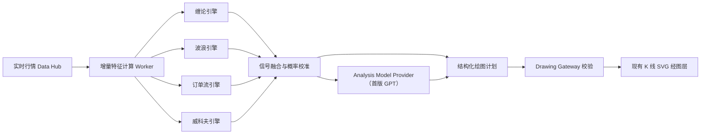

# 交易专家实时 AI 盘面分析执行方案

> 文档状态：已冻结的实施基线
> 创建日期：2026-08-08
> 最近更新：2026-08-12
> 当前里程碑：M0 架构与执行方案冻结
> 总体状态：M0 进行中（已完成 M0-001 至 M0-004、M0-008，下一项为 M0-005）
> 适用仓库：`D:\youle_desktop\youle_desktop`（桌面端）、`D:\youle_agent_ms`（业务后端）、`D:\zhongzhuan`（统一模型中转）

## 1. 文档用途与持续更新规则

本文是“交易专家实时 AI 盘面分析”唯一的长期执行基线，同时承担实施计划、架构决策、验收标准和进度记忆四个职责。后续任何相关开发、审查、测试或发布工作开始前都必须先阅读本文；工作结束前必须回写本文的任务状态和进度日志。

更新规则：

1. 使用本文定义的稳定任务编号，不用临时口头描述替代任务状态。
2. 开始一项任务时，将状态改为 `进行中`，并填写“当前工作焦点”。
3. 只有代码、必要测试和验收证据均完成时才能标记 `已完成`。
4. 任务被设计或外部依赖阻塞时标记 `受阻`，记录阻塞条件、已经验证的事实和解除条件。
5. 每次工作结束都在“进度日志”追加一条记录；历史记录只追加，不覆盖。
6. 如果实现需要偏离本文冻结架构，必须先在“架构决策记录”增加 ADR，写明原因、影响、替代方案和批准状态。
7. 不使用虚构完成百分比。总体进度以已通过验收的任务和里程碑为准。

状态枚举：`未开始 | 进行中 | 受阻 | 已完成 | 已取消`。

## 2. 目标契约

### 2.1 最终交付物

在现有交易专家 K 线工作区内建设可持续运行的实时 AI 盘面分析系统。系统能够基于缠论、艾略特波浪、威科夫和订单流产生可复现的结构化分析，融合为带证据、失效条件和历史校准的市场情景，并通过现有 K 线绘图能力自动落图。

### 2.2 成功标准

1. AI 绘图使用真实市场时间和价格坐标，缩放、拖动、切换主题后保持正确定位。
2. 缠论、波浪、威科夫和订单流分别形成版本化、可测试的独立引擎，不能只依赖大模型自由解释。
3. Analysis Model Provider 只消费结构化市场事实、规则和候选结果，不把截图识别作为主分析链路；首版默认 Provider 使用 `gpt-5.6-sol`。
4. 大模型输出必须经过 JSON Schema、权限、市场版本、坐标范围和对象数量校验后才能进入画布。
5. 用户手工绘图与 AI 绘图完全分层；AI 不覆盖用户绘图，也不污染用户撤销/重做栈。
6. 所有结构区分 `暂定`、`确认`、`失效`，不得在后续行情到来时无痕修改历史判断。
7. 涨跌概率来自无未来数据泄漏的历史回测和校准，不采用大模型自报置信度冒充概率。
8. 数据、分析、绘图、模型和错误事件均带稳定 ID、版本、时间和证据，可回放、可审计。
9. 亮色与暗色主题同时交付，覆盖默认、悬停、选中、焦点、展开、加载、禁用、过期和错误状态。
10. 关闭功能开关后，现有交易专家对话、行情、指标和手工绘图行为保持不变。
11. AI 落图默认使用虚拟 AI 光标逐对象、逐线段播放，用户能观察绘制过程；不得在等待结束后整批瞬间出现。

### 2.3 禁止事项

- 第一版不自动下单、不连接交易账户、不生成可直接执行的订单。
- 不让 GPT 或外部模型直接操作 DOM、SVG、`localStorage`、行情连接或系统权限。
- 不把全部逐笔成交、盘口快照或数千根原始 K 线反复发送给模型。
- 不把外部模型 API Key 写入 Renderer、日志、聊天、源码或普通配置文件。
- 不用普通 OHLCV 数据伪装成订单流；数据源不足时必须明确降级。
- 不以知识库代替确定性算法、行情数据、回测或概率校准。
- 不把新增实现继续堆入超大的 `src/renderer/main.ts` 或 `src/main/main.mjs`。
- 不通过合成真实鼠标/指针事件制造拟人效果，不让 AI 动画进入用户手工绘图的撤销栈。

## 3. 首发范围与后续范围

### 3.1 首发验证范围

- 市场：Binance 永续合约。
- 品种：`BTCUSDT`、`ETHUSDT`。
- 主分析周期：15 分钟、1 小时、4 小时。
- 预测周期：未来 3、6、12 根目标周期 K 线。
- 理论：缠论、波浪、威科夫、订单流四个引擎全部进入融合链路。
- 绘图：理论结构、关键区间、主/备选情景、支撑压力、目标位和失效位。
- 交互：实时分析开关、图层管理、实时结论卡、结构解释、手动刷新、过期提示。
- 运行模式：只分析、自动绘图和提醒；不包含交易执行。

### 3.2 非首发范围

- A 股、美股、外汇等缺少统一深度或逐笔方向数据的真实订单流。
- 自动下单、策略托管、资金管理、仓位同步和交易所账户授权。
- 用户自定义脚本语言、策略市场和公开策略排行榜。
- 大规模在线模型训练和个性化模型微调。

这些能力需要独立目标、数据授权、安全设计和发布验收，不能从本方案自动扩大范围。

## 4. 冻结架构



固定分工：

| 层 | 责任 | 不负责 |
|---|---|---|
| Market Data Hub | 连接数据源、标准化时间与市场身份、缓存和重连 | 理论判断、绘图 |
| Feature Worker | 增量计算摆动点、波动率、成交量、CVD、深度等事实 | 自然语言结论 |
| Theory Engines | 按版本化规则输出候选结构、证据与失效条件 | 最终概率、直接绘图 |
| Fusion/Calibration | 融合信号，产出市场状态和经回测校准的概率 | 自由叙事 |
| Analysis Model Orchestrator | 通过 Provider Registry 处理歧义、主备情景、理论冲突和用户解释 | 绑定具体模型厂商、直接写画布、计算逐笔流 |
| Drawing Gateway | 校验、限流、版本并发控制、生成受信任绘图补丁 | 推理行情 |
| Renderer | 展示、主题、交互、用户控制 | 持有模型凭证、签发权限 |

### 4.1 过渡策略

当前 Binance REST/WebSocket 和 K 线数组主要位于 Renderer。为避免一次性重写现有行情：

1. M1 先增加严格的只读 `MarketSnapshot` 导出桥，复用当前行情，打通端到端绘图链路。
2. M2 建立主进程 `TradingMarketDataHub`，由主进程统一管理订阅、重连、缓存和多周期数据。
3. Renderer 改为 Data Hub 的只读订阅者，分析 Worker 与图表共享同一行情事实源。
4. 迁移验收完成后删除临时 Renderer 快照桥，不能长期保留双数据源。

## 5. 数据和时间语义

### 5.1 市场身份

所有协议使用稳定 `marketId`，不得仅用 `symbol`。至少包含：

- `provider`：数据提供方；
- `venue`：交易场所；
- `marketType`：现货、永续或其他；
- `symbol`：交易标的；
- `interval`：目标周期；
- `priceTick`、`quantityStep` 和计价币种。

`BINANCE:FUTURES:BTCUSDT` 与 `BINANCE:SPOT:BTCUSDT` 必须被视为不同市场。

### 5.2 时间语义

- 协议、存储、分析和绘图锚点一律使用 UTC Unix 时间。
- 中国时区偏移只在 Renderer 显示阶段应用。
- 每根 K 线明确携带 `openTime`、`closeTime` 和 `closed`。
- 暂未收盘 K 线参与盘中候选分析，但不得作为历史回测中的已知终值。
- 所有分析结果记录 `snapshotTime`、`lastClosedBarTime` 和输入摘要哈希。

### 5.3 数据覆盖

K 线基础数据：OHLCV、成交笔数、主动买/卖量（数据源支持时）、标记价格、指数价格、资金费率、持仓量。

订单流增强数据：逐笔成交方向、盘口深度与增量、最佳买卖价、爆仓、持仓量时间序列和可验证的多空相关数据。

每个数据字段都要带覆盖状态：`available | delayed | partial | unavailable`。订单流数据不完整时，订单流引擎返回 `insufficient_data`，融合层降低覆盖度而不是编造结论。

## 6. 核心协议

所有跨模块对象必须携带 `schemaVersion`。以下为语义基线，实施时固化为 TypeScript/JSON Schema，并在主进程边界重复校验。

### 6.1 MarketSnapshot

```ts
interface MarketSnapshot {
  schemaVersion: 1;
  snapshotId: string;
  marketId: string;
  interval: string;
  snapshotTime: number;
  lastClosedBarTime: number;
  candles: Candle[];
  stats: MarketStats;
  orderFlow?: OrderFlowWindow;
  coverage: DataCoverage;
  inputHash: string;
}
```

要求：

- 同一 `snapshotId` 内容不可变。
- K 线按时间升序、去重、有限数值和合法价格校验。
- 发送给 GPT 的不是完整逐笔数据，而是 TheoryResult、聚合特征和必要的有限 K 线窗口。

### 6.2 TheoryResult

```ts
interface TheoryResult {
  schemaVersion: 1;
  resultId: string;
  engineId: "chan" | "elliott" | "wyckoff" | "order_flow";
  engineVersion: string;
  snapshotId: string;
  status: "succeeded" | "insufficient_data" | "failed";
  structures: TheoryStructure[];
  signals: TheorySignal[];
  evidence: Evidence[];
  invalidations: InvalidationCondition[];
  confidence: ConfidenceAssessment;
}
```

`confidence` 表示本引擎对结构识别的可靠程度，不等于市场上涨概率。

### 6.3 AnalysisPlan

```ts
interface AnalysisPlan {
  schemaVersion: 1;
  analysisId: string;
  revision: number;
  snapshotId: string;
  marketId: string;
  interval: string;
  regime: "trend_up" | "trend_down" | "range" | "transition" | "unknown";
  primaryScenario: Scenario;
  alternateScenarios: Scenario[];
  probabilityForecasts: ProbabilityForecast[];
  theoryViews: TheoryView[];
  drawingPatch: DrawingPatch;
  narrative: AnalysisNarrative;
  expiresAt?: number;
}
```

### 6.4 DrawingPatch

```ts
interface DrawingPatch {
  schemaVersion: 1;
  analysisId: string;
  baseRevision: number;
  marketId: string;
  interval: string;
  operations: Array<
    | { op: "upsert"; drawing: AiDrawing }
    | { op: "remove"; drawingId: string }
  >;
}
```

每个 `AiDrawing` 至少包含：稳定 ID、理论图层、工具类型、时间价格锚点、语义颜色、状态、证据引用、置信度、失效条件和生成来源。

## 7. Drawing Gateway 与图层设计

### 7.1 独立图层

绘图状态至少分为：

- `manual`：用户手工绘图；沿用当前撤销/重做和持久化语义。
- `ai/chan`：缠论。
- `ai/elliott`：波浪。
- `ai/wyckoff`：威科夫。
- `ai/order-flow`：订单流。
- `ai/consensus`：综合情景、目标和失效位。

AI 绘图默认锁定、不可直接拖动。用户选择“复制为手工绘图”后生成新的 manual ID，脱离 AI 分析版本。

### 7.2 校验规则

Drawing Gateway 必须在主进程或受信任 Host 边界执行：

1. Schema、协议版本和必需字段完整。
2. `marketId`、`interval`、`analysisId` 和 `baseRevision` 与当前会话一致。
3. 工具只来自批准白名单；点数符合工具定义。
4. 时间、价格和数值有限，预测锚点处于允许的未来窗口。
5. 单对象点数、单补丁操作数、总 AI 对象数和文本长度受限。
6. 颜色使用语义 Token，不接受任意 CSS、HTML 或 SVG 片段。
7. 迟到修订、旧市场、旧周期和已失效分析不能覆盖当前结果。
8. 应用补丁是幂等操作，同一分析修订重复到达不产生重复绘图。
9. 拒绝事件返回机器可读错误并记入审计，不把模型原始内容渲染为 HTML。

### 7.3 绘图状态

- `tentative`：虚线、较低不透明度，表示盘中或未满足确认规则。
- `confirmed`：实线和正常不透明度。
- `invalidated`：灰化并保留历史；用户可选择隐藏失效结构。
- `stale`：输入行情已经超过有效期但尚未产生新分析。

### 7.4 拟人化逐笔绘制播放

AI 落图默认不得在等待结束后整批瞬间出现。Drawing Gateway 必须先完整校验绘图补丁，再由 Renderer 的 `AiDrawingPlaybackController` 将受信任补丁转换为逐项、逐段、逐帧的播放计划，使用户看到类似分析师操作画布的过程。

固定原则：

1. 不伪造浏览器 `PointerEvent`，不调用手工绘图的点击/拖拽事件处理器，避免污染用户选择状态、撤销栈和输入焦点。
2. 使用独立的 AI 虚拟光标、点击涟漪和 SVG 几何插值表现“移动 → 落点 → 拖动/连线 → 完成”。
3. 每次完整 DrawingPatch 校验通过后才开始播放；不能一边解析不完整的模型 JSON 一边落图。
4. 确定性引擎先完成的图层可以先播放，不必等待 GPT 叙述；GPT 综合图层在完整校验后接续播放。
5. 播放顺序按语义固定为：基础结构 → 理论关键点 → 区间/通道 → 目标与失效位 → 主/备选情景 → 文字标注。
6. 模型只能建议语义优先级，不能指定任意毫秒时长、缓动函数、CSS 或光标行为；具体时序由本地受信任控制器归一化。
7. 每完成一个对象才把它提交为该分析修订的稳定绘图；正在播放的半成品只存在于临时展示状态。

不同工具的默认表现：

| 工具类型 | 播放方式 |
|---|---|
| 趋势线、射线、水平线、箭头 | 光标移动到起点，落点后终点沿路径平滑延伸 |
| 折线、缠论笔、波浪计数 | 按锚点逐段连接，每段完成后短暂停顿 |
| 矩形、中枢、威科夫区间 | 从第一角拖动到对角，边框和填充同步展开 |
| 通道、斐波那契 | 先绘基准锚点，再逐级显示派生线和标签 |
| 预测路径、主备情景 | 从当前价格向未来区域逐段延伸，最后显示概率/失效标签 |
| 文本与标记 | 光标定位后以短打字效果或受控淡入显示 |

播放控制和中断语义：

- 默认显示 AI 虚拟光标和“AI 正在绘制”状态；用户可以暂停、继续、调速或点击“立即完成”。
- “立即完成”只跳过展示动画，仍应用同一份已校验补丁，不能绕过 Gateway。
- 用户切换市场、周期或关闭 AI 图层时，立即取消当前临时动画并清除半成品，不把它提交为完成对象。
- 新 revision 在旧 revision 播放时到达，控制器在当前对象的安全边界终止旧队列，丢弃旧半成品，再从最后已提交状态计算新补丁；旧 revision 不得继续覆盖新结果。
- 用户正在手工绘制或拖动手工对象时，AI 播放暂停，避免视觉光标和真实操作竞争；结束后从安全边界继续。
- `prefers-reduced-motion` 或应用的减少动态效果设置生效时，缩短移动和拖动动画，保留明确的分步淡入，不以闪烁或大幅光标运动呈现。
- 每帧只更新临时几何，不写持久化；只记录播放开始、对象完成、暂停、跳过、被新 revision 取代、取消和全部完成事件。

默认节奏由本地策略配置：单个简单对象约 250–700ms，多点结构按段增量播放；标准密度的一轮分析应在保持可观察的前提下自适应压缩，目标总播放时间约 3–10 秒。对象很多时提高速度或按语义组连续播放，不能让陈旧分析长时间占用画布。

## 8. 理论知识库

### 8.1 目标

知识库不是向模型灌输百科，而是冻结 Haolo 采用的定义、流派、参数、确认规则、失效规则、绘图语义和争议处理方式，使同一输入在不同时间得到可解释的一致结果。

建议目录：

```text
resources/trading-knowledge/
  manifest.json
  shared/
    glossary.zh-CN.md
    evidence-schema.json
    drawing-semantics.json
  chan/v1/
    rules.yaml
    examples.jsonl
    counterexamples.jsonl
  elliott/v1/
    rules.yaml
    examples.jsonl
    counterexamples.jsonl
  wyckoff/v1/
    rules.yaml
    examples.jsonl
    counterexamples.jsonl
  order-flow/v1/
    rules.yaml
    examples.jsonl
    counterexamples.jsonl
```

要求：

- 内容使用原创归纳、获授权或可合法使用的材料，不大段复制受版权保护的书籍。
- 每条规则有稳定 ID、版本、定义、输入要求、确认条件、失效条件和示例引用。
- GPT 每次只接收与当前结构相关的规则片段及其 ID，不倾倒整个知识库。
- 知识库升级创建新版本；历史分析保留当时使用的规则版本。

### 8.2 四个规则包

缠论 v1：包含关系、标准/非标准分型、笔、线段、中枢、走势类型、背驰和买卖点；明确递归级别与未完成结构处理。

波浪 v1：摆动点、推动浪硬规则、调整浪结构、交替原则、比例参考、主/备计数和失效位；软指南不能伪装成硬规则。

威科夫 v1：交易区间、PS/SC/AR/ST、Spring/UTAD、SOS/SOW、LPS/LPSY、量价努力结果和阶段候选；事件标签必须附证据。

订单流 v1：主动买卖方向、CVD、成交失衡、盘口失衡、吸收、衰竭、爆仓和持仓量联动；每个判断注明数据覆盖和阈值来源。

## 9. 确定性分析引擎

统一接口：

```ts
interface TheoryEngine {
  describe(): TheoryEngineManifest;
  analyze(snapshot: MarketSnapshot, context: EngineContext): TheoryResult;
}
```

### 9.1 公共特征层

统一计算并缓存：摆动高低点、ATR、趋势斜率、成交量分位数、VWAP、价差、波动率状态、成交量扩张/收缩、主动成交差、CVD、OI 变化和盘口失衡。相同特征不能由四个引擎各自重复实现。

### 9.2 缠论引擎

流水线：K 线包含处理 → 分型 → 笔 → 线段 → 中枢 → 走势类型 → 背驰/买卖点候选。所有中间结构保留来源 K 线索引和规则 ID。

### 9.3 波浪引擎

使用公共摆动点生成有限候选计数，先执行硬规则剪枝，再用软指南排序。必须输出主计数、最多两个备选计数及各自失效点，禁止只保留一个看似确定的答案。

### 9.4 威科夫引擎

先识别趋势或交易区间，再根据价差、成交量、测试行为和突破质量生成事件与阶段候选。事件没有足够证据时标记候选，不强行命名。

### 9.5 订单流引擎

以滑动窗口增量维护逐笔、CVD、深度、爆仓和 OI 特征。订单流只对数据源覆盖的时间范围给结论；断线恢复后需要标记缺口，不能把缺口前后数据直接视为连续。

## 10. 信号融合与 Analysis Model Provider 边界

### 10.1 机器融合

融合层先于 GPT 工作，输出：

- 当前市场状态；
- 各理论方向、强度、覆盖度和冲突矩阵；
- 关键支撑、压力、目标、失效位；
- 历史校准后的不同预测周期概率；
- 数据不足或理论不适用标志。

### 10.2 模型中立输入

Provider 输入采用单次完整但紧凑的结构化上下文：

- 当前用户问题与显示周期；
- MarketSnapshot 摘要；
- 四个 TheoryResult；
- 融合和概率结果；
- 本次相关规则片段与规则 ID；
- 当前画布 AI 图层摘要；
- 输出 Schema、权限和禁止事项。

不发送全部逐笔成交或无关历史文件。当前生产跨厂商 Transport 没有被验证为真实增量计费，因此不能用伪 stateful 多轮不断重放大上下文。

### 10.3 模型中立输出

Analysis Model Provider 负责：主情景、备选情景、理论冲突解释、用户可读叙述和建议的 DrawingPatch。首版由 `gpt-5.6-sol` 适配器实现；模型自报置信度只能作为语义证据之一，不能直接成为涨跌概率。

任一 Provider 输出都先形成不可信 `ProposedAnalysisPlan`，由 Host 完成 Schema 和业务校验后才形成受信任 `AnalysisPlan`。

### 10.4 模型和权限

- 交易专家根分析默认使用项目指定的 `gpt-5.6-sol`。
- Codex 保持默认且唯一的根编排和最终采纳权。
- 外部模型若参与，只能返回分析建议，不获得绘图、文件、Shell 或系统写权限。
- 实际绘图由本地 Drawing Gateway 按窄能力执行；模型不持有 Renderer 或系统权限。
- 生产模型流量继续通过 `D:\youle_agent_ms` 和 `D:\zhongzhuan` 的集中链路，桌面不持有厂商上游 Key。

## 11. 概率、回测与防未来泄漏

### 11.1 标签定义

对未来 3、6、12 根 K 线分别定义三分类结果。初始基线可使用波动率归一化阈值：

- 未来收益大于 `+k × ATR`：上涨；
- 未来收益小于 `-k × ATR`：下跌；
- 其他：震荡。

`k` 不在产品代码硬编码；按市场、周期和训练窗口在校准配置中版本化。

### 11.2 校准原则

- 使用 walk-forward 或 expanding-window，禁止随机打乱时间序列造成泄漏。
- 未收盘 K 线不得以终值参与历史特征。
- 特征、规则和模型版本必须与回测记录绑定。
- 在样本不足前界面显示“信号强度”，不显示伪精确概率。
- 概率和结构识别置信度分别展示。
- 上涨、下跌和震荡概率之和必须为 100%，同时展示样本量、覆盖期和最近校准时间。

### 11.3 发布门槛

- Brier Score 必须优于无条件频率基线。
- 校准误差、分类覆盖、最大回撤情景和不同市场状态表现必须进入报告。
- 不以单次收益或少数截图作为有效性证据。
- 达不到发布门槛时保留结构分析功能，但关闭“概率”展示。

## 12. 实时触发与性能

触发分层：

- Tick/盘口：本地 Worker 以 100–500ms 节流增量更新；不调用 GPT。
- 盘中结构：关键结构发生变化时更新暂定图形。
- K 线收盘：确认结构、运行四理论融合，必要时调用 GPT。
- 事件触发：突破失效位、区间边界、订单流异常或数据恢复时重新分析。
- 用户触发：手动刷新、追问或切换主要分析周期。

性能目标：

- 本地特征和绘图增量更新 P95 小于 1 秒。
- K 线收盘后的本地四引擎结果 P95 小于 3 秒。
- GPT 综合分析目标 P95 小于 10 秒；超时不阻塞本地结构更新。
- Drawing Gateway 接受补丁后 150ms 内出现首个可见绘制反馈，不能继续停留在无反馈等待状态。
- 拟人化播放使用 `requestAnimationFrame`，目标 60fps；每帧不进行持久化、全量 Schema 校验或重新计算理论结构。
- 300 个可见 AI 绘图对象下，常规缩放和拖动保持流畅，不因分析阻塞 UI 线程。
- 所有高频计算放入 Worker 或主进程计算边界，不占用 Renderer 主线程。

## 13. 产品交互

### 13.1 图表控制

- 顶部“AI 实时分析”总开关。
- 状态：监听中、分析中、已更新、数据不足、已过期、连接中断和错误。
- 图层：综合、缠论、波浪、威科夫、订单流。
- 密度：精简、标准、完整。
- 绘制速度：0.5×、1×、2×；默认 1×。
- 操作：暂停/继续绘制、立即完成、刷新、隐藏失效结构、清除当前 AI 视图、复制为手工绘图。
- AI 虚拟光标必须与系统真实鼠标明显区分，并带“AI”标识，不能让用户误以为真实鼠标被接管。

### 13.2 实时结论卡

右侧交易专家对话区域顶部展示：

- 市场状态与数据时间；
- 未来 3/6/12 根 K 线的上涨/下跌/震荡概率或信号强度；
- 主情景和备选情景；
- 支撑、压力、目标和失效位；
- 四理论一致度、数据覆盖和规则版本；
- “为什么这样判断”的可展开证据。

### 13.3 主题要求

所有新增 UI 使用交易专家局部语义变量，例如 `--trading-ai-bull`、`--trading-ai-bear`、`--trading-ai-tentative`、`--trading-ai-stale`，分别为亮色和暗色定义。不能把只适合白底的浅色、阴影或图标颜色写死在组件中。

主题验收覆盖默认、hover、active/selected、focus、open、loading、disabled、stale、invalidated 和 error；同时检查文字、图标、边框、菜单、弹层、表单、开关、图层 Chip、图形透明度、AI 虚拟光标和点击涟漪。亮暗主题都必须保证虚拟光标可见且不遮挡 K 线价格信息。

## 14. 代码模块边界

建议结构：

```text
src/main/trading-analysis/
  protocol.mjs
  model-provider.mjs
  app-server-provider.mjs
  chan-engine.mjs
  chan-pipeline.mjs
  market-data-hub.mjs
  snapshot-store.mjs
  analysis-runtime.mjs
  drawing-gateway.mjs
  knowledge-loader.mjs
  probability-calibrator.mjs
  theory/
    common-features.mjs
    chan.mjs
    elliott.mjs
    wyckoff.mjs
    order-flow.mjs
  workers/
    feature-worker.mjs

src/renderer/
  trading-expert-ai.ts
  trading-expert-ai-view.ts
  trading-expert-ai-playback.ts
  trading-expert-drawing.ts
  trading-expert-market.ts

resources/trading-knowledge/
test/fixtures/trading-analysis/
test/trading-analysis-*.test.mjs
```

`src/renderer/main.ts` 和 `src/main/main.mjs` 只增加装配和窄 IPC 入口；业务逻辑必须位于独立模块。

## 15. 测试与验收矩阵

| 测试层 | 必须覆盖 |
|---|---|
| 协议测试 | Schema 版本、无效数值、旧修订、错误市场、对象限额、幂等 |
| 单元测试 | 四引擎规则、公共特征、时间聚合、概率标签、颜色 Token |
| 黄金样例 | 每种理论的标准案例、反例、争议案例和专家共识 |
| 回放测试 | 固定行情事件流得到相同结构、ID、状态变化和绘图补丁 |
| 集成测试 | WebSocket/REST → Snapshot → Engines → Fusion → Gateway → Renderer |
| 播放测试 | 虚拟光标、各工具插值、语义顺序、暂停/继续、立即完成、取消、新 revision 取代和 reduced-motion |
| 断线测试 | 重连、缺口、乱序、重复事件、迟到 GPT 响应和切市场 |
| 性能测试 | 高频 Worker、300 个对象、切周期、缩放和长时间运行 |
| 主题回归 | 亮色/暗色及全部交互状态的截图或 DOM/CSS 契约 |
| 安全测试 | Prompt 注入、HTML/SVG 注入、任意颜色、越界坐标和权限绕过 |
| 回测审计 | 无未来泄漏、版本绑定、基线对比、校准和样本覆盖 |

任何里程碑在相应测试未通过前不得标记完成。

## 16. 可观察性与故障降级

每次分析至少记录：`traceId`、`snapshotId`、`analysisId`、revision、市场、周期、引擎版本、规则版本、模型、触发原因、耗时、数据覆盖、结果状态和错误分类。模型原始大响应保存为受控 Artifact 引用，不直接写普通日志。

降级顺序：

1. GPT 不可用：继续展示确定性引擎和上次有效叙述，标记“AI 综合暂不可用”。
2. 某理论数据不足：从融合中降权并明确显示覆盖不足。
3. 订单流断线：保留 K 线理论，订单流图层标记过期并停止输出新信号。
4. Drawing Gateway 拒绝：不改变当前画布，记录机器可读错误并允许重新分析。
5. 全部行情不可用：冻结最后有效视图并显示时间，不继续生成新判断。

## 17. 风险清单

| 风险 | 应对 |
|---|---|
| 缠论和波浪流派差异 | 知识库冻结口径，规则版本化，展示备选情景 |
| 模型幻觉或绘图注入 | Schema + Drawing Gateway + 工具白名单 + Host 执行 |
| 结构重绘导致误导 | 暂定/确认/失效状态与不可变分析修订 |
| 订单流数据不完整 | Coverage 契约、缺口标记和 `insufficient_data` |
| 概率被理解为保证 | 历史校准、样本信息、风险提示和无自动下单 |
| 高频计算卡顿 | Worker、增量算法、RAF 合并和对象上限 |
| 拟人动画拖慢新分析 | 自适应时长、安全边界中断、新 revision 取代和立即完成 |
| AI 光标干扰真实操作 | 独立展示层、禁止合成 PointerEvent、手工操作时自动暂停 |
| 模型调用成本过高 | 事件触发、紧凑完整上下文、缓存和本地优先 |
| 未来数据泄漏 | UTC/收盘语义、walk-forward、回放审计测试 |
| 亮暗主题割裂 | 同一任务同时实现两主题并加入回归测试 |
| 当前工作区改动较多 | 小切片、避免覆盖无关改动、逐模块验证 |

## 18. 里程碑与详细任务台账

### M0：架构、规则和契约基线

| ID | 任务 | 状态 | 依赖 | 完成证据 |
|---|---|---|---|---|
| M0-001 | 核对现有行情、绘图、模型和主题实现 | 已完成 | 无 | 2026-08-08 代码盘点 |
| M0-002 | 冻结混合架构、目标契约与首发范围 | 已完成 | M0-001 | 本文第 2–4 节 |
| M0-003 | 建立长期执行文档与进度台账 | 已完成 | M0-002 | 本文 |
| M0-004 | 在 `AGENTS.md` 登记持久读取与回写要求 | 已完成 | M0-003 | `AGENTS.md` 持久记忆入口与 2026-08-08 校验记录 |
| M0-005 | 固化 MarketSnapshot/TheoryResult/AnalysisPlan/DrawingPatch Schema | 未开始 | M0-002 | 协议模块与契约测试 |
| M0-006 | 定义 Feature Flag、错误分类、审计字段和本地存储迁移 | 未开始 | M0-005 | 配置与测试 |
| M0-007 | 创建四理论规则模板、词汇表和版权来源规范 | 未开始 | M0-002 | knowledge 目录与校验 |
| M0-008 | 冻结拟人化逐笔落图、虚拟光标和中断语义 | 已完成 | M0-002 | 本文 7.4、ADR-005 与 2026-08-08 记录 |

M0 退出条件：协议、规则模板、错误和功能开关均有自动化测试；关闭开关时旧行为无变化。

### M1：AI 自动绘图纵向切片

| ID | 任务 | 状态 | 依赖 | 完成证据 |
|---|---|---|---|---|
| M1-001 | 导出/适配当前绘图模型，建立 manual 与 AI 图层 | 未开始 | M0-005 | 单元测试 |
| M1-002 | 实现 Drawing Gateway 校验、幂等和 revision 控制 | 未开始 | M0-005 | 安全与协议测试 |
| M1-003 | 实现临时 Renderer MarketSnapshot 只读桥 | 未开始 | M0-005 | 集成测试 |
| M1-004 | 使用固定 Fixture 生成模拟 TheoryResult 和 DrawingPatch | 未开始 | M1-002,M1-003 | 端到端演示 |
| M1-005 | 实现 AI 总开关、状态和图层控制 | 未开始 | M1-001 | UI 测试 |
| M1-006 | 实现亮色/暗色全部状态 | 未开始 | M1-005 | 主题回归 |
| M1-007 | 实现“复制为手工绘图”和独立撤销语义 | 未开始 | M1-001 | 交互测试 |
| M1-008 | 实现 AiDrawingPlaybackController 和工具几何插值 | 未开始 | M1-001,M1-002,M1-004 | 动画单元/回放测试 |
| M1-009 | 实现 AI 虚拟光标、涟漪、绘制状态和速度控制 | 未开始 | M1-005,M1-008 | 亮暗主题与交互测试 |
| M1-010 | 实现暂停/继续、立即完成、取消、revision 取代及 reduced-motion | 未开始 | M1-008,M1-009 | 中断与可访问性测试 |
| M1-011 | 以当前真实 K 线跑通经过 GPT-5.6 Sol 的缠论测试按钮纵向切片 | 已完成 | M0-005,M1-001,M1-002,M1-003,M1-008,M1-009 | `trading-analysis/*`、窄 IPC、测试按钮、AI 独立图层/光标、46 项专项通过、类型检查与生产构建通过 |
| M1-012 | 修复真实客户端点击“测试”后进入“重试”的运行时故障 | 已完成 | M1-011 | 根因是 `userMessage` 被误计为副作用；修复捕获分类并增加可见错误提示；真实 500 根 BTC 日线 + GPT 完整管线成功；46 项专项、类型检查、语法检查、生产构建通过 |
| M1-013 | 将缠论测试按钮升级为 `@策略:缠论` 对话式专家入口 | 已完成 | M1-012 | 已移除测试按钮；完成问答/截图/看盘意图分流、当前画布参数继承、按指令切换行情、对话进度、受控绘图与完整报告；74 项交易专家专项、类型检查、语法检查和生产构建通过 |
| M1-014 | 修复交易专家发送消息缺失、整页闪动与当前 K 线周期丢失 | 已完成 | M1-013 | 用户气泡和分析报告作为本地历史保留；进度改为局部更新对话区；临时任务升级正式 ID 时迁移同一行情工作区；交易专家及发送/分组相关 186 项测试、类型检查和生产构建通过 |
| M1-015 | 修复交易专家发送后输入残留并补齐标准思考状态气泡 | 已完成 | M1-014 | 发送后同步清空 textarea、草稿和 mention 高亮层；复用标准思考气泡展示准备行情、分析盘面、绘制结构、整理报告及耗时；交易专家 75 项与发送相关 111 项回归、类型检查和生产构建通过 |
| M1-016 | 在缠论最终报告中增加当下判断、涨跌情景概率和条件交易计划 | 已完成 | M1-015 | 已增加偏多/偏空/中性判断、25%–75% 审慎情景概率、结构来源的多空触发/失效/目标价、观望与风险条件；交易专家专项 76 项、类型检查、管线语法检查和生产构建通过 |
| M1-017 | 移除普通/升级模式按钮并由 `@自定义指标:趋势带` 双向同步趋势带 K 线 | 已完成 | M1-016 | 已删除按钮、事件和样式；标记出现时启用趋势带，普通删除、原子标记删除或发送清空时恢复原 K 线并保持视窗；77 项交易专家专项、类型检查、变更检查和生产构建通过 |
| M1-018 | 修复口语化缠论看盘误分流、当前 K 线丢失和内部提示词回显 | 已完成 | M1-017 | “帮我分析下/分析看看/研判下/复盘下”等表达进入专用看盘链路，缺省参数严格继承当前品种、周期和可见范围；内部专家提示词由统一消息清洗层隐藏；交易专家与历史消息专项 82 项、类型检查、变更检查和生产构建通过 |
| M1-019 | 用模型固定 JSON 路由替换缠论请求正则判断 | 已完成 | M1-018 | 新增只读 `gpt-5.6-sol` 路由、8 字段固定 JSON 契约、显式参数提取、0.65 置信度门槛和问答安全回退；移除缠论语义/参数正则；交易专家与消息发送共 123 项回归、类型检查、主进程语法检查和生产构建通过 |
| M1-020 | 修复模型路由等待期间交易专家输入框未清空 | 已完成 | M1-019 | 用户气泡登记后、等待路由模型前立即清空状态、草稿、匹配当前任务的 textarea 和 mention 覆盖层，正式任务升级后继续二次兜底；交易专家专项 82 项、类型检查和生产构建通过 |
| M1-021 | 修复缠论模型复核 180 秒超时后直接失败 | 已完成 | M1-020 | 超时改为结构化 `WORKFLOW_TURN_TIMEOUT/timeout`，模型活动会续期空闲看门狗，连续无进展时在原会话自动恢复；路由请求仍在 60 秒失败回退；增加脱敏诊断和中文超时回归，97 项相关测试、类型检查、主进程语法检查及生产构建通过 |
| M1-022 | 优化交易专家一级菜单到二级菜单的悬浮容错 | 已完成 | M1-013 | 接入级联菜单 180ms 延迟关闭并保留透明跨栏热区；补齐 `.submenu-open`、ARIA 展开态及亮暗主题契约；相关 30 项测试、类型检查和生产构建通过 |
| M1-023 | 将交易专家分析过程改为流式留存并在最终结果后折叠 | 已完成 | M1-015 | 每条进展作为独立 `commentary` 追加，运行中保持展开，最终报告/错误作为 `final_answer` 后复用普通执行折叠；核心 67 项、主题/流式 18 项、类型检查和生产构建通过 |
| M1-024 | 增加 K 线专业多点标注并约束文字框排版 | 已完成 | M1-011 | 每次输出 3–4 条综合判断/末笔/关键分型/中枢标注；AI 字号由 16px 缩至 12.8px，自动换行并约束框体/命中区；相关 65 项、类型检查和生产构建通过 |
| M1-025 | 对 AI 标注进行整组防碰撞和 K 线避让 | 已完成 | M1-024 | 12px 标注间距、8px 蜡烛避让、40px 顶部保护区；三角尾改为 1.2px 线段和锚点，缩放/平移后重排；相关 66 项、类型检查和生产构建通过 |
| M1-026 | 修复视窗外标注错位并改为 9px 无框文字 | 已完成 | M1-025 | 屏外锚点不参与布局且不进入渲染，末端笔绑定真实分型；9px 无框文字、连接线结束于首字并优先采用斜线；相关 66 项、类型检查和生产构建通过 |
| M1-027 | 将 AI 标注调整为 10px 并把缠论笔改为深灰色 | 已完成 | M1-026 | AI 标注统一为 10px；缠论笔亮色为 `#4b5563`、暗色为 `#9aa3b2`；相关 66 项、类型检查和生产构建通过 |
| M1-028 | 将缠论笔恢复为原紫色 | 已完成 | M1-027 | 亮色恢复 `#7b61ff`、暗色恢复 `#a994ff`；相关 66 项、类型检查和生产构建通过 |
| M1-029 | 将 AI 标注引线改为虚线并收紧文字行宽 | 已完成 | M1-028 | 确认/暂定标注统一虚线，单行最大宽度收紧为 200px；相关 66 项、类型检查和生产构建通过 |
| M1-030 | 为交易专家复用普通任务右侧会话栏收起/展开控制 | 已完成 | M1-023 | 复用 `rightCollapsed`、`toggle-right-panel`、面板图标及状态同步；布局与普通任务相关 61 项、类型检查和生产构建通过 |
| M1-031 | 复核当前缠论完整链路并以 `@策略:订单流` 跑通真实订单流纵向切片 | 已完成 | M1-030 | 完成真实 Binance 聚合成交/深度/OI、确定性 Delta/CVD/POC/成交簇/失衡引擎、模型中立复核、Gateway、AI 独立图层与拟人播放；15 项订单流+缠论专项、类型/语法检查、真实数据烟测和生产构建通过 |
| M1-032 | 以 `@策略:波浪理论` 跑通确定性波浪候选、模型复核和拟人落图纵向切片 | 已完成 | M1-031 | 完成摆动点、五浪推动/倾斜候选、ABC 调整、硬规则、斐波那契关系、主备计数、确认/失效、模型中立复核、`ai/wave` Gateway 与虚拟光标逐段落图；缠论+订单流+波浪 21 项专项、类型/语法检查、500 根实时 BTCUSDT 烟测和生产构建通过 |
| M1-033 | 将 ICT/SMC 市场结构体系并入 `@策略:订单流` 完整链路 | 已完成 | M1-031 | 完成 OB、FVG、BOS、CHoCH、MSS、Displacement、EQ、EQH/EQL、BSL/SSL、Sweep、Breaker、OTE 的多周期确定性候选、真实订单流窗口证据融合、模型中立复核和受控拟人落图；四理论 25 项专项、类型/语法检查、实时多周期烟测及生产构建通过 |
| M1-034 | 将 `@策略:波浪理论` 升级为完整 5 浪与 ABC/WXY 复合浪型计数 | 已完成 | M1-032 | 完成 `0-1-2-3-4-5 → A-B-C/W-X-Y` 完整周期、Zigzag/Flat/Expanded/Running Flat、Double Three、相对浪级、候选多样性保留、分段配色及 W/Y 内部子浪逐点标注；四理论 26 项专项、类型/语法检查、实时 BTCUSDT 烟测和生产构建通过 |
| M1-035 | 精简订单流/波浪盘面并输出新手可执行的条件式结论 | 已完成 | M1-033、M1-034 | 订单流绘图限制为 16 项内并按重要性保留转折、支撑/压力、上下流动性和最多一组微观证据；波浪只画主计数和短浪标；两类报告均输出确定性上破/跌破/回踩/反弹/等待区、第一目标、取消价及新手风控，四理论 26 项专项、实时烟测和生产构建通过 |
| M1-036 | 未点名理论时由模型判断是否优先分析左侧当前 K 线 | 开发完成，待用户实机验收 | M1-035 | 语义意图只由模型固定 JSON 路由判断，不使用关键词/正则判断语义；盘面请求未明确指定参数时继承左侧当前品种、周期和可见 K 线，进入独立通用价格结构引擎与 `ai/price-action` 受控拟人绘图层；83 项专项、类型/语法检查和生产构建通过，开发版已重启 |
| M1-037 | 将订单流与波浪绘图从过度精简调至中等复杂度且保持报告不变 | 已完成 | M1-035 | 订单流恢复第二层结构、双向区域、流动性、Sweep、EQ/OTE、POC 与两组成交证据，实时补丁 31 项；波浪恢复完整主计数、Fib、确认/失效和两条差异化备选路径，实时补丁 28 项；波浪结构折线强制实线，右侧报告与交易建议生成逻辑未改；87 项专项、实时烟测和生产构建通过 |
| M1-038 | 修复切换币种或 K 线周期后 AI 绘图丢失 | 已完成 | M1-037 | AI 图层按 `marketId + interval` 独立保存到本地；切换行情、取消播放和页面销毁只停止临时播放，不删除已完成图；同盘面新绘图通过 Gateway 后才替换旧图，分析失败保留上一版；62 项交易绘图/四理论专项、TypeScript 和生产构建通过 |
| M1-039 | 移除交易专家思考状态下方与消息气泡重复的灰色详情 | 已完成 | M1-023 | 交易专家阶段详情固定为空且空详情不生成 DOM；保留状态标签与已处理耗时，普通任务详情不变；35 项专项、TypeScript、变更空白检查和生产构建通过 |
| M1-040 | 将交易专家原仅在思考详情显示的首条执行文案补为进展气泡 | 已完成 | M1-039 | 通用盘面、缠论、订单流和波浪四条链路均通过统一 `updateProgress` 追加首条 commentary；37 项专项、TypeScript、变更空白检查和生产构建通过 |
| M1-041 | 修复实时订单流证据错投到历史 K 线并合并重复标签 | 已完成 | M1-037 | POC、成交失衡区和大额主动成交严格吸附到真实成交窗口所属执行 K 线；窗口与画布不重叠时禁止微观证据落图；同根 K 线同方向证据保留独立图形并合并文字标签；新增错投与聚合回归，64 项交易分析专项、TypeScript、变更空白检查和生产构建通过 |
| M1-042 | 修复订单流分钟级证据在小时画布被夹到左边界 | 已完成 | M1-041 | 微观证据不再使用 K 线内部分钟/秒时间作为 SVG 横坐标，统一使用对应执行 K 线开盘时间和整周期边界；订单流买卖/POC 标签引线限制在锚点 220px 内；新增 1H 成交窗口与标签距离回归，66 项交易分析专项、TypeScript 和生产构建通过 |
| M1-043 | 将订单流文字标注强制布局到结构箱体外侧 | 已完成 | M1-042 | Renderer 将当前可见订单流矩形转换为硬禁入区，订单流标签只从箱体外候选中布局并保留原锚点虚线引线；新增嵌套 FVG/OTE 箱体回归，67 项交易分析专项、TypeScript、主题审计和生产构建通过 |
| M1-044 | 严格复核波浪理论规则并审查 SOL 1H 实机计数 | 已完成 | M1-034 | 只读审查确认截图主计数不成立：波4对波3回撤 156.9% 且越过波3起点，既非标准推动浪也不满足倾斜三角形；定位到重叠即降级为 diagonal、cycle 丢失 motive 类型及缺少负例测试三项实现缺口；现有波浪专项 7/7 通过但未覆盖该违规形态 |
| M1-045 | 按波浪硬规则彻底修复推动浪、倾斜、截短与完整周期判定 | 已完成 | M1-044 | 波浪引擎 0.3.0 将父级锚点与低一级摆动证据分离，硬剪枝波2起点、波3推进/最短、波4全回撤/重叠、波5推进/严格截短及 5-3-5-3-5；倾斜必须显式位置、楔形和内部结构，当前无法证明父级位置时失败关闭；ABC/WXY 需内部结构证据，cycle 保留 motive 子类型；SOL 违规计数、倾斜、截短、调整浪和周期包装负例已覆盖，72/72 专项、类型/语法、双主题审计、实时 SOL/BTC 烟测及生产构建通过 |
| M1-046 | 以 `@策略:威科夫` 跑通区间、阶段、事件、模型复核和拟人落图纵向切片 | 已完成 | M1-045 | 完成确定性交易区间、量价努力结果、A–E 阶段、PS/SC/AR/ST/Spring/Test/SOS/LPS 与 PSY/BC/UTAD/SOW/LPSY 候选，模型中立复核、`ai/wyckoff` Gateway、盘面持久化、通俗条件价和拟人落图；122/122 交易专家专项、类型/语法、双主题、BTCUSDT 500 根 1H 实时烟测及生产构建通过，开发版已启动 |
| M1-047 | 波浪盘面无候选时自动扩大 K 线窗口直到可分析 | 已完成 | M1-045 | 仅对 `TRADING_WAVE_INSUFFICIENT_DATA` 从当前窗口倍增至已加载历史，仍不足时按 500 根补充更早 K 线，最多检查 2500 根；历史复盘不引入结束点后的 K 线，模型/网络/取消错误不重试；127/127 交易专项、TypeScript、生产构建及实时 BTCUSDT 4H 自动 `100→200→400` 烟测通过 |
| M1-048 | 按用户意图复用当前分析，按需重画并直接回答追问 | 已完成 | M1-036,M1-038,M4-007 | 首次完整分析继续生成原受控画线与固定完整报告；已有同品种/周期分析时，语义路由将依据/目标/风险/买卖条件等追问转为直接对话，刷新可重新计算但不替换原图，只有明确重画才播放新 Drawing Patch；通用价格行为、缠论、订单流/ICT-SMC、波浪、威科夫五条链路统一支持 `full/direct` 响应模式，Drawing Gateway 与确定性报告保持不变；135/135 相关专项、TypeScript、主进程/管线语法检查、双主题审计和 Vite 生产构建通过 |
| M1-049 | 修复副图开关后切换 K 线周期造成主图或副图缩放错乱 | 已完成 | M1-038 | 副图价格轴显式恢复自动缩放；关闭副图时先从 Lightweight Charts 数据层删除全部 Series，再清理 Pane，旧时间点不再污染后续周期；135/135 交易专项、TypeScript、生产构建、亮暗主题契约及两条开发版实机路径通过 |
| M1-050 | 将完整交易专家工作台迁入“新任务”主区域并移除智能体列表入口 | 已完成 | M1-049 | 顶层“新任务”创建与激活统一初始化完整交易专家行情、绘图、右侧功能栏和对话链路，同时保留应用导航与任务列表；原空白新任务界面不再出现在标准入口，智能体目录隐藏交易专家但保留历史线程兼容；146/146 相关专项、TypeScript、亮暗实机验收、变更空白检查和 Vite 生产构建通过 |
| M1-051 | 精简交易专家顶部栏并将交易对左移 | 已完成 | M1-050 | 移除“退出”按钮及其废弃事件链路，绘图栏不再显示右侧分隔线，交易对取消额外 42px 左内边距并贴齐原分隔线位置；146/146 相关专项、TypeScript、亮暗实机验收、变更空白检查和 Vite 生产构建通过 |
| M1-052 | 微调交易对水平位置并统一左右折叠按钮底部间距 | 已完成 | M1-051 | 交易对容器整体左移 10px，调整绘图栏堆叠上下文以完整显示越过原边界的币种图标；交易专家 Shell 将左折叠按钮顶距设为标题栏 42px + 行情栏 4px，与右折叠按钮保持相同底部间距；146/146 相关专项、TypeScript、亮暗实机验收、变更空白检查和 Vite 生产构建通过 |
| M1-053 | 精简任务侧栏并迁移交易专家功能分类 | 已完成 | M1-052 | 全局会话搜索的界面、状态、事件、索引、IPC、主进程回退模块及专用测试已完整移除，单会话内历史搜索继续保留；快捷新建菜单迁至“新任务”卡片右侧并保留全部原功能；任务/账户/预警/知识库成为左侧顶部唯一分类入口，“任务”显示任务会话列表，右侧原分类栏和任务刷新按钮已移除；119/119 相关专项与 1781/1781 全量回归、TypeScript、亮暗主题契约审计、变更空白检查和 Vite 生产构建通过，开发版保留运行供用户实机验收 |
| M1-054 | 对齐指标底栏并解耦左侧分类与右侧任务会话 | 已完成 | M1-053 | 指标底栏以完整 K 线区左边缘对齐；左侧分类只控制侧栏内容，右侧任务会话常驻；新增独立 K 线折叠开关；1781/1781 全量回归、67/67 折叠相关专项、TypeScript、亮暗主题契约和 Vite 生产构建通过 |
| M1-055 | 让画线工具栏随左侧任务栏响应式显隐 | 已完成 | M1-054 | 左栏展开时隐藏画线工具栏，折叠时恢复，画布与指标栏同步铺满和对齐；29/29 布局专项、TypeScript、亮暗主题契约和 Vite 生产构建通过 |
| M1-056 | 让行情顶栏随画线工具栏自适应对齐 | 已完成 | M1-055 | 画线工具栏隐藏时行情栏保留 42px 左侧控制区，恢复时取消额外占位；29/29 布局专项、TypeScript、亮暗主题契约和 Vite 生产构建通过 |
| M1-057 | 将任务/账户/预警/知识库设为聊天侧栏常驻分类 | 已完成 | M1-056 | 四分类在普通与交易专家会话中共用鼠标、键盘和可访问性链路；29/29 布局专项、1781/1781 全量回归、TypeScript、亮暗主题契约和 Vite 生产构建通过 |
| M1-058 | 恢复交易专家分组选择与双模型选择 | 已完成 | M1-057 | 分组选择器复用原任务逻辑；模型白名单限定 `gpt-5.6-sol` 与 `deepseek-v4-flash` 并按任务保存；82/82 相关专项、1781/1781 全量回归、TypeScript、亮暗主题契约和 Vite 生产构建通过 |
| M1-059 | 合并交易专家 K 线与会话折叠控制 | 已完成 | M1-058 | K 线与会话改为两栏交界处同组双按钮，左键控制 K 线、右键控制会话；组合入口在任一侧收起后仍可恢复，且禁止同时收起两侧；67/67 相关专项、TypeScript、亮暗主题契约、变更空白检查和 Vite 生产构建通过 |
| M1-060 | 将可见折叠入口改为极简方向图标 | 已完成 | M1-059 | 左侧栏、K 线和会话入口改为 12px 状态感知细线箭头；组合控件移除常驻面板轮廓、胶囊外框和组内分隔线，仅保留 hover/focus 淡背景；99/99 相关专项、全量回归、TypeScript、亮暗主题契约、变更空白检查和 Vite 生产构建通过 |
| M1-061 | 修复交易专家模型选项菜单被右侧面板裁切 | 已完成 | M1-058 | 模型定位层扩展到完整输入框、触发器保持原位、224px 菜单按输入框居中且窄宽度自适应；Sol/DeepSeek 分组与文字完整；44/44 模型/布局专项、TypeScript、亮暗主题契约、变更空白检查和 Vite 生产构建通过 |
| M1-062 | 将历史会话列表改为 Codex 式极简单行展示 | 已完成 | M1-061 | 新任务入口保持原样，历史会话压缩为 36px 单行标题并移除头像、摘要和时间；保留标题提示、分组、未读、运行中、完成提醒和更多菜单；76/76 相关专项、全量回归、TypeScript、亮暗主题契约、变更空白检查和 Vite 生产构建通过 |
| M1-063 | 按 Codex 信息架构重排完整会话侧栏 | 已完成 | M1-062 | 顶部按新对话/自动任务/连接渠道/创建群聊排列，新对话吸顶；会话置顶提升为全局区，项目使用文件夹标题且默认显示 5 条；删除加号菜单、空白画布创建与首版 Seed 链路；164/164 相关专项、757/757 全量回归、TypeScript、亮暗主题契约、变更空白检查和 Vite 生产构建通过 |
| M1-064 | 修复行情顶栏周期文字被折叠入口预留区裁切 | 已完成 | M1-060 | 周期控件保留 210px 最低可用宽度，收藏行情优先收缩；38/38 布局与主题专项、TypeScript、变更空白检查和生产构建通过，并在 150% 缩放、4 个收藏行情的亮暗主题下确认“5分”完整可见且不遮挡折叠按钮 |
| M1-065 | 将会话侧栏圈选导航整体左移 5px | 已完成 | M1-063 | 顶部四入口及置顶/项目分区标题通过共享外边距整体左移 5px；49/49 侧栏、交互与交易专家相关测试、TypeScript、亮暗主题审计、变更空白检查和 Vite 生产构建通过 |
| M1-066 | 修复交易对弹窗收藏行情缺少最新价和 24H 涨幅 | 已完成 | M1-064 | 弹窗优先复用 REST/WebSocket 实时行情，同 ID 无报价快照不能覆盖有效报价；行情、布局与双主题相关 59/59、TypeScript、变更空白检查和 Vite 生产构建通过 |
| M1-067 | 修复顶部与交易对弹窗收藏行情未实时变化 | 已完成 | M1-066 | 收藏行情改为直接组合流订阅，补充 12 秒静默超时重连、只在流静默时启用的 4 秒按交易对 REST 兜底、8 秒请求中止及低价币自适应精度；行情/布局与双主题专项 50/50、全量 1791/1791、TypeScript、变更空白检查和 Vite 生产构建通过 |
| M1-068 | 提升暗色 K 线价格轴对比度并将应用默认主题改为暗色 | 已完成 | M1-067 | 暗色主图/副图价格轴统一使用 `#dfe1e3`，主题热切换显式覆盖各价格轴文字色；Renderer、主进程偏好和原生窗口初始背景的无偏好默认值统一改为暗色，显式浅色偏好继续保留；主题/布局专项 39/39、全量 1792/1792、TypeScript、变更空白检查和 Vite 生产构建通过 |
| M1-069 | 将主图上涨 K 线及成交量上涨柱样式对齐 OKX 参考图 | 已完成 | M1-068 | 主图普通行情与趋势带的绿色蜡烛均使用透明实体、绿色描边/影线，红色蜡烛保持实心；成交量上涨柱为空心描边、下跌量柱为红色实心，MA5/MA10 默认 1px 并迁移旧默认值；行情/指标/主题专项 62/62、全量 1794/1794、TypeScript、变更空白检查和 Vite 生产构建通过 |
| M1-070 | 将全部涨跌柱改为 Binance 参考图的实心红绿色 | 已完成 | M1-069 | 主图、趋势带、成交量和 MACD 柱统一为实心 `#2EBD85` / `#F6465D`；旧指标颜色迁移到 v3；54/54 专项、1795/1795 全量、TypeScript、双主题审计、变更检查和生产构建通过 |
| M1-071 | 在历史会话中标记并恢复最后一次 AI K 线分析画布 | 已完成 | M1-063,M1-038 | 会话行与文件夹图标左对齐并加宽；亮暗主题显示最后一次分析的币种周期前缀；最后分析上下文按会话持久化、旧绘图反向迁移，点击会话恢复对应市场、周期和已保存绘图；73/73 专项、全量回归、TypeScript、双主题契约、变更检查和 Vite 生产构建通过 |
| M1-072 | 将左右面板分隔线改为可拖拽宽度调节 | 已完成 | M1-059,M1-060 | 左栏 192px、右栏 300px 改为硬下限；两条 12px 分隔命中区支持双竖线 hover/focus、指针拖拽、键盘调节、宽度持久化和窗口收敛；33/33 布局专项、TypeScript、双主题契约、变更检查和 Vite 生产构建通过 |
| M1-073 | 打通行情三点菜单、七类图表设置与 1–9 窗分屏 | 已完成 | M1-064,M1-070 | 三点菜单只提供设置/分屏；七类设置直接驱动真实主图并持久化；22 种 1–9 窗布局使用独立真实行情、品种和周期；64/64 专项、TypeScript、双主题实机/契约审计、变更检查和 Vite 生产构建通过 |
| M1-074 | 修复对数与百分比坐标切换后 K 线消失或压缩 | 已完成 | M1-073 | 线性坐标继续按可见 K 线固定绝对价格范围；对数/百分比坐标清除旧范围并启用原生自动缩放，主图与分屏一致；65/65 专项、TypeScript、变更检查和 Vite 生产构建通过 |
| M1-075 | 消除辅助分屏定时刷新闪动并统一主辅图表视觉 | 已完成 | M1-073,M1-074 | 后台轮询不再显示加载遮罩；无变化不重绘、尾部变化增量更新、瞬时失败保留旧图并继续重试；主辅图共用币种图标渲染和行情栏控件规格，OHLC/坐标文字同步；69/69 专项、全量回归、TypeScript、双主题审计、变更检查和 Vite 生产构建通过 |
| M1-076 | 修复竖向分屏主行情栏跨越独立窗格 | 已完成 | M1-073,M1-075 | 分屏时将主行情栏动态移入主图网格单元，主辅窗格分别裁切工具栏、行情数据、图表和弹层；分屏期间隐藏画布/会话收起控制，切回单屏自动恢复；47/47 专项、TypeScript、双主题审计、变更检查和 Vite 生产构建通过 |
| M1-077 | 统一分屏首窗与其他窗格的自定义周期菜单 | 已完成 | M1-073,M1-076 | 2–9 分屏时首窗复用辅助窗同一紧凑周期菜单样式与周期数据，支持相同选中、hover、active、focus、disabled 和关闭交互；切回单屏恢复完整周期编辑器；与 M1-078 合并验证通过 |
| M1-078 | 确保任意分屏状态下分屏选择器完整可见 | 已完成 | M1-073,M1-076 | 选择器打开时提升为行情工作区直属浮层，按实际触发窗格自动水平收敛、上下翻转和限制滚动高度，关闭/选择后归位；50/50 专项、TypeScript、双主题审计、变更检查和 Vite 生产构建通过 |
| M1-079 | 为所有辅助分屏提供完整交易对搜索选择器 | 已完成 | M1-073,M1-075,M1-078 | 辅助窗复用首窗搜索框、表头、行情行与币种图标，搜索覆盖完整币安永续/现货目录并支持无分隔符交易对、平台和类型关键字；当前品种置顶、单窗结果最多 120 条，行情目录异步完成后原地同步所有分屏而不重建图表；52/52 专项、TypeScript、双主题审计、变更检查和 Vite 生产构建通过 |
| M1-080 | 更新会话侧栏的新建入口与交易专家项目显示文案 | 已完成 | M1-063,M1-065 | “新对话”改为“新任务”；交易专家项目仅将侧栏可见标题映射为“最近”，内部身份与旧会话识别保持不变；44/44 相关测试、TypeScript、主题审计、变更检查和 Vite 生产构建通过 |
| M1-081 | 让共用画线工具作用于任意独立分屏 | 已完成 | M1-073,M1-075,M1-076 | 左侧工具状态在所有窗格共享，绘制、选择、缩放、撤销、重做、锁定、隐藏与清空按最后操作窗格路由；每个辅助窗拥有独立 SVG 绘图层、图表坐标系、历史栈和会话存储，布局切换会安全回到首窗且不串图；86/86 交易专家专项、TypeScript、双主题审计、变更检查和 Vite 生产构建通过 |
| M1-082 | 让一次交易专家分析在所有可见分屏独立计算并落图 | 已完成 | M1-038,M1-073,M1-081 | 通用、缠论、波浪、威科夫和订单流分析在首窗完成后，以最多两个并发工作器读取每个可见辅助窗自己的市场、周期和 K 线范围，经原 Drawing Gateway 生成独立补丁并在所属画布拟人播放；单窗失败保留原图且不阻塞其他窗，144/144 专项通过 |
| M1-083 | 分屏且会话栏收起时在首窗周期栏末尾提供展开入口 | 已完成 | M1-060,M1-076 | 首窗周期按钮末尾增加复用现有右栏布局图标与 `toggle-right-panel` 事件链的展开按钮，仅在“分屏激活且会话栏收起”时显示；默认、hover、active、focus、disabled 和亮暗主题继续使用现有语义 Token 与状态同步 |
| M1-084 | 按最后一次画线操作持久化并恢复会话布局、窗格行情与全部历史画线 | 已完成 | M1-038,M1-071,M1-073,M1-081 | 每次手工或 AI 画线成功写入会话存储后，记录当时单屏/分屏布局及所有窗格市场和周期；打开历史会话恢复该最后画线快照，仅浏览、切市场/周期或切布局不覆盖基准；手工与 AI 图层继续按会话、分屏序号、市场、周期隔离保留，并兼容旧无周期手工记录 |
| M1-085 | 会话名称与历史会话名称隐藏交易专家 @ 调用词 | 已完成 | M1-065,M1-080 | 新标题生成和旧标题显示统一移除完整交易专家调用标记，仅保留用户实际输入；侧栏、会话头部和已存历史标题均生效，保留普通邮箱等非调用型 @ 文本；42/42 相关测试、TypeScript、变更检查和 Vite 生产构建通过 |
| M1-086 | 收起会话后交易分析静默后台执行并可恢复进度 | 进行中（阶段 A 已完成） | M1-060,M1-082,M1-083 | 收起期间交易专家进度与线程刷新保持为局部状态更新，隐藏会话 DOM 暂停刷新并在展开时一次性对账；收起/展开按钮在 `pointerdown → click` 期间阻止根节点替换，`pointercancel`/窗口失焦可安全释放；53/53 专项、TypeScript、双主题审计、变更检查和 Vite 生产构建通过，完整任务与 DOM 解耦继续按 `docs/trading-expert-background-analysis-plan.zh-CN.md` 阶段 B/C 推进 |
| M1-087 | 分析运行期间隐藏并锁定会话收起入口 | 已完成 | M1-086 | 请求提交、专家阶段状态及模型/工作流运行任一成立即隐藏并禁用“收起会话”；事件层拒绝旧 DOM/程序化收起，成功、失败或取消终态即时恢复，已收起时的“展开会话”继续可用；相关分组/布局/暗色按钮专项 103/103、TypeScript、双主题审计、变更检查和生产构建通过 |
| M1-088 | 删除“历史任务”项目并统一未指定分组到“最近” | 已完成 | M1-058,M1-063,M1-080 | 默认项目唯一显示为“最近”，未显式选择分组的现有与新增会话统一进入该项目；旧交易专家内部项目在偏好加载时迁移并保留执行身份，显式用户分组继续生效；相关分组/布局/暗色按钮专项 103/103、TypeScript、双主题审计、变更检查和生产构建通过 |
| M1-089 | 将收藏交易对实时行情迁移到全局窗口标题栏 | 已完成 | M1-064,M1-067 | 复用原实时组件并挂载到全局标题栏；24px 固定左右留白、最多 12 个报价、跨重绘恢复、分屏持续可见、亮暗完整状态；91 项专项、TypeScript、变更检查和生产构建通过 |
| M1-090 | 发送首条任务后同步会话标题到左侧会话栏 | 已完成 | M1-062,M1-085 | 首条用户消息写入标题后，交易专家局部刷新同步请求更新当前侧栏行，左侧会话名立即与会话标题一致；标题/侧栏/交易布局/暗色可见性专项 50/50、TypeScript、差异检查与 Vite 生产构建通过 |
| M1-091 | 将交易专家对话完整写入顶层持久化会话 | 已完成 | M1-014,M1-023,M1-071,M1-090 | 顶层线程以 `thread/inject_items` 物化并串行、幂等、分批写入用户消息、分析进度和最终结果；内部分析线程继续保持临时隔离；顶层 rollout 是正文事实源，轻量发现索引补齐当前 app-server 对仅注入线程不返回 `thread/list` 的运行时缺口；前后台历史读取按索引恢复注入条目，归档同步清理索引 |
| M1-092 | 锁定订单流简短执行词进入实时分析与画图链路 | 已完成 | M1-023,M1-091 | `@策略:订单流 分析下`、仅调用标记及同类无参数短指令在主进程确定性路由为 `chart-analysis + chart-drawing` 并继承当前画布，不再允许模型误判为普通问答；带币种/周期的复杂请求继续由模型提取参数，概念问答与带图解读保持原链路 |
| M1-093 | 为 K 线画布增加全屏专注与原布局恢复按钮 | 已完成 | M1-060,M1-072,M1-086 | 周期栏末尾新增全屏专注切换；进入时精确快照并收起左右栏、保持 K 线与绘图画布完整铺满，退出时恢复进入前的三项折叠状态；分析锁、焦点回落、亮暗主题交互状态及布局重绘均已覆盖，99/99 相关回归、TypeScript、差异检查和 Vite 生产构建通过 |
| M1-094 | 移除新增周期数值框的蓝色加重焦点外框 | 已完成 | M1-077 | 数值框已脱离通用 `2px` 蓝色外轮廓，改为亮暗主题共用的中性细边框焦点态；交易专家布局专项 37/37、TypeScript、差异检查和 Vite 生产构建通过 |
| M1-095 | 画线工具激活时保留 K 线滚轮缩放 | 已完成 | M1-081 | SVG 画线层将完整滚轮参数转交所属主图或分屏的 Lightweight Charts 原生处理器，保留缩放速度、鼠标锚点、Ctrl 反转和绘图坐标同步；画线/设置/布局专项 95/95、TypeScript、差异检查和 Vite 生产构建通过 |
| M1-096 | 画线过程中右键逐级取消最后一个已确认端点 | 已完成 | M1-081 | 主图与分屏共用控制器仅在手工绘图草稿等待下一端点时拦截右键；逐级撤销最后一个确认点并保留更早端点，撤销起点后保留当前工具；99/99 相关回归、TypeScript、双主题审计、差异检查和 Vite 生产构建通过 |
| M1-097 | 移除 K 线模拟模式横幅与未来模拟提示 | 已完成 | M1-096 | 删除模拟横幅、退出按钮及未来模拟分隔线/文字和定位事件，保留独立模拟 K 线、触发标记与确认链路；预警全链路 88/88、交易专家/视觉专项 55/55、TypeScript、双主题残留审计、差异检查和 Vite 生产构建通过 |
| M1-098 | 让带标记圆点的会话标题与普通标题左对齐 | 已完成 | M1-097 | 圆点绝对定位到会话按钮左侧内边距，不再占据标题 flex 排版宽度；标记与未标记标题使用相同 12px 文字起点，侧栏/标记/布局/暗色专项 55/55、TypeScript、双主题审计、差异检查和 Vite 生产构建通过 |
| M1-099 | 移除全部状态预警卡片左侧闹钟图标 | 已完成 | M1-098,TA-M6-002 | 删除实体卡片图标 DOM、54px 列和图标样式，所有状态与草稿统一无图标单列布局；亮暗/缩放视觉报告、UI/视觉/暗色专项 20/20、TypeScript、差异检查和 Vite 生产构建通过 |
| M1-100 | 预警意图全量模型优先与健壮协议返修 | 已完成 | M1-099,TA-M2-009 | 移除画线本地意图快路径；所有意图先经模型，严格 Validator 精确返修，连续异常保留可续接澄清草稿；真实画线、MA 死叉、MA+MACD E2E 和全仓 1964/1964 通过 |

M1 退出条件：不调用模型也能通过固定行情 Fixture 完成结构化、逐笔动画自动绘图；非法补丁全部被拒绝；默认不会整批瞬间落图；用户绘图和真实鼠标不受影响。

### M2：统一 Data Hub 与增量特征层

| ID | 任务 | 状态 | 依赖 | 完成证据 |
|---|---|---|---|---|
| M2-001 | 实现主进程 TradingMarketDataHub | 未开始 | M0-005 | 连接与重连测试 |
| M2-002 | 标准化 UTC、K 线收盘、市场身份和数据覆盖 | 未开始 | M2-001 | 协议测试 |
| M2-003 | 实现 15m/1h/4h 多周期缓存与回补 | 未开始 | M2-001 | 回放测试 |
| M2-004 | 实现 Feature Worker 与公共特征缓存 | 未开始 | M2-002 | 性能/单元测试 |
| M2-005 | Renderer 改为 Data Hub 只读订阅 | 未开始 | M2-001 | UI 集成测试 |
| M2-006 | 删除 M1 临时快照桥和双数据源 | 未开始 | M2-005 | 搜索与回归证据 |
| M2-007 | 增加逐笔方向、深度、爆仓和 OI 序列覆盖 | 未开始 | M2-001 | 数据覆盖报告 |

M2 退出条件：图表和分析共享唯一行情事实源；断线、重复、乱序、回补和切市场均可回放验证。

### M3：知识库与四理论引擎

| ID | 任务 | 状态 | 依赖 | 完成证据 |
|---|---|---|---|---|
| M3-001 | 完成公共词汇、证据和绘图语义 | 未开始 | M0-007 | Schema/规则校验 |
| M3-010 | 完成缠论规则 v1 和黄金样例 | 未开始 | M3-001 | 专家审阅记录 |
| M3-011 | 实现缠论引擎和回放测试 | 未开始 | M2-004,M3-010 | Engine 测试 |
| M3-020 | 完成波浪规则 v1 和黄金样例 | 未开始 | M3-001 | 专家审阅记录 |
| M3-021 | 实现有限候选波浪引擎 | 未开始 | M2-004,M3-020 | 主/备计数测试 |
| M3-030 | 完成威科夫规则 v1 和黄金样例 | 未开始 | M3-001 | 专家审阅记录 |
| M3-031 | 实现威科夫引擎 | 未开始 | M2-004,M3-030 | 区间/事件测试 |
| M3-040 | 完成订单流规则 v1 和黄金样例 | 未开始 | M3-001 | 专家审阅记录 |
| M3-041 | 实现订单流引擎和缺口降级 | 未开始 | M2-004,M2-007,M3-040 | 流式/断线测试 |
| M3-050 | 建立四理论一致性与冲突矩阵 | 未开始 | M3-011,M3-021,M3-031,M3-041 | 融合 Fixture |

M3 退出条件：相同 Fixture 重复运行得到相同结构、稳定 ID、证据和失效条件；主观结构保留备选而非伪确定性。

### M4：融合、模型 Provider 和实时解释

| ID | 任务 | 状态 | 依赖 | 完成证据 |
|---|---|---|---|---|
| M4-001 | 实现确定性融合器和冲突矩阵 | 未开始 | M3-050 | 单元/Fixture 测试 |
| M4-002 | 实现知识库按规则 ID 检索 | 未开始 | M3-001 | 检索契约测试 |
| M4-003 | 定义模型中立输入包、输出 Schema 和 Policy Prompt | 未开始 | M4-001,M4-002 | 契约测试 |
| M4-004 | 实现 Provider Registry 并接入 `gpt-5.6-sol` 首个适配器 | 未开始 | M4-003 | GPT/替身 Provider 集成测试 |
| M4-005 | 实现迟到、取消、超时和本地降级 | 未开始 | M4-004 | 故障测试 |
| M4-006 | 实现实时结论卡和证据展开 | 未开始 | M4-001,M4-004 | UI/主题测试 |
| M4-007 | 实现用户追问与画布结构引用 | 未开始 | M4-004,M4-006 | 对话集成测试 |

M4 退出条件：任一 Provider 不可用时本地引擎继续；替换为 DeepSeek 等 Provider 不修改理论引擎、Gateway 和 Renderer；模型输出不能绕过 Drawing Gateway；所有叙述可追溯到结构和规则 ID。

### M5：概率、回测与评估

| ID | 任务 | 状态 | 依赖 | 完成证据 |
|---|---|---|---|---|
| M5-001 | 固化 3/6/12 根 K 线标签与 ATR 阈值版本 | 未开始 | M2-004 | 标签测试 |
| M5-002 | 建立无泄漏行情回放与特征快照 | 未开始 | M3-050,M5-001 | 泄漏审计 |
| M5-003 | 训练/拟合基线融合与概率校准 | 未开始 | M5-002 | 校准报告 |
| M5-004 | 建立 Brier、校准误差、覆盖度和市场状态报告 | 未开始 | M5-003 | 评估 Artifact |
| M5-005 | 实现概率发布门控和样本不足降级 | 未开始 | M5-004 | 产品测试 |
| M5-006 | 在结论卡展示样本、覆盖期和更新时间 | 未开始 | M5-005 | UI/主题测试 |

M5 退出条件：评估优于基线且通过无未来泄漏审计后才显示概率；否则只显示信号强度。

### M6：稳定性、灰度和发布

| ID | 任务 | 状态 | 依赖 | 完成证据 |
|---|---|---|---|---|
| M6-001 | 完成长时间运行、内存和 300 对象性能测试 | 未开始 | M4,M5 | 性能报告 |
| M6-002 | 完成安全、注入、权限和错误脱敏测试 | 未开始 | M4 | 安全报告 |
| M6-003 | 完成亮色/暗色全量回归 | 未开始 | M4,M5 | 主题基线 |
| M6-004 | 内部回放灰度，只记录不展示 | 未开始 | M6-001,M6-002 | 对比日志 |
| M6-005 | 小范围用户灰度，默认关闭自动绘图 | 未开始 | M6-004 | 灰度报告 |
| M6-006 | 审批公开开关和更新说明 | 未开始 | M6-005 | 发布审批 |
| M6-007 | 构建、打包和发布 Windows 客户端 | 未开始 | M6-006 | 安装包与版本记录 |

M6 退出条件：功能开关、降级、回滚路径、更新说明和支持诊断齐备；未经审批不得直接全量开放。

## 19. 推荐实施顺序与人员并行

最短关键路径：`M0 → M1 → M2 → M3 → M4 → M5 → M6`。

可并行工作：

- 桌面工程：M1 图层/Gateway/UI 与 M2 Data Hub。
- 量化工程：M3 规则、引擎、Fixture 与 M5 回测。
- AI/后端工程：M4 模型上下文、集中中转适配和可观察性。
- 设计/测试：从 M1 起同步完成亮暗主题和黄金样例，不在最后补做。

以 1 名桌面工程师、1 名量化/数据工程师和兼职 AI/后端支持估算：M1 可演示纵向切片约 1–2 周；包含四引擎、GPT 和真实订单流的内部 MVP 约 6–8 周；完成概率校准、稳定性和发布灰度约 8–12 周。实际日期以数据授权、专家标注和测试结果为准，不以工期压力绕过验收。

## 20. 当前工作焦点

当前任务：M1-100/TA-M2-010 已完成；交易预警继续执行独立 24h 长稳，交易专家后台分析 M1-086 的后续阶段仍按其专项计划推进。
并行任务：M1-071 至 M1-090 的已实现交互继续等待开发版确认。
下一任务：按需要继续推进 M1-086 阶段 B/C 的任务与 DOM 完整解耦。
当前阻塞：无。
需要产品确认但不阻塞 M0/M1：首发是否保持 BTC/ETH 永续及 15m/1h/4h 默认范围；若调整，只修改首发范围，不改变核心架构。

## 21. 架构决策记录

### ADR-001：采用确定性引擎 + GPT 综合 + 受控绘图

- 状态：已批准。
- 日期：2026-08-08。
- 决策：不以截图反复识别作为主链路；理论结构由确定性引擎产生，GPT 处理歧义和解释，Drawing Gateway 执行受控绘图。
- 原因：提高实时性、可复现性、可回测性、安全性和成本可控性。

### ADR-002：知识库用于统一口径，不代替算法

- 状态：已批准。
- 日期：2026-08-08。
- 决策：建立版本化规则与案例库；不在首期进行模型微调。
- 原因：四套理论存在流派差异，产品需要统一解释，但实时结构计算必须由程序完成。

### ADR-003：AI 与手工绘图分层

- 状态：已批准。
- 日期：2026-08-08。
- 决策：AI 图层独立存储、版本和显示；用户只能通过复制转换为手工绘图。
- 原因：防止 AI 更新破坏用户资产和撤销语义。

### ADR-004：先桥接再迁移统一 Data Hub

- 状态：已批准。
- 日期：2026-08-08。
- 决策：M1 使用临时只读快照桥验证闭环，M2 完成主进程统一 Data Hub 后删除桥接。
- 原因：控制一次性重构风险，同时避免形成长期双数据源。

### ADR-005：AI 绘图采用拟人化逐笔播放

- 状态：已批准。
- 日期：2026-08-08。
- 决策：完整绘图计划先通过 Gateway 校验，再由独立播放控制器使用虚拟 AI 光标和 SVG 插值逐项呈现；禁止整批瞬间落图和伪造真实 PointerEvent。
- 原因：让用户看见分析形成过程，增强可理解性和临场感，同时保持用户输入、撤销栈、安全校验和绘图状态相互隔离。

### ADR-006：分析大模型采用可插拔 Provider，业务链路不绑定 GPT

- 状态：已批准。
- 日期：2026-08-08。
- 决策：定义模型中立的 `TradingAnalysisModelProvider` 请求、响应、能力和错误协议；缠论等确定性引擎只产出 `TheoryResult`，融合层只调用 Provider Registry，Drawing Gateway 只消费规范化 `AnalysisPlan`。首版注册 `gpt-5.6-sol` Provider，后续 DeepSeek 等模型通过新增适配器和配置接入，不修改理论引擎、Gateway、Renderer 或拟人播放控制器。
- Provider 必须报告 `providerId`、`modelId`、`requestId`、`latencyMs`、`usage`、`finishReason` 和可重试错误类型；模型原始响应不得直接进入 SVG/HTML。
- Provider 选择由主进程配置和能力路由决定，支持默认模型、显式模型、超时、取消、熔断与后续受控降级；M1-011 默认且必须实际调用 `gpt-5.6-sol`，但代码中不得把它写死在缠论引擎内。
- 原因：避免模型供应商锁定，使 DeepSeek 等模型能够复用同一确定性事实层、提示协议、校验边界和评测集，并允许按质量、延迟、成本和可用性切换。

### ADR-007：AI 绘图按市场与周期持久化

- 状态：已批准。
- 日期：2026-08-08。
- 决策：AI 已完成绘图以 `marketId + interval` 为上下文键独立持久化；切换币种、切换周期、取消播放和页面销毁均不得删除已完成结果。只有同一上下文收到并通过校验的新 Drawing Patch 时，才清除该上下文旧图并开始拟人化绘制；模型请求失败或返回无效补丁时继续展示上一版。
- 原因：行情导航不应改变分析资产，且不同币种、不同周期的图形语义不能串线；延迟替换还能避免网络或模型失败造成用户刚完成的分析意外丢失。

## 22. 进度日志

### 2026-08-08

- 完成现有交易专家行情、绘图、模型和主题实现盘点。
- 确认当前已具备实时 Binance K 线、时间价格锚定 SVG 绘图和丰富绘图工具。
- 确认缺口为结构化市场上下文、AI 绘图 API、理论引擎、真实订单流覆盖和概率校准。
- 用户批准采用“实时行情 Data Hub → 增量特征 Worker → 四理论引擎 → 融合/校准 → GPT → Drawing Gateway → SVG 图层”的混合架构。
- 创建本执行方案、稳定任务编号、验收标准和持续进度台账。
- 更新项目 `AGENTS.md`，登记本文为交易专家实时 AI 工作的必读持久记忆，并要求每次开始和结束回写任务状态、证据与日志。
- 校验文档存在、持久入口可读取、任务表可解析、工作区只包含本次两个文档范围的新增改动。
- 用户补充拟人化落图要求：AI 必须像分析师操作一样一点一点画，而不是等待后整批出现。
- 新增 M0-008、M1-008 至 M1-010、Drawing Playback 规范和 ADR-005；冻结虚拟 AI 光标、逐帧插值、暂停/跳过、新 revision 取代、真实鼠标隔离和 reduced-motion 规则。
- 启动 M1-011：按用户指定位置增加“测试”按钮，使用当前真实 K 线，经主进程缠论确定性引擎形成候选结构，再由 `gpt-5.6-sol` 复核、解释并生成绘图计划，经过 Drawing Gateway 后拟人化逐笔落图。
- 用户明确确认 M1-011 必须经过 `gpt-5.6-sol`；此前“不调用 GPT”的临时实现设想已撤销。确定性引擎仍保留为可复现的事实层，不能用纯模型看图取代。
- 用户新增硬性架构约束：大模型必须与缠论、Drawing Gateway 和绘图播放解耦。M1-011 采用模型中立 Provider Registry，`gpt-5.6-sol` 只是首个默认适配器；未来接入 DeepSeek 时不得改动理论引擎和前端落图链路。
- 完成模型中立的 `TradingAnalysisModelProvider`、Provider Registry 和 App Server 适配器；缠论引擎与管线源码不含 GPT、OpenAI 或 DeepSeek 厂商依赖，首版仅在主进程装配层选择 `gpt-5.6-sol`。
- 完成主进程缠论包含处理、确认分型、笔、中枢候选、模型复核提示协议和 Drawing Gateway；模型只可选择确定性候选 ID，任意工具、颜色、市场身份和副作用均失败关闭。
- 完成 `tradingAnalysis:runChanTest/cancel` 窄 IPC、隐藏只读模型会话、三分钟超时、重复点击/切市场取消和内部会话清理。
- 在用户指定的品种标题右侧增加“测试”按钮，接入当前最多 500 根真实 K 线；完成分析中、绘制中、完成、错误和 disabled 状态。
- 完成 manual/AI 独立 SVG 图层、语义颜色 Token、亮色/暗色、虚拟 AI 光标、点击涟漪、路径/中枢/分型/注释逐项插值、取消和 reduced-motion；不合成 PointerEvent，不写入用户绘图持久化与撤销栈。
- 新增 `test/trading-expert-chan-analysis.test.mjs`；缠论/Provider/Gateway/播放/集成专项 5 项、合并相关专项共 46 项全部通过；TypeScript 检查、主进程语法检查和 Vite 生产构建通过。
- 全量测试结果为 1710/1718 通过；剩余 8 项均位于既有字体、群聊、媒体、问答分组和周期 hover 断言，未涉及本次新增缠论模块或专项测试。
- Windows 可视化自动验收未执行：本机会话中的 Computer Use 包缺少技能强制要求的 `documentation()` 接口，不能在未读取操作/确认规则时驱动桌面；代码、主题契约和生产构建验收已完成，实际客户端点击仍可作为后续冒烟复核。
- 完成 M1-012 故障复现：直接拉取与截图一致的 BTC/USDT 500 根日线，确定性缠论引擎成功得到 360 根合并 K 线、159 个分型、31 个笔点和 4 个中枢；排除行情与算法数据不足。
- 使用同一批真实 K 线和真实 `gpt-5.6-sol` 跑通模型中立 Provider → JSON 复核 → Drawing Gateway，得到有效复核结论和 16 个受控绘图操作；排除模型能力、协议解析和 Drawing Patch 生成故障。
- 定位 M1-012 根因：app-server 正常发出 `userMessage`、`reasoning`、`agentMessage` 生命周期项，通用捕获器仅排除了后两类，导致输入 `userMessage` 被放入 `completed.effects`，随后触发 `TRADING_ANALYSIS_MODEL_SIDE_EFFECT_BLOCKED`。修复后 transcript 消息不再作为副作用，真实命令、文件、MCP、联网等活动仍受原安全门拦截。
- 错误态不再只显示“重试”：标题栏按钮下方会显示具体失败原因；样式完全使用交易专家主题变量，亮色、暗色以及错误/隐藏状态同步覆盖。
- M1-012 验证完成：交易专家相关 46 项测试全部通过，TypeScript 检查、主进程语法检查和 Vite 生产构建通过。Computer Use 运行时仍缺少技能要求的 `sky.documentation()`，因此未绕过规范执行 Windows 自动点击；实际运行时主链路已用真实行情和真实模型独立冒烟成功。
- 完成 M1-013：移除行情标题栏的临时“测试”按钮及全部专用状态样式，缠论分析改由交易专家输入框中的 `@策略:缠论` 触发。
- 新增独立意图解析模块：缠论概念、方法和截图提问继续由 Haolo 以专业缠论专家身份对话；只有看盘、行情切换或明确绘图请求进入图表执行链路。截图问题优先保留图片问答语义，不会因为截图里出现品种或周期而误触发左侧绘图。
- 看盘请求支持解析品种、K 线周期和时间范围；任一参数缺省时继承当前画布，范围缺省时读取当前画布可见 K 线。示例 `ETH + 最近24小时 + 15分钟K线` 会切换 Binance ETHUSDT 永续、加载 15 分钟行情并聚焦 24 小时窗口。
- 对话区使用稳定进度消息依次反馈行情读取、缠论结构计算、模型复核、逐笔绘制和报告整理；最终报告包含数据范围、确定性结构统计、末笔/中枢、综合判断、观察与失效条件及风险说明。
- M1-013 验证完成：交易专家缠论、布局、绘图工具和指标相关 74 项测试全部通过；TypeScript 检查、主进程/管线语法检查和 Vite 生产构建通过。新增 UI 只删除临时按钮并复用现有亮暗主题对话消息与 AI 绘图语义色，没有新增硬编码亮色控件。
- 完成 M1-014：`@策略:缠论` 看盘请求在清除发送中状态前标记本地历史领先，用户气泡和本地完整分析报告不会再被不包含它们的服务端快照清除。
- 缠论看盘发送、进度和报告改为通过活动消息滚动区及输入区的局部补丁更新；不再直接触发整页 `render()`。交易专家临时任务升级为正式会话 ID 时登记行情工作区替换关系，完整渲染兜底也会复用原图表实例、已选品种、K 线周期和可见范围。
- M1-014 验证完成：交易专家专项 75 项、发送/消息/上下文/分组回归 111 项全部通过；TypeScript 检查、Vite 生产构建和变更文件格式检查通过。此次没有新增视觉样式，用户气泡与进度继续复用已经覆盖亮色、暗色及交互状态的对话组件。
- 完成 M1-015：交易专家看盘请求在正式会话 ID 确定后再次清空 `composerText`、草稿、引用、mention 状态、真实 textarea 和高亮覆盖层，避免局部刷新模式下旧输入残留。
- 缠论执行新增独立的本地思考状态，复用普通任务的 `thinking-bubble`、动画点和耗时更新；阶段依次覆盖“正在准备行情”“正在分析盘面”“正在绘制缠论结构”“正在整理分析报告”，完成或失败后自动移除。
- M1-015 验证完成：交易专家专项 75 项、发送/消息/上下文/分组回归 111 项全部通过；最后的阶段计时补丁再通过 34 项核心回归、TypeScript 检查和 Vite 生产构建。没有新增颜色或独立视觉控件，亮色、暗色、动态阶段和可访问状态全部沿用现有标准任务组件。
- 完成 M1-016：模型复核协议新增多空偏向、上涨/下跌情景权重和策略依据；概率与确定性结构评分融合后限制在 25%–75%，报告明确标注为未经回测校准的启发式情景权重，不等同于胜率或收益承诺。
- 条件交易计划中的做多、做空触发价、失效价和第一目标价只从当前样本的确认中枢、笔端点、近期高低点和 ATR 风险距离推导；要求已收盘 K 线确认及回踩/反抽验证，同时提供区间观望、假突破和永续合约风险提示。
- M1-016 验证完成：交易专家专项 76 项全部通过；TypeScript 检查、缠论管线语法检查和 Vite 生产构建通过。报告继续使用现有 Markdown 消息组件，没有新增独立 UI 或硬编码亮色，亮暗主题覆盖保持不变。
- 完成 M1-017：删除行情指标栏右下角“普通/升级”按钮、点击分支和全部 `.trading-market-modes` 样式，不保留仅在窄屏隐藏的死控件。
- `@自定义指标:趋势带` 现在可由手动输入、粘贴、菜单选择和中文输入法完成事件即时识别；行情工作区重建或复用时也会从当前草稿恢复，启用原升级模式的 ATM1 趋势蜡烛配色与 ATM4 均线带，并保留当前时间轴视窗。
- M1-017 验证完成：交易专家布局、行情指标、缠论和绘图专项共 77 项全部通过；TypeScript 检查、变更空白检查和 Vite 生产构建通过。移除的按钮及其亮暗交互样式无残留，现有 mention 菜单继续覆盖亮色、暗色、hover、focus 和 open 状态。
- 根据用户复核补齐 M1-017 双向行为：行情工作区由只允许 `activateTrendBand()` 改为 `setTrendBandEnabled(boolean)`，完整标记存在时启用，标记不存在时恢复默认蜡烛颜色并清空 ATM4 均线带数据。
- 普通输入删除、粘贴替换、中文输入完成、原子 mention 的 Backspace/Delete 专用分支、发送后输入框清空和工作区重建均调用同一同步入口；恢复普通 K 线时继续保留当前时间轴逻辑范围。
- M1-017 双向同步复验完成：77 项交易专家专项、TypeScript 检查、变更空白检查和 Vite 生产构建全部通过；没有新增 UI、颜色或主题分支，亮暗主题行为保持一致。
- 完成 M1-018：补齐“帮我分析下”“分析看看”“研判下”“复盘下”等口语看盘表达，避免误走普通模型任务链路；未指定品种、K 线周期或时间范围时仍分别使用当前选中行情、当前周期和当前画布可见 K 线，不读取 BTC 日线默认值。
- 缠论专家系统提示词使用 `<haolo_trading_chan_expert_prompt>` 内部消息块封装，通用可见消息清洗器在用户或助手气泡渲染前统一移除该块，只保留用户实际发送内容；流式结束标记暂缺时也沿用既有截断保护，不会闪现内部指令。
- M1-018 验证完成：交易专家及历史消息专项 82 项全部通过；TypeScript 检查、变更文件空白检查和 Vite 生产构建通过。此次未新增视觉样式，现有亮色、暗色及消息交互状态不受影响。
- 完成 M1-019：删除 Renderer 中用于识别看盘/问答、品种、周期和时间范围的全部缠论请求正则，只保留对 `@策略:缠论` 标记的字面量识别；用户发送后先通过独立 IPC 调用只读、禁工具、无桌面权限的 `gpt-5.6-sol` 路由器。
- 路由模型必须只返回包含 `schemaVersion/mode/intent/symbol/interval/lookbackMs/lookbackLabel/confidence` 的单个 JSON 对象；缺字段、多字段、Markdown、额外文字、非法交易对/周期/范围、问答携带画布变更参数均被拒绝。`chart-analysis` 置信度低于 0.65 或模型调用失败时统一回退为专业问答，不执行任何行情切换。
- 模型只允许抽取用户明确写出的品种、周期和范围；对应字段为 `null` 时，执行层继续使用当前选中行情、当前 K 线周期和当前画布可见范围。截图解读保持问答模式，固定 JSON 中不得携带行情变更参数。
- 交易专家对话新增“正在理解请求”标准思考阶段，继续复用亮色/暗色主题下既有思考气泡，不新增颜色、控件或主题分支。
- M1-019 验证完成：交易专家与历史消息专项 82 项、Composer 与消息去重回归 41 项全部通过；TypeScript 检查、主进程/路由器语法检查、变更空白检查和 Vite 生产构建通过。
- 完成 M1-020：模型 JSON 路由引入等待阶段后，输入框清理不再延后到正式任务 ID 创建和图表执行分支；本地用户气泡登记成功后立即调用交易专家专用清理，并在路由模型请求发出前完成。
- 专用清理现在同时清空 `composerText`、草稿、引用、mention 状态、匹配当前任务的全部 textarea 及其 `.composer-highlight` 覆盖层；正式任务 ID 创建后的原二次清理保留，防止局部刷新或任务迁移恢复旧内容。
- M1-020 验证完成：增加“清理发生在路由模型 await 之前”及 textarea/覆盖层同步清空回归；交易专家与历史消息专项 82 项、TypeScript 检查、变更空白检查和 Vite 生产构建通过。没有新增视觉样式，亮暗主题不受影响。
- 完成 M1-021：`captureWorkflowCodexTurn` 的交易分析复核由固定总时长改为按同线程/轮次模型活动续期的 180 秒空闲看门狗；模型仍在推理或输出时不再被机械截断，连续无进展才中断当前轮次。
- 超时错误固定携带 `WORKFLOW_TURN_TIMEOUT`、`category=timeout`、`retryable` 和 `timeoutMs`；通用恢复层会把结构化类别传入 Transport 分类器，中文“超时”也作为兼容兜底，同一内部会话按短退避自动对账续做。请求 JSON 路由继续使用 60 秒不可重试超时并安全回退，避免意图分类无限等待。
- 增加交易分析脱敏诊断：记录 request/snapshot/task/model、提示词字节数、线程/轮次、尝试、终态、输出长度、效果数量和恢复阶段，不记录提示词正文或行情内容；内部会话清理后仍能区分超时、恢复与终态。
- M1-021 验证完成：模型传输、交易专家、工作流恢复与生命周期相关 97 项测试全部通过；TypeScript 检查、主进程与恢复模块语法检查、变更空白检查和 Vite 生产构建通过。此次未新增或修改 UI 样式，现有亮暗主题及思考状态气泡保持不变。
- 完成 M1-022：交易专家一级/二级 mention 菜单接入既有级联菜单容错，一级项离开后保留 180ms，进入二级面板或重新进入一级项会取消关闭；透明跨栏热区继续覆盖上下各 8px，降低快速或斜向移动造成的菜单闪退。
- M1-022 验证完成：触发项补齐 `aria-expanded` 并随 `.submenu-open` 同步，亮色/暗色继续复用主题表面和交互色；交易专家布局与级联菜单相关 30 项测试、TypeScript 检查、变更空白检查和 Vite 生产构建全部通过。
- 完成 M1-023：交易专家不再用同一进展 ID 覆盖气泡；行情读取、结构识别、模型复核、逐笔绘制和报告整理分别以独立 `commentary` 消息按到达顺序追加，运行中全部可见并继续使用局部 DOM 补丁与自动跟随。
- 最终分析报告标记为 `final_answer`；运行态会阻止普通折叠器提前收起过程，报告到达后再把本轮过程折叠到“已处理”结果头部，用户可重新展开。失败消息同样作为终止结果折叠此前过程，不会留下永远运行中的状态。
- M1-023 验证完成：核心交易专家、普通执行折叠、增量渲染相关 67 项及亮暗主题/流式相关 18 项测试通过；TypeScript 检查、变更空白检查和 Vite 生产构建通过。没有新增独立视觉样式或硬编码颜色，默认、展开、折叠、hover、focus 与暗色状态继续复用普通执行组件。
- 完成 M1-024：缠论绘图补丁不再只生成一条总结注释；每次按确定性结构输出盘面结论、末端笔、前序关键分型，并在存在已确认中枢时补充中枢位置说明，共 3–4 条，全部绑定对应笔/中枢证据 ID 且继续经过 Drawing Gateway 白名单校验。
- AI 注释字号从默认 16px 按 80% 缩小为 12.8px；中文按全角、ASCII 按比例估宽并自动换行，单行再由 SVG `textLength` 限宽。注释框、引线和命中区域复用同一套画布约束几何，覆盖右边缘、顶部和多行文本，不再发生文字越框。
- M1-024 验证完成：缠论管线、绘图工具、交易专家布局和行情主题相关 65 项测试全部通过，TypeScript 检查与 Vite 生产构建通过。没有新增颜色或亮色专用样式，既有亮暗主题变量及 default、hover、active、focus、open、loading、disabled 状态保持不变；生产构建仅保留既有大 chunk 提示。
- 完成 M1-025：AI 注释由逐条独立定位改为整组碰撞布局；每次重绘把当前可见蜡烛高低区间转换为占用网格，所有标注按统一候选搜索依次落位，标注框之间保留 12px、与蜡烛保留至少 8px，并预留 40px 顶部行情信息保护区。缩放、平移和窗口变化后使用新的可见坐标重新排布。
- 移除注释框三角尾，改为从框体最近边缘连接真实时间/价格锚点的 1.2px 线段，并用小圆点明确终点；AI 标注框使用既有 `--trading-market-panel` 主题面板色作为 96% 不透明背景，文字、结构线和蜡烛不再透叠，亮暗主题无需独立硬编码颜色。
- M1-025 验证完成：增加四个相邻锚点、密集蜡烛障碍、框体边界和连接点回归；缠论管线、绘图工具、交易专家布局和行情主题相关 66 项测试全部通过，TypeScript 检查与 Vite 生产构建通过。600 根蜡烛、4 条标注的纯布局基准约 1.15ms；生产构建仅保留既有大 chunk 提示。
- 完成 M1-026 根因修复：此前坐标可计算但已离开当前视窗的锚点仍会进入默认标注几何，文字随后被画布边界夹回屏内，导致连接线只剩边缘短截；现在屏外 AI 标注同时跳过布局和渲染，平移回可见区域后再按实时坐标恢复。末端笔标注也从两个笔点的人工中点改为最新已确认分型的真实时间/价格锚点。
- AI 标注统一为 9px 无框文字；连接线文字端固定在首字左侧中点，布局评分在继续满足标注互斥、12px 间距、K 线 8px 避让和顶部保护区的前提下优先选择上下错位的斜线候选，仅在空间不足时容许接近水平的降级位置。没有新增硬编码颜色，亮色和暗色继续共用现有语义文字/线条颜色。
- M1-026 验证完成：增加屏幕点可见性、屏外渲染拦截、真实分型锚点、9px 字号、无框、首字端点和斜线偏好回归；缠论管线、绘图工具、交易专家布局和行情主题相关 66 项测试全部通过，TypeScript 检查与 Vite 生产构建通过；构建仅保留既有大 chunk 提示。
- 完成 M1-027：AI 标注字号由 9px 调整为 10px，整组碰撞布局、K 线避让和斜线偏好继续按实际字号重新测量；缠论笔语义色由紫色改为深灰体系，亮色主题使用 `#4b5563`，暗色主题使用对深色画布更清晰的 `#9aa3b2`，未影响中枢、顶底分型和标注语义色。
- M1-027 验证完成：主题测试锁定亮暗两套缠论笔颜色，绘图布局测试锁定 10px 字号；缠论管线、绘图工具、交易专家布局和行情主题相关 66 项测试全部通过，TypeScript 检查与 Vite 生产构建通过，构建仅保留既有大 chunk 提示。
- 完成 M1-028：按产品复核撤回 M1-027 的深灰色笔线调整，`--trading-ai-chan-pen` 在亮色主题恢复为 `#7b61ff`、暗色主题恢复为 `#a994ff`；10px AI 标注、无框样式、防碰撞、K 线避让和斜线偏好均保持不变。相关 66 项测试、TypeScript 检查和 Vite 生产构建通过，构建仅保留既有大 chunk 提示。
- 完成 M1-029：AI 文字标注到时间/价格锚点的引线强制使用虚线，不受已确认对象原实线状态覆盖；手工标注继续尊重用户线型。AI 标注保持 10px 字号，单行最大宽度由 280px 收紧为 200px，长说明自动增加换行，碰撞布局按换行后的实际宽高重新避让。相关 66 项测试、TypeScript 检查和 Vite 生产构建通过，构建仅保留既有大 chunk 提示。
- 完成 M1-030：在交易专家 K 线顶部右边界增加普通任务同款面板图标，直接复用 `rightCollapsed`、`toggle-right-panel`、`renderPanelLayoutIcon("right")` 和 `syncAgentPanelState()`；点击后右侧消息流与输入框一并隐藏，K 线容器通过既有弹性布局和 `ResizeObserver` 自动占满，收起后入口仍保留用于展开。按钮继续使用语义主题变量，亮色/暗色下的默认、展开、hover 和 focus 状态与普通任务一致；布局与普通任务相关 61 项测试、TypeScript 检查、变更空白检查和 Vite 生产构建通过，构建仅保留既有大 chunk 提示。
- 启动并完成 M1-031：完整复核当前 `@策略:缠论` 链路，确认入口依次经过固定 JSON 请求路由、当前画布市场/周期/可见 K 线读取、主进程确定性缠论引擎、模型中立 Provider Registry（首个装配为 `gpt-5.6-sol`）、Drawing Gateway、`data-ai-drawing-content` 独立 SVG 图层和虚拟光标逐项播放；用户手工绘图、本地持久化与撤销栈继续隔离。
- 新增 `@策略:订单流` 的同构纵向链路：裸 mention 默认分析当前画布，显式品种/周期/范围才允许切换；问答与截图解读进入专业订单流对话提示，内部提示块在可见消息中统一脱敏。主进程新增独立请求路由和分析 IPC，继续复用同一个可插拔 Provider Registry，订单流引擎和管线不包含 GPT、OpenAI 或 DeepSeek 厂商依赖。
- 订单流数据首版直接读取 Binance 永续最近 1000 笔真实聚合成交、双边 100 档 REST 深度快照和最多 30 个 OI 历史点；依据 Binance maker 标记区分主动买卖。覆盖协议固定标记 trades/depth/openInterest/liquidations，静态深度只声明 `partial`，爆仓固定 `unavailable`；非 Binance 永续市场和真实数据不足时失败关闭，不把 OHLCV、截图或 K 线形态冒充订单流。
- 新增确定性订单流引擎：计算主动买卖量/金额、Delta 与窗口 CVD、VWAP、成交量分布和 POC、失衡成交簇、大额主动成交、前 20 档深度失衡、价差和 OI 变化；输出稳定候选 ID、证据、覆盖分数和确认/暂定信号。模型只消费聚合后的 TheoryResult 和最近 K 线，并且只能筛选候选 ID；报告明确数据窗口、REST 深度限制、爆仓缺失、确认/失效条件以及“信号强度不是历史校准涨跌概率”。
- Drawing Gateway 增加 `order-flow` 理论域、`ai/order-flow` 图层及 buy/sell/POC/note 语义颜色白名单，禁止与缠论 Token 混用。Renderer 继续使用同一拟人播放控制器，以 RAF、虚拟 AI 光标和几何插值逐个绘制 POC、成交失衡区域、大额主动成交箭头与说明；不合成 PointerEvent。亮色和暗色主题同时补齐订单流四类语义色，并由主题回归锁定。
- M1-031 验证完成：新增 `test/trading-expert-order-flow-analysis.test.mjs` 6 项，连同原缠论 9 项共 15/15 通过；TypeScript、主进程/订单流/烟测脚本语法、变更空白检查和 Vite 生产构建通过。真实 BTCUSDT 烟测读取 1000 笔聚合成交、双边前 20 档和 30 个 OI 点，成功生成 9 个 `ai/order-flow` 受控绘图操作；实时结果随窗口变化，不固化方向结论。全量仓库回归另暴露字体固定 px、群聊 mention 源码断言、DeepSeek 媒体源码断言和视频并发测试四个现有工作树失败，最后一项导致测试进程不退出；这些用例不属于订单流/缠论专项，本任务未越界修改。
- 完成 M1-032：新增 `@策略:波浪理论` 固定 JSON 请求路由；裸 mention 继承当前品种、周期和可见 K 线，只有用户明确指定时才切换参数。概念问答和截图解读继续进入专业波浪理论对话，内部专家提示块由统一可见消息清洗层隐藏。
- 新增确定性波浪候选引擎：按 ATR 和局部高低点识别确认/暂定摆动点，压缩交替摆动后生成五浪推动、波4重叠的倾斜候选及 ABC 调整候选；逐项核验二浪不越起点、三浪不为最短浪、常规四浪不进入一浪区域、B 浪是否守住起点和 C 浪是否延伸，并计算 0.236/0.382/0.5/0.618/0.786/1/1.272/1.618/2.618 等关系、确认位、失效位和条件投影区。无足够交替摆动时在调用模型前失败关闭。
- 模型复核继续通过可插拔 Provider Registry；生产装配仍默认 `gpt-5.6-sol`，引擎、管线和协议不绑定 GPT/OpenAI/DeepSeek。模型只能从稳定候选 ID 中选择主计数和最多两个备选计数，不得新增浪点、价格或历史事实；报告明确波浪级别/起点天然歧义、暂定末端、主备计数、规则、比例、确认/失效和“投影不是必达目标”。
- Drawing Gateway 增加 `wave` 理论域、`ai/wave` 独立图层及 primary/correction/alternative/fibonacci/note 五类语义 Token，拒绝跨理论颜色混用。Renderer 使用既有 RAF 几何插值和虚拟 AI 光标逐段绘制路径、浪标、备选计数、投影区及失效线，不合成 PointerEvent，也不进入用户手工绘图撤销栈。亮色和暗色主题同步补齐五类语义颜色并由专项源码回归锁定。
- M1-032 验证完成：新增波浪理论 6 项专项，连同缠论 9 项和订单流 6 项共 21/21 通过；TypeScript、主进程/波浪模块语法、变更空白检查和 Vite 生产构建通过。真实 Binance BTCUSDT 500 根 15 分钟 K 线烟测识别 75 个交替摆动点、8 个候选，并生成 8 个 `ai/wave` 受控绘图操作；烟测模型仅验证厂商中立协议，生产运行时仍由配置的真实模型复核。
- 完成 M1-033：新增独立 `ict_smc` 确定性引擎，按 ATR 局部摆动、收盘突破、位移实体/量能、三 K 线失衡、最后反向 K 线、等高等低容差及回踩/回补/失效过程，生成 BOS、CHoCH、MSS、Displacement、看涨/看跌 OB、FVG、Breaker、BSL/SSL、EQH/EQL、Liquidity Sweep、Dealing Range、EQ 50% 与 OTE 0.618–0.786 候选。候选 ID、价位、时间、状态和证据全部稳定可复算，模型不能新增结构。
- 订单流执行周期会自动读取最多三个更高周期上下文：15 分钟及以下读取 1H/4H/1D，1H 读取 4H/1D，4H 读取 1D/1W，日线读取周线。上下文 K 线进入快照哈希和确定性引擎，标签固定带周期前缀并投影到当前画布；任一高周期请求失败会降级而不伪造数据。
- 新增结构与真实订单流融合边界：只有结构事件所在 K 线与最近聚合成交窗口实际重叠时，才允许标记 aligned/divergent/neutral；历史 OB、FVG 和流动性仍明确声明为 OHLCV 市场结构。模型提示只发送最多 22 个受控绘图候选、聚合订单流结构和多周期摘要，不重复发送全量枢轴，也不包含原始逐笔/完整盘口。
- Drawing Gateway 在 `order-flow` 域内增加 structure bull/bear、OB bull/bear、FVG bull/bear、liquidity、equilibrium、OTE 九类语义 Token；矩形绘制 OB/FVG/Breaker/OTE，路径绘制 BOS/CHoCH/MSS/EQ/BSL/SSL，箭头绘制 Sweep，注释清晰显示周期、术语与状态。真实订单流 POC、成交簇和主动成交标记继续同层受控输出，整批限制在 64 项内并由既有虚拟光标逐项播放。亮暗主题同步增加全部语义色。
- M1-033 验证完成：新增 ICT/SMC 4 项专项，连同缠论、订单流和波浪理论共 25/25 通过；TypeScript、主进程/引擎/管线/烟测脚本语法、变更空白检查和 Vite 生产构建通过。真实 Binance BTCUSDT 烟测读取 300 根 15 分钟、240 根 4H、240 根日线 K 线、1000 笔聚合成交、双边前 20 档与 30 个 OI 点，识别 30 个结构事件、21 个 OB、24 个 FVG、24 个流动性池、5 个 Sweep，并生成 59 个 `ai/order-flow` 受控绘图操作；实时方向和数量随窗口变化，不固化结论。
- 完成 M1-034：波浪确定性引擎升级为 0.2.0，推动段输出完整 `0-1-2-3-4-5`；当后续摆动与第 5 浪首尾相接时，组合为 `0-1-2-3-4-5-A-B-C` 或 `0-1-2-3-4-5-W-X-Y` 完整周期。调整段细分 Zigzag、Flat、Expanded Flat、Running Flat 与 Double Three，W/Y 内部三段固定以 `W:a/W:b/W`、`Y:a/Y:b/Y` 标注；浪级只声明相对当前画布的主/次/局部级别，末端证据不足时保持暂定，不强行凑浪。
- 候选池保留完整周期优先级，同时按配额保留完整 ABC、完整 WXY、单独推动段、ABC 和 WXY，避免高分完整周期挤掉全部替代解释。模型仍只能从稳定候选 ID 中选择，不可新增或重排浪点；专家提示明确要求优先完整计数、说明规则例外和斐波那契比例，并禁止为了凑满浪型虚构结构。
- 波浪 Drawing Patch 把完整周期拆成推动色与调整色两段连续路径，逐点生成带相对浪级的具体注释；重复 a/b 子浪使用索引化稳定 ID，不会相互覆盖。完整 ABC 主计数、WXY 备选、斐波那契投影区、确认/失效线继续经过 `ai/wave` Drawing Gateway，并由同一虚拟光标逐笔播放；没有新增 UI 色值，亮暗主题继续使用既有五类波浪语义 Token。
- M1-034 验证完成：波浪专项增加 WXY 子浪绘图回归，四理论合计 26/26 通过；TypeScript、波浪引擎/管线/烟测脚本语法检查和 Vite 生产构建通过。实时 Binance BTCUSDT 500 根 15 分钟 K 线烟测识别 74 个交替摆动点，受控候选池包含 6 个完整周期、2 个推动段、2 个 ABC 和 2 个 WXY，主计数为已确认的向下 `0-1-2-3-4-5-A-B-C`，生成 14 个 `ai/wave` 逐笔绘图操作；行情变化时计数与状态会重新计算，不固化结论。
- 完成 M1-035 订单流精简：模型返回空选择或过多选择时不再绘制全部 22 个 ICT/SMC 推荐候选，而是由确定性重要性选择器最多保留 5 个市场结构——最近一个关键转折、最近看涨/看跌主要区域及价格上下方最近未触及流动性；市场结构绘图预算为 10 项，另仅保留 POC、最多一个失衡成交簇、最多一笔大额主动成交和一条关键价位说明，最终补丁硬上限为 16 项。图示术语翻译为“趋势转多/空、上破关键高点、主要支撑/压力、上/下方止损集中区”，不再默认叠加 EQ、OTE 和所有历史事件。
- 完成 M1-035 确定性订单流交易计划：从当前价、最近已收盘 K 线高低、执行周期 ATR、有效看涨/看跌区域、结构枢轴、交易区间及 BSL/SSL 推导上破偏多价、跌破偏空价、第一目标、方案取消价、等待区、回调观察区和反弹观察区；触发与目标设有基于 ATR/价格比例的最小距离，避免把盘口噪声写成可执行突破。报告先给条件式方案和新手清单，再解释主动买卖、成交密集价和多周期方向；模型原始术语段落不直接成为最终结论。
- 完成 M1-035 波浪精简：保持完整 `0-1-2-3-4-5-A-B-C/W-X-Y` 主计数，但浪点只显示 `0–5`、`A/B/C`、`W:a/W:b/W/X/Y:a/Y:b/Y` 短标签；备选候选保留在文字报告中，不再叠加备选路径。根据主计数确认价、失效价、摆动点、最近区间和平均 K 线振幅生成上破偏多、跌破偏空、第一目标和取消价，图上只增加一条通俗关键价位说明。
- M1-035 报告与风控统一：订单流和波浪都按“先看结论 → 新手执行清单 → 通俗依据/可跳过专业依据 → 数据限制 → 风险说明”组织，要求当前周期收盘确认、假突破撤销、不追涨杀跌、单笔预设亏损约 0.5%–1%、谨慎使用杠杆和分批止盈。实时 Binance BTCUSDT 烟测中订单流由原 59 项降至 14 项、只显示 6 条文字标签；波浪为 14 项且不绘制备选路径。四理论专项 26/26、TypeScript、主进程脚本语法和 Vite 生产构建通过；未新增样式或硬编码颜色，亮暗主题继续使用既有语义 Token。
- 完成 M1-036 开发：交易专家中未点名缠论、订单流或波浪理论的消息统一交给模型固定 JSON 路由判断，不新增关键词或正则语义分类器。模型判定为盘面分析后，只有用户本条消息明确写出品种、周期或范围才切换；字段为 `null` 时由行情工作区继承左侧当前市场、当前周期和当前可见 K 线。普通知识问答与截图问答继续走原对话链路。
- M1-036 新增独立通用价格结构链路：确定性 `price-action` 引擎计算 ATR、EMA、摆动高低点、趋势、支撑/压力、上破偏多价、跌破偏空价、第一目标、取消价和等待区；模型经现有厂商中立 Provider Registry 复核，不能新增价位。Drawing Gateway 仅接受 `ai/price-action` 语义 Token，拟人化逐项绘制趋势、支撑、压力和通俗条件说明；亮暗主题同时覆盖。
- M1-036 验证：新增 7 项通用盘面专项，连同缠论、订单流、波浪、绘图工具和交易专家布局共 83/83 通过；TypeScript、主进程/预加载/路由/引擎/管线语法、`git diff --check` 和 Vite 生产构建通过。开发版已用新主进程重启；按用户要求停止代操作，等待用户自行发送“分析下”进行实机验收。
- 完成 M1-037 订单流绘图增强：确定性重要性选择由最多 5 个候选提升为 9 个，按最多两个关键结构事件、最近双向主要区域、一个补充区域、上下方流动性、最近 Sweep 和执行周期 Dealing Range 分层选择；市场结构预算提升至 20 项，并补充 POC 价签、最多两组失衡成交簇及两笔大额主动成交的图上短标签，最终补丁硬上限为 32 项。右侧报告、条件价位和新手交易建议生成函数未改。
- 完成 M1-037 波浪绘图增强：保留完整主计数和全部浪点，在画布增加主计数类型、Fib 0.382/0.5/0.618、确认价、失效价、投影区及最多两条差异化备选计数；备选优先选择与主计数在浪型、方向或候选种类上不同的结构。所有主浪、调整浪和备选波浪折线路径强制使用实线，只有 Fib、确认/失效等辅助参考线保留虚线语义；右侧波浪报告与交易建议生成函数未改。
- M1-037 验证：实时 Binance BTCUSDT 烟测中订单流生成 31 个 `ai/order-flow` 操作，包含 MSS、FVG、BSL/SSL、Sweep、EQ/OTE、POC、失衡成交簇和大额主动成交；波浪生成 28 个 `ai/wave` 操作，主计数为完整 `0-1-2-3-4-5-A-B-C`，并包含三条 Fib、确认/失效和两条备选路径。相关引擎、Drawing Gateway、拟人播放、绘图工具、亮暗主题、布局和通用看盘共 87/87 通过，TypeScript 和 Vite 生产构建通过。
- 完成 M1-038：AI 绘图模型补充周期上下文，渲染时同时匹配 `marketId + interval`；新增独立 `haolo.trading-market.ai-drawings.v1` 本地存储，页面重建或应用重启后可恢复各盘面最后一次已完成结果，手工绘图存储、选中态和撤销/重做栈保持隔离。
- M1-038 生命周期修复：行情重载、币种/周期切换和工作区销毁不再清空 AI 图层；发起新分析时先保留上一版，只有收到当前市场/当前周期的有效 Drawing Patch 后才替换该盘面旧图。不同盘面的同名绘图 ID 也按上下文隔离，取消中的临时草稿和虚拟光标不会被持久化。
- M1-038 验证：新增币种/周期上下文匹配、替换及生命周期回归，交易绘图、缠论、订单流、ICT/SMC、波浪与通用看盘专项 62/62 通过；TypeScript 和 Vite 生产构建通过。全量仓库 1747/1753 通过，剩余 6 项为工作区既有字体、群聊、媒体状态、问答目录、空任务重试和工作流画布断言，均未涉及本次交易绘图改动。
- 完成 M1-039：交易专家的独立进展消息已经完整显示行情读取、结构分析与绘图进度，思考状态不再把同一句进展作为 `thinking-stage-detail` 重复显示；阶段标签、动画点和“已处理”耗时保持不变，普通任务仍保留原有阶段详情。
- M1-039 主题与布局验证：空阶段详情不生成 DOM 节点，不残留灰字或多余详情间距；没有新增颜色或样式分支，亮色与暗色继续使用同一语义变量和既有状态组件。
- M1-039 验证：交易专家缠论、订单流、波浪、通用分析及普通思考状态共 35/35 项通过；TypeScript 检查、变更空白检查和 Vite 生产构建通过，构建仅保留既有大 chunk 提示。
- 完成 M1-040：通用盘面、缠论、订单流和波浪理论看盘在调用行情分析前，均通过既有 `updateProgress("preparing", message)` 写入第一条独立 commentary 气泡；不再仅调用思考状态更新器保存该文案。
- M1-040 消息与主题验证：首条气泡继续复用既有消息组件，后续行情、结构、绘图和报告进度顺序不变；思考状态仍只显示阶段标签、动画点和已处理耗时。没有新增颜色、样式或主题分支，亮暗模式行为一致。
- M1-040 验证：四条交易专家分析链路及普通思考状态共 37/37 项通过；TypeScript 检查、变更空白检查和 Vite 生产构建通过，构建仅保留既有大 chunk 提示。
- 完成 M1-041：修复订单流实时成交窗口与 K 线画布的时间归属。POC 改为成交窗口所属执行 K 线内的短水平线；失衡成交簇和大额主动成交按实际时间投影到同一根执行 K 线，禁止把当前约 5–10 分钟的实时证据画到数小时前或数日前的历史蜡烛。
- M1-041 标签聚合：同一执行 K 线、同一买卖方向的多个失衡区或大额成交继续保留各自矩形/箭头和证据 ID，但只输出一个汇总文字，并显示“2处/×2”等数量；右侧订单流报告、条件价位和新手交易建议生成逻辑未改。
- M1-041 验证：新增实时窗口吸附、同侧证据聚合及窗口不重叠时拒绝历史落图回归；交易绘图、缠论、订单流、ICT/SMC、波浪与通用看盘专项 64/64 通过，TypeScript、变更空白检查和 Vite 生产构建通过。此次未新增 UI 样式或颜色，亮色与暗色主题继续使用既有订单流语义 Token。
- 完成 M1-042：用户实机复核发现 M1-041 虽已把实时成交归入正确 K 线，但仍把 09:24、09:36 等小时内部时间直接交给离散 K 线画布，SVG 横坐标会被夹到左边界。现在 POC、失衡区、大额主动成交及其标签统一使用对应小时 K 线的开盘时间和下一整周期边界，消除连续成交时间与离散蜡烛索引的混用。
- M1-042 标签布局：订单流微观标签继续参与全局防碰撞和蜡烛避让，但引线最大水平距离限制为 220px；即使当前 K 线位于画布右侧，也不能为了躲避碰撞把文字搬到左侧历史区域。亮暗主题颜色和右侧报告未改。
- M1-042 验证：增加“1H K 线 + 小时内部真实成交窗口”整周期锚点回归，以及五条密集订单流标签的引线距离回归；交易绘图、缠论、订单流、ICT/SMC、波浪与通用看盘专项 66/66 通过，TypeScript 和 Vite 生产构建通过，构建仅保留既有大 chunk 提示。
- 完成 M1-043：Renderer 在每次重绘时把当前可见的订单流矩形（OB、Breaker、FVG、OTE 和真实成交失衡区）转换为裁剪后的屏幕禁入区；所有订单流文字只允许选择与任一箱体保持 8px 间距的外侧位置，箱外无合法候选时不再退回箱内。原时间/价格锚点、虚线引线、文字互斥、蜡烛避让及微观标签 220px 距离限制保持不变。
- M1-043 主题审计：此次没有新增或修改颜色、背景、边框、阴影和交互控件；订单流标签与引线继续使用既有语义 Token，亮色/暗色的默认和绘图状态由原主题契约覆盖。
- M1-043 验证：新增两个嵌套 FVG/OTE 箱体内锚点的硬避让回归，并锁定 Renderer 只对订单流标签启用箱体禁入；交易绘图、缠论、订单流、ICT/SMC、波浪和通用看盘专项 67/67 通过，TypeScript 检查与 Vite 生产构建通过，构建仅保留既有大 chunk 提示。
- 完成 M1-044 只读规则审查：依据 Elliott Wave International 对 impulse、motive wave、diagonal、truncation 和 corrective wave 的规则，标准推动浪要求波4不进入波1区域；倾斜三角形虽然通常允许波1/波4重叠，但任何反向子浪仍不得完全回撤前一顺势子浪，第三浪不得最短，并需匹配特定位置、楔形边界和内部细分；截短五浪还需由完整五个内部子浪验证。
- M1-044 截图验算：截图报告给出的 0 74.33 → 1 72.78 → 2 73.59 → 3 72.29 → 4 74.33 → 5 73.15 中，波4长度 2.04、波3长度 1.30，波4对波3回撤 156.9% 并越过波3起点 73.59；波5又比波3终点高 0.86，既没有形成标准推动浪，也不满足可接受的收敛/扩散倾斜结构。A-B-C 的端点比例本身不够证明内部 5-3-5 或 3-3-5，因此整组“完整五浪推动 + A-B-C”应判为不成立。
- M1-044 根因定位：`wave-engine.mjs` 仅因波4进入波1区域就把任意六摆动候选改为 `diagonal`，没有校验波4不得完全回撤波3、楔形、出现位置、内部细分和截短条件；`completeCycleCandidate` 随后把该 diagonal 无条件包装为 `impulse_plus_abc/wxy`，报告再显示“完整五浪推动”和“倾斜例外”。现有 7 项波浪专项全部通过，但只有合法正例与数据不足例，没有覆盖严重重叠、无楔形和大幅截短的负例；本轮遵循只读审查范围，未修改产品代码或 UI 主题。
- 完成 M1-045 规则引擎修复：`wave-engine.mjs` 升级到 0.3.0，父级摆动锚点与 radius-1 低一级结构证据分离；标准推动浪在评分前硬校验波2不越起点、波3越过波1终点、波4不全回撤波3、波3不为最短、波4不进入波1区域、波5推进或小幅且内部五浪已验证的截短，以及内部 5-3-5-3-5。任何失败直接不生成候选，不能以低分、暂定或比例接近保留。
- M1-045 倾斜与调整结构修复：波1/波4重叠不再自动变为 diagonal；倾斜验证器同时要求 leading/ending 明确位置、收敛/扩散的浪长和边界几何、相应内部结构及截短位置约束。当前引擎无法从孤立六点证明父级浪位，因此生产候选失败关闭，不绘制未证实倾斜。Zigzag 需 5-3-5 低一级证据，Flat/Expanded/Running Flat 需 3-3-5 证据，Double Three 需 W、X、Y 各自结构证据；完整周期只组合已经验证的标准推动与调整，并在 `components` 中保留 motive/correction 子类型。
- M1-045 报告与对话边界修复：模型提示、报告规则文字、图上主计数标题和交易专家提示同步移除“倾斜例外”兜底，明确硬规则失败不可落图、端点比例不能代替内部结构、“暂定”不能包装违规计数。未新增颜色、背景、边框、阴影或交互状态；波浪图层继续复用既有亮色/暗色语义 Token。
- M1-045 验证：波浪专项由 7 项增至 12 项，新增截图精确数值、候选周期包装、倾斜位置/楔形/内部结构、截短五浪及 ABC 内部细分正反例；交易绘图、缠论、订单流、ICT/SMC、波浪和通用看盘共 72/72 通过，TypeScript、波浪引擎/管线/烟测脚本语法和 Vite 生产构建通过。实时 SOLUSDT 500 根 1H K 线烟测识别 23 个父级摆动与 5 个已验证调整候选，`motiveCount=0`、`completeCycleCount=0`，画布只生成 ABC 调整而不再生成截图中的错误 0–5；实时 BTCUSDT 500 根 15m 烟测同样通过确定性引擎、模型中立复核与 Drawing Gateway。主题源码审计仅命中既有成对亮/暗色定义及测试字面量。

### 2026-08-09

- 启动并完成 M1-046：新增独立 `wyckoff-engine.mjs`，先识别至少两次上下沿测试、价格旋转和区间包含率满足规则的交易区间，再按前置趋势、价差、相对成交量、上下影线、测试和突破质量生成吸筹/派发竞争候选；普通单边趋势无法形成旋转区间时返回 `insufficient_data`，不强行套用威科夫叙事。
- 威科夫事件全部绑定稳定 ID、规则 ID、K 线索引、相对量能、价差/ATR、收盘位置和上下沿距离证据。吸筹侧覆盖 PS、SC、AR、ST、Spring、Test、SOS、LPS；派发侧覆盖 PSY、BC、AR、ST、UTAD、Test、SOW、LPSY。没有足够证据的终端测试或强弱信号保持暂定或不生成，A–E 阶段不为完整而强行补齐。
- 新增模型中立 `wyckoff-pipeline.mjs` 和固定 JSON 路由。生产继续复用可插拔 Provider Registry，默认模型只允许选择确定性候选与事件 ID；候选外事件、价格、时间和成交量事实被丢弃。最终报告由本地确定性行动价生成，先给上破偏多、跌破偏空、区间等待、第一目标和取消价，再解释阶段与事件，并明确 OHLCV 量价结构不等于逐笔订单流。
- Drawing Gateway 新增 `wyckoff` 理论域、`ai/wyckoff` 独立图层和 range/demand/supply/phase/event-bull/event-bear/projection/note 八类语义 Token。图上按顺序绘制交易区间、供给/需求边界、Phase A–E 分界、最多八个关键事件、条件路径和通俗价位说明；继续复用虚拟 AI 光标逐对象播放、`marketId + interval` 持久化和手工绘图隔离。
- Renderer 完成 `@策略:威科夫` 字面 mention、模型语义路由、当前品种/周期/可见 K 线继承、截图问答安全分流、进展气泡和完整报告接入。亮色与暗色同步增加全部威科夫语义色，没有新增硬编码浅色控件或独立交互状态。
- M1-046 验证：新增 8 项威科夫专项，覆盖吸筹、派发镜像、单边趋势失败关闭、模型候选约束、跨理论颜色注入、当前画布继承、专家提示与 IPC/主题/持久化装配；连同缠论、订单流、ICT/SMC、波浪、通用分析、绘图、布局和指标共 122/122 通过。TypeScript、主进程/威科夫模块语法、`git diff --check` 和 Vite 生产构建通过。
- 真实 Binance BTCUSDT 500 根 1H K 线烟测识别 4 个交易区间、6 个吸筹/派发候选和 35 个候选事件；当前数据下主候选为暂定 Phase C 派发，事件为 PSY、BC、AR、ST、UTAD、Test，受控生成 27 个 `ai/wyckoff` 绘图操作。该结论只记录烟测时行情，不固化为产品判断。
- 开发版已启动，Vite 运行于 `http://127.0.0.1:5177/`，Electron 主进程正常进入手动验收状态。启动日志中的 Chrome Native Host 缺失和 Windows 快捷方式修复失败属于工作区既有开发环境告警，与交易专家威科夫链路无关。
- 完成 M1-047：新增独立 Renderer 波浪扩窗控制器。首次继续尊重用户显式范围或当前可见 K 线；只有主进程返回 `TRADING_WAVE_INSUFFICIENT_DATA` 时才按至少 120 根、随后倍增的顺序扩大到当前结束时点之前的已加载历史，禁止历史复盘读取未来 K 线。模型、网络、取消和其他错误立即返回，不进入扩窗循环。
- M1-047 历史补充与上限：已加载 K 线全部检查后仍无候选时，每次向前补充 500 根并继续验证，安全上限为 2500 根；成功补充的历史合并回当前市场/周期图表并保留原可见时间范围。达到上限或数据源没有更早 K 线仍无候选时继续失败关闭，提示实际已检查数量，不放宽 M1-045 的价格硬规则和低一级内部结构要求。
- M1-047 验证：新增自动倍增、历史补充、历史结束点防未来数据、非数据不足错误不重试四类回归；波浪专项 16/16、交易专家九组相关专项 127/127、TypeScript、变更空白检查和 Vite 生产构建通过。实时 Binance BTCUSDT 500 根 4H 烟测从默认 100 根自动尝试 `100 → 200 → 400`，在 400 根识别 2 个候选，主候选为 Zigzag；实时结论只作为链路证据，不固化为产品判断。本次没有新增 UI 样式或颜色，亮色/暗色继续复用既有进展气泡和波浪语义 Token。
- 完成 M1-048 请求分流：Renderer 按 `marketId + interval` 检测当前 AI 分析，五个语义路由器接收 `hasCurrentAnalysis`。首次分析继续走 `chart-drawing`；对上一轮目标依据、风险、失效条件及“现在能否买卖”的追问改走普通对话，直接复用线程中的完整报告与图上事实回答；明确重新分析、刷新行情、切换参数时才重新计算。
- 完成 M1-048 可选绘图：把“重新计算”和“重新画图”拆为独立决策。当前上下文已有图线时，`chart-analysis` 使用 `direct` 响应但不播放 Drawing Patch，原 AI 图层保持不变；只有 `chart-drawing` 才通过原 Drawing Gateway 播放和替换同上下文图层。确定性引擎仍生成并校验受控补丁，分析失败继续保留上一版，既有持久化和安全边界未改变。
- 完成 M1-048 自由回答：通用价格行为、缠论、订单流/ICT-SMC、波浪和威科夫管线新增 `full/direct` 模式。`full` 继续输出原“先看结论/执行清单/判断依据”等完整报告；`direct` 要求第一句回答真实问题，只给必要证据和条件，不复述完整盘面、不固定章节，也不机械同时给多空模板。内部追问提示继续从可见消息中脱敏。
- M1-048 验证：五个路由、五条分析管线、绘图持久化、ICT/SMC、布局、指标与亮暗主题相关专项 135/135 通过；TypeScript、11 个主进程/路由/管线模块语法检查、`git diff --check` 和 Vite 生产构建通过。没有新增 UI 控件、颜色或状态，消息气泡、进展状态与 AI 语义图层继续复用既有亮色/暗色实现和 hover/active/focus/open/loading/disabled 回归覆盖。
- 完成 M1-049 根因修复：主图为固定可见价格范围而设置的全局 `rightPriceScale.autoScale=false` 会被新副图继承，导致日线 MACD 的纵轴范围在切到 5 分钟后继续保留；现在副图创建时显式启用独立自动缩放，并在每次完整数据替换后再次恢复，主题切换重应用全局图表选项后也会由同一数据更新入口纠正。
- M1-049 Pane 生命周期修复：Lightweight Charts 的 `removePane()` 只移除可视 Pane，不会从 DataLayer 删除其中 Series；旧 MACD 时间点因此与新周期 K 线共同参与全局时间轴。现在重建副图前先逐条调用 `removeSeries()`，再清理可能残留的空 Pane，并在重建期间屏蔽逻辑范围与固定价格轴回调，避免中间态抢写主图范围。
- M1-049 实机与主题验证：开发版按“日线打开 MACD并保持开启 → 切 5 分钟”验证副图纵轴由原约 `-6000～4000` 正确重算为当前约 `-20～60`；按“日线打开 MACD → 关闭 MACD → 切 5 分钟”验证主图时间间距、100 根初始视窗和价格轴正常。全部交易专家专项 135/135、TypeScript、`git diff --check` 和 Vite 生产构建通过；没有新增颜色、背景、边框、阴影或控件，亮色/暗色及原有 hover、active、focus、open、loading、disabled 契约继续通过。

### 2026-08-10

- 启动 M1-074：用户在开发版确认对数坐标切换后 K 线消失、百分比坐标切换后绝对价格被显示成数百万百分比并把 K 线压到底部；根因是主图为线性坐标设计的 `fixedPriceScaleRange` 仍通过 `setVisibleRange` 写入对数/百分比价格轴，而 Lightweight Charts 的非线性模式不能复用该绝对范围。
- 完成 M1-074：新增统一坐标缩放策略，线性模式继续根据当前可见 K 线计算并锁定绝对价格范围，对数/百分比模式在创建、主题/设置切换、初始视窗、回看聚焦和可见区同步时都会清除旧锁定范围并显式启用原生自动缩放；分屏价格轴同样显式保持自动缩放。新增回归锁定三种模式判断、旧范围清理、主图初始视窗接线和分屏行为；设置/布局/行情/指标专项 65/65、TypeScript、`git diff --check` 和 Vite 生产构建通过，构建仅保留既有大 chunk 提示。开发版已重启到修复后源码供用户复核。
- 启动 M1-073：按参考图在交易对选择器右侧加入三点菜单，菜单只提供“设置”和“分屏”；设置弹窗只展示主图样式、图表背景、K线缩放、涨跌颜色、坐标选择、实时价格、画线工具七类，并要求每个设置直接作用于真实主图、按亮暗主题分别保存颜色；分屏覆盖 1–9 窗及多种主辅排列，每个辅助窗使用真实行情并可独立切换品种和周期。
- 完成 M1-073 设置链路：交易对右侧三点菜单只保留“设置/分屏”；设置弹窗严格保留主图样式、图表背景、K线缩放、涨跌颜色、坐标选择、实时价格、画线工具七类。K 线、HLC、美国线、收盘线、平均 K 线，复权提示、上下间距、实心/空心、柱体/边框/影线颜色，网格/十字线/背景，光标或右侧缩放锚点与 Ctrl 反转，红绿配色、线性/对数/百分比坐标、价格线/标签/倒计时以及画线工具开关均直接作用于真实主图并持久化；亮色与暗色拥有独立颜色配置。
- 完成 M1-073 分屏链路：新增 22 种覆盖 1–9 窗的横排、竖排、网格和主辅组合；每个辅助窗口均创建独立 Lightweight Charts 实例，使用 Binance、Finnhub 或 iFinD 的真实 K 线加载链路，支持独立切换品种、周期、加载/错误重试和定时刷新，并实时继承当前主题及图表设置。分屏布局选择持久化，主窗继续保留完整指标和画线能力。
- M1-073 双主题与验证：浅色、暗色下实机检查设置弹窗及 1–9 窗布局选择器，补齐默认、hover、active-selected、focus、open、loading、error 和 disabled 状态以及屏幕阅读器标签隐藏回归；未发现硬编码浅色控件残留。图表设置/行情/指标专项 64/64、TypeScript、`git diff --check` 和 Vite 生产构建通过，构建仅保留既有大 chunk 提示。全量回归 1799/1802；其余 3 项仍是当前工作树充值/会员重构删除 `refreshMembershipProfileAfterPayment` 后，`multi-agent-mode`、`thread-group-picker-rendering`、`thread-marker-menu` 旧测试沿用该函数作源码区块结束标记，与 M1-073 无关。
- 启动 M1-072：按用户圈选位置，将左侧会话栏与 K 线、K 线与右侧任务会话之间的分隔线改为可拖拽调宽；现有固定宽度分别作为最低可拖动宽度，并同步覆盖鼠标悬浮双竖线提示、拖动状态、键盘操作和亮暗主题。
- 完成 M1-072：新增独立 `trading-expert-panel-resize.ts`，左侧栏 192px、右侧任务会话 300px 成为硬下限，中央 K 线保留 560px 安全宽度；两条 12px 分隔命中区在 hover/focus/active 显示双竖线，支持鼠标/触控笔拖拽、方向键与 Home/End 调节、窗口缩小时自动收敛，并把最后宽度保存到 Renderer 本地偏好。收起左栏、右栏或 K 线时对应分隔线按布局隐藏，已有折叠控制位置随宽度变量实时同步。
- M1-072 主题与验证：浅色使用中性灰双线和蓝色拖动态，暗色使用高对比灰蓝语义变量；默认透明、hover、active、focus、收起隐藏与拖动禁选状态均有契约断言，未新增硬编码浅色面板。交易专家布局专项 33/33、TypeScript、`git diff --check` 和 Vite 生产构建通过。全量回归为 1791/1794，通过项包含新增分割线测试；其余 3 项均因当前工作树另一批充值/会员资料重构已删除 `refreshMembershipProfileAfterPayment`，但 `multi-agent-mode`、`thread-group-picker-rendering`、`thread-marker-menu` 旧测试仍以该函数作为源码区块结束标记，与 M1-072 无关。
- 完成 M1-050 页面迁移：顶层“新任务”的创建、恢复与激活统一进入交易专家执行模式并固定使用 `gpt-5.6-sol` ultra；原行情、绘图、指标、AI 图层、右侧任务/账户/预警/知识库和对话逻辑继续复用同一实现，没有复制或分叉业务链路。应用侧边导航、任务列表以及左右面板开关继续保留，新任务首次进入时默认展开完整工作台；切换到工作流画布或其他显式新任务模式时会清除交易专家线程身份，避免串用布局。
- 完成智能体入口整理：交易专家的兼容资料和历史线程识别仍保留，保证旧线程、深链与既有消息动作可继续打开；联系人/智能体目录的可见过滤统一排除交易专家，因此智能体列表不再出现重复入口。相关布局测试锁定标准新任务不再渲染原 Haolo 空白欢迎页，同时锁定应用导航、任务列表、图表工具栏和右侧功能栏共存。
- M1-050 验证：交易专家九组专项加联系人目录回归共 146/146 通过，TypeScript、`git diff --check` 和 Vite 生产构建通过；开发版分别以浅色和暗色实机检查新任务选中态、K 线、绘图工具、行情控制、右侧页签、输入框及默认/hover/active/focus/open/disabled 主题契约，未发现硬编码浅色残留或可读性问题。开发版继续运行于 `http://127.0.0.1:5177/` 供用户验收。
- 完成 M1-051 顶部栏精简：绘图工具栏顶部保留与行情栏等高的空白承载区供左栏开关定位，但彻底移除“退出”按钮、Renderer 事件监听和已失去用途的退出函数；绘图栏自身的右边框改为零，不影响行情区域与右侧任务面板原有分隔线。
- M1-051 对齐与验证：交易专家行情栏移除迁移时增加的 42px 左内边距，交易对按钮的外边界贴齐原绘图栏分隔线位置，右侧面板开关所需的 42px 右内边距保持不变。浅色和暗色开发版实机均确认退出文字、竖线与多余空隙消失；146/146 相关专项、TypeScript、`git diff --check` 和 Vite 生产构建通过，未新增颜色或主题专用状态。
- 完成 M1-052 精确对齐：交易对容器使用 `margin-left: -10px` 继续向左移动；桌面 Shell 增加仅限交易专家的布局类，将左折叠按钮固定到全局 46px 顶距，即 42px 标题栏加行情栏内 4px，与右折叠按钮的局部 4px 顶距和 26px 按钮高度形成相同的底边留白，普通任务布局不受影响。
- M1-052 图标与验证：负外边距会让币种图标进入绘图栏顶部的原叠层区域，初版被绘图栏较高层级遮挡；现将绘图栏父容器恢复为非堆叠上下文，并分别保持滚动工具区 `z-index: 40`、工具菜单 `z-index: 110`，使行情栏完整显示图标且绘图按钮和弹出菜单仍在正确层级。亮暗开发版实机确认图标完整、交易对左移和左右按钮底边对齐；146/146 相关专项、TypeScript、`git diff --check` 和 Vite 生产构建通过。
- 完成 M1-053 任务侧栏精简：删除全局会话搜索框及其 Renderer 状态、输入/清空/焦点事件、会话过滤/高亮/自动选中、后台并发补水与索引缓存；同步删除 Preload `searchThreads` 桥、主进程 `codex:searchThreads` IPC、回退搜索模块和对应专用测试。会话行悬停后的“搜索此对话”继续作为独立的本地历史定位能力保留，标签和占位文案不再暗示全局范围。
- M1-053 快捷菜单与分类迁移：原顶部 `+` 快捷入口移到顶层“新任务”卡片右侧，菜单用侧栏独立浮层承载，创建画布、发起群聊、自动任务和连接渠道的原事件链路保持不变且不受滚动容器裁切；任务/账户/预警/知识库四分类从右侧功能栏顶端迁到左侧顶端，右侧只保留当前分类内容。“任务”选中时展示任务会话列表与交易专家对话输入，其他分类隐藏任务列表并展示既有对应面板；任务右侧刷新按钮及其 loading 状态、事件和旋转样式完整移除。
- M1-053 验证：全量回归 1781/1781、相关专项 119/119、TypeScript、`git diff --check` 和 Vite 生产构建通过；新增/更新断言覆盖全局搜索链路不存在、单会话搜索仍可用、“新任务”右侧快捷菜单、左侧分类唯一入口、任务会话列表切换、刷新按钮移除，以及亮色/暗色下分类和菜单的默认、hover、active、focus、open、disabled 契约。按用户要求不再代做客户端目视检查，开发版继续保持运行供用户实机验收。
- 完成 M1-054 底栏与任务列表对齐：技术指标底栏向左覆盖 41.6px 绘图工具栏宽度，使“自定义指标”及主图指标组以整块 K 线工作区左边缘为基准保留 10px 左间距；图表视口继续独立裁切，底栏之外的 K 线与绘图图层不产生横向溢出。左侧任务会话内容区整体增加 8px 顶部间距，快捷菜单锚点同步下移 8px，避免入口与菜单错位。
- 完成 M1-054 分类解耦：任务/账户/预警/知识库状态现在只控制左侧分类内容，右侧固定渲染当前交易专家任务会话和原输入框；切换任一左侧分类不再替换、隐藏或重置右侧会话。左侧页签与各自侧栏面板改用独立 `aria-controls`/`aria-labelledby` 关系，右侧任务会话使用独立可访问名称。
- 完成 M1-054 K 线折叠：右侧任务会话左上角新增独立画布开关，使用与现有左右侧栏按钮一致的布局图标、可访问标签和展开状态；折叠时仅隐藏 K 线画布并让任务会话占满剩余宽度，展开后恢复原 300px 右栏与 K 线弹性布局。按钮默认、展开、hover、active、focus、disabled 继续使用主题 Token，亮色和暗色无需分叉业务逻辑。
- M1-054 验证：全量回归 1781/1781、交易专家布局与两组共用折叠样式专项 67/67、TypeScript、`git diff --check` 和 Vite 生产构建通过；专项断言覆盖 10px 指标栏对齐、任务列表与快捷菜单同步下移 8px、左侧分类/右侧任务会话解耦、K 线独立折叠/展开及亮暗主题交互状态。按用户要求未打开客户端做目视检查，开发版保留给用户自行验收。
- 完成 M1-055 响应式画线工具栏：交易专家左侧任务栏展开时隐藏 41.6px 画线工具栏，K 线内容区通过原 Flex 布局自动占满释放的宽度；左侧任务栏折叠时恢复完整画线工具栏。底部指标栏同步按状态切换宽度与负外边距，工具栏隐藏时保持整块画布 10px 左间距，恢复时继续覆盖工具栏底部并保持 M1-054 对齐。
- M1-055 验证：交易专家布局专项 29/29、TypeScript、`git diff --check` 和 Vite 生产构建通过；新增断言同时锁定左栏展开隐藏、左栏折叠恢复、画布弹性铺满及指标栏两种偏移状态。没有新增亮暗专用颜色，显隐逻辑在两种主题下复用同一布局状态。
- 完成 M1-056 行情顶栏自适应：画线工具栏隐藏时，行情顶栏整体增加 42px 左内边距，为左侧栏折叠按钮保留完整点击区和间隔，交易对、收藏行情及周期控件作为同一 Flex 顶栏整体后移；画线工具栏随左栏折叠恢复后，顶栏左内边距自动归零并继续使用工具栏自身的 41.6px 占位，避免交易对图标与折叠按钮在两种布局间重叠。
- M1-056 验证：交易专家布局专项 29/29、TypeScript、`git diff --check` 和 Vite 生产构建通过；断言锁定工具栏隐藏时 42px 顶栏占位与工具栏恢复时 0px 额外占位。布局只使用既有主题表面和文字 Token，亮暗主题自动共享。
- 完成 M1-057 历史会话分类常驻：任务/账户/预警/知识库四个分类提升为聊天侧栏的常驻导航，不再依赖当前所选会话是否属于交易专家；点击任意普通历史会话后，中间区域继续按原逻辑展示该会话，左侧顶部四分类保持可见。“任务”仍只控制会话列表显隐，切换分类不会改变或重置当前会话；鼠标点击与左右方向键、Home、End 键切换在所有聊天会话中共用同一事件链路和 `aria-controls`/`aria-labelledby` 关系。
- M1-057 主题与验证：分类导航样式从交易专家画布作用域收敛到常驻聊天侧栏自身，并为普通会话布局补齐亮色/暗色默认、hover、active、focus 和 disabled Token，避免离开 K 线布局后丢失颜色变量。交易专家布局专项 29/29、全量回归 1781/1781、TypeScript、`git diff --check` 和 Vite 生产构建通过；按用户要求未打开客户端做目视检查，开发版继续保持运行供用户验收。
- 完成 M1-058 输入框分组与双模型选择：交易专家右侧输入框恢复复用原新任务分组选择器，继续支持选择/创建分组、文件夹绑定与首次发送归组；底部恢复原模型选择器，交易专家白名单严格限定为 `gpt-5.6-sol` 和 `deepseek-v4-flash`，不展示其他执行、图片或视频模型。Sol 请求固定使用 Haolo GPT 路由和 `ultra`，DeepSeek 请求固定使用 DeepSeek 路由和 `max`；所选模型按任务保存，重新进入不会被初始化重置，执行中禁用切换，DeepSeek 的图片/视频附件限制继续生效。
- M1-058 主题与验证：分组、模型触发器及菜单完整复用现有亮色/暗色默认、hover、active/open、focus 和 disabled 样式，只移除交易专家对这两个控件的隐藏规则并继续隐藏无关的执行模式选择。交易专家、模型、分组与暗色输入框相关专项 82/82、全量回归 1781/1781、TypeScript、`git diff --check` 和 Vite 生产构建通过；按用户要求未打开客户端做目视检查，开发版继续保持运行供用户验收。
- 完成 M1-059 组合折叠控制：移除 K 线工作区右上角和会话区左上角两个分散入口，在两栏交界处改为一个带边框和中间分隔线的双按钮组；左半使用左栏图标控制 K 线，右半使用右栏图标控制会话，标签明确为“收起/展开K线画布”和“收起/展开会话”。
- M1-059 状态保护与定位：双栏展开时组合按钮固定在会话分隔线左侧；会话收起时随 K 线右边缘移动，K 线收起时移到会话左侧并避开全局左栏按钮。任一侧已收起时禁止继续收起另一侧，避免工作区全空；组合入口始终保留，可恢复被收起区域。
- M1-059 主题与验证：按钮组的表面、边框、文字、hover、active、focus 和 disabled 全部使用现有语义 Token，亮暗主题共用同一状态逻辑；相关布局与共用折叠样式专项 67/67、TypeScript、`git diff --check` 和 Vite 生产构建通过，构建仅保留既有大 chunk 提示。
- 完成 M1-060 极简图标：按用户实机反馈移除三个可见折叠入口中的矩形面板轮廓；左侧栏与 K 线根据展开状态显示向左收起或向右展开的 12px 细线箭头，会话使用向右收起或向左展开的镜像箭头，方向随状态同步变化。
- M1-060 组合控件减法：去除双按钮组常驻的胶囊背景、外边框和中间分隔线，保留两个 24px 轻量点击区与 2px 间距；静止时透明，只有 hover/focus 使用主题淡背景，focus 和 disabled 状态继续可辨识，浅色与深色共享同一语义 Token。
- M1-060 验证：交易专家布局、绘图工具、普通左栏与共用折叠样式专项 99/99、全量回归、TypeScript、`git diff --check` 和 Vite 生产构建通过；新增断言锁定状态感知箭头、无常驻边框/分隔线、亮暗 hover/focus/disabled 契约，构建仅保留既有大 chunk 提示。
- 完成 M1-061 根因修复：通用 224px 模型菜单原本以距输入框右侧 104px 的紧凑触发器为绝对定位基准，而交易专家右侧栏固定为 300px 且 `overflow: hidden`，导致菜单左半部分越过面板边界后被裁切。交易专家专用模型定位层现横跨完整输入框，触发器通过独立子容器保持原 footer 位置，菜单则以完整输入框的 50% 中线居中。
- M1-061 交互与主题：菜单继续保持 224px 标准宽度，并用 `min(224px, calc(100% - 24px))` 在窄输入框内自适应；全宽定位层不接收指针事件，仅模型触发器和打开的菜单可交互，因此附件、语音和发送控件不受遮挡。Sol/DeepSeek 分组、选中、hover、focus、open、disabled 及亮色/暗色样式继续复用原语义 Token，没有新增硬编码浅色控件。
- M1-061 验证：模型选择与交易专家布局专项 44/44、TypeScript、`git diff --check` 和 Vite 生产构建通过；新增回归锁定交易专家菜单专用类、完整输入框定位、224px 居中/窄宽度约束、指针穿透，以及亮暗主题的 hover、selected、focus 和 disabled 状态。构建仅保留既有大 chunk 提示。
- 完成 M1-062 极简会话展示：保留顶层“新任务”入口原视觉，所有已存在会话改为 36px 单行标题；头像、第二行摘要和常驻时间不再渲染，空标题回退到原摘要，长标题使用省略号并通过原生悬浮提示显示全文。
- M1-062 交互与主题：点击、分组、历史悬浮定位、更多菜单、未读数、运行中转圈和完成提醒点继续复用原事件链路；hover/focus/menu-open 使用主题轻背景，selected 使用中性主题按下背景，更多按钮仅在悬浮或聚焦时出现，浅色与深色共用语义 Token。
- M1-062 验证：会话展示、分组、主题、画布头像与单会话历史定位专项 76/76、全量回归、TypeScript、`git diff --check` 和 Vite 生产构建通过；新增断言锁定单行 DOM、36px 密度、2px 行距、标题省略、状态保留和亮暗 hover/selected/focus/menu-open 契约，构建仅保留既有大 chunk 提示。
- 完成 M1-063 会话侧栏重排：顶部改为四个 36px 极简单行入口，顺序固定为“新对话、自动任务、连接渠道、创建群聊”；新对话使用独立吸顶容器，滚动置顶和项目内容时始终可点击。自动任务进入既有任务列表，连接渠道使用侧栏直接浮层，创建群聊继续复用原成员选择与创建链路；原右侧加号和快捷菜单彻底删除。
- M1-063 置顶与项目结构：所有会话置顶从各分组内部抽离为单一全局“置顶”区，项目区按现有分组顺序渲染文件夹标题与缩进会话；未归组会话进入“其他”。每个项目默认展示前 5 条，超过后显示“展开显示”，点击一次展开该项目全部会话；会话点击、悬浮、选中、未读、运行中、完成提醒、历史定位、更多菜单及分组折叠继续复用原事件链路。
- M1-063 画布清理与主题：删除创建画布菜单项、空白画布创建函数、专属识别/标题/布局分支、旧菜单状态、级联渠道样式和运行时 `seedRun` 首版草稿注入；保留由实际多模型任务生成的画布、节点编辑、版本修订、历史和退出能力。新入口、文件夹、展开按钮、全局置顶和会话行的 default/hover/active-selected/focus/open/disabled 均使用语义 Token，亮暗主题同时覆盖，无新增硬编码浅色控件。
- M1-063 验证：相关会话、分组、渠道、群聊、自动任务、画布、主题与运行时专项 164/164，全量回归 757/757，TypeScript、`git diff --check` 和 Vite 生产构建通过；构建仅保留既有大 chunk 提示。
- 完成 M1-064 周期栏裁切修复：行情顶栏同时展示 4 个收藏行情时，`.trading-market-period-controls` 原可被 Flex 压缩到约 184.84px，只够显示“自定义周期、1周、1日”和半个“5分”；现在为周期组保留 210px 最低可用宽度，空间不足时由仅承载信息的收藏行情卡片继续收缩，周期按钮、横向滚动和折叠入口位置保持原行为。
- M1-064 双主题与缩放验收：按用户截图的 1280 CSS px 视口、150% 缩放和 4 个收藏行情复现，亮色与暗色下周期组均为 210px，“5分”按钮右边界 911.5px、周期可视区右边界 915px，完整可见；折叠按钮从 950px 开始，仍保留 35px 间隔。布局与主题专项 38/38、TypeScript、`git diff --check` 和 Vite 生产构建通过，构建仅保留既有大 chunk 提示。
- 启动 M1-065：按用户截图将会话侧栏中的“新对话、账户、预警、知识库”入口及同轴分区标题整体左移 5px；只调整共享布局，不分叉亮暗主题或改变现有交互状态。
- 完成 M1-065：顶部四入口与“置顶/项目”分区标题使用同一组 `margin-left: -5px`、`margin-right: 5px`，保持原宽度和右侧留白关系；亮色、暗色及 default/hover/active-selected/focus/open/disabled 状态继续共用原语义 Token。侧栏、群聊交互与交易专家相关测试 49/49、TypeScript、`git diff --check` 和 Vite 生产构建通过，构建仅保留既有大 chunk 提示。
- 完成 M1-066 根因修复：交易对弹窗不再把 `markPrice=0`、`quoteAvailable=false` 的本地收藏快照排在实时行情之后覆盖同 ID 市场；收藏行统一从 REST 目录、顶部 WebSocket 行情以及 Finnhub/iFinD 刷新结果中选择可用报价，REST 尚未完成或失败时仍可复用已经到达的 WebSocket 最新价和 24H 涨幅。
- M1-066 增加同 ID 实时报价优先、WebSocket 新报价替换、无报价安全降级及旧快照禁止反向覆盖回归；行情单测 20/20、交易专家布局与亮暗主题相关 39/39、TypeScript、`git diff --check` 和 Vite 生产构建通过。此次未新增颜色或样式，浅色与深色的默认、hover、selected、focus、open 和 disabled 状态继续复用同一主题实现；构建仅保留既有大 chunk 提示。
- 启动 M1-067：用户实机确认顶部收藏行情与交易对弹窗虽然已有首次价格，但报价不会持续变化；开始将收藏行情实时链路从“原始 WebSocket 连接后再发送订阅”收敛为直接组合流，并补充无消息超时重连和只在流静默时启用的按交易对 REST 兜底。
- 完成 M1-067 实时链路修复：币安现货与永续收藏按市场类型建立打开即订阅的组合流，每条 `24hrTicker` 报价统一更新顶部与弹窗共享的市场对象；有效消息会续期连接看门狗，12 秒无有效消息则关闭并在 1.5 秒后重建全部收藏流。每个币种 5 秒未收到流报价时单独启用 4 秒 REST 兜底，单轮请求 8 秒自动中止，流恢复后自动停止对应币种的 REST 请求，避免静默连接把界面永久留在首次快照。
- M1-067 显示与验证：顶部按钮的可访问价格文本与可见价格同步更新；大于等于 1 USDT 的行情维持两位小数，小于 1 USDT 的 BMT/TUT 等币种使用现有高精度规则，底层变化不再被 `0.03`/`0.14` 的两位舍入隐藏。行情/布局及亮暗主题专项 50/50、全量回归 1791/1791、TypeScript、`git diff --check` 和 Vite 生产构建通过；没有新增颜色或样式，浅色与深色的 default、hover、active-selected、focus、open、loading 和 disabled 状态继续复用同一主题实现。当前执行环境访问 Binance WebSocket/REST 超时，因此外部实时报价需由用户在开发版网络环境最终确认，失败时新增的静默检测、重连与 REST 兜底会自动接管。
- 启动 M1-068：用户在暗色开发版发现主 K 线及 MACD 副图右侧价格刻度仍为接近黑色，要求改成清晰亮色，并把应用无保存偏好时的默认外观改为暗色；开始同步检查图表创建、主题热切换、Renderer 本地偏好、主进程偏好和原生窗口初始背景。
- 完成 M1-068 根因修复：Lightweight Charts 首次在浅色模式创建时会在主价格轴保存黑色 `textColor`，原主题观察器只更新了布局颜色和边框，没有覆盖主图及各副图价格轴的独立文字选项；现在暗色行情主题将轴文字提升为 `#dfe1e3`，图表创建、主题热切换以及 MACD 等副图创建均显式写入同一亮色，切换主题后不再残留浅色模式的黑色刻度。
- M1-068 默认主题与验证：Renderer 在本地无偏好或存储不可读时默认暗色，主进程的偏好默认值与无效值归一化同样回落暗色，原生窗口启动背景按实际偏好选择深色或浅色；用户已明确保存的浅色选择仍优先并继续持久化。主题与交易专家布局专项 39/39、全量回归 1792/1792、TypeScript、`git diff --check` 和 Vite 生产构建通过；浅色轴继续使用黑色，暗色轴使用高对比亮色，其他 default、hover、active-selected、focus、open、loading 和 disabled 状态未被改写。
- 启动 M1-069：按用户提供的 OKX 参考图，将主图上涨 K 线调整为透明实体、绿色描边和绿色影线；同时完成已开始的成交量上涨柱空心描边、下跌柱红色实心、MA5/MA10 细线与旧默认设置迁移，统一覆盖亮色和暗色显示。
- 完成 M1-069 成交量子项：成交量系列改用无影线蜡烛量柱表达，涨柱内部透明并只保留可自定义的绿色边框，跌柱保持红色实心；十字光标图例改读量柱最高值，仍准确显示对应成交量。MA5/MA10 默认线宽改为 1px，指标设置存储升级到 v2 并只把旧 v1 的默认 2px 一次性迁移为 1px，用户之后主动选择的 2px/3px 不会被覆盖。亮色与暗色共用相同透明/语义色实现，未新增浅色专用填充；布局与指标专项 53/53、TypeScript、`git diff --check` 和 Vite 生产构建通过，构建仅保留既有大 chunk 提示。
- 完成 M1-069 主图空心 K 线：默认 CandlestickSeries 的上涨实体改为全透明，明确保留绿色边框和绿色影线；趋势带逐根覆盖颜色时，`bull_trend` 同样使用透明实体而保留对应绿色边框/影线，红色及其他趋势状态继续使用原实心颜色。透明填充直接透出当前图表背景，亮色和暗色无需维护两套伪背景色。行情布局、指标和主题专项 62/62、全量回归 1794/1794、TypeScript、`git diff --check` 和 Vite 生产构建全部通过。
- 完成 M1-070 Binance 取色与实心柱：从用户参考图原始像素统计确认上涨色 `#2EBD85`、下跌色 `#F6465D`；普通主图和趋势带 K 线的实体、边框、影线统一复用该配色并取消透明上涨实体。成交量恢复为实心 HistogramSeries，按对应 K 线涨跌逐柱着色；MACD 正负柱同步使用相同不透明颜色，浅色与暗色主题共享同一实现。
- M1-070 设置迁移与验证：指标设置存储升级到 v3，v2/v1 的旧默认成交量和 MACD 绿色自动迁移，新老用户均不会继续显示旧色；用户主动选择的其他颜色保持不变。新增回归锁定实心主图、趋势带、成交量、MACD、精确色值、无透明柱和颜色迁移；54/54 图表/指标专项、1795/1795 全量回归、TypeScript、`git diff --check` 和 Vite 生产构建通过，构建仅保留既有大 chunk 提示。
- 完成 M1-071 历史会话入口：项目内会话行向文件夹图标的 18px 左轴对齐并扩大可用宽度；存在 AI K 线绘图时，在标题开头显示该会话最后一次成功绘制分析的“币种+周期”前缀（如 `BTC1H`、`ETH1D`），暗色使用亮黄色，浅色使用高对比琥珀色。标题、前缀与会话行继续覆盖原有 default、hover、active-selected、focus 和 open 状态。
- M1-071 恢复与迁移：最后分析的市场、周期和完整市场记录按会话持久化；点击历史会话进入交易专家时，会在图表初始化前恢复对应币种和周期，再载入该会话已保存的绘图。旧会话没有上下文索引时从既有 AI 绘图末尾反向推导并自动补写；多次分析只采用最后一次，直接问答不替换记录，清空 AI 绘图会同步清除或回退上下文。
- M1-071 验证：会话列表、绘图存储与交易专家布局专项 73/73、全量回归、TypeScript、`git diff --check` 和 Vite 生产构建通过；专项覆盖 15M/1H/4H/1D 标签、旧绘图迁移、最后一次优先、点击恢复、即时刷新以及亮暗主题语义色，构建仅保留既有大 chunk 提示。
- 启动并完成 M1-075：辅助分屏原 15 秒轮询无条件显示全屏“加载行情”遮罩，即使数据未变化也对整份 K 线调用 `setData`，造成周期性闪动；现在只有首次加载、切品种/周期和手动重试显示加载态，后台轮询保持旧画布完整可见。返回数据完全相同时不触发图表写入，只更新最后一根或追加尾部时使用 `series.update`，窗口滚动或历史修订才回退到同步 `setData`；瞬时后台失败不覆盖旧图、不弹错误按钮，并继续下一轮自动重试。
- M1-075 主辅视觉同源：新增独立行情身份渲染模块，主图、交易对列表和所有辅助分屏共用 Binance 官方币种图标、Hyperliquid 回退及文字徽标兜底；辅助分屏直接复用主图的 36px 行情按钮、22px 当前币种图标、14/12/9px 字体层级、7px 内部间距、32px 周期按钮、三点菜单和完整亮暗主题交互状态，移除原 20px/11px/10px/8px 缩小版覆盖。辅助窗 OHLC 改用主图相同排版、两位价格、涨幅/振幅字段，Lightweight Charts 坐标字体同步为 11px；主图专属的左栏折叠位移规则收窄到主行情栏，避免误作用于辅助窗。
- M1-075 验证：行情设置/分屏、交易专家布局与指标专项 69/69、全量 `node --test`、TypeScript、`git diff --check` 和 Vite 生产构建全部通过；新增回归锁定后台刷新不显示遮罩、无变化不重绘、尾部增量更新、瞬时失败保留旧图、主辅共用图标渲染器和同规格字体/间距。新增样式只复用既有主题 Token，浅色/暗色的 default、hover、active-selected、focus、open、loading、error 和 disabled 状态均保留，未新增硬编码浅色控件；构建仅保留既有大 chunk 提示。
- 完成 M1-076：主行情栏单屏时继续位于原工作区层级，启用任意 2–9 窗布局后动态移入主图网格单元、切回 1 窗再恢复，因此竖向、横向与混合布局中主图和辅助图都拥有各自的 36.4px 行情栏与图表高度，不再出现主栏跨列、辅助图多出一行或行情数据越过相邻窗格。主图交易对选择器、分屏选择器和周期编辑器增加当前容器宽度上限，各网格单元继续裁切自身内容。
- M1-076 收起控制与验证：交易专家工作区检测到分屏激活时隐藏画布/会话收起控制，切回单屏后自动恢复且不改写原展开状态。新增规则复用现有主题状态与颜色变量，浅色/暗色 default、hover、active、focus、open、loading、error、disabled 契约不变，未引入硬编码浅色控件；交易专家设置/布局专项 47/47、TypeScript、`git diff --check` 和 Vite 生产构建通过。全量回归只有当前工作树会员重构删除 `refreshMembershipProfileAfterPayment` 后仍引用旧结束标记的 3 项既有失败，与本任务无关；构建仅保留既有大 chunk 提示。
- 完成 M1-077：首窗行情栏新增与辅助窗相同的 `trading-market-split-period-menu` 紧凑菜单，分屏状态点击“自定义周期”只展示当前可用周期，按钮尺寸、间距、换行、选中、hover、active、focus 和 disabled 状态共用同一规则；首窗与辅助窗从同一周期数据重绘，选择后同步主图并立即关闭。切回单屏时触发器恢复 `dialog` 语义及“已添加项/新增周期/排序”的完整编辑器，两种模式不会同时打开。
- 完成 M1-078：分屏选择器打开时从首窗三点菜单提升为行情工作区直属浮层，并记录主窗或任意辅助窗的实际触发按钮；定位算法把 390px 首选宽度约束在工作区左右 8px 安全边界内，比较上下可用空间后自动向下或向上展开，最大高度严格限制在工作区内并保留内部滚动。工作区尺寸变化时重新定位，点击外部、选择布局或关闭后恢复原 DOM 位置；切换布局导致原触发窗格销毁时自动回退到主窗锚点。
- M1-077/M1-078 验证：新增顶部、底部、左右边缘和窄工作区的纯定位算法回归，并锁定首窗紧凑菜单、单屏恢复、浮层提升/归位、辅助窗锚点传递及亮暗主题状态；交易专家设置/布局专项 50/50、TypeScript、`git diff --check` 和 Vite 生产构建通过。全量回归仍仅有当前工作树会员重构遗留的 3 项旧结束标记失败，与本任务无关；构建仅保留既有大 chunk 提示。开发版已重启至本次修复后的源码。

### 2026-08-11

- 完成 M1-079 辅助分屏交易对搜索：所有辅助窗币种菜单改为复用首窗的搜索框、列标题、币种图标、名称/合约标签、平台、最新价和 24H 涨幅行样式；搜索覆盖完整币安 USDT 永续与现货目录，支持 `ETH/USDT`、`ETHUSDT`、币种、平台和“现货/永续”等关键字，空结果提供明确反馈，选择仍只改变当前窗格。
- M1-079 稳定性与性能：移除原先只传前 60 条行情且一次性渲染静态按钮的限制；行情目录异步加载完成后通过 `updateMarkets` 原地同步已有分屏，不销毁或重建任何图表。每个打开的选择器只渲染最多 120 条结果，关闭即释放结果 DOM；当前品种在无搜索时置顶，菜单高度按所属窗格实时收敛并使用内部滚动，保证横排、竖排、网格及 2–9 窗布局不越界。
- M1-079 主题与验证：辅助选择器直接复用行情面板、文字、边框、控件、涨跌和强调色 Token，浅色与暗色的 default、hover、active-selected、focus、open、empty 和 disabled 状态同步覆盖，未新增硬编码浅色控件。新增契约与功能回归锁定完整目录、异步同步、无分隔符查询、元数据查询、选中置顶、结果上限和窗格内高度约束；交易专家设置/布局专项 52/52、TypeScript、`git diff --check` 和 Vite 生产构建通过，构建仅保留既有大 chunk 提示。开发版已重启到本次修复后的源码。
- 完成 M1-080 侧栏文案更新：吸顶新建入口由“新对话”改为“新任务”；交易专家专属项目在会话侧栏中映射显示为“最近”，持久化分组名、联系人资料、交易专家线程识别和历史会话兼容继续使用原内部身份，避免可见文案调整破坏旧会话。
- M1-080 主题与验证：未新增或修改颜色、背景、边框、阴影及交互样式，亮色/暗色的 default、hover、active-selected、focus、open、loading 和 disabled 状态继续复用现有语义 Token；相关文案、会话侧栏和交易专家测试 44/44、TypeScript、`git diff --check` 和 Vite 生产构建通过。全量回归仅有当前工作树会员重构删除 `refreshMembershipProfileAfterPayment` 后仍引用旧结束标记的 3 项既有失败，与 M1-080 无关；构建仅保留既有大 chunk 提示。
- 完成 M1-081 多分屏画线：保留一套左侧工具栏作为工作区共享控制，把首窗和每个辅助窗分别接入独立 `TradingDrawingController`、SVG 绘图层、K 线坐标转换与撤销/重做栈；点击任意图表会把该窗设为当前操作目标，随后绘制、选择、缩放、锁定、隐藏和清空均只作用于该窗，画线工具、磁吸与保持绘图模式则在所有窗同步，完成一次绘制后统一回到光标。
- M1-081 隔离与稳定性：辅助窗按 `会话::split-pane:序号` 使用独立持久化命名空间，切换币种或周期只重绘本窗对应上下文，变更分屏布局前会安全取消旧窗未完成手势并把控制权交回首窗；清空辅助窗时明确提示其他分屏不受影响。辅助绘图层嵌入各自的相对定位视口，OHLC、加载层、坐标标签和浮动选项栏不会跨出所属分屏。
- M1-081 主题与验证：新增视口仅复用 `--trading-market-panel` 等现有语义 Token，工具栏及绘图的亮色/暗色 default、hover、active-selected、focus、open、loading 和 disabled 状态继续走同一套规则，没有新增硬编码浅色控件。新增回归锁定共享工具路由、当前窗键盘操作、辅助 SVG 图层、独立坐标/存储和布局接线；交易专家专项 86/86、TypeScript、`git diff --check` 和 Vite 生产构建通过，开发版已热重启到本次修复，构建仅保留既有大 chunk 提示。
- 完成 M1-082 全分屏独立分析：通用价格行为、缠论、波浪、威科夫和订单流五条绘图链路在首窗落图后，会读取每个可见辅助窗自己的交易对、周期、回看范围和真实 K 线；最多两个辅助窗并发请求各理论分析，返回补丁仍由现有 Drawing Gateway 校验，并在对应分屏的独立 `TradingDrawingController` 上拟人播放。某个辅助窗数据不足、市场不受支持或分析失败时只保留该窗原画线并汇总进度，不影响首窗和其他分屏。
- 完成 M1-083 会话栏恢复入口：首窗周期栏末尾加入与当前会话栏控制完全同源的右侧布局图标，直接复用 `toggle-right-panel` 事件、折叠状态同步、可访问标签和禁用逻辑；按钮仅在分屏激活且右栏收起时出现，展开后自动隐藏。样式不新增硬编码颜色，浅色/暗色的 default、hover、active、focus、expanded/open 和 disabled 状态均复用现有语义 Token。
- 完成 M1-084 最后画线工作区恢复：手工线条或 AI 图层成功写入后，按会话保存当时布局和每个窗格的完整市场/周期快照；历史会话切换与首次创建工作区都会优先恢复该快照，所以倒数第二次分屏画线、最后一次单屏画线会恢复为单屏，反向顺序则恢复分屏。单纯浏览市场、周期或切换布局不会更新恢复基准；会话提升时同步迁移工作区索引，旧会话没有新索引时继续回退到既有最后分析上下文。
- M1-084 历史图层隔离与验证：手工图层新增周期上下文并保留旧无周期数据兼容，AI 图层继续按市场+周期替换，辅助窗继续按会话+分屏序号使用独立存储，因此切回任何已分析币种、周期或窗格都会恢复原画线而不会被最后一次工作区快照删除。交易专家绘图、设置、布局及五类分析专项 144/144；全量回归 1815/1818，其余 3 项仍为当前工作树会员重构删除 `refreshMembershipProfileAfterPayment` 后旧测试引用结束标记的既有失败，与本任务无关；TypeScript、`git diff --check` 和 Vite 生产构建通过，开发版已重新打开到最新源码，构建仅保留既有大 chunk 提示。
- 完成 M1-085 会话名称净化：标题生成时按交易专家目录移除完整的 `@策略:选项`、中文冒号变体、`@知识库` 与 `@自定义指标:选项` 调用词，再对用户实际输入生成标题；读取既有历史会话时经过同一显示净化，所以无需迁移或覆盖服务端旧标题，侧栏和会话头部会立即只展示用户文字。普通邮箱等非目录 @ 文本不受影响，仅调用没有附加用户文字时继续回退“新任务”。新增独立纯函数与单元/接线回归，相关测试 42/42、TypeScript、`git diff --check` 和 Vite 生产构建通过；构建仅保留既有大 chunk 提示。未修改任何主题样式或交互状态。
- 完成 M1-086 评估方案：收起/展开事件本身没有调用取消逻辑；但收起状态会让部分会话列表刷新放弃局部更新并调度根节点重绘，重绘可能在按下与点击之间替换展开按钮，也可能在临时会话提升、线程替换或宿主匹配竞态中销毁交易工作区，随后现有分析代次检查抛出“分析已取消”。已形成 `docs/trading-expert-background-analysis-plan.zh-CN.md`：先以局部进度仓库、隐藏面板停止逐条刷新和工作区销毁护栏止损，再引入稳定 `analysisId` 的任务控制器、不可变窗格快照、按原上下文持久化落图和展开后的进度对账。本轮按用户要求只交付方案，尚未实施静默执行。
- 完成 M1-086 阶段 A 根因修复：交易专家右栏收起后，进度、完成水合和线程列表刷新不再因 `rightCollapsed` 退化为根节点 `render()`；隐藏的消息区与输入区暂停逐条 DOM 刷新，状态继续写入现有线程仓库，重新展开时在同一绘制帧前一次性补齐消息、标题、输入区和侧栏行，不重启分析或重复模型请求。
- M1-086 阶段 A 点击与主题验证：交易专家所有会话/K 线布局按钮在主指针按下至原生 click 完成期间启用稳定 DOM 护栏，任何并发整页刷新只记为待处理，不得替换当前按钮；鼠标释放无 click、`pointercancel` 或窗口失焦均会自动释放，键盘 click 继续走原路径。新增持续进度下的展开回归，交易专家布局、暗色按钮、线程切换及指针专项 53/53、TypeScript、`git diff --check` 和 Vite 生产构建通过；未新增颜色或主题分叉，浅色/暗色的 default、hover、active、focus、expanded/open 和 disabled 状态继续复用现有语义 Token。全量回归 1817/1821，其余 4 项为当前工作树会话标题/会员重构遗留的旧源码结束标记或断言失败，与本阶段无关。
- 完成 M1-087：新增交易专家会话收起锁，统一覆盖发送准备、意图分类、行情读取、确定性分析、模型任务、绘图、报告整理及工作流运行；右栏展开且锁生效时，头部与组合控件中的“收起会话”均设置 `hidden/disabled/aria-hidden`，CSS 以明确的 `[hidden]` 规则保证亮暗主题下不可见。旧 DOM、键盘或程序化 click 还会被事件层再次拒绝；右栏原本已收起时保留“展开会话”，成功、失败和取消终态通过发送 `finally` 与 Codex busy 终态同步立即恢复。
- 完成 M1-088：默认会话项目可见名称改为“最近”，发送时直接采用分组选择器结果，因此未指定分组进入默认“最近”、明确选择的用户分组继续生效；删除发送时临时创建交易专家专属分组的链路。偏好加载通过独立纯函数把旧交易专家项目和旧默认别名合并到默认项目，并把旧项目线程补记为 `execution`，既消除重复项目，又保留历史交易专家工作区身份。
- M1-087/M1-088 验证：交易专家布局、会话分组、问答分组上下文、Provider 首发归组、侧栏极简展示和暗色按钮专项 103/103 通过；TypeScript、`git diff --check` 与 Vite 生产构建通过，未新增硬编码浅色，亮色/暗色继续共用现有 default、hover、active、focus、expanded/open 和 disabled Token。全量回归仅剩当前工作树既有的会话标题源码断言、两项会员重构旧结束标记和分屏绘图快照字段断言共 4 项失败，均未涉及本次实现。
- 完成 M1-089：收藏交易对实时行情不再占用 K 线局部行情栏，原组件、共享市场对象及 WebSocket/REST 兜底链路整体挂载到全局窗口标题栏的导航与窗口控制区之间；全局重绘会把同一组件重新挂回新标题栏，点击仍切换主行情，不复制报价状态。标题栏中间槽只保留左右各 24px 固定间距，卡片按 108–160px 自适应并将展示上限由 6 提升到 12；分屏时继续显示，报价未就绪时提供 loading/`aria-busy` 状态。
- M1-089 主题与验证：标题栏宿主定义独立交易行情语义变量，亮色/暗色同步覆盖默认、hover、active、selected、focus、loading 和 disabled，涨跌颜色分别成对定义且未依赖原行情容器继承。交易专家布局/图表设置/行情指标专项 78/78、暗色按钮与主题专项 13/13、TypeScript、`git diff --check` 和 Vite 生产构建通过。全量回归 1818/1824；6 项失败位于当前工作树并行存在的会话标题、执行模式、会话标记及交易分析生命周期断言，未命中 M1-089 新增标题栏挂载、样式或专项测试。
- 完成 M1-090 会话标题即时同步：首条任务先把临时“新任务”提升为正式会话并生成标题，交易专家刷新现在同时局部更新当前侧栏行，避免右侧会话已显示任务而左侧仍停留在旧占位名称；标题仍复用 M1-085 的调用词净化规则，侧栏与会话头部读取同一名称。
- M1-090 主题与验证：本次未新增或修改颜色、背景、边框、阴影及交互样式，亮色/暗色的 default、hover、active-selected、focus、open、loading、working 和 disabled 状态继续复用现有语义 Token；标题/侧栏/交易布局/暗色可见性专项 50/50、TypeScript、`git diff --check` 与 Vite 生产构建通过，构建仅保留既有大 chunk 提示。
- 完成 M1-091 顶层会话持久化：五类交易专家画图任务在执行前先把用户消息写入 `ephemeral: false` 的顶层线程，写入失败则明确终止任务；分析进度、成功报告和失败终态随后按稳定消息 ID 分批写回同一顶层 rollout。主进程以线程级串行锁、写后读取校验和 Renderer 三次重试保证幂等，超时后会先核对已写 ID 而不是重复追加；内部模型分析线程仍保持 `ephemeral: true`，没有改成顶层模型 turn，也没有改写原确定性引擎、行情读取和 Drawing Gateway 链路。
- M1-091 发现与恢复：实测当前 app-server `0.144.1` 能在重启后按 ID 读取仅含 `thread/inject_items` 的顶层 rollout，却不会在 `thread/list` 返回该线程；因此在分组 Codex Home 增加原子写入的轻量发现索引，仅保存线程 ID、工作区、rollout 路径、标题和有界摘要，正文继续以顶层 rollout 为准。会话列表合并索引并去重，前后台读取只对索引线程扫描和水合用户/进度/报告，普通会话不扫描 rollout，归档后同步删除索引。
- 完成 M1-092 订单流现场修复：用户实际失败任务的顶层 rollout 证明 `@策略:订单流` 已被识别并注入订单流专家提示词，但意图模型把“分析下”返回为普通对话，因而没有调用 Binance `aggTrades`、深度、OI、订单流引擎和画图播放。主进程现对仅调用标记及“分析下/看下/看盘/画图/刷新下”等无参数短执行词直接返回 `chart-analysis + chart-drawing`，继承左侧当前品种、周期和可见范围；带图请求、概念问答和含明确行情参数的复杂请求仍走原分类规则。
- M1-091/M1-092 验证：交易专家、订单流、后台水合和持久化专项 200/200，通过真实 app-server 的“创建顶层线程→注入用户/回答→停止→重启→按 ID 恢复→合并侧栏发现”冒烟；TypeScript、主进程语法检查和 Vite 生产构建通过，构建仅保留既有大 chunk 提示。全量回归 1837/1840，剩余 3 项仍是当前工作树既有的会话标题源码断言和两个会员重构旧结束标记断言，与本次持久化及订单流路由无关。本次未修改视觉样式，亮色/暗色及其 default、hover、active-selected、focus、open、loading、working、error 和 disabled 状态不变；开发版主进程已自动重启至本次修复源码。
- 完成 M1-093 K 线全屏专注：在周期栏末尾加入四角向外图标，点击后保存左栏、右侧任务会话和 K 线画布的原始折叠状态，收起左右栏并让 K 线、指标和绘图层铺满应用工作区；按钮原位切换为四角向内图标，再次点击精确恢复进入前布局。离开交易工作区或重置认证状态会安全退出专注模式；专注期间其他布局入口和分隔拖拽区隐藏，按钮焦点在重绘后回落，分析运行锁生效时禁止进入，避免收起正在输出的会话。
- M1-093 双主题与验证：按钮默认、hover、active、focus、pressed 和 disabled 均使用现有语义 Token，浅色与暗色实机检查均无硬编码浅色控件或对比度问题。浏览器功能验收中 K 线宽度由 1106px 扩为 1597px，退出后精确恢复 1106px，左右栏宽度与可见性同步恢复；窗口重绘、绘图工具、交易布局、图表设置和暗色按钮相关回归 99/99，TypeScript、`git diff --check` 和 Vite 生产构建通过，构建仅保留既有大 chunk 提示。

### 2026-08-12

- 完成 M1-094：自定义周期弹层的“新增周期”数值框不再命中弹层通用的 `2px` 蓝色 `outline` 与 `2px` 外偏移，聚焦时只显示由 `--trading-market-text` 和 `--trading-market-border` 混合得到的中性细边框；按钮和单位下拉框原有键盘焦点反馈保持不变。
- M1-094 双主题与验证：焦点规则只使用既有交易行情文字与边框语义 Token，浅色、暗色共用同一实现；新增回归锁定数值框不再进入通用蓝色焦点选择器且专用焦点态无外轮廓、无阴影。交易专家布局专项 37/37、TypeScript、`git diff --check` 和 Vite 生产构建通过；构建仅保留既有大 chunk 提示。
- 完成 M1-095：画线工具激活后，覆盖 K 线的 SVG 层会捕获滚轮；现在由通用 `TradingDrawingController` 保留滚轮的横纵增量、坐标、修饰键和滚动模式，并将事件转交当前窗格的 Lightweight Charts 根表面。主图和所有辅助分屏由同一控制器生效，继续使用图表原生缩放速度、光标位置锚点、Ctrl 锚点反转及横向滚动语义；缩放触发的可见范围回调继续重绘手工/AI 图层，绘图数据和未完成落点不会被改写。
- M1-095 交互与验证：监听器仅在画线 SVG 层接收滚轮时工作，光标工具状态继续走原图表事件链；转发后的图表确实消费事件时才阻止外层页面滚动，控制器销毁时同步解绑。此次未修改颜色或视觉状态，亮色/暗色行为一致；画线专项 39/39、图表设置与布局专项 56/56、TypeScript、`git diff --check` 和 Vite 生产构建通过，构建仅保留既有大 chunk 提示。
- 完成 M1-096：手工画线草稿等待下一端点时，右键会阻止原生菜单并只撤销最近一个已确认端点；多点形态保留全部更早端点并立即从最后保留点继续预览，撤销第一个端点则结束当前草稿但不退出已选画线工具。已完成绘图、AI 图层、持久化数据和用户撤销/重做栈均不受影响，主图与所有辅助分屏通过同一控制器生效。
- M1-096 交互、主题与验证：所有等待落点提示同步显示“右键撤销上一端点”，监听器在控制器销毁时解绑；本次没有新增颜色、表面、边框或主题分叉，浅色/暗色及其 default、hover、active-selected、focus、open、loading 和 disabled 状态继续复用原实现。新增纯状态回退与接线回归；画线、图表设置、布局和暗色按钮专项 99/99、TypeScript、`git diff --check` 和 Vite 生产构建通过，构建仅保留既有大 chunk 提示。
- 完成 M1-097：移除 K 线模拟模式的“模拟情景”横幅、说明文字、退出按钮以及“未来模拟”分隔提示，同时删除对应 DOM 查询、点击分支、动画帧定位和窗口缩放重排逻辑；独立模拟 K 线序列、逐根播放、触发箭头、市场/周期隔离以及确认/取消草稿链路保持不变。会话确认文案同步去除已不存在的图表标识说明。
- M1-097 双主题与验证：提示组件及其 default、hover、active、focus 和 reduced-motion 样式从共享样式表完整删除，浅色与暗色均不再渲染或保留死样式；回归明确锁定渲染源码和主题样式中不存在横幅、退出按钮、未来分隔符及其布局调度。交易专家/视觉专项 55/55、完整预警链路 88/88、TypeScript、`git diff --check` 和 Vite 生产构建通过；构建仅保留既有大 chunk 提示。
- 完成 M1-098：会话标记圆点从标题 flex 排版流中移出，绝对定位到会话按钮左侧 12px 内边距中的 3px 位置；圆点不再推后标题，带标记和未标记会话名称使用完全相同的文字起点，标题省略、分析画布前缀、三点菜单、未读与工作状态布局保持不变。
- M1-098 双主题与验证：仅调整几何定位，没有新增颜色、背景、边框或主题分叉；浅色圆点描边、暗色高对比描边以及 default、hover、active-selected、focus、menu-open、working 和 unread 状态继续复用原规则。新增回归锁定圆点绝对定位；侧栏、标记菜单、交易专家布局和暗色可见性专项 55/55、TypeScript、`git diff --check` 和 Vite 生产构建通过，构建仅保留既有大 chunk 提示。
- 完成 TA-M6-010：预警待确认状态不再只依赖 Renderer 内存 Map，Service 从持久化 Draft/Simulation 向快照暴露最小确认绑定，Renderer 首次发送前加载并按任务别名恢复，所以重绘、任务提升或客户端重启后回复“确认”仍进入确定性 `tradingAlertsConfirm`，不会落入普通模型生成没有 Store 写入的假成功。
- TA-M6-010 创建一致性与入口：Service 在 Engine arm 后读回 Alert、列表和已确认 Draft，Renderer 在显示成功前再从最新列表反查目标 `alertId`，任一不一致均失败关闭且保留待确认状态。真实成功气泡下方新增“查看我的预警”，点击进入图 2 所示的独立预警卡片列表；动作随顶层交易会话持久化，重启恢复后继续可用。
- TA-M6-010 主题与验证：入口使用语义 Token，同步覆盖亮色/暗色 default、hover、active、focus、disabled，无新增硬编码浅色控件。预警专项 93/93、定向服务/UI/会话持久化 34/34、全仓 1954/1954、TypeScript、主进程语法检查与 Vite production build 通过，构建仅保留既有大 chunk 提示。
- 完成 TA-M6-011：截图中的 `fetch failed` 发生在 Alert/Draft 已原子落库之后的 Engine 历史行情预热；Renderer 因异常冒泡误说“未创建”，而真实唯一卡片停在 `arming`。模拟阶段现在按 context/market/interval 将 Renderer 已验证的真实 K 线种入主进程 Data Hub，确认紧随模拟时无需二次历史请求；桌面实例注入 Electron `net.fetch`，并用同一 Chromium/系统网络路径轮询 Binance 实时 K 线，规避 Node/Undici 在本机的连接超时。
- TA-M6-011 恢复与幂等：Engine 将 retryable 的 transport/provider 失败持久化为 `reconnecting` 并指数退避，单条恢复失败不再使 Service 启动失败；Service single-flight 串行同一确认，按 `draftId` 复用已创建 Alert，Store 再强制同 Draft 单卡。Renderer 根据读回状态区分“监控已启动”和“卡片已保存、连接恢复中”，两种状态都保留“查看我的预警”入口，不再把已落库记录说成未创建。
- TA-M6-011 实机闭环：Electron `net.fetch` 真实请求 Binance 成功，轮询订阅也在 Electron 实机收到 K 线；重启开发版后，用户截图对应 `alert-ba4b2b15-b4b5-4c67-b809-36711d76ac48` 从 `arming` 原 ID 自动恢复为 `monitoring`，相同 Draft 的卡片数为 1，`armedAt/lastEvaluatedAt` 已写回且无 failure。预警专项 97/97、故障注入专项 19/19、全仓 1958/1958、TypeScript、主进程语法、Vite production build 和 `git diff --check` 通过；开发版保持打开，24h soak PID 13780 未中断。
- 完成 M1-099/TA-M6-012：预警实体卡片的统一模板不再渲染闹钟图标，CSS 同步删除 54px 图标列、容器背景和草稿专用覆盖，基础卡片直接使用与草稿一致的单列布局；因此已完成、已触发、监控中、已暂停、需处理及未来状态均不会再出现图标或左侧空白。没有新增颜色或主题分叉，亮色/暗色及 100%、125%、150% Windows 视觉报告均无横向溢出，UI/视觉/暗色专项 20/20、TypeScript、Vite production build 和 `git diff --check` 通过；开发版已自动重启。
- 完成 M1-100/TA-M2-010：删除预警意图层唯一画线的本地快速编译，画线、指标、价格、外部数据和任意复合条件全部先进入只读无工具模型；本地仅执行协议/能力/身份校验、模拟、确认和确定性监控。Prompt 加入版本化指标能力表、金叉/死叉、MA/MACD、布尔/顺序/时间窗和动态画线合法样例，标准“MA5 和 MA20 死叉”不再被模型反问方向。
- M1-100 健壮性与验收：模型协议异常最多三次携带精确错误路径和受限脱敏上一响应返修，再由模型生成最小澄清；最终畸形或 Provider/transport 故障只持久化无候选规则的可续接草稿，取消不落旧草稿，严格 Schema/关联/权限门禁不放宽。未知指标、非法参数和非法 output 也由本地能力契约给出精确路径并让模型改用受支持指标、外部能力或追问，不会静默使用默认值。真实 `gpt-5.6-sol` 的画线、MA 死叉、MA+MACD 三条生产 Service E2E 均完成模拟、确认、Store 和 Engine `monitoring`；预警专项 102/102、全仓 1964/1964、TypeScript、生产构建和变更检查通过。本次没有新增 UI 样式，亮暗主题与全部交互状态保持既有通过状态。
- 完成 M1-101/TA-M4-010 指标同源模拟：预警模拟不再只画未来蜡烛；Renderer 从模型已编译且经生产 Evaluator 验证的规则 AST 提取精确指标和参数，用真实历史 OHLCV 预热并连接未来模拟 OHLCV。MA/SMA、EMA、BOLL 自动进入主图，MACD、RSI、KDJ、ATR、CCI、ADX、MOM、ROC 自动创建副图，组合条件会同时拉起全部相关指标；未来曲线与蜡烛逐根同步，触发标记绑定实际 `triggerBarIndex`，不从聊天文本或像素位置猜测。
- M1-101 生命周期、主题与验证：模拟指标使用临时 Series/Pane/Legend/Marker，不改写用户指标设置、真实行情缓存或监控事件；市场/周期隔离、会话模拟持久恢复、副图重建、取消/确认/销毁清理均已接通。模拟蜡烛与指标提供独立浅色/暗色高对比配色，主题热切换同步更新轴、图例和标记。指标/模拟专项 57/57；全量 1965/1966 唯一失败为无关 Feishu 临时目录清理偶发 `ENOTEMPTY`，独立复跑 1/1 通过；TypeScript 与 Vite production build 通过。开发版已自动重载，独立 24h soak 未中断。
- 完成 M1-102/TA-M4-011 VOLUME 同源模拟：意图模型现在可用受限 `lag`/`rolling` 表达任意明确的历史量价窗口；“当前量能大于前 3 根每根的 3 倍”严格编译为当前 volume 大于前三柱最大 volume 的三倍，`offset=1` 排除当前柱。生产 Evaluator、Capability 历史推导和模拟 Planner 共用该 AST，Planner 会搜索并证明具体未来成交量，验证阶段重放完整 OHLCV。
- M1-102 展示、主题与验证：涉及 volume 的规则会自动创建临时 VOLUME 副图，连续绘制真实历史与未来模拟的量柱、MA5/MA10 量均线，并在 proof 的触发柱标注；组合 MA/MACD/量能条件共享同一 `triggerBarIndex`。亮暗主题、切换/恢复/清理复用指标模拟完整生命周期。真实 `gpt-5.6-sol` 量能冒烟严格核验“前三柱最大量 × 3”语义，并完成模型编译、模拟、确认、Store、Engine `monitoring` 和共享行情订阅；协议、意图、求值、模拟和 UI 专项 69/69、全仓 1970/1970、TypeScript 与 Vite production build 全部通过，构建仅保留既有大 chunk 提示。
