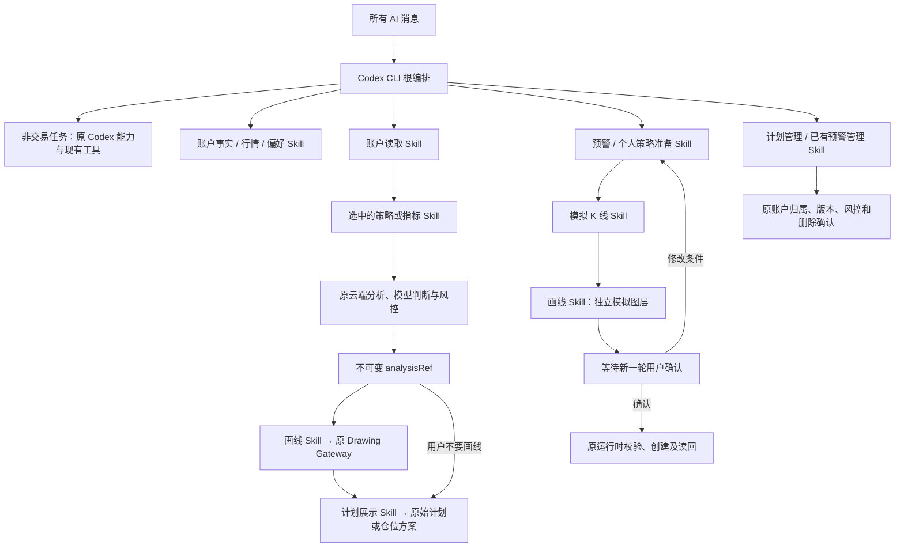

# Codex 独立交易 Skill 分批实施

任务 M1-401 / ADR-051。2026-10-20 用户授权实现、逐批 review / 测试、最后整体复核。

## 批次与验收

| 批次 | 状态 | 范围 |
|---|---|---|
| P1 | 专项通过 | 账户读取、分析结果引用、受控画线、计划展示分离；身份与重试测试 |
| P2 | 专项通过 | 17 个策略 / 指标 Skill、发现与升级、明确指定及组合路径 |
| P3 | 专项通过 | 预警、模拟、个人策略、计划管理；确认与恢复 |
| Final | 源码与隔离复核完成 | 类型、构建、真实 CLI/MCP、回归及界面；全仓旧失败和线上验收边界见下 |

固定边界：Codex 唯一根编排；云端确定性计算、原模型判断、账户风控及 Drawing Gateway 保留。
分析回执是画线和卡片的共同事实来源；展示卡片不等于创建订单。
模拟结果不进入真实行情；确认绑定当前草稿及模拟版本。
非交易消息、用户明确不画线、概念解释继续按其目标处理。

## 基线

工作目录与 Git 根目录均为规定的 Windows 仓库。
已有 M1-400 与其他会话未提交改动；本次不覆盖、不整体提交。
修改前相关文件备份及测试输出位于 `output/trading-skills-20261020/`。

## 验收记录

P1：类型检查通过，专项 61 项中 60 项首轮通过；1 项原生命周期测试硬编码只有两个任务入口，新增独立绘图入口后已更新并重跑该文件 3/3 通过。新增行为测试覆盖不可变回执、跨账号/会话拒绝、重启恢复、显式不画线、分屏、取消与仓位模式；真实 CLI/MCP 原兼容链通过。Review 补齐自动任务新能力兼容、固定卡片 ID、独立仓位展示。最终还需新能力真实 CLI 串联及综合回归。

修改前全库基线：4484 项，4419 通过、65 失败（baseline-tests.log）。后续逐项比较，不把旧失败算成本次通过。

P2：50/50 专项通过；全部 17 个策略/指标从官方目录生成独立 SKILL.md，稳定 ID 不变。连同账户、行情、画线、展示、偏好、兼容入口及第三批能力共 27 个 Skill，格式验证通过。托管内置 Skill 支持升级、备份并保留用户修改。真实打包 CLI 0.163.0 能发现 Skill 并经实际 MCP 完成账户→分析→画线→卡片；模型和云端响应采用本地 fixture，不是线上语义准确率测评。

P3：初轮独立链路 30/30、原预警/个人策略/计划预警 95/95；最终能力专项 35/35，最终复核组合 133/133（包含重复验证，不累加为去重总数）。草稿只返回不透明 draftRef；模拟、画图和确认各自独立。宿主绑定账号、可见会话、当前草稿和展示后的实际用户回复；修改、失败与取消令旧引用失效。未展示模拟不能确认，重复确认返回已有回执。过期/运行时已清理的草稿必须清理待办并重新准备，不用本地引用绕过运行时验证。计划管理沿用 ADR-046 的加入后自动启用提醒，先保存再激活，删除保留应用内确认。

最终 review 修复：

- 显式 @策略/指标不得被模型参数替换；显式不画线优先，仓位分析未指定策略时默认 price-action。
- 分析失败不生成有效 analysisRef；不可变原始回执供画线和卡片共用，保留后台会话归属、取消及既有 Drawing Gateway。
- 独立草稿不能经旧兼容工具绕过确认。新条件准备失败后仍可取消并重新开始；恢复中的同一轮不能伪造新用户确认。
- 仓位方案使用独立正文卡片，不暴露开仓“添加计划”操作。修复英文正文误用价格网格后，隔离 Electron 的 3 语言×2 主题共 6 组布局通过，截图已抽查。
- 补齐新增英文文本，限制大体积结果的内存缓存，保留持久结果用于重试和恢复。

最终全仓运行 `npm --prefix youle_desktop test`：4506 项，4440 通过、66 失败。65 项在修改前已失败；唯一新增失败名称为未修改模块的并发代理恢复测试，单独纳入最终复核后通过。两个因新增独立画线入口而失效的旧源码断言已更新；对应实际行为测试和原测试均通过。不能据此声称全仓全绿。类型检查、开发版 Vite 构建通过；包体大小提示仍在。

证据：`output/trading-skills-20261020/` 中 baseline-tests.log、p1-tests.log、p2-tests.log、p3-existing.log、final-capabilities.log、final-review-tests.log、final-full-tests.log、final-typecheck.log、final-build.log、position-visual-report.json 与截图。

未制作安装包或发布；未操作生产订单、预警、计划和账户偏好。未完成登录真实账户后的线上模型自然选择与云端实盘数据全链路验收；当前结论限于源码、隔离业务行为、实际 CLI/MCP 协议和界面验证。原有全仓失败应在对应工作流中单独消除后再满足完整发布门槛。

## 后续验收：M1-403 全仓既有失败清理

2026-10-20，用户另行授权处理上述既有失败。本轮已修复测试发现范围、缺失翻译、过时 fixture／断言及焦点对比度，保留生产风控和原业务契约。当前全仓 4483/4483 通过，失败、取消、跳过均为 0；类型检查、开发构建、差异审查和双主题焦点实渲染验收通过。此前 65 项既有失败及代理并发偶发失败已在此次完整运行中清零。原始阶段日志继续保留；新证据见 `output/regression-cleanup-20261020/summary.json`。真实账户线上验收和发布边界仍按上文执行。

## 最终线路

策略/指标仍在云端执行；客户端 17 个 Skill 是编排调用入口，不承载替代算法。个人策略准备和预警模拟继续使用各自原有理解/确定性规则运行时，不能概括为所有 Skill 都在云端。

普通、选定外部模型、媒体、群聊、渠道、自动任务和工作流继续使用上一批 Codex 根入口。自动任务沿用云端分析与产物保存，交互草稿确认仍需桌面会话。概念解释、纯账户事实、补展示已有结果不强行重跑完整分析。
